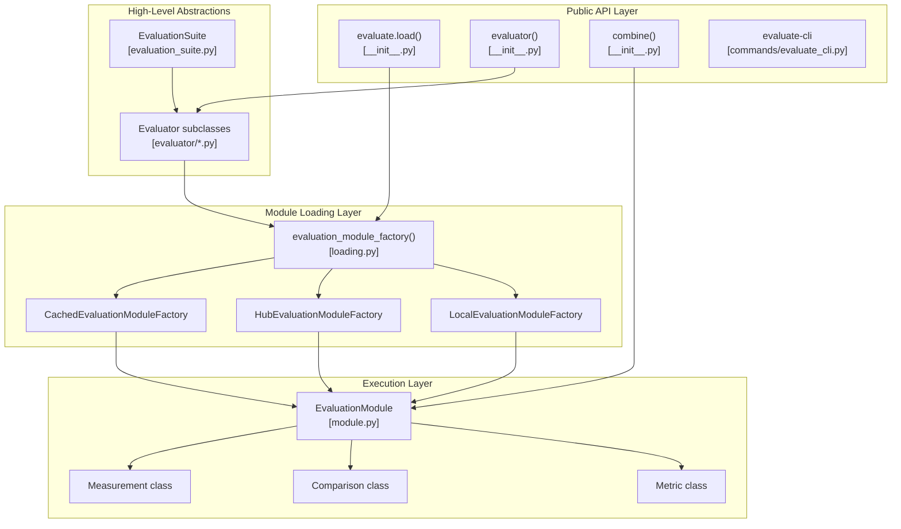
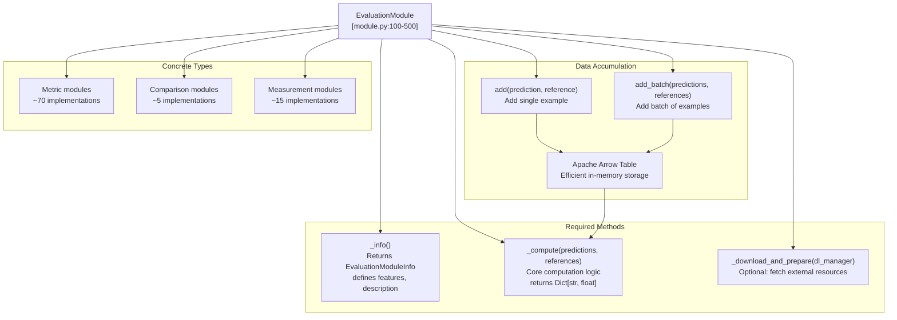
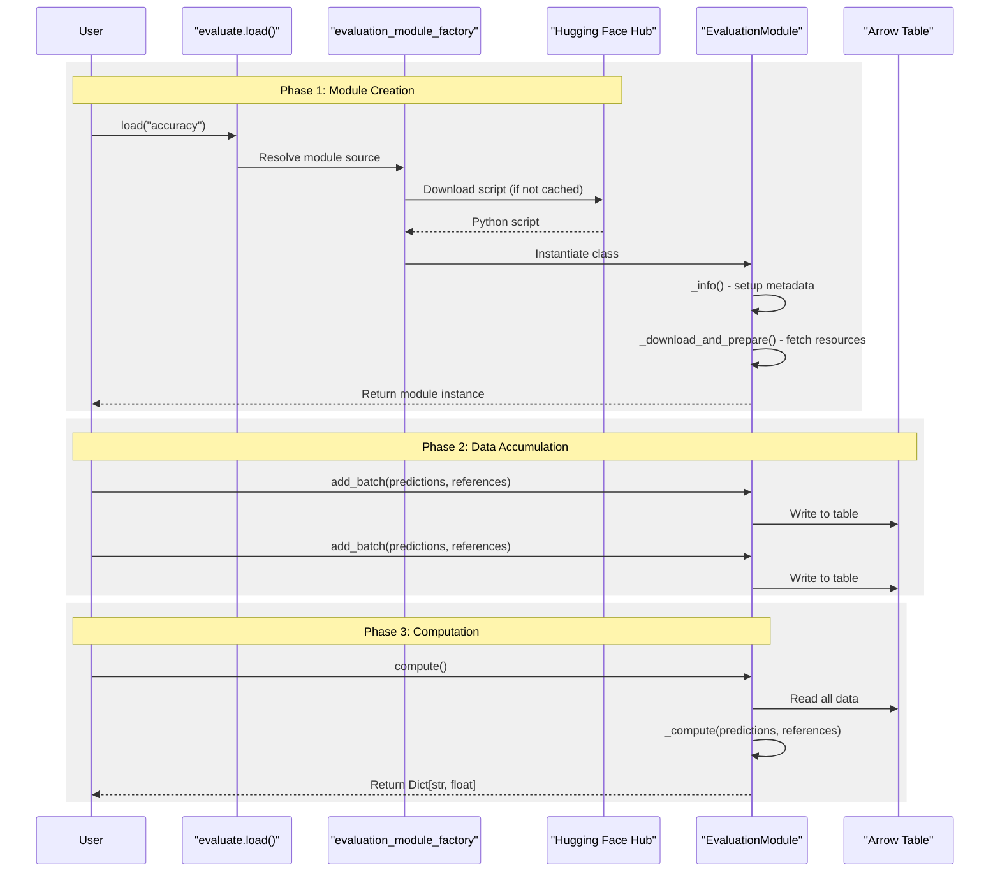
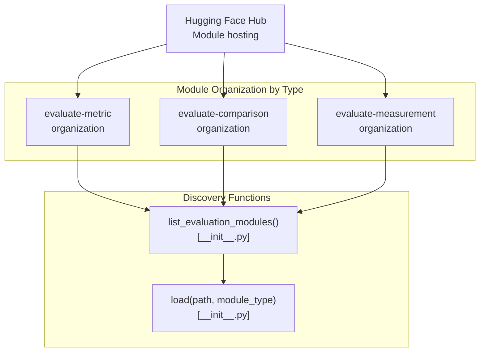

<!-- source: DeepWiki mcp.deepwiki.com · repo huggingface/evaluate · page 1 Overview · fetched 2026-10-26 -->

# Overview

<details>
<summary>Relevant source files</summary>

The following files were used as context for generating this wiki page:

- [README.md](README.md)
- [docs/source/a_quick_tour.mdx](docs/source/a_quick_tour.mdx)
- [docs/source/choosing_a_metric.mdx](docs/source/choosing_a_metric.mdx)
- [docs/source/considerations.mdx](docs/source/considerations.mdx)
- [docs/source/creating_and_sharing.mdx](docs/source/creating_and_sharing.mdx)
- [docs/source/index.mdx](docs/source/index.mdx)
- [docs/source/transformers_integrations.mdx](docs/source/transformers_integrations.mdx)
- [docs/source/types_of_evaluations.mdx](docs/source/types_of_evaluations.mdx)
- [setup.py](setup.py)
- [src/evaluate/evaluator/audio_classification.py](src/evaluate/evaluator/audio_classification.py)
- [src/evaluate/utils/logging.py](src/evaluate/utils/logging.py)

</details>


The `evaluate` library is a Python package that provides standardized access to evaluation metrics, statistical comparisons, and dataset measurements for machine learning models. It serves as a unified interface for computing evaluation scores across diverse ML tasks, with built-in support for distributed computation, caching, and community-driven module sharing via the Hugging Face Hub.

**Scope**: This page provides a high-level introduction to the library's architecture, main components, and usage patterns. For detailed information on specific subsystems, see:
- Installation and configuration: [Installation and Setup](#1.2)
- Loading system internals: [Module Loading System](#3.1)
- High-level automation: [Evaluator System](#4)
- Creating custom modules: [Creating Custom Modules](#10.1)

## Purpose and Design Philosophy

The evaluate library addresses three core evaluation needs:

1. **Metrics**: Measure model performance against ground truth labels (e.g., accuracy, BLEU, F1)
2. **Comparisons**: Statistically compare predictions from multiple models (e.g., McNemar test)
3. **Measurements**: Analyze dataset or prediction properties without requiring labels (e.g., toxicity, perplexity)

All evaluation modules are hosted on the Hugging Face Hub as Spaces, enabling version control, documentation, and interactive widgets for each module.

**Sources**: [setup.py:2-3](), [README.md:31-37](), [docs/source/a_quick_tour.mdx:3-11]()

## Library Architecture

The library follows a modular architecture with four primary layers:



**Sources**: [src/evaluate/__init__.py](), [docs/source/a_quick_tour.mdx:19-28]()

## Main Entry Points

The library exposes three primary entry points for users:

| Entry Point | Purpose | Location | Returns |
|------------|---------|----------|---------|
| `evaluate.load(path)` | Load any evaluation module by name or path | [__init__.py]() | `EvaluationModule` instance |
| `evaluator(task)` | Create task-specific automated evaluator | [__init__.py]() | Task-specific `Evaluator` subclass |
| `evaluate.combine(modules)` | Bundle multiple metrics into single compute | [__init__.py]() | `CombinedEvaluations` instance |
| `evaluate-cli` | Command-line tool for creating modules | [commands/evaluate_cli.py]() | N/A (creates Hub Space) |

### Load Function Workflow

```mermaid
graph LR
    user["User calls<br/>evaluate.load('accuracy')"]
    load["load() function<br/>[__init__.py]"]
    factory["evaluation_module_factory()<br/>[loading.py]"]
    determine["Determine source:<br/>Hub/Local/Cache"]
    download["Download script<br/>if needed"]
    import["Import module class<br/>via importlib"]
    instantiate["Instantiate<br/>EvaluationModule"]
    info["Call _info()<br/>setup metadata"]
    prepare["Call _download_and_prepare()<br/>fetch resources"]
    return_val["Return configured<br/>module instance"]
    
    user --> load
    load --> factory
    factory --> determine
    determine --> download
    download --> import
    import --> instantiate
    instantiate --> info
    info --> prepare
    prepare --> return_val
```



**Sources**: [src/evaluate/loading.py](), [docs/source/a_quick_tour.mdx:22-28]()

## Evaluation Module Types

The library categorizes evaluation modules into three types, each inheriting from `EvaluationModule`:

### Module Type Hierarchy

| Type | Count | Purpose | Example Modules | Base Class |
|------|-------|---------|-----------------|------------|
| **Metric** | ~70 | Measure model performance vs. ground truth | `accuracy`, `f1`, `rouge`, `bleu` | `EvaluationModule` |
| **Comparison** | ~5 | Statistical tests between model outputs | `mcnemar`, `exact_match` | `EvaluationModule` |
| **Measurement** | ~15 | Dataset/prediction analysis (no labels required) | `toxicity`, `perplexity`, `word_length` | `EvaluationModule` |

All three types implement the same interface pattern:



**Sources**: [src/evaluate/module.py](), [docs/source/types_of_evaluations.mdx:1-36](), [docs/source/a_quick_tour.mdx:6-11]()

## Module Lifecycle

Every evaluation module follows a three-phase lifecycle:



**Sources**: [src/evaluate/module.py](), [docs/source/a_quick_tour.mdx:119-176]()

## Integration with ML Ecosystem

The evaluate library integrates deeply with the Hugging Face ecosystem:

### Core Dependencies

| Dependency | Purpose | Usage in evaluate |
|-----------|---------|-------------------|
| `datasets>=2.0.0` | Data backend | Arrow table storage, Features validation |
| `huggingface-hub>=0.7.0` | Hub access | Module discovery, download scripts |
| `transformers` (optional) | Model inference | `Evaluator` system, `Trainer` integration |
| `scipy>=1.7.1` (optional) | Statistical functions | Bootstrap confidence intervals |
| `numpy>=1.17` | Numerical operations | Data manipulation, shuffling |

### Module Type Discovery



**Sources**: [setup.py:31-57](), [docs/source/a_quick_tour.mdx:36-58]()

## Typical Usage Patterns

The library supports three common evaluation workflows:

### Pattern 1: Simple Metric Computation

```python
# Load metric
metric = evaluate.load("accuracy")

# Compute directly
results = metric.compute(
    predictions=[0, 1, 1, 0],
    references=[0, 1, 0, 0]
)
# Returns: {'accuracy': 0.75}
```

### Pattern 2: Incremental Accumulation

```python
# Load metric
metric = evaluate.load("f1")

# Add data in batches (e.g., during model evaluation loop)
for batch in dataloader:
    predictions = model(batch)
    metric.add_batch(
        predictions=predictions,
        references=batch['labels']
    )

# Compute at the end
results = metric.compute()
```

### Pattern 3: Automated Evaluation

```python
# Create task-specific evaluator
task_evaluator = evaluator("text-classification")

# Evaluate model on dataset
results = task_evaluator.compute(
    model_or_pipeline="bert-base-uncased",
    data="imdb",
    metric="accuracy"
)
# Handles: loading model, inference, metric computation
```

**Sources**: [docs/source/a_quick_tour.mdx:119-176](), [docs/source/a_quick_tour.mdx:244-291]()

## Key Design Principles

The library implements several design decisions that differentiate it from other evaluation frameworks:

### Distributed Evaluation Support

The `EvaluationModule` class [src/evaluate/module.py]() uses Apache Arrow tables to enable distributed evaluation across multiple processes. Each process accumulates predictions locally, and the first process aggregates results from all processes during `compute()`, ensuring non-additive metrics (like F1) are computed correctly.

### Hub-Based Module Distribution

All evaluation modules live on the Hub as Spaces [docs/source/creating_and_sharing.mdx:19-27](), providing:
- Automatic version control via git
- Interactive widgets for testing metrics
- Community contributions without library updates
- Documentation cards for each module

### Type-Checked Inputs

The `features` attribute in `EvaluationModuleInfo` [src/evaluate/module.py]() defines expected input types using `datasets.Features`, enabling automatic validation of predictions and references before computation.

**Sources**: [src/evaluate/module.py](), [docs/source/a_quick_tour.mdx:168-176](), [docs/source/creating_and_sharing.mdx:1-28]()

## File Organization

The library's main components are organized as follows:

```
src/evaluate/
├── __init__.py              # Public API: load(), evaluator(), combine()
├── module.py                # EvaluationModule base class
├── loading.py               # evaluation_module_factory, Factory classes
├── evaluator/               # High-level Evaluator implementations
│   ├── base.py             # Evaluator base class
│   ├── text_classification.py
│   ├── question_answering.py
│   └── ...                 # 10+ task-specific evaluators
├── evaluation_suite.py      # EvaluationSuite for multi-task benchmarking
├── config.py               # Task definitions and configurations
└── commands/
    └── evaluate_cli.py     # CLI tool for module creation
```

**Sources**: [setup.py:138-140](), [src/evaluate/]()

---

For more detailed information on specific subsystems, refer to:
- Module loading mechanics: [Module Loading System](#3.1)
- Creating custom evaluation modules: [Creating Custom Modules](#10.1)
- Using the Evaluator system: [Evaluator System](#4)
- Integration with transformers: [Integration with ML Frameworks](#8)

---

