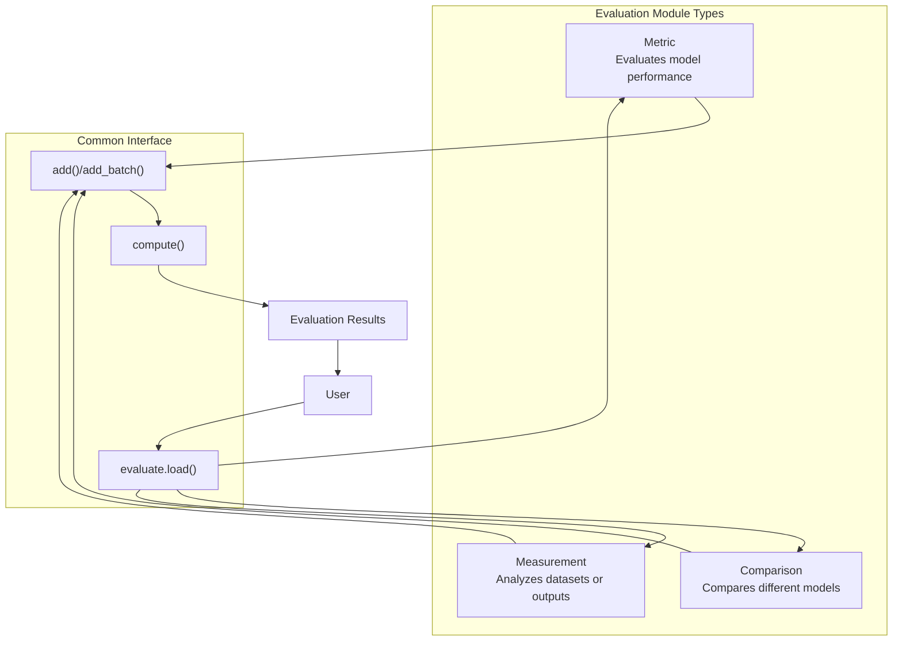
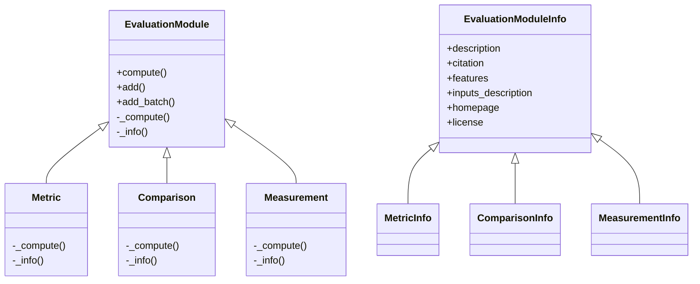
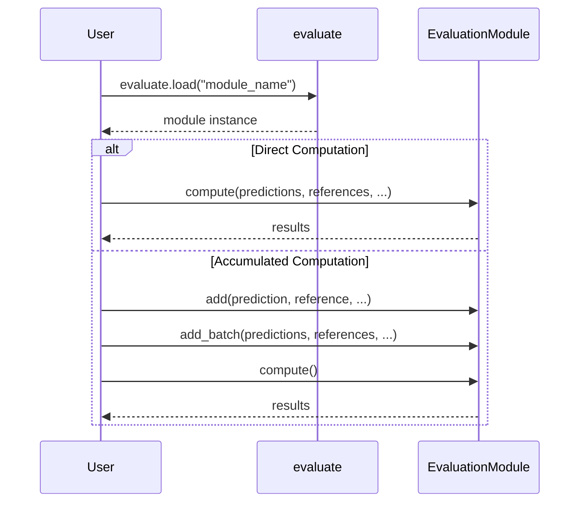
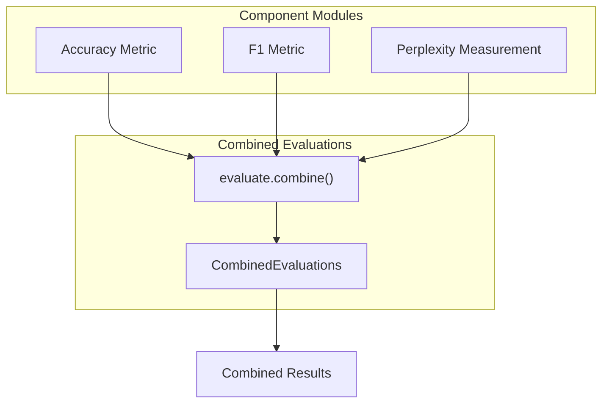
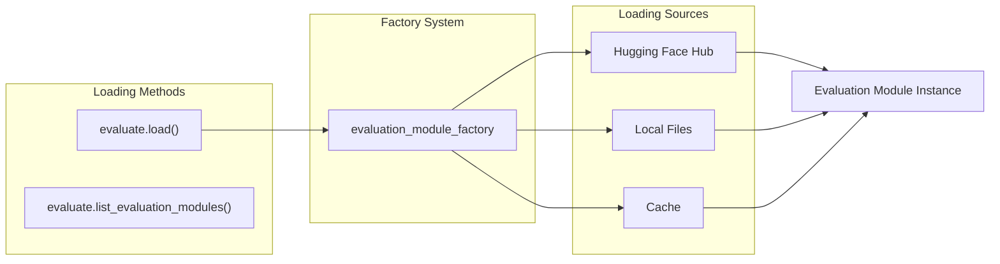

<!-- source: DeepWiki mcp.deepwiki.com · repo huggingface/evaluate · page 1.1 Key Concepts · fetched 2026-10-26 -->

# Key Concepts

<details>
<summary>Relevant source files</summary>

The following files were used as context for generating this wiki page:

- [README.md](README.md)
- [docs/source/a_quick_tour.mdx](docs/source/a_quick_tour.mdx)
- [docs/source/choosing_a_metric.mdx](docs/source/choosing_a_metric.mdx)
- [docs/source/considerations.mdx](docs/source/considerations.mdx)
- [docs/source/creating_and_sharing.mdx](docs/source/creating_and_sharing.mdx)
- [docs/source/index.mdx](docs/source/index.mdx)
- [docs/source/transformers_integrations.mdx](docs/source/transformers_integrations.mdx)
- [docs/source/types_of_evaluations.mdx](docs/source/types_of_evaluations.mdx)
- [src/evaluate/evaluator/audio_classification.py](src/evaluate/evaluator/audio_classification.py)
- [src/evaluate/utils/logging.py](src/evaluate/utils/logging.py)

</details>


This page introduces the fundamental concepts of the Hugging Face `evaluate` library. You'll learn about the different types of evaluation modules (metrics, comparisons, and measurements), how they're structured, and how to use them. For information about the overall architecture, see [Core Architecture](#2).

## Evaluation Modules

Evaluation modules are the core components of the `evaluate` library. They provide standardized ways to evaluate machine learning models and datasets. All evaluation modules share a common interface and structure but serve different evaluation purposes.



Sources: [README.md:31-37](), [docs/source/types_of_evaluations.mdx:1-36]()

### Evaluation Module Structure

All evaluation modules inherit from the same base class, `EvaluationModule`, which defines common methods and behavior. The class hierarchy ensures consistency across different evaluation types.



Sources: [docs/source/package_reference/main_classes.mdx:1-25]()

## Loading and Using Evaluation Modules

All evaluation modules in the `evaluate` library follow a consistent usage pattern:

1. **Loading**: First, load the module using `evaluate.load()`
2. **Computing**: Then use `compute()` to calculate results directly, or use `add()`/`add_batch()` followed by `compute()` for accumulated calculations



Sources: [README.md:64-69](), [docs/source/package_reference/loading_methods.mdx:1-12]()

## Metrics

Metrics are evaluation modules that measure the performance of a model on a given dataset. They typically compare model predictions against ground truth references to calculate performance scores.

| Metric Type | Description | Examples |
|-------------|-------------|----------|
| Generic | Applicable to many tasks | accuracy, precision, recall, F1 |
| Task-specific | Designed for particular ML tasks | BLEU (translation), ROUGE (summarization) |
| Dataset-specific | Tailored for specific benchmarks | GLUE, SQuAD |

### Example: Using the Accuracy Metric

```python
# Load the accuracy metric
accuracy = evaluate.load("accuracy")

# Compute accuracy directly
results = accuracy.compute(predictions=[0, 1, 1, 0], references=[0, 1, 0, 1])
# {'accuracy': 0.75}

# Or use add_batch and compute
accuracy.add_batch(predictions=[0, 1], references=[0, 1])
accuracy.add_batch(predictions=[1, 0], references=[0, 1])
results = accuracy.compute()
# {'accuracy': 0.75}
```

Sources: [README.md:35](), [docs/source/types_of_evaluations.mdx:8-15](), [docs/source/choosing_a_metric.mdx:8-63]()

## Comparisons

Comparisons are evaluation modules that analyze differences between two or more models. Rather than measuring absolute performance, they quantify the relative difference or statistical significance of performance variations.

### Example: McNemar Test

The McNemar test is a statistical test that compares the predictions of two models to determine if there's a significant difference between them:

```python
# Load the McNemar comparison
mcnemar = evaluate.load("mcnemar")

# Compare two model predictions on the same test set
results = mcnemar.compute(
    predictions_a=[0, 0, 1, 1], 
    predictions_b=[0, 1, 1, 0],
    references=[0, 0, 1, 1]
)
# Returns p-value indicating significance of differences
```

Sources: [docs/source/types_of_evaluations.mdx:17-23](), [README.md:36]()

## Measurements

Measurements are evaluation modules that provide insights about datasets or model outputs without necessarily comparing against a ground truth. They can analyze properties like text length, toxicity, or perplexity.

### Common Measurement Types

| Measurement | Purpose | Example Use |
|-------------|---------|-------------|
| Text Analysis | Analyze basic text properties | word_length, duplicate_detection |
| Content Quality | Assess generated text quality | toxicity, perplexity |
| Dataset Analysis | Examine dataset characteristics | class_distribution, data_statistics |

Sources: [docs/source/types_of_evaluations.mdx:25-33](), [README.md:36]()

## Combined Evaluations

The `evaluate` library allows you to combine multiple evaluation modules to run them together. This is useful when you want to evaluate a model using several metrics at once.



### Example: Using Combined Evaluations

```python
from evaluate import load, combine

# Load individual metrics
accuracy = load("accuracy")
f1 = load("f1")

# Combine them
combined = combine([accuracy, f1])

# Compute all metrics at once
results = combined.compute(predictions=[0, 1, 1, 0], references=[0, 1, 0, 1])
# {'accuracy': 0.75, 'f1': 0.67}
```

Sources: [docs/source/package_reference/main_classes.mdx:27-33]()

## Loading Mechanism

The `evaluate` library supports loading evaluation modules from different sources, including the Hugging Face Hub and local files. The loading system automatically handles caching to improve performance.



Sources: [README.md:66](), [docs/source/package_reference/loading_methods.mdx:1-12]()

## Key Benefits of the Evaluate Library

- **Standardized Interface**: Consistent API across different types of evaluations
- **Flexibility**: Support for various input formats and ML frameworks
- **Extensibility**: Easy to create and share custom evaluation modules
- **Documentation**: Detailed metric cards explaining each evaluation module's purpose, limitations, and usage
- **Caching**: Efficient storage and retrieval of evaluation data
- **Hub Integration**: Access to community-contributed evaluation modules

Sources: [README.md:31-49]()

---

