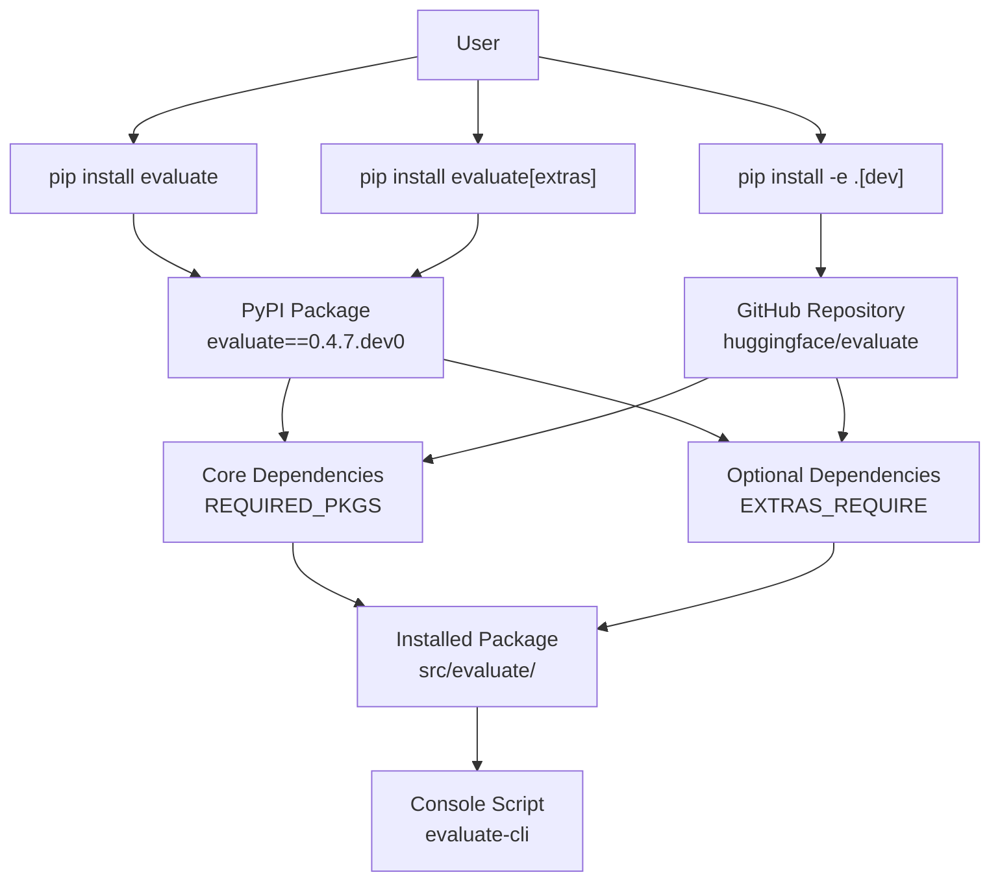
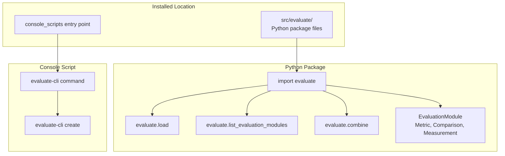

<!-- source: DeepWiki mcp.deepwiki.com · repo huggingface/evaluate · page 1.2 Installation and Setup · fetched 2026-10-26 -->

# Installation and Setup

<details>
<summary>Relevant source files</summary>

The following files were used as context for generating this wiki page:

- [README.md](README.md)
- [docs/source/creating_and_sharing.mdx](docs/source/creating_and_sharing.mdx)
- [docs/source/transformers_integrations.mdx](docs/source/transformers_integrations.mdx)
- [docs/source/types_of_evaluations.mdx](docs/source/types_of_evaluations.mdx)
- [setup.py](setup.py)

</details>


## Purpose and Scope

This page documents the installation process, dependency requirements, and initial configuration for the evaluate library. It covers standard installation via pip, development installation from source, Python version requirements, and the various optional dependency groups available for extended functionality.

For information about creating custom evaluation modules, see [Creating Custom Metrics](#9.1). For details on the Hub integration and CI/CD pipeline, see [Hub Integration](#9.2).

---

## Python Version Requirements

The evaluate library requires **Python 3.8.0 or higher**. This requirement is specified in [setup.py:143]() and enforced during installation.

**Supported Python versions:**
- Python 3.8
- Python 3.9  
- Python 3.10

Sources: [setup.py:143-155]()

---

## Installation Methods

### Standard Installation via pip

The recommended installation method is via pip, which installs the library with core dependencies from PyPI:

```bash
pip install evaluate
```

This command installs the `evaluate` package and all required dependencies listed in `REQUIRED_PKGS`. The package should be installed in a virtual environment (venv or conda) to avoid dependency conflicts.

**Virtual environment setup:**
```bash
# Using venv
python -m venv evaluate-env
source evaluate-env/bin/activate  # On Windows: evaluate-env\Scripts\activate

# Using conda
conda create -n evaluate-env python=3.9
conda activate evaluate-env

# Install evaluate
pip install evaluate
```

### Installation with Optional Extras

The library provides several optional dependency groups that can be installed based on your use case:

```bash
# For creating new evaluation modules
pip install evaluate[template]

# For using task-specific evaluators
pip install evaluate[evaluator]

# For TensorFlow support
pip install evaluate[tensorflow]

# For PyTorch support
pip install evaluate[torch]

# For development (includes testing and quality tools)
pip install evaluate[dev]

# Multiple extras can be combined
pip install evaluate[template,evaluator,torch]
```

### Development Installation from Source

For contributing to the library or working with the latest development version:

```bash
# Clone the repository
git clone https://github.com/huggingface/evaluate.git
cd evaluate

# Install in editable mode with development dependencies
pip install -e ".[dev]"
```

The `-e` flag installs the package in editable mode, allowing code changes to take effect without reinstallation.

Sources: [README.md:52-60](), [README.md:72-79](), [setup.py:127-159]()

---

## Dependency Architecture

### Installation Flow Diagram



### Dependency Groups

```mermaid
graph TB
    subgraph "Core Installation"
        Core["evaluate package"]
        CoreDeps["Core Dependencies"]
        
        Core --> CoreDeps
    end
    
    subgraph "Core Dependencies - Always Installed"
        Datasets["datasets>=2.0.0<br/>Backend & Features"]
        Hub["huggingface-hub>=0.7.0<br/>Hub integration"]
        Numpy["numpy>=1.17<br/>Array operations"]
        Fsspec["fsspec[http]>=2021.05.0<br/>File system abstraction"]
        Multiprocess["multiprocess<br/>Distributed evaluation"]
        Tqdm["tqdm>=4.62.1<br/>Progress bars"]
        Dill["dill<br/>Smart caching"]
        Pandas["pandas<br/>Arrow performance"]
        Requests["requests>=2.19.0<br/>HTTP downloads"]
        Xxhash["xxhash<br/>Fast hashing"]
        Packaging["packaging<br/>Version comparison"]
    end
    
    subgraph "Optional Extras"
        Template["template extra<br/>cookiecutter, gradio>=3.0.0"]
        Evaluator["evaluator extra<br/>transformers, scipy>=1.7.1"]
        TF["tensorflow extra<br/>tensorflow>=2.2.0"]
        Torch["torch extra<br/>torch"]
        Dev["dev extra<br/>tests + quality tools"]
    end
    
    CoreDeps --> Datasets
    CoreDeps --> Hub
    CoreDeps --> Numpy
    CoreDeps --> Fsspec
    CoreDeps --> Multiprocess
    CoreDeps --> Tqdm
    CoreDeps --> Dill
    CoreDeps --> Pandas
    CoreDeps --> Requests
    CoreDeps --> Xxhash
    CoreDeps --> Packaging
    
    Core -.-> Template
    Core -.-> Evaluator
    Core -.-> TF
    Core -.-> Torch
    Core -.-> Dev
```



Sources: [setup.py:31-125]()

---

## Core Dependencies

The following packages are **always installed** with evaluate and enable core functionality:

| Package | Version Constraint | Purpose |
|---------|-------------------|---------|
| `datasets` | `>=2.0.0` | Backend for data handling and Apache Arrow integration |
| `numpy` | `>=1.17` | Array operations and random number generation |
| `dill` | (any) | Smart caching for dataset processing |
| `pandas` | (any) | Performance gains with Apache Arrow |
| `requests` | `>=2.19.0` | Downloading datasets over HTTPS |
| `tqdm` | `>=4.62.1` | Progress bars for downloads and processing |
| `xxhash` | (any) | Fast hashing for cache keys |
| `multiprocess` | (any) | Better multiprocessing support |
| `fsspec[http]` | `>=2021.05.0` | Abstract file system for local/remote storage |
| `huggingface-hub` | `>=0.7.0` | Hub API for module discovery and download |
| `packaging` | (any) | Version comparison utilities |
| `importlib_metadata` | (any) | Metadata access for Python <3.8 |

**Key dependency relationships:**

- **datasets**: Provides the backend architecture that evaluate builds upon, including Apache Arrow tables for efficient caching and the `Features` system for data validation. See [Core Architecture](#2) for details on how evaluate extends datasets functionality.

- **huggingface-hub**: Enables the module loading system to discover and download evaluation modules from the Hub. See [Module Loading System](#2.1) for the factory pattern implementation.

- **multiprocess + fsspec + dill**: Together enable distributed evaluation across multiple processes with shared caching. See [Caching and Distributed Computation](#2.3) for implementation details.

Sources: [setup.py:31-57]()

---

## Optional Dependency Groups

Optional extras extend evaluate's functionality for specific use cases:

### Template Extra (`pip install evaluate[template]`)

Required for creating new evaluation modules using the CLI scaffolding tool:

| Package | Version Constraint | Purpose |
|---------|-------------------|---------|
| `cookiecutter` | (any) | Template generation for new modules |
| `gradio` | `>=3.0.0` | Interactive widgets for Hub Spaces |

**When to use:** Install this extra if you plan to create custom metrics using `evaluate-cli create`. See [Command-line Interface](#8) for usage details.

### Evaluator Extra (`pip install evaluate[evaluator]`)

Required for using high-level task-specific evaluators:

| Package | Version Constraint | Purpose |
|---------|-------------------|---------|
| `transformers` | (any) | Pipeline integration for model inference |
| `scipy` | `>=1.7.1` | Bootstrap computations for confidence intervals |

**When to use:** Install this extra to use the `Evaluator` classes that automate the full evaluation pipeline. See [Evaluator System](#3) for implementation details.

### Framework Extras

Support for specific ML frameworks:

| Extra | Packages | Purpose |
|-------|----------|---------|
| `tensorflow` | `tensorflow>=2.2.0,!=2.6.0,!=2.6.1` | TensorFlow model support |
| `tensorflow_gpu` | `tensorflow-gpu>=2.2.0,!=2.6.0,!=2.6.1` | TensorFlow with GPU support |
| `torch` | `torch` | PyTorch model support |

**Note:** These are **optional** because the core library is framework-agnostic. Only install the frameworks you need for your specific evaluation tasks. See [Integration with ML Frameworks](#7) for usage patterns.

### Development Extras

| Extra | Contents | Purpose |
|-------|----------|---------|
| `dev` | `tests` + `quality` | Full development environment |
| `tests` | See test dependencies table below | Running test suite |
| `quality` | `black~=22.0`, `flake8>=3.8.3`, `isort>=5.0.0`, `pyyaml>=5.3.1` | Code formatting and linting |
| `docs` | `s3fs` | Building documentation |

### Test Dependencies

The test suite requires numerous dependencies for testing specific metrics:

| Category | Packages |
|----------|----------|
| Test frameworks | `pytest`, `pytest-datadir`, `pytest-xdist`, `absl-py` |
| ML frameworks | `tensorflow>=2.3,<=2.10`, `torch`, `accelerate` |
| Metric-specific | `bert_score>=0.3.6`, `rouge_score>=0.1.2`, `sacrebleu`, `sacremoses`, `seqeval`, `scikit-learn`, `jiwer`, `sentencepiece`, `mauve-text`, `trectools` |
| Text processing | `nltk`, `charcut>=1.1.1`, `cer>=1.2.0`, `unidecode>=1.3.4` |
| Utilities | `scipy>=1.10.0`, `toml>=0.10.1`, `requests_file>=1.5.1`, `tldextract>=3.1.0`, `texttable>=1.6.3`, `Werkzeug>=1.0.1`, `six~=1.15.0` |

**Note:** Version constraints like `tensorflow>=2.3,!=2.6.0,!=2.6.1, <=2.10` exclude specific buggy versions while maintaining compatibility.

Sources: [setup.py:59-125]()

---

## Package Structure and Entry Points

After installation, the evaluate package is available with the following structure:



**Console script entry point:** The installation creates a `evaluate-cli` command available in your shell, defined in [setup.py:140]():

```python
entry_points={"console_scripts": ["evaluate-cli=evaluate.commands.evaluate_cli:main"]}
```

**Package directory:** The source code is installed from the `src/` directory, specified in [setup.py:138]():

```python
package_dir={"": "src"}
```

Sources: [setup.py:138-140]()

---

## Environment Configuration

### Environment Variables

The evaluate library respects the following environment variables:

| Variable | Values | Default | Purpose |
|----------|--------|---------|---------|
| `EVALUATE_VERBOSITY` | `debug`, `info`, `warning`, `error`, `critical` | `warning` | Controls logging verbosity globally |
| `HF_HOME` | Path | `~/.cache/huggingface` | Base directory for Hub cache |
| `HF_DATASETS_CACHE` | Path | `$HF_HOME/datasets` | Cache directory for datasets |

**Setting verbosity:**

```bash
# Via environment variable
export EVALUATE_VERBOSITY=info
python my_script.py

# Or inline
EVALUATE_VERBOSITY=error python my_script.py
```

**Programmatic configuration:**

```python
import evaluate

# Set verbosity level
evaluate.logging.set_verbosity_info()
evaluate.logging.set_verbosity_warning()
evaluate.logging.set_verbosity_debug()

# Get current verbosity
level = evaluate.logging.get_verbosity()

# Control progress bars
evaluate.logging.disable_progress_bar()
evaluate.logging.enable_progress_bar()
```

### Cache Directory Structure

After first use, evaluate creates a cache directory structure:

```
~/.cache/huggingface/
└── modules/
    ├── evaluate_modules/
    │   ├── metrics/
    │   │   └── accuracy/
    │   │       └── <hash>/
    │   │           ├── accuracy.py
    │   │           └── __init__.py
    │   ├── comparisons/
    │   └── measurements/
    └── datasets_modules/
```

The hash-based directory structure enables version coexistence for the same module. See [Module Loading System](#2.1) for details on the caching mechanism.

Sources: [docs/source/package_reference/logging_methods.mdx:1-90](), [README.md:46-49]()

---

## Verification of Installation

### Basic Import Test

Verify the installation by importing the library and checking the version:

```python
import evaluate

# Check version
print(evaluate.__version__)

# List available evaluation modules
modules = evaluate.list_evaluation_modules()
print(f"Found {len(modules)} modules")

# Load a simple metric to verify functionality
accuracy = evaluate.load("accuracy")
results = accuracy.compute(predictions=[1, 0, 1], references=[1, 0, 0])
print(results)  # {'accuracy': 0.6666666666666666}
```

### Testing Core Functionality

```python
import evaluate

# Test module loading from Hub
metric = evaluate.load("accuracy")
print(f"Loaded metric: {metric.name}")

# Test basic computation
predictions = [0, 1, 2, 0, 1, 2]
references = [0, 1, 1, 0, 1, 1]
results = metric.compute(predictions=predictions, references=references)
print(f"Accuracy: {results['accuracy']:.3f}")

# Test incremental addition
metric = evaluate.load("accuracy")
metric.add_batch(predictions=[0, 1], references=[0, 1])
metric.add_batch(predictions=[2, 0], references=[1, 0])
results = metric.compute()
print(f"Incremental accuracy: {results['accuracy']:.3f}")
```

### Testing Optional Functionality

If you installed optional extras, verify they work:

```python
# Test evaluator extra
try:
    from evaluate import evaluator
    task_evaluator = evaluator("text-classification")
    print("✓ Evaluator functionality available")
except ImportError as e:
    print(f"✗ Evaluator not available: {e}")

# Test template extra
try:
    import cookiecutter
    import gradio
    print("✓ Template creation tools available")
except ImportError as e:
    print(f"✗ Template tools not available: {e}")
```

### CLI Verification

Verify the command-line interface is installed:

```bash
# Check CLI is available
evaluate-cli --help

# List available commands
evaluate-cli create --help
```

Expected output shows the available commands and options for creating new evaluation modules.

Sources: [README.md:62-68](), [README.md:70-79]()

---

## Common Installation Issues

### Issue: Version Conflicts with TensorFlow

**Problem:** TensorFlow requires `numpy<2.0.0` but other packages may require newer versions.

**Solution:** Install with specific constraints:
```bash
pip install evaluate "numpy<2.0.0" "tensorflow>=2.3,<=2.10"
```

### Issue: Missing Optional Dependencies

**Problem:** `ImportError` when using evaluators or creating templates.

**Solution:** Install the appropriate extra:
```bash
pip install evaluate[evaluator]  # For evaluators
pip install evaluate[template]   # For module creation
```

### Issue: Hub Connection Errors

**Problem:** Cannot download modules from Hugging Face Hub.

**Solution:** Check network connectivity and Hub status. Configure proxy if needed:
```python
import os
os.environ['HTTP_PROXY'] = 'http://proxy.example.com:8080'
os.environ['HTTPS_PROXY'] = 'http://proxy.example.com:8080'
```

### Issue: Cache Permission Errors

**Problem:** Permission denied when writing to cache directory.

**Solution:** Set a custom cache directory:
```python
import os
os.environ['HF_HOME'] = '/path/to/writable/directory'
```

Sources: [setup.py:82-107]()

---

## Dependency Update Policy

The library follows semantic versioning and maintains backward compatibility within major versions. Dependency constraints are set to:

1. **Minimum required versions** for core functionality
2. **Exclusion of known buggy versions** (e.g., `!=2.6.0,!=2.6.1` for TensorFlow)
3. **Maximum versions** where breaking changes are known (e.g., `<=2.10` for TensorFlow)

**Version specification in setup.py:**
```python
version="0.4.7.dev0"  # Format: MAJOR.MINOR.PATCH.dev0
```

The `.dev0` suffix indicates development versions between releases. Release versions follow the pattern `x.y.z` without additional suffixes.

Sources: [setup.py:1-24](), [setup.py:129]()

---

## Next Steps

After installation:

1. **Explore available modules:** Use `evaluate.list_evaluation_modules()` to discover metrics, comparisons, and measurements
2. **Load and use metrics:** See [Key Concepts](#1.1) for understanding the three module types
3. **Automated evaluation:** See [Evaluator System](#3) for using high-level evaluation pipelines
4. **Create custom modules:** See [Creating Custom Metrics](#9.1) for implementing your own evaluation logic
5. **Integration patterns:** See [Integration with ML Frameworks](#7) for using evaluate with your training workflows

Sources: [README.md:31-49](), [README.md:62-80]()

---

