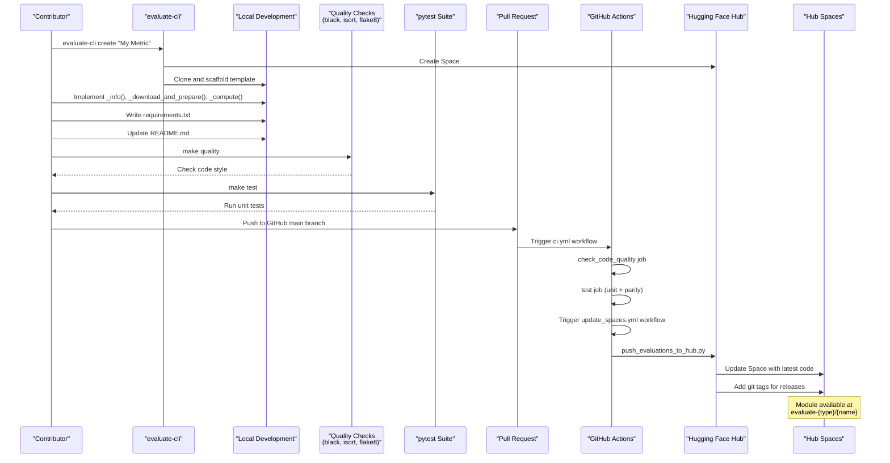
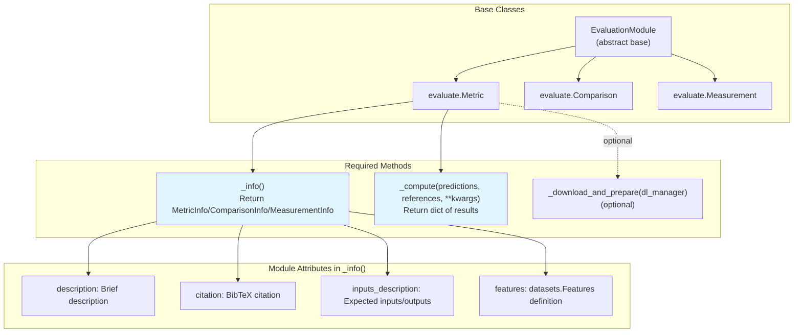
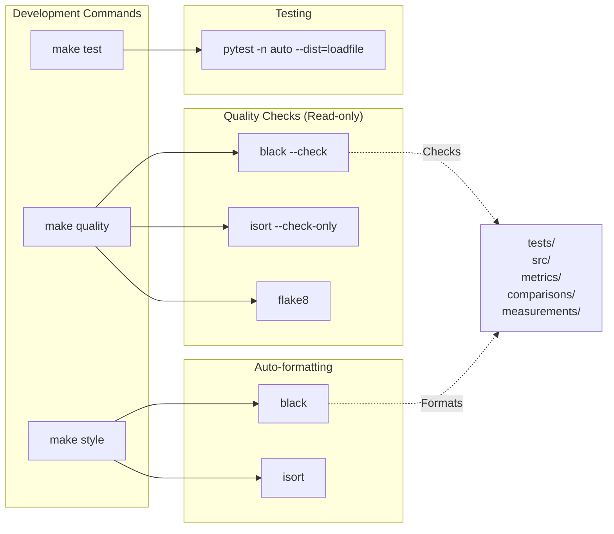
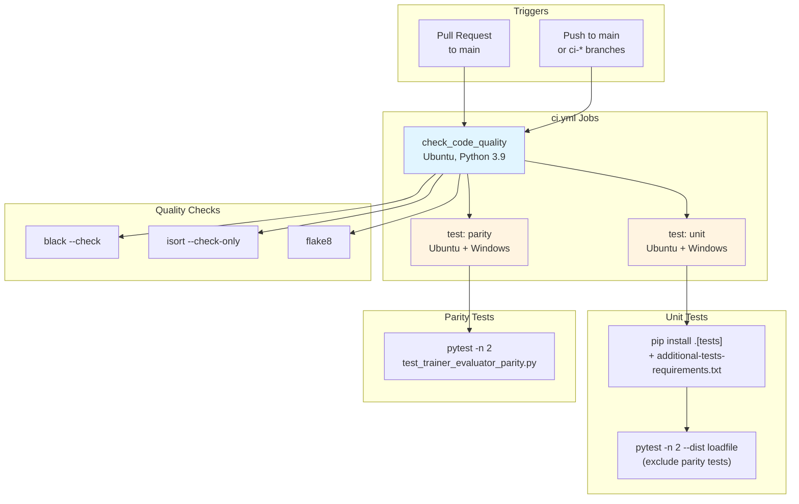
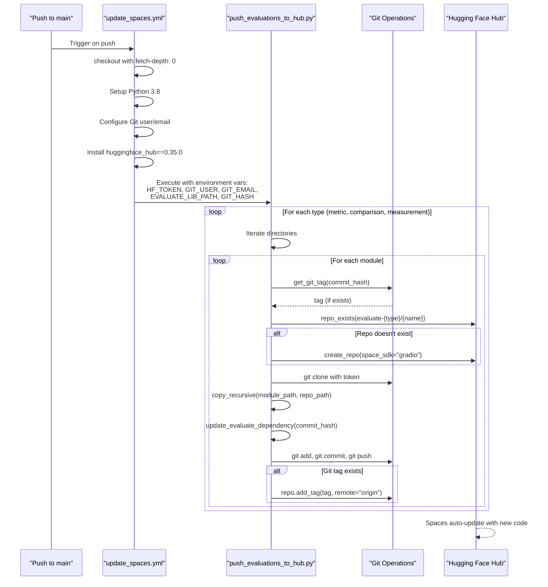
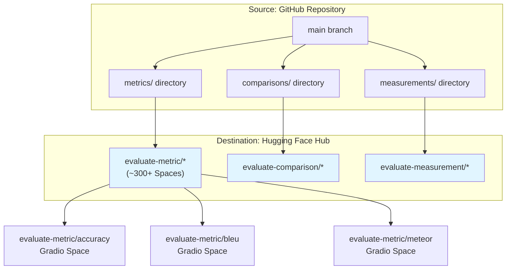

<!-- source: DeepWiki mcp.deepwiki.com · repo huggingface/evaluate · page 10 Contributing & Development · fetched 2026-10-26 -->

# Contributing & Development

<details>
<summary>Relevant source files</summary>

The following files were used as context for generating this wiki page:

- [README.md](README.md)
- [docs/source/a_quick_tour.mdx](docs/source/a_quick_tour.mdx)
- [docs/source/choosing_a_metric.mdx](docs/source/choosing_a_metric.mdx)
- [docs/source/considerations.mdx](docs/source/considerations.mdx)
- [docs/source/creating_and_sharing.mdx](docs/source/creating_and_sharing.mdx)
- [docs/source/index.mdx](docs/source/index.mdx)
- [docs/source/transformers_integrations.mdx](docs/source/transformers_integrations.mdx)
- [docs/source/types_of_evaluations.mdx](docs/source/types_of_evaluations.mdx)
- [src/evaluate/evaluator/audio_classification.py](src/evaluate/evaluator/audio_classification.py)
- [src/evaluate/utils/logging.py](src/evaluate/utils/logging.py)

</details>


This page provides an overview of the contribution workflow for the 🤗 Evaluate library, including how to create new evaluation modules, development setup, quality standards, and the automated deployment pipeline to the Hugging Face Hub.

For detailed implementation guidance on creating custom metrics and measurements, see [Creating Custom Metrics](#9.1). For information on how modules are shared and deployed to Spaces, see [Hub Integration](#9.2). For development tooling and testing infrastructure, see [Development Tooling](#9.3).

## Overview of Contribution Process

The 🤗 Evaluate library follows a community-driven development model where new metrics, comparisons, and measurements are contributed as individual modules that live on the Hugging Face Hub as Spaces. The contribution process involves local development, quality checks, and automated deployment.

### Contribution Workflow



**Sources:** [docs/source/creating_and_sharing.mdx:1-113](), [.github/workflows/ci.yml:1-66](), [.github/workflows/update_spaces.yml:1-41]()

## Module Structure and Creation

Evaluation modules consist of several key files that work together to provide functionality, documentation, and an interactive interface.

### Module File Structure

| File | Purpose | Required |
|------|---------|----------|
| `{module_name}.py` | Core module implementation with `_info()`, `_compute()`, and optionally `_download_and_prepare()` | Yes |
| `README.md` | Documentation including description, usage examples, limitations, and citations | Yes |
| `requirements.txt` | Python dependencies with pinned versions, includes placeholder for evaluate package | Yes |
| `app.py` | Gradio widget for interactive demonstration on Spaces | Yes |

### Creating a New Module

The `evaluate-cli` command provides scaffolding for new modules:

```bash
evaluate-cli create "My Metric" --module_type "metric"
```

This command performs the following actions:
1. Creates a new Space on the Hugging Face Hub at `evaluate-metric/my_metric`
2. Clones the Space locally to your machine
3. Populates it with a template structure including all required files
4. Provides terminal instructions for next steps

**Sources:** [docs/source/creating_and_sharing.mdx:17-25]()

### Module Implementation Requirements

All evaluation modules must inherit from the appropriate base class and implement specific methods:



**Sources:** [metrics/meteor/meteor.py:92-170](), [measurements/word_length/word_length.py:65-96](), [docs/source/creating_and_sharing.mdx:29-78]()

### Example: METEOR Metric Implementation Structure

The METEOR metric implementation demonstrates the standard structure:

- **`_info()` method** [metrics/meteor/meteor.py:93-117](): Returns `evaluate.MetricInfo` with description, citation, inputs description, and features defining the input format (supports both single reference and multiple references per prediction)

- **`_download_and_prepare()` method** [metrics/meteor/meteor.py:119-128](): Downloads required NLTK resources (`wordnet`, `punkt` or `punkt_tab` depending on NLTK version, and `omw-1.4`)

- **`_compute()` method** [metrics/meteor/meteor.py:130-170](): Implements the actual metric calculation, handling version-specific NLTK API differences and supporting both single and multiple references

**Sources:** [metrics/meteor/meteor.py:1-171]()

### Example: Word Length Measurement Structure

The word_length measurement shows a simpler structure:

- **`_info()` method** [measurements/word_length/word_length.py:68-82](): Returns `evaluate.MeasurementInfo` with `module_type="measurement"` and features expecting a list of strings

- **`_download_and_prepare()` method** [measurements/word_length/word_length.py:84-90](): Downloads NLTK punkt resources based on version

- **`_compute()` method** [measurements/word_length/word_length.py:92-96](): Takes a `data` parameter (not predictions/references) and returns average word length using a configurable tokenizer

**Sources:** [measurements/word_length/word_length.py:1-97]()

## Development Environment Setup

Contributors need to install development dependencies and configure their environment for quality checks and testing.

### Installation for Development

```bash
# Install with all development dependencies
pip install evaluate[template]

# Authenticate with Hugging Face Hub
huggingface-cli login
```

The `[template]` extra includes dependencies for creating new modules via the CLI.

**Sources:** [docs/source/creating_and_sharing.mdx:3-15]()

## Code Quality Standards

The library enforces consistent code style and quality through automated tools defined in the Makefile and setup.cfg.

### Quality Tools and Configuration

| Tool | Purpose | Configuration |
|------|---------|---------------|
| `black` | Code formatting with 119 character line length, Python 3.6 target | [Makefile:6](), [setup.cfg:8]() |
| `isort` | Import sorting with trailing commas, grid wrap mode | [Makefile:7](), [setup.cfg:4-11]() |
| `flake8` | Linting with specific ignores (E203, E501, W503) | [Makefile:8](), [setup.cfg:13-20]() |

### Makefile Targets



**Usage:**
- `make quality` - Check code meets standards without modifying files
- `make style` - Automatically format code to meet standards
- `make test` - Run the full test suite with parallel execution

**Sources:** [Makefile:1-19](), [setup.cfg:1-20]()

### Per-file Configuration

The flake8 configuration includes special handling for metrics files [setup.cfg:19-20]():
- `metrics/*:F401` - Ignores unused imports in metric modules (commonly needed for imports used only in `_compute`)

## Continuous Integration Pipeline

The library uses GitHub Actions for automated testing and deployment, with two primary workflows.

### CI Workflow Architecture



**Sources:** [.github/workflows/ci.yml:1-66]()

### Hub Deployment Workflow

The `update_spaces.yml` workflow automatically deploys modules to the Hugging Face Hub when changes are pushed to main:



**Key Functions in push_evaluations_to_hub.py:**

| Function | Purpose | Lines |
|----------|---------|-------|
| `get_git_tag()` | Checks if commit has a version tag matching `v*.*.*` pattern | [.github/hub/push_evaluations_to_hub.py:28-42]() |
| `copy_recursive()` | Recursively copies module files to Hub repo, overwriting existing | [.github/hub/push_evaluations_to_hub.py:45-53]() |
| `update_evaluate_dependency()` | Replaces `{COMMIT_PLACEHOLDER}` in requirements.txt with actual commit hash | [.github/hub/push_evaluations_to_hub.py:55-61]() |
| `push_module_to_hub()` | Orchestrates cloning, updating, committing, and pushing to Hub | [.github/hub/push_evaluations_to_hub.py:63-107]() |

**Sources:** [.github/workflows/update_spaces.yml:1-41](), [.github/hub/push_evaluations_to_hub.py:1-130]()

### Hub Organization Structure

Modules are deployed to separate Hub organizations based on type:



Each Space includes:
- The module's Python implementation
- `requirements.txt` with the evaluate dependency pointing to the specific commit hash
- `app.py` containing the Gradio widget for interactive demonstration
- `README.md` with full documentation
- Git tags matching library version tags (e.g., `v0.4.0`)

**Sources:** [.github/hub/push_evaluations_to_hub.py:110-129]()

## Testing Infrastructure

The testing infrastructure provides fixtures and configuration for evaluation module testing.

### Test Configuration

The `conftest.py` file sets up test-specific cache directories and HTTP headers [tests/conftest.py:18-58]():

| Configuration | Purpose |
|---------------|---------|
| `HF_EVALUATE_CACHE` | Test-specific cache for downloaded modules |
| `HF_METRICS_CACHE` | Test-specific cache for metrics |
| `HF_MODULES_CACHE` | Test-specific cache for dynamic imports |
| `CI_HEADERS` | Custom headers for Hub requests during CI |
| `HF_UPDATE_DOWNLOAD_COUNTS` | Disabled to exclude tests from download statistics |

### Test Dataset Fixtures

The test suite provides numerous fixtures for different data formats, including Arrow, CSV, JSON, Parquet, and text files [tests/conftest.py:66-482](). These fixtures enable testing of module loading and computation across various input formats.

**Sources:** [tests/conftest.py:1-483]()

## Requirements Management

Each evaluation module includes a `requirements.txt` file specifying its dependencies.

### Dependency Template

```
evaluate @ git+https://github.com/huggingface/evaluate@{COMMIT_PLACEHOLDER}
nltk>=3.6
# Additional dependencies specific to the module
```

The `{COMMIT_PLACEHOLDER}` is automatically replaced with the actual commit hash during deployment by `update_evaluate_dependency()` [.github/hub/push_evaluations_to_hub.py:55-61](). This ensures that each Space uses the correct version of the evaluate library corresponding to when it was deployed.

**Sources:** [.github/hub/push_evaluations_to_hub.py:55-61](), [docs/source/creating_and_sharing.mdx:84-87]()

## Contributing Guidelines Summary

To contribute a new evaluation module:

1. **Setup**: Install `evaluate[template]` and authenticate with `huggingface-cli login`
2. **Create**: Use `evaluate-cli create` to scaffold the module structure
3. **Implement**: Write `_info()`, `_compute()`, and optionally `_download_and_prepare()`
4. **Document**: Update README.md with description, usage, limitations, and citations
5. **Test**: Run `make quality` and `make test` locally
6. **Submit**: Push to GitHub, where CI will validate and automatically deploy to Hub
7. **Verify**: Check that your module appears on the Hub and the Gradio widget works

The automated pipeline handles Space creation, dependency resolution, and deployment, making contributions straightforward and ensuring consistency across all modules.

**Sources:** [docs/source/creating_and_sharing.mdx:1-113]()

---

