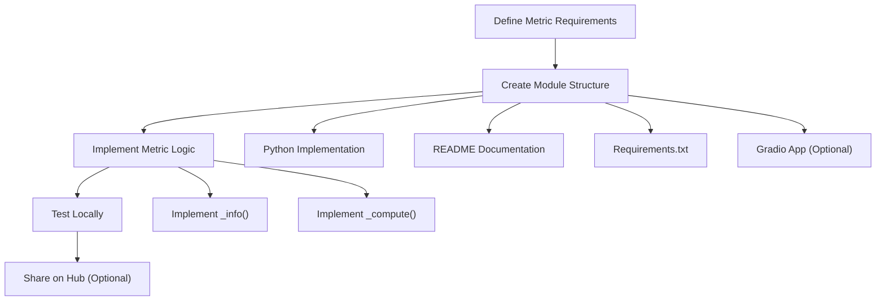
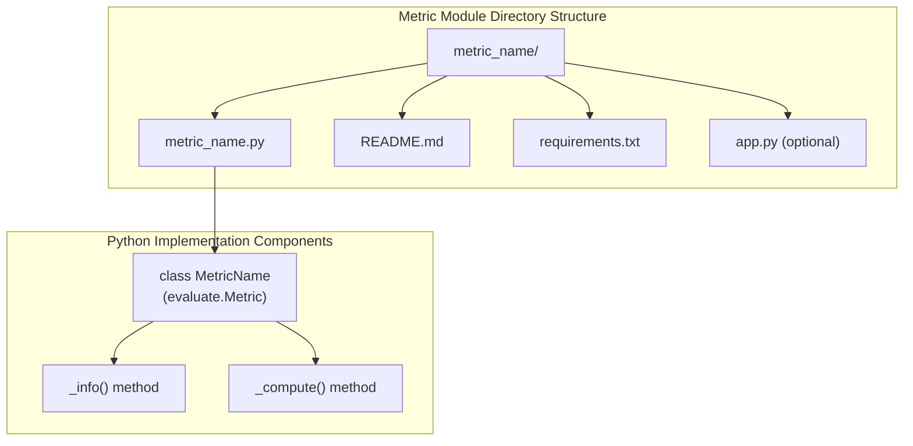
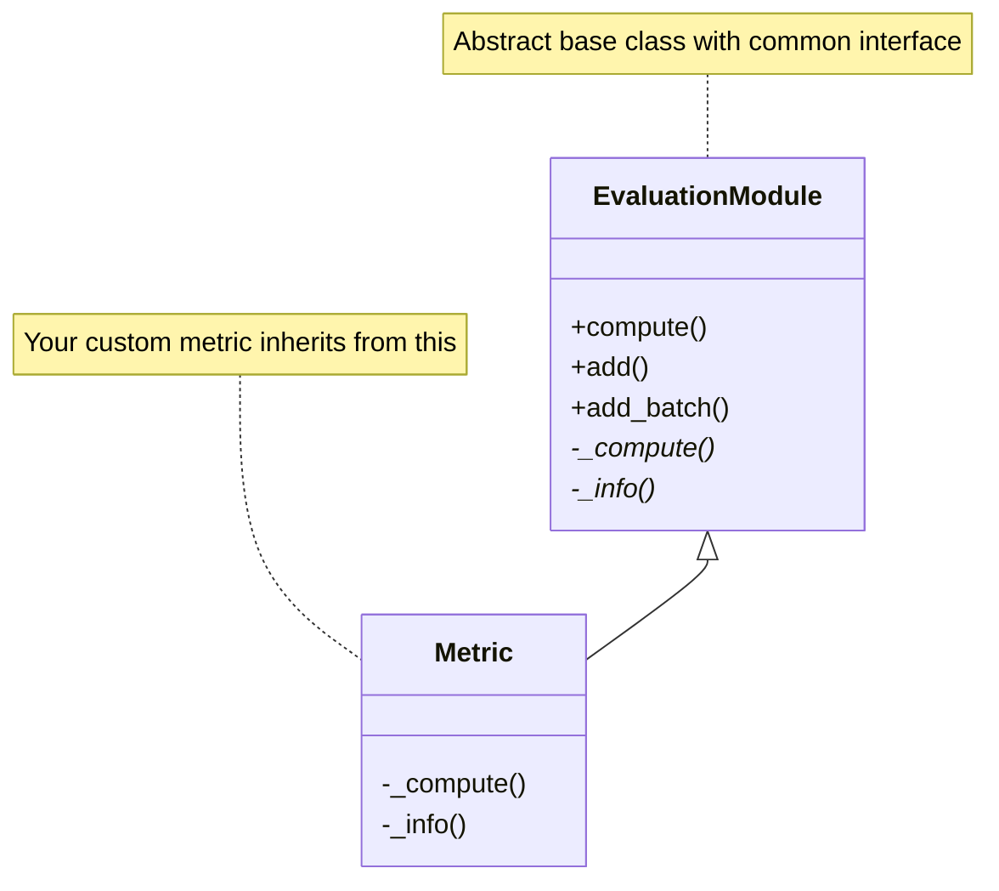
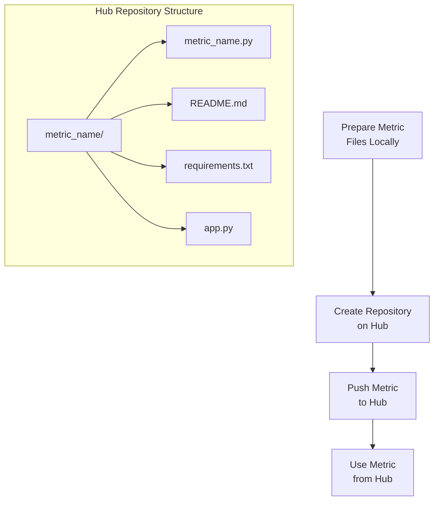

<!-- source: DeepWiki mcp.deepwiki.com · repo huggingface/evaluate · page 10.1 Creating Custom Modules · fetched 2026-10-26 -->

# Creating Custom Metrics

<details>
<summary>Relevant source files</summary>

The following files were used as context for generating this wiki page:

- [README.md](README.md)
- [docs/source/a_quick_tour.mdx](docs/source/a_quick_tour.mdx)
- [docs/source/choosing_a_metric.mdx](docs/source/choosing_a_metric.mdx)
- [docs/source/considerations.mdx](docs/source/considerations.mdx)
- [docs/source/creating_and_sharing.mdx](docs/source/creating_and_sharing.mdx)
- [docs/source/index.mdx](docs/source/index.mdx)
- [docs/source/transformers_integrations.mdx](docs/source/transformers_integrations.mdx)
- [docs/source/types_of_evaluations.mdx](docs/source/types_of_evaluations.mdx)
- [measurements/honest/requirements.txt](measurements/honest/requirements.txt)
- [measurements/regard/requirements.txt](measurements/regard/requirements.txt)
- [measurements/toxicity/README.md](measurements/toxicity/README.md)
- [measurements/toxicity/app.py](measurements/toxicity/app.py)
- [measurements/toxicity/requirements.txt](measurements/toxicity/requirements.txt)
- [measurements/toxicity/toxicity.py](measurements/toxicity/toxicity.py)
- [src/evaluate/evaluator/audio_classification.py](src/evaluate/evaluator/audio_classification.py)
- [src/evaluate/utils/logging.py](src/evaluate/utils/logging.py)

</details>


This page provides a comprehensive guide on how to create, implement, and share custom metrics for the Hugging Face Evaluate library. Custom metrics allow you to extend the evaluation capabilities of the library beyond the built-in metrics to address specific evaluation needs for your machine learning models.

For information about using existing metrics, see [Metrics](#4). For details on the overall evaluation module architecture, see [Evaluation Module Base Classes](#2.2).

## Overview of Custom Metrics

Custom metrics in the Evaluate library follow the same structure as built-in metrics, inheriting from the `EvaluationModule` base class. The process of creating a custom metric involves:

1. Creating the metric module structure
2. Implementing the metric computation logic
3. Testing the metric locally
4. Sharing the metric on the Hugging Face Hub (optional)



Sources: [measurements/label_distribution/label_distribution.py](), [measurements/label_distribution/README.md]()

## Metric Module Structure

A custom metric module consists of several files organized in a specific structure:



Sources: [measurements/label_distribution/label_distribution.py](), [measurements/label_distribution/README.md](), [measurements/label_distribution/requirements.txt](), [measurements/label_distribution/app.py]()

### Required Files

1. **Python Implementation File**: The main implementation file (e.g., `metric_name.py`) containing the metric class
2. **README.md**: Documentation for the metric including description, usage examples, and limitations
3. **requirements.txt**: Dependencies required by the metric
4. **app.py**: (Optional) A Gradio app for interactive demonstration of the metric

## Implementing a Custom Metric

To implement a custom metric, you need to create a class that inherits from `evaluate.Metric` and implements the required methods.

### Basic Implementation Structure



Sources: [measurements/label_distribution/label_distribution.py:72-93]()

### Implementation Steps

1. **Create the class**: Define a class that inherits from `evaluate.Metric`
2. **Implement `_info()`**: Define metadata about your metric (description, features, etc.)
3. **Implement `_compute()`**: Implement the actual metric computation logic

### The `_info()` Method

The `_info()` method returns metadata about your metric using the `evaluate.MetricInfo` class. It should include:

- Description of the metric
- Citation information
- Input and output descriptions
- Feature specifications

Example based on the label distribution measurement:

```python
def _info(self):
    return evaluate.MetricInfo(
        module_type="metric",
        description="Description of what your metric calculates",
        citation="Citation for the metric if applicable",
        inputs_description="Description of the inputs expected by the metric",
        features=[
            datasets.Features({"predictions": datasets.Value("int32")}),
            datasets.Features({"references": datasets.Value("int32")}),
        ],
    )
```

Sources: [measurements/label_distribution/label_distribution.py:73-83]()

### The `_compute()` Method

The `_compute()` method contains the actual logic for calculating your metric. It takes inputs like predictions and references and returns the metric results:

```python
def _compute(self, predictions, references, **kwargs):
    """
    Compute the metric.
    
    Args:
        predictions: Model predictions
        references: Ground truth references
        **kwargs: Additional metric-specific parameters
        
    Returns:
        Dictionary containing the metric results
    """
    # Implement your metric calculation logic here
    result = {...}  # Your computation
    return result
```

Sources: [measurements/label_distribution/label_distribution.py:85-93]()

## Documentation

Good documentation is essential for custom metrics. Your README.md should include:

1. **Metric Card Header**: Metadata about the metric (title, emoji, colors, etc.)
2. **Metric Description**: Clear explanation of what the metric calculates
3. **Intended Uses**: When and why to use this metric
4. **Usage Examples**: Code examples showing how to use the metric
5. **Input Format**: Description of the expected inputs
6. **Output Format**: Description of the returned values
7. **Limitations and Bias**: Any limitations or potential biases of the metric
8. **Citations**: References to relevant papers or resources

Sources: [measurements/label_distribution/README.md:1-94]()

## Testing Your Custom Metric

Before sharing your metric, test it thoroughly:

1. Install your metric locally in development mode:
   ```bash
   cd /path/to/your/metric_directory
   pip install -e .
   ```

2. Test loading and using your metric:
   ```python
   import evaluate
   metric = evaluate.load("path/to/your/metric_directory")
   results = metric.compute(predictions=[...], references=[...])
   ```

3. Verify the results against expected values

## Sharing on the Hugging Face Hub

Once your metric is working correctly, you can share it on the Hugging Face Hub to make it available to the community.



Sources: [.github/hub/push_evaluations_to_hub.py:53-96]()

### Steps to Share Your Metric

1. **Prepare your files**: Ensure all required files are present and properly formatted
2. **Create a repository**: Use the Hugging Face Hub interface or API to create a new repository for your metric
3. **Push your metric**: Upload your metric files to the repository
4. **Test from the Hub**: Verify that your metric can be loaded from the Hub

Example of the push process:

```python
# Manual approach
from huggingface_hub import create_repo, Repository
import tempfile
import shutil

# Create the repo
repo_url = create_repo("evaluate-metric/your_metric_name", repo_type="space", space_sdk="gradio")

# Clone and add files
repo_path = tempfile.mkdtemp()
repo = Repository(local_dir=repo_path, clone_from=repo_url)

# Copy your files to repo_path
# ...

# Commit and push
repo.git_add()
repo.git_commit("Initial commit")
repo.git_push()
```

Sources: [.github/hub/push_evaluations_to_hub.py:53-96]()

### Using Your Hub-Shared Metric

Once your metric is on the Hub, it can be loaded using:

```python
import evaluate
metric = evaluate.load("evaluate-metric/your_metric_name")
results = metric.compute(predictions=[...], references=[...])
```

## Best Practices

1. **Clear Naming**: Use descriptive names for your metric that indicate its purpose
2. **Comprehensive Documentation**: Include detailed documentation with examples
3. **Efficient Implementation**: Optimize your computation for speed and memory usage
4. **Error Handling**: Implement robust error checking and provide helpful error messages
5. **Versioning**: Consider versioning your metric if you make significant changes
6. **Test with Real Data**: Test your metric with realistic data scenarios

## Real Example: Creating a Label Distribution Measurement

The label distribution measurement provided in the repository demonstrates how to implement an evaluation module:

1. The class `LabelDistribution` inherits from `evaluate.Measurement`
2. It implements `_info()` to define the measurement metadata
3. It implements `_compute()` to calculate the label distribution and skewness
4. The README provides detailed documentation on usage and interpretation

Sources: [measurements/label_distribution/label_distribution.py:72-93](), [measurements/label_distribution/README.md:1-94]()

Note: While this example is a measurement rather than a metric, the implementation pattern is the same for custom metrics, as both inherit from the `EvaluationModule` base class.

## Summary

Creating custom metrics for the Hugging Face Evaluate library involves:
- Creating a class that inherits from `evaluate.Metric`
- Implementing the required `_info()` and `_compute()` methods
- Providing comprehensive documentation
- Testing thoroughly
- Optionally sharing on the Hugging Face Hub

By following this guide, you can extend the evaluation capabilities of the Evaluate library to meet your specific model evaluation needs.

---

