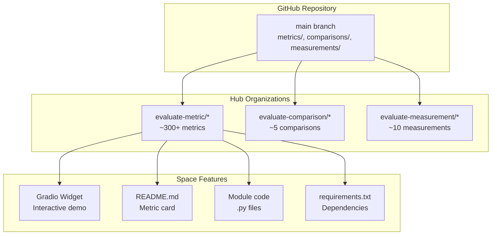
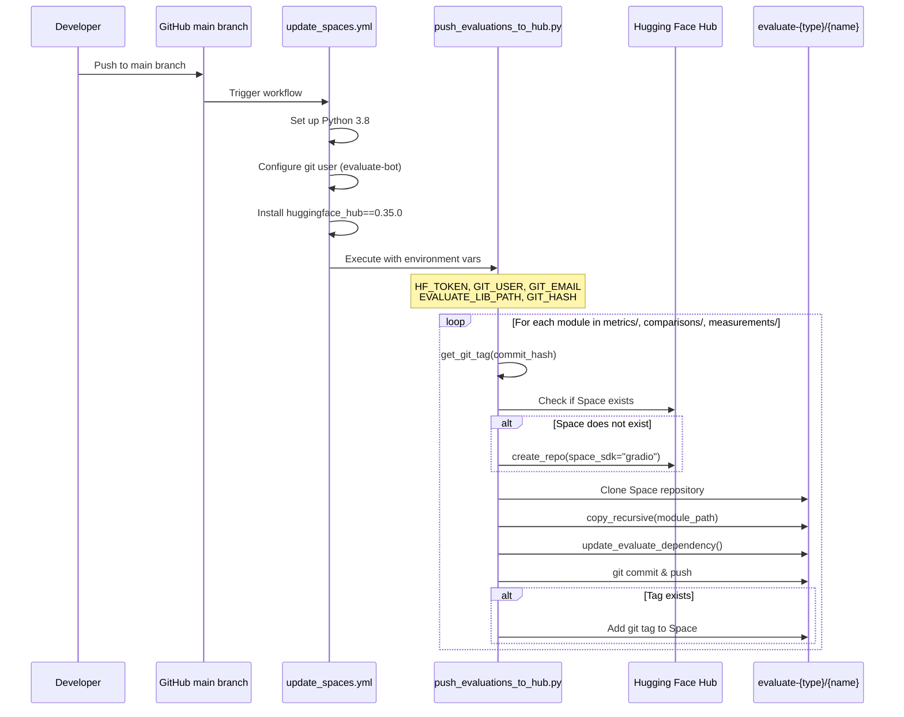
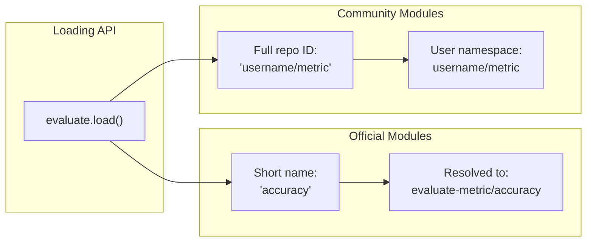
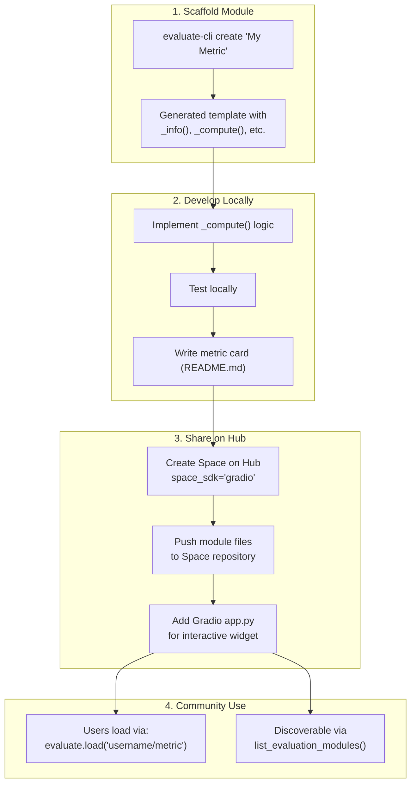
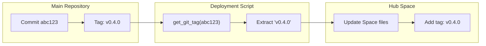

<!-- source: DeepWiki mcp.deepwiki.com · repo huggingface/evaluate · page 10.2 Hub Integration · fetched 2026-10-26 -->

# Hub Integration

<details>
<summary>Relevant source files</summary>

The following files were used as context for generating this wiki page:

- [README.md](README.md)
- [docs/source/a_quick_tour.mdx](docs/source/a_quick_tour.mdx)
- [docs/source/choosing_a_metric.mdx](docs/source/choosing_a_metric.mdx)
- [docs/source/considerations.mdx](docs/source/considerations.mdx)
- [docs/source/creating_and_sharing.mdx](docs/source/creating_and_sharing.mdx)
- [docs/source/index.mdx](docs/source/index.mdx)
- [docs/source/transformers_integrations.mdx](docs/source/transformers_integrations.mdx)
- [docs/source/types_of_evaluations.mdx](docs/source/types_of_evaluations.mdx)
- [src/evaluate/evaluator/audio_classification.py](src/evaluate/evaluator/audio_classification.py)
- [src/evaluate/info.py](src/evaluate/info.py)
- [src/evaluate/inspect.py](src/evaluate/inspect.py)
- [src/evaluate/loading.py](src/evaluate/loading.py)
- [src/evaluate/module.py](src/evaluate/module.py)
- [src/evaluate/utils/file_utils.py](src/evaluate/utils/file_utils.py)
- [src/evaluate/utils/logging.py](src/evaluate/utils/logging.py)

</details>


This document explains how evaluation modules are shared and distributed through the Hugging Face Hub, including the automated CI/CD pipeline that deploys modules as interactive Spaces, and how users can discover and load both official and community modules.

For information about creating custom metrics, see [Creating Custom Metrics](#9.1). For general development setup and tooling, see [Development Tooling](#9.3).

## Hub Organization Structure

The 🤗 Evaluate library distributes evaluation modules across three dedicated Hub organizations, each corresponding to a module type:

| Organization | Module Type | Example |
|-------------|-------------|---------|
| `evaluate-metric/*` | Metrics (performance measurement) | `evaluate-metric/accuracy` |
| `evaluate-comparison/*` | Comparisons (model comparison) | `evaluate-comparison/mcnemar` |
| `evaluate-measurement/*` | Measurements (dataset analysis) | `evaluate-measurement/word_length` |

Each module within these organizations is deployed as a **Hugging Face Space** with SDK `"gradio"`, providing an interactive widget for users to test the module before using it in code.

**Module Distribution Flow:**



Sources: [README.md:35-41](), [docs/source/a_quick_tour.mdx:9-17]()

## Automatic Deployment Pipeline

The library uses a GitHub Actions workflow to automatically synchronize evaluation modules from the main repository to their corresponding Hub Spaces whenever changes are pushed to the `main` branch.

### Workflow Configuration

The workflow is defined in [.github/workflows/update_spaces.yml:1-41]() and executes the following steps:



Sources: [.github/workflows/update_spaces.yml:1-41](), [.github/hub/push_evaluations_to_hub.py:110-130]()

### Push Script Implementation

The core deployment logic is implemented in [.github/hub/push_evaluations_to_hub.py]():

**Key Functions:**

1. **`get_git_tag(lib_path, commit_hash)`** [.github/hub/push_evaluations_to_hub.py:28-42]()
   - Checks if the commit has an associated version tag matching `v\d*\.\d*\.\d*`
   - Tags are used to mark released versions on Hub Spaces

2. **`copy_recursive(source_base_path, target_base_path)`** [.github/hub/push_evaluations_to_hub.py:45-53]()
   - Recursively copies module files to the cloned Space repository
   - Overwrites existing files to ensure latest version is deployed

3. **`update_evaluate_dependency(requirements_path, commit_hash)`** [.github/hub/push_evaluations_to_hub.py:55-61]()
   - Updates the `requirements.txt` file with the specific commit hash
   - Replaces placeholder `{COMMIT_PLACEHOLDER}` with actual commit
   - Ensures the Space uses the exact version of evaluate that the module was tested with

4. **`push_module_to_hub(module_path, type, token, commit_hash, tag=None)`** [.github/hub/push_evaluations_to_hub.py:63-107]()
   - Main orchestration function
   - Creates Space if it doesn't exist using `create_repo()`
   - Clones Space repository to temporary directory
   - Copies module files and updates requirements
   - Commits changes with message format: `"Update Space (evaluate main: {commit_hash[:8]})"`
   - Adds git tag if a version tag exists

**Module Iteration Logic:**

```python
# From push_evaluations_to_hub.py:110-130
evaluation_paths = ["metrics", "comparisons", "measurements"]
evaluation_types = ["metric", "comparison", "measurement"]

for type, dir in zip(evaluation_types, evaluation_paths):
    if (evaluate_lib_path/dir).exists():
        for module_path in (evaluate_lib_path/dir).iterdir():
            if module_path.is_dir():
                push_module_to_hub(module_path, type, token, commit_hash, tag=git_tag)
```

Sources: [.github/hub/push_evaluations_to_hub.py:63-130]()

## Module Distribution as Spaces

Each evaluation module is distributed as a Hugging Face Space, which provides several features:

### Space Structure

A typical Space for an evaluation module contains:

| File/Directory | Purpose |
|----------------|---------|
| `README.md` | Metric card with description, usage, citations, limitations |
| `app.py` or module `.py` files | Module implementation code |
| `requirements.txt` | Python dependencies including evaluate version |
| `.gitattributes` | Git LFS configuration |

### Requirements Management

The `requirements.txt` in each Space includes:

```python
# Example structure (placeholder replaced during deployment)
evaluate @ git+https://github.com/huggingface/evaluate@{COMMIT_PLACEHOLDER}
# Additional metric-specific dependencies
```

The placeholder is replaced with the actual commit hash during deployment via `update_evaluate_dependency()` [.github/hub/push_evaluations_to_hub.py:55-61](), ensuring that the Space uses the exact version of the library that the module was developed and tested with.

### Interactive Widget

Each Space includes an interactive Gradio widget that allows users to:
- Input example predictions and references
- See the computed metric values
- Understand the metric's input format and output structure
- Explore the metric card documentation

Sources: [.github/hub/push_evaluations_to_hub.py:55-61](), [docs/source/a_quick_tour.mdx:13-17](), [README.md:35-41]()

## Loading and Discovering Modules

### Loading Official Modules

Users can load evaluation modules using `evaluate.load()` with just the module name:

```python
import evaluate

# Load from evaluate-metric organization
accuracy = evaluate.load("accuracy")

# Explicitly specify module type to avoid ambiguity
word_length = evaluate.load("word_length", module_type="measurement")
```

The loading system automatically searches the appropriate Hub organization based on the module type. See [Module Loading System](#2.1) for implementation details.

Sources: [docs/source/a_quick_tour.mdx:23-34]()

### Loading Community Modules

Community members can share custom evaluation modules in their personal namespaces. These are loaded by specifying the full repository ID:

```python
# Load community module from user namespace
custom_metric = evaluate.load("username/metric_name", module_type="metric")

# Example from documentation
element_count = evaluate.load("lvwerra/element_count", module_type="measurement")
```

**Community vs Official Modules:**



Sources: [docs/source/a_quick_tour.mdx:36-44]()

### Module Discovery

The `list_evaluation_modules()` function provides programmatic discovery of available modules:

```python
import evaluate

# List all modules of a specific type
evaluate.list_evaluation_modules(
    module_type="comparison",
    include_community=False,  # Exclude community modules
    with_details=True         # Include metadata like likes
)
# Returns: [{'name': 'mcnemar', 'type': 'comparison', 'community': False, 'likes': 1}, ...]

# List all modules including community contributions
all_modules = evaluate.list_evaluation_modules(
    include_community=True
)
```

**Discovery Options:**

| Parameter | Type | Description |
|-----------|------|-------------|
| `module_type` | `str` | Filter by type: `"metric"`, `"comparison"`, or `"measurement"` |
| `include_community` | `bool` | Include community-contributed modules |
| `with_details` | `bool` | Return additional metadata (likes, author, etc.) |

Sources: [docs/source/a_quick_tour.mdx:46-58](), [README.md:41]()

## Community Module Sharing

Community members can create and share custom evaluation modules on the Hub.

### Creating and Sharing Workflow



**Steps to Share a Community Module:**

1. **Scaffold with CLI**: Use `evaluate-cli create` to generate template (see [Command-line Interface](#8))
2. **Implement Logic**: Fill in `_info()`, `_compute()`, and optionally `_download_and_prepare()`
3. **Create Hub Space**: 
   - Go to huggingface.co and create a new Space
   - Set SDK to "Gradio"
   - Name it following convention: `username/metric_name`
4. **Push Module Files**:
   - Push your module Python files
   - Include `requirements.txt` with dependencies
   - Add `README.md` with metric card documentation
5. **Optional**: Add `app.py` for custom Gradio interface

Sources: [README.md:70-80](), [docs/source/a_quick_tour.mdx:36-44]()

## Version Management

The deployment pipeline handles versioning through git tags and commit hashes:

### Commit Hash Tracking

Every Space deployment includes the specific commit hash of the evaluate library:

```python
# In requirements.txt of deployed Space
evaluate @ git+https://github.com/huggingface/evaluate@abc12345
```

This ensures reproducibility - the Space uses the exact version of evaluate that the module was tested with.

### Version Tags

When a commit in the main repository has a version tag (format: `v\d*\.\d*\.\d*`), the deployment script:

1. Detects the tag using `get_git_tag()` [.github/hub/push_evaluations_to_hub.py:28-42]()
2. Adds the same tag to the Space repository using `repo.add_tag()` [.github/hub/push_evaluations_to_hub.py:104-105]()

This allows users to:
- Track which evaluate library version each Space corresponds to
- Pin to specific versions if needed
- Browse version history on the Hub

**Version Tagging Flow:**



Sources: [.github/hub/push_evaluations_to_hub.py:28-42](), [.github/hub/push_evaluations_to_hub.py:104-105](), [.github/hub/push_evaluations_to_hub.py:117-120]()

## CI/CD Integration

The deployment pipeline integrates with the broader CI/CD system:

### Quality Checks Before Deployment

Before modules are deployed to the Hub, they pass through quality checks defined in [.github/workflows/ci.yml:18-35]():

```yaml
check_code_quality:
  - black --check (code formatting)
  - isort --check (import sorting)  
  - flake8 (linting)
```

### Test Suite

The CI runs two types of tests [.github/workflows/ci.yml:36-65]():

1. **Unit Tests**: `pytest` on `./tests/` (excluding parity tests)
2. **Parity Tests**: Integration tests with `transformers` library

Only after these checks pass does code get merged to `main`, which triggers the `update_spaces.yml` workflow.

### Environment Configuration

The deployment workflow sets specific environment variables [.github/workflows/update_spaces.yml:24-40]():

| Variable | Purpose |
|----------|---------|
| `HF_TOKEN` | Authentication for Hub API |
| `GIT_USER` | Git committer name (`evaluate-bot`) |
| `GIT_EMAIL` | Git committer email |
| `EVALUATE_LIB_PATH` | Path to repository root |
| `GIT_HASH` | Current commit hash |
| `GIT_LFS_SKIP_SMUDGE` | Skip LFS downloads for performance |
| `CI_HEADERS` | Custom headers for CI identification |

Sources: [.github/workflows/ci.yml:18-65](), [.github/workflows/update_spaces.yml:24-40](), [.github/hub/push_evaluations_to_hub.py:23-25]()

---

