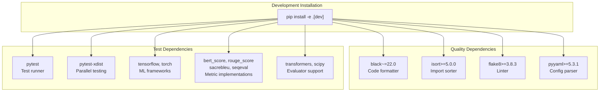
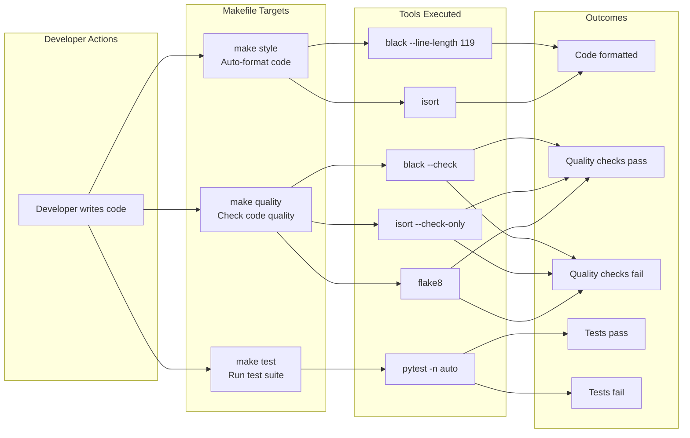
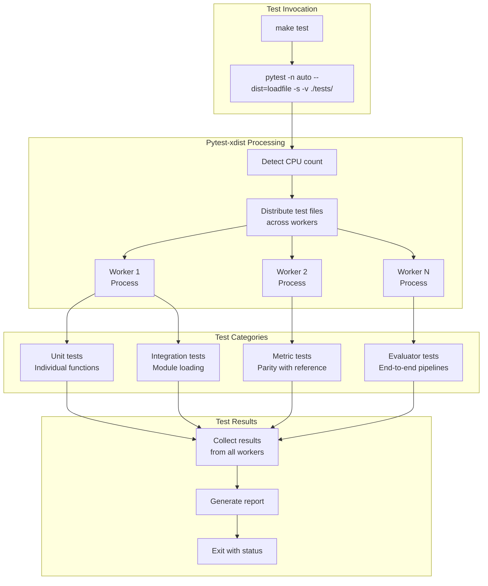
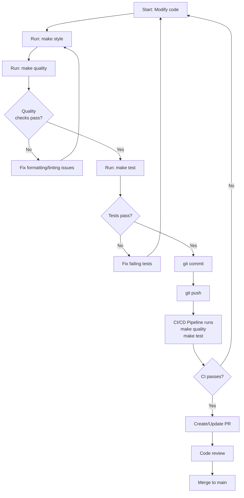

<!-- source: DeepWiki mcp.deepwiki.com · repo huggingface/evaluate · page 10.3 Development Tooling · fetched 2026-10-26 -->

# Development Tooling

<details>
<summary>Relevant source files</summary>

The following files were used as context for generating this wiki page:

- [Makefile](Makefile)
- [metrics/super_glue/record_evaluation.py](metrics/super_glue/record_evaluation.py)
- [setup.cfg](setup.cfg)
- [setup.py](setup.py)

</details>


This document covers the development infrastructure for contributing to the evaluate library, including environment setup, code quality tools, Makefile automation, and testing infrastructure. For creating custom evaluation modules, see [Creating Custom Metrics](#9.1). For Hub deployment and CI/CD pipelines, see [Hub Integration](#9.2).

## Development Environment Setup

The evaluate library provides several dependency groups for different development needs, defined in [setup.py:112-125]():

| Dependency Group | Purpose | Installation Command |
|-----------------|---------|---------------------|
| `dev` | Full development environment (tests + quality tools) | `pip install -e ".[dev]"` |
| `tests` | Testing dependencies only | `pip install -e ".[tests]"` |
| `quality` | Code quality tools only | `pip install -e ".[quality]"` |
| `template` | Metric template creation | `pip install -e ".[template]"` |
| `evaluator` | Task evaluator dependencies | `pip install -e ".[evaluator]"` |

### Development Dependencies

The `dev` extra combines test and quality dependencies [setup.py:116]():

**Quality Tools** [setup.py:109]():
- `black~=22.0` - Code formatting
- `flake8>=3.8.3` - Linting
- `isort>=5.0.0` - Import sorting
- `pyyaml>=5.3.1` - Configuration parsing

**Test Dependencies** [setup.py:72-107]() include:
- Core testing: `pytest`, `pytest-datadir`, `pytest-xdist`
- Framework support: `tensorflow>=2.3`, `torch`
- Metric-specific: `bert_score>=0.3.6`, `rouge_score>=0.1.2`, `sacrebleu`, `seqeval`, `scikit-learn`, `jiwer`
- Evaluator support: `transformers`, `accelerate`, `scipy>=1.10.0`



**Sources:** [setup.py:72-125]()

## Code Quality Configuration

Code quality tools are configured through [setup.cfg:1-21]() and enforced via Makefile targets.

### Black Configuration

Black formatting is enforced with specific parameters [Makefile:6](), [Makefile:13]():
- Line length: 119 characters
- Target version: Python 3.6
- Applied to: `tests`, `src`, `metrics`, `comparisons`, `measurements`

### isort Configuration

Import sorting follows [setup.cfg:4-11]() settings:

```
[isort]
ensure_newline_before_comments = True
force_grid_wrap = 0
include_trailing_comma = True
line_length = 119
lines_after_imports = 2
multi_line_output = 3
use_parentheses = True
```

These settings ensure imports are formatted consistently with:
- 119-character line length matching Black
- Two blank lines after imports
- Trailing commas in multi-line imports
- Parentheses for line continuation

### Flake8 Configuration

Linting rules are defined in [setup.cfg:13-20]():

```
[flake8]
ignore = E203, E501, W503
max-line-length = 119
exclude =
    src/datasets/datasets
    src/datasets/metrics
per-file-ignores =
    metrics/*:F401
```

**Key settings:**
- **E203**: Whitespace before ':' (ignored for Black compatibility)
- **E501**: Line too long (ignored, Black handles this)
- **W503**: Line break before binary operator (ignored, allows readable multi-line expressions)
- **F401** ignored in `metrics/*`: Allows unused imports in metric modules (common for re-exports)

**Sources:** [setup.cfg:1-21](), [Makefile:6,13]()

## Makefile Automation

The [Makefile:1-20]() provides three primary targets for development workflows:



**Sources:** [Makefile:1-20]()

### make style

Auto-formats code according to project standards [Makefile:12-14]():

```bash
black --line-length 119 --target-version py36 tests src metrics comparisons measurements
isort tests src metrics measurements
```

This target:
- Reformats all Python files to 119-character lines
- Sorts imports alphabetically with proper grouping
- Modifies files in-place
- Should be run before committing code

### make quality

Checks code quality without modifying files [Makefile:5-8]():

```bash
black --check --line-length 119 --target-version py36 tests src metrics comparisons measurements
isort --check-only tests src metrics measurements
flake8 tests src metrics
```

This target:
- Verifies code is formatted correctly (exits with error if not)
- Checks import ordering
- Runs linting checks
- Used in CI/CD pipelines to enforce quality

**Note:** Comparisons are checked by Black/isort but not Flake8 [Makefile:8]()

### make test

Runs the test suite with parallel execution [Makefile:18-19]():

```bash
python -m pytest -n auto --dist=loadfile -s -v ./tests/
```

**Test execution parameters:**
- `-n auto`: Automatically detect CPU count and run tests in parallel
- `--dist=loadfile`: Distribute tests by file (keeps tests from same file together)
- `-s`: Don't capture stdout (shows print statements)
- `-v`: Verbose output
- `./tests/`: Test directory

**Sources:** [Makefile:5-19]()

## Testing Infrastructure

### Test Dependencies

The test suite requires numerous dependencies for comprehensive coverage [setup.py:72-107]():

**Core Testing Framework:**
- `pytest` - Test runner
- `pytest-datadir` - Test data management
- `pytest-xdist` - Parallel test execution

**Framework Compatibility Testing:**
- `tensorflow>=2.3,!=2.6.0,!=2.6.1, <=2.10`
- `torch`
- `numpy<2.0.0` (TensorFlow constraint)

**Metric Implementation Testing:**
```python
# From setup.py TESTS_REQUIRE
"accelerate",          # for frugalscore
"bert_score>=0.3.6",   # BERTScore metric
"rouge_score>=0.1.2",  # ROUGE metric
"sacrebleu",           # BLEU variants
"sacremoses",          # Tokenization for BLEU
"scipy>=1.10.0",       # Statistical computations
"seqeval",             # Sequence labeling metrics
"scikit-learn",        # Classification metrics
"jiwer",               # Word/character error rate
"sentencepiece",       # For BLEURT
"transformers",        # For evaluator
"mauve-text",          # MAUVE metric
"trectools",           # Information retrieval metrics
```

### Test Execution



**Sources:** [setup.py:72-107](), [Makefile:18-19]()

## Development Workflow

The typical development workflow combines these tools:



**Sources:** [Makefile:1-20](), [setup.py:1-24]()

## Package Configuration

### Version Management

Version is defined in two locations [setup.py:11-14]():
1. `setup.py` line 129: `version="0.4.7.dev0"`
2. `src/evaluate/__init__.py`

Version format follows `MAJOR.MINOR.PATCH` convention [setup.py:6]():
- Development versions: `X.Y.Z.dev0`
- Release candidates: `X.Y.Z.rc1`
- Stable releases: `X.Y.Z`

### Entry Points

The CLI is registered as a console script [setup.py:140]():
```python
entry_points={
    "console_scripts": ["evaluate-cli=evaluate.commands.evaluate_cli:main"]
}
```

This creates the `evaluate-cli` command that maps to the `main()` function in the CLI module.

### Python Version Requirement

Minimum Python version is 3.8.0 [setup.py:143](). The package supports Python 3.8, 3.9, and 3.10 [setup.py:152-154]().

**Sources:** [setup.py:127-159]()

## Tool Integration Matrix

| Tool | Configuration File | Makefile Target | Purpose | Auto-fix |
|------|-------------------|-----------------|---------|----------|
| **black** | Command-line args | `style`, `quality` | Code formatting | Yes (with `style`) |
| **isort** | [setup.cfg:4-11]() | `style`, `quality` | Import sorting | Yes (with `style`) |
| **flake8** | [setup.cfg:13-20]() | `quality` | Linting | No |
| **pytest** | - | `test` | Test execution | N/A |

**Command Examples:**

```bash
# Setup development environment
pip install -e ".[dev]"

# Auto-format code before committing
make style

# Check code quality (CI-style)
make quality

# Run all tests in parallel
make test

# Run specific test file
pytest tests/test_module_factory.py

# Run tests with coverage
pytest --cov=evaluate --cov-report=html tests/
```

**Sources:** [Makefile:1-20](), [setup.cfg:1-21](), [setup.py:109-125]()