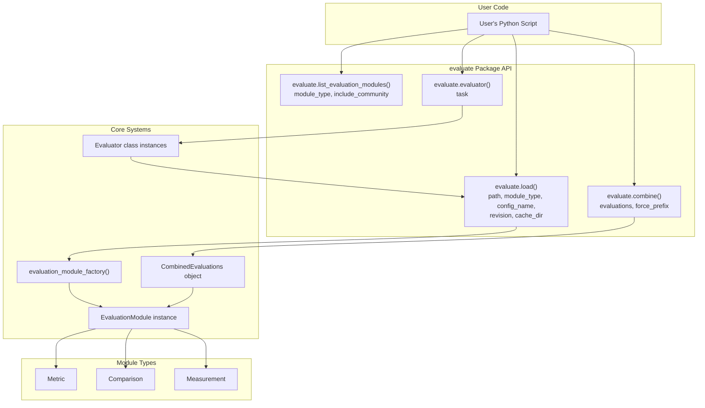
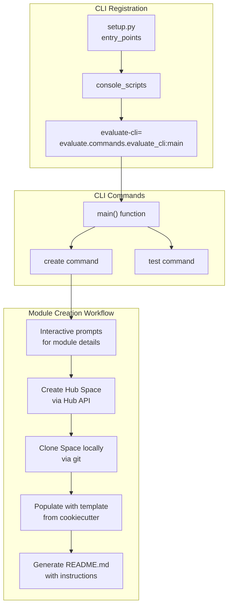
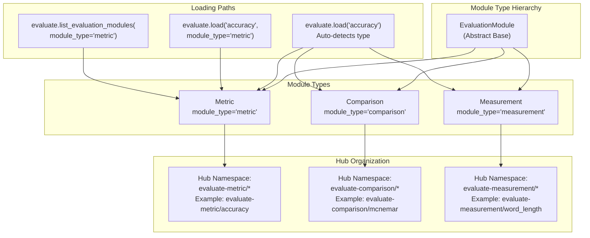
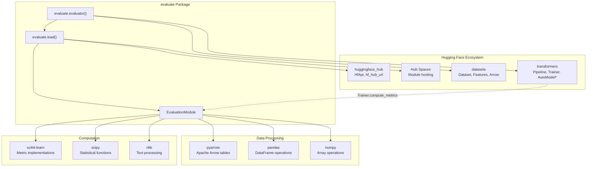

<!-- source: DeepWiki mcp.deepwiki.com · repo huggingface/evaluate · page 2 Package Structure and Entrypoints · fetched 2026-10-26 -->

# Package Structure and Entrypoints

<details>
<summary>Relevant source files</summary>

The following files were used as context for generating this wiki page:

- [README.md](README.md)
- [docs/source/creating_and_sharing.mdx](docs/source/creating_and_sharing.mdx)
- [docs/source/transformers_integrations.mdx](docs/source/transformers_integrations.mdx)
- [docs/source/types_of_evaluations.mdx](docs/source/types_of_evaluations.mdx)
- [setup.py](setup.py)

</details>


This document describes the organizational structure of the `evaluate` package, its main entry points for users, dependency management strategy, and how to interact with the library through both Python API and command-line interface. For details on how modules are loaded from various sources, see [Module Loading System](#3.1). For information on creating custom modules, see [Creating Custom Modules](#10.1).

---

## Package Organization

The `evaluate` library follows a standard Python package structure with all source code located in the `src` directory:

```
evaluate/
├── src/
│   └── evaluate/
│       ├── __init__.py              # Main API exports
│       ├── loading.py               # Module loading functions
│       ├── evaluation_suite.py      # EvaluationSuite implementation
│       ├── evaluator/               # Task-specific evaluators
│       ├── module.py                # EvaluationModule base class
│       ├── utils/                   # Utility functions
│       ├── config.py                # Configuration management
│       ├── info.py                  # Module metadata classes
│       ├── commands/                # CLI implementation
│       │   └── evaluate_cli.py      # Command-line tool
│       └── template/                # Module templates for creation
├── setup.py                         # Package configuration
├── requirements.txt                 # Core dependencies
└── README.md                        # Package documentation
```

The package is registered as `"evaluate"` on PyPI and installed via `pip install evaluate`. All public APIs are accessible through the top-level `evaluate` namespace.

**Sources:** [setup.py:138-139]()

---

## Main Python API Entrypoints

The library provides three primary functions that constitute the core user-facing API. These functions handle 95% of evaluation use cases:



**Sources:** [README.md:64-68]()

### evaluate.load()

The primary entrypoint for instantiating evaluation modules. This function handles module discovery, downloading, caching, and instantiation:

**Function Signature:**
```python
evaluate.load(
    path: str,
    module_type: Optional[str] = None,
    config_name: Optional[str] = None,
    revision: Optional[str] = None,
    cache_dir: Optional[str] = None,
    **kwargs
) -> EvaluationModule
```

**Parameters:**
- `path`: Module identifier (e.g., `"accuracy"`, `"rouge"`, `"lvwerra/my_metric"`) or local file path
- `module_type`: One of `"metric"`, `"comparison"`, or `"measurement"` (auto-detected if omitted)
- `config_name`: Specific configuration variant (e.g., `"bleurt-base-128"` for BLEURT metric)
- `revision`: Git revision (commit hash, tag, or branch) for Hub modules
- `cache_dir`: Custom cache directory (defaults to `~/.cache/huggingface/modules`)

**Usage Example:**
```python
import evaluate

# Load from Hub
accuracy = evaluate.load("accuracy")
rouge = evaluate.load("rouge")

# Load specific configuration
bleurt = evaluate.load("bleurt", config_name="bleurt-base-128")

# Load from Hub with user namespace
custom_metric = evaluate.load("username/custom_metric")

# Load from local path
local_metric = evaluate.load("/path/to/metric.py")
```

The function delegates to `evaluation_module_factory()` which implements the multi-source resolution strategy (Hub, local, cache).

**Sources:** [README.md:67](), [setup.py:31-57]()

### evaluate.evaluator()

A factory function that returns task-specific evaluator instances. This high-level abstraction automates the entire evaluation pipeline from data loading to metric computation:

**Function Signature:**
```python
evaluate.evaluator(task: str) -> BaseEvaluator
```

**Supported Tasks:**
- `"text-classification"`
- `"token-classification"`
- `"question-answering"`
- `"image-classification"`
- `"text-generation"`
- `"text2text-generation"`
- `"summarization"`
- `"translation"`
- `"automatic-speech-recognition"`
- `"audio-classification"`

**Usage Example:**
```python
import evaluate

# Initialize task-specific evaluator
evaluator = evaluate.evaluator("text-classification")

# Run automated evaluation
results = evaluator.compute(
    model_or_pipeline="distilbert-base-uncased-finetuned-sst-2-english",
    data="imdb",
    metric="accuracy",
    label_mapping={"NEGATIVE": 0, "POSITIVE": 1}
)
# Returns: {'accuracy': 0.925, 'latency_in_seconds': 12.34, ...}
```

Evaluators handle model loading, data preprocessing, batch inference, and metric computation. For detailed documentation of each evaluator, see [Task-Specific Evaluators](#4.1).

**Sources:** [README.md:64-68](), [setup.py:66-70]()

### evaluate.combine()

Combines multiple evaluation modules into a single object that computes all metrics simultaneously:

**Function Signature:**
```python
evaluate.combine(
    evaluations: List[Union[str, EvaluationModule]],
    force_prefix: bool = False
) -> CombinedEvaluations
```

**Parameters:**
- `evaluations`: List of module identifiers or pre-loaded module instances
- `force_prefix`: If `True`, prefixes all metric names with module name (prevents key collisions)

**Usage Example:**
```python
import evaluate

# Combine multiple metrics
combined = evaluate.combine(["accuracy", "f1", "precision", "recall"])

# Or combine pre-loaded modules
accuracy = evaluate.load("accuracy")
f1 = evaluate.load("f1")
combined = evaluate.combine([accuracy, f1])

# Compute all metrics at once
results = combined.compute(predictions=[0, 1, 0, 1], references=[0, 1, 1, 1])
# Returns: {'accuracy': 0.75, 'f1': 0.8, 'precision': 1.0, 'recall': 0.667}
```

The combined object implements the same `add()`, `add_batch()`, and `compute()` interface as individual modules, making it a drop-in replacement.

**Sources:** [README.md:64-68]()

### evaluate.list_evaluation_modules()

Discovery function that lists available evaluation modules from the Hub and local cache:

**Function Signature:**
```python
evaluate.list_evaluation_modules(
    module_type: Optional[str] = None,
    include_community: bool = True
) -> List[str]
```

**Parameters:**
- `module_type`: Filter by `"metric"`, `"comparison"`, or `"measurement"`
- `include_community`: Include community-contributed modules from Hub

**Usage Example:**
```python
import evaluate

# List all metrics
metrics = evaluate.list_evaluation_modules(module_type="metric")
# Returns: ['accuracy', 'bleu', 'rouge', 'f1', 'precision', ...]

# List only canonical metrics (no community modules)
canonical = evaluate.list_evaluation_modules(
    module_type="metric", 
    include_community=False
)

# List all module types
all_modules = evaluate.list_evaluation_modules()
```

**Sources:** [README.md:66]()

---

## Command-Line Interface (evaluate-cli)

The `evaluate-cli` tool provides command-line access to module creation and management functionality. It is installed as a console script entry point:



**Sources:** [setup.py:140](), [docs/source/creating_and_sharing.mdx:20-25]()

### CLI Installation

The CLI is automatically installed when you install the base package, but module creation requires additional dependencies:

```bash
# Install base package (CLI available but limited)
pip install evaluate

# Install with template creation support
pip install evaluate[template]
```

The `template` extra installs `cookiecutter` (for template generation) and `gradio>=3.0.0` (for interactive widgets).

**Sources:** [setup.py:59-64](), [docs/source/creating_and_sharing.mdx:6-9]()

### evaluate-cli create

Creates a new evaluation module by setting up a Hub Space with a pre-configured template:

**Command Syntax:**
```bash
evaluate-cli create "Module Name" --module_type [metric|comparison|measurement]
```

**Example:**
```bash
evaluate-cli create "My Custom Metric" --module_type "metric"
```

**What This Does:**

1. **Authenticates** with Hugging Face Hub (requires `huggingface-cli login`)
2. **Creates Space** on Hub with URL `https://huggingface.co/spaces/username/my_custom_metric`
3. **Clones locally** to current directory as `my_custom_metric/`
4. **Generates template files**:
   - `my_custom_metric.py` - Module implementation skeleton
   - `README.md` - Documentation template with examples
   - `requirements.txt` - Dependency specification
   - `app.py` - Gradio widget for interactive testing
5. **Displays instructions** for implementing the module

**Template Structure:**

The generated module includes three required methods to implement:

```python
# Generated in my_custom_metric.py

class MyCustomMetric(evaluate.EvaluationModule):
    def _info(self):
        # Define module metadata, inputs, outputs
        return evaluate.EvaluationModuleInfo(...)
    
    def _download_and_prepare(self, dl_manager):
        # Download external resources (NLTK data, checkpoints)
        pass
    
    def _compute(self, predictions, references):
        # Core evaluation logic
        return {"my_custom_metric": score}
```

**Sources:** [docs/source/creating_and_sharing.mdx:17-28](), [README.md:72-79]()

---

## Dependency Management

The library follows a tiered dependency strategy: a minimal core for basic usage, with optional extras for advanced features:

```mermaid
graph TB
    subgraph "Installation Tiers"
        BASE["pip install evaluate<br/>(core dependencies)"]
        TEMPLATE["pip install evaluate[template]<br/>(+ cookiecutter, gradio)"]
        EVALUATOR["pip install evaluate[evaluator]<br/>(+ transformers, scipy)"]
        DEV["pip install evaluate[dev]<br/>(+ tests, quality)"]
        TESTS["pip install evaluate[tests]<br/>(+ all metric dependencies)"]
    end
    
    subgraph "Core Dependencies (REQUIRED_PKGS)"
        DATASETS["datasets>=2.0.0"]
        NUMPY["numpy>=1.17"]
        DILL["dill"]
        PANDAS["pandas"]
        REQUESTS["requests>=2.19.0"]
        TQDM["tqdm>=4.62.1"]
        XXHASH["xxhash"]
        MULTIPROCESS["multiprocess"]
        FSSPEC["fsspec[http]>=2021.05.0"]
        HUB["huggingface-hub>=0.7.0"]
        PACKAGING["packaging"]
    end
    
    subgraph "Optional Dependencies"
        COOKIECUTTER["cookiecutter"]
        GRADIO["gradio>=3.0.0"]
        TRANSFORMERS["transformers"]
        SCIPY["scipy>=1.7.1"]
        SKLEARN["scikit-learn"]
        NLTK["nltk"]
        ROUGE["rouge_score"]
        SACREBLEU["sacrebleu"]
        BERTSCORE["bert_score"]
    end
    
    BASE --> DATASETS
    BASE --> NUMPY
    BASE --> DILL
    BASE --> PANDAS
    BASE --> REQUESTS
    BASE --> TQDM
    BASE --> XXHASH
    BASE --> MULTIPROCESS
    BASE --> FSSPEC
    BASE --> HUB
    BASE --> PACKAGING
    
    TEMPLATE --> BASE
    TEMPLATE --> COOKIECUTTER
    TEMPLATE --> GRADIO
    
    EVALUATOR --> BASE
    EVALUATOR --> TRANSFORMERS
    EVALUATOR --> SCIPY
    
    TESTS --> SKLEARN
    TESTS --> NLTK
    TESTS --> ROUGE
    TESTS --> SACREBLEU
    TESTS --> BERTSCORE
```



**Sources:** [setup.py:31-125]()

### Core Dependencies (Always Installed)

These packages are required for basic module loading and computation:

| Package | Version | Purpose |
|---------|---------|---------|
| `datasets` | `>=2.0.0` | Data backend for evaluation modules |
| `numpy` | `>=1.17` | Array operations, random generator for shuffling |
| `dill` | any | Serialization for caching computation state |
| `pandas` | any | Performance gains with Apache Arrow backend |
| `requests` | `>=2.19.0` | Downloading modules/data over HTTPS |
| `tqdm` | `>=4.62.1` | Progress bars for downloads and computation |
| `xxhash` | any | Fast hashing for cache keys |
| `multiprocess` | any | Better multiprocessing support than stdlib |
| `fsspec[http]` | `>=2021.05.0` | Filesystem abstraction for saving datasets |
| `huggingface-hub` | `>=0.7.0` | Hub API access for module discovery/download |
| `packaging` | any | Version comparison utilities |

**Sources:** [setup.py:31-57]()

### Optional Dependencies (Install as Needed)

Optional features require additional packages specified as extras:

#### Template Creation (`[template]`)
```bash
pip install evaluate[template]
```
- `cookiecutter`: Template generation for new modules
- `gradio>=3.0.0`: Interactive widgets in module Spaces

**Sources:** [setup.py:59-64]()

#### Evaluator System (`[evaluator]`)
```bash
pip install evaluate[evaluator]
```
- `transformers`: Model loading and inference pipelines
- `scipy>=1.7.1`: Bootstrap resampling for confidence intervals

**Sources:** [setup.py:66-70]()

#### Metric-Specific Dependencies

Individual metrics may require additional packages specified in their `requirements.txt` files. Common dependencies include:

| Package | Used By | Purpose |
|---------|---------|---------|
| `scikit-learn` | accuracy, f1, precision, recall | Classic ML metrics |
| `nltk` | meteor, nist | Tokenization, linguistic resources |
| `rouge_score>=0.1.2` | rouge | ROUGE metric implementation |
| `sacrebleu` | sacrebleu | BLEU with standardized tokenization |
| `seqeval` | seqeval | NER/POS tagging evaluation |
| `bert_score>=0.3.6` | bertscore | Semantic similarity via BERT |
| `jiwer` | wer, cer | Word/character error rate for ASR |

These are NOT installed by default. When you load a metric that requires them, the library will:
1. Attempt to import the package
2. If missing, provide an error message with installation instructions
3. Some modules may add them to their Space's `requirements.txt` for automatic installation

**Sources:** [setup.py:72-107](), [docs/source/creating_and_sharing.mdx:84-86]()

#### Development Tools (`[dev]`)
```bash
pip install evaluate[dev]
```
Installs both testing and code quality dependencies:
- `pytest`, `pytest-datadir`, `pytest-xdist`: Testing framework
- `black~=22.0`: Code formatting
- `flake8>=3.8.3`: Linting
- `isort>=5.0.0`: Import sorting
- `pyyaml>=5.3.1`: Configuration parsing

**Sources:** [setup.py:109-116]()

---

## Module Type Organization

The library supports three module types, each serving a distinct evaluation purpose. These types are distinguished at loading time via the `module_type` parameter:



**Sources:** [docs/source/types_of_evaluations.mdx:1-35]()

### Type Characteristics

| Aspect | Metric | Comparison | Measurement |
|--------|--------|------------|-------------|
| **Purpose** | Measure model performance | Compare two models statistically | Analyze data/predictions |
| **Requires References** | Yes (usually) | Yes | No |
| **Requires Predictions** | Yes | Yes | No (or predictions only) |
| **Output** | Scalar score(s) | Statistical significance | Descriptive statistics |
| **Example Usage** | Model evaluation on test set | A/B testing between models | Dataset characterization |
| **Count** | ~70 implementations | ~5 implementations | ~15 implementations |

**Sources:** [docs/source/types_of_evaluations.mdx:7-33]()

### Auto-Detection Behavior

When `module_type` is not specified, `evaluate.load()` attempts to detect the type by:

1. **Checking canonical names** in each namespace (`evaluate-metric/`, `evaluate-comparison/`, `evaluate-measurement/`)
2. **Querying Hub API** for Space existence in each namespace
3. **Examining local cache** for previously loaded modules

If the module exists in multiple namespaces (unlikely), you must specify `module_type` explicitly to disambiguate.

**Example:**
```python
# Auto-detection (searches all namespaces)
metric = evaluate.load("accuracy")

# Explicit type (faster, no Hub query)
metric = evaluate.load("accuracy", module_type="metric")

# Community module (requires namespace)
custom = evaluate.load("username/my_module")  # Auto-detects type
custom = evaluate.load("username/my_module", module_type="metric")  # Explicit
```

---

## Integration Points

The package integrates with several external libraries to provide its functionality:



**Sources:** [setup.py:31-57](), [docs/source/transformers_integrations.mdx:1-132]()

### Hub Integration

All evaluation modules are stored as Spaces on the Hugging Face Hub:
- **Canonical metrics**: `https://huggingface.co/spaces/evaluate-metric/accuracy`
- **Community metrics**: `https://huggingface.co/spaces/username/metric_name`
- Each Space contains: module script, README, requirements.txt, Gradio app

The `huggingface-hub` library handles authentication, downloads, and Space creation.

### transformers Integration

The `transformers` library integrates with evaluate in two ways:

1. **Trainer.compute_metrics**: Pass a function that calls `evaluate.load()` and `compute()`
2. **Evaluator pipelines**: Use transformers `Pipeline` objects for inference

**Example:**
```python
import evaluate
from transformers import Trainer

metric = evaluate.load("accuracy")

def compute_metrics(eval_pred):
    logits, labels = eval_pred
    predictions = np.argmax(logits, axis=-1)
    return metric.compute(predictions=predictions, references=labels)

trainer = Trainer(..., compute_metrics=compute_metrics)
```

**Sources:** [docs/source/transformers_integrations.mdx:9-52]()

### datasets Integration

The `datasets` library provides:
- **Features schema**: Used in `EvaluationModuleInfo.features` for input validation
- **Arrow backend**: Evaluation modules store data in Arrow tables for memory efficiency
- **Dataset objects**: Evaluators accept `datasets.Dataset` as input

---

## Summary Table: API Surface

| Entry Point | Type | Purpose | Returns |
|-------------|------|---------|---------|
| `evaluate.load()` | Function | Load evaluation module | `EvaluationModule` instance |
| `evaluate.evaluator()` | Function | Get task-specific evaluator | `BaseEvaluator` subclass |
| `evaluate.combine()` | Function | Combine multiple modules | `CombinedEvaluations` object |
| `evaluate.list_evaluation_modules()` | Function | Discover available modules | `List[str]` |
| `evaluate-cli create` | CLI Command | Create new module template | N/A (side effect: Hub Space) |
| `module.compute()` | Method | Calculate evaluation results | `Dict[str, float]` |
| `module.add()` | Method | Add single example | `None` |
| `module.add_batch()` | Method | Add batch of examples | `None` |

**Sources:** [README.md:62-79]()

---

