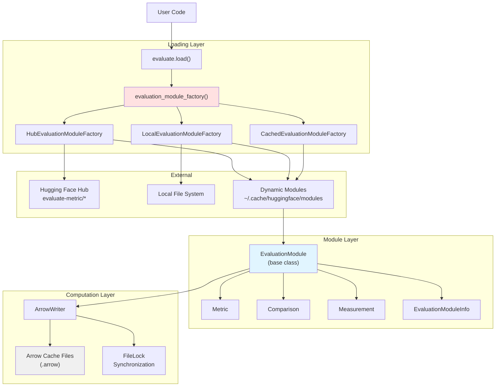
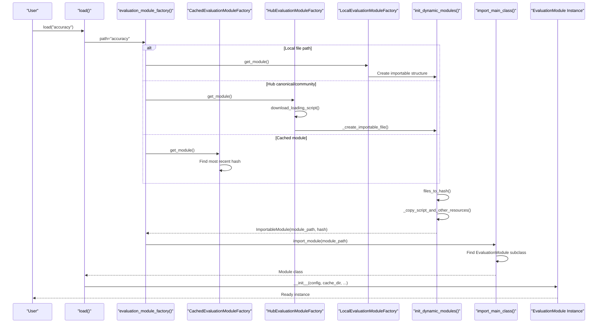
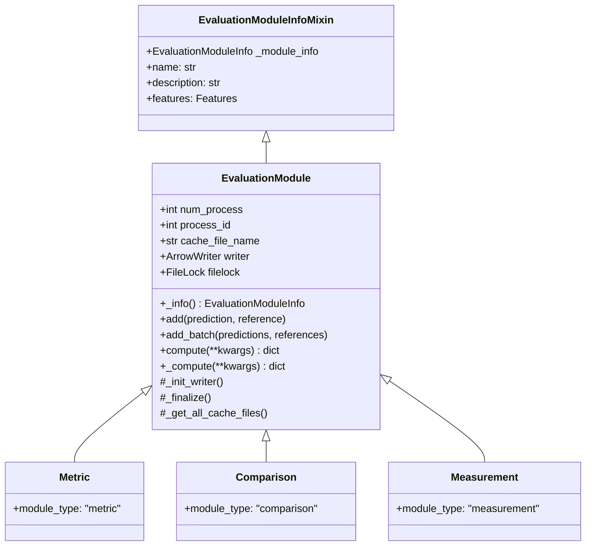
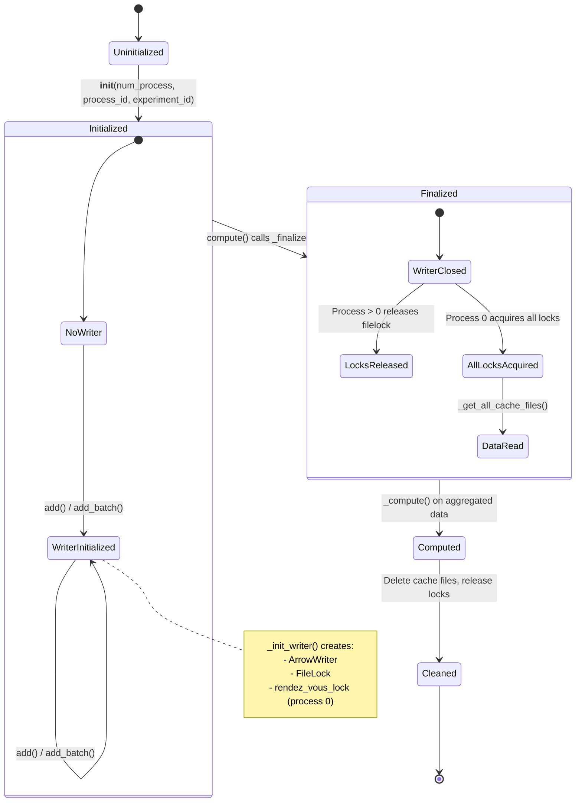
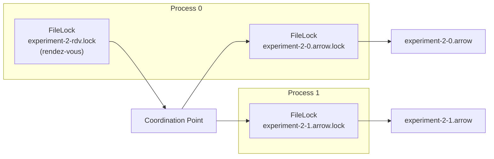

<!-- source: DeepWiki mcp.deepwiki.com · repo huggingface/evaluate · page 3 Core Architecture · fetched 2026-10-26 -->

# Core Architecture

<details>
<summary>Relevant source files</summary>

The following files were used as context for generating this wiki page:

- [src/evaluate/info.py](src/evaluate/info.py)
- [src/evaluate/inspect.py](src/evaluate/inspect.py)
- [src/evaluate/loading.py](src/evaluate/loading.py)
- [src/evaluate/module.py](src/evaluate/module.py)
- [src/evaluate/utils/file_utils.py](src/evaluate/utils/file_utils.py)
- [tests/test_file_utils.py](tests/test_file_utils.py)
- [tests/test_load.py](tests/test_load.py)
- [tests/test_metric.py](tests/test_metric.py)
- [tests/test_metric_common.py](tests/test_metric_common.py)

</details>


This document describes the internal architecture of the `evaluate` library, focusing on the system-level components and their interactions. It covers the factory-based module loading system, the base class hierarchy for evaluation modules, and the distributed computation mechanisms.

For information about using the library from a user perspective, see [Overview](#1). For details on task-specific automated evaluation, see [Evaluator System](#3). For information about individual metric implementations, see [Metrics](#4).

## System Overview

The Evaluate library is built around three core architectural components:

1. **Module Loading System** - A factory-based system for discovering and dynamically importing evaluation modules from multiple sources (Hub, local files, cache)
2. **Evaluation Module Base Classes** - Abstract base classes that define the lifecycle and interface for metrics, comparisons, and measurements
3. **Distributed Computation Infrastructure** - Apache Arrow-based caching and file-locking mechanisms that enable multi-process evaluation

**Architecture Overview**



Sources: [src/evaluate/loading.py:1-687](), [src/evaluate/module.py:1-640](), [src/evaluate/info.py:1-158]()

## Loading Flow

The library uses a three-tier loading strategy to source evaluation modules:



Sources: [src/evaluate/loading.py:689-754](), [src/evaluate/loading.py:559-687](), [src/evaluate/loading.py:74-88]()

## Module Class Hierarchy

All evaluation modules inherit from `EvaluationModule`, which provides a standardized interface:



Sources: [src/evaluate/module.py:83-148](), [src/evaluate/module.py:149-265](), [src/evaluate/info.py:34-119]()

## Lifecycle of an Evaluation

The `EvaluationModule` follows a specific lifecycle from instantiation to result computation:

| Phase | Method | Purpose | Process 0 | Process N |
|-------|--------|---------|-----------|-----------|
| **Initialization** | `__init__()` | Set up configuration, cache directories | Creates experiment lock | Waits for experiment lock |
| **Accumulation** | `add()` / `add_batch()` | Write predictions/references to Arrow cache | Writes to process-0 file | Writes to process-N file |
| **Writer Init** | `_init_writer()` | Create ArrowWriter with file lock | Creates writer | Creates writer |
| **Finalization** | `_finalize()` | Close writer, sync processes | Acquires all locks | Releases lock, returns None |
| **Aggregation** | `compute()` | Read all cache files, compute result | Reads all files, returns dict | Returns None |
| **Cleanup** | `compute()` (end) | Delete cache files, release locks | Deletes files | N/A |

Sources: [src/evaluate/module.py:180-252](), [src/evaluate/module.py:415-486](), [src/evaluate/module.py:381-413]()

**Detailed Lifecycle Diagram**



Sources: [src/evaluate/module.py:625-665](), [src/evaluate/module.py:310-343]()

## Core Design Principles

### Factory Pattern for Module Loading

The library implements a factory pattern with three specialized factories:

- **`HubEvaluationModuleFactory`** - Downloads modules from Hugging Face Hub repositories (`evaluate-metric/*`, `evaluate-comparison/*`, `evaluate-measurement/*`)
- **`LocalEvaluationModuleFactory`** - Loads modules from local filesystem paths
- **`CachedEvaluationModuleFactory`** - Retrieves previously downloaded modules from cache

The `evaluation_module_factory()` function orchestrates these factories based on the input path format.

Sources: [src/evaluate/loading.py:395-398](), [src/evaluate/loading.py:400-441](), [src/evaluate/loading.py:443-509](), [src/evaluate/loading.py:511-557]()

### Hash-Based Module Versioning

Each evaluation module is stored in a hash-based directory structure:

```
~/.cache/huggingface/modules/
└── evaluate_modules/
    └── metrics/
        └── accuracy/
            ├── abc123def456.../  # hash of module code
            │   ├── __init__.py
            │   ├── accuracy.py
            │   └── accuracy.json  # metadata
            └── def789abc012.../  # different version
                └── ...
```

The hash is computed from all Python files using `files_to_hash()`, enabling:
- Multiple versions to coexist
- Automatic cache invalidation on code changes
- Reproducible evaluation across environments

Sources: [src/evaluate/loading.py:91-108](), [src/evaluate/loading.py:360-387]()

### Dynamic Module Import System

The library dynamically imports modules at runtime using `importlib`:

1. **Parse Imports** - `get_imports()` scans the module file for `import` statements and extracts dependencies
2. **Download Dependencies** - `_download_additional_modules()` fetches external imports (marked with `# From: URL`)
3. **Create Importable Structure** - `_create_importable_file()` copies the module into a proper Python package structure with `__init__.py` files
4. **Import Module** - `import_main_class()` dynamically imports the module and finds the `EvaluationModule` subclass

Sources: [src/evaluate/loading.py:139-209](), [src/evaluate/loading.py:212-271](), [src/evaluate/loading.py:273-357](), [src/evaluate/loading.py:74-88]()

### Apache Arrow for Efficient Caching

The library uses Apache Arrow tables for storing predictions and references during evaluation:

- **Memory Efficiency** - Arrow's columnar format provides compact storage
- **Lazy Loading** - Data is not loaded into memory until `compute()` is called
- **Multi-Process Support** - Multiple processes write to separate `.arrow` files
- **Type Safety** - Features define expected data types via `datasets.Features`

The `ArrowWriter` class (from `datasets` library) handles the actual writing, while `EvaluationModule` manages the lifecycle.

Sources: [src/evaluate/module.py:625-665](), [src/evaluate/module.py:233-238]()

### File Locking for Distributed Coordination

Multi-process evaluation requires careful synchronization:

**Lock Types**



**Synchronization Protocol**

1. Each process creates and locks its own cache file (`.arrow.lock`)
2. Process 0 creates a rendez-vous lock (`-rdv.lock`) 
3. On `compute()`, each process calls `_finalize()` which closes its writer
4. Non-zero processes release their locks and return `None`
5. Process 0 acquires locks on all cache files (via `_get_all_cache_files()`)
6. Process 0 reads all Arrow files, computes the final result, and cleans up

Sources: [src/evaluate/module.py:277-308](), [src/evaluate/module.py:310-343](), [src/evaluate/module.py:44-68]()

## Key Data Structures

### EvaluationModuleInfo

Stores metadata about an evaluation module:

```python
@dataclass
class EvaluationModuleInfo:
    description: str
    citation: str
    features: Union[Features, List[Features]]
    inputs_description: str
    homepage: str
    license: str
    codebase_urls: List[str]
    reference_urls: List[str]
    module_type: str  # "metric", "comparison", or "measurement"
    module_name: Optional[str]
    config_name: Optional[str]
    experiment_id: Optional[str]
```

Each module must implement `_info()` to return an instance of this class.

Sources: [src/evaluate/info.py:34-119]()

### ImportableModule

Returned by factory `get_module()` methods:

```python
@dataclass
class ImportableModule:
    module_path: str  # e.g., "evaluate_modules.metrics.accuracy.abc123.accuracy"
    hash: str         # e.g., "abc123def456..."
```

The `module_path` can be passed directly to `importlib.import_module()`.

Sources: [src/evaluate/loading.py:389-393]()

## Execution Paths

The library supports three ways to use an evaluation module:

### Direct Compute

```python
metric = evaluate.load("accuracy")
result = metric.compute(predictions=[0, 1], references=[0, 1])
```

Internally calls `add_batch()` then `_finalize()` then `_compute()`.

### Incremental Accumulation

```python
metric = evaluate.load("accuracy")
metric.add_batch(predictions=[0, 1], references=[0, 1])
metric.add_batch(predictions=[1, 0], references=[1, 1])
result = metric.compute()
```

Writes multiple batches to Arrow cache before final computation.

### Distributed Multi-Process

```python
# On each process
metric = evaluate.load(
    "accuracy",
    num_process=4,
    process_id=rank,
    experiment_id="my_eval"
)
metric.add_batch(predictions=local_preds, references=local_refs)
result = metric.compute()  # Only process 0 returns results
```

Each process writes to its own cache file; process 0 aggregates all results.

Sources: [tests/test_metric.py:155-189](), [tests/test_metric.py:319-368]()

## Configuration Options

The `EvaluationModule.__init__()` accepts several configuration parameters:

| Parameter | Type | Default | Purpose |
|-----------|------|---------|---------|
| `config_name` | str | `"default"` | Sub-configuration name (e.g., multilabel vs multiclass) |
| `keep_in_memory` | bool | `False` | Store data in memory instead of Arrow files |
| `cache_dir` | str | `~/.cache/huggingface/metrics` | Directory for cache files |
| `num_process` | int | `1` | Total number of processes in distributed setup |
| `process_id` | int | `0` | ID of current process (0 to num_process-1) |
| `experiment_id` | str | `"default_experiment"` | Unique identifier for this evaluation run |
| `seed` | int | Random | Random seed for reproducible computation |
| `timeout` | float | `100` | Timeout in seconds for lock acquisition |

Sources: [src/evaluate/module.py:180-222]()

## Error Handling

The system includes several validation checks:

- **Process ID validation** - Ensures `0 <= process_id < num_process` ([src/evaluate/module.py:203-206]())
- **Distributed + keep_in_memory** - Raises `ValueError` if both enabled ([src/evaluate/module.py:207-208]())
- **Lock timeout** - Raises `ValueError` if cannot acquire lock within timeout ([src/evaluate/module.py:334-339]())
- **Feature type validation** - Ensures predictions/references match expected schema ([src/evaluate/module.py:516-546]())

## Integration Points

The core architecture integrates with:

- **`datasets` library** - Provides `Features`, `ArrowWriter`, `ArrowReader`, file locking
- **`huggingface_hub`** - Used for downloading modules from Hub repositories
- **`importlib`** - Dynamic module importing at runtime
- **`pyarrow`** - Underlying Arrow table implementation

Sources: [src/evaluate/module.py:26-33](), [src/evaluate/loading.py:30-34]()

---

For detailed information on specific components:
- Module loading mechanics: [Module Loading System](#2.1)
- Base class implementation: [Evaluation Module Base Classes](#2.2)  
- Distributed computation details: [Caching and Distributed Computation](#2.3)

---

