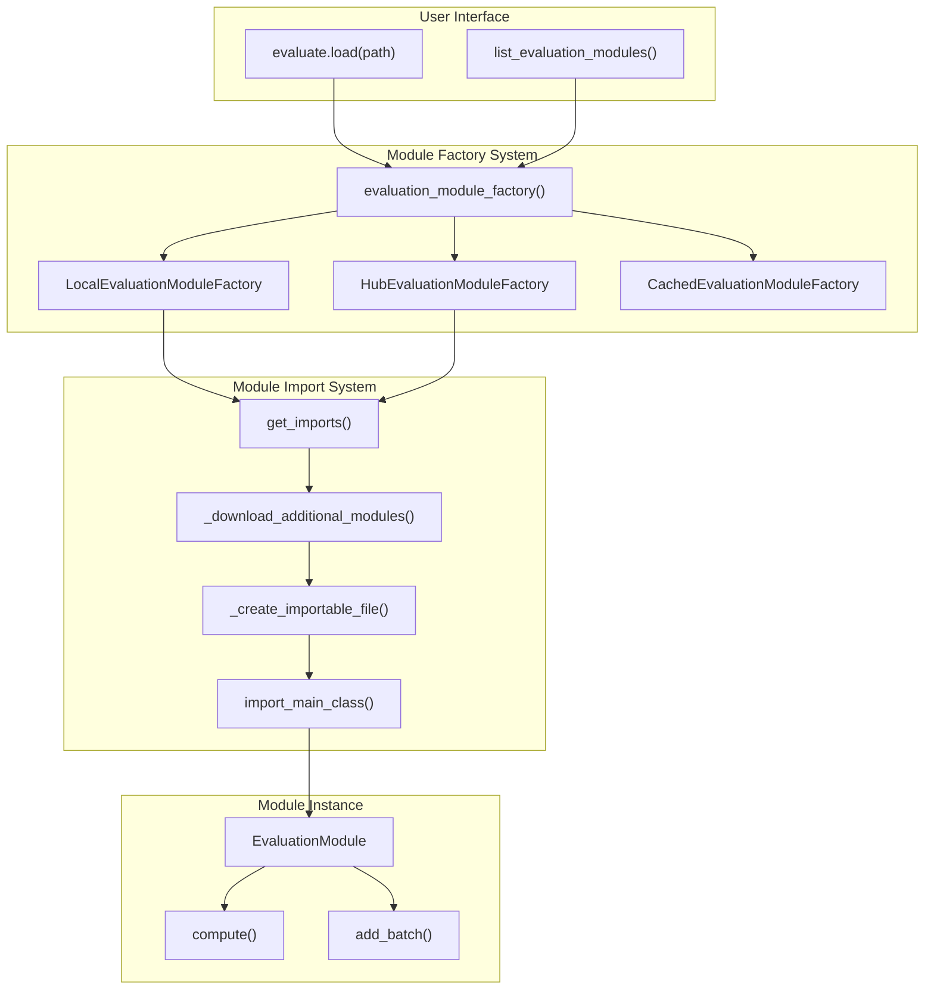
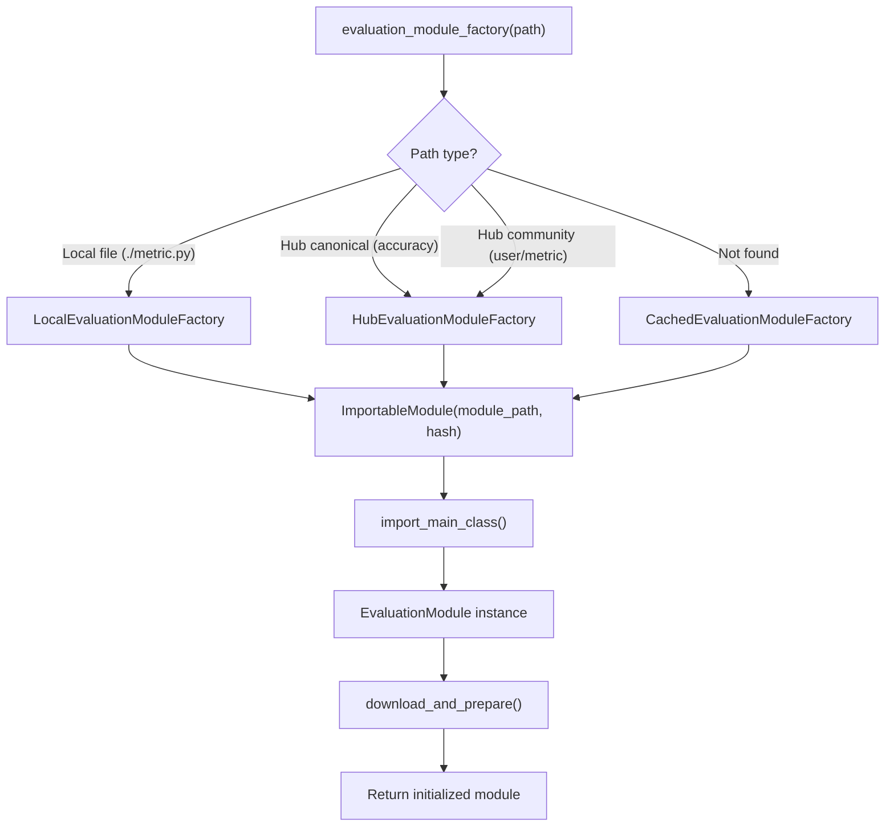
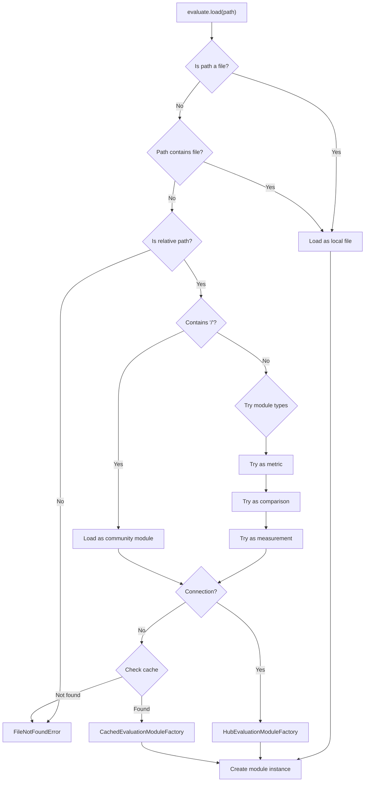
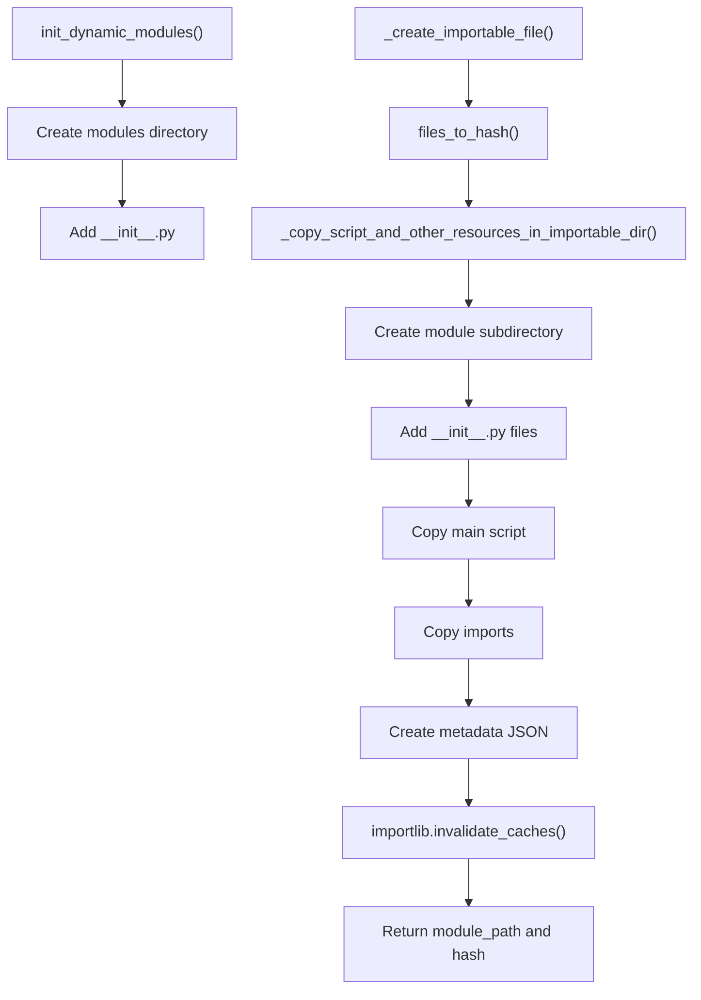
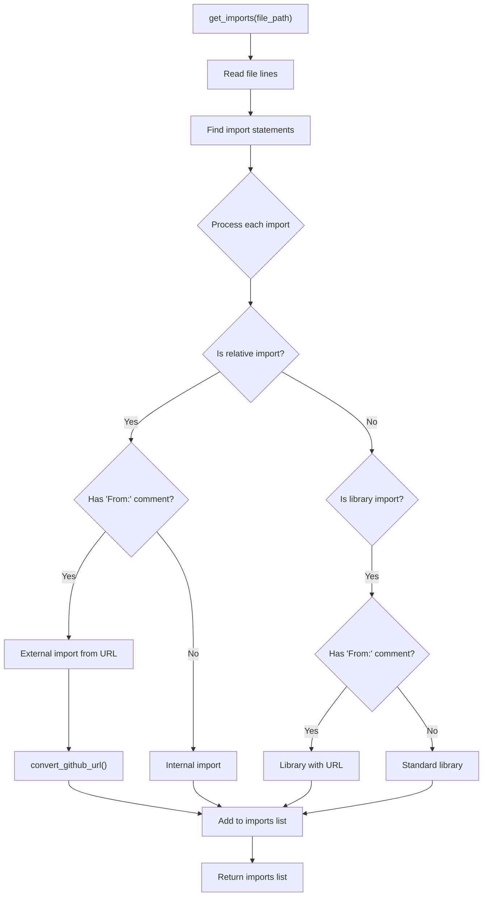
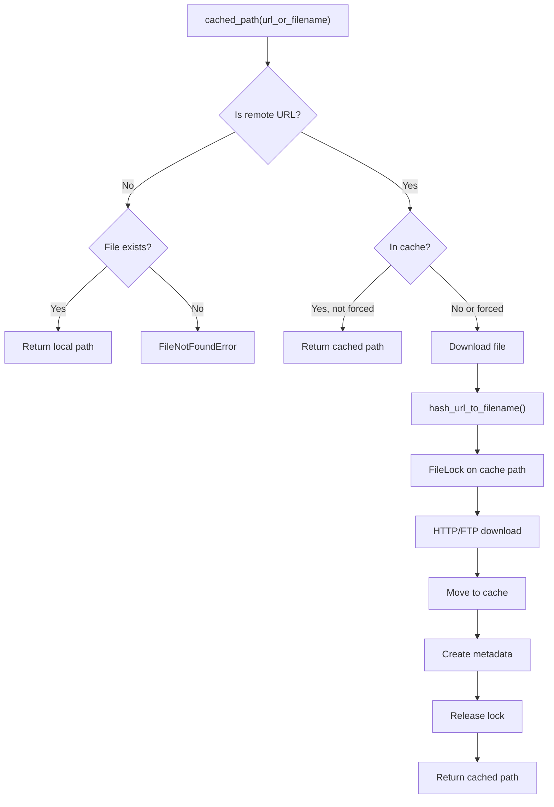

<!-- source: DeepWiki mcp.deepwiki.com · repo huggingface/evaluate · page 3.1 Module Loading System · fetched 2026-10-26 -->

# Module Loading System

<details>
<summary>Relevant source files</summary>

The following files were used as context for generating this wiki page:

- [src/evaluate/info.py](src/evaluate/info.py)
- [src/evaluate/inspect.py](src/evaluate/inspect.py)
- [src/evaluate/loading.py](src/evaluate/loading.py)
- [src/evaluate/module.py](src/evaluate/module.py)
- [src/evaluate/utils/file_utils.py](src/evaluate/utils/file_utils.py)
- [tests/test_file_utils.py](tests/test_file_utils.py)
- [tests/test_load.py](tests/test_load.py)

</details>


The Module Loading System is a core component of the Hugging Face evaluate library, responsible for loading evaluation modules (metrics, comparisons, and measurements) from various sources. This system enables users to seamlessly load modules from local files, the Hugging Face Hub, or a local cache using a unified interface.

For information about the evaluation modules themselves, see [Evaluation Module Base Classes](#2.2).

## Overview

The Module Loading System provides a unified interface (`evaluate.load()`) that handles:

- Loading modules from local files
- Downloading and loading modules from the Hugging Face Hub
- Loading previously cached modules
- Handling module dependencies and imports
- Creating dynamic importable modules
- Caching downloaded modules for reuse



Sources: [src/evaluate/loading.py](), [src/evaluate/module.py]()

## Loading Interface

The primary interface for users is the `evaluate.load()` function, which streamlines the process of loading evaluation modules.

```python
import evaluate

# Load a metric from the Hub
accuracy = evaluate.load("accuracy")

# Load a local metric
my_metric = evaluate.load("./my_metric.py")

# Load a specific configuration of a metric
squad = evaluate.load("squad", config_name="v2")
```

The `load()` function accepts several parameters:

| Parameter | Type | Description |
|-----------|------|-------------|
| `path` | `str` | Path to the evaluation module (local file or Hub identifier) |
| `config_name` | `str` | Module configuration name (for modules with multiple configs) |
| `module_type` | `str` | Type of module ('metric', 'comparison', or 'measurement') |
| `process_id` | `int` | Process ID for distributed evaluation |
| `num_process` | `int` | Total number of processes for distributed evaluation |
| `cache_dir` | `str` | Directory for storing temporary data |
| `experiment_id` | `str` | ID for shared file systems in distributed setups |
| `keep_in_memory` | `bool` | Whether to store results in memory |
| `download_config` | `DownloadConfig` | Configuration for downloading modules |
| `revision` | `str` | Version of the module to load from the Hub |

Sources: [src/evaluate/loading.py:689-771]()

## Module Factory System

The loading system uses a factory pattern through the `evaluation_module_factory()` function, which determines the appropriate factory based on the path provided.



Sources: [src/evaluate/loading.py:559-686]()

### Factory Types

The system includes three factory types:

1. **LocalEvaluationModuleFactory**: Loads modules from local files
   - Parses the file to find imports
   - Resolves local dependencies
   - Creates an importable module in the dynamic modules directory

2. **HubEvaluationModuleFactory**: Downloads and loads modules from the Hugging Face Hub
   - Downloads the module script from the Hub
   - Processes imports and dependencies
   - Creates an importable module

3. **CachedEvaluationModuleFactory**: Loads previously cached modules
   - Finds the most recent cached version
   - Creates an importable reference to the cached module

Sources: [src/evaluate/loading.py:400-440](), [src/evaluate/loading.py:443-508](), [src/evaluate/loading.py:511-556]()

## Module Resolution Process

When resolving a module path, the system follows this process:



The resolution process handles:
- Absolute and relative local paths
- Canonical module names (e.g., "accuracy")
- Community module names (e.g., "username/module_name") 
- Fallback to cache when modules cannot be found

Sources: [src/evaluate/loading.py:559-686]()

## Dynamic Module Import System

To import modules without modifying the Python path, the system uses a dynamic module system:



The dynamic module system:
- Creates a unique directory for each module based on its content hash
- Ensures modules with the same name but different content don't conflict
- Maintains metadata about the module's origin
- Makes modules importable without modifying sys.path

Sources: [src/evaluate/loading.py:56-71](), [src/evaluate/loading.py:360-386]()

## Module Import Handling

The system handles imports within evaluation modules using `get_imports()`:



The import system supports:
- Regular imports (`import module`)
- Relative imports (`from .module import X`)
- External imports with a "From:" comment (`from .module import X  # From: https://example.com/module.py`)
- GitHub repository imports that are automatically processed

Sources: [src/evaluate/loading.py:139-209]()

## Module Download and Caching

The system uses `cached_path()` to download and cache modules:



Features of the caching system:
- Downloads files to a central cache directory
- Uses content hashing to avoid name collisions
- Stores metadata including the source URL and ETag
- Supports HTTP/HTTPS and FTP protocols
- Handles network errors and retries

Sources: [src/evaluate/utils/file_utils.py:142-578]()

## Creating Custom Evaluation Modules

Users can create custom evaluation modules by subclassing `EvaluationModule`:

```python
import evaluate
from evaluate import EvaluationModuleInfo
from datasets import Features, Value

class MyCustomMetric(evaluate.EvaluationModule):
    def _info(self):
        return EvaluationModuleInfo(
            description="My custom metric",
            citation="...",
            features=Features({
                "predictions": Value("int"),
                "references": Value("int")
            })
        )
    
    def _compute(self, predictions, references):
        # Implement the computation
        return {"score": sum(p == r for p, r in zip(predictions, references)) / len(predictions)}
```

Custom modules can be:
- Used locally by path
- Shared on the Hugging Face Hub
- Discovered using `evaluate.list_evaluation_modules()`

Sources: [src/evaluate/module.py:149-732]()

## Key Components Reference

| Component | File Path | Purpose |
|-----------|-----------|---------|
| `evaluate.load()` | [src/evaluate/loading.py:689-771]() | Main function to load evaluation modules |
| `evaluation_module_factory()` | [src/evaluate/loading.py:559-686]() | Factory function that creates appropriate module factories |
| `LocalEvaluationModuleFactory` | [src/evaluate/loading.py:400-440]() | Factory for loading modules from local files |
| `HubEvaluationModuleFactory` | [src/evaluate/loading.py:443-508]() | Factory for loading modules from the Hugging Face Hub |
| `CachedEvaluationModuleFactory` | [src/evaluate/loading.py:511-556]() | Factory for loading previously cached modules |
| `get_imports()` | [src/evaluate/loading.py:139-209]() | Function to parse imports in module files |
| `_download_additional_modules()` | [src/evaluate/loading.py:212-270]() | Downloads dependencies for a module |
| `_create_importable_file()` | [src/evaluate/loading.py:360-386]() | Creates an importable module in the dynamic modules directory |
| `import_main_class()` | [src/evaluate/loading.py:74-88]() | Imports the main class from a module |
| `cached_path()` | [src/evaluate/utils/file_utils.py:142-578]() | Downloads and caches files from URLs |
| `init_dynamic_modules()` | [src/evaluate/loading.py:56-71]() | Initializes the dynamic modules directory |

## Conclusion

The Module Loading System is a fundamental component of the evaluate library that provides a flexible and user-friendly way to access evaluation modules. Key strengths include:

- Unified interface for loading modules from any source
- Robust error handling and fallback mechanisms
- Efficient caching to reduce network requests and improve performance
- Support for module dependencies and external imports
- Seamless integration with the Hugging Face Hub ecosystem

By abstracting away the complexity of loading modules from different sources, it allows users to focus on evaluation rather than infrastructure.

---

