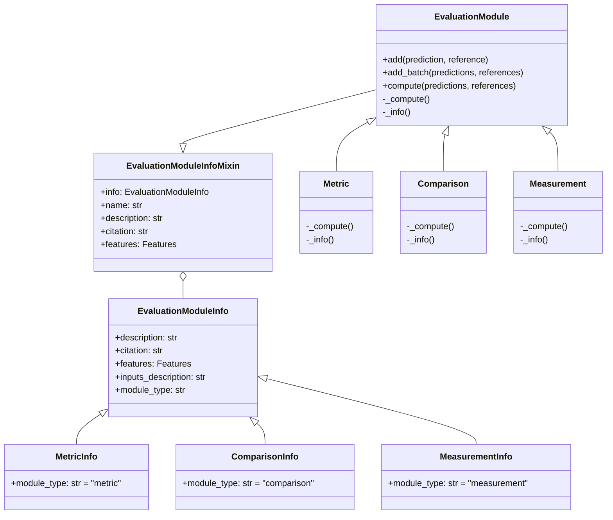
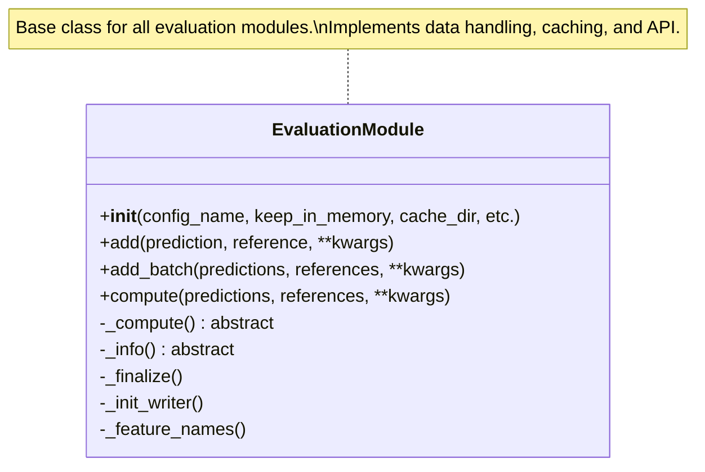
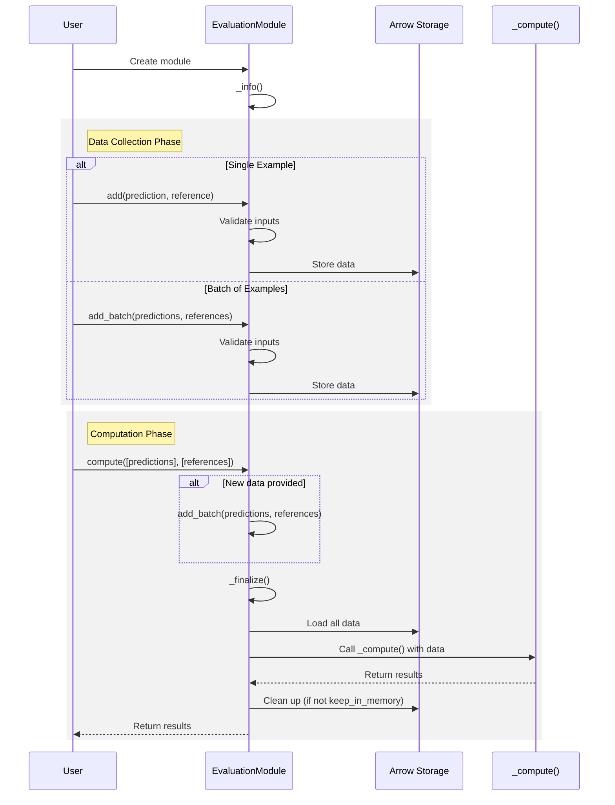
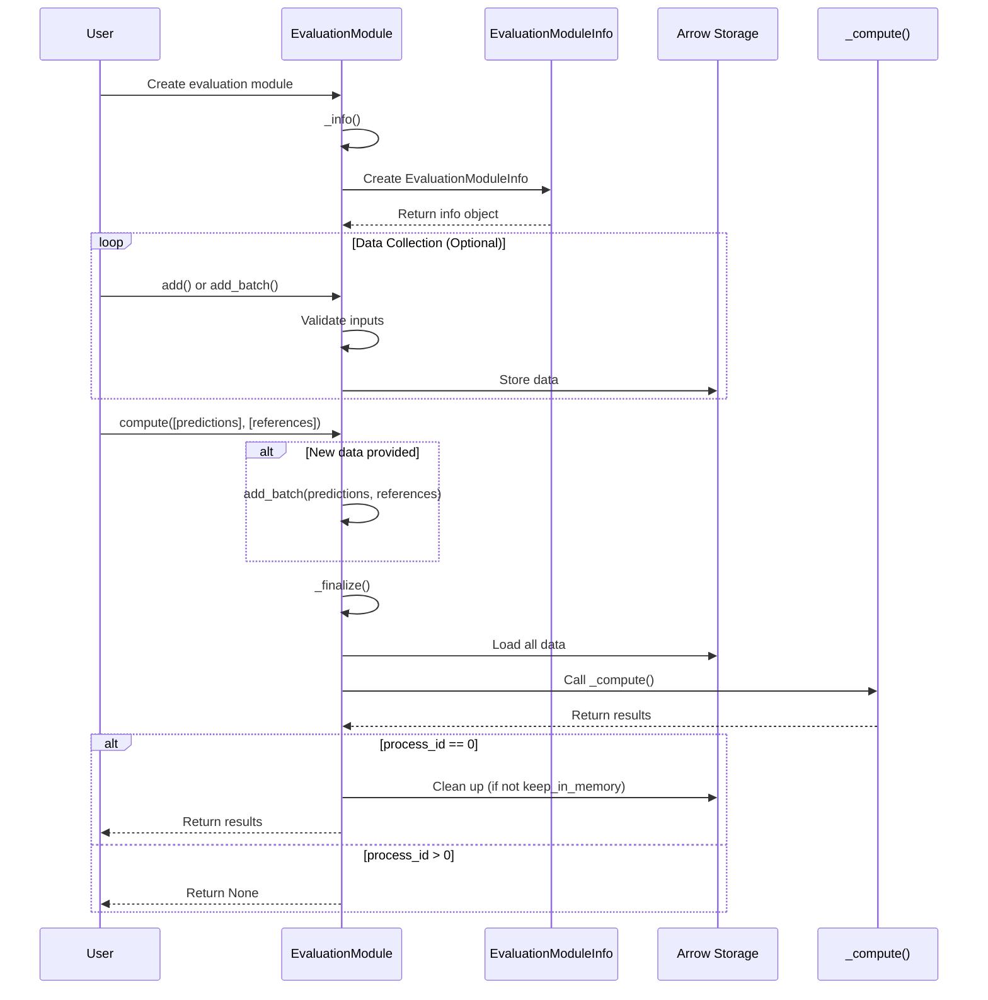

<!-- source: DeepWiki mcp.deepwiki.com · repo huggingface/evaluate · page 3.2 Evaluation Module Base Classes · fetched 2026-10-26 -->

# Evaluation Module Base Classes

<details>
<summary>Relevant source files</summary>

The following files were used as context for generating this wiki page:

- [src/evaluate/info.py](src/evaluate/info.py)
- [src/evaluate/inspect.py](src/evaluate/inspect.py)
- [src/evaluate/loading.py](src/evaluate/loading.py)
- [src/evaluate/module.py](src/evaluate/module.py)
- [src/evaluate/utils/file_utils.py](src/evaluate/utils/file_utils.py)
- [tests/test_metric.py](tests/test_metric.py)
- [tests/test_metric_common.py](tests/test_metric_common.py)

</details>


This page documents the core base classes that power the evaluation modules in the evaluate library. These classes provide the foundation for implementing metrics, comparisons, and measurements that can evaluate machine learning models and datasets.

For information about specific metric implementations, see [Metrics](#4). For information about the module loading system, see [Module Loading System](#2.1).

## Class Hierarchy and Relationships

The evaluate library uses a hierarchical class structure to implement its evaluation functionality. At the core are two main base classes:

1. `EvaluationModuleInfo` - Stores metadata about an evaluation module
2. `EvaluationModule` - Provides the core functionality for all evaluation modules

From these base classes, specialized classes are derived for different types of evaluations:



This class hierarchy allows for:
- Common functionality to be implemented once in the base classes
- Type-specific behavior to be implemented in the derived classes
- Consistent API across all evaluation module types

Sources: `src/evaluate/module.py`, `src/evaluate/info.py`, `docs/source/package_reference/main_classes.mdx`

## Types of Evaluation Modules

The evaluate library provides three types of evaluation modules, each designed for a specific purpose:

1. **Metrics** - Evaluate model outputs against ground truth references (e.g., accuracy, F1 score)
2. **Comparisons** - Compare outputs from two or more models (e.g., McNemar's test)
3. **Measurements** - Analyze properties of datasets or model outputs without requiring references (e.g., word length, toxicity)

Each type has its own specialized base class (`Metric`, `Comparison`, `Measurement`) that inherits from `EvaluationModule` and provides type-specific behavior.

Sources: `docs/source/package_reference/main_classes.mdx:17-25`

## EvaluationModuleInfo

The `EvaluationModuleInfo` class is responsible for storing metadata about an evaluation module. This includes information like:

- `description` - A text description of what the module does
- `citation` - Academic citation for the evaluation method
- `features` - The expected input and output formats
- `homepage` - URL to the homepage for the evaluation method
- `license` - The license under which the evaluation is distributed
- `module_type` - The type of module (metric, comparison, or measurement)

### Specialized Info Classes

`EvaluationModuleInfo` has three specialized subclasses, one for each type of evaluation module:

1. `MetricInfo` - For metric modules (e.g., accuracy, F1 score)
2. `ComparisonInfo` - For comparison modules (e.g., comparing two models)
3. `MeasurementInfo` - For measurement modules (e.g., analyzing dataset properties)

The main difference between these subclasses is the `module_type` field, which is set to "metric", "comparison", or "measurement" respectively.

```python
@dataclass
class MetricInfo(EvaluationModuleInfo):
    module_type: str = "metric"

@dataclass
class ComparisonInfo(EvaluationModuleInfo):
    module_type: str = "comparison"

@dataclass
class MeasurementInfo(EvaluationModuleInfo):
    module_type: str = "measurement"
```

Sources: `src/evaluate/info.py:35-157`

## EvaluationModuleInfoMixin

The `EvaluationModuleInfoMixin` class is a helper class that exposes attributes of `EvaluationModuleInfo` directly on the `EvaluationModule` class. This makes it easier to access metadata fields without having to go through the `info` property.

For example, instead of writing `module.info.description`, you can simply write `module.description`.

Properties exposed by this mixin include:
- `name`: The name of the module
- `experiment_id`: The experiment identifier
- `description`: The module description
- `citation`: The academic citation
- `features`: The expected input/output formats
- `inputs_description`: Detailed description of the inputs
- `homepage`: URL to the module's homepage
- `license`: The module's license
- `module_type`: The type of module (metric, comparison, or measurement)

Sources: `src/evaluate/module.py:83-147`

## EvaluationModule

The `EvaluationModule` class is the primary base class for all evaluation modules. It inherits from `EvaluationModuleInfoMixin` and provides the core functionality for:

- Loading and validating inputs
- Storing data during evaluation
- Computing results
- Distributed computation
- Caching results



Sources: `src/evaluate/module.py:149-590`

### Key Methods

The `EvaluationModule` class defines several key methods that all evaluation modules must implement:

1. **Abstract Methods** (to be implemented by subclasses):
   - `_info()`: Returns an `EvaluationModuleInfo` object with metadata about the module
   - `_compute()`: Implements the actual computation logic

2. **Public API Methods**:
   - `add(prediction, reference, **kwargs)`: Add a single prediction/reference pair
   - `add_batch(predictions, references, **kwargs)`: Add a batch of prediction/reference pairs
   - `compute(predictions, references, **kwargs)`: Compute results on provided data or previously added data

3. **Internal Helper Methods**:
   - `_finalize()`: Prepares data for computation
   - `_init_writer()`: Initializes the Arrow writer for data storage
   - `_feature_names()`: Returns the names of the expected features

Sources: `src/evaluate/module.py:415-590`

### Initialization Parameters

The `EvaluationModule` constructor accepts several parameters to customize its behavior:

```python
def __init__(
    self,
    config_name: Optional[str] = None,
    keep_in_memory: bool = False,
    cache_dir: Optional[str] = None,
    num_process: int = 1,
    process_id: int = 0,
    seed: Optional[int] = None,
    experiment_id: Optional[str] = None,
    hash: str = None,
    max_concurrent_cache_files: int = 10000,
    timeout: Union[int, float] = 100,
    **kwargs,
):
```

Key parameters include:
- `config_name`: Configuration name for the module
- `keep_in_memory`: Whether to keep data in memory (not compatible with distributed computation)
- `cache_dir`: Directory to store temporary files
- `num_process`: Number of processes for distributed computation
- `process_id`: ID of the current process
- `seed`: Random seed for reproducibility
- `experiment_id`: ID for the current experiment, used to separate experiments in distributed settings

Sources: `src/evaluate/module.py:180-193`

## Data Flow and Processing

The following diagram illustrates how data flows through an evaluation module:



This process allows for flexibility in how data is provided to the module:
1. You can add data incrementally using `add()` or `add_batch()` and then call `compute()`
2. You can provide all data at once directly to `compute()`
3. You can mix these approaches, adding some data incrementally and some in the final `compute()` call

Sources: `src/evaluate/module.py:415-486`, `tests/test_metric.py:156-189`

### Input Format Support

Evaluation modules can handle various input formats, including:
- Python lists
- NumPy arrays
- PyTorch tensors
- TensorFlow tensors

The `EvaluationModule` class automatically converts these formats to the expected types based on the `Features` defined in the module's info.

```python
# All these formats are supported:
module.compute(predictions=[1, 2, 3, 4], references=[1, 2, 3, 4])  # Python lists
module.compute(predictions=np.array([1, 2, 3, 4]), references=np.array([1, 2, 3, 4]))  # NumPy arrays
module.compute(predictions=torch.tensor([1, 2, 3, 4]), references=torch.tensor([1, 2, 3, 4]))  # PyTorch tensors
module.compute(predictions=tf.constant([1, 2, 3, 4]), references=tf.constant([1, 2, 3, 4]))  # TensorFlow tensors
```

Sources: `tests/test_metric.py:435-501`

### Input Validation

The `EvaluationModule` class enforces the expected input formats defined in the `features` field of the module's info. It validates inputs by:
1. Checking that all required inputs are provided
2. Verifying that the inputs match the expected types
3. Ensuring that all inputs have the same number of examples

If the inputs don't match the expected format, an error is raised with a detailed message about what went wrong.

Sources: `src/evaluate/module.py:510-546`

## Storage and Caching

Evaluation modules use Arrow files to cache prediction and reference data. This allows for efficient storage and retrieval, especially when working with large datasets.

The storage mechanism is determined by the `keep_in_memory` parameter:
- If `keep_in_memory=True`, data is stored in memory using an Arrow buffer
- If `keep_in_memory=False` (default), data is stored in Arrow files in the `cache_dir` directory

The caching system handles file locking and cleanup to ensure that:
1. Multiple processes don't try to write to the same file simultaneously
2. Temporary files are deleted when they're no longer needed

Sources: `src/evaluate/module.py:276-309`, `src/evaluate/module.py:385-414`

## Distributed Computation

The evaluate library supports distributed computation, where multiple processes can work together to compute a metric. This is especially useful for large datasets or computationally intensive metrics.

To use distributed computation:
1. Create multiple instances of the same evaluation module
2. Assign each instance a unique process ID (0 to num_process-1)
3. Use the same experiment ID for all instances
4. Add data to each instance
5. Call compute() on all instances

Only the instance with `process_id=0` will return results; the other instances will return `None`.

Key parameters for distributed computation:
- `num_process`: Total number of processes
- `process_id`: ID of the current process (0 to num_process-1)
- `experiment_id`: Shared ID to group processes together
- `timeout`: Time to wait for other processes to complete in seconds

Sources: `src/evaluate/module.py:191-208`, `src/evaluate/module.py:310-380`, `tests/test_metric.py:319-391`

## Combined Evaluations

The evaluate library provides a `combine` function that allows multiple evaluation modules to be used together. This creates a `CombinedEvaluations` object that exposes the same API as individual evaluation modules but runs multiple evaluations in one go.

```python
# Example usage:
combined = evaluate.combine([accuracy, f1, precision])
results = combined.compute(predictions=[0, 1, 1, 0], references=[0, 1, 0, 1])
# results contains scores from all three metrics
```

By default, this will return a dictionary with keys for each metric's outputs. You can also force prefixing to avoid name collisions:

```python
# With force_prefix=True:
combined = evaluate.combine({'acc': accuracy, 'f1': f1}, force_prefix=True)
# Results will have keys like 'acc_accuracy' and 'f1_precision'
```

Sources: `tests/test_metric.py:673-749`

## Creating Custom Evaluation Modules

To create a custom evaluation module, you need to subclass `EvaluationModule` (or one of its subclasses) and implement the `_info()` and `_compute()` methods:

```python
class DummyMetric(EvaluationModule):
    def _info(self):
        return EvaluationModuleInfo(
            description="dummy metric for tests",
            citation="insert citation here",
            features=Features({"predictions": Value("int64"), "references": Value("int64")}),
        )

    def _compute(self, predictions, references):
        result = {}
        if not predictions:
            return result
        else:
            result["accuracy"] = sum(i == j for i, j in zip(predictions, references)) / len(predictions)
            try:
                result["set_equality"] = set(predictions) == set(references)
            except TypeError:
                result["set_equality"] = None
        return result
```

The `_info()` method returns an `EvaluationModuleInfo` object that describes the metric, including its expected inputs and outputs.

The `_compute()` method takes the collected predictions and references and computes the actual metric values, returning them as a dictionary.

Sources: `tests/test_metric.py:16-70`

## Life Cycle of an Evaluation Module

An evaluation module goes through several stages during its life cycle:



This life cycle ensures that:
1. Metadata is properly initialized
2. Data is collected and stored efficiently
3. Computation is performed on all data
4. Resources are cleaned up afterward

Sources: `src/evaluate/module.py:415-486`, `tests/test_metric.py:156-189`

## Summary

The evaluation module base classes provide a robust foundation for implementing various types of evaluations in the evaluate library. By understanding these base classes, you can:

1. Use existing evaluation modules effectively
2. Extend the library with custom evaluation modules
3. Work with distributed computation for large-scale evaluations

The consistent API across all module types makes it easy to switch between different evaluations while maintaining the same workflow.

Sources: `src/evaluate/module.py`, `src/evaluate/info.py`, `tests/test_metric.py`

---

