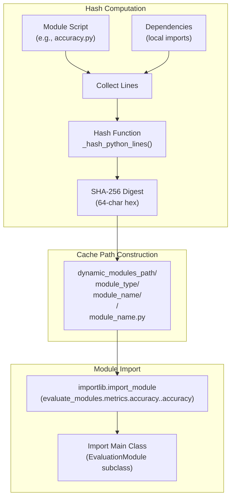
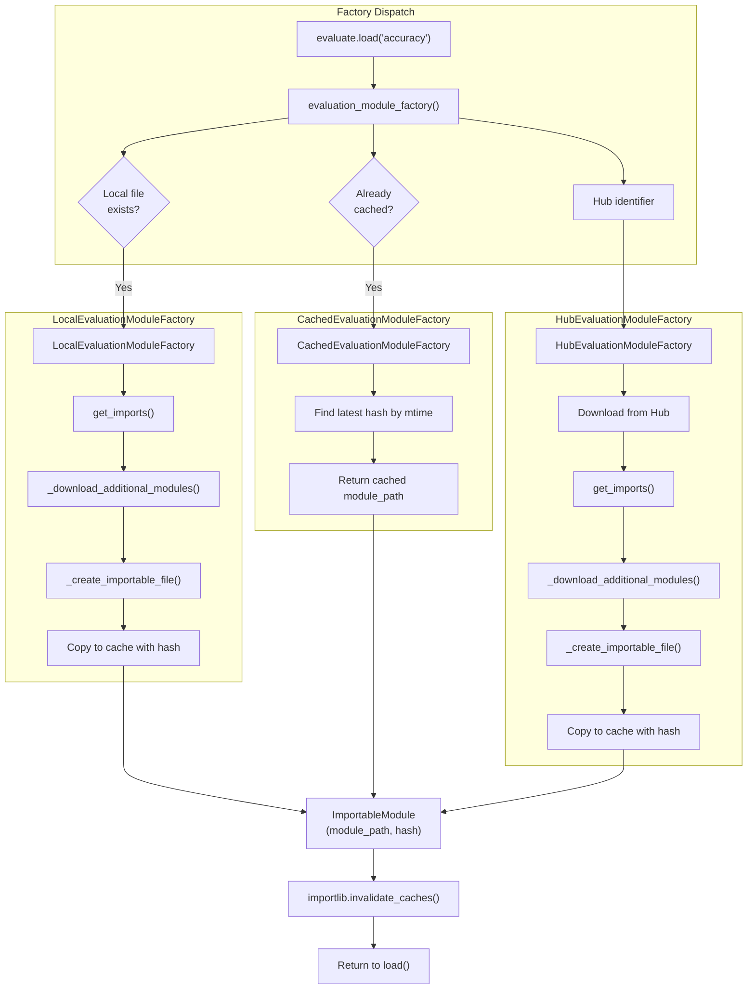
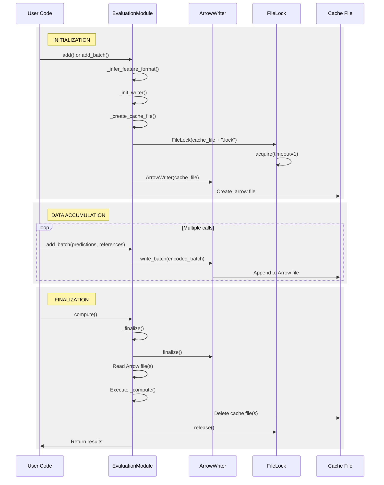
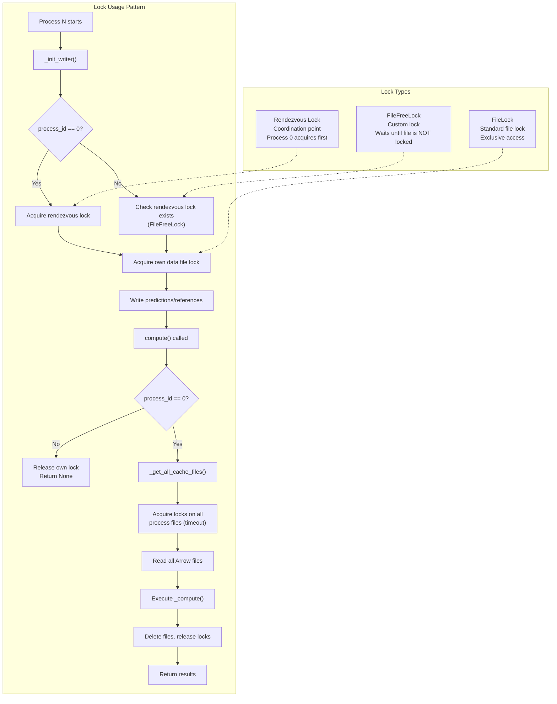
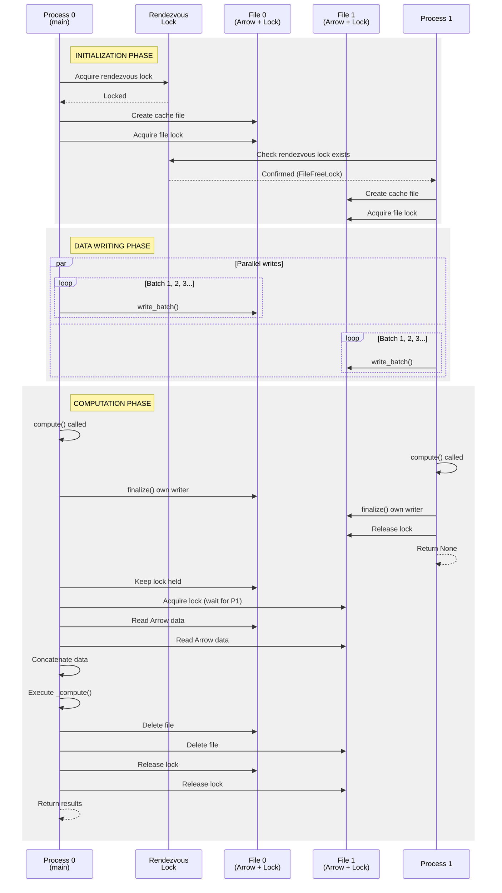

<!-- source: DeepWiki mcp.deepwiki.com · repo huggingface/evaluate · page 3.3 Caching and Distributed Computation · fetched 2026-10-26 -->

# Caching and Distributed Computation

<details>
<summary>Relevant source files</summary>

The following files were used as context for generating this wiki page:

- [src/evaluate/info.py](src/evaluate/info.py)
- [src/evaluate/inspect.py](src/evaluate/inspect.py)
- [src/evaluate/loading.py](src/evaluate/loading.py)
- [src/evaluate/module.py](src/evaluate/module.py)
- [src/evaluate/utils/file_utils.py](src/evaluate/utils/file_utils.py)
- [tests/test_metric.py](tests/test_metric.py)
- [tests/test_metric_common.py](tests/test_metric_common.py)

</details>


This page documents the caching infrastructure and distributed computation support in the evaluate library. It covers three interconnected systems: (1) module script caching for dynamic code loading, (2) data caching with Apache Arrow for efficient prediction/reference storage, and (3) distributed evaluation coordination using file-based locks. For information about module loading sources and factories, see [Module Loading System](#3.1). For the base evaluation module interface, see [Evaluation Module Base Classes](#3.2).

---

## Purpose and Architecture

The caching system serves two distinct purposes:

1. **Module Caching**: Downloaded evaluation module scripts are cached in `~/.cache/huggingface/modules/` to avoid repeated downloads and enable offline evaluation
2. **Data Caching**: During evaluation, predictions and references are written to Apache Arrow files in `~/.cache/huggingface/evaluate/` to support distributed computation and large-scale evaluation

The distributed computation system enables multi-process evaluation where different processes add data independently and a main process aggregates results, critical for non-additive metrics like F1 score.

**Sources**: [src/evaluate/loading.py:56-71](), [src/evaluate/module.py:180-223](), [src/evaluate/utils/file_utils.py:41-57]()

---

## Module Caching System

### Dynamic Modules Cache

Evaluation modules are Python scripts that must be dynamically imported. The `init_dynamic_modules()` function creates a special cache directory that is added to Python's import path:

```
~/.cache/huggingface/modules/
└── evaluate_modules/
    ├── __init__.py
    ├── metrics/
    │   ├── __init__.py
    │   └── accuracy/
    │       ├── __init__.py
    │       └── <hash>/
    │           ├── __init__.py
    │           ├── accuracy.py
    │           └── accuracy.json  # metadata
    ├── comparisons/
    └── measurements/
```

Each module type (metric, comparison, measurement) has its own subdirectory, and within each module name subdirectory, hash-based subdirectories enable multiple versions to coexist.

**Sources**: [src/evaluate/loading.py:56-71](), [src/evaluate/loading.py:363-390]()

### Hash-Based Versioning

The `files_to_hash()` function computes a SHA-256 hash of the module script and all its dependencies to create a unique identifier:



This hash-based system allows different versions of the same module to be cached simultaneously without conflicts, critical when switching between local and Hub versions or testing modifications.

**Sources**: [src/evaluate/loading.py:91-108](), [src/evaluate/loading.py:363-390]()

### Factory-Based Loading and Caching

Three factory classes handle module loading from different sources, all utilizing the cache:



The `CachedEvaluationModuleFactory` provides fast loading by finding the most recently modified cached version without any network requests. This enables offline evaluation once a module has been loaded at least once.

**Sources**: [src/evaluate/loading.py:403-560](), [src/evaluate/loading.py:562-689]()

---

## Data Caching with Apache Arrow

### Cache File Lifecycle

During evaluation, the `EvaluationModule` writes predictions and references to Apache Arrow files. The lifecycle differs between single-process and distributed modes:



The cache files use a specific naming convention: `{experiment_id}-{num_process}-{process_id}.arrow`. The `experiment_id` distinguishes between concurrent evaluations on the same filesystem.

**Sources**: [src/evaluate/module.py:277-308](), [src/evaluate/module.py:625-658](), [src/evaluate/module.py:381-413]()

### Arrow vs In-Memory Storage

The `keep_in_memory` parameter controls storage backend:

| Parameter | Storage | Use Case | Distributed? |
|-----------|---------|----------|--------------|
| `keep_in_memory=False` | Arrow files on disk | Large-scale evaluation, distributed setups | Yes |
| `keep_in_memory=True` | In-memory buffer | Small datasets, single-process only | No |

When `keep_in_memory=True`, the system uses a `BytesIO` buffer instead of disk files:

**Sources**: [src/evaluate/module.py:180-223](), [src/evaluate/module.py:392-413]()

### Cache Directory Structure

Data cache files are organized by module and configuration:

```
~/.cache/huggingface/evaluate/
└── <module_name>/
    └── <config_name>/
        ├── <experiment_id>-<num_process>-0.arrow
        ├── <experiment_id>-<num_process>-0.arrow.lock
        ├── <experiment_id>-<num_process>-1.arrow
        ├── <experiment_id>-<num_process>-1.arrow.lock
        └── <experiment_id>-<num_process>-rdv.lock
```

Each process writes to its own `.arrow` file. The `.lock` files coordinate access, and the `-rdv.lock` file serves as a rendezvous point for distributed synchronization.

**Sources**: [src/evaluate/module.py:266-275](), [src/evaluate/module.py:277-308]()

---

## Distributed Evaluation Coordination

### Process Configuration

Distributed evaluation requires specifying process topology:

```python
# Process 0 (main process)
metric = evaluate.load(
    "accuracy",
    num_process=4,       # Total number of processes
    process_id=0,        # This process's ID (0 to num_process-1)
    experiment_id="exp_1"  # Shared identifier for this evaluation
)

# Process 1, 2, 3 would use process_id=1, 2, 3
```

The `experiment_id` is critical when multiple distributed evaluations share the same filesystem, preventing cache file collisions.

**Sources**: [src/evaluate/module.py:180-223](), [tests/test_metric.py:319-417]()

### Lock-Based Synchronization

The distributed coordination system uses three types of locks:



The `FileFreeLock` class is a custom lock implementation that waits until a file **cannot** be locked, indicating another process has acquired it. This is used to verify that expected lock files exist before proceeding.

**Sources**: [src/evaluate/module.py:44-68](), [src/evaluate/module.py:625-658](), [src/evaluate/module.py:310-343](), [src/evaluate/module.py:361-379]()

### Distributed Evaluation Timeline

Here's how a two-process distributed evaluation proceeds:



Only process 0 returns results; all other processes return `None` after writing their data and releasing their locks.

**Sources**: [src/evaluate/module.py:381-413](), [src/evaluate/module.py:415-487](), [tests/test_metric.py:319-417]()

### Synchronization Checks

Before gathering data, process 0 performs validation checks:

1. **`_check_all_processes_locks()`**: Verifies that all expected lock files exist (one per process), ensuring all processes have started writing data
2. **`_check_rendez_vous()`**: Verifies the rendezvous lock exists before attempting to acquire process file locks

These checks use `FileFreeLock` with a configurable timeout (default 100 seconds) to detect missing processes or configuration errors.

**Sources**: [src/evaluate/module.py:345-379]()

---

## Concurrent Evaluation on Single Filesystem

Multiple independent evaluations can run simultaneously on the same filesystem using different `experiment_id` values:

```python
# Evaluation 1
metric1 = evaluate.load("f1", experiment_id="exp_1")
metric1.add_batch(predictions=[...], references=[...])
result1 = metric1.compute()

# Evaluation 2 (concurrent, same filesystem)
metric2 = evaluate.load("f1", experiment_id="exp_2")
metric2.add_batch(predictions=[...], references=[...])
result2 = metric2.compute()
```

Without distinct `experiment_id` values, concurrent evaluations would attempt to lock the same cache files, causing `ValueError: Error in _create_cache_file: another evaluation module instance is already using the local cache file`.

In distributed settings, all processes **must** use the same `experiment_id` to coordinate on the same set of cache files.

**Sources**: [src/evaluate/module.py:277-308](), [tests/test_metric.py:371-406]()

---

## Cache File Naming and Discovery

### Naming Convention

Cache files follow strict naming patterns:

| Component | Pattern | Example |
|-----------|---------|---------|
| Module script | `{module_name}-{hash}.py` | `accuracy-a1b2c3d4...py` |
| Data file | `{experiment_id}-{num_process}-{process_id}.arrow` | `default_experiment-4-2.arrow` |
| Data lock | `{experiment_id}-{num_process}-{process_id}.arrow.lock` | `default_experiment-4-2.arrow.lock` |
| Rendezvous lock | `{experiment_id}-{num_process}-rdv.lock` | `default_experiment-4-rdv.lock` |

The 64-character hash subdirectories in the module cache are the hexadecimal SHA-256 digest of the module code and dependencies.

**Sources**: [src/evaluate/loading.py:91-108](), [src/evaluate/module.py:277-308]()

### Cache File Discovery

When loading a cached module, `CachedEvaluationModuleFactory` finds the most recent version by modification time:

```python
hashes = [h for h in os.listdir(importable_directory_path) if len(h) == 64]
hash = sorted(hashes, key=_get_modification_time)[-1]
```

This allows automatic fallback to cached versions when offline or when the Hub is unreachable.

**Sources**: [src/evaluate/loading.py:531-559]()

---

## Configuration and Environment Variables

Several configuration options control caching behavior:

| Option | Environment Variable | Default | Purpose |
|--------|---------------------|---------|---------|
| `cache_dir` | `HF_EVALUATE_CACHE` | `~/.cache/huggingface/evaluate` | Data cache location |
| `dynamic_modules_path` | `HF_MODULES_CACHE` | `~/.cache/huggingface/modules` | Module script cache |
| `max_concurrent_cache_files` | N/A | `10000` | Max unique cache file names |
| `timeout` | N/A | `100` seconds | Lock acquisition timeout |
| `keep_in_memory` | N/A | `False` | Use memory instead of disk |

These can be overridden in the `load()` function or `EvaluationModule` constructor.

**Sources**: [src/evaluate/loading.py:692-774](), [src/evaluate/module.py:180-223](), [src/evaluate/config.py]()

---

## Error Handling and Edge Cases

### Common Cache-Related Errors

| Error | Cause | Solution |
|-------|-------|----------|
| `ValueError: Error in _create_cache_file` | Multiple processes using same experiment_id in non-distributed mode | Set unique experiment_id or configure num_process correctly |
| `FileNotFoundError: Metric ... is not cached` | Attempting to load from cache without prior download | Ensure network access or use local path |
| `ValueError: Cannot acquire lock` | Lock file timeout or missing process | Check all processes started, increase timeout |
| `ValueError: Using 'keep_in_memory' is not possible in distributed setting` | keep_in_memory=True with num_process > 1 | Use disk-based caching for distributed |

**Sources**: [src/evaluate/module.py:277-308](), [src/evaluate/loading.py:531-559]()

### Cache Cleanup

Cache files are automatically deleted after successful computation by process 0. However, if a process crashes, lock files may remain. These can be safely deleted manually. The module script cache is persistent and grows over time as new versions are downloaded.

To clear the module cache:
```bash
rm -rf ~/.cache/huggingface/modules/evaluate_modules/
```

To clear the data cache:
```bash
rm -rf ~/.cache/huggingface/evaluate/
```

**Sources**: [src/evaluate/module.py:469-482]()

---

## Performance Considerations

### Arrow Format Benefits

Apache Arrow provides several performance advantages:

1. **Zero-copy reads**: Data can be accessed without deserialization
2. **Columnar storage**: Efficient for batch operations
3. **Memory mapping**: Large datasets can be processed without loading entirely into RAM
4. **Language interoperability**: Same format works across Python, C++, Java, etc.

The `ArrowWriter` buffers data in memory and periodically flushes to disk, minimizing I/O operations.

**Sources**: [src/evaluate/module.py:625-658]()

### Lock Contention

In distributed settings, lock contention is minimized by:

1. Each process writing to its own file (no contention during data writing)
2. Process 0 acquiring locks sequentially (deterministic order prevents deadlocks)
3. Non-main processes releasing locks immediately after writing
4. Configurable timeout for lock acquisition

The default timeout of 100 seconds accommodates slow filesystems and large datasets.

**Sources**: [src/evaluate/module.py:310-343]()

---

## Testing Distributed Evaluation

The test suite demonstrates distributed evaluation patterns:

```python
def metric_compute(arg):
    num_process, process_id, preds, refs, exp_id, cache_dir, wait = arg
    metric = DummyMetric(
        num_process=num_process,
        process_id=process_id,
        experiment_id=exp_id,
        cache_dir=cache_dir,
        timeout=5
    )
    time.sleep(wait)
    results = metric.compute(predictions=preds, references=refs)
    return results

# Simulate two processes
pool = Pool(processes=2)
results = pool.map(
    metric_compute,
    [
        (2, 0, preds_0, refs_0, "exp_1", tmp_dir, 0),
        (2, 1, preds_1, refs_1, "exp_1", tmp_dir, 0.5),
    ],
)
# results[0] contains the metric output
# results[1] is None
```

The test adds artificial delays to ensure synchronization works correctly even when processes finish at different times.

**Sources**: [tests/test_metric.py:101-153](), [tests/test_metric.py:319-417]()

---

