<!-- source: DeepWiki mcp.deepwiki.com · repo huggingface/evaluate · page 4 Evaluator System · fetched 2026-10-26 -->

# Evaluator System

<details>
<summary>Relevant source files</summary>

The following files were used as context for generating this wiki page:

- [docs/source/a_quick_tour.mdx](docs/source/a_quick_tour.mdx)
- [docs/source/base_evaluator.mdx](docs/source/base_evaluator.mdx)
- [docs/source/choosing_a_metric.mdx](docs/source/choosing_a_metric.mdx)
- [docs/source/considerations.mdx](docs/source/considerations.mdx)
- [docs/source/index.mdx](docs/source/index.mdx)
- [docs/source/package_reference/evaluator_classes.mdx](docs/source/package_reference/evaluator_classes.mdx)
- [src/evaluate/__init__.py](src/evaluate/__init__.py)
- [src/evaluate/evaluator/__init__.py](src/evaluate/evaluator/__init__.py)
- [src/evaluate/evaluator/audio_classification.py](src/evaluate/evaluator/audio_classification.py)
- [src/evaluate/evaluator/base.py](src/evaluate/evaluator/base.py)
- [src/evaluate/evaluator/image_classification.py](src/evaluate/evaluator/image_classification.py)
- [src/evaluate/evaluator/question_answering.py](src/evaluate/evaluator/question_answering.py)
- [src/evaluate/evaluator/text_classification.py](src/evaluate/evaluator/text_classification.py)
- [src/evaluate/evaluator/token_classification.py](src/evaluate/evaluator/token_classification.py)
- [src/evaluate/evaluator/utils.py](src/evaluate/evaluator/utils.py)
- [src/evaluate/utils/logging.py](src/evaluate/utils/logging.py)
- [tests/test_evaluator.py](tests/test_evaluator.py)

</details>


The Evaluator System provides a high-level abstraction for automated model evaluation that eliminates the need for manual inference loops, preprocessing, and postprocessing. It enables users to evaluate models on datasets with metrics using a simple API that handles the entire evaluation workflow internally.

For information about individual evaluation modules (metrics, comparisons, measurements), see [Evaluation Module Base Classes](#3.2). For multi-task benchmarking across multiple datasets, see [Evaluation Suite](#4.2).

## Overview

The Evaluator System transforms the typical multi-step evaluation process—loading data, initializing pipelines, running inference, processing predictions, computing metrics—into a single `compute()` call. Users specify a task type, model, dataset, and metric, and the evaluator handles all intermediate steps automatically.

The system is implemented as a factory pattern that routes tasks to specialized evaluator implementations. Each task-specific evaluator understands the data format, pipeline requirements, and prediction post-processing needs for its domain.

**Sources:** [src/evaluate/evaluator/__init__.py:113-141](), [docs/source/base_evaluator.mdx:1-17]()

## System Architecture

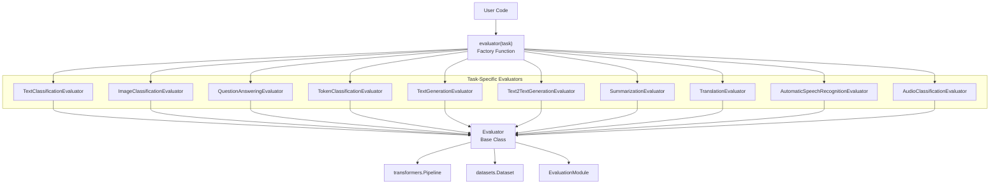

The architecture consists of three layers: a factory function that creates evaluators, task-specific evaluator implementations that handle domain-specific logic, and a base class that provides common evaluation infrastructure. All evaluators integrate with `transformers.Pipeline` for inference, `datasets.Dataset` for data handling, and `EvaluationModule` for metric computation.

**Sources:** [src/evaluate/evaluator/__init__.py:38-79](), [src/evaluate/evaluator/base.py:102-108]()

## Factory Pattern and Task Routing

### Task Registration

The evaluator system maintains a registry mapping task names to evaluator implementations and default metrics:

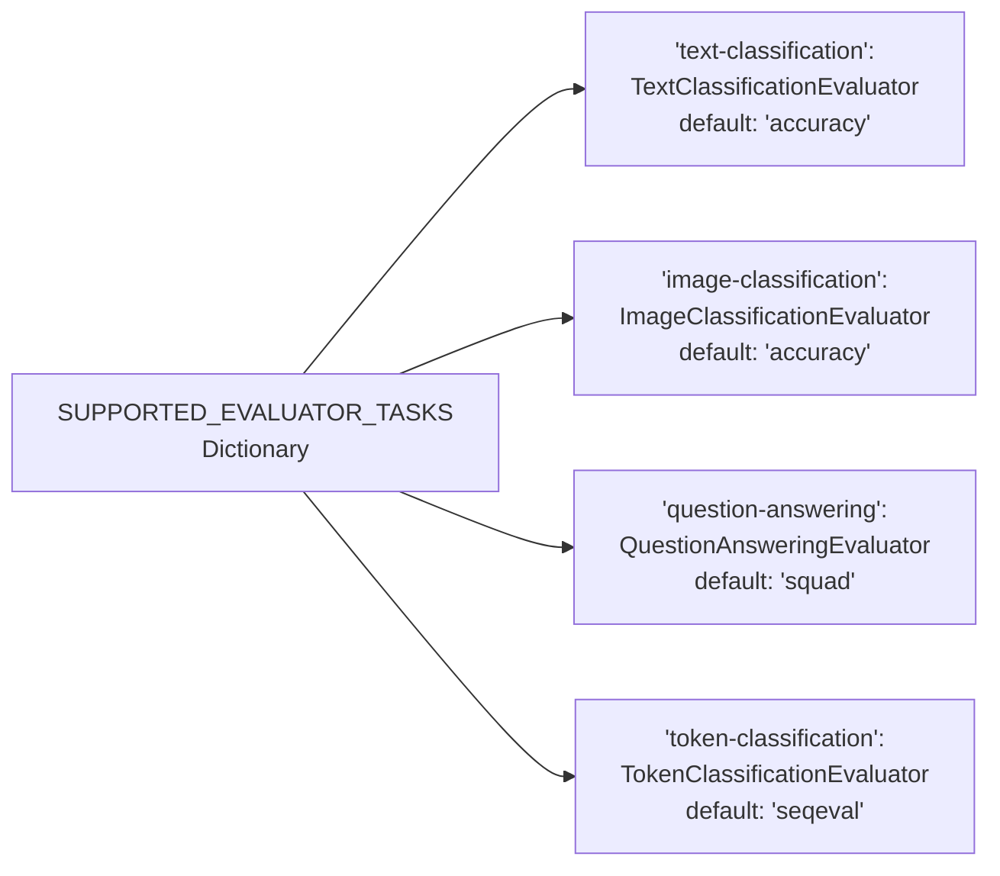

The `SUPPORTED_EVALUATOR_TASKS` dictionary at [src/evaluate/evaluator/__init__.py:38-79]() defines the mapping between task strings, evaluator implementations, and default metrics. Each entry specifies the class to instantiate and the metric to use if none is provided.

### Factory Function Flow

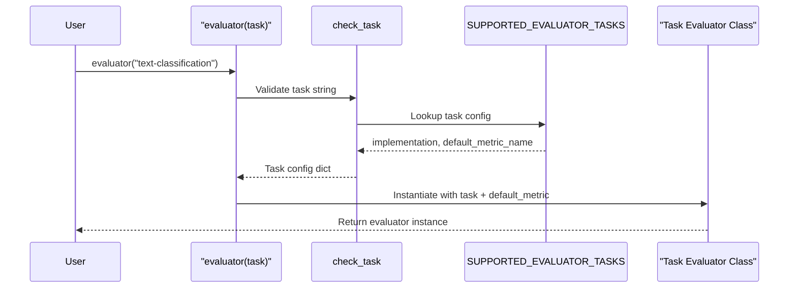

The factory function performs task validation against both `transformers` pipeline tasks and evaluator-supported tasks, retrieves the appropriate implementation class, and instantiates it with the task name and default metric.

**Sources:** [src/evaluate/evaluator/__init__.py:113-141](), [src/evaluate/evaluator/__init__.py:89-111]()

## Execution Pipeline

The `Evaluator.compute()` method orchestrates a seven-stage pipeline that handles the complete evaluation workflow:

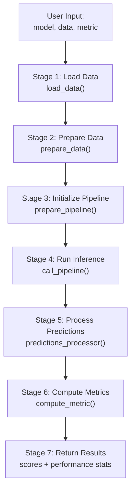

**Sources:** [src/evaluate/evaluator/base.py:218-279]()

### Stage 1: Load Data

The `load_data()` method handles two input formats:

| Input Type | Processing | Output |
|------------|-----------|--------|
| `str` (dataset name) | Calls `datasets.load_dataset()` with automatic split selection via `choose_split()` | `Dataset` object |
| `Dataset` object | Returns as-is (ignores `subset` and `split` parameters) | `Dataset` object |

The `choose_split()` function at [src/evaluate/evaluator/utils.py:21-38]() implements a priority-ordered split selection: `test` > `testing` > `eval` > `evaluation` > `validation` > `val` > `valid` > `dev` > `train` > `training`.

**Sources:** [src/evaluate/evaluator/base.py:350-388](), [src/evaluate/evaluator/utils.py:21-38]()

### Stage 2: Prepare Data

The `prepare_data()` method is abstract in the base class and implemented by each task-specific evaluator. It performs three operations:

1. **Column validation**: Verifies required columns exist using `check_required_columns()`
2. **Reference extraction**: Extracts ground truth labels into a dictionary
3. **Input structuring**: Wraps input columns in `DatasetColumn` or `DatasetColumnPair` objects to avoid loading entire columns into memory

For example, `TextClassificationEvaluator.prepare_data()` at [src/evaluate/evaluator/text_classification.py:65-80]() returns:
- `metric_inputs`: `{"references": data[label_column]}`
- `pipe_inputs`: `DatasetColumnPair(data, input_column, second_input_column, "text", "text_pair")`

**Sources:** [src/evaluate/evaluator/base.py:390-420](), [src/evaluate/evaluator/text_classification.py:65-80]()

### Stage 3: Initialize Pipeline

The `prepare_pipeline()` method creates a `transformers.Pipeline` from various input formats:

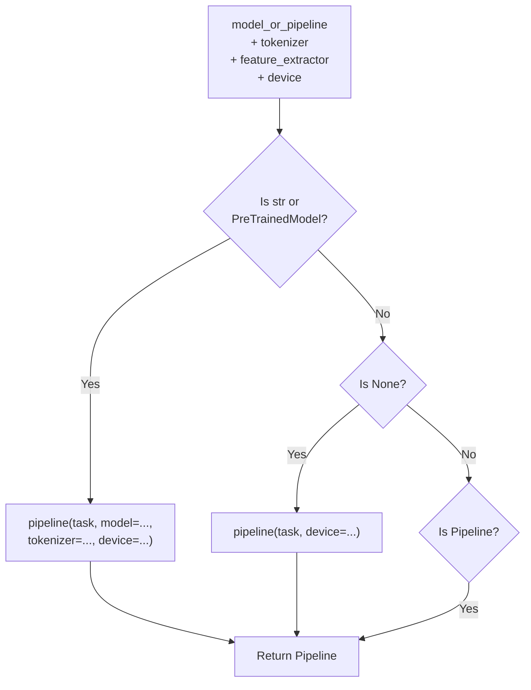

Device inference occurs via `_infer_device()` at [src/evaluate/evaluator/base.py:182-209](), which checks for CUDA availability (PyTorch) or GPU devices (TensorFlow), defaulting to CPU if unavailable.

**Sources:** [src/evaluate/evaluator/base.py:422-478](), [src/evaluate/evaluator/base.py:182-209]()

### Stage 4: Run Inference

The `call_pipeline()` method executes the pipeline on input data while tracking performance:

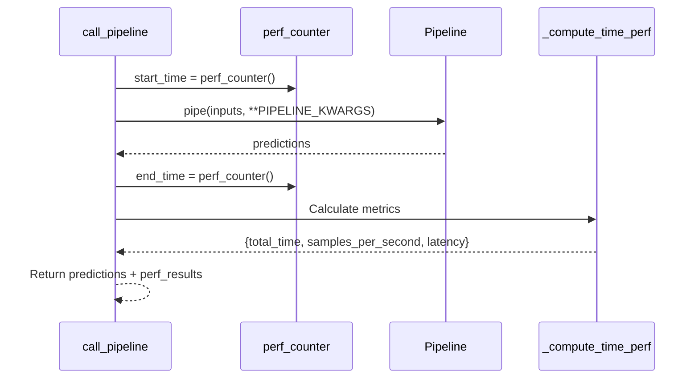

Performance metrics calculated at [src/evaluate/evaluator/base.py:163-179]():
- `total_time_in_seconds`: Total inference time
- `samples_per_second`: Throughput (num_samples / latency)
- `latency_in_seconds`: Per-sample latency (total_time / num_samples)

**Sources:** [src/evaluate/evaluator/base.py:511-515](), [src/evaluate/evaluator/base.py:163-179]()

### Stage 5: Process Predictions

The `predictions_processor()` method is abstract and task-specific. It transforms pipeline outputs into metric-compatible format. Examples:

| Evaluator | Input Format | Processing | Output Format |
|-----------|--------------|------------|---------------|
| `TextClassificationEvaluator` | `[{"label": "POSITIVE"}, ...]` | Map labels via `label_mapping` | `{"predictions": [1, ...]}` |
| `ImageClassificationEvaluator` | `[[{"label": "cat", "score": 0.9}, ...], ...]` | Extract max score label, apply mapping | `{"predictions": [0, ...]}` |
| `QuestionAnsweringEvaluator` | `[{"answer": "text", "score": 0.95}, ...]` | Extract answer text, add no_answer_probability if SQuAD v2 | `{"predictions": [{"prediction_text": "text", "id": "...", ...}]}` |
| `TokenClassificationEvaluator` | `[[{"entity": "B-LOC", "start": 0}, ...], ...]` | Align token predictions to word boundaries | `{"predictions": [["B-LOC", "O", ...], ...]}` |

**Sources:** [src/evaluate/evaluator/text_classification.py:82-87](), [src/evaluate/evaluator/image_classification.py:62-66](), [src/evaluate/evaluator/question_answering.py:135-142](), [src/evaluate/evaluator/token_classification.py:99-136]()

### Stage 6: Compute Metrics

The `compute_metric()` method supports two strategies:

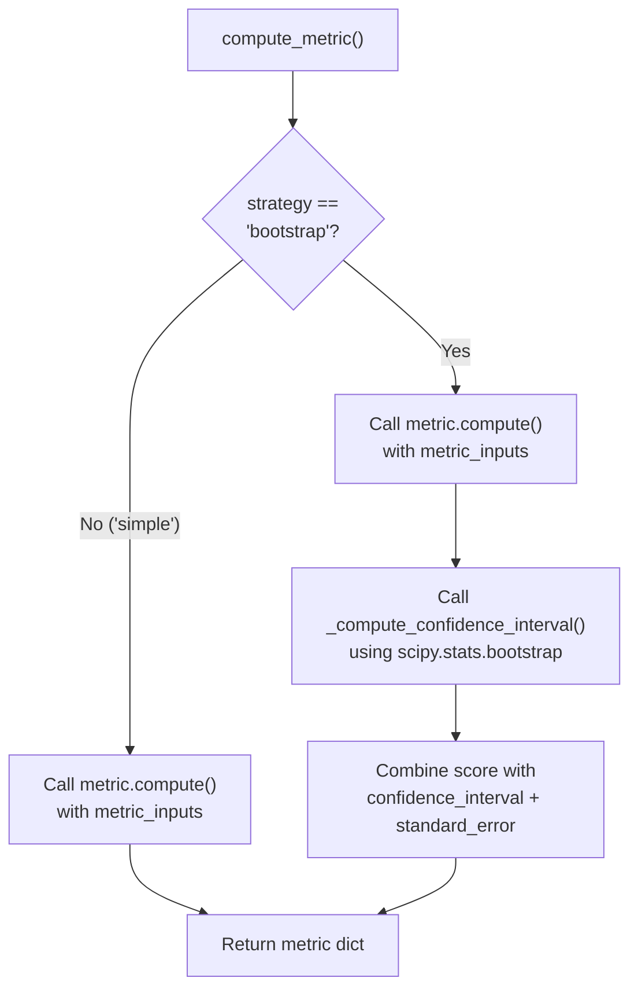

Bootstrap strategy (when `strategy="bootstrap"`) uses `scipy.stats.bootstrap` at [src/evaluate/evaluator/base.py:125-160]() to compute confidence intervals via resampling. Each metric key gets wrapped in a dictionary containing:
- `score`: Original metric value
- `confidence_interval`: Tuple of (low, high) bounds
- `standard_error`: Bootstrap standard error

**Sources:** [src/evaluate/evaluator/base.py:517-544](), [src/evaluate/evaluator/base.py:125-160]()

### Stage 7: Return Results

Results combine metric scores with performance statistics:

```python
{
    "accuracy": 0.918,                    # Metric result(s)
    "total_time_in_seconds": 12.676,      # Performance metrics
    "samples_per_second": 78.887,
    "latency_in_seconds": 0.013
}
```

Or with bootstrap:

```python
{
    "accuracy": {
        "score": 0.918,
        "confidence_interval": (0.906, 0.941),
        "standard_error": 0.009
    },
    "total_time_in_seconds": 12.676,
    "samples_per_second": 78.887,
    "latency_in_seconds": 0.013
}
```

**Sources:** [src/evaluate/evaluator/base.py:273-279](), [docs/source/base_evaluator.mdx:76-83]()

## Task-Specific Evaluators

The system provides ten specialized evaluator implementations:

| Task | Evaluator Class | Default Metric | Key Parameters | Special Processing |
|------|----------------|----------------|----------------|-------------------|
| `text-classification` | `TextClassificationEvaluator` | `accuracy` | `input_column`, `second_input_column`, `label_column`, `label_mapping` | Supports two-column input (MNLI-style) via `DatasetColumnPair` |
| `image-classification` | `ImageClassificationEvaluator` | `accuracy` | `input_column`, `label_column`, `label_mapping` | Extracts highest-confidence prediction from multi-class output |
| `question-answering` | `QuestionAnsweringEvaluator` | `squad` | `question_column`, `context_column`, `id_column`, `label_column`, `squad_v2_format` | Auto-detects SQuAD v2 format, handles impossible answers |
| `token-classification` | `TokenClassificationEvaluator` | `seqeval` | `input_column`, `label_column`, `join_by` | Joins tokens with `join_by`, aligns subword predictions to words |
| `text-generation` | `TextGenerationEvaluator` | `word_count` | Standard evaluator params | Flattens multi-sequence outputs from beam search |
| `text2text-generation` | `Text2TextGenerationEvaluator` | `bleu` | Standard evaluator params | Base class for summarization/translation |
| `summarization` | `SummarizationEvaluator` | `rouge` | Standard evaluator params | Alias for `Text2TextGenerationEvaluator` |
| `translation` | `TranslationEvaluator` | `bleu` | Standard evaluator params | Alias for `Text2TextGenerationEvaluator` |
| `automatic-speech-recognition` | `AutomaticSpeechRecognitionEvaluator` | `wer` | `input_column`, `label_column` | Handles audio file paths and raw waveforms |
| `audio-classification` | `AudioClassificationEvaluator` | `accuracy` | `input_column`, `label_column`, `label_mapping` | Handles audio file paths and raw waveforms |

### Specialized Behaviors

**TokenClassificationEvaluator** performs word-to-character offset mapping at [src/evaluate/evaluator/token_classification.py:138-159]() to align subword tokenizer predictions back to original word boundaries. The `words_to_offsets()` method computes start/end character positions for each word, then `predictions_processor()` maps token-level predictions to these positions.

**QuestionAnsweringEvaluator** includes automatic SQuAD format detection at [src/evaluate/evaluator/question_answering.py:121-133]() by checking if any answers have empty text lists. It sets `handle_impossible_answer=True` in pipeline kwargs for SQuAD v2 format, enabling the model to predict "no answer".

**Sources:** [src/evaluate/evaluator/__init__.py:38-79](), [src/evaluate/evaluator/token_classification.py:84-273](), [src/evaluate/evaluator/question_answering.py:75-237]()

## Input Format Flexibility

### Model/Pipeline Input Formats

The evaluator accepts four input formats for the model:

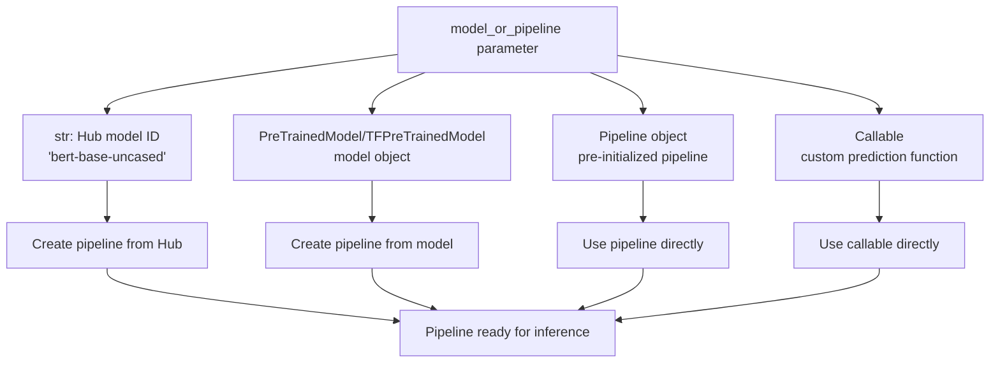

Example usage from [docs/source/base_evaluator.mdx:37-69]():

```python
# 1. Pass model name/path
evaluator.compute(model_or_pipeline="lvwerra/distilbert-imdb", data=data)

# 2. Pass model object
model = AutoModelForSequenceClassification.from_pretrained("lvwerra/distilbert-imdb")
evaluator.compute(model_or_pipeline=model, data=data)

# 3. Pass pipeline
pipe = pipeline("text-classification", model="lvwerra/distilbert-imdb")
evaluator.compute(model_or_pipeline=pipe, data=data)

# 4. Pass custom callable (must follow pipeline signature)
def custom_predictor(inputs):
    # Custom inference logic
    return predictions
evaluator.compute(model_or_pipeline=custom_predictor, data=data)
```

**Sources:** [src/evaluate/evaluator/base.py:422-478](), [docs/source/base_evaluator.mdx:37-69]()

### Dataset Input Formats

Two input formats are supported for datasets:

| Input Type | Processing | Use Case |
|------------|-----------|----------|
| `str` | Loads dataset from Hub via `load_dataset(data, name=subset, split=split)` | Evaluate on standard benchmarks |
| `Dataset` | Uses pre-loaded dataset directly | Custom datasets, preprocessed data |

### Metric Input Formats

Three metric input formats are supported:

| Input Type | Processing | Example |
|------------|-----------|---------|
| `None` | Uses `default_metric_name` from evaluator | `evaluator.compute(data=data)` |
| `str` | Loads metric via `load(metric)` | `evaluator.compute(metric="f1", data=data)` |
| `EvaluationModule` | Uses pre-loaded metric directly | `evaluator.compute(metric=load("f1"), data=data)` |
| `CombinedEvaluations` | Evaluates multiple metrics | `evaluator.compute(metric=combine(["accuracy", "f1"]), data=data)` |

**Sources:** [src/evaluate/evaluator/base.py:480-509]()

## Advanced Features

### Bootstrap Confidence Intervals

The bootstrap strategy uses `scipy.stats.bootstrap` to estimate confidence intervals via resampling:

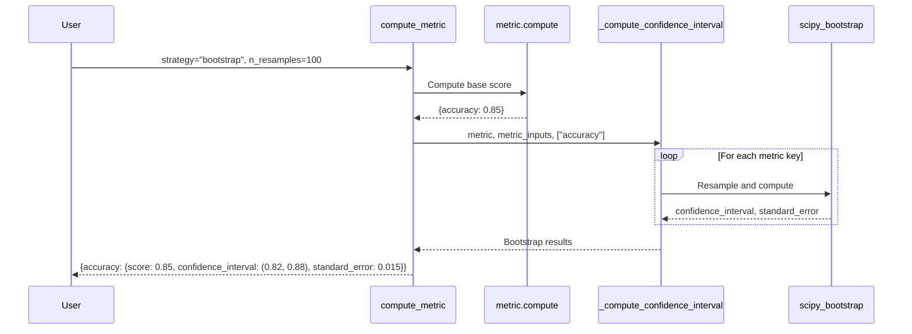

The bootstrap implementation at [src/evaluate/evaluator/base.py:125-160]() wraps the metric compute function to work with `scipy.stats.bootstrap`, which requires positional arguments. Parameters:
- `n_resamples`: Number of bootstrap samples (default: 9999)
- `confidence_level`: Confidence level for intervals (default: 0.95)
- `random_state`: Random seed for reproducibility

**Sources:** [src/evaluate/evaluator/base.py:125-160](), [docs/source/base_evaluator.mdx:217-255]()

### Device Management

Device selection follows this priority:

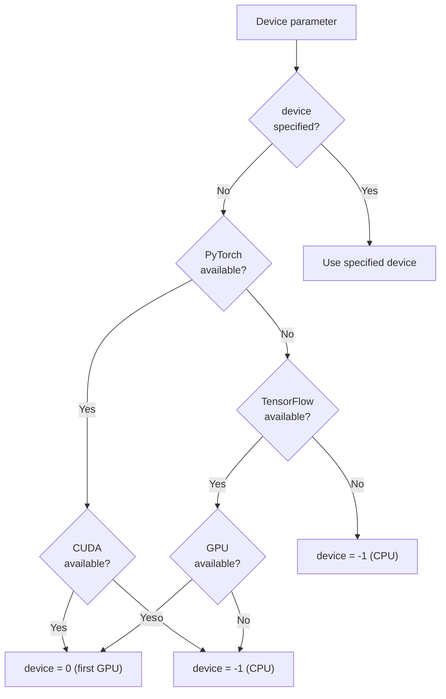

The `_infer_device()` method at [src/evaluate/evaluator/base.py:182-209]() attempts to detect GPU availability via PyTorch first, then TensorFlow. It returns `0` for the first GPU or `-1` for CPU.

Device mismatch validation at [src/evaluate/evaluator/base.py:282-293]() raises an error if the user passes a `device` parameter that conflicts with a pre-initialized pipeline's device.

**Sources:** [src/evaluate/evaluator/base.py:182-209](), [src/evaluate/evaluator/base.py:282-293](), [docs/source/base_evaluator.mdx:72-73]()

### Performance Tracking

All evaluations automatically track inference performance:

| Metric | Calculation | Purpose |
|--------|-------------|---------|
| `total_time_in_seconds` | `end_time - start_time` | Overall inference duration |
| `samples_per_second` | `num_samples / total_time` | Throughput measurement |
| `latency_in_seconds` | `total_time / num_samples` | Per-sample latency |

Timing uses `time.perf_counter()` at [src/evaluate/evaluator/base.py:511-515]() for high-resolution measurements. These metrics help identify bottlenecks and compare model efficiency.

**Note:** Performance metrics include all pipeline overhead (tokenization, post-processing) and depend on hardware, so they should be compared under consistent conditions.

**Sources:** [src/evaluate/evaluator/base.py:163-179](), [src/evaluate/evaluator/base.py:511-515](), [docs/source/base_evaluator.mdx:85-89]()

### Label Mapping

The `label_mapping` parameter resolves mismatches between model output labels and dataset labels:

```python
# Dataset has integer labels: 0, 1
# Model outputs string labels: "NEGATIVE", "POSITIVE"
evaluator.compute(
    model_or_pipeline="lvwerra/distilbert-imdb",
    data=data,
    label_mapping={"NEGATIVE": 0, "POSITIVE": 1}
)
```

Each task-specific evaluator applies the mapping in its `predictions_processor()` method before passing predictions to the metric. This enables evaluation of models trained with different label schemes than the evaluation dataset.

**Sources:** [src/evaluate/evaluator/text_classification.py:82-87](), [docs/source/base_evaluator.mdx:46-50]()

## Integration Points

### Transformers Pipeline Integration

The evaluator system relies heavily on `transformers.Pipeline` abstraction:

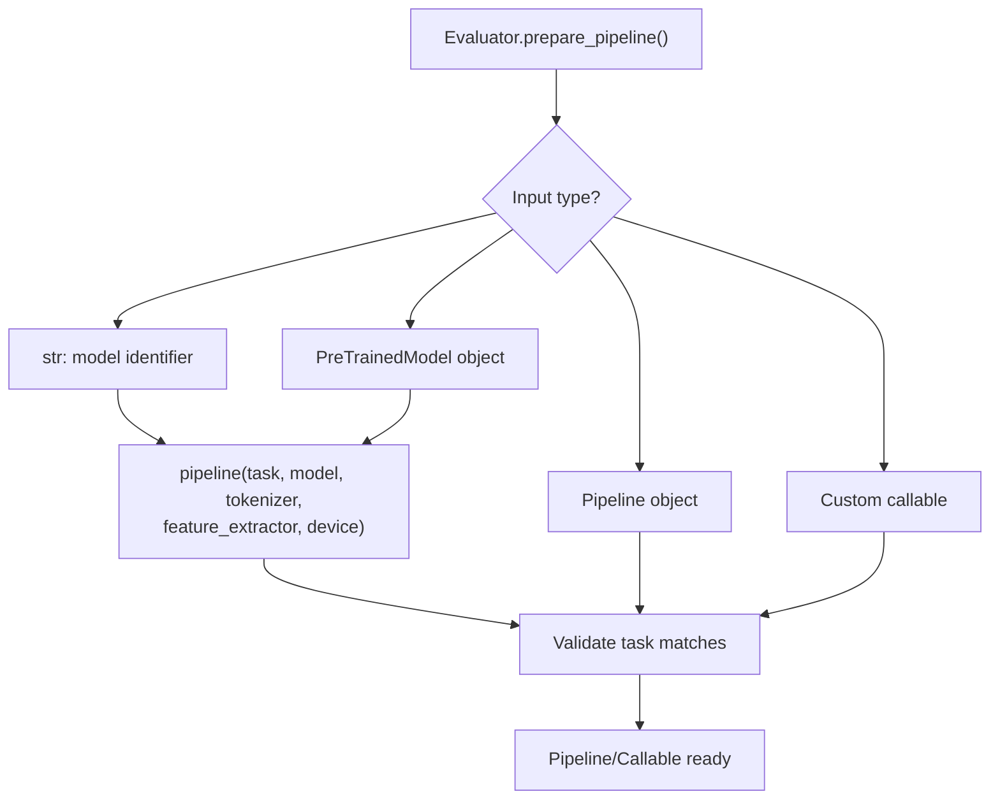

Task validation at [src/evaluate/evaluator/base.py:474-477]() ensures the pipeline's task matches the evaluator's task (with special handling for translation subtasks). Custom pipelines must implement the `__call__` interface expected by the task.

**Sources:** [src/evaluate/evaluator/base.py:422-478]()

### Datasets Integration

The system uses `datasets` library features:

| Feature | Usage | Location |
|---------|-------|----------|
| `load_dataset()` | Load datasets from Hub | [src/evaluate/evaluator/base.py:379]() |
| `get_dataset_split_names()` | Auto-detect available splits | [src/evaluate/evaluator/utils.py:22]() |
| `Dataset.features` | Validate column types | [src/evaluate/evaluator/token_classification.py:164-169]() |
| `DatasetColumn` wrapper | Lazy column access without loading into memory | [src/evaluate/evaluator/utils.py:4-19]() |

The `DatasetColumn` class at [src/evaluate/evaluator/utils.py:4-19]() wraps a dataset column to provide list-like access without loading data into memory—it fetches items on-demand during iteration, which is crucial for large datasets.

**Sources:** [src/evaluate/evaluator/base.py:350-388](), [src/evaluate/evaluator/utils.py:4-19]()

### Metric Loading Integration

Evaluators load metrics via the module loading system (see [Module Loading System](#3.1)):

```python
# In prepare_metric() at base.py:480-509
if metric is None:
    metric = load(self.default_metric_name)
elif isinstance(metric, str):
    metric = load(metric)
# else: metric is already an EvaluationModule
```

This enables seamless use of all Hub metrics, community metrics, and combined metrics via `combine()`.

**Sources:** [src/evaluate/evaluator/base.py:480-509]()

### Common Usage Patterns

**Simple evaluation:**
```python
from evaluate import evaluator
task_evaluator = evaluator("text-classification")
results = task_evaluator.compute(
    model_or_pipeline="distilbert-base-uncased-finetuned-sst-2-english",
    data="sst2",
    split="validation[:100]"
)
```

**Multi-metric evaluation:**
```python
import evaluate
results = task_evaluator.compute(
    model_or_pipeline="distilbert-base-uncased-finetuned-sst-2-english",
    data="sst2",
    metric=evaluate.combine(["accuracy", "f1", "precision", "recall"])
)
```

**Bootstrap confidence intervals:**
```python
results = task_evaluator.compute(
    model_or_pipeline="distilbert-base-uncased-finetuned-sst-2-english",
    data="sst2",
    strategy="bootstrap",
    n_resamples=100,
    confidence_level=0.95
)
```

**Sources:** [docs/source/base_evaluator.mdx:37-118](), [docs/source/a_quick_tour.mdx:244-289]()

---

