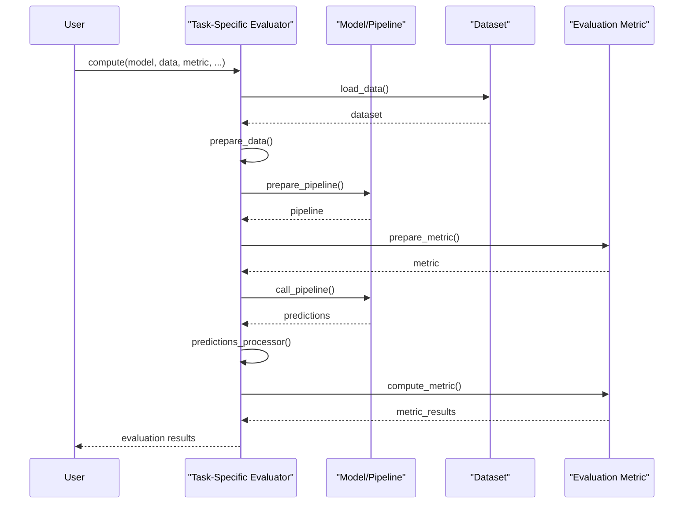
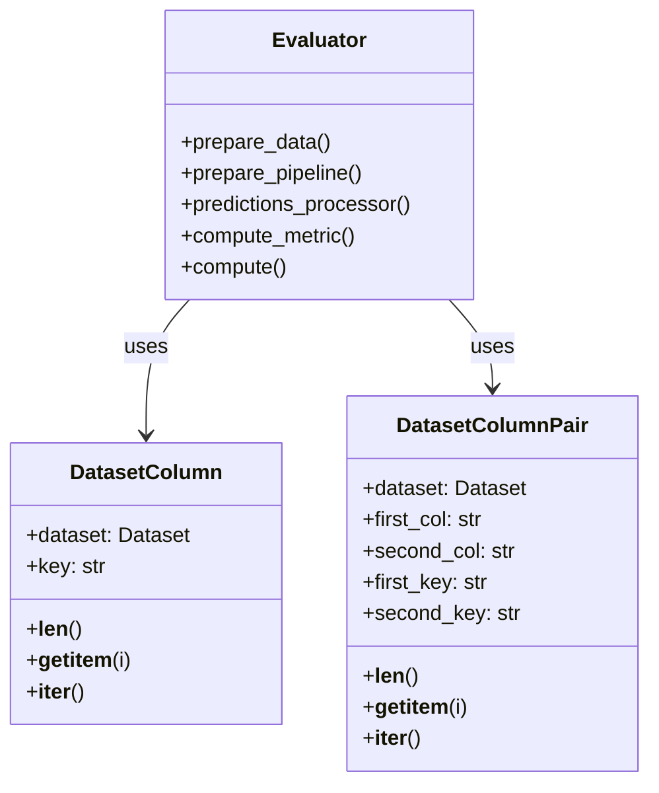
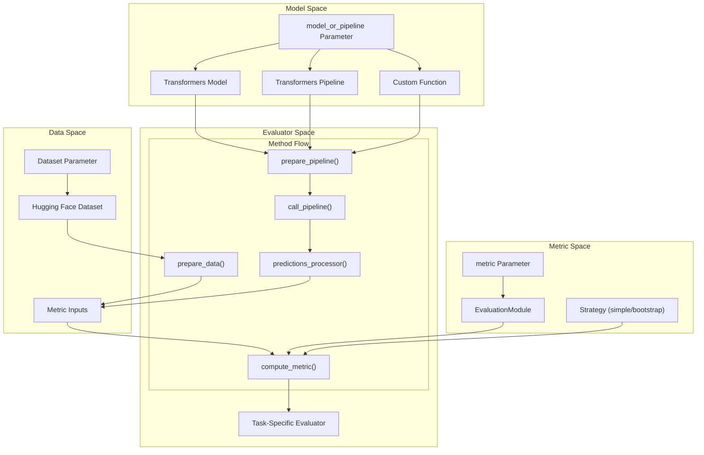

<!-- source: DeepWiki mcp.deepwiki.com · repo huggingface/evaluate · page 4.1 Task-Specific Evaluators · fetched 2026-10-26 -->

# Task-Specific Evaluators

<details>
<summary>Relevant source files</summary>

The following files were used as context for generating this wiki page:

- [docs/source/base_evaluator.mdx](docs/source/base_evaluator.mdx)
- [docs/source/package_reference/evaluator_classes.mdx](docs/source/package_reference/evaluator_classes.mdx)
- [src/evaluate/__init__.py](src/evaluate/__init__.py)
- [src/evaluate/evaluator/__init__.py](src/evaluate/evaluator/__init__.py)
- [src/evaluate/evaluator/base.py](src/evaluate/evaluator/base.py)
- [src/evaluate/evaluator/image_classification.py](src/evaluate/evaluator/image_classification.py)
- [src/evaluate/evaluator/question_answering.py](src/evaluate/evaluator/question_answering.py)
- [src/evaluate/evaluator/text_classification.py](src/evaluate/evaluator/text_classification.py)
- [src/evaluate/evaluator/token_classification.py](src/evaluate/evaluator/token_classification.py)
- [src/evaluate/evaluator/utils.py](src/evaluate/evaluator/utils.py)
- [tests/test_evaluator.py](tests/test_evaluator.py)

</details>


## Introduction

Task-Specific Evaluators in the Hugging Face Evaluate library provide standardized, task-oriented interfaces for evaluating machine learning models across various NLP and computer vision tasks. These evaluators abstract away the complexities of data preparation, model inference, and metric calculation, allowing users to evaluate models with minimal code.

Task-Specific Evaluators are part of the larger Evaluator System in the library, sitting between the user interfaces and the implementation types (metrics, comparisons, measurements). For an overview of the complete Evaluator System architecture, see [Evaluator System](#3).

```mermaid
graph TD
    subgraph "Evaluator System"
        EvaluatorFactory["evaluator(task)"]
        BaseEvaluator["Evaluator (Abstract Base Class)"]
        
        subgraph "Task-Specific Evaluators"
            TextClass["TextClassificationEvaluator"]
            ImageClass["ImageClassificationEvaluator"]
            QA["QuestionAnsweringEvaluator"]
            TokenClass["TokenClassificationEvaluator"]
            TextGen["TextGenerationEvaluator"]
            Text2Text["Text2TextGenerationEvaluator"]
            AudioClass["AudioClassificationEvaluator"]
            ASR["AutomaticSpeechRecognitionEvaluator"]
        end
    end
    
    EvaluatorFactory --> BaseEvaluator
    BaseEvaluator --> Task-Specific Evaluators
    
    subgraph "User Code"
        UserCode["User Application Code"]
    end
    
    subgraph "Metrics"
        Metrics["EvaluationModule (Metrics)"]
    end
    
    subgraph "ML Models/Pipelines"
        Models["Transformers Models/Pipelines"]
    end
    
    UserCode --> EvaluatorFactory
    Task-Specific Evaluators --> Metrics
    Task-Specific Evaluators --> Models
```

Sources: [src/evaluate/evaluator/text_classification.py](), [src/evaluate/evaluator/image_classification.py](), [src/evaluate/evaluator/question_answering.py](), [src/evaluate/evaluator/token_classification.py]()

## Common Architecture and Workflow

All Task-Specific Evaluators inherit from the abstract base class `Evaluator`, which defines the common interface and workflow. Each task-specific evaluator implements methods to prepare data, process predictions, and compute metrics appropriate for its task.

### Core Components and Data Flow

The standard evaluation workflow involves:

1. **Loading data**: Prepare dataset for evaluation
2. **Preparing inputs**: Format data for the model and metrics
3. **Model inference**: Generate predictions using the model or pipeline
4. **Processing predictions**: Convert raw model outputs to a format suitable for metrics
5. **Computing metrics**: Calculate and return metric results



Sources: [src/evaluate/evaluator/base.py](), [src/evaluate/evaluator/text_classification.py:89-160](), [src/evaluate/evaluator/question_answering.py:147-239]()

## Available Task-Specific Evaluators

### TextClassificationEvaluator

Evaluates text classification models, including sentiment analysis and other categorical text classification tasks. Supports both single-text inputs and paired-text inputs (for tasks like MNLI).

**Key features:**
- Handles single text or text pairs
- Supports label mapping between model outputs and dataset labels
- Works with standard classification metrics like accuracy, F1, etc.

```python
# Example usage
from evaluate import evaluator
from datasets import load_dataset

task_evaluator = evaluator("text-classification")
data = load_dataset("imdb", split="test[:2]")
results = task_evaluator.compute(
    model_or_pipeline="huggingface/prunebert-base-uncased-6-finepruned-w-distil-mnli",
    data=data,
    metric="accuracy",
    label_mapping={"LABEL_0": 0.0, "LABEL_1": 1.0},
    strategy="bootstrap"
)
```

Sources: [src/evaluate/evaluator/text_classification.py:51-160]()

### ImageClassificationEvaluator

Evaluates image classification models, handling the complexities of image inputs and label mapping.

**Key features:**
- Processes image inputs from datasets
- Handles label mapping for image categories
- Works with standard classification metrics

```python
# Example usage
from evaluate import evaluator
from datasets import load_dataset

task_evaluator = evaluator("image-classification")
data = load_dataset("beans", split="test[:40]")
results = task_evaluator.compute(
    model_or_pipeline="nateraw/vit-base-beans",
    data=data,
    label_column="labels",
    metric="accuracy",
    label_mapping={'angular_leaf_spot': 0, 'bean_rust': 1, 'healthy': 2},
    strategy="bootstrap"
)
```

Sources: [src/evaluate/evaluator/image_classification.py:49-119]()

### QuestionAnsweringEvaluator

Evaluates extractive question answering models, where the answer to a question is a span of text from a provided context.

**Key features:**
- Supports SQuAD v1 and SQuAD v2 formats
- Automatically detects if the dataset has unanswerable questions
- Computes specialized QA metrics like exact match and F1

```python
# Example usage
from evaluate import evaluator
from datasets import load_dataset

task_evaluator = evaluator("question-answering")
data = load_dataset("squad", split="validation[:2]")
results = task_evaluator.compute(
    model_or_pipeline="sshleifer/tiny-distilbert-base-cased-distilled-squad",
    data=data,
    metric="squad",
)
```

Sources: [src/evaluate/evaluator/question_answering.py:78-239]()

### TokenClassificationEvaluator

Evaluates token classification models such as Named Entity Recognition (NER) systems.

**Key features:**
- Handles sequence-based token classification
- Processes token-level predictions
- Works with sequence evaluation metrics like seqeval

```python
# Example usage
from evaluate import evaluator
from datasets import load_dataset

task_evaluator = evaluator("token-classification")
data = load_dataset("conll2003", split="validation[:2]")
results = task_evaluator.compute(
    model_or_pipeline="elastic/distilbert-base-uncased-finetuned-conll03-english",
    data=data,
    metric="seqeval",
)
```

Sources: [src/evaluate/evaluator/token_classification.py:90-278]()

## Implementation Details

### Data Preparation Methods

Each task-specific evaluator implements a `prepare_data` method that:
1. Validates the required columns exist in the dataset
2. Formats the data for both the model pipeline and the metric
3. Uses utility classes like `DatasetColumn` to avoid loading the entire dataset into memory



Sources: [src/evaluate/evaluator/utils.py:4-19](), [src/evaluate/evaluator/utils.py:41-84](), [src/evaluate/evaluator/question_answering.py:96-122](), [src/evaluate/evaluator/text_classification.py:65-80]()

### Prediction Processing

The `predictions_processor` method in each evaluator handles task-specific conversion of model outputs to a format suitable for the metric:

- **TextClassificationEvaluator**: Converts predicted label strings to numeric values using the label mapping
- **ImageClassificationEvaluator**: Extracts the highest probability class and applies label mapping
- **QuestionAnsweringEvaluator**: Formats predictions with answer text and handles SQuAD v2 format (unanswerable questions)
- **TokenClassificationEvaluator**: Aligns token-level predictions with the original word boundaries

This standardizes the format for metric computation and handles any task-specific peculiarities.

Sources: [src/evaluate/evaluator/text_classification.py:82-87](), [src/evaluate/evaluator/image_classification.py:62-66](), [src/evaluate/evaluator/question_answering.py:138-145](), [src/evaluate/evaluator/token_classification.py:105-142]()

### Compute Method Configuration

Each evaluator's `compute` method is extensively parameterized to support task-specific requirements:

| Evaluator | Key Parameters | Description |
|-----------|---------------|-------------|
| TextClassificationEvaluator | `input_column`, `second_input_column`, `label_column`, `label_mapping` | Handles both single-text and paired-text inputs |
| ImageClassificationEvaluator | `input_column`, `label_column`, `label_mapping` | Maps model output labels to dataset labels |
| QuestionAnsweringEvaluator | `question_column`, `context_column`, `id_column`, `label_column`, `squad_v2_format` | Supports datasets with or without unanswerable questions |
| TokenClassificationEvaluator | `input_column`, `label_column`, `join_by` | Controls how tokens are joined into words |

Sources: [src/evaluate/evaluator/text_classification.py:91-111](), [src/evaluate/evaluator/image_classification.py:70-89](), [src/evaluate/evaluator/question_answering.py:149-185](), [src/evaluate/evaluator/token_classification.py:220-247]()

## Integration with Models and Metrics

Task-Specific Evaluators act as a bridge between models/pipelines and metrics, ensuring that:

1. Models are correctly initialized and configured for the task
2. Inputs are formatted appropriately for the model
3. Model outputs are processed into the format expected by metrics
4. Metrics are computed correctly with appropriate statistical analysis



Sources: [src/evaluate/evaluator/text_classification.py:91-160](), [src/evaluate/evaluator/question_answering.py:147-239](), [tests/test_trainer_evaluator_parity.py:36-314]()

## Using Task-Specific Evaluators

All Task-Specific Evaluators follow a consistent pattern:

1. Create an evaluator instance for the desired task
2. Call the `compute` method with the model, data, and metric
3. Receive a dictionary of metric results

```python
from evaluate import evaluator
from datasets import load_dataset

# Create a task-specific evaluator
task_evaluator = evaluator("text-classification")  # Or other task names

# Load evaluation data
data = load_dataset("imdb", split="test[:100]")

# Compute metrics
results = task_evaluator.compute(
    model_or_pipeline="distilbert-base-uncased-finetuned-sst-2-english",
    data=data,
    metric="accuracy",
    input_column="text",
    label_column="label",
    label_mapping={"NEGATIVE": 0, "POSITIVE": 1}
)

print(results)
# Output: {'accuracy': 0.92, ...}
```

For detailed usage and examples for each task-specific evaluator, refer to their individual documentation and examples.

Sources: [src/evaluate/evaluator/text_classification.py:32-47](), [src/evaluate/evaluator/image_classification.py:30-46](), [src/evaluate/evaluator/question_answering.py:42-74](), [src/evaluate/evaluator/token_classification.py:30-86]()

---

