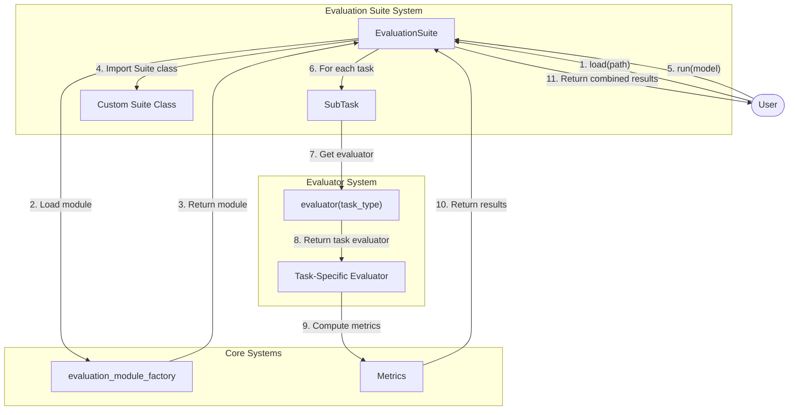
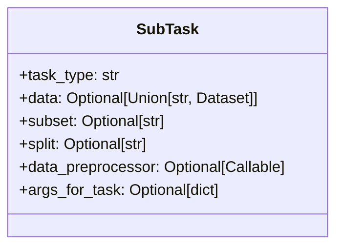
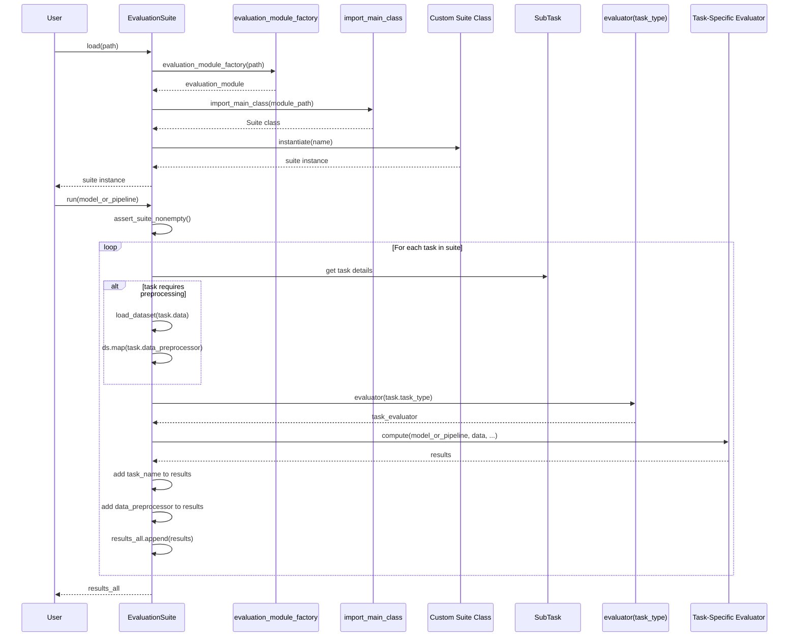

<!-- source: DeepWiki mcp.deepwiki.com · repo huggingface/evaluate · page 4.2 Evaluation Suite · fetched 2026-10-26 -->

# Evaluation Suite

<details>
<summary>Relevant source files</summary>

The following files were used as context for generating this wiki page:

- [docs/source/a_quick_tour.mdx](docs/source/a_quick_tour.mdx)
- [docs/source/base_evaluator.mdx](docs/source/base_evaluator.mdx)
- [docs/source/choosing_a_metric.mdx](docs/source/choosing_a_metric.mdx)
- [docs/source/considerations.mdx](docs/source/considerations.mdx)
- [docs/source/index.mdx](docs/source/index.mdx)
- [docs/source/package_reference/evaluator_classes.mdx](docs/source/package_reference/evaluator_classes.mdx)
- [src/evaluate/__init__.py](src/evaluate/__init__.py)
- [src/evaluate/evaluator/__init__.py](src/evaluate/evaluator/__init__.py)
- [src/evaluate/evaluator/audio_classification.py](src/evaluate/evaluator/audio_classification.py)
- [src/evaluate/utils/logging.py](src/evaluate/utils/logging.py)

</details>


The Evaluation Suite is a higher-level component in the evaluate library that enables users to run multiple evaluation tasks on a model or pipeline. It provides a structured way to define a suite of evaluations, each with its own dataset, task type, and evaluation metrics, and run them as a unified evaluation.

For information about individual metrics, see [Metrics](#4), and for task-specific evaluators, see [Task-Specific Evaluators](#3.1).

## 1. Overview and Purpose

The Evaluation Suite allows you to:

1. Define multiple evaluation tasks with different datasets
2. Run all evaluations on a single model/pipeline 
3. Collect and organize results from all evaluations
4. Share evaluation suites via the Hugging Face Hub

This functionality is particularly useful when you want to comprehensively evaluate a model across multiple datasets or tasks to get a holistic view of its performance.

Sources: [src/evaluate/evaluation_suite/__init__.py:59-70]()

## 2. Architecture

The Evaluation Suite system consists of two main components:

1. `EvaluationSuite` - The main class for loading and running evaluation suites
2. `SubTask` - A dataclass representing individual tasks within a suite

These components work together with the evaluator system (see [Evaluator System](#3)) to run evaluations for different task types.



Sources: [src/evaluate/evaluation_suite/__init__.py:59-128]()

## 3. SubTask Definition

The `SubTask` dataclass defines the structure of individual evaluation tasks within a suite. It contains all the necessary information to run a specific evaluation.



| Attribute | Type | Description |
|-----------|------|-------------|
| `task_type` | str | The type of task (e.g., "text-classification", "summarization") |
| `data` | str or Dataset | The dataset for evaluation (either a Dataset object or a string identifier) |
| `subset` | str (optional) | A specific subset of the dataset |
| `split` | str (optional) | A specific split of the dataset (e.g., "train", "validation") |
| `data_preprocessor` | Callable (optional) | A function to preprocess the dataset |
| `args_for_task` | dict (optional) | Additional arguments for the task evaluator |

The `SubTask` class also includes validation in `__post_init__` to ensure that the attributes have the correct types.

Sources: [src/evaluate/evaluation_suite/__init__.py:18-41]()

## 4. EvaluationSuite Class

The `EvaluationSuite` class is the main interface for loading and running evaluation suites.

### 4.1 Loading an Evaluation Suite

The `load` static method allows loading an evaluation suite from a local path or the Hugging Face Hub:

```python
suite = EvaluationSuite.load("evaluate/evaluation-suite-ci")
```

Internally, this method:
1. Uses `evaluation_module_factory` to load the module from the specified path
2. Imports the `Suite` class from that module using `import_main_class`
3. Creates and returns an instance of that class

Sources: [src/evaluate/evaluation_suite/__init__.py:75-90]()

### 4.2 Running an Evaluation Suite

The `run` method executes all tasks in the suite on the specified model or pipeline:

```python
results = suite.run("lvwerra/distilbert-imdb")
```

The workflow for running an evaluation suite is:

1. Verify that the suite contains at least one task
2. For each task in the suite:
   - Load the dataset if necessary
   - Apply the data preprocessor if specified
   - Get the appropriate evaluator for the task type
   - Run the evaluator on the model/pipeline and dataset
   - Collect the results
3. Return all results as a list

Sources: [src/evaluate/evaluation_suite/__init__.py:102-128]()

## 5. Integration with Task-Specific Evaluators

The Evaluation Suite leverages the task-specific evaluators from the evaluator system to run each task. When you call `suite.run()`, it obtains the appropriate evaluator for each task's `task_type` using `evaluator(task.task_type)` and then calls the evaluator's `compute()` method with the appropriate arguments.

The available task types include:

- Text generation tasks:
  - `text2text-generation`
  - `summarization`
  - `translation`
- Speech tasks:
  - `automatic-speech-recognition`
  - `audio-classification`
- And more (see [Task-Specific Evaluators](#3.1))

This integration allows the Evaluation Suite to handle diverse task types without duplicating evaluation logic.

Sources: [src/evaluate/evaluator/text2text_generation.py:88-102](), [src/evaluate/evaluator/audio_classification.py:81-87](), [src/evaluate/evaluator/automatic_speech_recognition.py:47-53]()

## 6. Creating a Custom Evaluation Suite

To create a custom evaluation suite, you need to:

1. Create a Python module with a `Suite` class that inherits from `EvaluationSuite`
2. Define a `suite` attribute as a list of `SubTask` objects
3. Optionally upload it to the Hugging Face Hub

Here's an example structure of a custom evaluation suite:

```python
from evaluate import EvaluationSuite, SubTask

class Suite(EvaluationSuite):
    def __init__(self, name):
        super().__init__(name)
        
        self.suite = [
            SubTask(
                task_type="text-classification",
                data="imdb",
                split="test",
                args_for_task={
                    "metric": "accuracy"
                }
            ),
            SubTask(
                task_type="summarization",
                data="cnn_dailymail",
                subset="3.0.0",
                split="validation",
                args_for_task={
                    "metric": "rouge",
                    "input_column": "article",
                    "label_column": "highlights"
                }
            )
        ]
```

This custom evaluation suite defines two tasks:
1. A text classification task on the IMDB dataset
2. A summarization task on the CNN/DailyMail dataset

Sources: [src/evaluate/evaluation_suite/__init__.py:59-70]()

## 7. Example Usage

Here's a complete example demonstrating how to load and run an evaluation suite:

```python
from evaluate import EvaluationSuite

# Load the evaluation suite
suite = EvaluationSuite.load("evaluate/evaluation-suite-ci")

# Run the suite on a model
results = suite.run("lvwerra/distilbert-imdb")

# Print the results
for result in results:
    print(f"Task: {result['task_name']}")
    for metric_name, metric_value in result.items():
        if metric_name not in ["task_name", "data_preprocessor"]:
            print(f"  {metric_name}: {metric_value}")
```

This example loads an evaluation suite from the Hugging Face Hub, runs it on the "lvwerra/distilbert-imdb" model, and then prints the results for each task.

Sources: [src/evaluate/evaluation_suite/__init__.py:64-70]()

## 8. Data Flow Diagram

The following diagram illustrates the complete data flow when using an Evaluation Suite:



Sources: [src/evaluate/evaluation_suite/__init__.py:59-128]()

---

