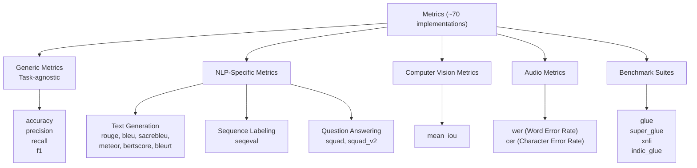
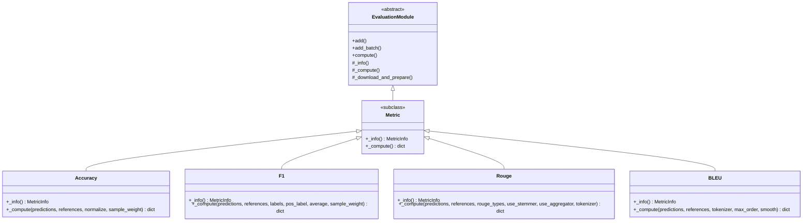
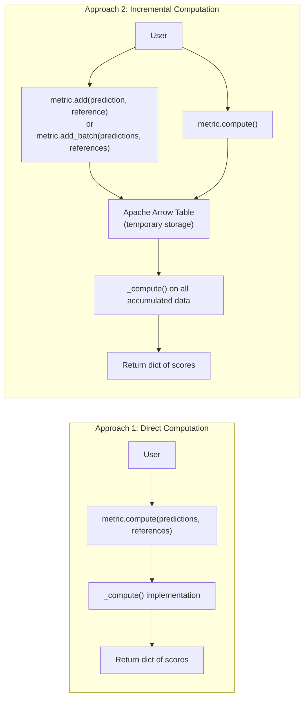
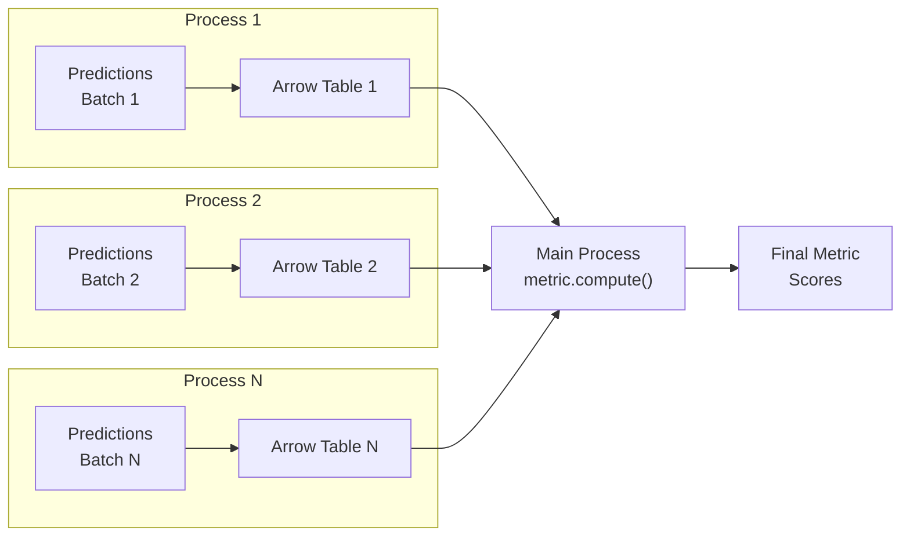

<!-- source: DeepWiki mcp.deepwiki.com · repo huggingface/evaluate · page 5 Metrics · fetched 2026-10-26 -->

# Metrics

<details>
<summary>Relevant source files</summary>

The following files were used as context for generating this wiki page:

- [docs/source/a_quick_tour.mdx](docs/source/a_quick_tour.mdx)
- [docs/source/choosing_a_metric.mdx](docs/source/choosing_a_metric.mdx)
- [docs/source/considerations.mdx](docs/source/considerations.mdx)
- [docs/source/index.mdx](docs/source/index.mdx)
- [metrics/accuracy/accuracy.py](metrics/accuracy/accuracy.py)
- [metrics/bleu/bleu.py](metrics/bleu/bleu.py)
- [metrics/f1/f1.py](metrics/f1/f1.py)
- [metrics/glue/glue.py](metrics/glue/glue.py)
- [metrics/indic_glue/indic_glue.py](metrics/indic_glue/indic_glue.py)
- [metrics/precision/precision.py](metrics/precision/precision.py)
- [metrics/recall/recall.py](metrics/recall/recall.py)
- [metrics/rouge/README.md](metrics/rouge/README.md)
- [metrics/rouge/requirements.txt](metrics/rouge/requirements.txt)
- [metrics/rouge/rouge.py](metrics/rouge/rouge.py)
- [metrics/sacrebleu/sacrebleu.py](metrics/sacrebleu/sacrebleu.py)
- [metrics/seqeval/seqeval.py](metrics/seqeval/seqeval.py)
- [metrics/squad/squad.py](metrics/squad/squad.py)
- [metrics/super_glue/super_glue.py](metrics/super_glue/super_glue.py)
- [metrics/xnli/xnli.py](metrics/xnli/xnli.py)
- [src/evaluate/evaluator/audio_classification.py](src/evaluate/evaluator/audio_classification.py)
- [src/evaluate/utils/logging.py](src/evaluate/utils/logging.py)

</details>


## Purpose and Scope

Metrics are the primary evaluation module type in the Hugging Face evaluate library, used to quantify model performance by comparing predictions against ground truth reference labels. Metrics form one of three evaluation module categories (alongside Comparisons and Measurements) and constitute the largest category with approximately 70+ implementations spanning multiple domains and tasks.

This page provides an overview of the metric module type, its implementation pattern, and a taxonomy of available metrics. For implementation details of the base classes, see [Evaluation Module Base Classes](#3.2). For specific metric categories, see the subsection pages:
- [Classification Metrics](#5.1)
- [Text Generation Metrics](#5.2)
- [Sequence Labeling Metrics](#5.3)
- [Question Answering Metrics](#5.4)
- [Advanced Metrics](#5.5)

Sources: [docs/source/a_quick_tour.mdx:1-19]()

## Metric Taxonomy

The evaluate library organizes metrics into several categories based on their application domain and task type. This taxonomy helps users select appropriate metrics for their evaluation needs.

**Taxonomy Overview: Metrics by Domain**



Sources: [docs/source/a_quick_tour.mdx:9-11](), [docs/source/choosing_a_metric.mdx:7-14](), [metrics/accuracy/accuracy.py](), [metrics/f1/f1.py](), [metrics/rouge/rouge.py](), [metrics/bleu/bleu.py](), [metrics/seqeval/seqeval.py](), [metrics/squad/squad.py](), [metrics/glue/glue.py]()

## Role in the Evaluation Ecosystem

Metrics are one of three evaluation module types that serve distinct purposes in the ML evaluation workflow:

| Module Type | Purpose | Ground Truth Required | Example Use Cases |
|-------------|---------|----------------------|-------------------|
| **Metric** | Measure model performance against ground truth | Yes | Model selection, hyperparameter tuning, benchmark comparison |
| **Comparison** | Statistically compare two models | Yes | A/B testing, model selection with significance testing |
| **Measurement** | Analyze data or predictions without ground truth | No | Bias detection, dataset characterization, production monitoring |

All three types inherit from the `EvaluationModule` base class and follow the same loading and computation patterns. Metrics are loaded using `evaluate.load()` and always require both `predictions` and `references` inputs.

Sources: [docs/source/a_quick_tour.mdx:5-11](), [docs/source/index.mdx:53-60]()

## Metric Implementation Pattern

All metrics in the evaluate library inherit from `evaluate.Metric` and implement two required methods that define the metric's behavior:

**Metric Class Structure**



Sources: [metrics/accuracy/accuracy.py:81-106](), [metrics/f1/f1.py:106-130](), [metrics/rouge/rouge.py:93-158](), [metrics/bleu/bleu.py:87-133]()

### Required Methods

**1. `_info()` Method**

Returns a `MetricInfo` object that defines the metric's metadata and input schema:

```python
def _info(self):
    return evaluate.MetricInfo(
        description=_DESCRIPTION,           # Text description of the metric
        citation=_CITATION,                 # BibTeX citation
        inputs_description=_KWARGS_DESCRIPTION,  # Description of inputs
        features=datasets.Features({        # Input schema definition
            "predictions": datasets.Value("int32"),
            "references": datasets.Value("int32"),
        }),
        reference_urls=[...],               # URLs for more information
    )
```

Sources: [metrics/accuracy/accuracy.py:82-99](), [metrics/f1/f1.py:107-124]()

**2. `_compute()` Method**

Implements the actual metric calculation logic:

```python
def _compute(self, predictions, references, **kwargs):
    # Metric calculation logic
    score = compute_metric_score(predictions, references, **kwargs)
    return {"metric_name": score}
```

The `_compute()` method receives predictions and references (along with any additional parameters) and returns a dictionary of metric values.

Sources: [metrics/accuracy/accuracy.py:101-106](), [metrics/f1/f1.py:126-130]()

## Loading and Computing Metrics

**Loading a Metric**

Metrics are loaded using `evaluate.load()` which routes through the module loading system:

```python
import evaluate

# Load from Hub (default)
accuracy = evaluate.load("accuracy")

# Load specific module type explicitly
rouge = evaluate.load("rouge", module_type="metric")

# Load community metric
custom_metric = evaluate.load("username/my_metric", module_type="metric")
```

Sources: [docs/source/a_quick_tour.mdx:22-28](), [docs/source/a_quick_tour.mdx:36-43]()

**Computing Metrics: Two Approaches**

Metrics support two computation patterns depending on the evaluation workflow:

**Computation Flow Diagram**



Sources: [docs/source/a_quick_tour.mdx:119-166]()

**Example: Direct Computation**

```python
accuracy = evaluate.load("accuracy")
results = accuracy.compute(
    predictions=[0, 1, 0, 1], 
    references=[0, 1, 1, 0]
)
print(results)  # {'accuracy': 0.5}
```

**Example: Incremental Computation**

Useful for large datasets or streaming evaluation:

```python
accuracy = evaluate.load("accuracy")

# Add predictions incrementally
for pred, ref in zip(predictions, references):
    accuracy.add(predictions=pred, references=ref)

# Or add in batches
for pred_batch, ref_batch in zip(pred_batches, ref_batches):
    accuracy.add_batch(predictions=pred_batch, references=ref_batch)

# Compute final score
results = accuracy.compute()
print(results)  # {'accuracy': 0.5}
```

Sources: [docs/source/a_quick_tour.mdx:133-157]()

## Metric Categories and Examples

### Generic Metrics

Task-agnostic metrics applicable across multiple domains:

| Metric | Input Type | Description | Key Parameters |
|--------|-----------|-------------|----------------|
| `accuracy` | `int32` | Proportion of correct predictions | `normalize`, `sample_weight` |
| `precision` | `int32` | True positives / predicted positives | `average`, `pos_label`, `labels` |
| `recall` | `int32` | True positives / actual positives | `average`, `pos_label`, `labels` |
| `f1` | `int32` | Harmonic mean of precision and recall | `average`, `pos_label`, `labels` |

For detailed documentation, see [Classification Metrics](#5.1).

Sources: [metrics/accuracy/accuracy.py:22-30](), [metrics/precision/precision.py:22-26](), [metrics/recall/recall.py:22-26](), [metrics/f1/f1.py:22-25]()

### Text Generation Metrics

Metrics for evaluating machine translation, summarization, and text generation:

| Metric | Input Type | Description | Key Parameters |
|--------|-----------|-------------|----------------|
| `bleu` | `string` | N-gram precision with brevity penalty | `max_order`, `smooth`, `tokenizer` |
| `sacrebleu` | `string` | Standardized BLEU with reproducible tokenization | `tokenize`, `smooth_method`, `lowercase` |
| `rouge` | `string` | Recall-oriented summarization evaluation | `rouge_types`, `use_stemmer`, `tokenizer` |
| `meteor` | `string` | Alignment-based MT evaluation | N/A |

For detailed documentation, see [Text Generation Metrics](#5.2).

Sources: [metrics/bleu/bleu.py:46-54](), [metrics/sacrebleu/sacrebleu.py:37-43](), [metrics/rouge/rouge.py:41-50]()

### Task-Specific Metrics

Metrics designed for specific NLP tasks:

| Metric | Task | Input Type | Description |
|--------|------|-----------|-------------|
| `seqeval` | Sequence Labeling | List of label strings | NER/POS tagging evaluation with IOB support |
| `squad` | Question Answering | Dict with id and text | Exact match and token-level F1 |
| `squad_v2` | Question Answering | Dict with id and text | SQuAD v2 with unanswerable questions |
| `wer` | Speech Recognition | `string` | Word Error Rate for ASR |
| `cer` | Speech Recognition | `string` | Character Error Rate for ASR |

For detailed documentation, see [Sequence Labeling Metrics](#5.3) and [Question Answering Metrics](#5.4).

Sources: [metrics/seqeval/seqeval.py:43-58](), [metrics/squad/squad.py:32-38]()

### Benchmark Suite Metrics

Composite metrics for standardized evaluation benchmarks:

| Metric | Domain | Subtasks | Output Format |
|--------|--------|----------|---------------|
| `glue` | General NLU | SST-2, MNLI, QQP, QNLI, RTE, WNLI, CoLA, STS-B, MRPC | Task-dependent (accuracy, F1, correlation) |
| `super_glue` | Advanced NLU | BoolQ, CB, COPA, MultiRC, ReCoRD, RTE, WiC, WSC, AXb, AXg | Task-dependent |
| `xnli` | Cross-lingual NLI | 15 language variants | Accuracy |
| `indic_glue` | Indian Languages | 11 language variants across multiple tasks | Task-dependent |

Benchmark metrics automatically select the appropriate evaluation metric based on the specified subtask.

Sources: [metrics/glue/glue.py:32-36](), [metrics/super_glue/super_glue.py:33-37](), [metrics/xnli/xnli.py:39-45](), [metrics/indic_glue/indic_glue.py:34-37]()

## Usage Examples

### Basic Metric Usage

```python
import evaluate

# Load and compute accuracy
accuracy = evaluate.load("accuracy")
results = accuracy.compute(predictions=[0, 1, 0], references=[0, 1, 1])
print(results)  # {'accuracy': 0.6666666666666666}
```

Sources: [metrics/accuracy/accuracy.py:45-49]()

### Classification Metrics with Parameters

```python
# F1 with macro averaging for multiclass
f1_metric = evaluate.load("f1")
results = f1_metric.compute(
    predictions=[0, 2, 1, 0, 0, 1],
    references=[0, 1, 2, 0, 1, 2],
    average="macro"
)
print(results)  # {'f1': 0.26666666666666666}

# Precision with sample weights
precision = evaluate.load("precision")
results = precision.compute(
    predictions=[0, 1, 0, 1, 0],
    references=[0, 0, 1, 1, 0],
    sample_weight=[0.9, 0.5, 3.9, 1.2, 0.3]
)
print(results)  # {'precision': 0.23529411764705882}
```

Sources: [metrics/f1/f1.py:66-71](), [metrics/precision/precision.py:66-70]()

### Text Generation Metrics

```python
# ROUGE for summarization
rouge = evaluate.load("rouge")
results = rouge.compute(
    predictions=["hello there", "general kenobi"],
    references=["hello there", "general kenobi"]
)
print(results)
# {'rouge1': 1.0, 'rouge2': 1.0, 'rougeL': 1.0, 'rougeLsum': 1.0}

# BLEU for machine translation
bleu = evaluate.load("bleu")
results = bleu.compute(
    predictions=["hello there general kenobi"],
    references=[["hello there general kenobi", "hello there!"]]
)
print(results)
# {'bleu': 1.0, 'precisions': [1.0, 1.0, 1.0, 1.0], ...}
```

Sources: [metrics/rouge/rouge.py:74-79](), [metrics/bleu/bleu.py:75-83]()

### Benchmark Metrics with Configuration

```python
# GLUE with specific subtask
glue_metric = evaluate.load("glue", "mrpc")
results = glue_metric.compute(
    predictions=[0, 1], 
    references=[0, 1]
)
print(results)  # {'accuracy': 1.0, 'f1': 1.0}

# SQuAD for question answering
squad_metric = evaluate.load("squad")
predictions = [{
    'id': '56e10a3be3433e1400422b22',
    'prediction_text': '1976'
}]
references = [{
    'id': '56e10a3be3433e1400422b22',
    'answers': {'answer_start': [97], 'text': ['1976']}
}]
results = squad_metric.compute(predictions=predictions, references=references)
print(results)  # {'exact_match': 100.0, 'f1': 100.0}
```

Sources: [metrics/glue/glue.py:60-65](), [metrics/squad/squad.py:59-64]()

### Combining Multiple Metrics

```python
# Evaluate with multiple metrics at once
import evaluate

clf_metrics = evaluate.combine(["accuracy", "f1", "precision", "recall"])
results = clf_metrics.compute(
    predictions=[0, 1, 0], 
    references=[0, 1, 1]
)
print(results)
# {'accuracy': 0.667, 'f1': 0.667, 'precision': 1.0, 'recall': 0.5}
```

Sources: [docs/source/a_quick_tour.mdx:178-197]()

## Common Metric Parameters

### Classification Metric Parameters

| Parameter | Type | Description | Default | Applicable Metrics |
|-----------|------|-------------|---------|-------------------|
| `average` | `str` | Averaging method: `"binary"`, `"micro"`, `"macro"`, `"weighted"`, `"samples"`, or `None` | `"binary"` | F1, Precision, Recall |
| `pos_label` | `int` or `str` | Label to treat as positive class in binary classification | `1` | F1, Precision, Recall |
| `labels` | `list` | Subset of labels to include in calculation | `None` (all labels) | F1, Precision, Recall |
| `sample_weight` | `list` of `float` | Per-sample weights for weighted averaging | `None` | Accuracy, F1, Precision, Recall |
| `normalize` | `bool` | Return fraction (True) or count (False) of correct predictions | `True` | Accuracy |
| `zero_division` | `str` or `int` | Value to return when division by zero occurs: `"warn"`, `0`, or `1` | `"warn"` | Precision, Recall |

Sources: [metrics/f1/f1.py:29-42](), [metrics/precision/precision.py:29-48](), [metrics/recall/recall.py:29-46](), [metrics/accuracy/accuracy.py:33-41]()

### Text Generation Metric Parameters

| Parameter | Type | Description | Default | Applicable Metrics |
|-----------|------|-------------|---------|-------------------|
| `tokenizer` | `callable` | Custom tokenization function | Metric-specific | BLEU, ROUGE |
| `max_order` | `int` | Maximum n-gram order to consider | `4` | BLEU |
| `smooth` | `bool` | Apply Lin et al. 2004 smoothing | `False` | BLEU |
| `rouge_types` | `list` of `str` | ROUGE variants to compute: `"rouge1"`, `"rouge2"`, `"rougeL"`, `"rougeLsum"` | `["rouge1", "rouge2", "rougeL", "rougeLsum"]` | ROUGE |
| `use_stemmer` | `bool` | Apply Porter stemmer to words | `False` | ROUGE |
| `use_aggregator` | `bool` | Return aggregated scores vs. per-sample scores | `True` | ROUGE |
| `lowercase` | `bool` | Convert input to lowercase | `False` | SacreBLEU |

Sources: [metrics/bleu/bleu.py:56-67](), [metrics/rouge/rouge.py:52-67](), [metrics/sacrebleu/sacrebleu.py:45-68]()

### Sequence Labeling Metric Parameters

| Parameter | Type | Description | Default | Applicable Metrics |
|-----------|------|-------------|---------|-------------------|
| `scheme` | `str` | Tagging scheme: `"IOB1"`, `"IOB2"`, `"IOE1"`, `"IOE2"`, `"IOBES"`, `"BILOU"` | `None` | Seqeval |
| `mode` | `str` | Evaluation mode: `None` or `"strict"` (exact boundary matching) | `None` | Seqeval |
| `suffix` | `bool` | Whether IOB tag is suffix (e.g., `PERSON-B`) vs. prefix (e.g., `B-PERSON`) | `False` | Seqeval |

Sources: [metrics/seqeval/seqeval.py:60-75]()

## Metric Metadata and Discovery

### Viewing Metric Information

Each metric provides comprehensive metadata accessible via its attributes:

| Attribute | Description | Example |
|-----------|-------------|---------|
| `description` | Plain-text description of the metric | "Accuracy is the proportion of correct predictions..." |
| `citation` | BibTeX citation for the metric | Academic paper reference |
| `inputs_description` | Description of expected inputs | Documentation of parameters |
| `features` | Input schema (predictions/references types) | `datasets.Features` object |
| `homepage` | URL to metric homepage | Link to official documentation |
| `codebase_urls` | Links to implementation code | GitHub repositories |
| `reference_urls` | Additional reference materials | Papers, tutorials |

**Example: Accessing Metric Metadata**

```python
accuracy = evaluate.load("accuracy")

print(accuracy.description)
# "Accuracy is the proportion of correct predictions among the total 
# number of cases processed. It can be computed with:
# Accuracy = (TP + TN) / (TP + TN + FP + FN)..."

print(accuracy.citation)
# "@article{scikit-learn, ...}"

print(accuracy.features)
# {'predictions': Value(dtype='int32'), 'references': Value(dtype='int32')}
```

Sources: [docs/source/a_quick_tour.mdx:60-114]()

### Listing Available Metrics

Use `evaluate.list_evaluation_modules()` to discover metrics:

```python
import evaluate

# List all metrics
all_metrics = evaluate.list_evaluation_modules(
    module_type="metric",
    include_community=True,
    with_details=True
)

# Filter for specific metrics
classification_metrics = [
    m for m in all_metrics 
    if m['name'] in ['accuracy', 'precision', 'recall', 'f1']
]
```

Sources: [docs/source/a_quick_tour.mdx:46-58]()

## Advanced Topics

### Distributed Evaluation

Metrics support distributed evaluation across multiple processes or nodes using Apache Arrow for efficient data sharing:



In distributed settings, each process accumulates predictions/references in local Arrow tables. When `compute()` is called, the main process gathers all data and computes the final metric. This enables efficient evaluation on large datasets without memory overhead.

Sources: [docs/source/a_quick_tour.mdx:168-176]()

### Metric Input Validation

Metrics enforce input schemas via the `features` attribute in `_info()`:

```python
# Example: F1 metric with multilabel support
def _info(self):
    return evaluate.MetricInfo(
        features=datasets.Features({
            "predictions": datasets.Sequence(datasets.Value("int32")),
            "references": datasets.Sequence(datasets.Value("int32")),
        }) if self.config_name == "multilabel" else {
            "predictions": datasets.Value("int32"),
            "references": datasets.Value("int32"),
        }
    )
```

The library validates inputs against this schema and converts various formats (Python lists, NumPy arrays, PyTorch tensors) to the appropriate internal representation.

Sources: [metrics/f1/f1.py:112-122](), [docs/source/a_quick_tour.mdx:108-117]()

### Custom Tokenization

Text generation metrics (BLEU, ROUGE) support custom tokenization:

```python
rouge = evaluate.load("rouge")

# Custom tokenizer (e.g., for non-Latin scripts)
def custom_tokenizer(text):
    return text.split()  # Simple whitespace tokenization

results = rouge.compute(
    predictions=["hello there"],
    references=["hello there"],
    tokenizer=custom_tokenizer
)
```

Sources: [metrics/rouge/rouge.py:129-131](), [metrics/rouge/README.md:45-52]()

## Implementing Custom Metrics

To implement a custom metric, you need to inherit from `evaluate.Metric` and implement the required methods:

```python
import evaluate
import datasets

class CustomMetric(evaluate.Metric):
    def _info(self):
        return evaluate.MetricInfo(
            description="My custom metric",
            citation="",
            inputs_description="",
            features=datasets.Features({
                "predictions": datasets.Value("int32"),
                "references": datasets.Value("int32"),
            }),
            reference_urls=[],
        )

    def _compute(self, predictions, references):
        # Custom calculation logic here
        score = sum(p == r for p, r in zip(predictions, references)) / len(predictions)
        return {"custom_score": score}
```

Custom metrics can be used just like built-in metrics once they are properly defined.

Sources: [metrics/f1/f1.py:106-130](), [metrics/accuracy/accuracy.py:81-106]()

## Summary

The metrics system in the evaluate library provides a standardized way to evaluate model performance across various tasks. With a consistent interface for loading and computing metrics, it simplifies the evaluation process while offering flexibility through customizable parameters. The library includes a wide range of metrics from simple classification measures to complex generation metrics, making it suitable for evaluating different types of machine learning models.

---

