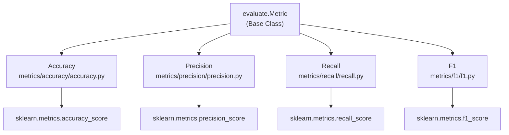
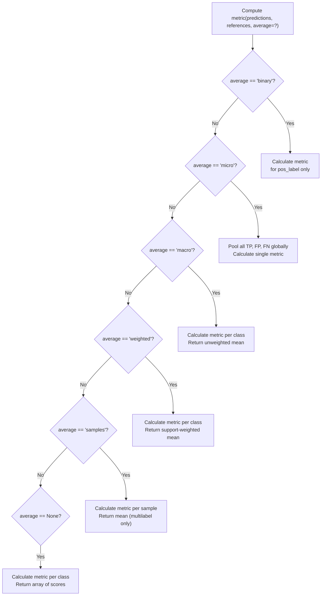
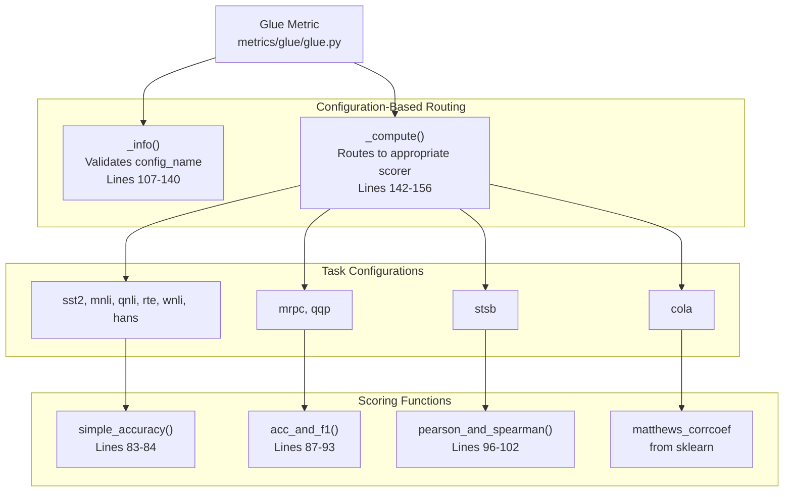
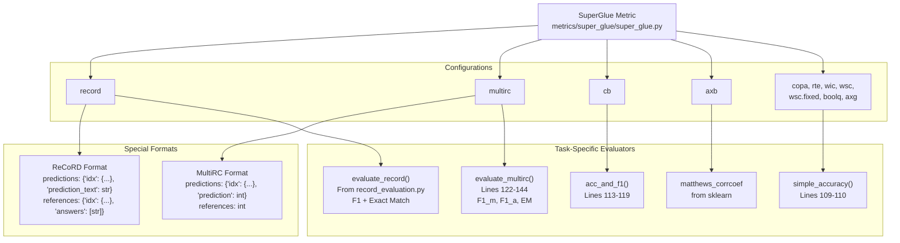
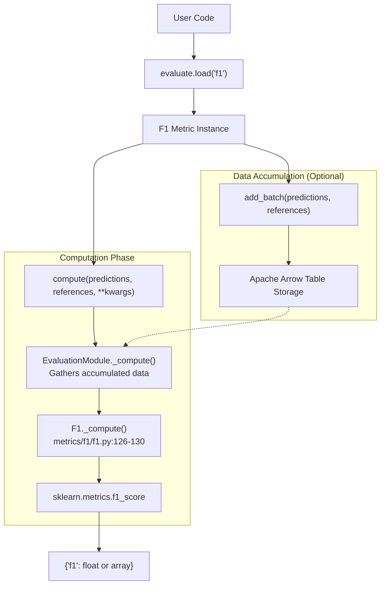
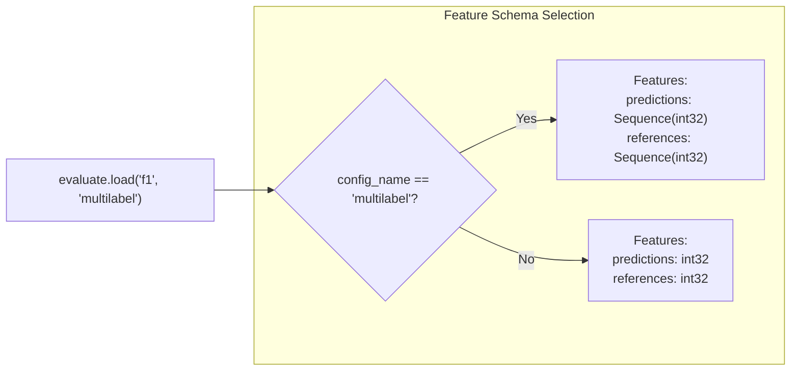

<!-- source: DeepWiki mcp.deepwiki.com · repo huggingface/evaluate · page 5.1 Classification Metrics · fetched 2026-10-26 -->

# Classification Metrics

<details>
<summary>Relevant source files</summary>

The following files were used as context for generating this wiki page:

- [metrics/accuracy/accuracy.py](metrics/accuracy/accuracy.py)
- [metrics/f1/f1.py](metrics/f1/f1.py)
- [metrics/glue/glue.py](metrics/glue/glue.py)
- [metrics/indic_glue/indic_glue.py](metrics/indic_glue/indic_glue.py)
- [metrics/precision/precision.py](metrics/precision/precision.py)
- [metrics/recall/recall.py](metrics/recall/recall.py)
- [metrics/super_glue/super_glue.py](metrics/super_glue/super_glue.py)

</details>


## Purpose and Scope

This document covers classification metrics available in the evaluate library. Classification metrics measure the performance of models that assign discrete labels to inputs. This includes binary classification (two classes), multiclass classification (more than two classes), and multilabel classification (multiple labels per instance).

For metrics specific to text generation tasks (ROUGE, BLEU), see [Text Generation Metrics](#5.2). For sequence labeling tasks (NER, POS tagging), see [Sequence Labeling Metrics](#5.3). For question answering, see [Question Answering Metrics](#5.4).

## Core Classification Metrics

The evaluate library provides four fundamental classification metrics, all implemented as wrappers around scikit-learn functions. Each metric extends the `evaluate.Metric` base class and follows the standard `_info()` and `_compute()` pattern.

### Metric Class Hierarchy



**Sources:** [metrics/accuracy/accuracy.py:81-106](), [metrics/precision/precision.py:106-145](), [metrics/recall/recall.py:96-135](), [metrics/f1/f1.py:106-130]()

### Accuracy

The `Accuracy` class computes the proportion of correct predictions. It is the simplest classification metric and works for binary, multiclass, and multilabel settings.

**Formula:** Accuracy = (TP + TN) / (TP + TN + FP + FN)

**Key Parameters:**
- `predictions` (list of int): Predicted labels
- `references` (list of int): Ground truth labels
- `normalize` (bool): If False, returns count instead of proportion (default: True)
- `sample_weight` (list of float): Optional weights for each sample

**Implementation:** The `_compute()` method at [metrics/accuracy/accuracy.py:101-106]() directly delegates to `sklearn.metrics.accuracy_score`.

**Configuration:** Supports a `"multilabel"` config via `config_name`, which changes the feature schema to use `datasets.Sequence(datasets.Value("int32"))` instead of scalar `int32` values [metrics/accuracy/accuracy.py:87-96]().

### Precision

The `Precision` class measures the fraction of positive predictions that are actually correct.

**Formula:** Precision = TP / (TP + FP)

**Key Parameters:**
- `predictions` (list of int): Predicted class labels
- `references` (list of int): Actual class labels
- `labels` (list of int): Subset of labels to include in calculation
- `pos_label` (int): The positive class for binary classification (default: 1)
- `average` (string): Averaging strategy for multiclass (default: "binary")
- `sample_weight` (list of float): Optional sample weights
- `zero_division` (int or string): Value to return when denominator is zero (default: "warn")

**Implementation:** [metrics/precision/precision.py:126-145]() wraps `sklearn.metrics.precision_score`.

### Recall

The `Recall` class measures the fraction of actual positive examples that were correctly identified.

**Formula:** Recall = TP / (TP + FN)

**Key Parameters:** Identical to Precision (see above).

**Implementation:** [metrics/recall/recall.py:116-135]() wraps `sklearn.metrics.recall_score`.

### F1 Score

The `F1` class computes the harmonic mean of precision and recall, providing a balanced measure of both metrics.

**Formula:** F1 = 2 × (precision × recall) / (precision + recall)

**Key Parameters:** Identical to Precision and Recall.

**Implementation:** [metrics/f1/f1.py:126-130]() wraps `sklearn.metrics.f1_score`. The return value handling at line 130 converts arrays to native Python types when needed.

**Sources:** [metrics/accuracy/accuracy.py:1-107](), [metrics/precision/precision.py:1-146](), [metrics/recall/recall.py:1-136](), [metrics/f1/f1.py:1-131]()

## Averaging Strategies for Multiclass Classification

All metrics except accuracy support multiple averaging strategies for multiclass problems via the `average` parameter. This determines how per-class metrics are aggregated into a single score.

### Averaging Strategy Flowchart



**Sources:** [metrics/f1/f1.py:28-87](), [metrics/precision/precision.py:29-87](), [metrics/recall/recall.py:29-87]()

### Averaging Strategy Comparison

| Strategy | Use Case | Formula | Label Imbalance Handling |
|----------|----------|---------|--------------------------|
| `binary` | Binary classification only | Metric for `pos_label` class | N/A (two classes) |
| `micro` | Multiclass, emphasis on overall performance | Global TP, FP, FN pooled | Yes (naturally weighted by frequency) |
| `macro` | Multiclass, equal importance per class | Mean of per-class metrics | No (treats all classes equally) |
| `weighted` | Multiclass, account for class imbalance | Support-weighted mean | Yes (weighted by true label frequency) |
| `samples` | Multilabel only | Per-sample metric, then mean | Yes (per-sample basis) |
| `None` | Need per-class breakdown | Array of per-class metrics | N/A (no aggregation) |

**Example:** For a 3-class problem with predictions `[0, 2, 1, 0, 0, 1]` and references `[0, 1, 2, 0, 1, 2]`:
- `average='macro'` at [metrics/f1/f1.py:69-71]() yields F1=0.27 (mean of [0.8, 0.0, 0.0])
- `average='micro'` at [metrics/f1/f1.py:72-74]() yields F1=0.33 (global pooling)
- `average=None` at [metrics/f1/f1.py:78-80]() yields array `[0.8, 0.0, 0.0]`

**Sources:** [metrics/f1/f1.py:28-87](), [metrics/precision/precision.py:29-87](), [metrics/recall/recall.py:29-87]()

## Benchmark Suites

Benchmark suites are specialized metrics that select the appropriate scoring function based on a configuration name. They enable consistent evaluation across standardized datasets.

### GLUE Benchmark

The `Glue` class implements the General Language Understanding Evaluation benchmark, supporting 12 different task configurations.



**Configuration Logic:**

The `_compute()` method at [metrics/glue/glue.py:142-156]() routes to different scorers based on `self.config_name`:

1. **cola**: Returns Matthews correlation coefficient via `sklearn.metrics.matthews_corrcoef` [metrics/glue/glue.py:143-144]()
2. **stsb** (regression): Returns Pearson and Spearman correlations via `scipy.stats` [metrics/glue/glue.py:145-146]()
3. **mrpc, qqp**: Returns both accuracy and F1 score [metrics/glue/glue.py:147-148]()
4. **sst2, mnli, mnli_mismatched, mnli_matched, qnli, rte, wnli, hans**: Returns simple accuracy [metrics/glue/glue.py:149-150]()

**Input Schema:** The `_info()` method configures features at [metrics/glue/glue.py:131-136](). For **stsb**, it uses `float32` for regression; all others use `int64` for classification.

**Sources:** [metrics/glue/glue.py:1-157]()

### SuperGLUE Benchmark

The `SuperGlue` class extends GLUE with more challenging tasks and supports complex prediction formats for ReCoRD and MultiRC.



**Special Task Handling:**

1. **ReCoRD** [metrics/super_glue/super_glue.py:218-228](): Transforms predictions into a format expected by the ReCoRD evaluator imported from `record_evaluation.py`. Returns exact match and token-level F1.

2. **MultiRC** [metrics/super_glue/super_glue.py:229-230](): Groups predictions by question ID (constructed from paragraph + question indices), computes per-question macro F1 (`f1_m`), overall F1 (`f1_a`), and exact match. Implementation at [metrics/super_glue/super_glue.py:122-144]().

3. **CB** [metrics/super_glue/super_glue.py:216-217](): Uses macro-averaged F1 instead of binary.

4. **axb** [metrics/super_glue/super_glue.py:214-215](): Returns Matthews correlation coefficient.

**Feature Schema:** The `_get_feature_types()` method at [metrics/super_glue/super_glue.py:177-211]() returns different schemas for ReCoRD (nested dict with string answers), MultiRC (nested dict with int predictions), and others (simple int64 predictions/references).

**Sources:** [metrics/super_glue/super_glue.py:1-238]()

### IndicGLUE Benchmark

The `IndicGlue` class provides evaluation for Indian language understanding tasks, including a unique cross-lingual similarity retrieval task.

**Unique Task - cvit-mkb-clsr:** This configuration at [metrics/indic_glue/indic_glue.py:149-150]() evaluates cross-lingual sentence retrieval. The `precision_at_10()` function at [metrics/indic_glue/indic_glue.py:89-102]() computes cosine similarity between English and Indian language sentence vectors, then checks if the correct match appears in the top 10 results. This is the only metric that operates on vector embeddings rather than discrete labels.

**Other Configurations:**
- **wiki-ner**: Returns accuracy and F1 [metrics/indic_glue/indic_glue.py:151-152]()
- **wnli, copa, sna, csqa, wstp, inltkh, bbca, iitp-mr, iitp-pr, actsa-sc, md**: Return simple accuracy [metrics/indic_glue/indic_glue.py:153-166]()

**Sources:** [metrics/indic_glue/indic_glue.py:1-174]()

## Implementation Architecture

### Data Flow Through Classification Metrics



**Sources:** [metrics/f1/f1.py:126-130](), [metrics/accuracy/accuracy.py:101-106]()

### Metric Configuration Pattern

All classification metrics follow a consistent pattern:

1. **_info() method:** Defines metadata, input schemas, and documentation
2. **_compute() method:** Implements the scoring logic (delegates to sklearn)
3. **config_name support:** Some metrics support multiple configurations (e.g., `"multilabel"`)

**Multilabel Configuration Example:**



This pattern appears in [metrics/f1/f1.py:112-122](), [metrics/accuracy/accuracy.py:87-96](), [metrics/precision/precision.py:112-122](), and [metrics/recall/recall.py:102-112]().

**Sources:** [metrics/f1/f1.py:107-130](), [metrics/accuracy/accuracy.py:82-106](), [metrics/precision/precision.py:107-145](), [metrics/recall/recall.py:97-135]()

## Usage Patterns

### Basic Usage

```python
# Load metric
metric = evaluate.load("accuracy")

# Compute on full dataset
predictions = [0, 1, 1, 2, 1, 0]
references = [0, 1, 2, 0, 1, 2]
results = metric.compute(predictions=predictions, references=references)
# {'accuracy': 0.5}
```

### Multiclass with Different Averaging

```python
f1_metric = evaluate.load("f1")

predictions = [0, 2, 1, 0, 0, 1]
references = [0, 1, 2, 0, 1, 2]

# Macro averaging (equal weight per class)
f1_metric.compute(predictions=predictions, references=references, average="macro")
# {'f1': 0.27}

# Weighted averaging (weight by support)
f1_metric.compute(predictions=predictions, references=references, average="weighted")
# {'f1': 0.27}

# Per-class scores
f1_metric.compute(predictions=predictions, references=references, average=None)
# {'f1': array([0.8, 0., 0.])}
```

**Sources:** [metrics/f1/f1.py:66-80]()

### Multilabel Classification

```python
# Load with multilabel config
f1_metric = evaluate.load("f1", "multilabel")

# Each sample can have multiple labels (binary vector)
predictions = [[0, 1, 1], [1, 1, 0]]
references = [[0, 1, 1], [0, 1, 0]]

results = f1_metric.compute(predictions=predictions, references=references, average="macro")
# {'f1': 0.67}
```

**Sources:** [metrics/f1/f1.py:82-86]()

### GLUE Benchmark Usage

```python
# Load with task-specific configuration
glue_metric = evaluate.load("glue", "mrpc")

predictions = [0, 1, 0, 1]
references = [0, 1, 1, 1]

results = glue_metric.compute(predictions=predictions, references=references)
# {'accuracy': 0.75, 'f1': 0.8}
```

The configuration name determines which metrics are computed:
- **cola**: Matthews correlation
- **stsb**: Pearson and Spearman correlations
- **mrpc/qqp**: Accuracy and F1
- **Others**: Accuracy only

**Sources:** [metrics/glue/glue.py:53-79]()

### SuperGLUE with Complex Formats

```python
# ReCoRD task with structured predictions
super_glue_metric = evaluate.load("super_glue", "record")

predictions = [{
    'idx': {'passage': 0, 'query': 0}, 
    'prediction_text': 'answer'
}]
references = [{
    'idx': {'passage': 0, 'query': 0}, 
    'answers': ['answer', 'another_answer']
}]

results = super_glue_metric.compute(predictions=predictions, references=references)
# {'exact_match': 1.0, 'f1': 1.0}
```

**Sources:** [metrics/super_glue/super_glue.py:86-91]()

### Incremental Computation

For large datasets, metrics support incremental data accumulation:

```python
metric = evaluate.load("accuracy")

# Add batches incrementally
for batch in dataset.iter(batch_size=1000):
    metric.add_batch(
        predictions=batch["predictions"],
        references=batch["labels"]
    )

# Compute on all accumulated data
final_results = metric.compute()
```

This pattern is particularly useful in distributed training scenarios where data is processed across multiple processes.

**Sources:** Based on the standard `EvaluationModule` API documented in [Core Architecture](#3)

## Key Implementation Details

### Sklearn Delegation

All core metrics delegate computation to scikit-learn functions:

| Metric | sklearn Function | File Location |
|--------|-----------------|---------------|
| Accuracy | `sklearn.metrics.accuracy_score` | [metrics/accuracy/accuracy.py:104]() |
| Precision | `sklearn.metrics.precision_score` | [metrics/precision/precision.py:136]() |
| Recall | `sklearn.metrics.recall_score` | [metrics/recall/recall.py:126]() |
| F1 | `sklearn.metrics.f1_score` | [metrics/f1/f1.py:127]() |
| Matthews (GLUE) | `sklearn.metrics.matthews_corrcoef` | [metrics/glue/glue.py:18]() |
| F1 (SuperGLUE) | `sklearn.metrics.f1_score` | [metrics/super_glue/super_glue.py:18]() |

### Return Value Normalization

Metrics normalize return values to handle both scalar and array outputs. Example from F1 at [metrics/f1/f1.py:130]():

```python
return {"f1": score if getattr(score, "size", 1) > 1 else float(score)}
```

This converts numpy scalars to Python floats when `average` is not None, but preserves arrays when `average=None`.

### Configuration Validation

Benchmark metrics validate configuration names in `_info()`:
- GLUE: [metrics/glue/glue.py:108-126]()
- SuperGLUE: [metrics/super_glue/super_glue.py:150-166]()
- IndicGLUE: [metrics/indic_glue/indic_glue.py:108-128]()

Invalid configurations raise `KeyError` with a helpful message listing valid options.

**Sources:** [metrics/accuracy/accuracy.py:1-107](), [metrics/precision/precision.py:1-146](), [metrics/recall/recall.py:1-136](), [metrics/f1/f1.py:1-131](), [metrics/glue/glue.py:1-157](), [metrics/super_glue/super_glue.py:1-238](), [metrics/indic_glue/indic_glue.py:1-174]()

---

