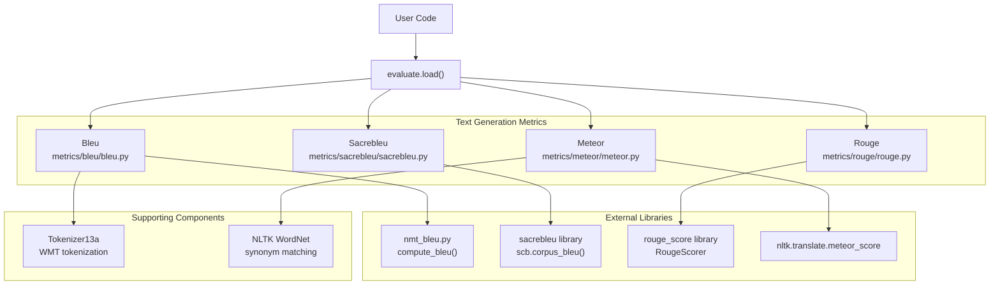
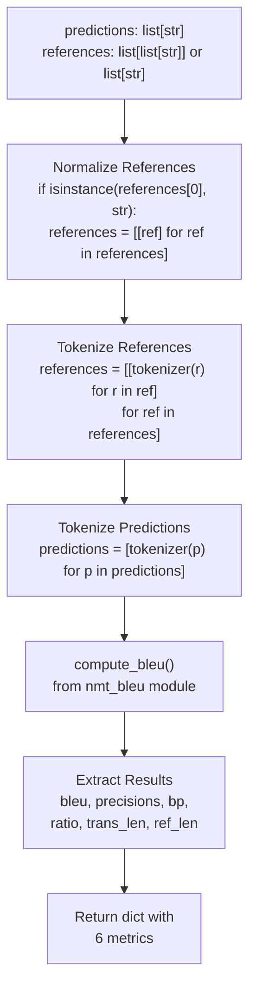
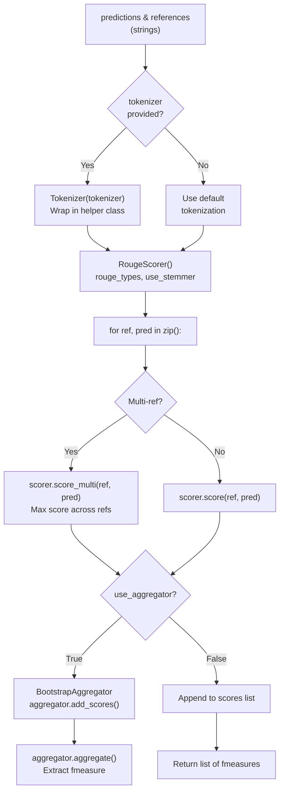
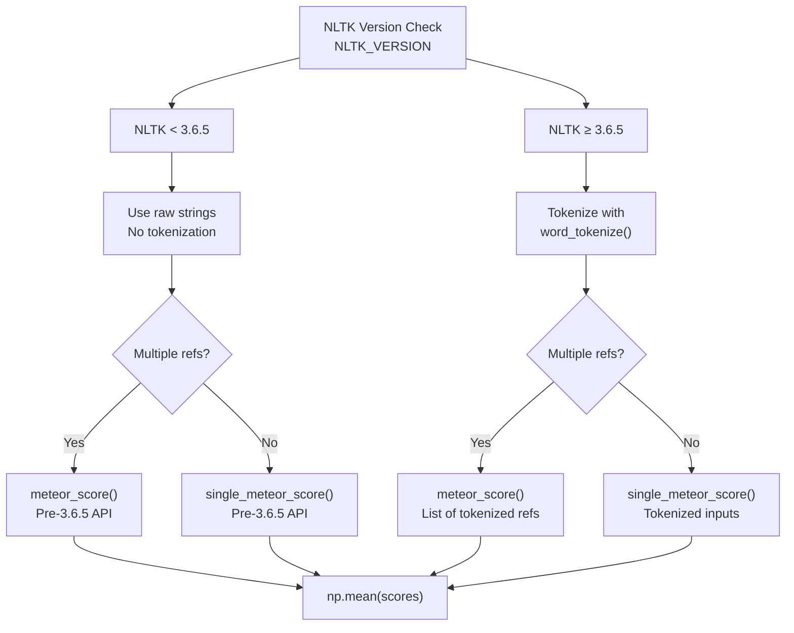
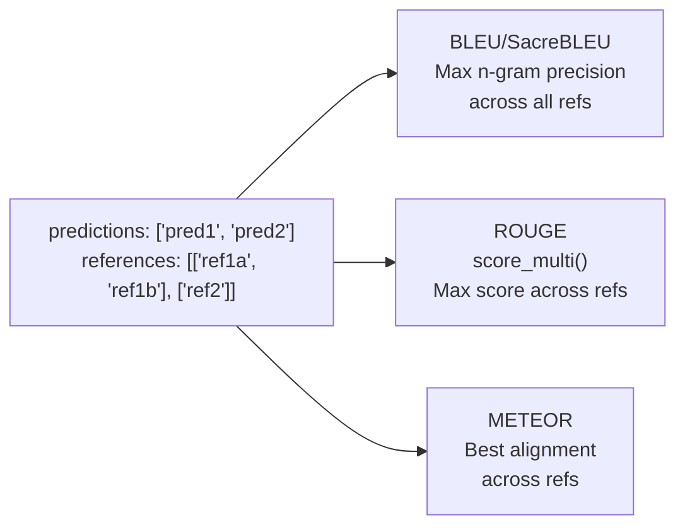
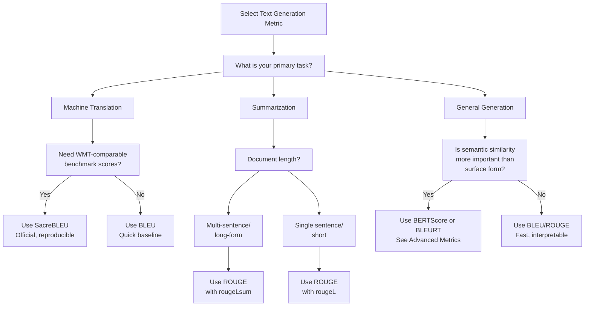
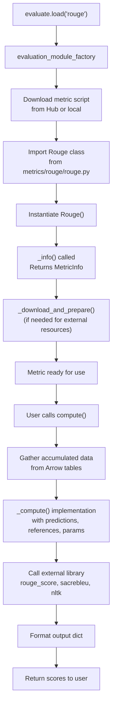

<!-- source: DeepWiki mcp.deepwiki.com · repo huggingface/evaluate · page 5.2 Text Generation Metrics · fetched 2026-10-26 -->

# Text Generation Metrics

<details>
<summary>Relevant source files</summary>

The following files were used as context for generating this wiki page:

- [measurements/word_length/word_length.py](measurements/word_length/word_length.py)
- [metrics/bertscore/bertscore.py](metrics/bertscore/bertscore.py)
- [metrics/bleu/bleu.py](metrics/bleu/bleu.py)
- [metrics/bleurt/bleurt.py](metrics/bleurt/bleurt.py)
- [metrics/meteor/meteor.py](metrics/meteor/meteor.py)
- [metrics/rouge/README.md](metrics/rouge/README.md)
- [metrics/rouge/requirements.txt](metrics/rouge/requirements.txt)
- [metrics/rouge/rouge.py](metrics/rouge/rouge.py)
- [metrics/sacrebleu/sacrebleu.py](metrics/sacrebleu/sacrebleu.py)
- [metrics/seqeval/seqeval.py](metrics/seqeval/seqeval.py)
- [metrics/squad/squad.py](metrics/squad/squad.py)
- [metrics/xnli/xnli.py](metrics/xnli/xnli.py)

</details>


## Purpose and Scope

This page documents metrics designed for evaluating text generation tasks, including machine translation, summarization, and general sequence-to-sequence generation. These metrics assess the quality of generated text by comparing predictions against one or more reference texts.

For classification-based NLP tasks, see [Classification Metrics](#5.1). For token-level sequence labeling, see [Sequence Labeling Metrics](#5.3). For extractive question answering, see [Question Answering Metrics](#5.4). For semantic similarity metrics using pretrained models, see [Advanced Metrics](#5.5).

## Overview

Text generation metrics evaluate the correspondence between machine-generated text and human-written reference texts. The evaluate library provides several implementations spanning different approaches:

| Metric | Primary Use Case | Approach | Key Characteristic |
|--------|-----------------|----------|-------------------|
| BLEU | Machine Translation | N-gram precision | Original MT metric, word-level matching |
| SacreBLEU | Machine Translation | N-gram precision | Standardized BLEU with reproducible tokenization |
| ROUGE | Summarization, Translation | N-gram overlap | Recall-oriented, multiple variants |
| METEOR | Machine Translation | Unigram alignment | Stemming, synonyms, word ordering |
| BERTScore | General Generation | Contextual embeddings | Semantic similarity via BERT |
| BLEURT | General Generation | Learned metric | Fine-tuned BERT on human judgments |

The first four metrics use surface-form matching with various tokenization and matching strategies. The latter two leverage pretrained language models for semantic evaluation and are covered in detail in [Advanced Metrics](#5.5).

**Sources**: [metrics/bleu/bleu.py:46-54](), [metrics/rouge/rouge.py:41-50](), [metrics/meteor/meteor.py:49-66](), [metrics/sacrebleu/sacrebleu.py:37-43]()

## Metric Architecture

### Component Relationships



**Sources**: [metrics/bleu/bleu.py:20-21](), [metrics/sacrebleu/sacrebleu.py:17](), [metrics/rouge/rouge.py:22](), [metrics/meteor/meteor.py:18]()

## Common Characteristics

### Input Format

All text generation metrics follow a consistent input schema defined through the `_info()` method:

```python
features=[
    datasets.Features({
        "predictions": datasets.Value("string", id="sequence"),
        "references": datasets.Sequence(datasets.Value("string", id="sequence"), id="references"),
    }),
    datasets.Features({
        "predictions": datasets.Value("string", id="sequence"),
        "references": datasets.Value("string", id="sequence"),
    }),
]
```

This allows metrics to accept either:
- **Single reference**: Each prediction has one reference string
- **Multiple references**: Each prediction has a list of reference strings

The metric implementations automatically detect which format is provided at runtime by checking `isinstance(references[0], str)` or `isinstance(references[0], list)`.

**Sources**: [metrics/rouge/rouge.py:100-113](), [metrics/meteor/meteor.py:98-111](), [metrics/bleu/bleu.py:94-107]()

### String Tokenization

Most metrics expect predictions and references as strings with tokens separated by spaces:

```
Input: "hello there general kenobi"
Internal: ["hello", "there", "general", "kenobi"]
```

Some metrics provide tokenization customization:
- **ROUGE**: Accepts a custom `tokenizer` callable wrapped by the `Tokenizer` helper class [metrics/rouge/rouge.py:83-91]()
- **BLEU**: Provides the `Tokenizer13a` class for WMT-style tokenization [metrics/bleu/bleu.py:21]()
- **SacreBLEU**: Offers multiple tokenization schemes via the `tokenize` parameter including "13a", "intl", "zh", "ja-mecab", "char" [metrics/sacrebleu/sacrebleu.py:58-64]()

**Sources**: [metrics/rouge/rouge.py:122-132](), [metrics/bleu/bleu.py:115](), [metrics/sacrebleu/sacrebleu.py:58-64]()

## Core Metrics

### BLEU (Bilingual Evaluation Understudy)

**Implementation**: The `Bleu` class [metrics/bleu/bleu.py:88-133]() wraps the TensorFlow NMT implementation [metrics/bleu/bleu.py:20]().

**Key Parameters**:
- `tokenizer` (default: `Tokenizer13a()`): Tokenization function applied to all text
- `max_order` (default: 4): Maximum n-gram order (1 through 4 for BLEU-4)
- `smooth` (default: False): Apply Lin et al. 2004 smoothing for short sentences

**Computation Process**:



**Implementation Details** [metrics/bleu/bleu.py:115-133]():
1. Reference format normalization ensures list of lists
2. All references tokenized into lists of token lists
3. All predictions tokenized into lists of tokens
4. `compute_bleu()` computes modified n-gram precision with brevity penalty
5. Returns comprehensive statistics

**Output Format**:
```python
{
    'bleu': float,              # Overall BLEU score (0-1)
    'precisions': list[float],  # N-gram precisions [1-gram, 2-gram, 3-gram, 4-gram]
    'brevity_penalty': float,   # BP value (≤1.0)
    'length_ratio': float,      # prediction_length / reference_length
    'translation_length': int,  # Total tokens in predictions
    'reference_length': int     # Total tokens in references
}
```

**Sources**: [metrics/bleu/bleu.py:46-84](), [metrics/bleu/bleu.py:88-133]()

### SacreBLEU

**Implementation**: The `Sacrebleu` class [metrics/sacrebleu/sacrebleu.py:106-178]() wraps the `sacrebleu` library [metrics/sacrebleu/sacrebleu.py:17]().

**Key Parameters**:
- `smooth_method` (default: "exp"): Smoothing strategy ("none", "floor", "add-k", "exp")
- `smooth_value` (optional): Smoothing parameter (depends on `smooth_method`)
- `tokenize` (optional): Tokenization scheme ("none", "zh", "13a", "intl", "char", "ja-mecab")
- `lowercase` (default: False): Enable case-insensitive scoring
- `force` (default: False): Require detokenized input
- `use_effective_order` (default: False): Stop at zero precision n-gram orders

**Reference Transformation**:

SacreBLEU requires references grouped by position rather than by prediction. The implementation transposes the structure [metrics/sacrebleu/sacrebleu.py:155-158]():

```python
# Input format: [[ref1_for_pred1, ref2_for_pred1], [ref1_for_pred2, ...]]
# SacreBLEU format: [[ref1_for_pred1, ref1_for_pred2, ...], [ref2_for_pred1, ...]]
transformed_references = [
    [refs[i] for refs in references] 
    for i in range(references_per_prediction)
]
```

**Output Format**:
```python
{
    'score': float,           # BLEU score (0-100 scale) ← NOTE: Different from BLEU
    'counts': list[int],      # Matched n-gram counts
    'totals': list[int],      # Total n-gram counts  
    'precisions': list[float], # Precision for each order
    'bp': float,              # Brevity penalty
    'sys_len': int,           # System (prediction) length
    'ref_len': int            # Reference length
}
```

**Important**: SacreBLEU returns scores on a 0-100 scale, while the base BLEU metric uses 0-1. A score of `45.0` in SacreBLEU equals `0.45` in BLEU.

**Sources**: [metrics/sacrebleu/sacrebleu.py:45-102](), [metrics/sacrebleu/sacrebleu.py:140-178]()

### ROUGE (Recall-Oriented Understudy for Gisting Evaluation)

**Implementation**: The `Rouge` class [metrics/rouge/rouge.py:94-158]() wraps the Google Research `rouge_score` library [metrics/rouge/rouge.py:22]().

**ROUGE Types**:

| Type | Description | Computation | Best For |
|------|-------------|-------------|----------|
| `rouge1` | Unigram overlap | F1 of word matches | Overall content coverage |
| `rouge2` | Bigram overlap | F1 of 2-gram matches | Fluency and phrase quality |
| `rougeL` | Longest Common Subsequence | LCS-based F1 | Sentence-level structure |
| `rougeLsum` | LCS with newline splitting | LCS per sentence, summed | Multi-sentence documents |

**Key Parameters**:
- `rouge_types` (default: `["rouge1", "rouge2", "rougeL", "rougeLsum"]`): Which variants to compute
- `use_stemmer` (default: False): Apply Porter stemmer before matching
- `use_aggregator` (default: True): Return single aggregated score vs. per-sample list
- `tokenizer` (optional): Custom tokenization callable

**Computation Flow**:



**Implementation Details** [metrics/rouge/rouge.py:121-158]():

1. **Custom Tokenizer Wrapping** [metrics/rouge/rouge.py:129-130](): If provided, tokenizer wrapped in `Tokenizer` class with `tokenize()` method
2. **Scorer Creation** [metrics/rouge/rouge.py:132](): `RougeScorer` initialized with types and options
3. **Multi-reference Handling** [metrics/rouge/rouge.py:138-142](): Uses `score_multi()` for multiple references, `score()` for single
4. **Aggregation** [metrics/rouge/rouge.py:143-157]():
   - With aggregator: Uses bootstrap resampling, returns F-measure `.mid.fmeasure`
   - Without aggregator: Returns list of F-measures

**Output Format**:

With aggregation (`use_aggregator=True`):
```python
{
    'rouge1': float,     # 0-1 scale
    'rouge2': float,
    'rougeL': float,
    'rougeLsum': float
}
```

Without aggregation (`use_aggregator=False`):
```python
{
    'rouge1': list[float],     # Per-sample scores
    'rouge2': list[float],
    'rougeL': list[float],
    'rougeLsum': list[float]
}
```

**rougeLsum vs rougeL**: `rougeLsum` splits text by `"\n"` before computing LCS, making it suitable for multi-sentence summaries. Use `rougeL` for single sentences, `rougeLsum` for documents [metrics/rouge/README.md:71-76]().

**Sources**: [metrics/rouge/rouge.py:41-80](), [metrics/rouge/rouge.py:94-158](), [metrics/rouge/README.md:71-76]()

### METEOR (Metric for Evaluation of Translation with Explicit ORdering)

**Implementation**: The `Meteor` class [metrics/meteor/meteor.py:92-171]() uses NLTK's `meteor_score` module [metrics/meteor/meteor.py:18]().

**Key Features**:
- **Flexible matching**: Surface form, stemmed form, and synonyms via WordNet
- **Fragmentation penalty**: Captures word order quality
- **Balanced precision/recall**: Harmonic mean weighted by `alpha`
- **Better human correlation**: Designed to improve on BLEU's correlation with human judgments

**Key Parameters**:
- `alpha` (default: 0.9): Weight of recall vs. precision in harmonic mean
- `beta` (default: 3): Shape parameter for fragmentation penalty
- `gamma` (default: 0.5): Weight assigned to fragmentation penalty in final score

**Dependencies**:

The `_download_and_prepare()` method [metrics/meteor/meteor.py:119-129]() downloads required NLTK data:
- `wordnet`: For synonym matching via Open Multilingual WordNet
- `punkt` or `punkt_tab`: For tokenization (version-dependent)
- `omw-1.4`: Open Multilingual WordNet data (NLTK ≥ 3.6.6)

**Version Compatibility**:



**Implementation Details** [metrics/meteor/meteor.py:130-170]():

The metric handles two NLTK API versions:
- **NLTK ≥ 3.6.5**: Expects tokenized inputs [metrics/meteor/meteor.py:132-151]()
  - Applies `word_tokenize()` to all texts
  - Uses `meteor_score()` for multi-ref, `single_meteor_score()` for single-ref
- **NLTK < 3.6.5**: Expects raw strings [metrics/meteor/meteor.py:152-168]()
  - Passes strings directly to scoring functions

**Output Format**:
```python
{
    'meteor': float  # Average METEOR score across all samples (0-1 scale)
}
```

Unlike BLEU/ROUGE, METEOR returns only the final averaged score without component statistics.

**Sources**: [metrics/meteor/meteor.py:35-88](), [metrics/meteor/meteor.py:92-171](), [metrics/meteor/meteor.py:119-129]()

## Usage Patterns

### Basic Loading and Computation

```python
# Load metric
metric = evaluate.load("rouge")  # or "bleu", "meteor", "sacrebleu"

# Single reference per prediction
predictions = ["hello there", "general kenobi"]
references = ["hello there", "general kenobi"]
results = metric.compute(predictions=predictions, references=references)

# Multiple references per prediction
predictions = ["hello there"]
references = [["hello there", "hello", "greetings"]]
results = metric.compute(predictions=predictions, references=references)
```

All metrics auto-detect reference format by checking `isinstance(references[0], str)` or `isinstance(references[0], list)`.

**Sources**: [metrics/bleu/bleu.py:116-118](), [metrics/rouge/rouge.py:127](), [metrics/meteor/meteor.py:131]()

### Multiple Reference Handling

Different metrics handle multiple references differently:



- **BLEU/SacreBLEU**: Use maximum n-gram precision across references [metrics/sacrebleu/sacrebleu.py:155-158]()
- **ROUGE**: `score_multi()` computes score against each reference, returns max [metrics/rouge/rouge.py:140]()
- **METEOR**: Computes alignment with each reference, uses best [metrics/meteor/meteor.py:136-143]()

**Sources**: [metrics/rouge/rouge.py:138-142](), [metrics/meteor/meteor.py:134-143](), [metrics/sacrebleu/sacrebleu.py:155-158]()

### Custom Tokenization

Some metrics support custom tokenization for non-Latin scripts:

```python
# ROUGE with custom tokenizer
def japanese_tokenizer(text):
    # Your tokenization logic
    return text.split()  # Simplified example

rouge = evaluate.load('rouge')
results = rouge.compute(
    predictions=predictions,
    references=references,
    tokenizer=japanese_tokenizer
)

# BLEU with custom tokenizer
bleu = evaluate.load('bleu')
results = bleu.compute(
    predictions=predictions,
    references=references,
    tokenizer=japanese_tokenizer
)
```

The ROUGE metric wraps custom tokenizers in a helper class [metrics/rouge/rouge.py:83-91]() to provide the `tokenize()` method expected by `rouge_score`.

**Sources**: [metrics/rouge/rouge.py:83-91](), [metrics/rouge/rouge.py:129-132](), [metrics/bleu/bleu.py:115]()

### Combining Multiple Metrics

For comprehensive evaluation, combine multiple metrics:

```python
import evaluate

# Combine multiple text generation metrics
combined = evaluate.combine(["bleu", "rouge", "meteor"])

results = combined.compute(
    predictions=predictions,
    references=references
)

# Returns merged dictionary:
# {
#     'bleu': 0.45, 'precisions': [...], 'brevity_penalty': 0.98, ...
#     'rouge1': 0.65, 'rouge2': 0.42, 'rougeL': 0.58, 'rougeLsum': 0.60,
#     'meteor': 0.52
# }
```

**Sources**: Based on combine functionality described in architecture diagrams

## Comparison and Selection Guide

### Decision Tree



**Sources**: Synthesized from metric descriptions in provided files

### Metric Characteristics Comparison

| Characteristic | BLEU | SacreBLEU | ROUGE | METEOR |
|---------------|------|-----------|-------|--------|
| **Orientation** | Precision | Precision | Recall | Balanced |
| **N-gram order** | 1-4 | 1-4 | 1-2, LCS | 1 (unigram) |
| **Word order** | Implicit | Implicit | Limited (LCS) | Explicit penalty |
| **Linguistics** | None | None | Optional stemming | Stemming, synonyms |
| **Speed** | Fast | Fast | Fast | Medium |
| **External deps** | Minimal | Minimal | Minimal | NLTK data |
| **Score scale** | 0-1 | 0-100 | 0-1 | 0-1 |
| **Multi-ref** | ✓ | ✓ | ✓ | ✓ |
| **Reproducibility** | Low | High | Medium | Medium |

**Sources**: Inferred from implementation details in metric files

### When to Use Each Metric

**BLEU** [metrics/bleu/bleu.py]():
- Quick baseline for machine translation
- When precision is more important than recall
- Fast computation needed
- Legacy comparison with older work

**SacreBLEU** [metrics/sacrebleu/sacrebleu.py]():
- Publishing WMT-comparable scores
- Reproducible benchmarking required
- Multiple tokenization schemes needed
- Official MT evaluation

**ROUGE** [metrics/rouge/rouge.py]():
- Summarization evaluation (especially `rougeLsum`)
- Recall more important than precision
- Multiple variants for comprehensive analysis
- Fast computation on large datasets

**METEOR** [metrics/meteor/meteor.py]():
- MT evaluation with linguistic features
- Word order matters
- Synonym/stemming matching needed
- Better human correlation desired

**Sources**: [metrics/rouge/README.md:24-31](), metric descriptions in implementation files

## Common Issues and Solutions

### Issue: Reference Format Confusion

**Problem**: Unclear whether to pass single strings or lists of strings.

**Solution**: All metrics auto-detect format. Both work:

```python
# Single reference (one string per prediction)
references = ["ref1", "ref2", "ref3"]

# Multiple references (list of strings per prediction)
references = [
    ["ref1a", "ref1b"],      # Two refs for prediction 1
    ["ref2"],                # One ref for prediction 2
    ["ref3a", "ref3b", "ref3c"]  # Three refs for prediction 3
]
```

Detection logic: `if isinstance(references[0], str):` [metrics/bleu/bleu.py:117]()

**Sources**: [metrics/bleu/bleu.py:116-118](), [metrics/rouge/rouge.py:127](), [metrics/meteor/meteor.py:131]()

### Issue: Tokenization Format Mismatch

**Problem**: Passing already-tokenized lists instead of space-separated strings.

**Solution**: Metrics expect strings with space-separated tokens:

```python
# Correct format ✓
predictions = ["hello there", "general kenobi"]

# Incorrect format ✗
predictions = [["hello", "there"], ["general", "kenobi"]]

# If you have token lists, join them:
predictions = [" ".join(tokens) for tokens in token_lists]
```

**Sources**: Based on feature schemas in [metrics/rouge/rouge.py:100-113]()

### Issue: SacreBLEU vs BLEU Score Scale Difference

**Problem**: Scores differ by factor of 100 between BLEU and SacreBLEU.

**Solution**: Remember the scale difference:
- BLEU: 0-1 scale (`0.45` means 45%)
- SacreBLEU: 0-100 scale (`45.0` means 45%)

Both represent the same quality level, just different scales.

**Sources**: [metrics/bleu/bleu.py:126-127](), [metrics/sacrebleu/sacrebleu.py:170]()

### Issue: METEOR NLTK Data Not Found

**Problem**: `LookupError: Resource wordnet not found.`

**Solution**: The metric automatically downloads NLTK data via `_download_and_prepare()` [metrics/meteor/meteor.py:119-129](), but ensure NLTK is installed:

```bash
pip install nltk
```

The download happens on first use and is cached for future runs.

**Sources**: [metrics/meteor/meteor.py:119-129]()

### Issue: ROUGE rougeLsum on Single Sentences

**Problem**: Using `rougeLsum` on single-sentence texts without newlines gives unexpected results.

**Solution**: Choose the right ROUGE type:
- **Single sentence**: Use `rougeL`
- **Multi-sentence documents**: Use `rougeLsum`

```python
# For single sentences
rouge.compute(
    predictions=predictions,
    references=references,
    rouge_types=["rouge1", "rouge2", "rougeL"]
)

# For multi-sentence documents
rouge.compute(
    predictions=predictions,
    references=references,
    rouge_types=["rouge1", "rouge2", "rougeLsum"]
)
```

`rougeLsum` splits on `"\n"` before computing LCS [metrics/rouge/README.md:75-76]().

**Sources**: [metrics/rouge/README.md:71-76]()

### Issue: SacreBLEU Version Requirement

**Problem**: Old `sacrebleu` versions cause import errors.

**Solution**: The metric checks version and raises informative error [metrics/sacrebleu/sacrebleu.py:108-112]():

```bash
pip install "sacrebleu>=1.4.12"
```

**Sources**: [metrics/sacrebleu/sacrebleu.py:108-112]()

## Implementation Pattern

All text generation metrics follow the standard `EvaluationModule` pattern:



**Key Methods**:

1. **`_info()`** [metrics/rouge/rouge.py:95-119](): Returns `MetricInfo` object with:
   - Description and citation strings
   - Input/output documentation
   - Feature schema for validation
   - Codebase and reference URLs

2. **`_download_and_prepare()`** (optional): Downloads external resources before first use
   - METEOR: Downloads WordNet and punkt tokenizer [metrics/meteor/meteor.py:119-129]()
   - BLEURT: Downloads model checkpoint [metrics/bleurt/bleurt.py:98-121]()
   - Not needed for BLEU, SacreBLEU, or ROUGE

3. **`_compute()`**: Core scoring logic
   - Receives predictions and references (plus optional parameters)
   - Calls underlying library implementation
   - Returns dictionary with metric values

**Sources**: [metrics/rouge/rouge.py:94-158](), [metrics/meteor/meteor.py:92-171](), [metrics/bleu/bleu.py:88-133]()

## File Organization

Text generation metrics follow a consistent directory structure:

```
metrics/
├── bleu/
│   ├── bleu.py              # Bleu class with _info() and _compute()
│   ├── nmt_bleu.py          # TensorFlow NMT BLEU implementation
│   ├── tokenizer_13a.py     # WMT tokenization
│   └── README.md            # Usage documentation
├── sacrebleu/
│   ├── sacrebleu.py         # Sacrebleu class
│   ├── requirements.txt     # sacrebleu>=1.4.12
│   └── README.md
├── rouge/
│   ├── rouge.py             # Rouge class with Tokenizer helper
│   ├── requirements.txt     # rouge_score>=0.1.2, nltk, absl-py
│   ├── app.py               # Gradio widget
│   └── README.md
└── meteor/
    ├── meteor.py            # Meteor class with NLTK integration
    └── README.md
```

Each metric directory contains:
- **Main Python file**: Metric class inheriting from `evaluate.Metric`
- **README.md**: Detailed documentation with examples
- **requirements.txt**: External dependencies
- **Helper modules**: Optional supporting code (tokenizers, scorers)

**Sources**: [metrics/bleu/bleu.py:1](), [metrics/rouge/rouge.py:1](), [metrics/meteor/meteor.py:1](), [metrics/sacrebleu/sacrebleu.py:1](), [metrics/rouge/requirements.txt:1-4]()

---

