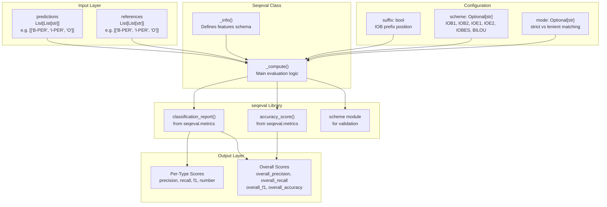
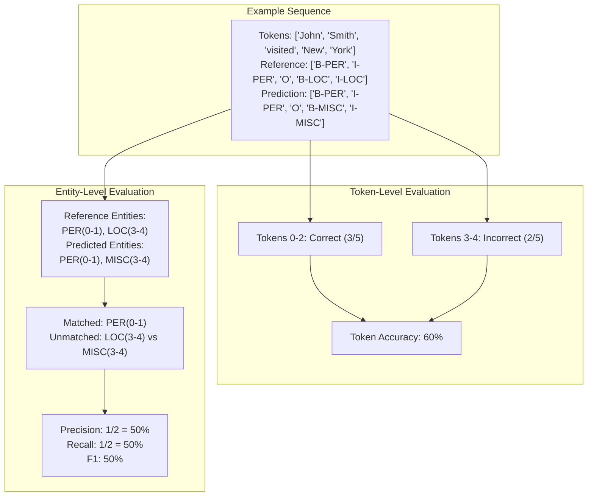

<!-- source: DeepWiki mcp.deepwiki.com · repo huggingface/evaluate · page 5.3 Sequence Labeling Metrics · fetched 2026-10-26 -->

# Sequence Labeling Metrics

<details>
<summary>Relevant source files</summary>

The following files were used as context for generating this wiki page:

- [metrics/bleu/bleu.py](metrics/bleu/bleu.py)
- [metrics/rouge/README.md](metrics/rouge/README.md)
- [metrics/rouge/requirements.txt](metrics/rouge/requirements.txt)
- [metrics/rouge/rouge.py](metrics/rouge/rouge.py)
- [metrics/sacrebleu/sacrebleu.py](metrics/sacrebleu/sacrebleu.py)
- [metrics/seqeval/seqeval.py](metrics/seqeval/seqeval.py)
- [metrics/squad/squad.py](metrics/squad/squad.py)
- [metrics/xnli/xnli.py](metrics/xnli/xnli.py)

</details>


## Purpose and Scope

This document describes metrics for evaluating sequence labeling tasks such as Named Entity Recognition (NER), Part-of-Speech (POS) tagging, chunking, and semantic role labeling. These tasks involve assigning labels to each token in a sequence, where labels often indicate entity boundaries and types.

For metrics on classification tasks, see [Classification Metrics](#5.1). For text generation evaluation, see [Text Generation Metrics](#5.2). For advanced semantic evaluation metrics, see [Advanced Metrics](#5.5).

## Overview

Sequence labeling differs from simple classification in that:
- Labels are assigned to each token in a sequence
- Labels often encode both entity boundaries and entity types
- Evaluation must consider entity spans, not just individual tokens
- Multiple tagging schemes exist (IOB, IOBES, etc.) with different encoding conventions

The primary metric for sequence labeling in the evaluate library is **seqeval**, which provides entity-level evaluation using precision, recall, and F1 scores per entity type and overall.

Sources: [metrics/seqeval/seqeval.py:43-58]()

## Seqeval Metric

### Core Functionality

The `Seqeval` class in [metrics/seqeval/seqeval.py:103]() wraps the seqeval Python framework, which implements the standard CoNLL evaluation methodology. Unlike token-level accuracy, seqeval evaluates complete entity spans - an entity prediction is only considered correct if both the entity type and boundaries match exactly.

**Diagram: Seqeval Evaluation Pipeline**



Sources: [metrics/seqeval/seqeval.py:103-164]()

### Tagging Schemes

Seqeval supports multiple tagging schemes that encode entity boundaries differently. The `scheme` parameter in `_compute()` specifies which scheme to use.

**Diagram: Tagging Scheme Comparison**

```mermaid
graph TB
    subgraph "Token Sequence"
        T1["John"]
        T2["Smith"]
        T3["visited"]
        T4["New"]
        T5["York"]
    end
    
    subgraph "IOB2 (Default)"
        IOB2_1["B-PER"]
        IOB2_2["I-PER"]
        IOB2_3["O"]
        IOB2_4["B-LOC"]
        IOB2_5["I-LOC"]
    end
    
    subgraph "IOB1"
        IOB1_1["I-PER"]
        IOB1_2["I-PER"]
        IOB1_3["O"]
        IOB1_4["I-LOC"]
        IOB1_5["I-LOC"]
    end
    
    subgraph "IOBES"
        IOBES_1["B-PER"]
        IOBES_2["E-PER"]
        IOBES_3["O"]
        IOBES_4["B-LOC"]
        IOBES_5["E-LOC"]
    end
    
    subgraph "IOE2"
        IOE2_1["I-PER"]
        IOE2_2["E-PER"]
        IOE2_3["O"]
        IOE2_4["I-LOC"]
        IOE2_5["E-LOC"]
    end
    
    T1 -.-> IOB2_1
    T1 -.-> IOB1_1
    T1 -.-> IOBES_1
    T1 -.-> IOE2_1
    
    T2 -.-> IOB2_2
    T2 -.-> IOB1_2
    T2 -.-> IOBES_2
    T2 -.-> IOE2_2
    
    T3 -.-> IOB2_3
    T3 -.-> IOB1_3
    T3 -.-> IOBES_3
    T3 -.-> IOE2_3
    
    T4 -.-> IOB2_4
    T4 -.-> IOB1_4
    T4 -.-> IOBES_4
    T4 -.-> IOE2_4
    
    T5 -.-> IOB2_5
    T5 -.-> IOB1_5
    T5 -.-> IOBES_5
    T5 -.-> IOE2_5
```



**Scheme Descriptions:**

| Scheme | Description | Usage |
|--------|-------------|-------|
| **IOB1** | I tag for all tokens; B only when entity follows same-type entity | Rare, legacy format |
| **IOB2** | B tag for first token, I for continuations | Most common, default in many frameworks |
| **IOE1** | E tag for last token, I for earlier tokens | Less common |
| **IOE2** | E tag marks entity ends explicitly | Less common |
| **IOBES** | B (begin), I (inside), E (end), S (single), O (outside) | Most explicit, better for single-token entities |
| **BILOU** | B (begin), I (inside), L (last), O (outside), U (unit) | Alternative to IOBES |

The scheme is specified via the `scheme` parameter and validated in [metrics/seqeval/seqeval.py:130-135](). The implementation imports the scheme module dynamically and retrieves the appropriate scheme class.

Sources: [metrics/seqeval/seqeval.py:50-56](), [metrics/seqeval/seqeval.py:130-135]()

### Input Format

The seqeval metric expects predictions and references as nested lists of strings, where each inner list represents a sequence of labels for one example.

**Expected Features Schema** (from [metrics/seqeval/seqeval.py:110-115]()):

```python
datasets.Features({
    "predictions": datasets.Sequence(datasets.Value("string", id="label"), id="sequence"),
    "references": datasets.Sequence(datasets.Value("string", id="label"), id="sequence")
})
```

Each label string follows the format `{PREFIX}-{TYPE}` (e.g., `"B-PER"`, `"I-LOC"`) or just `"O"` for outside tokens. The `suffix` parameter (default `False`) controls whether the format is `{PREFIX}-{TYPE}` or `{TYPE}-{PREFIX}`.

Sources: [metrics/seqeval/seqeval.py:110-115]()

## Parameters and Configuration

### Core Parameters

The `_compute()` method in [metrics/seqeval/seqeval.py:120-129]() accepts the following parameters:

| Parameter | Type | Default | Description |
|-----------|------|---------|-------------|
| `predictions` | `List[List[str]]` | Required | List of predicted label sequences |
| `references` | `List[List[str]]` | Required | List of reference label sequences |
| `suffix` | `bool` | `False` | Whether the tag type comes after the IOB prefix (e.g., `PER-B` vs `B-PER`) |
| `scheme` | `Optional[str]` | `None` | Tagging scheme: `"IOB1"`, `"IOB2"`, `"IOE1"`, `"IOE2"`, `"IOBES"`, or `"BILOU"` |
| `mode` | `Optional[str]` | `None` | Evaluation mode: `"strict"` for exact boundary matching only |
| `sample_weight` | `Optional[List[int]]` | `None` | Weights for individual samples |
| `zero_division` | `Union[str, int]` | `"warn"` | Value to use when division by zero occurs: `0`, `1`, or `"warn"` |

### Mode Parameter

The `mode` parameter controls entity matching strictness:
- **Default (None)**: Counts entities as correct if both type and boundaries match, but may be lenient with I/B tag mismatches within the entity
- **"strict"**: Only counts exact matches where all tags (including I/B distinctions) are correct

Sources: [metrics/seqeval/seqeval.py:120-145]()

## Entity-Level Evaluation

### Evaluation Logic

The seqeval metric performs entity-level evaluation rather than token-level. This means:

1. **Entity Extraction**: Labels are parsed to extract entity spans (start, end, type)
2. **Entity Matching**: Predicted entities are matched against reference entities
3. **Metrics Calculation**: Precision, recall, and F1 are computed based on matched entities

**Diagram: Entity-Level vs Token-Level Evaluation**



Sources: [metrics/seqeval/seqeval.py:136-145]()

### Output Structure

The `_compute()` method returns a dictionary with per-type and overall scores:

**Per-Type Scores** (for each entity type like `"PER"`, `"LOC"`, `"ORG"`):
- `precision`: Ratio of correct predictions to total predictions for this type
- `recall`: Ratio of correct predictions to total references for this type  
- `f1`: Harmonic mean of precision and recall
- `number`: Number of reference entities of this type

**Overall Scores**:
- `overall_precision`: Micro-averaged precision across all types
- `overall_recall`: Micro-averaged recall across all types
- `overall_f1`: Micro-averaged F1 score
- `overall_accuracy`: Token-level accuracy (computed via `accuracy_score()`)

The output structure is assembled in [metrics/seqeval/seqeval.py:150-164]():

```python
scores = {
    type_name: {
        "precision": score["precision"],
        "recall": score["recall"],
        "f1": score["f1-score"],
        "number": score["support"],
    }
    for type_name, score in report.items()
}
scores["overall_precision"] = overall_score["precision"]
scores["overall_recall"] = overall_score["recall"]
scores["overall_f1"] = overall_score["f1-score"]
scores["overall_accuracy"] = accuracy_score(y_true=references, y_pred=predictions)
```

Sources: [metrics/seqeval/seqeval.py:150-164]()

## Implementation Details

### Delegation to seqeval Library

The `Seqeval` class delegates to the external seqeval library for core functionality:

1. **classification_report()** [metrics/seqeval/seqeval.py:136](): Computes precision, recall, F1 per entity type
2. **accuracy_score()** [metrics/seqeval/seqeval.py:162](): Computes token-level accuracy
3. **scheme module** [metrics/seqeval/seqeval.py:132-133](): Provides tagging scheme classes for validation

The classification report returns macro avg, weighted avg, and micro avg scores. The implementation removes macro and weighted averages [metrics/seqeval/seqeval.py:146-148]() and extracts the micro avg as "overall" scores.

### Schema Validation

The `_info()` method defines the expected input schema using `datasets.Features` [metrics/seqeval/seqeval.py:110-115](), which ensures that:
- Both predictions and references are sequences of sequences
- Each element is a string representing a label
- The structure is validated before `_compute()` is called

Sources: [metrics/seqeval/seqeval.py:104-118](), [metrics/seqeval/seqeval.py:136-162]()

## Usage Examples

### Basic Usage

```python
import evaluate

seqeval = evaluate.load("seqeval")

predictions = [
    ['O', 'O', 'B-MISC', 'I-MISC', 'I-MISC', 'I-MISC', 'O'],
    ['B-PER', 'I-PER', 'O']
]
references = [
    ['O', 'O', 'O', 'B-MISC', 'I-MISC', 'I-MISC', 'O'],
    ['B-PER', 'I-PER', 'O']
]

results = seqeval.compute(predictions=predictions, references=references)
# Returns: {
#     'MISC': {'precision': 0.0, 'recall': 0.0, 'f1': 0.0, 'number': 1},
#     'PER': {'precision': 1.0, 'recall': 1.0, 'f1': 1.0, 'number': 1},
#     'overall_precision': 0.5,
#     'overall_recall': 0.5,
#     'overall_f1': 0.5,
#     'overall_accuracy': 0.8
# }
```

From [metrics/seqeval/seqeval.py:89-98]()

### With Specific Tagging Scheme

```python
# Specify IOB2 scheme explicitly
results = seqeval.compute(
    predictions=predictions,
    references=references,
    scheme="IOB2"
)

# Use IOBES scheme
predictions_iobes = [
    ['O', 'B-PER', 'E-PER', 'S-LOC']
]
references_iobes = [
    ['O', 'B-PER', 'E-PER', 'S-LOC']
]
results = seqeval.compute(
    predictions=predictions_iobes,
    references=references_iobes,
    scheme="IOBES"
)
```

### With Strict Mode

```python
# Strict mode: only exact tag matches count
results = seqeval.compute(
    predictions=predictions,
    references=references,
    mode="strict"
)
```

Sources: [metrics/seqeval/seqeval.py:60-75]()

## Comparison with Other Metrics

Unlike classification metrics such as accuracy, precision, and recall (see [Classification Metrics](#5.1)), sequence labeling metrics must account for:

1. **Multi-token spans**: Entities often span multiple tokens
2. **Boundary detection**: Both entity boundaries and types must be correct
3. **Partial matches**: Token-level vs entity-level correctness
4. **Tagging conventions**: Different schemes encode the same entities differently

The seqeval metric provides the standard evaluation methodology for sequence labeling tasks, consistent with CoNLL shared task evaluations and widely used in NLP research.

Sources: [metrics/seqeval/seqeval.py:43-58]()

## Related Metrics

For other sequence-based tasks, see:
- [Text Generation Metrics](#5.2) for ROUGE, BLEU (sequence-to-sequence generation)
- [Question Answering Metrics](#5.4) for SQuAD (span extraction)
- [Classification Metrics](#5.1) for token-level classification without entity spans

---

