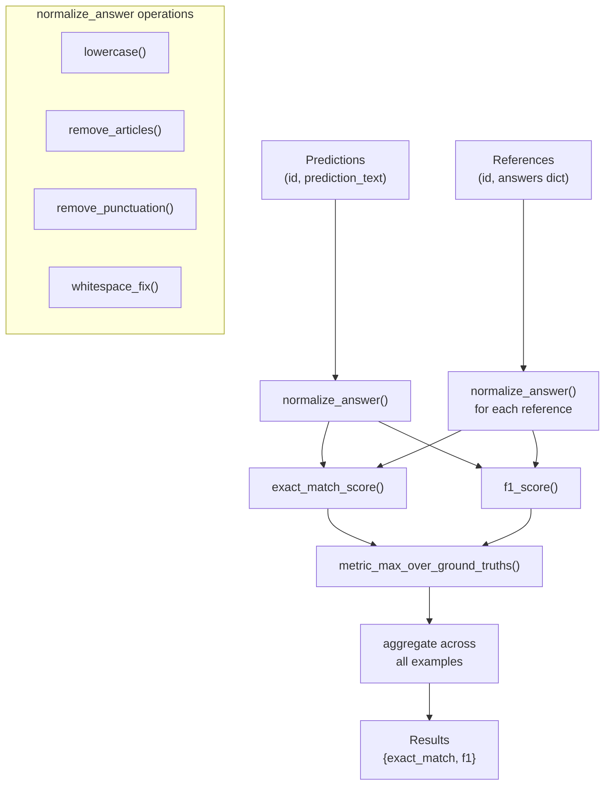
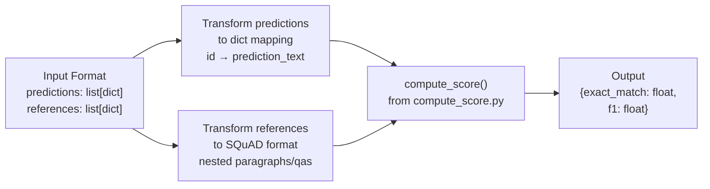
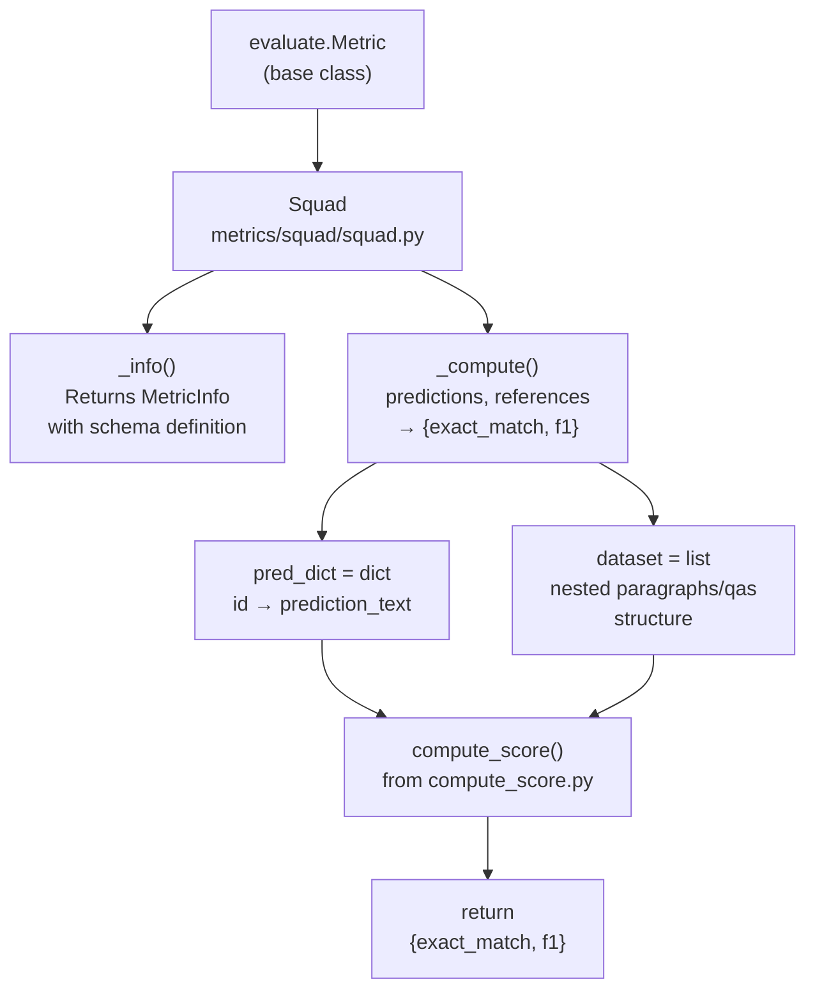
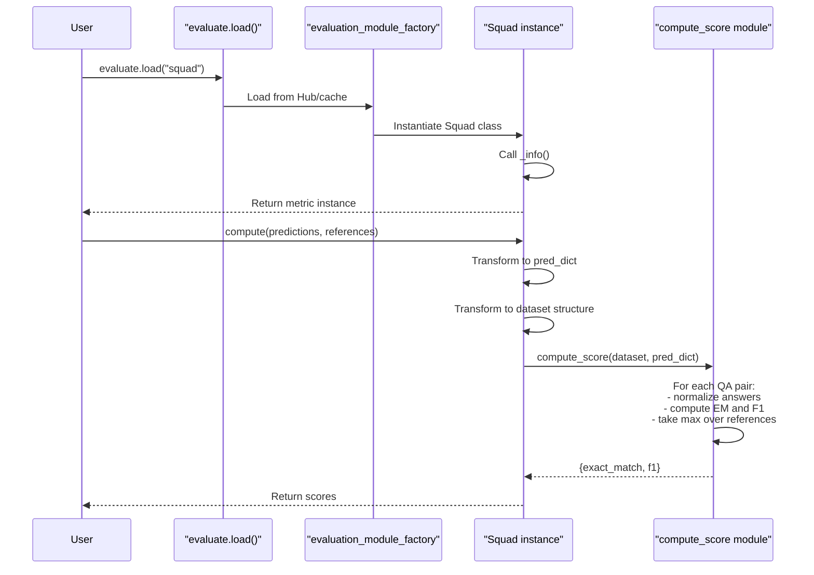

<!-- source: DeepWiki mcp.deepwiki.com · repo huggingface/evaluate · page 5.4 Question Answering Metrics · fetched 2026-10-26 -->

# Question Answering Metrics

<details>
<summary>Relevant source files</summary>

The following files were used as context for generating this wiki page:

- [Makefile](Makefile)
- [metrics/bleu/bleu.py](metrics/bleu/bleu.py)
- [metrics/rouge/README.md](metrics/rouge/README.md)
- [metrics/rouge/requirements.txt](metrics/rouge/requirements.txt)
- [metrics/rouge/rouge.py](metrics/rouge/rouge.py)
- [metrics/sacrebleu/sacrebleu.py](metrics/sacrebleu/sacrebleu.py)
- [metrics/seqeval/seqeval.py](metrics/seqeval/seqeval.py)
- [metrics/squad/squad.py](metrics/squad/squad.py)
- [metrics/super_glue/record_evaluation.py](metrics/super_glue/record_evaluation.py)
- [metrics/xnli/xnli.py](metrics/xnli/xnli.py)
- [setup.cfg](setup.cfg)

</details>


## Purpose and Scope

This document covers metrics designed for evaluating **extractive question answering** tasks, where models must identify spans of text from a given passage that answer questions. The primary focus is on the SQuAD (Stanford Question Answering Dataset) metrics, which compute exact match and F1 scores for comparing predicted answer spans against reference answers.

For metrics used in other NLP tasks, see:
- Text generation metrics like ROUGE and BLEU: [5.2](#5.2)
- Classification metrics for entailment and sentiment: [5.1](#5.1)
- Semantic similarity metrics like BERTScore: [5.5](#5.5)

---

## Overview of Question Answering Evaluation

Question answering metrics evaluate how well a model extracts answer spans from text passages. Unlike generation tasks where metrics compare generated sequences, QA metrics compare predicted text spans against one or more reference answer texts. The two standard metrics are:

- **Exact Match (EM)**: Binary metric indicating whether the normalized prediction exactly matches any normalized reference
- **F1 Score**: Token-level overlap between prediction and references, treating the problem as a bag-of-words comparison

These metrics prioritize semantic correctness over exact string matching by applying text normalization (lowercasing, removing articles and punctuation) before comparison.

**Metric Flow for QA Evaluation**



Sources: [metrics/squad/squad.py:1-112](), [metrics/super_glue/record_evaluation.py:15-83]()

---

## SQuAD Metrics

The `Squad` class in [metrics/squad/squad.py:69-111]() implements the official evaluation metrics for SQuAD v1.0. It inherits from `evaluate.Metric` and follows the standard `_info()` and `_compute()` pattern.

### Exact Match Score

Exact match is a binary metric that checks whether the normalized predicted answer exactly equals any of the normalized reference answers. The normalization process ensures case-insensitive comparison and removes common linguistic variations.

**Normalization steps** (from [metrics/super_glue/record_evaluation.py:15-31]()):
1. Convert to lowercase
2. Remove articles (a, an, the)
3. Remove punctuation
4. Normalize whitespace

```python
# Example from record_evaluation.py showing normalization
def normalize_answer(s):
    def remove_articles(text):
        return re.sub(r"\b(a|an|the)\b", " ", text)
    
    def white_space_fix(text):
        return " ".join(text.split())
    
    def remove_punc(text):
        exclude = set(string.punctuation)
        return "".join(ch for ch in text if ch not in exclude)
    
    def lower(text):
        return text.lower()
    
    return white_space_fix(remove_articles(remove_punc(lower(s))))
```

### F1 Score Computation

The F1 score treats prediction and reference as bags of tokens and computes token-level precision and recall. This provides a softer metric than exact match, giving partial credit for overlapping tokens.

**F1 Calculation** (from [metrics/super_glue/record_evaluation.py:34-44]()):

```
precision = (common_tokens) / (prediction_tokens)
recall = (common_tokens) / (reference_tokens)
f1 = 2 * precision * recall / (precision + recall)
```

The implementation uses `Counter` objects to handle token multiplicities correctly.

### Multiple Reference Handling

When multiple valid answers exist (e.g., "1976" and "the year 1976"), the metric computes scores against each reference and takes the maximum. This is implemented in [metrics/super_glue/record_evaluation.py:51-56]():

```python
def metric_max_over_ground_truths(metric_fn, prediction, ground_truths):
    scores_for_ground_truths = []
    for ground_truth in ground_truths:
        score = metric_fn(prediction, ground_truth)
        scores_for_ground_truths.append(score)
    return max(scores_for_ground_truths)
```

Sources: [metrics/squad/squad.py:69-111](), [metrics/super_glue/record_evaluation.py:1-84]()

---

## Data Format Requirements

The SQuAD metric expects specific data structures that align with the SQuAD dataset format.

### Input Schema

The schema is defined in [metrics/squad/squad.py:75-87]():

| Component | Field | Type | Description |
|-----------|-------|------|-------------|
| **Predictions** | `id` | string | Unique identifier matching reference |
| | `prediction_text` | string | The predicted answer text |
| **References** | `id` | string | Unique identifier matching prediction |
| | `answers` | Sequence | Dict containing answer texts and positions |
| | `answers.text` | list[string] | List of valid answer texts |
| | `answers.answer_start` | list[int] | Start positions (not used in scoring) |

### Example Data Structure

```python
predictions = [
    {
        'id': '56e10a3be3433e1400422b22',
        'prediction_text': '1976'
    }
]

references = [
    {
        'id': '56e10a3be3433e1400422b22',
        'answers': {
            'text': ['1976', 'the year 1976'],
            'answer_start': [97, 93]
        }
    }
]
```

**Note**: The `answer_start` field is included for compatibility with the SQuAD dataset format but is **not used** in metric computation. Only the `text` field affects scoring.

**Internal Data Transformation**



The transformation logic is in [metrics/squad/squad.py:93-110](), where predictions are converted to a dictionary and references are restructured into the nested format expected by the official scoring script.

Sources: [metrics/squad/squad.py:75-111]()

---

## Usage Examples

### Basic Usage

```python
>>> import evaluate
>>> squad_metric = evaluate.load("squad")
>>> 
>>> predictions = [
...     {'prediction_text': '1976', 'id': '56e10a3be3433e1400422b22'}
... ]
>>> references = [
...     {
...         'answers': {'answer_start': [97], 'text': ['1976']},
...         'id': '56e10a3be3433e1400422b22'
...     }
... ]
>>> 
>>> results = squad_metric.compute(predictions=predictions, references=references)
>>> print(results)
{'exact_match': 100.0, 'f1': 100.0}
```

### Multiple Valid Answers

When multiple reference answers are provided, the metric automatically computes scores against all references and returns the maximum:

```python
>>> predictions = [
...     {'prediction_text': 'the year 1976', 'id': 'q1'}
... ]
>>> references = [
...     {
...         'answers': {
...             'text': ['1976', 'the year 1976', 'in 1976'],
...             'answer_start': [97, 93, 90]
...         },
...         'id': 'q1'
...     }
... ]
>>> 
>>> results = squad_metric.compute(predictions=predictions, references=references)
>>> print(results)
{'exact_match': 100.0, 'f1': 100.0}
```

### Batch Evaluation

For evaluating multiple questions efficiently:

```python
>>> predictions = [
...     {'prediction_text': 'Denver Broncos', 'id': 'q1'},
...     {'prediction_text': 'Carolina Panthers', 'id': 'q2'},
...     {'prediction_text': 'Levi\'s Stadium', 'id': 'q3'}
... ]
>>> 
>>> references = [
...     {'answers': {'text': ['Denver Broncos'], 'answer_start': [177]}, 'id': 'q1'},
...     {'answers': {'text': ['Carolina Panthers'], 'answer_start': [249]}, 'id': 'q2'},
...     {'answers': {'text': ['Levi\'s Stadium'], 'answer_start': [403]}, 'id': 'q3'}
... ]
>>> 
>>> results = squad_metric.compute(predictions=predictions, references=references)
>>> print(results)
{'exact_match': 100.0, 'f1': 100.0}
```

Sources: [metrics/squad/squad.py:59-64]()

---

## Implementation Architecture

### Class Structure



### Core Components

| Component | Location | Responsibility |
|-----------|----------|----------------|
| `Squad` class | [metrics/squad/squad.py:69]() | Main metric implementation |
| `_info()` method | [metrics/squad/squad.py:70-91]() | Defines input/output schema |
| `_compute()` method | [metrics/squad/squad.py:93-111]() | Transforms data and delegates to scorer |
| `compute_score()` | [metrics/squad/compute_score.py:1-end]() | Official SQuAD scoring implementation |
| `normalize_answer()` | [metrics/super_glue/record_evaluation.py:15-31]() | Text normalization (ReCoRD variant) |
| `f1_score()` | [metrics/super_glue/record_evaluation.py:34-44]() | Token-level F1 computation |
| `exact_match_score()` | [metrics/super_glue/record_evaluation.py:47-48]() | Normalized string comparison |

### Metric Loading and Execution



Sources: [metrics/squad/squad.py:1-112]()

---

## Related Question Answering Metrics

### SQuAD v2.0

SQuAD v2.0 extends v1.0 with **unanswerable questions** where the answer is not present in the passage. The metric adds:
- Handling of null predictions for unanswerable questions
- Additional scoring for null threshold optimization
- Separate tracking of answerable vs. unanswerable performance

The v2.0 metric is available as `evaluate.load("squad_v2")`.

### ReCoRD (Reading Comprehension with Commonsense Reasoning)

ReCoRD uses identical EM and F1 scoring but applies to a different dataset format. The implementation in [metrics/super_glue/record_evaluation.py:59-83]() shows the same `normalize_answer`, `f1_score`, and `exact_match_score` functions, demonstrating that these are standard components for extractive QA evaluation.

**Key differences from SQuAD:**
- Part of SuperGLUE benchmark suite
- Focus on commonsense reasoning
- Same scoring methodology but different data source

### Comparison with Text Generation Metrics

| Aspect | QA Metrics (SQuAD) | Generation Metrics (ROUGE/BLEU) |
|--------|-------------------|----------------------------------|
| **Task Type** | Extractive span selection | Free-form text generation |
| **Scoring Unit** | Token bag-of-words | N-gram sequences |
| **Normalization** | Heavy (remove articles, punct) | Minimal (case, stemming optional) |
| **Multiple References** | Max score over references | Average or max over references |
| **Key Metrics** | EM (binary), F1 (overlap) | ROUGE-L (LCS), BLEU (precision) |

For ROUGE metrics used in summarization, see [5.2](#5.2).

Sources: [metrics/super_glue/record_evaluation.py:1-112](), [metrics/squad/squad.py:1-112]()

---

## Integration with Evaluator System

The SQuAD metric integrates with the high-level Evaluator system for automated evaluation. For question answering tasks, use the `QuestionAnsweringEvaluator`:

```python
from evaluate import evaluator

# Initialize task-specific evaluator
qa_evaluator = evaluator("question-answering")

# Run evaluation with model, data, and metric
results = qa_evaluator.compute(
    model_or_pipeline="bert-large-uncased-whole-word-masking-finetuned-squad",
    data="squad",
    metric="squad",
    split="validation[:100]"
)
```

The `QuestionAnsweringEvaluator` automatically:
1. Loads the model pipeline
2. Extracts question/context pairs from the dataset
3. Runs inference to get predicted spans
4. Formats predictions/references for the SQuAD metric
5. Computes EM and F1 scores

For details on the Evaluator system, see [4](#4) and [4.1](#4.1).

Sources: [metrics/squad/squad.py:1-112]()

---

## Metadata and References

### Citation Information

The SQuAD metric implementation includes citation metadata in [metrics/squad/squad.py:23-30]():

```bibtex
@inproceedings{Rajpurkar2016SQuAD10,
  title={SQuAD: 100, 000+ Questions for Machine Comprehension of Text},
  author={Pranav Rajpurkar and Jian Zhang and Konstantin Lopyrev and Percy Liang},
  booktitle={EMNLP},
  year={2016}
}
```

### Reference URLs

- Official SQuAD website: https://rajpurkar.github.io/SQuAD-explorer/
- SQuAD v2.0 paper and leaderboard
- ReCoRD benchmark (similar methodology)

### Codebase References

- Official scoring script: The implementation wraps the official SQuAD v1.0 evaluation script
- Codebase URL listed in [metrics/squad/squad.py:89](): https://rajpurkar.github.io/SQuAD-explorer/

Sources: [metrics/squad/squad.py:23-90]()

---

