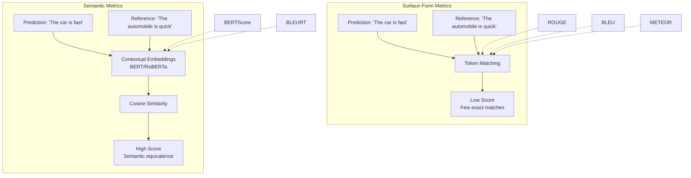
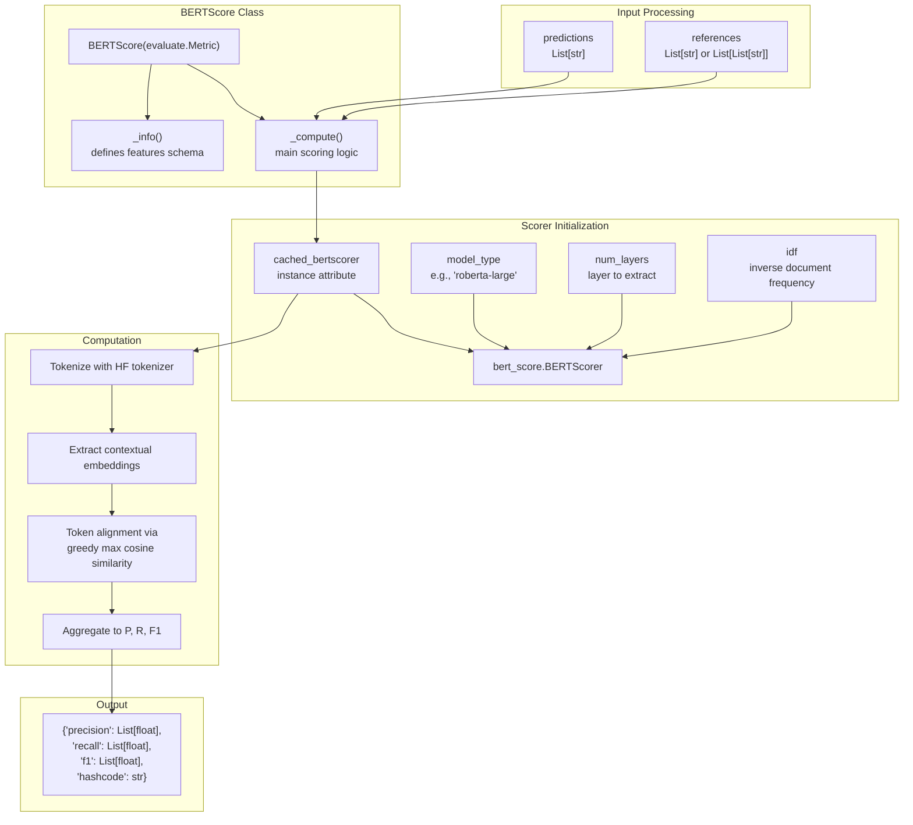
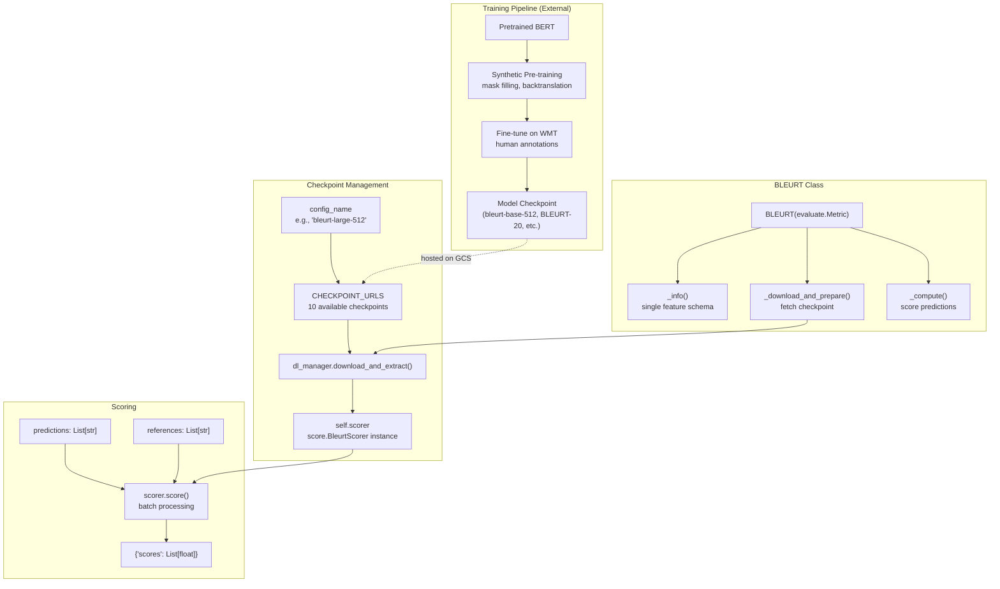
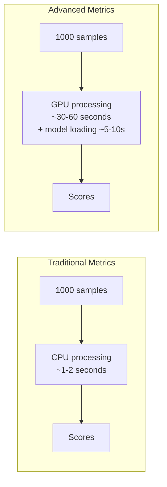
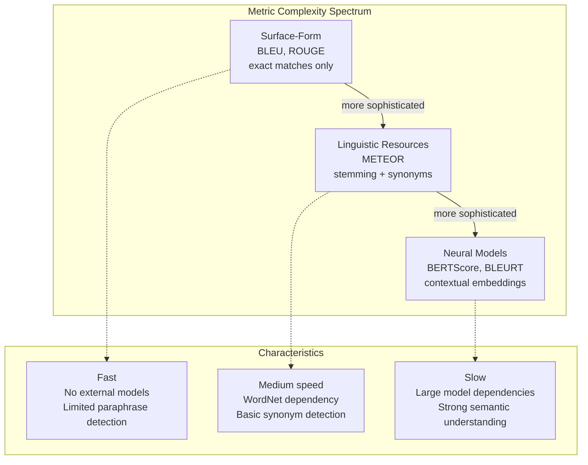

<!-- source: DeepWiki mcp.deepwiki.com · repo huggingface/evaluate · page 5.5 Advanced Metrics · fetched 2026-10-26 -->

# Advanced Metrics

<details>
<summary>Relevant source files</summary>

The following files were used as context for generating this wiki page:

- [measurements/word_length/word_length.py](measurements/word_length/word_length.py)
- [metrics/bertscore/bertscore.py](metrics/bertscore/bertscore.py)
- [metrics/bleurt/bleurt.py](metrics/bleurt/bleurt.py)
- [metrics/meteor/meteor.py](metrics/meteor/meteor.py)

</details>


## Purpose and Scope

This document covers advanced evaluation metrics that leverage pretrained neural models for semantic evaluation of text generation tasks. Unlike traditional metrics that rely on surface-form matching (see [Text Generation Metrics](#5.2)), advanced metrics use contextual embeddings to assess semantic similarity between predictions and references.

The two primary advanced metrics in the evaluate library are:
- **BERTScore**: Uses BERT embeddings and cosine similarity for token-level matching
- **BLEURT**: A learned metric trained on human judgments via transfer learning

For metrics that measure sequence labeling or question answering, see [Sequence Labeling Metrics](#5.3) and [Question Answering Metrics](#5.4).

---

## Semantic vs Surface-Form Evaluation

Traditional metrics like BLEU, ROUGE, and METEOR rely on exact or stemmed word matches to compute similarity. Advanced metrics instead use pretrained language models to capture semantic equivalence, enabling them to recognize paraphrases and synonyms that surface-form metrics would miss.

### Comparison of Evaluation Approaches



**Key Differences:**

| Aspect | Surface-Form Metrics | Advanced Metrics |
|--------|---------------------|------------------|
| Matching Strategy | Exact/stemmed tokens | Contextual embeddings |
| Paraphrase Recognition | Limited | Strong |
| Computational Cost | Low | High (GPU recommended) |
| External Dependencies | Rule-based (NLTK, etc.) | Pretrained models (transformers) |
| Correlation with Humans | Moderate | High |

Sources: [metrics/bertscore/bertscore.py:49-57](), [metrics/bleurt/bleurt.py:37-43]()

---

## BERTScore

BERTScore evaluates text generation by computing token-level similarity using contextual embeddings from BERT or similar models. It produces precision, recall, and F1 scores based on maximum cosine similarity matches between tokens in the candidate and reference sentences.

### Architecture



Sources: [metrics/bertscore/bertscore.py:101-127](), [metrics/bertscore/bertscore.py:129-215]()

### Implementation Details

The `BERTScore` class implements the `evaluate.Metric` interface and manages scorer lifecycle through caching:

**Class Structure:**
- **_info()**: Defines two feature schemas - one for single references, one for multiple references per prediction [metrics/bertscore/bertscore.py:102-127]()
- **_compute()**: Handles scorer initialization, caching, and score computation [metrics/bertscore/bertscore.py:129-215]()

**Key Parameters:**

| Parameter | Type | Purpose |
|-----------|------|---------|
| `lang` | str | Language code (e.g., 'en') for automatic model selection |
| `model_type` | str | Explicit model specification (e.g., 'microsoft/deberta-xlarge-mnli') |
| `num_layers` | int | Layer index to extract embeddings from |
| `idf` | bool/dict | Enable IDF weighting for importance scoring |
| `device` | str | Device placement ('cuda:0', 'cpu') |
| `rescale_with_baseline` | bool | Rescale scores using precomputed baselines |
| `use_fast_tokenizer` | bool | Use Rust-based fast tokenizers (requires bert-score>=0.3.10) |

**Scorer Caching:**

The implementation maintains a `cached_bertscorer` instance attribute and reuses it when the hashcode (computed from model configuration) matches [metrics/bertscore/bertscore.py:188-201](). This avoids reloading the model for multiple `compute()` calls:

```python
if not hasattr(self, "cached_bertscorer") or self.cached_bertscorer.hash != hashcode:
    self.cached_bertscorer = scorer(
        model_type=model_type,
        num_layers=num_layers,
        batch_size=batch_size,
        # ... other parameters
    )
```

**Multiple References:**

When references is a list of lists, BERTScore automatically handles multiple references by converting single-reference format [metrics/bertscore/bertscore.py:147-148]():

```python
if isinstance(references[0], str):
    references = [[ref] for ref in references]
```

Sources: [metrics/bertscore/bertscore.py:101-215]()

### Usage Example

```python
import evaluate

bertscore = evaluate.load("bertscore")

predictions = ["The cat sat on the mat", "A dog barked loudly"]
references = ["A feline rested on the rug", "The canine made noise"]

results = bertscore.compute(
    predictions=predictions,
    references=references,
    lang="en",
    model_type="microsoft/deberta-xlarge-mnli"
)

# results = {
#     'precision': [0.89, 0.82],
#     'recall': [0.87, 0.79],
#     'f1': [0.88, 0.80],
#     'hashcode': 'microsoft-deberta-xlarge-mnli_L40_no-idf_version=0.3.12(hug_trans=4.25.1)'
# }
```

Sources: [metrics/bertscore/bertscore.py:89-97]()

---

## BLEURT

BLEURT (Bilingual Evaluation Understudy with Representations from Transformers) is a learned metric that uses transfer learning to predict human judgments of text quality. Unlike BERTScore which uses fixed similarity computations, BLEURT fine-tunes a pretrained model on human evaluation data.

### Architecture



Sources: [metrics/bleurt/bleurt.py:80-96](), [metrics/bleurt/bleurt.py:98-121]()

### Implementation Details

**Class Structure:**
- **_info()**: Defines a single feature schema (predictions and references as strings) [metrics/bleurt/bleurt.py:81-96]()
- **_download_and_prepare()**: Downloads and initializes the BLEURT checkpoint [metrics/bleurt/bleurt.py:98-121]()
- **_compute()**: Delegates scoring to the `BleurtScorer` instance [metrics/bleurt/bleurt.py:123-125]()

**Available Checkpoints:**

The library provides 10 pre-trained BLEURT checkpoints [metrics/bleurt/bleurt.py:65-76]():

| Checkpoint | Max Sequence Length | Model Size | Use Case |
|------------|---------------------|------------|----------|
| `bleurt-tiny-128` | 128 | Tiny | Fast prototyping |
| `bleurt-base-128` | 128 | Base | Default for short texts |
| `bleurt-large-512` | 512 | Large | High-quality long texts |
| `BLEURT-20` | 512 | Large | Latest, best correlation |
| `BLEURT-20-D12` | 512 | XLarge | Maximum performance |

**Checkpoint Loading:**

The `_download_and_prepare()` method handles checkpoint selection and download [metrics/bleurt/bleurt.py:98-121]():

1. Defaults to `bleurt-base-128` if no config specified
2. Normalizes checkpoint name (case-insensitive)
3. Downloads checkpoint from Google Cloud Storage
4. Initializes `score.BleurtScorer` with the checkpoint path

**Dependency Management:**

BLEURT requires the `bleurt` package installed from GitHub [metrics/bleurt/bleurt.py:19]():

```python
from bleurt import score  # From: git+https://github.com/google-research/bleurt.git
```

The special comment `# From: ...` instructs the module loading system to install this dependency from the specified Git URL.

Sources: [metrics/bleurt/bleurt.py:80-125]()

### Usage Example

```python
import evaluate

bleurt = evaluate.load("bleurt", config_name="BLEURT-20")

predictions = ["The weather is nice today", "I enjoy reading books"]
references = ["Today's weather is pleasant", "Reading is my hobby"]

results = bleurt.compute(predictions=predictions, references=references)

# results = {
#     'scores': [0.95, 0.87]
# }
```

Sources: [metrics/bleurt/bleurt.py:56-62]()

---

## Implementation Patterns

Both BERTScore and BLEURT follow common patterns for neural metric implementation:

### Lifecycle Pattern

```mermaid
sequenceDiagram
    participant User
    participant Metric["BERTScore/BLEURT"]
    participant DLManager["dl_manager"]
    participant External["External Resources<br/>(Model Hub/GCS)"]
    participant Scorer["Scorer Instance<br/>(BERTScorer/BleurtScorer)"]
    
    User->>Metric: evaluate.load("bertscore")
    Metric->>Metric: _info() - define schemas
    Metric->>DLManager: _download_and_prepare()
    DLManager->>External: Download model checkpoint
    External-->>DLManager: Model files
    DLManager->>Scorer: Initialize scorer
    Scorer-->>Metric: Store in instance attribute
    Metric-->>User: Return metric instance
    
    User->>Metric: compute(predictions, references)
    Metric->>Scorer: score(predictions, references)
    Scorer-->>Metric: Numeric scores
    Metric-->>User: Return dict with scores
```

Sources: [metrics/bertscore/bertscore.py:102-127](), [metrics/bleurt/bleurt.py:81-96]()

### Resource Management

**BERTScore Approach:**
- Lazy initialization: scorer created on first `compute()` call
- Caching by hashcode: reuses scorer if configuration unchanged
- Supports custom model paths and Hub identifiers

**BLEURT Approach:**
- Eager initialization: scorer created in `_download_and_prepare()`
- Single scorer per metric instance
- Fixed checkpoint selected at load time via `config_name`

### Feature Schema Definitions

Both metrics use `datasets.Features` to specify input formats [metrics/bertscore/bertscore.py:108-121](), [metrics/bleurt/bleurt.py:88-93]():

```python
# BERTScore supports two schemas
features=[
    # Multiple references per prediction
    datasets.Features({
        "predictions": datasets.Value("string", id="sequence"),
        "references": datasets.Sequence(datasets.Value("string", id="sequence"), id="references"),
    }),
    # Single reference per prediction
    datasets.Features({
        "predictions": datasets.Value("string", id="sequence"),
        "references": datasets.Value("string", id="sequence"),
    }),
]

# BLEURT uses single schema
features=datasets.Features({
    "predictions": datasets.Value("string", id="sequence"),
    "references": datasets.Value("string", id="sequence"),
})
```

Sources: [metrics/bertscore/bertscore.py:108-121](), [metrics/bleurt/bleurt.py:88-93]()

---

## Performance Considerations

### Computational Requirements

Advanced metrics are significantly more expensive than surface-form metrics:



**Resource Usage:**

| Metric | GPU Memory | CPU Memory | Typical Throughput |
|--------|------------|------------|-------------------|
| BERTScore (base) | ~1-2 GB | ~3-4 GB | 50-100 samples/sec |
| BERTScore (large) | ~3-4 GB | ~5-6 GB | 20-40 samples/sec |
| BLEURT (base) | ~1-2 GB | ~3-4 GB | 40-80 samples/sec |
| BLEURT-20 | ~3-4 GB | ~5-6 GB | 20-30 samples/sec |

### Optimization Strategies

**Batch Size Tuning:**

BERTScore accepts a `batch_size` parameter [metrics/bertscore/bertscore.py:139]() that controls memory-speed tradeoff:

```python
# Larger batch = faster but more memory
results = bertscore.compute(
    predictions=predictions,
    references=references,
    lang="en",
    batch_size=128  # Default: 64
)
```

**Device Selection:**

Both metrics support explicit device placement [metrics/bertscore/bertscore.py:138]():

```python
# Force CPU usage
results = bertscore.compute(
    predictions=predictions,
    references=references,
    lang="en",
    device="cpu"
)

# Explicit GPU
results = bertscore.compute(
    predictions=predictions,
    references=references,
    lang="en",
    device="cuda:1"
)
```

**Model Selection:**

For BERTScore, smaller models trade accuracy for speed [metrics/bertscore/bertscore.py:174]():

```python
# Fast but less accurate
bertscore.compute(predictions, references, model_type="bert-base-uncased")

# Slower but more accurate
bertscore.compute(predictions, references, model_type="microsoft/deberta-xlarge-mnli")
```

For BLEURT, checkpoint size matters [metrics/bleurt/bleurt.py:65-76]():

```python
# Fast prototyping
bleurt_tiny = evaluate.load("bleurt", config_name="bleurt-tiny-128")

# Production quality
bleurt_large = evaluate.load("bleurt", config_name="BLEURT-20")
```

Sources: [metrics/bertscore/bertscore.py:129-215](), [metrics/bleurt/bleurt.py:98-121]()

---

## Comparison with METEOR

METEOR [metrics/meteor/meteor.py]() represents a middle ground between purely surface-form metrics and advanced neural metrics. It uses linguistic resources (stemming, synonyms from WordNet) without requiring neural models:



**METEOR Architecture** [metrics/meteor/meteor.py:92-170]():
- Uses NLTK's `word_tokenize` for tokenization
- Leverages `meteor_score.meteor_score()` for computation
- Downloads WordNet and punkt tokenizer data in `_download_and_prepare()`
- Supports configurable alpha, beta, gamma parameters for precision/recall/fragmentation weighting

Sources: [metrics/meteor/meteor.py:92-170]()

---

## When to Use Advanced Metrics

**Use BERTScore when:**
- Evaluating paraphrase quality
- Semantic similarity is more important than exact wording
- You have GPU resources available
- You need interpretable precision/recall/F1 breakdowns

**Use BLEURT when:**
- Maximum correlation with human judgment is critical
- Evaluating generation tasks (summarization, translation, dialogue)
- You can afford the computational cost
- You need a single aggregated score

**Stick with traditional metrics when:**
- Computational budget is limited
- Exact wording matters (code generation, structured outputs)
- You need reproducibility across different environments
- Speed is critical (large-scale evaluation)

Sources: [metrics/bertscore/bertscore.py:49-57](), [metrics/bleurt/bleurt.py:37-43]()

---

