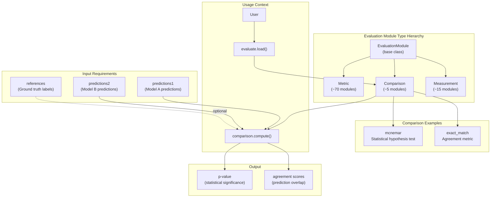
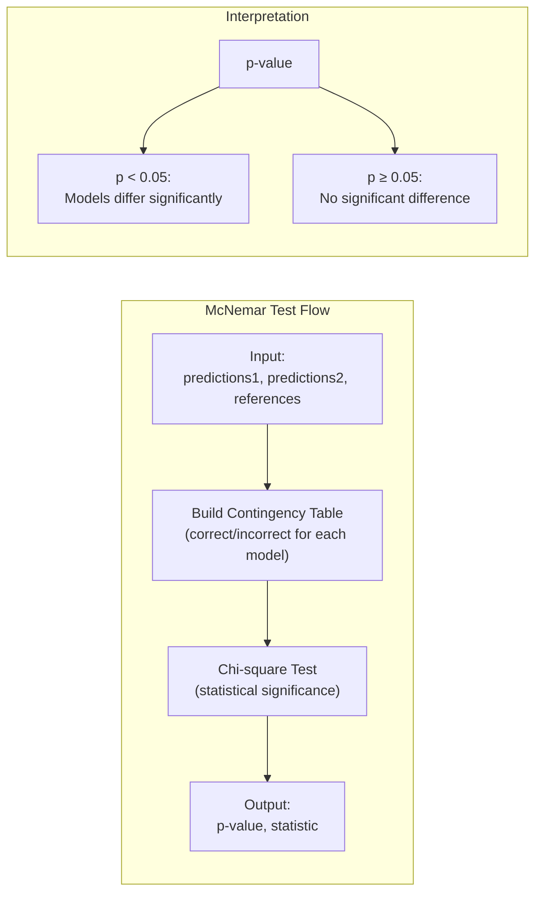
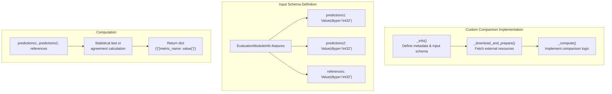

<!-- source: DeepWiki mcp.deepwiki.com · repo huggingface/evaluate · page 6 Comparisons · fetched 2026-10-26 -->

# Comparisons

<details>
<summary>Relevant source files</summary>

The following files were used as context for generating this wiki page:

- [README.md](README.md)
- [docs/source/a_quick_tour.mdx](docs/source/a_quick_tour.mdx)
- [docs/source/choosing_a_metric.mdx](docs/source/choosing_a_metric.mdx)
- [docs/source/considerations.mdx](docs/source/considerations.mdx)
- [docs/source/creating_and_sharing.mdx](docs/source/creating_and_sharing.mdx)
- [docs/source/index.mdx](docs/source/index.mdx)
- [docs/source/transformers_integrations.mdx](docs/source/transformers_integrations.mdx)
- [docs/source/types_of_evaluations.mdx](docs/source/types_of_evaluations.mdx)
- [src/evaluate/evaluator/audio_classification.py](src/evaluate/evaluator/audio_classification.py)
- [src/evaluate/utils/logging.py](src/evaluate/utils/logging.py)

</details>


Comparisons are evaluation modules designed to statistically compare the predictions of two or more models. Unlike metrics (see [Metrics](#5)) which measure individual model performance against ground truth, comparisons analyze the differences and agreements between multiple models' predictions.

For information about measuring model performance, see [Metrics](#5). For analyzing datasets or predictions without ground truth, see [Measurements](#7).

---

## Purpose and Scope

Comparisons provide statistical tests and analyses that quantify whether and how significantly two models' predictions differ from each other. They answer questions like "Are these two models producing statistically different predictions?" rather than "How accurate is this model?" This enables more rigorous model selection and performance analysis beyond simply comparing leaderboard scores.

Sources: [docs/source/types_of_evaluations.mdx:17-23](), [README.md:36]()

---

## Comparison vs Metric Distinction

The key distinction between comparisons and metrics:

| Aspect | Metrics | Comparisons |
|--------|---------|-------------|
| **Input** | Single model's predictions + references | Multiple models' predictions (+ references) |
| **Output** | Performance score (accuracy, F1, etc.) | Statistical test results (p-values, agreement scores) |
| **Purpose** | Measure absolute performance | Measure relative differences |
| **Example** | "Model A has 85% accuracy" | "Models A and B predictions differ significantly (p=0.03)" |

Sources: [docs/source/types_of_evaluations.mdx:17-23](), [docs/source/a_quick_tour.mdx:9-11]()

---

## Architecture and Module Type



**Comparisons in the Module Loading System**

Comparisons inherit from the same `EvaluationModule` base class as metrics and measurements, following the same loading, caching, and execution patterns. They are distinguished by the `module_type="comparison"` parameter during loading.

Sources: [docs/source/a_quick_tour.mdx:9-11](), [README.md:33-37]()

---

## Loading Comparison Modules

### Basic Loading

```python
import evaluate

# Load a comparison module
comparison = evaluate.load("mcnemar", module_type="comparison")
```

The `module_type="comparison"` parameter ensures the correct type is loaded when there are naming conflicts.

### Discovering Available Comparisons

```python
import evaluate

# List all comparison modules
comparisons = evaluate.list_evaluation_modules(
    module_type="comparison",
    include_community=False,
    with_details=True
)

# Example output:
# [{'name': 'mcnemar', 'type': 'comparison', 'community': False, 'likes': 1},
#  {'name': 'exact_match', 'type': 'comparison', 'community': False, 'likes': 0}]
```

Comparisons are hosted on the Hugging Face Hub under the `evaluate-comparison` organization (e.g., [https://huggingface.co/evaluate-comparison](https://huggingface.co/evaluate-comparison)).

Sources: [docs/source/a_quick_tour.mdx:22-34](), [docs/source/a_quick_tour.mdx:48-58]()

---

## Computing Comparisons

### Input Format

Comparisons typically require predictions from two models and optionally reference labels:

```python
import evaluate

# Load comparison
comparison = evaluate.load("mcnemar")

# Model predictions (must be same length)
predictions1 = [0, 1, 0, 1, 1, 0]  # Model A predictions
predictions2 = [0, 1, 1, 1, 0, 0]  # Model B predictions
references = [0, 1, 0, 1, 1, 1]     # Ground truth

# Compute comparison
results = comparison.compute(
    predictions1=predictions1,
    predictions2=predictions2,
    references=references
)
```

### Batch Processing

Like metrics, comparisons support incremental addition of predictions:

```python
comparison = evaluate.load("mcnemar")

# Add predictions in batches
for batch_pred1, batch_pred2, batch_ref in zip(batches_model1, batches_model2, batches_ref):
    comparison.add_batch(
        predictions1=batch_pred1,
        predictions2=batch_pred2,
        references=batch_ref
    )

# Compute final results
results = comparison.compute()
```

Sources: [docs/source/a_quick_tour.mdx:119-157]()

---

## Available Comparison Modules

### McNemar Test



**McNemar Test** ([https://github.com/huggingface/evaluate/tree/main/comparisons/mcnemar](https://github.com/huggingface/evaluate/tree/main/comparisons/mcnemar))

A paired nonparametric statistical hypothesis test that compares two models' predictions on the same dataset. It tests whether the models make errors on different instances.

**Key characteristics:**
- Requires paired predictions (same instances for both models)
- Tests null hypothesis: "models have same error rate"
- Outputs p-value (0.0 to 1.0) indicating significance of difference
- Lower p-value = more significant difference

**Usage:**
```python
mcnemar = evaluate.load("mcnemar")
results = mcnemar.compute(
    predictions1=[1, 0, 1, 1, 0],
    predictions2=[1, 1, 1, 0, 0],
    references=[1, 0, 1, 1, 1]
)
# Returns: {'p-value': ..., 'statistic': ...}
```

### Exact Match Comparison

**Exact Match Comparison** analyzes prediction agreement between models rather than testing statistical significance. It computes metrics like:
- Percentage of instances where both models agree
- Percentage where both are correct
- Percentage where both are incorrect
- Percentage where they disagree

Sources: [docs/source/types_of_evaluations.mdx:17-23](), [docs/source/a_quick_tour.mdx:54-58]()

---

## Module Attributes

All comparison modules provide metadata through the `EvaluationModuleInfo` object:

```python
comparison = evaluate.load("mcnemar")

# Access module information
print(comparison.description)  # Detailed description of the comparison
print(comparison.citation)     # BibTeX citation
print(comparison.features)     # Expected input format
print(comparison.inputs_description)  # Documentation of inputs/outputs
```

| Attribute | Description |
|-----------|-------------|
| `description` | Explanation of the comparison methodology |
| `citation` | BibTeX citation for academic use |
| `features` | Input schema (predictions1, predictions2, references types) |
| `inputs_description` | Documentation with usage examples |
| `homepage` | Link to comparison's documentation |
| `reference_urls` | Academic papers or resources |

Sources: [docs/source/a_quick_tour.mdx:60-74]()

---

## Common Use Cases

### Model Selection and Validation

```mermaid
graph TB
    subgraph "Model Selection Workflow"
        MODELS["Multiple Candidate Models"]
        EVAL["Evaluate on Test Set"]
        METRIC_SCORES["Compute Metrics<br/>(accuracy, F1, etc.)"]
        SIMILAR["Similar Scores?"]
        COMPARISON["Run Statistical Comparison<br/>(McNemar test)"]
        DECISION["Make Selection Decision"]
        
        MODELS --> EVAL
        EVAL --> METRIC_SCORES
        METRIC_SCORES --> SIMILAR
        SIMILAR -->|Yes| COMPARISON
        SIMILAR -->|No| DECISION
        COMPARISON --> DECISION
    end
    
    subgraph "Example Scenario"
        SCORE1["Model A: 84.5% accuracy"]
        SCORE2["Model B: 85.1% accuracy"]
        QUESTION["Is 0.6% difference<br/>statistically significant?"]
        MCNEMAR["McNemar Test"]
        RESULT["p = 0.23<br/>Not significant"]
        
        SCORE1 --> QUESTION
        SCORE2 --> QUESTION
        QUESTION --> MCNEMAR
        MCNEMAR --> RESULT
    end
```



**When to use comparisons:**

1. **Close Performance Scores**: When multiple models have similar metric scores (e.g., 84.5% vs 85.1% accuracy), comparisons determine if the difference is statistically meaningful.

2. **Model Validation**: Before replacing a production model with a new one, verify the improvement is significant, not random variation.

3. **Ensemble Analysis**: Understand whether ensemble components make complementary or redundant errors.

4. **Ablation Studies**: Test if removing/adding a model component significantly affects predictions.

Sources: [docs/source/types_of_evaluations.mdx:17-23]()

### Research and Publication

Statistical comparisons provide rigor for academic claims:

```python
# Compare baseline vs improved model
baseline_preds = [...]
improved_preds = [...]
references = [...]

mcnemar = evaluate.load("mcnemar")
results = mcnemar.compute(
    predictions1=baseline_preds,
    predictions2=improved_preds,
    references=references
)

# Report in paper: "The improved model's predictions differ 
# significantly from the baseline (McNemar's test, p < 0.05)"
```

Sources: [docs/source/considerations.mdx:1-88]()

---

## Distributed Computation

Comparisons support distributed evaluation using the same Apache Arrow-based caching system as metrics:

```python
# Each process adds its portion of predictions
comparison = evaluate.load("mcnemar")

# Process 1
comparison.add_batch(
    predictions1=model1_batch_p1,
    predictions2=model2_batch_p1,
    references=refs_p1
)

# Process 2
comparison.add_batch(
    predictions1=model1_batch_p2,
    predictions2=model2_batch_p2,
    references=refs_p2
)

# Compute aggregates all data from all processes
results = comparison.compute()
```

The caching system ensures predictions from all processes are gathered before computing the final comparison statistics.

Sources: [docs/source/a_quick_tour.mdx:168-176]()

---

## Creating Custom Comparisons

### Module Structure

Custom comparison modules follow the same template as metrics. Use the CLI to generate scaffolding:

```bash
pip install evaluate[template]
evaluate-cli create "My Comparison" --module_type "comparison"
```

This creates a Space on the Hub with the required structure:
- `my_comparison.py` - Main module script
- `README.md` - Documentation card
- `requirements.txt` - Dependencies
- `app.py` - Gradio widget

### Required Methods



### Example Implementation Skeleton

```python
import evaluate
import datasets

class MyComparison(evaluate.EvaluationModule):
    def _info(self):
        return evaluate.EvaluationModuleInfo(
            description="Description of comparison",
            citation="BibTeX citation",
            features=datasets.Features({
                'predictions1': datasets.Value('int32'),
                'predictions2': datasets.Value('int32'),
                'references': datasets.Value('int32'),
            }),
            inputs_description="Documentation of inputs",
        )
    
    def _download_and_prepare(self, dl_manager):
        # Download any required resources (e.g., lookup tables)
        pass
    
    def _compute(self, predictions1, predictions2, references):
        # Implement comparison logic
        # Return dictionary with results
        return {"score": computed_value}
```

Sources: [docs/source/creating_and_sharing.mdx:1-114]()

---

## Integration with Evaluation Workflows

### Combining with Metrics

Comparisons complement metrics in comprehensive evaluation pipelines:

```python
import evaluate

# Evaluate individual model performance
accuracy = evaluate.load("accuracy")
f1 = evaluate.load("f1")

model1_accuracy = accuracy.compute(predictions=pred1, references=refs)
model2_accuracy = accuracy.compute(predictions=pred2, references=refs)

# Compare models statistically
mcnemar = evaluate.load("mcnemar")
comparison_result = mcnemar.compute(
    predictions1=pred1,
    predictions2=pred2,
    references=refs
)

print(f"Model 1: {model1_accuracy}")
print(f"Model 2: {model2_accuracy}")
print(f"Statistical difference: p={comparison_result['p-value']}")
```

### Not Supported by Evaluator System

The high-level `Evaluator` abstraction (see [Evaluator System](#4)) is designed for single-model evaluation and does not currently support comparisons, which require multiple models' predictions. Use the direct `evaluate.load()` interface for comparisons.

Sources: [docs/source/a_quick_tour.mdx:179-197](), [docs/source/a_quick_tour.mdx:244-291]()

---

## Hub Organization

Comparison modules are hosted under the `evaluate-comparison` organization on the Hugging Face Hub:
- Each comparison lives in a dedicated Space
- Interactive Gradio widgets allow testing with custom inputs
- Metric cards document methodology, limitations, and usage
- Community members can contribute new comparisons

Browse all comparisons: [https://huggingface.co/evaluate-comparison](https://huggingface.co/evaluate-comparison)

Sources: [README.md:41](), [docs/source/a_quick_tour.mdx:13]()

---

## Limitations and Considerations

### Statistical Validity Requirements

1. **Sample Size**: Statistical tests like McNemar require sufficient sample size for valid results (typically n > 20)
2. **Independence**: Assumes predictions are independent; may not hold for sequence models with long-range dependencies
3. **Paired Predictions**: Models must be evaluated on identical test instances

### Interpretation Caveats

1. **P-value Interpretation**: A non-significant p-value doesn't prove models are equivalent, only that there's insufficient evidence they differ
2. **Multiple Comparisons**: When comparing many model pairs, adjust significance thresholds to avoid false positives
3. **Practical Significance**: Statistical significance doesn't imply practical importance; consider effect sizes and deployment constraints

Sources: [docs/source/considerations.mdx:1-88]()

---

## Summary

Comparisons provide statistical rigor for model selection decisions by quantifying whether performance differences are meaningful or due to chance. They complement metrics by analyzing relative performance rather than absolute scores. The evaluate library's comparison modules integrate seamlessly with the same loading and computation interfaces as metrics, while being hosted and discoverable through the Hugging Face Hub's `evaluate-comparison` organization.

Sources: [README.md:33-37](), [docs/source/types_of_evaluations.mdx:17-23]()

---

