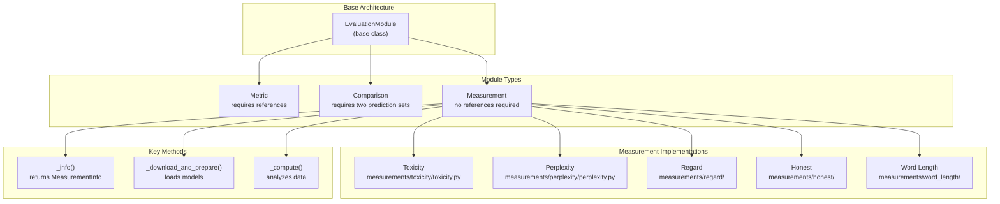
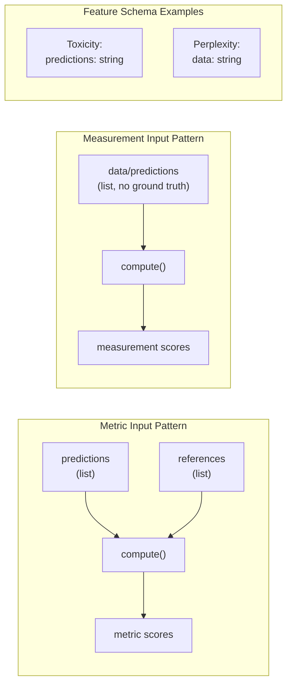
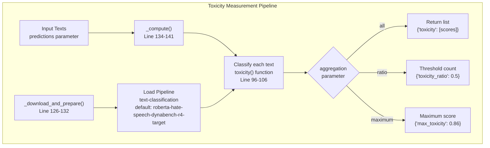
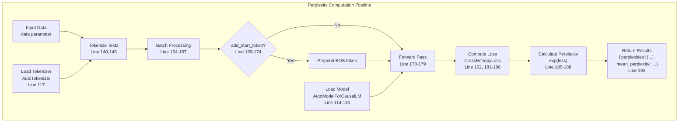
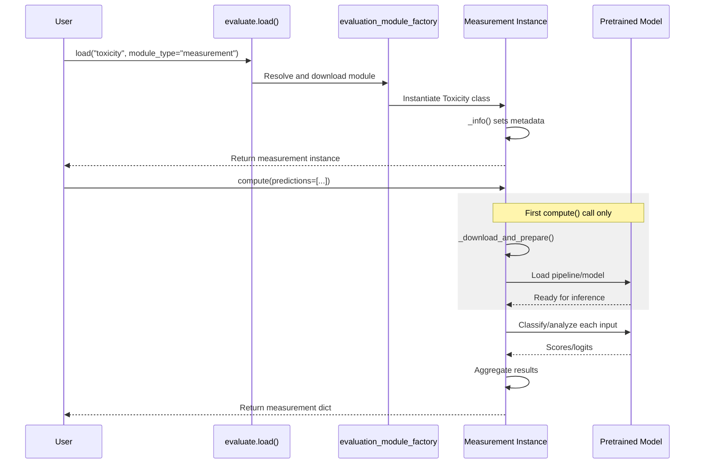
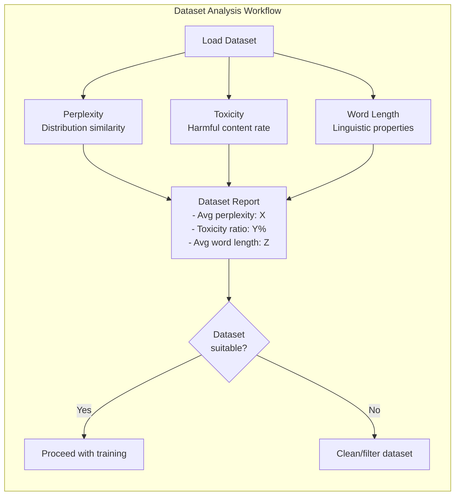

<!-- source: DeepWiki mcp.deepwiki.com · repo huggingface/evaluate · page 7 Measurements · fetched 2026-10-26 -->

# Measurements

<details>
<summary>Relevant source files</summary>

The following files were used as context for generating this wiki page:

- [docs/source/a_quick_tour.mdx](docs/source/a_quick_tour.mdx)
- [docs/source/choosing_a_metric.mdx](docs/source/choosing_a_metric.mdx)
- [docs/source/considerations.mdx](docs/source/considerations.mdx)
- [docs/source/index.mdx](docs/source/index.mdx)
- [measurements/honest/requirements.txt](measurements/honest/requirements.txt)
- [measurements/perplexity/README.md](measurements/perplexity/README.md)
- [measurements/perplexity/app.py](measurements/perplexity/app.py)
- [measurements/perplexity/perplexity.py](measurements/perplexity/perplexity.py)
- [measurements/perplexity/requirements.txt](measurements/perplexity/requirements.txt)
- [measurements/regard/requirements.txt](measurements/regard/requirements.txt)
- [measurements/toxicity/README.md](measurements/toxicity/README.md)
- [measurements/toxicity/app.py](measurements/toxicity/app.py)
- [measurements/toxicity/requirements.txt](measurements/toxicity/requirements.txt)
- [measurements/toxicity/toxicity.py](measurements/toxicity/toxicity.py)
- [metrics/perplexity/README.md](metrics/perplexity/README.md)
- [metrics/perplexity/app.py](metrics/perplexity/app.py)
- [metrics/perplexity/perplexity.py](metrics/perplexity/perplexity.py)
- [src/evaluate/evaluator/audio_classification.py](src/evaluate/evaluator/audio_classification.py)
- [src/evaluate/utils/logging.py](src/evaluate/utils/logging.py)

</details>


## Purpose and Scope

Measurements are evaluation modules that analyze properties of datasets, model outputs, or model behavior **without requiring ground truth labels**. Unlike metrics (see [Metrics](#5)) which compare predictions against references, measurements quantify characteristics such as text toxicity, perplexity, or linguistic properties. This page documents the Measurement module type, its architecture, and common implementations.

For comparing model predictions against ground truth, see [Metrics](#5). For statistically comparing two models, see [Comparisons](#6).

---

## Measurement Module Architecture

Measurements extend the `EvaluationModule` base class (see [Evaluation Module Base Classes](#3.2)) but differ from metrics in their input requirements and use cases.

### Class Hierarchy and Key Differences



**Sources:** [measurements/toxicity/toxicity.py:110-141](), [measurements/perplexity/perplexity.py:89-102](), [docs/source/a_quick_tour.mdx:1-378]()

### The Measurement Base Class

Measurements inherit from `evaluate.Measurement` which provides the standard lifecycle methods:

| Method | Return Type | Purpose |
|--------|-------------|---------|
| `_info()` | `MeasurementInfo` | Defines metadata, input schema, and documentation |
| `_download_and_prepare()` | None | Downloads pretrained models or resources |
| `_compute()` | Dict | Performs the actual measurement computation |

**Key distinction:** The `features` field in `MeasurementInfo` does not include a `references` field, only the data to be analyzed.

**Sources:** [measurements/toxicity/toxicity.py:111-124](), [measurements/perplexity/perplexity.py:90-102]()

---

## Input Schema Patterns

Measurements use different input patterns than metrics:



**Example feature definitions:**

**Toxicity measurement** [measurements/toxicity/toxicity.py:117-121]():
```python
features=datasets.Features({
    "predictions": datasets.Value("string", id="sequence"),
})
```

**Perplexity measurement** [measurements/perplexity/perplexity.py:96-100]():
```python
features=datasets.Features({
    "data": datasets.Value("string"),
})
```

**Sources:** [measurements/toxicity/toxicity.py:117-121](), [measurements/perplexity/perplexity.py:96-100]()

---

## Loading and Using Measurements

### Loading a Measurement

Measurements are loaded using `evaluate.load()` with the `module_type="measurement"` parameter:

```python
import evaluate

# Load toxicity measurement
toxicity = evaluate.load("toxicity", module_type="measurement")

# Load perplexity measurement
perplexity = evaluate.load("perplexity", module_type="measurement")
```

The `module_type` parameter is required to distinguish measurements from metrics with similar names (e.g., perplexity exists as both a metric and measurement).

**Sources:** [docs/source/a_quick_tour.mdx:23-34](), [measurements/toxicity/README.md:63-92]()

### Basic Usage Pattern

```python
# Toxicity measurement example
toxicity = evaluate.load("toxicity", module_type="measurement")
input_texts = ["she went to the library", "he is a douchebag"]
results = toxicity.compute(predictions=input_texts)
# Returns: {'toxicity': [0.0002, 0.8564]}

# Perplexity measurement example
perplexity = evaluate.load("perplexity", module_type="measurement")
data = ["lorem ipsum", "Happy Birthday!", "Bienvenue"]
results = perplexity.compute(model_id='gpt2', data=data)
# Returns: {'perplexities': [...], 'mean_perplexity': 646.75}
```

**Sources:** [measurements/toxicity/README.md:62-92](), [measurements/perplexity/README.md:66-78]()

---

## Measurement Categories

### Content Quality Measurements

Content quality measurements detect potentially harmful or biased content in text using pretrained classification models. For detailed documentation, see [Content Quality Measurements](#7.1).

#### Toxicity Measurement

The toxicity measurement quantifies harmful or offensive content using hate speech classification models.



**Configuration options** [measurements/toxicity/toxicity.py:134-141]():

| Parameter | Type | Default | Description |
|-----------|------|---------|-------------|
| `predictions` | list[str] | Required | Input texts to analyze |
| `toxic_label` | str | `"hate"` | Label to detect (model-dependent) |
| `aggregation` | str | `"all"` | `"all"`, `"ratio"`, or `"maximum"` |
| `threshold` | float | `0.5` | Threshold for ratio aggregation |

**Custom models:** The measurement can use any `AutoModelForSequenceClassification`-compatible model by specifying it as the `config_name` parameter when loading [measurements/toxicity/toxicity.py:126-132]():

```python
toxicity = evaluate.load("toxicity", "DaNLP/da-electra-hatespeech-detection")
results = toxicity.compute(predictions=texts, toxic_label='offensive')
```

**Sources:** [measurements/toxicity/toxicity.py:1-142](), [measurements/toxicity/README.md:1-118]()

### Text Analysis Measurements

Text analysis measurements quantify linguistic or statistical properties of text. For detailed documentation, see [Text Analysis Measurements](#7.2).

#### Perplexity Measurement

Perplexity measures how well a dataset matches the distribution of text a language model was trained on. Lower perplexity indicates text is more similar to the model's training distribution.



**Configuration options** [measurements/perplexity/perplexity.py:104-106]():

| Parameter | Type | Default | Description |
|-----------|------|---------|-------------|
| `data` | list[str] | Required | Text samples to evaluate |
| `model_id` | str | Required | Causal language model identifier |
| `batch_size` | int | `16` | Batch size for processing |
| `add_start_token` | bool | `True` | Include BOS token probability |
| `device` | str | Auto | `"cuda"`, `"cpu"`, or auto-detect |
| `max_length` | int | `None` | Maximum sequence length |

**Important constraints** [measurements/perplexity/perplexity.py:40-44]():
- Only works with causal language models (`AutoModelForCausalLM`)
- Examples: GPT-2, causal BERT variants, causal T5 variants
- See [transformers AutoModelForCausalLM documentation](https://huggingface.co/docs/transformers/master/en/model_doc/auto#transformers.AutoModelForCausalLM)

**Mathematical definition** [measurements/perplexity/README.md:28]():
```
perplexity = e^(sum(losses) / num_tokenized_tokens)
```

**Sources:** [measurements/perplexity/perplexity.py:1-194](), [measurements/perplexity/README.md:1-117]()

---

## Implementation Workflow

### Typical Measurement Lifecycle



**Sources:** [measurements/toxicity/toxicity.py:110-141](), [measurements/perplexity/perplexity.py:89-193]()

### Model Loading and Caching

Measurements that use pretrained models leverage the `_download_and_prepare()` method to load resources once:

**Toxicity model loading** [measurements/toxicity/toxicity.py:126-132]():
```python
def _download_and_prepare(self, dl_manager):
    if self.config_name == "default":
        model_name = "facebook/roberta-hate-speech-dynabench-r4-target"
    else:
        model_name = self.config_name
    self.toxic_classifier = pipeline("text-classification", model=model_name, 
                                     top_k=99999, truncation=True)
```

**Perplexity model loading** [measurements/perplexity/perplexity.py:114-117]():
```python
model = AutoModelForCausalLM.from_pretrained(model_id)
model = model.to(device)
tokenizer = AutoTokenizer.from_pretrained(model_id)
```

Models are cached by the `transformers` library in the standard cache directory (`~/.cache/huggingface/`).

**Sources:** [measurements/toxicity/toxicity.py:126-132](), [measurements/perplexity/perplexity.py:114-117]()

---

## Use Cases and Applications

### Dataset Analysis

Measurements enable understanding dataset characteristics before training:



**Example:** Analyzing a dataset for harmful content before training [measurements/toxicity/README.md:74-76]():
```python
toxicity = evaluate.load("toxicity", module_type="measurement")
texts = dataset["text"][:1000]  # Sample
results = toxicity.compute(predictions=texts, aggregation="ratio")
print(f"Toxic content: {results['toxicity_ratio']*100:.1f}%")
```

**Sources:** [docs/source/a_quick_tour.mdx:3-11](), [measurements/perplexity/README.md:31]()

### Model Behavior Analysis

Measurements can analyze model outputs without ground truth:

```python
# Analyze generation toxicity
model_outputs = model.generate(prompts)
toxicity = evaluate.load("toxicity", module_type="measurement")
results = toxicity.compute(predictions=model_outputs, aggregation="maximum")

# Check if maximum toxicity exceeds threshold
if results['max_toxicity'] > 0.7:
    print("Warning: Model generating potentially toxic content")
```

**Sources:** [measurements/toxicity/README.md:78-84](), [docs/source/considerations.mdx:82-88]()

### Production Monitoring

Measurements enable continuous monitoring of deployed models:

| Measurement | Monitoring Use Case |
|-------------|---------------------|
| Toxicity | Track harmful content generation rate |
| Perplexity | Detect distribution drift in inputs |
| Word Length | Monitor output verbosity changes |

**Sources:** [docs/source/a_quick_tour.mdx:3-11]()

---

## Comparison: Measurements vs Metrics

Understanding when to use measurements versus metrics:

| Aspect | Measurements | Metrics |
|--------|--------------|---------|
| **Ground Truth** | Not required | Required (references) |
| **Input Schema** | `data` or `predictions` only | `predictions` + `references` |
| **Use Case** | Dataset/model analysis | Model performance evaluation |
| **Examples** | Toxicity, perplexity, word length | Accuracy, F1, BLEU |
| **Return Type** | Analysis scores/statistics | Performance scores (0-1 or 0-100) |
| **Base Class** | `evaluate.Measurement` | `evaluate.Metric` |

**Loading distinction** [docs/source/a_quick_tour.mdx:30-34]():
```python
# Must specify module_type for measurements
word_length = evaluate.load("word_length", module_type="measurement")

# Metrics can omit module_type
accuracy = evaluate.load("accuracy")  # defaults to metric
```

**Sources:** [docs/source/a_quick_tour.mdx:1-378](), [docs/source/choosing_a_metric.mdx:1-64]()

---

## Advanced Features

### Aggregation Strategies

The toxicity measurement demonstrates flexible aggregation [measurements/toxicity/toxicity.py:134-141]():

```python
# Individual scores for each text
results = toxicity.compute(predictions=texts, aggregation="all")
# {'toxicity': [0.0002, 0.8564, 0.1234, ...]}

# Percentage above threshold
results = toxicity.compute(predictions=texts, aggregation="ratio", threshold=0.5)
# {'toxicity_ratio': 0.35}  # 35% of texts are toxic

# Maximum toxicity score
results = toxicity.compute(predictions=texts, aggregation="maximum")
# {'max_toxicity': 0.8564}
```

**Sources:** [measurements/toxicity/toxicity.py:134-141](), [measurements/toxicity/README.md:42-54]()

### Batch Processing

Perplexity measurement handles large datasets efficiently through batching [measurements/perplexity/perplexity.py:164-167]():

```python
perplexity = evaluate.load("perplexity", module_type="measurement")
results = perplexity.compute(
    data=large_dataset,
    model_id='gpt2',
    batch_size=32,  # Process 32 texts at a time
    device='cuda'
)
```

Progress tracking is automatically displayed via tqdm [measurements/perplexity/perplexity.py:164]().

**Sources:** [measurements/perplexity/perplexity.py:164-191](), [src/evaluate/utils/logging.py:196-213]()

---

## Available Measurements

The evaluate library provides measurements across multiple categories. Use `evaluate.list_evaluation_modules(module_type="measurement")` to discover all available measurements.

### Content Quality Category
- **toxicity**: Harmful or offensive content detection
- **regard**: Social group bias measurement
- **honest**: Hurtful sentence completion evaluation

### Text Analysis Category
- **perplexity**: Distribution similarity measurement
- **word_length**: Word and sentence length statistics

**Finding measurements:** Browse all measurements at [evaluate-measurement](https://huggingface.co/evaluate-measurement) on the Hub.

**Sources:** [docs/source/a_quick_tour.mdx:46-58](), [docs/source/index.mdx:1-81]()

---

## Dependencies and Requirements

Measurements often require additional dependencies beyond the core `evaluate` library:

**Toxicity requirements** [measurements/toxicity/requirements.txt:1-4]():
```
evaluate
transformers
torch
```

**Perplexity requirements** [measurements/perplexity/requirements.txt:1-3]():
```
evaluate
torch
transformers
```

**Honest requirements** [measurements/honest/requirements.txt:1-5]():
```
evaluate
transformers
unidecode==1.3.4
torch
```

Install these when loading custom measurements or when the automatic dependency resolution reports missing packages.

**Sources:** [measurements/toxicity/requirements.txt:1-4](), [measurements/perplexity/requirements.txt:1-3](), [measurements/honest/requirements.txt:1-5]()

---

## Creating Custom Measurements

To create custom measurements, extend the `evaluate.Measurement` class and implement the three required methods. See [Creating Custom Modules](#10.1) for detailed guidance on implementing custom evaluation modules.

**Basic template structure:**

```python
import evaluate
import datasets

class CustomMeasurement(evaluate.Measurement):
    def _info(self):
        return evaluate.MeasurementInfo(
            module_type="measurement",
            description="...",
            citation="...",
            features=datasets.Features({
                "data": datasets.Value("string"),
            }),
        )
    
    def _download_and_prepare(self, dl_manager):
        # Load any required models or resources
        pass
    
    def _compute(self, data, **kwargs):
        # Perform measurement computation
        return {"score": ...}
```

**Sources:** [measurements/toxicity/toxicity.py:110-141](), [measurements/perplexity/perplexity.py:89-102]()

---

