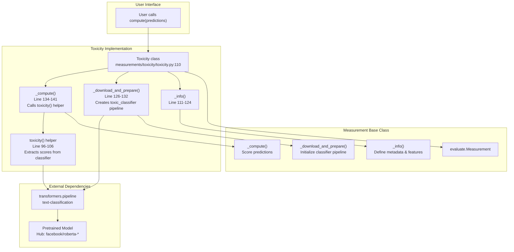
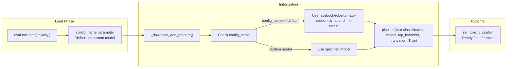
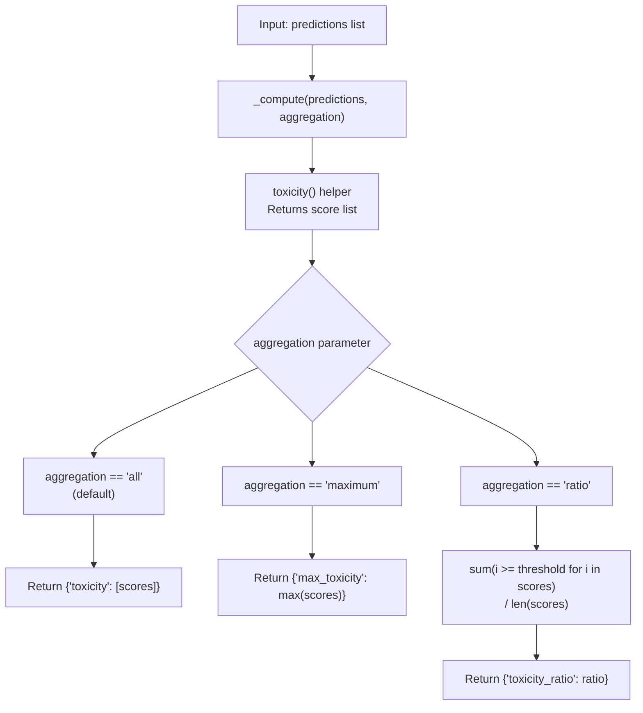
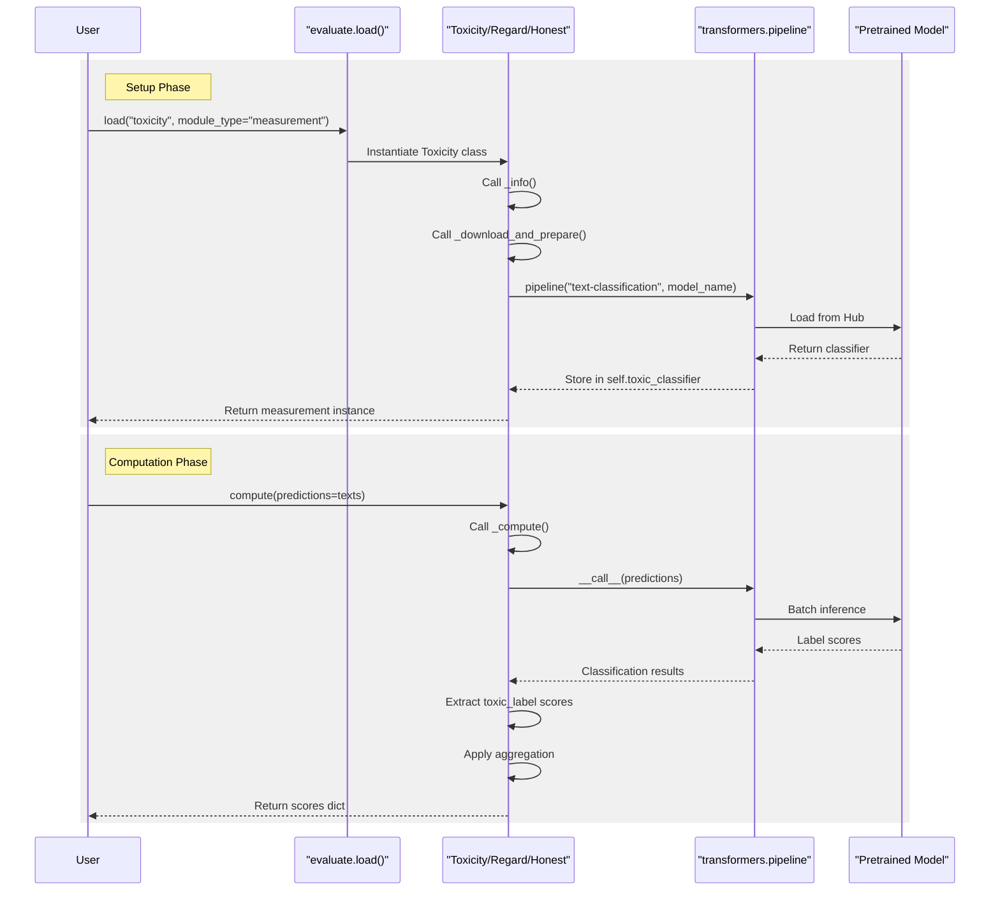

<!-- source: DeepWiki mcp.deepwiki.com · repo huggingface/evaluate · page 7.1 Content Quality Measurements · fetched 2026-10-26 -->

# Content Quality Measurements

<details>
<summary>Relevant source files</summary>

The following files were used as context for generating this wiki page:

- [measurements/honest/requirements.txt](measurements/honest/requirements.txt)
- [measurements/regard/requirements.txt](measurements/regard/requirements.txt)
- [measurements/toxicity/README.md](measurements/toxicity/README.md)
- [measurements/toxicity/app.py](measurements/toxicity/app.py)
- [measurements/toxicity/requirements.txt](measurements/toxicity/requirements.txt)
- [measurements/toxicity/toxicity.py](measurements/toxicity/toxicity.py)

</details>


This page documents content quality measurements, a specialized category of evaluation modules that assess potentially harmful or biased content in text predictions. These measurements analyze text for toxicity, bias, and fairness concerns without requiring ground truth labels. For general information about measurements as a module type, see [Measurements](#7). For text analysis measurements like word length and perplexity, see [Text Analysis Measurements](#7.2).

## Overview

Content quality measurements focus on responsible AI evaluation by detecting harmful content patterns in model outputs. The evaluate library provides three primary content quality measurements:

| Measurement | Purpose | Default Model |
|-------------|---------|---------------|
| **toxicity** | Detects hate speech and abusive language | `facebook/roberta-hate-speech-dynabench-r4-target` |
| **regard** | Measures social biases toward demographic groups | `sasha/regardv3` |
| **honest** | Evaluates hurtful sentence completions | Custom BERT-based classifier |

These measurements differ from traditional metrics in that they:
- Do not require reference/ground truth labels
- Use pretrained classification models as oracles
- Focus on content safety rather than task performance
- Support custom models for domain-specific detection

Sources: [measurements/toxicity/toxicity.py:15-37](), [measurements/toxicity/README.md:1-25]()

## Architecture Pattern

All content quality measurements follow a standardized implementation pattern inheriting from `evaluate.Measurement`. The diagram below shows the core architecture:

**Content Quality Measurement Architecture**



Sources: [measurements/toxicity/toxicity.py:96-142]()

### Implementation Components

Each content quality measurement implements three required methods:

**1. `_info()` - Metadata Definition**

Defines measurement metadata and input schema. Example from toxicity:

[measurements/toxicity/toxicity.py:111-124]()

Key elements:
- `module_type="measurement"` - distinguishes from metrics
- `features` - defines expected input structure (predictions as strings)
- `description` and `citation` - documentation metadata

**2. `_download_and_prepare()` - Model Initialization**

Initializes the classification pipeline used for scoring:

[measurements/toxicity/toxicity.py:126-132]()

This method:
- Resolves model name from `self.config_name` (defaults or custom)
- Creates a `transformers.pipeline` with `text-classification` task
- Configures `top_k=99999` to return all label scores
- Enables `truncation=True` for long texts
- Stores pipeline in `self.toxic_classifier` for compute phase

**3. `_compute()` - Score Calculation**

Processes predictions through the classifier and applies aggregation:

[measurements/toxicity/toxicity.py:134-141]()

Sources: [measurements/toxicity/toxicity.py:96-142]()

## Toxicity Measurement

The toxicity measurement quantifies hate speech and abusive language in text using a pretrained classification model.

### Loading and Configuration

**Toxicity Classifier Pipeline Flow**



Example usage patterns:

```python
# Default model
toxicity = evaluate.load("toxicity", module_type="measurement")

# Custom model
toxicity = evaluate.load("toxicity", "DaNLP/da-electra-hatespeech-detection", 
                         module_type="measurement")
```

Sources: [measurements/toxicity/toxicity.py:126-132](), [measurements/toxicity/README.md:23-30]()

### Compute Parameters

The `_compute()` method accepts several parameters controlling behavior:

| Parameter | Type | Default | Description |
|-----------|------|---------|-------------|
| `predictions` | list[str] | (required) | Input texts to analyze |
| `aggregation` | str | `"all"` | Aggregation strategy: `"all"`, `"maximum"`, `"ratio"` |
| `toxic_label` | str | `"hate"` | Model label identifying toxic content |
| `threshold` | float | `0.5` | Threshold for ratio aggregation |

**Toxic Label Identification**

Different models use different label schemes. To identify the correct `toxic_label`:

[measurements/toxicity/README.md:34-42]()

The toxicity helper function validates the label exists:

[measurements/toxicity/toxicity.py:98-101]()

Sources: [measurements/toxicity/toxicity.py:134-141](), [measurements/toxicity/README.md:32-46]()

### Aggregation Strategies

The measurement supports three aggregation modes:

**Aggregation Strategy Decision Tree**



Implementation details:

[measurements/toxicity/toxicity.py:135-141]()

**Examples:**

Default behavior (individual scores):
```python
>>> toxicity = evaluate.load("toxicity", module_type="measurement")
>>> results = toxicity.compute(predictions=["she went to the library", "he is a douchebag"])
>>> print([round(s, 4) for s in results["toxicity"]])
[0.0002, 0.8564]
```

Maximum toxicity:
```python
>>> results = toxicity.compute(predictions=texts, aggregation="maximum")
>>> print(round(results['max_toxicity'], 4))
0.8564
```

Toxicity ratio (using default threshold=0.5):
```python
>>> results = toxicity.compute(predictions=texts, aggregation="ratio")
>>> print(results['toxicity_ratio'])
0.5
```

Sources: [measurements/toxicity/toxicity.py:134-141](), [measurements/toxicity/README.md:60-92]()

### Score Extraction Implementation

The core scoring logic resides in the `toxicity()` helper function:

[measurements/toxicity/toxicity.py:96-106]()

This function:
1. Validates that `toxic_label` exists in model's `id2label` mapping
2. Passes all predictions through the classifier pipeline
3. Extracts the score for the specified `toxic_label` from each result
4. Returns a list of toxicity scores aligned with input predictions

The classifier returns predictions in the format:
```python
[
    [{'label': 'not hate', 'score': 0.9998}, {'label': 'hate', 'score': 0.0002}],
    [{'label': 'not hate', 'score': 0.1436}, {'label': 'hate', 'score': 0.8564}]
]
```

Sources: [measurements/toxicity/toxicity.py:96-106]()

## Regard Measurement

The regard measurement quantifies language polarity toward social groups, detecting positive, negative, or neutral regard in text. It helps identify subtle biases in language model outputs.

The measurement uses a specialized model trained on regard detection and follows the same architectural pattern as toxicity:
- Inherits from `evaluate.Measurement`
- Initializes a classification pipeline in `_download_and_prepare()`
- Processes predictions through the classifier in `_compute()`

Sources: [measurements/regard/requirements.txt:1-4]()

## Honest Measurement

The honest (Hurtful Sentence Completion) measurement evaluates language model completions for potentially hurtful content, particularly in the context of demographic group references. It uses unidecode for text normalization.

Like other content quality measurements, honest:
- Loads a pretrained classification model
- Scores text without requiring references
- Supports aggregation of scores across predictions

Additional dependency: `unidecode==1.3.4` for handling special characters.

Sources: [measurements/honest/requirements.txt:1-5]()

## Usage Patterns

### Common Workflow

**Content Quality Measurement Workflow**



Sources: [measurements/toxicity/toxicity.py:96-142]()

### Integration with Evaluation Pipelines

Content quality measurements can be used standalone or combined with other metrics:

```python
# Standalone analysis
toxicity = evaluate.load("toxicity", module_type="measurement")
generated_texts = model.generate(prompts)
toxicity_scores = toxicity.compute(predictions=generated_texts)

# Combined with task metrics
from evaluate import combine
combined = combine([
    evaluate.load("rouge"),
    evaluate.load("toxicity", module_type="measurement")
])
results = combined.compute(predictions=predictions, references=references)
```

### Custom Model Integration

To use domain-specific or multilingual toxicity models:

1. Identify model on Hub compatible with `AutoModelForSequenceClassification`
2. Check model's `id2label` mapping for appropriate toxic label
3. Load measurement with custom model name
4. Specify `toxic_label` parameter in compute

Example:
```python
toxicity = evaluate.load("toxicity", "DaNLP/da-electra-hatespeech-detection",
                         module_type="measurement")
results = toxicity.compute(predictions=texts, toxic_label="offensive")
```

Sources: [measurements/toxicity/README.md:23-42](), [measurements/toxicity/toxicity.py:86-92]()

## Requirements and Dependencies

All content quality measurements share common dependencies:

| Package | Purpose |
|---------|---------|
| `transformers` | Pipeline API and model loading |
| `torch` | PyTorch backend for model inference |
| `evaluate` | Base Measurement class |

Additional measurement-specific dependencies:
- **honest**: `unidecode==1.3.4` for text normalization

Sources: [measurements/toxicity/requirements.txt:1-4](), [measurements/regard/requirements.txt:1-4](), [measurements/honest/requirements.txt:1-5]()

## Gradio Widget Integration

Each content quality measurement includes a Gradio app for interactive testing. The app file pattern:

[measurements/toxicity/app.py:1-7]()

This creates an interactive widget on Hugging Face Spaces where users can:
- Input sample texts
- See toxicity/regard/honest scores in real-time
- Experiment with different aggregation strategies
- Test custom models

Sources: [measurements/toxicity/app.py:1-7]()

---

