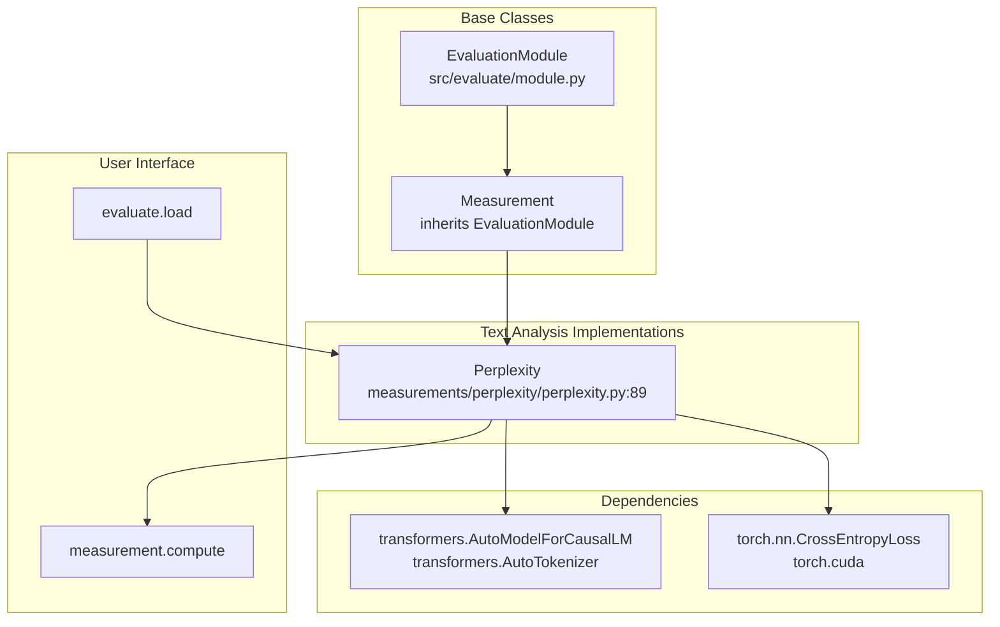
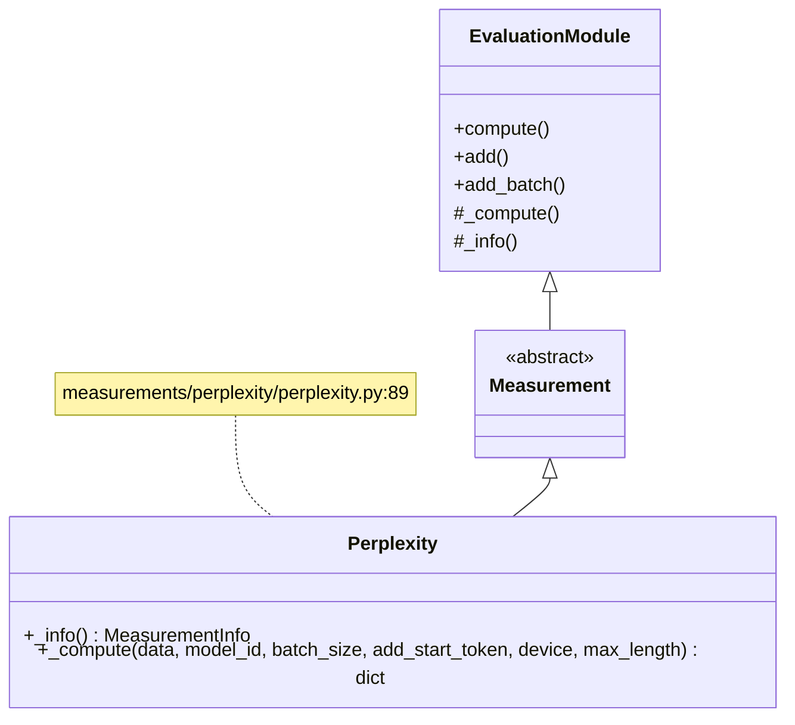
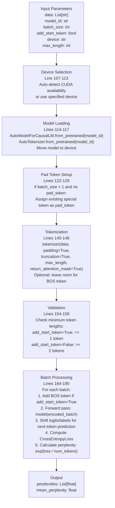
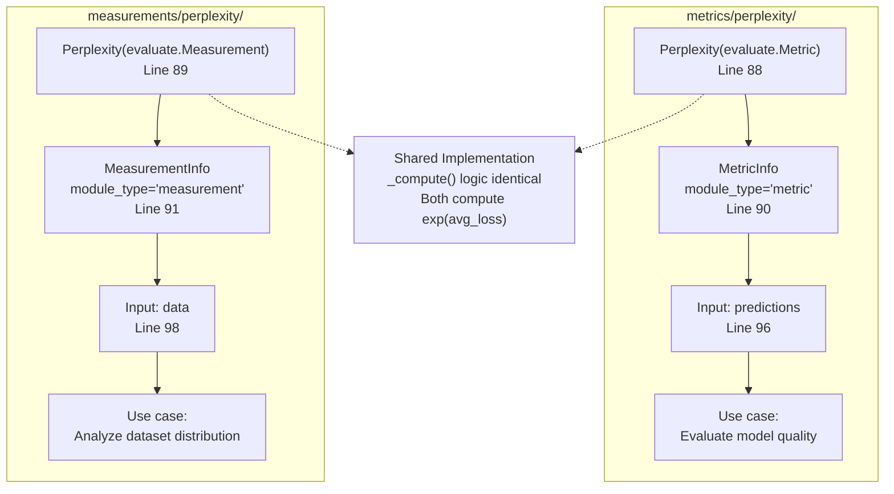
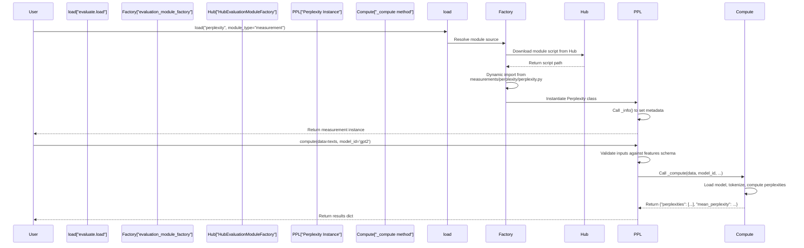

<!-- source: DeepWiki mcp.deepwiki.com · repo huggingface/evaluate · page 7.2 Text Analysis Measurements · fetched 2026-10-26 -->

# Text Analysis Measurements

<details>
<summary>Relevant source files</summary>

The following files were used as context for generating this wiki page:

- [measurements/perplexity/README.md](measurements/perplexity/README.md)
- [measurements/perplexity/app.py](measurements/perplexity/app.py)
- [measurements/perplexity/perplexity.py](measurements/perplexity/perplexity.py)
- [measurements/perplexity/requirements.txt](measurements/perplexity/requirements.txt)
- [metrics/perplexity/README.md](metrics/perplexity/README.md)
- [metrics/perplexity/app.py](metrics/perplexity/app.py)
- [metrics/perplexity/perplexity.py](metrics/perplexity/perplexity.py)

</details>


## Purpose and Scope

Text analysis measurements analyze intrinsic properties of text data without requiring ground truth references. Unlike metrics (which compare predictions to references) or comparisons (which statistically compare models), measurements characterize text datasets themselves. This enables dataset exploration, distribution analysis, and text property quantification.

For content quality measurements such as toxicity detection, see page 7.1.

## Overview

Text analysis measurements serve three primary use cases:

1. **Dataset Characterization**: Analyze text properties to understand dataset composition
2. **Distribution Similarity**: Evaluate how closely text matches a model's training distribution
3. **Quality Assessment**: Quantify text complexity and characteristics for preprocessing decisions



**Diagram: Text Analysis Measurement Architecture**

Sources: [measurements/perplexity/perplexity.py:1-193]()

## Available Measurements

| Measurement | Purpose | Input Parameters | Output Keys | Dependencies |
|-------------|---------|------------------|-------------|--------------|
| Perplexity | Measures dataset similarity to model training distribution | `data` (List[str]), `model_id` (str), `batch_size` (int), `add_start_token` (bool), `device` (str), `max_length` (int) | `perplexities` (List[float]), `mean_perplexity` (float) | transformers, torch |

Sources: [measurements/perplexity/perplexity.py:37-57]()

## Perplexity Measurement

The `Perplexity` measurement evaluates dataset similarity to a language model's training distribution. It computes the exponentiated average negative log-likelihood of text sequences using log base e: `perplexity = e^(sum(losses) / num_tokenized_tokens)`.

Lower perplexity indicates higher similarity to the model's training data. This measurement is useful for:
- Assessing whether a dataset is appropriate for a particular model
- Detecting distribution shift between training and evaluation data
- Comparing text complexity across datasets

Sources: [measurements/perplexity/perplexity.py:30-35](), [measurements/perplexity/README.md:22-28]()

### Implementation Architecture

The `Perplexity` class at [measurements/perplexity/perplexity.py:89]() inherits from `evaluate.Measurement` and implements the standard evaluation module pattern:



**Diagram: Perplexity Class Hierarchy**

Sources: [measurements/perplexity/perplexity.py:89-193]()

### Computation Pipeline

The `_compute` method implements a five-stage pipeline:



**Diagram: Perplexity Computation Flow**

Sources: [measurements/perplexity/perplexity.py:104-193]()

### Key Implementation Details

#### Model and Device Management

Device selection at [measurements/perplexity/perplexity.py:107-113]():
- Accepts `"gpu"`, `"cpu"`, or `"cuda"` as device strings
- Converts `"gpu"` to `"cuda"` internally
- Auto-detects CUDA availability if device is None
- Loads model using `AutoModelForCausalLM.from_pretrained(model_id)` and moves to device

Sources: [measurements/perplexity/perplexity.py:107-117]()

#### Tokenization and Special Tokens

Tokenization at [measurements/perplexity/perplexity.py:140-148]():
- Pads sequences when batch_size > 1 for efficient batching
- Handles padding token assignment at [measurements/perplexity/perplexity.py:122-129]()
- Optionally reserves space for BOS token when `add_start_token=True` and `max_length` is specified
- Returns `input_ids` and `attention_mask` tensors

BOS token handling at [measurements/perplexity/perplexity.py:169-174]():
- Prepends BOS token tensor to encoded batch: `torch.cat([bos_tokens_tensor, encoded_batch], dim=1)`
- Updates attention mask to cover BOS token
- Only executed when `add_start_token=True` and tokenizer has `bos_token_id`

Sources: [measurements/perplexity/perplexity.py:122-148](), [measurements/perplexity/perplexity.py:169-174]()

#### Loss Computation

Perplexity calculation at [measurements/perplexity/perplexity.py:178-190]():

1. **Forward Pass**: `model(encoded_batch, attention_mask=attn_mask).logits` with gradients disabled
2. **Shift for Next-Token Prediction**: 
   - Logits shifted left: `out_logits[..., :-1, :]`
   - Labels shifted left: `labels[..., 1:]`
   - Attention mask shifted: `attn_mask[..., 1:]`
3. **Cross-Entropy Loss**: `CrossEntropyLoss(reduction="none")` applied element-wise
4. **Perplexity Formula**: `torch.exp((loss * shift_attention_mask).sum(1) / shift_attention_mask.sum(1))`
   - Multiplies loss by attention mask to exclude padding
   - Sums over sequence length
   - Divides by number of valid tokens
   - Exponentiates to get perplexity

Sources: [measurements/perplexity/perplexity.py:162-190]()

### Usage Examples

#### Basic Usage

Load the measurement and compute perplexity on a list of text strings:

```python
import evaluate

perplexity = evaluate.load("perplexity", module_type="measurement")
data = ["lorem ipsum", "Happy Birthday!", "Bienvenue"]
results = perplexity.compute(
    model_id='gpt2',
    add_start_token=False,
    data=data
)
print(list(results.keys()))
# ['perplexities', 'mean_perplexity']
print(round(results["mean_perplexity"], 0))
# 647.0
print(round(results["perplexities"][0], 0))
# 32.0
```

Sources: [measurements/perplexity/README.md:60-78]()

#### Dataset Integration

Compute perplexity on dataset samples:

```python
from datasets import load_dataset
import evaluate

perplexity = evaluate.load("perplexity", module_type="measurement")
data = load_dataset("wikitext", "wikitext-2-raw-v1", split="test")["text"][:10]
# Filter empty strings
data = [s for s in data if s != '']
results = perplexity.compute(model_id='gpt2', data=data)
print(round(results["mean_perplexity"], 2))
# 576.76
```

Sources: [measurements/perplexity/README.md:79-94]()

### Parameters

The `compute` method accepts the following parameters:

| Parameter | Type | Default | Description |
|-----------|------|---------|-------------|
| `data` | List[str] | Required | Input text sequences to evaluate |
| `model_id` | str | Required | HuggingFace model ID for causal language model |
| `batch_size` | int | 16 | Number of texts processed per batch |
| `add_start_token` | bool | True | Whether to prepend BOS token to sequences |
| `device` | str | None | Device for computation ("cuda", "cpu", "gpu"), auto-detected if None |
| `max_length` | int | None | Maximum sequence length for truncation, defaults to model's max |

Sources: [measurements/perplexity/perplexity.py:37-52](), [measurements/perplexity/perplexity.py:104-105]()

### Model Compatibility

Perplexity requires causal language models from `AutoModelForCausalLM`. Compatible model types include:

- **GPT-2**: `gpt2`, `gpt2-medium`, `gpt2-large`, `gpt2-xl`
- **GPT-Neo/GPT-J**: `EleutherAI/gpt-neo-*`, `EleutherAI/gpt-j-*`
- **Causal BERT variants**: Models with causal attention masks
- **Causal T5 variants**: T5 models configured for causal language modeling

The full list is available in the [AutoModelForCausalLM documentation](https://huggingface.co/docs/transformers/master/en/model_doc/auto#transformers.AutoModelForCausalLM).

Sources: [measurements/perplexity/perplexity.py:39-44](), [measurements/perplexity/README.md:44-45]()

### Output Format

The measurement returns a dictionary with two keys:

```python
{
    'perplexities': [8.18, 33.42, 27.01],  # Per-text perplexity scores
    'mean_perplexity': 22.87                # Average across all texts
}
```

**Interpretation**:
- Range: [0, ∞)
- Lower values indicate better fit to model's training distribution
- Values are not comparable across different models or datasets

Sources: [measurements/perplexity/README.md:52-59]()

## Metric vs Measurement Distinction

The evaluate library contains both a perplexity **metric** and a perplexity **measurement** with identical implementations but different semantic purposes:



**Diagram: Perplexity Metric vs Measurement**

### Key Differences

| Aspect | Metric | Measurement |
|--------|--------|-------------|
| **Module Type** | `"metric"` | `"measurement"` |
| **Base Class** | `evaluate.Metric` | `evaluate.Measurement` |
| **Input Parameter** | `predictions` | `data` |
| **Purpose** | Evaluate how well a model learned its training distribution | Evaluate dataset similarity to a model's training distribution |
| **Typical Use** | Model validation: "Did my model learn the training data?" | Dataset analysis: "Is this dataset similar to what GPT-2 was trained on?" |
| **Features Schema** | `predictions: Value("string")` | `data: Value("string")` |
| **Module Path** | `metrics/perplexity/perplexity.py:88` | `measurements/perplexity/perplexity.py:89` |

### Loading Examples

```python
# Load as metric for model evaluation
metric = evaluate.load("perplexity", module_type="metric")
results = metric.compute(predictions=model_outputs, model_id='gpt2')

# Load as measurement for dataset analysis
measurement = evaluate.load("perplexity", module_type="measurement")
results = measurement.compute(data=dataset_texts, model_id='gpt2')
```

### Implementation Comparison

Both versions implement identical computation logic at [metrics/perplexity/perplexity.py:103-192]() and [measurements/perplexity/perplexity.py:104-193](). The only differences are:

1. **Class Inheritance**: `evaluate.Metric` vs `evaluate.Measurement`
2. **Info Object**: `MetricInfo` vs `MeasurementInfo`
3. **Feature Name**: `"predictions"` vs `"data"`
4. **Description Text**: Lines 30-35 in each file describe different use cases

Sources: [metrics/perplexity/perplexity.py:1-193](), [measurements/perplexity/perplexity.py:1-193](), [metrics/perplexity/README.md:22-29](), [measurements/perplexity/README.md:22-28]()

## Integration with Evaluate Library

### Module Loading and Execution

Text analysis measurements integrate through the standard `EvaluationModule` lifecycle:



**Diagram: Measurement Loading and Execution Flow**

Sources: [measurements/perplexity/perplexity.py:89-193]()

### EvaluationModule Contract

The `Perplexity` measurement implements the standard `EvaluationModule` pattern:

#### 1. Class Definition

Inherits from `evaluate.Measurement` at [measurements/perplexity/perplexity.py:89]():

```python
class Perplexity(evaluate.Measurement):
```

Sources: [measurements/perplexity/perplexity.py:89]()

#### 2. Metadata via `_info()`

Returns `MeasurementInfo` object at [measurements/perplexity/perplexity.py:90-101]():

```python
def _info(self):
    return evaluate.MeasurementInfo(
        module_type="measurement",
        description=_DESCRIPTION,
        citation=_CITATION,
        inputs_description=_KWARGS_DESCRIPTION,
        features=datasets.Features({
            "data": datasets.Value("string"),
        }),
        reference_urls=["https://huggingface.co/docs/transformers/perplexity"],
    )
```

The `features` schema defines the expected input format using `datasets.Features`, enabling automatic validation.

Sources: [measurements/perplexity/perplexity.py:90-101]()

#### 3. Computation via `_compute()`

Implements the measurement logic at [measurements/perplexity/perplexity.py:104-193]():

```python
def _compute(
    self, data, model_id, batch_size: int = 16, 
    add_start_token: bool = True, device=None, max_length=None
):
    # Implementation details covered in previous sections
    return {"perplexities": ppls, "mean_perplexity": np.mean(ppls)}
```

Sources: [measurements/perplexity/perplexity.py:104-193]()

### Resource Management

Unlike metrics that typically use lightweight dependencies, the perplexity measurement loads large pretrained models at runtime:

**Model Loading**: Deferred to `_compute()` execution at [measurements/perplexity/perplexity.py:114-117]():
- Downloads model checkpoint from Hub if not cached
- Uses `AutoModelForCausalLM.from_pretrained(model_id)`
- Automatically leverages Hub cache directory
- Moves model to compute device

**Memory Considerations**:
- Models remain in memory only during `compute()` execution
- No `_download_and_prepare()` method (unlike measurements that pre-download resources)
- Supports incremental batching via `batch_size` parameter

Sources: [measurements/perplexity/perplexity.py:114-117](), [measurements/perplexity/requirements.txt:1-3]()

## Gradio Integration

Text analysis measurements deploy as interactive Gradio widgets on Hugging Face Spaces. The perplexity measurement includes an `app.py` for this purpose:

```python
import evaluate
from evaluate.utils import launch_gradio_widget

module = evaluate.load("perplexity", module_type="measurement")
launch_gradio_widget(module)
```

This creates an interactive interface where users can:
1. Enter text data
2. Specify model ID
3. Configure measurement parameters
4. View perplexity results

The widget automatically generates input fields based on the measurement's `_info()` metadata and parameter signatures.

Sources: [measurements/perplexity/app.py:1-6]()

## Datasets Integration

Text analysis measurements integrate seamlessly with the `datasets` library:

```python
from datasets import load_dataset
import evaluate

# Load dataset
wiki = load_dataset("wikitext", "wikitext-2-raw-v1", split="test")

# Filter empty strings
texts = [s for s in wiki["text"][:50] if s != '']

# Apply measurement
perplexity = evaluate.load("perplexity", module_type="measurement")
results = perplexity.compute(data=texts, model_id='gpt2')
print(f"Mean perplexity: {results['mean_perplexity']:.2f}")
```

The `features` schema in `_info()` uses `datasets.Features` for compatibility, ensuring consistent data types.

Sources: [measurements/perplexity/README.md:79-94](), [measurements/perplexity/perplexity.py:96-100]()

## Best Practices

When working with text analysis measurements:

1. **Memory Considerations**: 
   - For large datasets, be cautious with measurements that retain all data (like `text_duplicates` with `list_duplicates=True`)
   - Use the `max_vocab` parameter in `word_count` when working with very large vocabularies

2. **Preprocessing**:
   - Consider normalizing text (lowercase, removing punctuation) before measurement for more meaningful results
   - Be consistent in preprocessing across different analyses

3. **Integration**:
   - Text analysis measurements can be combined with other evaluate modules in evaluation suites
   - Consider using alongside content quality measurements for comprehensive text analysis

## Conclusion

Text analysis measurements provide valuable tools for understanding text data characteristics. By quantifying properties like word counts and duplicates, they help with dataset exploration, quality assessment, and model output analysis. These measurements integrate seamlessly with the broader Hugging Face ecosystem, making them accessible tools for NLP practitioners.

---

