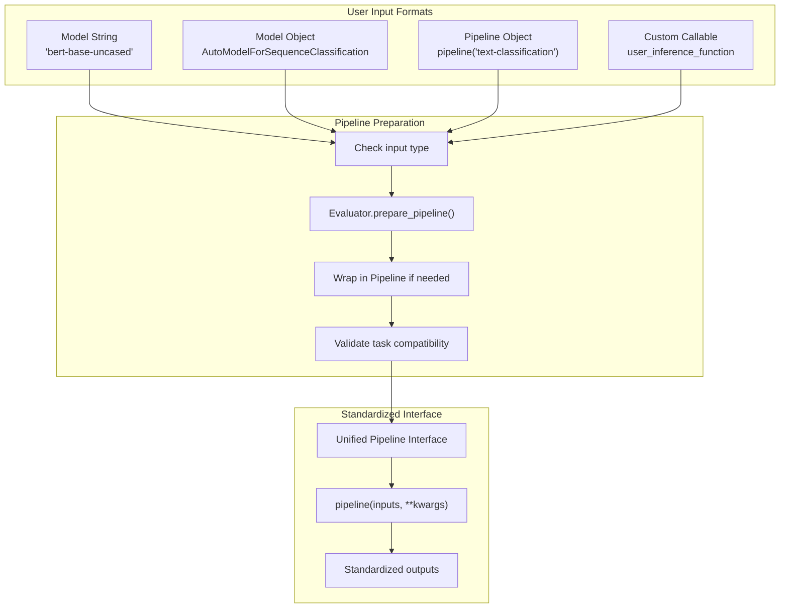
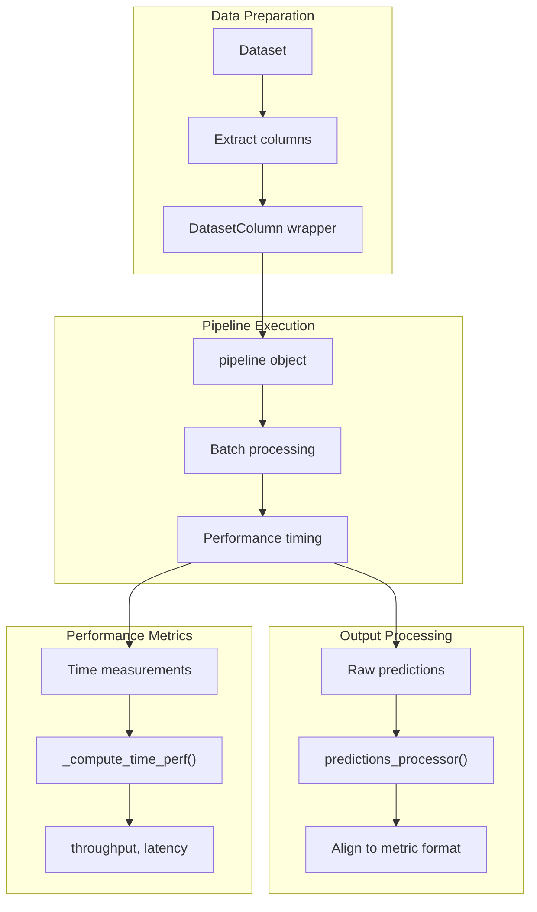
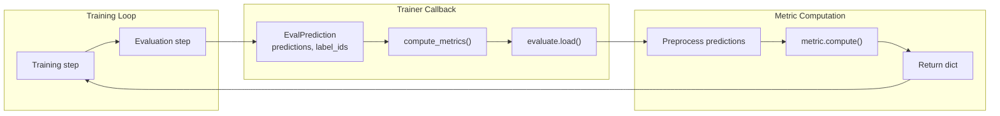
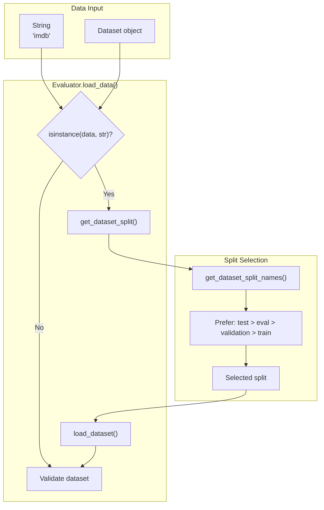
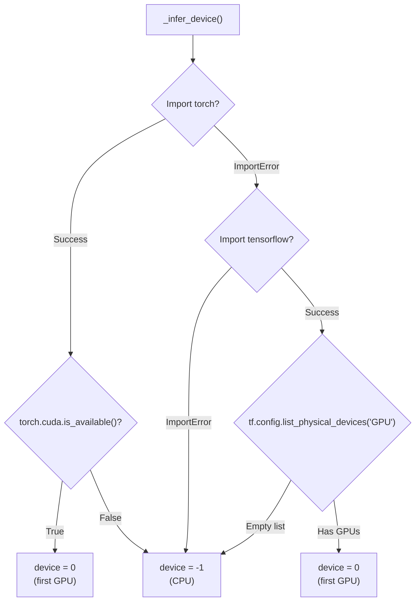
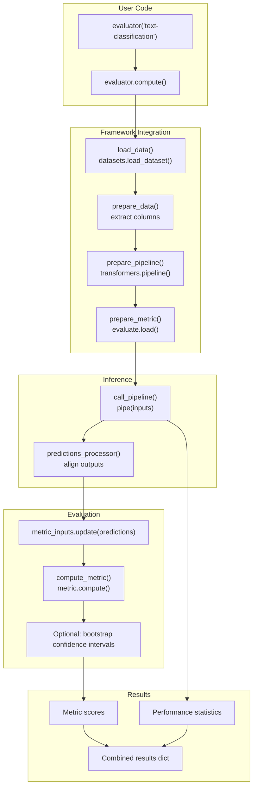

<!-- source: DeepWiki mcp.deepwiki.com · repo huggingface/evaluate · page 8 Integration with ML Frameworks · fetched 2026-10-26 -->

# Integration with ML Frameworks

<details>
<summary>Relevant source files</summary>

The following files were used as context for generating this wiki page:

- [docs/source/a_quick_tour.mdx](docs/source/a_quick_tour.mdx)
- [docs/source/base_evaluator.mdx](docs/source/base_evaluator.mdx)
- [docs/source/choosing_a_metric.mdx](docs/source/choosing_a_metric.mdx)
- [docs/source/considerations.mdx](docs/source/considerations.mdx)
- [docs/source/index.mdx](docs/source/index.mdx)
- [docs/source/package_reference/evaluator_classes.mdx](docs/source/package_reference/evaluator_classes.mdx)
- [src/evaluate/__init__.py](src/evaluate/__init__.py)
- [src/evaluate/evaluator/__init__.py](src/evaluate/evaluator/__init__.py)
- [src/evaluate/evaluator/audio_classification.py](src/evaluate/evaluator/audio_classification.py)
- [src/evaluate/evaluator/base.py](src/evaluate/evaluator/base.py)
- [src/evaluate/evaluator/image_classification.py](src/evaluate/evaluator/image_classification.py)
- [src/evaluate/evaluator/question_answering.py](src/evaluate/evaluator/question_answering.py)
- [src/evaluate/evaluator/text_classification.py](src/evaluate/evaluator/text_classification.py)
- [src/evaluate/evaluator/token_classification.py](src/evaluate/evaluator/token_classification.py)
- [src/evaluate/evaluator/utils.py](src/evaluate/evaluator/utils.py)
- [src/evaluate/utils/logging.py](src/evaluate/utils/logging.py)
- [tests/test_evaluator.py](tests/test_evaluator.py)

</details>


This document describes how the evaluate library integrates with machine learning frameworks, primarily **transformers** and **datasets**, to enable seamless model evaluation. It covers the interfaces, data flow, and extension points for custom frameworks.

For information about the high-level Evaluator abstraction and task-specific evaluators, see [Evaluator System](#4). For details on individual metrics and their computation, see [Metrics](#5).

---

## Overview

The evaluate library provides multiple integration points with ML frameworks:

1. **Pipeline Integration**: Uses `transformers.Pipeline` for standardized inference
2. **Trainer Integration**: Provides `compute_metrics` callbacks for training-time evaluation
3. **Dataset Integration**: Leverages `datasets.Dataset` for efficient data handling
4. **Custom Framework Support**: Accepts any callable that follows the pipeline interface

The primary integration mechanism is the `Evaluator.prepare_pipeline()` method, which accepts models in multiple formats and wraps them in a standardized interface for inference.

**Sources**: [src/evaluate/evaluator/base.py:422-478](), [src/evaluate/__init__.py:30-43]()

---

## Transformers Pipeline Integration

### Pipeline as the Core Abstraction

The `transformers.Pipeline` serves as the standardized interface between the evaluate library and model inference. All evaluators expect inputs compatible with pipeline semantics.



**Sources**: [src/evaluate/evaluator/base.py:422-478]()

### Pipeline Initialization Methods

The `prepare_pipeline()` method handles four input types:

| Input Type | Detection Logic | Processing |
|------------|----------------|------------|
| **String** | `isinstance(model_or_pipeline, str)` | Calls `pipeline(task, model=model_or_pipeline)` |
| **Model Object** | `isinstance(..., PreTrainedModel)` or `TFPreTrainedModel` | Wraps in `pipeline(task, model=...)` |
| **Pipeline Object** | Pre-initialized pipeline | Uses directly after task validation |
| **None** | No model specified | Creates default pipeline via `pipeline(task)` |

**Code Implementation**:

```python
# From prepare_pipeline() method
if isinstance(model_or_pipeline, str) or \
   isinstance(model_or_pipeline, transformers.PreTrainedModel) or \
   isinstance(model_or_pipeline, transformers.TFPreTrainedModel):
    pipe = pipeline(self.task, model=model_or_pipeline, 
                   tokenizer=tokenizer, feature_extractor=feature_extractor, 
                   device=device)
else:
    if model_or_pipeline is None:
        pipe = pipeline(self.task, device=device)
    else:
        pipe = model_or_pipeline
```

**Sources**: [src/evaluate/evaluator/base.py:452-471]()

### Task Validation

After pipeline initialization, the evaluator validates that the pipeline's task matches the evaluator's expected task:

```python
if (pipe.task != self.task) and not \
   (self.task == "translation" and pipe.task.startswith("translation")):
    raise ValueError(
        f"Incompatible `model_or_pipeline`. Please specify compatible with `{self.task}` task."
    )
```

This ensures that a text classification evaluator doesn't accidentally receive a question-answering pipeline.

**Sources**: [src/evaluate/evaluator/base.py:474-477]()

### Preprocessor Handling

Each pipeline may require task-specific preprocessors:

- **Text tasks**: Tokenizer (`tokenizer` parameter)
- **Vision tasks**: Feature extractor (`feature_extractor` parameter)  
- **Audio tasks**: Feature extractor (`feature_extractor` parameter)

These are passed to the `pipeline()` constructor and ignored if a pre-initialized pipeline is provided:

```python
if tokenizer is not None and feature_extractor is not None:
    logger.warning("Ignoring preprocessor argument for pre-initialized pipeline.")
```

**Sources**: [src/evaluate/evaluator/base.py:472-473]()

---

## Pipeline Execution Flow

### Data Flow Through Pipeline



**Sources**: [src/evaluate/evaluator/base.py:511-515](), [src/evaluate/evaluator/base.py:163-179]()

### The call_pipeline Method

The `call_pipeline()` method orchestrates inference with timing:

```python
def call_pipeline(self, pipe, *args, **kwargs):
    start_time = perf_counter()
    pipe_output = pipe(*args, **kwargs, **self.PIPELINE_KWARGS)
    end_time = perf_counter()
    return pipe_output, self._compute_time_perf(start_time, end_time, len(pipe_output))
```

Each evaluator defines task-specific `PIPELINE_KWARGS`:
- `TextClassificationEvaluator`: `{"truncation": True}`
- `TokenClassificationEvaluator`: `{"ignore_labels": []}`
- `QuestionAnsweringEvaluator`: `{"handle_impossible_answer": True/False}` (dynamic)

**Sources**: [src/evaluate/evaluator/base.py:511-515](), [src/evaluate/evaluator/text_classification.py:60](), [src/evaluate/evaluator/token_classification.py:94]()

### Performance Tracking

The `_compute_time_perf()` static method calculates three metrics:

| Metric | Formula | Description |
|--------|---------|-------------|
| `total_time_in_seconds` | `end_time - start_time` | Total inference duration |
| `samples_per_second` | `num_samples / total_time` | Throughput |
| `latency_in_seconds` | `total_time / num_samples` | Per-sample latency |

**Sources**: [src/evaluate/evaluator/base.py:163-179]()

---

## Transformers Trainer Integration

### Using Metrics with Trainer

The `transformers.Trainer` accepts a `compute_metrics` callback that receives `EvalPrediction` objects. Evaluate metrics can be integrated directly:

```python
from transformers import Trainer
import evaluate

metric = evaluate.load("accuracy")

def compute_metrics(eval_pred):
    predictions, labels = eval_pred
    predictions = predictions.argmax(axis=-1)
    return metric.compute(predictions=predictions, references=labels)

trainer = Trainer(
    model=model,
    args=training_args,
    train_dataset=train_dataset,
    eval_dataset=eval_dataset,
    compute_metrics=compute_metrics,
)
```

### Integration Pattern



**Sources**: [docs/source/a_quick_tour.mdx:162-166]()

### Combining Multiple Metrics

The `evaluate.combine()` function enables computing multiple metrics in one pass:

```python
import evaluate

clf_metrics = evaluate.combine(["accuracy", "f1", "precision", "recall"])

def compute_metrics(eval_pred):
    predictions, labels = eval_pred
    predictions = predictions.argmax(axis=-1)
    return clf_metrics.compute(predictions=predictions, references=labels)
```

This returns a dictionary with all metric scores:
```python
{
  'accuracy': 0.667,
  'f1': 0.667,
  'precision': 1.0,
  'recall': 0.5
}
```

**Sources**: [docs/source/a_quick_tour.mdx:180-197]()

---

## Datasets Library Integration

### Dataset as Primary Data Format

The evaluate library uses `datasets.Dataset` as its primary data container. The integration provides several benefits:

1. **Memory Efficiency**: Memory-mapped storage avoids loading entire datasets into RAM
2. **Consistent Interface**: Standardized column access and iteration
3. **Hub Integration**: Seamless loading from Hugging Face Hub
4. **Schema Validation**: Features system ensures data type compatibility

### Data Loading Flow



**Sources**: [src/evaluate/evaluator/base.py:350-388](), [src/evaluate/evaluator/utils.py:21-38]()

### DatasetColumn Wrapper

To avoid loading entire columns into memory, the evaluator uses `DatasetColumn`:

```python
class DatasetColumn(list):
    """Helper class to avoid loading a dataset column into memory when accessing it."""
    
    def __init__(self, dataset: Dataset, key: str):
        self.dataset = dataset
        self.key = key
    
    def __getitem__(self, i):
        return self.dataset[i][self.key]
    
    def __iter__(self):
        return (self.dataset[i][self.key] for i in range(len(self)))
```

This wrapper provides a list-like interface without materializing the column data until accessed.

**Sources**: [src/evaluate/evaluator/utils.py:4-18]()

### Column Validation

The `check_required_columns()` method ensures datasets have the expected structure:

```python
def check_required_columns(self, data: Union[str, Dataset], columns_names: Dict[str, str]):
    for input_name, column_name in columns_names.items():
        if column_name not in data.column_names:
            raise ValueError(
                f"Invalid `{input_name}` {column_name} specified. "
                f"The dataset contains: {data.column_names}."
            )
```

**Sources**: [src/evaluate/evaluator/base.py:295-319]()

### Task-Specific Data Preparation

Each evaluator implements `prepare_data()` to extract relevant columns:

**Text Classification**:
```python
def prepare_data(self, data, input_column, second_input_column, label_column):
    self.check_required_columns(data, {
        "input_column": input_column, 
        "label_column": label_column
    })
    return (
        {"references": data[label_column]},
        DatasetColumnPair(data, input_column, second_input_column, "text", "text_pair")
    )
```

**Token Classification**:
```python
def prepare_data(self, data, input_column, label_column, join_by):
    # Join tokens with specified separator
    data = data.map(lambda x: {input_column: join_by.join(x[input_column])})
    return (
        {"references": references},
        DatasetColumn(data, input_column)
    )
```

**Question Answering**:
```python
def prepare_data(self, data, question_column, context_column, id_column, label_column):
    metric_inputs = {
        "references": [
            {"id": element[id_column], "answers": element[label_column]} 
            for element in data
        ]
    }
    return metric_inputs, {
        "question": DatasetColumn(data, question_column),
        "context": DatasetColumn(data, context_column),
    }
```

**Sources**: [src/evaluate/evaluator/text_classification.py:65-80](), [src/evaluate/evaluator/token_classification.py:161-191](), [src/evaluate/evaluator/question_answering.py:93-119]()

---

## Device Management

### Automatic Device Inference

The `_infer_device()` method detects available hardware:



**Device Codes**:
- `-1`: CPU
- `0` or positive integer: CUDA device index

**Sources**: [src/evaluate/evaluator/base.py:182-209]()

### Device Validation

When a pre-initialized pipeline is passed with an explicit `device` parameter, the evaluator validates consistency:

```python
@staticmethod
def check_for_mismatch_in_device_setup(device, model_or_pipeline):
    if device is not None and device != -1 and isinstance(model_or_pipeline, Pipeline):
        if model_or_pipeline.device.type == "cpu":
            raise ValueError(
                "The `device` kwarg suggests GPU but pipe instantiated on CPU. "
                "Pass `device` to pipeline during initialization."
            )
        elif device != model_or_pipeline.device.index:
            raise ValueError(
                f"Pipeline on device {model_or_pipeline.device.index} "
                f"but device={device} passed to compute()."
            )
```

This prevents silent performance issues where evaluation expects GPU but runs on CPU.

**Sources**: [src/evaluate/evaluator/base.py:281-293]()

---

## Custom Framework Support

### Custom Callable Interface

Any callable that follows the pipeline interface can be used:

```python
class CustomModel:
    def __init__(self):
        self.task = "text-classification"
    
    def __call__(self, inputs, **kwargs):
        # inputs: list of strings or dicts
        # returns: list of dicts with task-specific structure
        return [{"label": "POSITIVE", "score": 0.9} for _ in inputs]

custom_model = CustomModel()

evaluator = evaluate.evaluator("text-classification")
results = evaluator.compute(
    model_or_pipeline=custom_model,
    data=data,
    label_mapping={"POSITIVE": 1, "NEGATIVE": 0}
)
```

### Requirements for Custom Callables

To be compatible with evaluators, custom models must:

1. **Have a `task` attribute**: String indicating the task type
2. **Accept list inputs**: Process batches efficiently
3. **Return task-specific output**: Follow pipeline output schema
4. **Support keyword arguments**: Accept and ignore evaluator-specific kwargs

### Task-Specific Output Schemas

**Text Classification**:
```python
[{"label": "POSITIVE", "score": 0.9}, {"label": "NEGATIVE", "score": 0.1}]
```

**Token Classification**:
```python
[[{"entity": "B-LOC", "start": 0, "end": 3}, ...]]
```

**Question Answering**:
```python
[{"answer": "text", "score": 0.95, "start": 10, "end": 15}]
```

**Image Classification**:
```python
[[{"label": "cat", "score": 0.9}, {"label": "dog", "score": 0.1}]]
```

**Sources**: Test examples in [tests/test_evaluator.py:52-139]()

---

## Integration Example: Full Pipeline

### End-to-End Evaluation Flow



**Sources**: [src/evaluate/evaluator/base.py:218-279]()

### Code Example

```python
import evaluate
from transformers import pipeline
from datasets import load_dataset

# 1. Initialize evaluator
task_evaluator = evaluate.evaluator("text-classification")

# 2. Load data (integrates with datasets)
data = load_dataset("imdb", split="test[:100]")

# 3. Prepare model (integrates with transformers)
pipe = pipeline("text-classification", 
                model="distilbert-base-uncased-finetuned-sst-2-english",
                device=0)  # Use GPU

# 4. Evaluate with multiple metrics (integrates with evaluate)
results = task_evaluator.compute(
    model_or_pipeline=pipe,
    data=data,
    metric=evaluate.combine(["accuracy", "f1"]),
    label_mapping={"POSITIVE": 1, "NEGATIVE": 0},
    strategy="bootstrap",
    n_resamples=100
)

# Results include metric scores and performance stats
print(results)
# {
#   'accuracy': {'score': 0.91, 'confidence_interval': (0.88, 0.94), ...},
#   'f1': {'score': 0.90, 'confidence_interval': (0.87, 0.93), ...},
#   'total_time_in_seconds': 12.5,
#   'samples_per_second': 8.0,
#   'latency_in_seconds': 0.125
# }
```

**Sources**: [docs/source/a_quick_tour.mdx:244-289](), [docs/source/base_evaluator.mdx:1-118]()

---

## Advanced Integration Features

### Label Mapping

The `label_mapping` parameter aligns model outputs with dataset labels:

```python
# Model outputs: {"LABEL_0": ..., "LABEL_1": ...}
# Dataset labels: {0, 1}
label_mapping = {"LABEL_0": 0, "LABEL_1": 1}

results = evaluator.compute(
    model_or_pipeline=model,
    data=data,
    label_mapping=label_mapping
)
```

This is applied in `predictions_processor()` for each evaluator:

```python
def predictions_processor(self, predictions, label_mapping):
    predictions = [
        label_mapping[element["label"]] if label_mapping is not None else element["label"]
        for element in predictions
    ]
    return {"predictions": predictions}
```

**Sources**: [src/evaluate/evaluator/text_classification.py:82-87](), [src/evaluate/evaluator/image_classification.py:62-66]()

### Bootstrap Strategy Integration

The bootstrap strategy uses `scipy.stats.bootstrap` for confidence intervals:

```python
def _compute_confidence_interval(
    metric, metric_inputs, metric_keys, 
    confidence_level=0.95, n_resamples=9999, random_state=None
):
    bootstrap_dict = {}
    for key in metric_keys:
        bs = bootstrap(
            data=list(metric_inputs.values()),
            statistic=build_args_metric(metric, key, **metric_inputs),
            paired=True,
            vectorized=False,
            confidence_level=confidence_level,
            n_resamples=n_resamples,
            random_state=random_state,
        )
        bootstrap_dict[key] = {
            "confidence_interval": (bs.confidence_interval.low, bs.confidence_interval.high),
            "standard_error": bs.standard_error,
        }
    return bootstrap_dict
```

This wraps around the metric computation, resampling predictions and references.

**Sources**: [src/evaluate/evaluator/base.py:125-160]()

### Memory-Mapped Dataset Support

The integration supports large datasets through memory mapping:

```python
# ImageNet-1k evaluation (150+ GB) with minimal RAM usage
data = load_dataset("imagenet-1k", split="validation", token=True)

pipe = pipeline("image-classification", 
                model="facebook/deit-small-distilled-patch16-224")

task_evaluator = evaluate.evaluator("image-classification")
results = task_evaluator.compute(
    model_or_pipeline=pipe,
    data=data,
    metric="accuracy",
    label_mapping=pipe.model.config.label2id
)
# Uses ~1.5 GB RAM despite 30+ GB validation split
```

The `DatasetColumn` wrapper ensures only accessed samples are loaded into memory.

**Sources**: [docs/source/base_evaluator.mdx:267-289]()

---

## Summary of Integration Points

| Framework | Integration Type | Key Classes/Functions | Purpose |
|-----------|-----------------|----------------------|---------|
| **transformers** | Pipeline API | `Pipeline`, `pipeline()` | Standardized inference interface |
| **transformers** | Trainer callback | `compute_metrics` | Training-time evaluation |
| **datasets** | Data handling | `Dataset`, `load_dataset()` | Memory-efficient data access |
| **datasets** | Schema validation | `Features`, `ClassLabel` | Type checking and alignment |
| **scipy** | Statistical analysis | `bootstrap()` | Confidence intervals |
| **Custom** | Callable interface | Any callable with `task` attribute | Framework-agnostic evaluation |

**Sources**: [src/evaluate/__init__.py:1-52](), [src/evaluate/evaluator/__init__.py:16-141]()

---

