# Page: Overview

# Overview

<details>
<summary>Relevant source files</summary>

The following files were used as context for generating this wiki page:

- [README.md](README.md)
- [docs/source/a_quick_tour.mdx](docs/source/a_quick_tour.mdx)
- [docs/source/choosing_a_metric.mdx](docs/source/choosing_a_metric.mdx)
- [docs/source/considerations.mdx](docs/source/considerations.mdx)
- [docs/source/creating_and_sharing.mdx](docs/source/creating_and_sharing.mdx)
- [docs/source/index.mdx](docs/source/index.mdx)
- [docs/source/transformers_integrations.mdx](docs/source/transformers_integrations.mdx)
- [docs/source/types_of_evaluations.mdx](docs/source/types_of_evaluations.mdx)
- [setup.py](setup.py)
- [src/evaluate/evaluator/audio_classification.py](src/evaluate/evaluator/audio_classification.py)
- [src/evaluate/utils/logging.py](src/evaluate/utils/logging.py)

</details>


The `evaluate` library is a Python package that provides standardized access to evaluation metrics, statistical comparisons, and dataset measurements for machine learning models. It serves as a unified interface for computing evaluation scores across diverse ML tasks, with built-in support for distributed computation, caching, and community-driven module sharing via the Hugging Face Hub.

**Scope**: This page provides a high-level introduction to the library's architecture, main components, and usage patterns. For detailed information on specific subsystems, see:
- Installation and configuration: [Installation and Setup](#1.2)
- Loading system internals: [Module Loading System](#3.1)
- High-level automation: [Evaluator System](#4)
- Creating custom modules: [Creating Custom Modules](#10.1)

## Purpose and Design Philosophy

The evaluate library addresses three core evaluation needs:

1. **Metrics**: Measure model performance against ground truth labels (e.g., accuracy, BLEU, F1)
2. **Comparisons**: Statistically compare predictions from multiple models (e.g., McNemar test)
3. **Measurements**: Analyze dataset or prediction properties without requiring labels (e.g., toxicity, perplexity)

All evaluation modules are hosted on the Hugging Face Hub as Spaces, enabling version control, documentation, and interactive widgets for each module.

**Sources**: [setup.py:2-3](), [README.md:31-37](), [docs/source/a_quick_tour.mdx:3-11]()

## Library Architecture

The library follows a modular architecture with four primary layers:

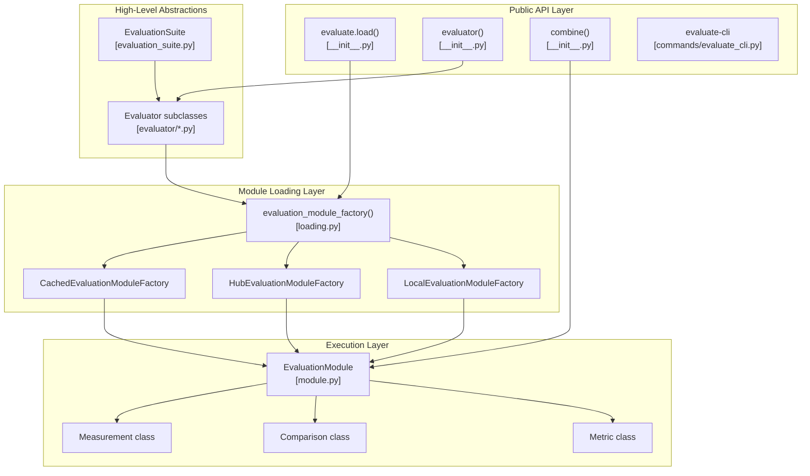

**Sources**: [src/evaluate/__init__.py](), [docs/source/a_quick_tour.mdx:19-28]()

## Main Entry Points

The library exposes three primary entry points for users:

| Entry Point | Purpose | Location | Returns |
|------------|---------|----------|---------|
| `evaluate.load(path)` | Load any evaluation module by name or path | [__init__.py]() | `EvaluationModule` instance |
| `evaluator(task)` | Create task-specific automated evaluator | [__init__.py]() | Task-specific `Evaluator` subclass |
| `evaluate.combine(modules)` | Bundle multiple metrics into single compute | [__init__.py]() | `CombinedEvaluations` instance |
| `evaluate-cli` | Command-line tool for creating modules | [commands/evaluate_cli.py]() | N/A (creates Hub Space) |

### Load Function Workflow

```mermaid
graph LR
    user["User calls<br/>evaluate.load('accuracy')"]
    load["load() function<br/>[__init__.py]"]
    factory["evaluation_module_factory()<br/>[loading.py]"]
    determine["Determine source:<br/>Hub/Local/Cache"]
    download["Download script<br/>if needed"]
    import["Import module class<br/>via importlib"]
    instantiate["Instantiate<br/>EvaluationModule"]
    info["Call _info()<br/>setup metadata"]
    prepare["Call _download_and_prepare()<br/>fetch resources"]
    return_val["Return configured<br/>module instance"]
    
    user --> load
    load --> factory
    factory --> determine
    determine --> download
    download --> import
    import --> instantiate
    instantiate --> info
    info --> prepare
    prepare --> return_val
```

**Sources**: [src/evaluate/loading.py](), [docs/source/a_quick_tour.mdx:22-28]()

## Evaluation Module Types

The library categorizes evaluation modules into three types, each inheriting from `EvaluationModule`:

### Module Type Hierarchy

| Type | Count | Purpose | Example Modules | Base Class |
|------|-------|---------|-----------------|------------|
| **Metric** | ~70 | Measure model performance vs. ground truth | `accuracy`, `f1`, `rouge`, `bleu` | `EvaluationModule` |
| **Comparison** | ~5 | Statistical tests between model outputs | `mcnemar`, `exact_match` | `EvaluationModule` |
| **Measurement** | ~15 | Dataset/prediction analysis (no labels required) | `toxicity`, `perplexity`, `word_length` | `EvaluationModule` |

All three types implement the same interface pattern:

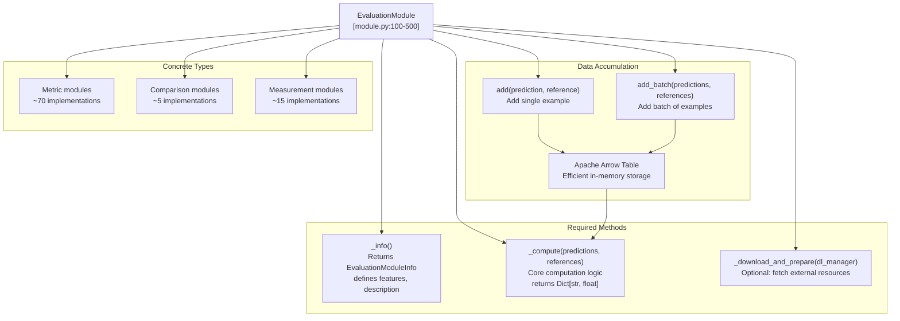

**Sources**: [src/evaluate/module.py](), [docs/source/types_of_evaluations.mdx:1-36](), [docs/source/a_quick_tour.mdx:6-11]()

## Module Lifecycle

Every evaluation module follows a three-phase lifecycle:

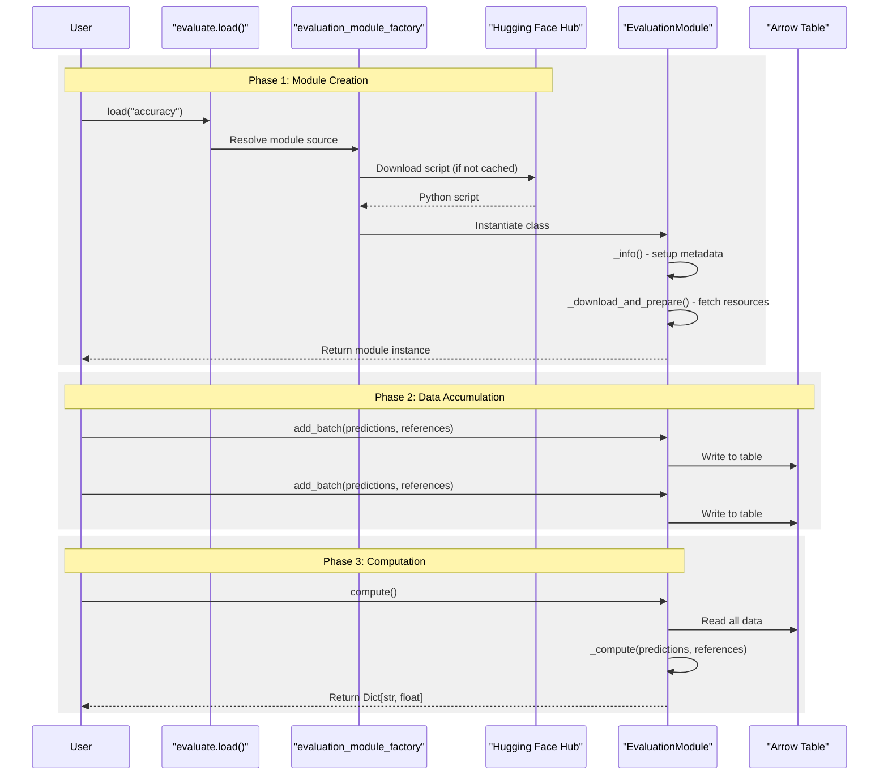

**Sources**: [src/evaluate/module.py](), [docs/source/a_quick_tour.mdx:119-176]()

## Integration with ML Ecosystem

The evaluate library integrates deeply with the Hugging Face ecosystem:

### Core Dependencies

| Dependency | Purpose | Usage in evaluate |
|-----------|---------|-------------------|
| `datasets>=2.0.0` | Data backend | Arrow table storage, Features validation |
| `huggingface-hub>=0.7.0` | Hub access | Module discovery, download scripts |
| `transformers` (optional) | Model inference | `Evaluator` system, `Trainer` integration |
| `scipy>=1.7.1` (optional) | Statistical functions | Bootstrap confidence intervals |
| `numpy>=1.17` | Numerical operations | Data manipulation, shuffling |

### Module Type Discovery

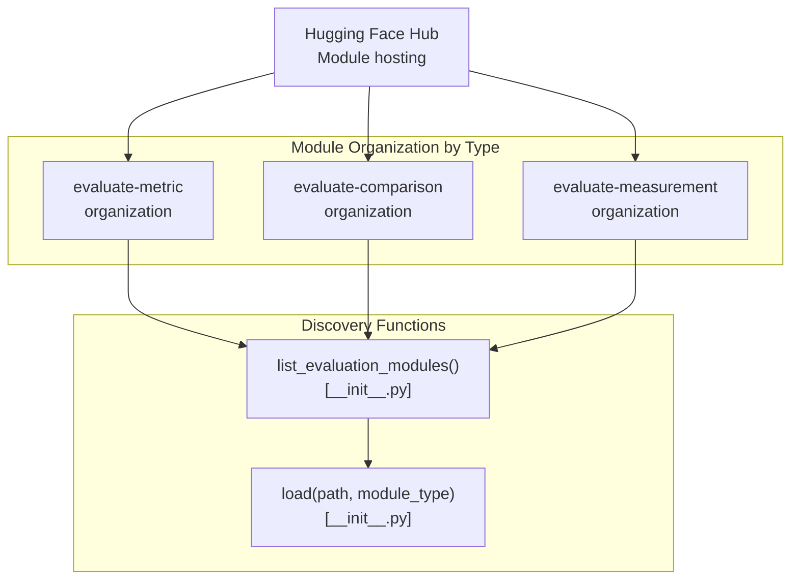

**Sources**: [setup.py:31-57](), [docs/source/a_quick_tour.mdx:36-58]()

## Typical Usage Patterns

The library supports three common evaluation workflows:

### Pattern 1: Simple Metric Computation

```python
# Load metric
metric = evaluate.load("accuracy")

# Compute directly
results = metric.compute(
    predictions=[0, 1, 1, 0],
    references=[0, 1, 0, 0]
)
# Returns: {'accuracy': 0.75}
```

### Pattern 2: Incremental Accumulation

```python
# Load metric
metric = evaluate.load("f1")

# Add data in batches (e.g., during model evaluation loop)
for batch in dataloader:
    predictions = model(batch)
    metric.add_batch(
        predictions=predictions,
        references=batch['labels']
    )

# Compute at the end
results = metric.compute()
```

### Pattern 3: Automated Evaluation

```python
# Create task-specific evaluator
task_evaluator = evaluator("text-classification")

# Evaluate model on dataset
results = task_evaluator.compute(
    model_or_pipeline="bert-base-uncased",
    data="imdb",
    metric="accuracy"
)
# Handles: loading model, inference, metric computation
```

**Sources**: [docs/source/a_quick_tour.mdx:119-176](), [docs/source/a_quick_tour.mdx:244-291]()

## Key Design Principles

The library implements several design decisions that differentiate it from other evaluation frameworks:

### Distributed Evaluation Support

The `EvaluationModule` class [src/evaluate/module.py]() uses Apache Arrow tables to enable distributed evaluation across multiple processes. Each process accumulates predictions locally, and the first process aggregates results from all processes during `compute()`, ensuring non-additive metrics (like F1) are computed correctly.

### Hub-Based Module Distribution

All evaluation modules live on the Hub as Spaces [docs/source/creating_and_sharing.mdx:19-27](), providing:
- Automatic version control via git
- Interactive widgets for testing metrics
- Community contributions without library updates
- Documentation cards for each module

### Type-Checked Inputs

The `features` attribute in `EvaluationModuleInfo` [src/evaluate/module.py]() defines expected input types using `datasets.Features`, enabling automatic validation of predictions and references before computation.

**Sources**: [src/evaluate/module.py](), [docs/source/a_quick_tour.mdx:168-176](), [docs/source/creating_and_sharing.mdx:1-28]()

## File Organization

The library's main components are organized as follows:

```
src/evaluate/
├── __init__.py              # Public API: load(), evaluator(), combine()
├── module.py                # EvaluationModule base class
├── loading.py               # evaluation_module_factory, Factory classes
├── evaluator/               # High-level Evaluator implementations
│   ├── base.py             # Evaluator base class
│   ├── text_classification.py
│   ├── question_answering.py
│   └── ...                 # 10+ task-specific evaluators
├── evaluation_suite.py      # EvaluationSuite for multi-task benchmarking
├── config.py               # Task definitions and configurations
└── commands/
    └── evaluate_cli.py     # CLI tool for module creation
```

**Sources**: [setup.py:138-140](), [src/evaluate/]()

---

For more detailed information on specific subsystems, refer to:
- Module loading mechanics: [Module Loading System](#3.1)
- Creating custom evaluation modules: [Creating Custom Modules](#10.1)
- Using the Evaluator system: [Evaluator System](#4)
- Integration with transformers: [Integration with ML Frameworks](#8)

---

# Page: Key Concepts

# Key Concepts

<details>
<summary>Relevant source files</summary>

The following files were used as context for generating this wiki page:

- [README.md](README.md)
- [docs/source/a_quick_tour.mdx](docs/source/a_quick_tour.mdx)
- [docs/source/choosing_a_metric.mdx](docs/source/choosing_a_metric.mdx)
- [docs/source/considerations.mdx](docs/source/considerations.mdx)
- [docs/source/creating_and_sharing.mdx](docs/source/creating_and_sharing.mdx)
- [docs/source/index.mdx](docs/source/index.mdx)
- [docs/source/transformers_integrations.mdx](docs/source/transformers_integrations.mdx)
- [docs/source/types_of_evaluations.mdx](docs/source/types_of_evaluations.mdx)
- [src/evaluate/evaluator/audio_classification.py](src/evaluate/evaluator/audio_classification.py)
- [src/evaluate/utils/logging.py](src/evaluate/utils/logging.py)

</details>


This page introduces the fundamental concepts of the Hugging Face `evaluate` library. You'll learn about the different types of evaluation modules (metrics, comparisons, and measurements), how they're structured, and how to use them. For information about the overall architecture, see [Core Architecture](#2).

## Evaluation Modules

Evaluation modules are the core components of the `evaluate` library. They provide standardized ways to evaluate machine learning models and datasets. All evaluation modules share a common interface and structure but serve different evaluation purposes.

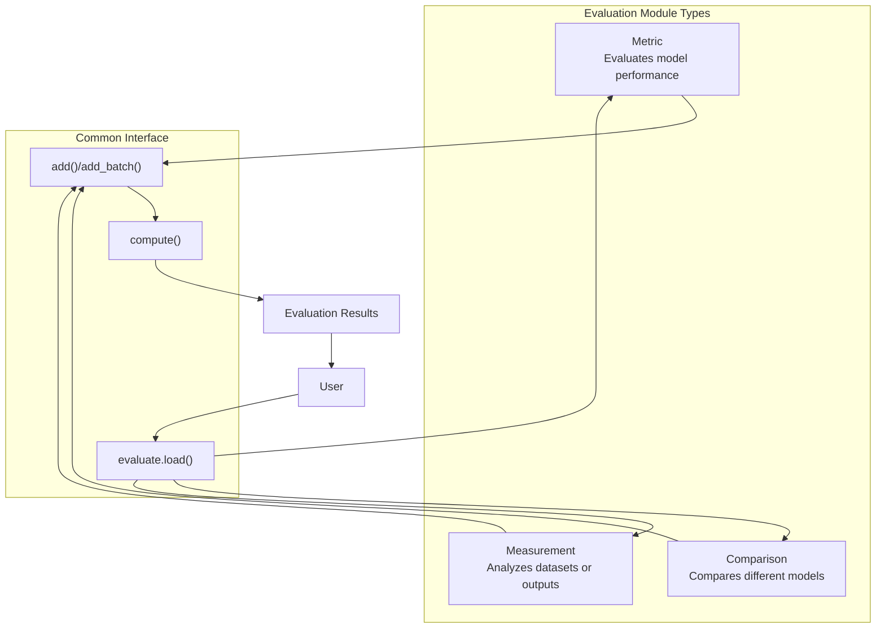

Sources: [README.md:31-37](), [docs/source/types_of_evaluations.mdx:1-36]()

### Evaluation Module Structure

All evaluation modules inherit from the same base class, `EvaluationModule`, which defines common methods and behavior. The class hierarchy ensures consistency across different evaluation types.

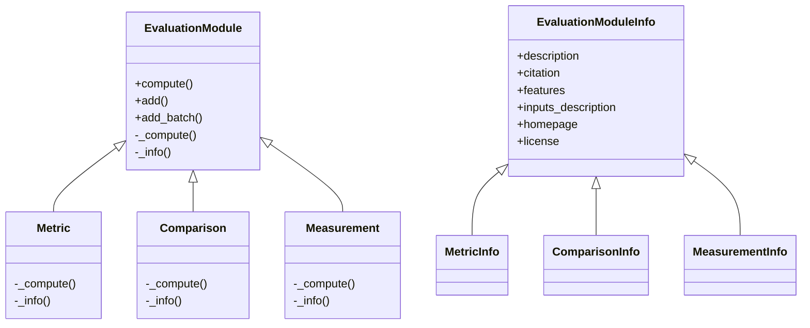

Sources: [docs/source/package_reference/main_classes.mdx:1-25]()

## Loading and Using Evaluation Modules

All evaluation modules in the `evaluate` library follow a consistent usage pattern:

1. **Loading**: First, load the module using `evaluate.load()`
2. **Computing**: Then use `compute()` to calculate results directly, or use `add()`/`add_batch()` followed by `compute()` for accumulated calculations

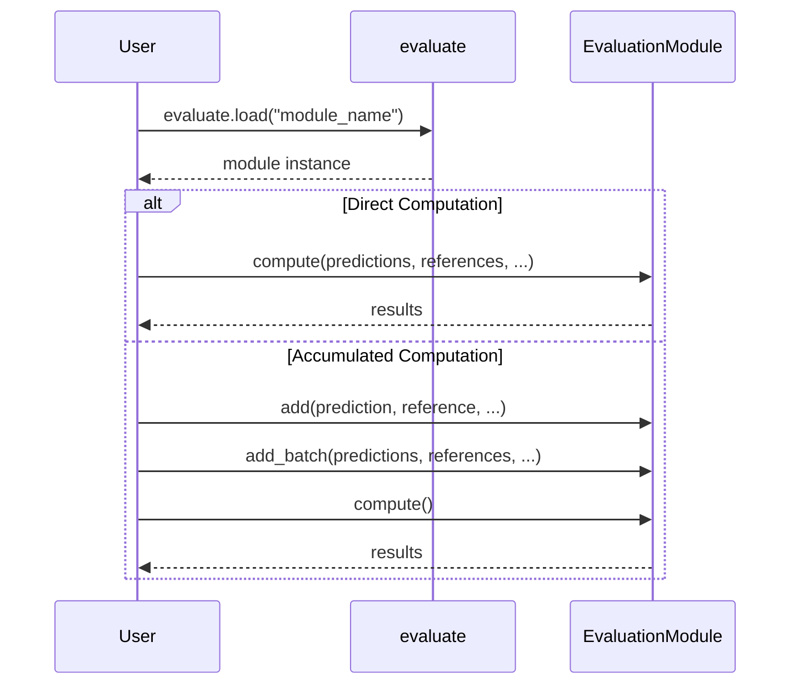

Sources: [README.md:64-69](), [docs/source/package_reference/loading_methods.mdx:1-12]()

## Metrics

Metrics are evaluation modules that measure the performance of a model on a given dataset. They typically compare model predictions against ground truth references to calculate performance scores.

| Metric Type | Description | Examples |
|-------------|-------------|----------|
| Generic | Applicable to many tasks | accuracy, precision, recall, F1 |
| Task-specific | Designed for particular ML tasks | BLEU (translation), ROUGE (summarization) |
| Dataset-specific | Tailored for specific benchmarks | GLUE, SQuAD |

### Example: Using the Accuracy Metric

```python
# Load the accuracy metric
accuracy = evaluate.load("accuracy")

# Compute accuracy directly
results = accuracy.compute(predictions=[0, 1, 1, 0], references=[0, 1, 0, 1])
# {'accuracy': 0.75}

# Or use add_batch and compute
accuracy.add_batch(predictions=[0, 1], references=[0, 1])
accuracy.add_batch(predictions=[1, 0], references=[0, 1])
results = accuracy.compute()
# {'accuracy': 0.75}
```

Sources: [README.md:35](), [docs/source/types_of_evaluations.mdx:8-15](), [docs/source/choosing_a_metric.mdx:8-63]()

## Comparisons

Comparisons are evaluation modules that analyze differences between two or more models. Rather than measuring absolute performance, they quantify the relative difference or statistical significance of performance variations.

### Example: McNemar Test

The McNemar test is a statistical test that compares the predictions of two models to determine if there's a significant difference between them:

```python
# Load the McNemar comparison
mcnemar = evaluate.load("mcnemar")

# Compare two model predictions on the same test set
results = mcnemar.compute(
    predictions_a=[0, 0, 1, 1], 
    predictions_b=[0, 1, 1, 0],
    references=[0, 0, 1, 1]
)
# Returns p-value indicating significance of differences
```

Sources: [docs/source/types_of_evaluations.mdx:17-23](), [README.md:36]()

## Measurements

Measurements are evaluation modules that provide insights about datasets or model outputs without necessarily comparing against a ground truth. They can analyze properties like text length, toxicity, or perplexity.

### Common Measurement Types

| Measurement | Purpose | Example Use |
|-------------|---------|-------------|
| Text Analysis | Analyze basic text properties | word_length, duplicate_detection |
| Content Quality | Assess generated text quality | toxicity, perplexity |
| Dataset Analysis | Examine dataset characteristics | class_distribution, data_statistics |

Sources: [docs/source/types_of_evaluations.mdx:25-33](), [README.md:36]()

## Combined Evaluations

The `evaluate` library allows you to combine multiple evaluation modules to run them together. This is useful when you want to evaluate a model using several metrics at once.

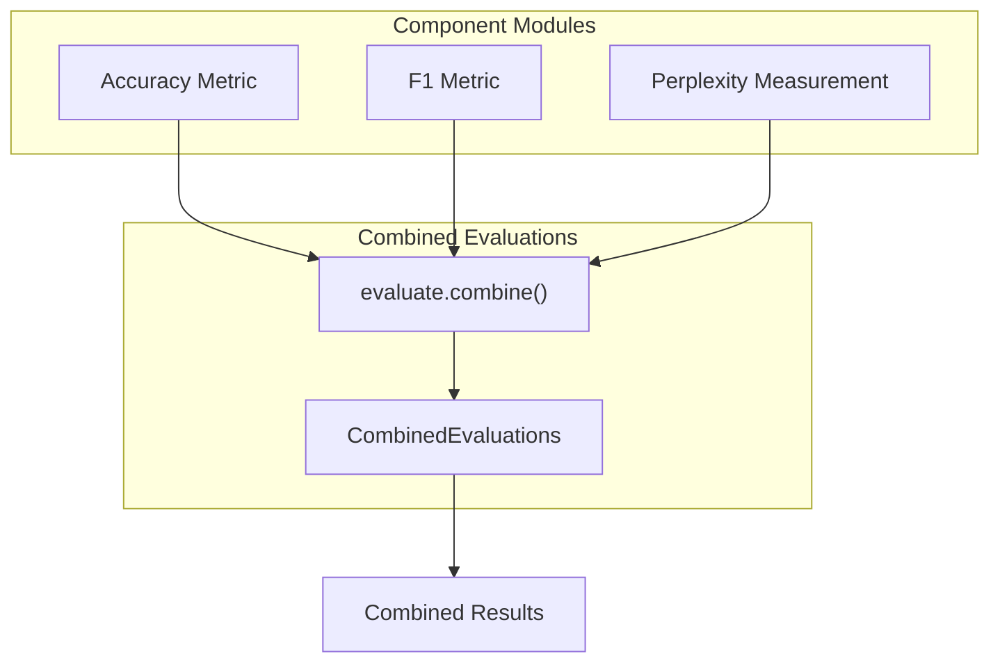

### Example: Using Combined Evaluations

```python
from evaluate import load, combine

# Load individual metrics
accuracy = load("accuracy")
f1 = load("f1")

# Combine them
combined = combine([accuracy, f1])

# Compute all metrics at once
results = combined.compute(predictions=[0, 1, 1, 0], references=[0, 1, 0, 1])
# {'accuracy': 0.75, 'f1': 0.67}
```

Sources: [docs/source/package_reference/main_classes.mdx:27-33]()

## Loading Mechanism

The `evaluate` library supports loading evaluation modules from different sources, including the Hugging Face Hub and local files. The loading system automatically handles caching to improve performance.

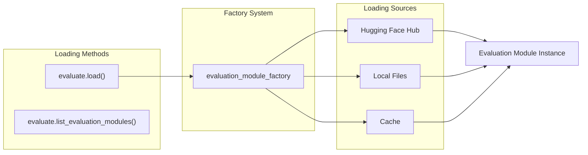

Sources: [README.md:66](), [docs/source/package_reference/loading_methods.mdx:1-12]()

## Key Benefits of the Evaluate Library

- **Standardized Interface**: Consistent API across different types of evaluations
- **Flexibility**: Support for various input formats and ML frameworks
- **Extensibility**: Easy to create and share custom evaluation modules
- **Documentation**: Detailed metric cards explaining each evaluation module's purpose, limitations, and usage
- **Caching**: Efficient storage and retrieval of evaluation data
- **Hub Integration**: Access to community-contributed evaluation modules

Sources: [README.md:31-49]()

---

# Page: Installation and Setup

# Installation and Setup

<details>
<summary>Relevant source files</summary>

The following files were used as context for generating this wiki page:

- [README.md](README.md)
- [docs/source/creating_and_sharing.mdx](docs/source/creating_and_sharing.mdx)
- [docs/source/transformers_integrations.mdx](docs/source/transformers_integrations.mdx)
- [docs/source/types_of_evaluations.mdx](docs/source/types_of_evaluations.mdx)
- [setup.py](setup.py)

</details>


## Purpose and Scope

This page documents the installation process, dependency requirements, and initial configuration for the evaluate library. It covers standard installation via pip, development installation from source, Python version requirements, and the various optional dependency groups available for extended functionality.

For information about creating custom evaluation modules, see [Creating Custom Metrics](#9.1). For details on the Hub integration and CI/CD pipeline, see [Hub Integration](#9.2).

---

## Python Version Requirements

The evaluate library requires **Python 3.8.0 or higher**. This requirement is specified in [setup.py:143]() and enforced during installation.

**Supported Python versions:**
- Python 3.8
- Python 3.9  
- Python 3.10

Sources: [setup.py:143-155]()

---

## Installation Methods

### Standard Installation via pip

The recommended installation method is via pip, which installs the library with core dependencies from PyPI:

```bash
pip install evaluate
```

This command installs the `evaluate` package and all required dependencies listed in `REQUIRED_PKGS`. The package should be installed in a virtual environment (venv or conda) to avoid dependency conflicts.

**Virtual environment setup:**
```bash
# Using venv
python -m venv evaluate-env
source evaluate-env/bin/activate  # On Windows: evaluate-env\Scripts\activate

# Using conda
conda create -n evaluate-env python=3.9
conda activate evaluate-env

# Install evaluate
pip install evaluate
```

### Installation with Optional Extras

The library provides several optional dependency groups that can be installed based on your use case:

```bash
# For creating new evaluation modules
pip install evaluate[template]

# For using task-specific evaluators
pip install evaluate[evaluator]

# For TensorFlow support
pip install evaluate[tensorflow]

# For PyTorch support
pip install evaluate[torch]

# For development (includes testing and quality tools)
pip install evaluate[dev]

# Multiple extras can be combined
pip install evaluate[template,evaluator,torch]
```

### Development Installation from Source

For contributing to the library or working with the latest development version:

```bash
# Clone the repository
git clone https://github.com/huggingface/evaluate.git
cd evaluate

# Install in editable mode with development dependencies
pip install -e ".[dev]"
```

The `-e` flag installs the package in editable mode, allowing code changes to take effect without reinstallation.

Sources: [README.md:52-60](), [README.md:72-79](), [setup.py:127-159]()

---

## Dependency Architecture

### Installation Flow Diagram

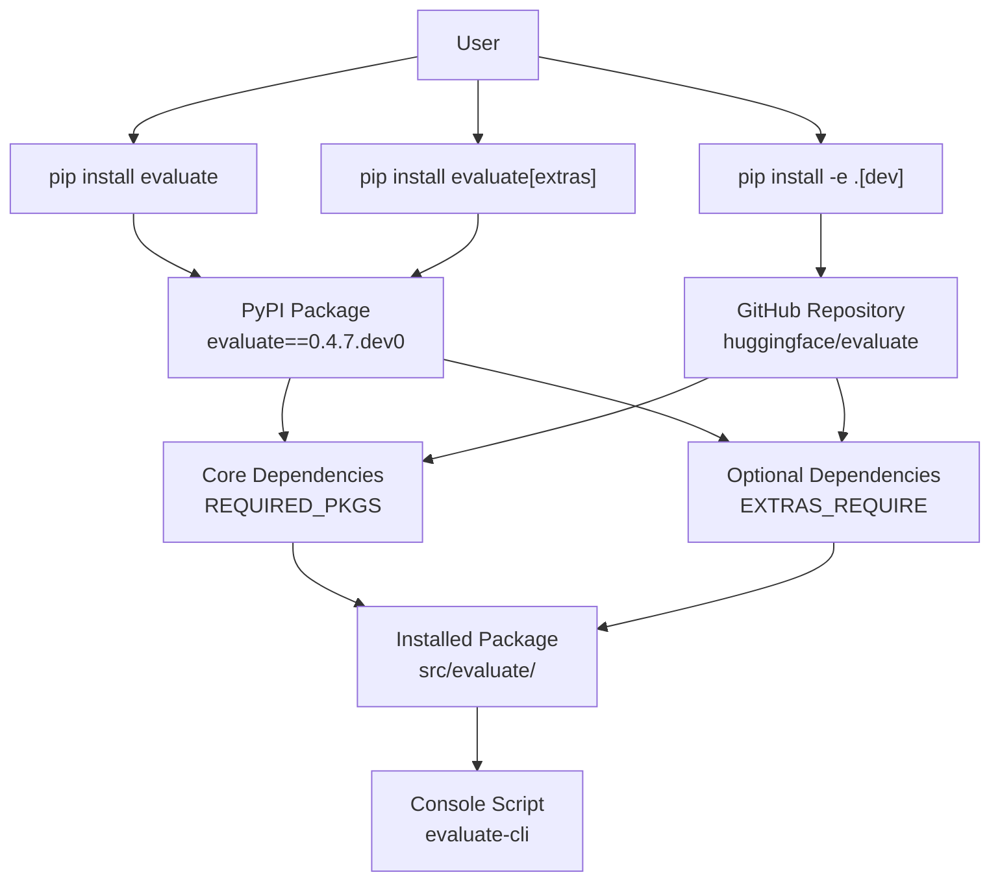

### Dependency Groups

```mermaid
graph TB
    subgraph "Core Installation"
        Core["evaluate package"]
        CoreDeps["Core Dependencies"]
        
        Core --> CoreDeps
    end
    
    subgraph "Core Dependencies - Always Installed"
        Datasets["datasets>=2.0.0<br/>Backend & Features"]
        Hub["huggingface-hub>=0.7.0<br/>Hub integration"]
        Numpy["numpy>=1.17<br/>Array operations"]
        Fsspec["fsspec[http]>=2021.05.0<br/>File system abstraction"]
        Multiprocess["multiprocess<br/>Distributed evaluation"]
        Tqdm["tqdm>=4.62.1<br/>Progress bars"]
        Dill["dill<br/>Smart caching"]
        Pandas["pandas<br/>Arrow performance"]
        Requests["requests>=2.19.0<br/>HTTP downloads"]
        Xxhash["xxhash<br/>Fast hashing"]
        Packaging["packaging<br/>Version comparison"]
    end
    
    subgraph "Optional Extras"
        Template["template extra<br/>cookiecutter, gradio>=3.0.0"]
        Evaluator["evaluator extra<br/>transformers, scipy>=1.7.1"]
        TF["tensorflow extra<br/>tensorflow>=2.2.0"]
        Torch["torch extra<br/>torch"]
        Dev["dev extra<br/>tests + quality tools"]
    end
    
    CoreDeps --> Datasets
    CoreDeps --> Hub
    CoreDeps --> Numpy
    CoreDeps --> Fsspec
    CoreDeps --> Multiprocess
    CoreDeps --> Tqdm
    CoreDeps --> Dill
    CoreDeps --> Pandas
    CoreDeps --> Requests
    CoreDeps --> Xxhash
    CoreDeps --> Packaging
    
    Core -.-> Template
    Core -.-> Evaluator
    Core -.-> TF
    Core -.-> Torch
    Core -.-> Dev
```

Sources: [setup.py:31-125]()

---

## Core Dependencies

The following packages are **always installed** with evaluate and enable core functionality:

| Package | Version Constraint | Purpose |
|---------|-------------------|---------|
| `datasets` | `>=2.0.0` | Backend for data handling and Apache Arrow integration |
| `numpy` | `>=1.17` | Array operations and random number generation |
| `dill` | (any) | Smart caching for dataset processing |
| `pandas` | (any) | Performance gains with Apache Arrow |
| `requests` | `>=2.19.0` | Downloading datasets over HTTPS |
| `tqdm` | `>=4.62.1` | Progress bars for downloads and processing |
| `xxhash` | (any) | Fast hashing for cache keys |
| `multiprocess` | (any) | Better multiprocessing support |
| `fsspec[http]` | `>=2021.05.0` | Abstract file system for local/remote storage |
| `huggingface-hub` | `>=0.7.0` | Hub API for module discovery and download |
| `packaging` | (any) | Version comparison utilities |
| `importlib_metadata` | (any) | Metadata access for Python <3.8 |

**Key dependency relationships:**

- **datasets**: Provides the backend architecture that evaluate builds upon, including Apache Arrow tables for efficient caching and the `Features` system for data validation. See [Core Architecture](#2) for details on how evaluate extends datasets functionality.

- **huggingface-hub**: Enables the module loading system to discover and download evaluation modules from the Hub. See [Module Loading System](#2.1) for the factory pattern implementation.

- **multiprocess + fsspec + dill**: Together enable distributed evaluation across multiple processes with shared caching. See [Caching and Distributed Computation](#2.3) for implementation details.

Sources: [setup.py:31-57]()

---

## Optional Dependency Groups

Optional extras extend evaluate's functionality for specific use cases:

### Template Extra (`pip install evaluate[template]`)

Required for creating new evaluation modules using the CLI scaffolding tool:

| Package | Version Constraint | Purpose |
|---------|-------------------|---------|
| `cookiecutter` | (any) | Template generation for new modules |
| `gradio` | `>=3.0.0` | Interactive widgets for Hub Spaces |

**When to use:** Install this extra if you plan to create custom metrics using `evaluate-cli create`. See [Command-line Interface](#8) for usage details.

### Evaluator Extra (`pip install evaluate[evaluator]`)

Required for using high-level task-specific evaluators:

| Package | Version Constraint | Purpose |
|---------|-------------------|---------|
| `transformers` | (any) | Pipeline integration for model inference |
| `scipy` | `>=1.7.1` | Bootstrap computations for confidence intervals |

**When to use:** Install this extra to use the `Evaluator` classes that automate the full evaluation pipeline. See [Evaluator System](#3) for implementation details.

### Framework Extras

Support for specific ML frameworks:

| Extra | Packages | Purpose |
|-------|----------|---------|
| `tensorflow` | `tensorflow>=2.2.0,!=2.6.0,!=2.6.1` | TensorFlow model support |
| `tensorflow_gpu` | `tensorflow-gpu>=2.2.0,!=2.6.0,!=2.6.1` | TensorFlow with GPU support |
| `torch` | `torch` | PyTorch model support |

**Note:** These are **optional** because the core library is framework-agnostic. Only install the frameworks you need for your specific evaluation tasks. See [Integration with ML Frameworks](#7) for usage patterns.

### Development Extras

| Extra | Contents | Purpose |
|-------|----------|---------|
| `dev` | `tests` + `quality` | Full development environment |
| `tests` | See test dependencies table below | Running test suite |
| `quality` | `black~=22.0`, `flake8>=3.8.3`, `isort>=5.0.0`, `pyyaml>=5.3.1` | Code formatting and linting |
| `docs` | `s3fs` | Building documentation |

### Test Dependencies

The test suite requires numerous dependencies for testing specific metrics:

| Category | Packages |
|----------|----------|
| Test frameworks | `pytest`, `pytest-datadir`, `pytest-xdist`, `absl-py` |
| ML frameworks | `tensorflow>=2.3,<=2.10`, `torch`, `accelerate` |
| Metric-specific | `bert_score>=0.3.6`, `rouge_score>=0.1.2`, `sacrebleu`, `sacremoses`, `seqeval`, `scikit-learn`, `jiwer`, `sentencepiece`, `mauve-text`, `trectools` |
| Text processing | `nltk`, `charcut>=1.1.1`, `cer>=1.2.0`, `unidecode>=1.3.4` |
| Utilities | `scipy>=1.10.0`, `toml>=0.10.1`, `requests_file>=1.5.1`, `tldextract>=3.1.0`, `texttable>=1.6.3`, `Werkzeug>=1.0.1`, `six~=1.15.0` |

**Note:** Version constraints like `tensorflow>=2.3,!=2.6.0,!=2.6.1, <=2.10` exclude specific buggy versions while maintaining compatibility.

Sources: [setup.py:59-125]()

---

## Package Structure and Entry Points

After installation, the evaluate package is available with the following structure:

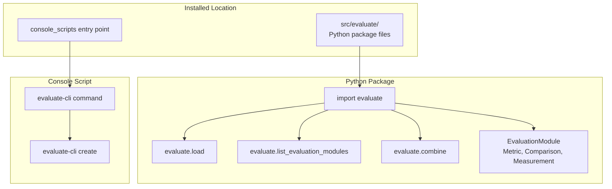

**Console script entry point:** The installation creates a `evaluate-cli` command available in your shell, defined in [setup.py:140]():

```python
entry_points={"console_scripts": ["evaluate-cli=evaluate.commands.evaluate_cli:main"]}
```

**Package directory:** The source code is installed from the `src/` directory, specified in [setup.py:138]():

```python
package_dir={"": "src"}
```

Sources: [setup.py:138-140]()

---

## Environment Configuration

### Environment Variables

The evaluate library respects the following environment variables:

| Variable | Values | Default | Purpose |
|----------|--------|---------|---------|
| `EVALUATE_VERBOSITY` | `debug`, `info`, `warning`, `error`, `critical` | `warning` | Controls logging verbosity globally |
| `HF_HOME` | Path | `~/.cache/huggingface` | Base directory for Hub cache |
| `HF_DATASETS_CACHE` | Path | `$HF_HOME/datasets` | Cache directory for datasets |

**Setting verbosity:**

```bash
# Via environment variable
export EVALUATE_VERBOSITY=info
python my_script.py

# Or inline
EVALUATE_VERBOSITY=error python my_script.py
```

**Programmatic configuration:**

```python
import evaluate

# Set verbosity level
evaluate.logging.set_verbosity_info()
evaluate.logging.set_verbosity_warning()
evaluate.logging.set_verbosity_debug()

# Get current verbosity
level = evaluate.logging.get_verbosity()

# Control progress bars
evaluate.logging.disable_progress_bar()
evaluate.logging.enable_progress_bar()
```

### Cache Directory Structure

After first use, evaluate creates a cache directory structure:

```
~/.cache/huggingface/
└── modules/
    ├── evaluate_modules/
    │   ├── metrics/
    │   │   └── accuracy/
    │   │       └── <hash>/
    │   │           ├── accuracy.py
    │   │           └── __init__.py
    │   ├── comparisons/
    │   └── measurements/
    └── datasets_modules/
```

The hash-based directory structure enables version coexistence for the same module. See [Module Loading System](#2.1) for details on the caching mechanism.

Sources: [docs/source/package_reference/logging_methods.mdx:1-90](), [README.md:46-49]()

---

## Verification of Installation

### Basic Import Test

Verify the installation by importing the library and checking the version:

```python
import evaluate

# Check version
print(evaluate.__version__)

# List available evaluation modules
modules = evaluate.list_evaluation_modules()
print(f"Found {len(modules)} modules")

# Load a simple metric to verify functionality
accuracy = evaluate.load("accuracy")
results = accuracy.compute(predictions=[1, 0, 1], references=[1, 0, 0])
print(results)  # {'accuracy': 0.6666666666666666}
```

### Testing Core Functionality

```python
import evaluate

# Test module loading from Hub
metric = evaluate.load("accuracy")
print(f"Loaded metric: {metric.name}")

# Test basic computation
predictions = [0, 1, 2, 0, 1, 2]
references = [0, 1, 1, 0, 1, 1]
results = metric.compute(predictions=predictions, references=references)
print(f"Accuracy: {results['accuracy']:.3f}")

# Test incremental addition
metric = evaluate.load("accuracy")
metric.add_batch(predictions=[0, 1], references=[0, 1])
metric.add_batch(predictions=[2, 0], references=[1, 0])
results = metric.compute()
print(f"Incremental accuracy: {results['accuracy']:.3f}")
```

### Testing Optional Functionality

If you installed optional extras, verify they work:

```python
# Test evaluator extra
try:
    from evaluate import evaluator
    task_evaluator = evaluator("text-classification")
    print("✓ Evaluator functionality available")
except ImportError as e:
    print(f"✗ Evaluator not available: {e}")

# Test template extra
try:
    import cookiecutter
    import gradio
    print("✓ Template creation tools available")
except ImportError as e:
    print(f"✗ Template tools not available: {e}")
```

### CLI Verification

Verify the command-line interface is installed:

```bash
# Check CLI is available
evaluate-cli --help

# List available commands
evaluate-cli create --help
```

Expected output shows the available commands and options for creating new evaluation modules.

Sources: [README.md:62-68](), [README.md:70-79]()

---

## Common Installation Issues

### Issue: Version Conflicts with TensorFlow

**Problem:** TensorFlow requires `numpy<2.0.0` but other packages may require newer versions.

**Solution:** Install with specific constraints:
```bash
pip install evaluate "numpy<2.0.0" "tensorflow>=2.3,<=2.10"
```

### Issue: Missing Optional Dependencies

**Problem:** `ImportError` when using evaluators or creating templates.

**Solution:** Install the appropriate extra:
```bash
pip install evaluate[evaluator]  # For evaluators
pip install evaluate[template]   # For module creation
```

### Issue: Hub Connection Errors

**Problem:** Cannot download modules from Hugging Face Hub.

**Solution:** Check network connectivity and Hub status. Configure proxy if needed:
```python
import os
os.environ['HTTP_PROXY'] = 'http://proxy.example.com:8080'
os.environ['HTTPS_PROXY'] = 'http://proxy.example.com:8080'
```

### Issue: Cache Permission Errors

**Problem:** Permission denied when writing to cache directory.

**Solution:** Set a custom cache directory:
```python
import os
os.environ['HF_HOME'] = '/path/to/writable/directory'
```

Sources: [setup.py:82-107]()

---

## Dependency Update Policy

The library follows semantic versioning and maintains backward compatibility within major versions. Dependency constraints are set to:

1. **Minimum required versions** for core functionality
2. **Exclusion of known buggy versions** (e.g., `!=2.6.0,!=2.6.1` for TensorFlow)
3. **Maximum versions** where breaking changes are known (e.g., `<=2.10` for TensorFlow)

**Version specification in setup.py:**
```python
version="0.4.7.dev0"  # Format: MAJOR.MINOR.PATCH.dev0
```

The `.dev0` suffix indicates development versions between releases. Release versions follow the pattern `x.y.z` without additional suffixes.

Sources: [setup.py:1-24](), [setup.py:129]()

---

## Next Steps

After installation:

1. **Explore available modules:** Use `evaluate.list_evaluation_modules()` to discover metrics, comparisons, and measurements
2. **Load and use metrics:** See [Key Concepts](#1.1) for understanding the three module types
3. **Automated evaluation:** See [Evaluator System](#3) for using high-level evaluation pipelines
4. **Create custom modules:** See [Creating Custom Metrics](#9.1) for implementing your own evaluation logic
5. **Integration patterns:** See [Integration with ML Frameworks](#7) for using evaluate with your training workflows

Sources: [README.md:31-49](), [README.md:62-80]()

---

# Page: Package Structure and Entrypoints

# Package Structure and Entrypoints

<details>
<summary>Relevant source files</summary>

The following files were used as context for generating this wiki page:

- [README.md](README.md)
- [docs/source/creating_and_sharing.mdx](docs/source/creating_and_sharing.mdx)
- [docs/source/transformers_integrations.mdx](docs/source/transformers_integrations.mdx)
- [docs/source/types_of_evaluations.mdx](docs/source/types_of_evaluations.mdx)
- [setup.py](setup.py)

</details>


This document describes the organizational structure of the `evaluate` package, its main entry points for users, dependency management strategy, and how to interact with the library through both Python API and command-line interface. For details on how modules are loaded from various sources, see [Module Loading System](#3.1). For information on creating custom modules, see [Creating Custom Modules](#10.1).

---

## Package Organization

The `evaluate` library follows a standard Python package structure with all source code located in the `src` directory:

```
evaluate/
├── src/
│   └── evaluate/
│       ├── __init__.py              # Main API exports
│       ├── loading.py               # Module loading functions
│       ├── evaluation_suite.py      # EvaluationSuite implementation
│       ├── evaluator/               # Task-specific evaluators
│       ├── module.py                # EvaluationModule base class
│       ├── utils/                   # Utility functions
│       ├── config.py                # Configuration management
│       ├── info.py                  # Module metadata classes
│       ├── commands/                # CLI implementation
│       │   └── evaluate_cli.py      # Command-line tool
│       └── template/                # Module templates for creation
├── setup.py                         # Package configuration
├── requirements.txt                 # Core dependencies
└── README.md                        # Package documentation
```

The package is registered as `"evaluate"` on PyPI and installed via `pip install evaluate`. All public APIs are accessible through the top-level `evaluate` namespace.

**Sources:** [setup.py:138-139]()

---

## Main Python API Entrypoints

The library provides three primary functions that constitute the core user-facing API. These functions handle 95% of evaluation use cases:

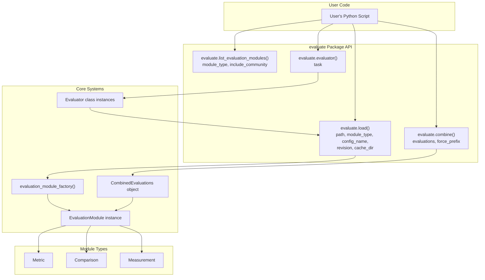

**Sources:** [README.md:64-68]()

### evaluate.load()

The primary entrypoint for instantiating evaluation modules. This function handles module discovery, downloading, caching, and instantiation:

**Function Signature:**
```python
evaluate.load(
    path: str,
    module_type: Optional[str] = None,
    config_name: Optional[str] = None,
    revision: Optional[str] = None,
    cache_dir: Optional[str] = None,
    **kwargs
) -> EvaluationModule
```

**Parameters:**
- `path`: Module identifier (e.g., `"accuracy"`, `"rouge"`, `"lvwerra/my_metric"`) or local file path
- `module_type`: One of `"metric"`, `"comparison"`, or `"measurement"` (auto-detected if omitted)
- `config_name`: Specific configuration variant (e.g., `"bleurt-base-128"` for BLEURT metric)
- `revision`: Git revision (commit hash, tag, or branch) for Hub modules
- `cache_dir`: Custom cache directory (defaults to `~/.cache/huggingface/modules`)

**Usage Example:**
```python
import evaluate

# Load from Hub
accuracy = evaluate.load("accuracy")
rouge = evaluate.load("rouge")

# Load specific configuration
bleurt = evaluate.load("bleurt", config_name="bleurt-base-128")

# Load from Hub with user namespace
custom_metric = evaluate.load("username/custom_metric")

# Load from local path
local_metric = evaluate.load("/path/to/metric.py")
```

The function delegates to `evaluation_module_factory()` which implements the multi-source resolution strategy (Hub, local, cache).

**Sources:** [README.md:67](), [setup.py:31-57]()

### evaluate.evaluator()

A factory function that returns task-specific evaluator instances. This high-level abstraction automates the entire evaluation pipeline from data loading to metric computation:

**Function Signature:**
```python
evaluate.evaluator(task: str) -> BaseEvaluator
```

**Supported Tasks:**
- `"text-classification"`
- `"token-classification"`
- `"question-answering"`
- `"image-classification"`
- `"text-generation"`
- `"text2text-generation"`
- `"summarization"`
- `"translation"`
- `"automatic-speech-recognition"`
- `"audio-classification"`

**Usage Example:**
```python
import evaluate

# Initialize task-specific evaluator
evaluator = evaluate.evaluator("text-classification")

# Run automated evaluation
results = evaluator.compute(
    model_or_pipeline="distilbert-base-uncased-finetuned-sst-2-english",
    data="imdb",
    metric="accuracy",
    label_mapping={"NEGATIVE": 0, "POSITIVE": 1}
)
# Returns: {'accuracy': 0.925, 'latency_in_seconds': 12.34, ...}
```

Evaluators handle model loading, data preprocessing, batch inference, and metric computation. For detailed documentation of each evaluator, see [Task-Specific Evaluators](#4.1).

**Sources:** [README.md:64-68](), [setup.py:66-70]()

### evaluate.combine()

Combines multiple evaluation modules into a single object that computes all metrics simultaneously:

**Function Signature:**
```python
evaluate.combine(
    evaluations: List[Union[str, EvaluationModule]],
    force_prefix: bool = False
) -> CombinedEvaluations
```

**Parameters:**
- `evaluations`: List of module identifiers or pre-loaded module instances
- `force_prefix`: If `True`, prefixes all metric names with module name (prevents key collisions)

**Usage Example:**
```python
import evaluate

# Combine multiple metrics
combined = evaluate.combine(["accuracy", "f1", "precision", "recall"])

# Or combine pre-loaded modules
accuracy = evaluate.load("accuracy")
f1 = evaluate.load("f1")
combined = evaluate.combine([accuracy, f1])

# Compute all metrics at once
results = combined.compute(predictions=[0, 1, 0, 1], references=[0, 1, 1, 1])
# Returns: {'accuracy': 0.75, 'f1': 0.8, 'precision': 1.0, 'recall': 0.667}
```

The combined object implements the same `add()`, `add_batch()`, and `compute()` interface as individual modules, making it a drop-in replacement.

**Sources:** [README.md:64-68]()

### evaluate.list_evaluation_modules()

Discovery function that lists available evaluation modules from the Hub and local cache:

**Function Signature:**
```python
evaluate.list_evaluation_modules(
    module_type: Optional[str] = None,
    include_community: bool = True
) -> List[str]
```

**Parameters:**
- `module_type`: Filter by `"metric"`, `"comparison"`, or `"measurement"`
- `include_community`: Include community-contributed modules from Hub

**Usage Example:**
```python
import evaluate

# List all metrics
metrics = evaluate.list_evaluation_modules(module_type="metric")
# Returns: ['accuracy', 'bleu', 'rouge', 'f1', 'precision', ...]

# List only canonical metrics (no community modules)
canonical = evaluate.list_evaluation_modules(
    module_type="metric", 
    include_community=False
)

# List all module types
all_modules = evaluate.list_evaluation_modules()
```

**Sources:** [README.md:66]()

---

## Command-Line Interface (evaluate-cli)

The `evaluate-cli` tool provides command-line access to module creation and management functionality. It is installed as a console script entry point:

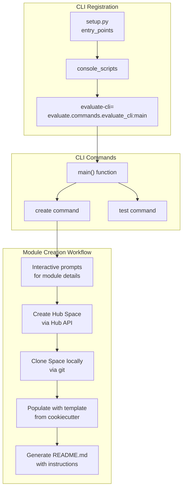

**Sources:** [setup.py:140](), [docs/source/creating_and_sharing.mdx:20-25]()

### CLI Installation

The CLI is automatically installed when you install the base package, but module creation requires additional dependencies:

```bash
# Install base package (CLI available but limited)
pip install evaluate

# Install with template creation support
pip install evaluate[template]
```

The `template` extra installs `cookiecutter` (for template generation) and `gradio>=3.0.0` (for interactive widgets).

**Sources:** [setup.py:59-64](), [docs/source/creating_and_sharing.mdx:6-9]()

### evaluate-cli create

Creates a new evaluation module by setting up a Hub Space with a pre-configured template:

**Command Syntax:**
```bash
evaluate-cli create "Module Name" --module_type [metric|comparison|measurement]
```

**Example:**
```bash
evaluate-cli create "My Custom Metric" --module_type "metric"
```

**What This Does:**

1. **Authenticates** with Hugging Face Hub (requires `huggingface-cli login`)
2. **Creates Space** on Hub with URL `https://huggingface.co/spaces/username/my_custom_metric`
3. **Clones locally** to current directory as `my_custom_metric/`
4. **Generates template files**:
   - `my_custom_metric.py` - Module implementation skeleton
   - `README.md` - Documentation template with examples
   - `requirements.txt` - Dependency specification
   - `app.py` - Gradio widget for interactive testing
5. **Displays instructions** for implementing the module

**Template Structure:**

The generated module includes three required methods to implement:

```python
# Generated in my_custom_metric.py

class MyCustomMetric(evaluate.EvaluationModule):
    def _info(self):
        # Define module metadata, inputs, outputs
        return evaluate.EvaluationModuleInfo(...)
    
    def _download_and_prepare(self, dl_manager):
        # Download external resources (NLTK data, checkpoints)
        pass
    
    def _compute(self, predictions, references):
        # Core evaluation logic
        return {"my_custom_metric": score}
```

**Sources:** [docs/source/creating_and_sharing.mdx:17-28](), [README.md:72-79]()

---

## Dependency Management

The library follows a tiered dependency strategy: a minimal core for basic usage, with optional extras for advanced features:

```mermaid
graph TB
    subgraph "Installation Tiers"
        BASE["pip install evaluate<br/>(core dependencies)"]
        TEMPLATE["pip install evaluate[template]<br/>(+ cookiecutter, gradio)"]
        EVALUATOR["pip install evaluate[evaluator]<br/>(+ transformers, scipy)"]
        DEV["pip install evaluate[dev]<br/>(+ tests, quality)"]
        TESTS["pip install evaluate[tests]<br/>(+ all metric dependencies)"]
    end
    
    subgraph "Core Dependencies (REQUIRED_PKGS)"
        DATASETS["datasets>=2.0.0"]
        NUMPY["numpy>=1.17"]
        DILL["dill"]
        PANDAS["pandas"]
        REQUESTS["requests>=2.19.0"]
        TQDM["tqdm>=4.62.1"]
        XXHASH["xxhash"]
        MULTIPROCESS["multiprocess"]
        FSSPEC["fsspec[http]>=2021.05.0"]
        HUB["huggingface-hub>=0.7.0"]
        PACKAGING["packaging"]
    end
    
    subgraph "Optional Dependencies"
        COOKIECUTTER["cookiecutter"]
        GRADIO["gradio>=3.0.0"]
        TRANSFORMERS["transformers"]
        SCIPY["scipy>=1.7.1"]
        SKLEARN["scikit-learn"]
        NLTK["nltk"]
        ROUGE["rouge_score"]
        SACREBLEU["sacrebleu"]
        BERTSCORE["bert_score"]
    end
    
    BASE --> DATASETS
    BASE --> NUMPY
    BASE --> DILL
    BASE --> PANDAS
    BASE --> REQUESTS
    BASE --> TQDM
    BASE --> XXHASH
    BASE --> MULTIPROCESS
    BASE --> FSSPEC
    BASE --> HUB
    BASE --> PACKAGING
    
    TEMPLATE --> BASE
    TEMPLATE --> COOKIECUTTER
    TEMPLATE --> GRADIO
    
    EVALUATOR --> BASE
    EVALUATOR --> TRANSFORMERS
    EVALUATOR --> SCIPY
    
    TESTS --> SKLEARN
    TESTS --> NLTK
    TESTS --> ROUGE
    TESTS --> SACREBLEU
    TESTS --> BERTSCORE
```

**Sources:** [setup.py:31-125]()

### Core Dependencies (Always Installed)

These packages are required for basic module loading and computation:

| Package | Version | Purpose |
|---------|---------|---------|
| `datasets` | `>=2.0.0` | Data backend for evaluation modules |
| `numpy` | `>=1.17` | Array operations, random generator for shuffling |
| `dill` | any | Serialization for caching computation state |
| `pandas` | any | Performance gains with Apache Arrow backend |
| `requests` | `>=2.19.0` | Downloading modules/data over HTTPS |
| `tqdm` | `>=4.62.1` | Progress bars for downloads and computation |
| `xxhash` | any | Fast hashing for cache keys |
| `multiprocess` | any | Better multiprocessing support than stdlib |
| `fsspec[http]` | `>=2021.05.0` | Filesystem abstraction for saving datasets |
| `huggingface-hub` | `>=0.7.0` | Hub API access for module discovery/download |
| `packaging` | any | Version comparison utilities |

**Sources:** [setup.py:31-57]()

### Optional Dependencies (Install as Needed)

Optional features require additional packages specified as extras:

#### Template Creation (`[template]`)
```bash
pip install evaluate[template]
```
- `cookiecutter`: Template generation for new modules
- `gradio>=3.0.0`: Interactive widgets in module Spaces

**Sources:** [setup.py:59-64]()

#### Evaluator System (`[evaluator]`)
```bash
pip install evaluate[evaluator]
```
- `transformers`: Model loading and inference pipelines
- `scipy>=1.7.1`: Bootstrap resampling for confidence intervals

**Sources:** [setup.py:66-70]()

#### Metric-Specific Dependencies

Individual metrics may require additional packages specified in their `requirements.txt` files. Common dependencies include:

| Package | Used By | Purpose |
|---------|---------|---------|
| `scikit-learn` | accuracy, f1, precision, recall | Classic ML metrics |
| `nltk` | meteor, nist | Tokenization, linguistic resources |
| `rouge_score>=0.1.2` | rouge | ROUGE metric implementation |
| `sacrebleu` | sacrebleu | BLEU with standardized tokenization |
| `seqeval` | seqeval | NER/POS tagging evaluation |
| `bert_score>=0.3.6` | bertscore | Semantic similarity via BERT |
| `jiwer` | wer, cer | Word/character error rate for ASR |

These are NOT installed by default. When you load a metric that requires them, the library will:
1. Attempt to import the package
2. If missing, provide an error message with installation instructions
3. Some modules may add them to their Space's `requirements.txt` for automatic installation

**Sources:** [setup.py:72-107](), [docs/source/creating_and_sharing.mdx:84-86]()

#### Development Tools (`[dev]`)
```bash
pip install evaluate[dev]
```
Installs both testing and code quality dependencies:
- `pytest`, `pytest-datadir`, `pytest-xdist`: Testing framework
- `black~=22.0`: Code formatting
- `flake8>=3.8.3`: Linting
- `isort>=5.0.0`: Import sorting
- `pyyaml>=5.3.1`: Configuration parsing

**Sources:** [setup.py:109-116]()

---

## Module Type Organization

The library supports three module types, each serving a distinct evaluation purpose. These types are distinguished at loading time via the `module_type` parameter:

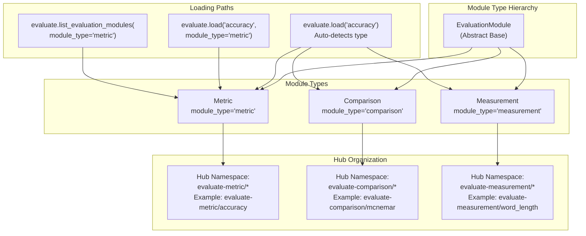

**Sources:** [docs/source/types_of_evaluations.mdx:1-35]()

### Type Characteristics

| Aspect | Metric | Comparison | Measurement |
|--------|--------|------------|-------------|
| **Purpose** | Measure model performance | Compare two models statistically | Analyze data/predictions |
| **Requires References** | Yes (usually) | Yes | No |
| **Requires Predictions** | Yes | Yes | No (or predictions only) |
| **Output** | Scalar score(s) | Statistical significance | Descriptive statistics |
| **Example Usage** | Model evaluation on test set | A/B testing between models | Dataset characterization |
| **Count** | ~70 implementations | ~5 implementations | ~15 implementations |

**Sources:** [docs/source/types_of_evaluations.mdx:7-33]()

### Auto-Detection Behavior

When `module_type` is not specified, `evaluate.load()` attempts to detect the type by:

1. **Checking canonical names** in each namespace (`evaluate-metric/`, `evaluate-comparison/`, `evaluate-measurement/`)
2. **Querying Hub API** for Space existence in each namespace
3. **Examining local cache** for previously loaded modules

If the module exists in multiple namespaces (unlikely), you must specify `module_type` explicitly to disambiguate.

**Example:**
```python
# Auto-detection (searches all namespaces)
metric = evaluate.load("accuracy")

# Explicit type (faster, no Hub query)
metric = evaluate.load("accuracy", module_type="metric")

# Community module (requires namespace)
custom = evaluate.load("username/my_module")  # Auto-detects type
custom = evaluate.load("username/my_module", module_type="metric")  # Explicit
```

---

## Integration Points

The package integrates with several external libraries to provide its functionality:

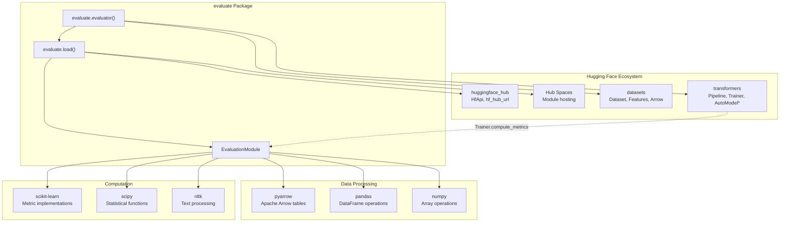

**Sources:** [setup.py:31-57](), [docs/source/transformers_integrations.mdx:1-132]()

### Hub Integration

All evaluation modules are stored as Spaces on the Hugging Face Hub:
- **Canonical metrics**: `https://huggingface.co/spaces/evaluate-metric/accuracy`
- **Community metrics**: `https://huggingface.co/spaces/username/metric_name`
- Each Space contains: module script, README, requirements.txt, Gradio app

The `huggingface-hub` library handles authentication, downloads, and Space creation.

### transformers Integration

The `transformers` library integrates with evaluate in two ways:

1. **Trainer.compute_metrics**: Pass a function that calls `evaluate.load()` and `compute()`
2. **Evaluator pipelines**: Use transformers `Pipeline` objects for inference

**Example:**
```python
import evaluate
from transformers import Trainer

metric = evaluate.load("accuracy")

def compute_metrics(eval_pred):
    logits, labels = eval_pred
    predictions = np.argmax(logits, axis=-1)
    return metric.compute(predictions=predictions, references=labels)

trainer = Trainer(..., compute_metrics=compute_metrics)
```

**Sources:** [docs/source/transformers_integrations.mdx:9-52]()

### datasets Integration

The `datasets` library provides:
- **Features schema**: Used in `EvaluationModuleInfo.features` for input validation
- **Arrow backend**: Evaluation modules store data in Arrow tables for memory efficiency
- **Dataset objects**: Evaluators accept `datasets.Dataset` as input

---

## Summary Table: API Surface

| Entry Point | Type | Purpose | Returns |
|-------------|------|---------|---------|
| `evaluate.load()` | Function | Load evaluation module | `EvaluationModule` instance |
| `evaluate.evaluator()` | Function | Get task-specific evaluator | `BaseEvaluator` subclass |
| `evaluate.combine()` | Function | Combine multiple modules | `CombinedEvaluations` object |
| `evaluate.list_evaluation_modules()` | Function | Discover available modules | `List[str]` |
| `evaluate-cli create` | CLI Command | Create new module template | N/A (side effect: Hub Space) |
| `module.compute()` | Method | Calculate evaluation results | `Dict[str, float]` |
| `module.add()` | Method | Add single example | `None` |
| `module.add_batch()` | Method | Add batch of examples | `None` |

**Sources:** [README.md:62-79]()

---

# Page: Core Architecture

# Core Architecture

<details>
<summary>Relevant source files</summary>

The following files were used as context for generating this wiki page:

- [src/evaluate/info.py](src/evaluate/info.py)
- [src/evaluate/inspect.py](src/evaluate/inspect.py)
- [src/evaluate/loading.py](src/evaluate/loading.py)
- [src/evaluate/module.py](src/evaluate/module.py)
- [src/evaluate/utils/file_utils.py](src/evaluate/utils/file_utils.py)
- [tests/test_file_utils.py](tests/test_file_utils.py)
- [tests/test_load.py](tests/test_load.py)
- [tests/test_metric.py](tests/test_metric.py)
- [tests/test_metric_common.py](tests/test_metric_common.py)

</details>


This document describes the internal architecture of the `evaluate` library, focusing on the system-level components and their interactions. It covers the factory-based module loading system, the base class hierarchy for evaluation modules, and the distributed computation mechanisms.

For information about using the library from a user perspective, see [Overview](#1). For details on task-specific automated evaluation, see [Evaluator System](#3). For information about individual metric implementations, see [Metrics](#4).

## System Overview

The Evaluate library is built around three core architectural components:

1. **Module Loading System** - A factory-based system for discovering and dynamically importing evaluation modules from multiple sources (Hub, local files, cache)
2. **Evaluation Module Base Classes** - Abstract base classes that define the lifecycle and interface for metrics, comparisons, and measurements
3. **Distributed Computation Infrastructure** - Apache Arrow-based caching and file-locking mechanisms that enable multi-process evaluation

**Architecture Overview**

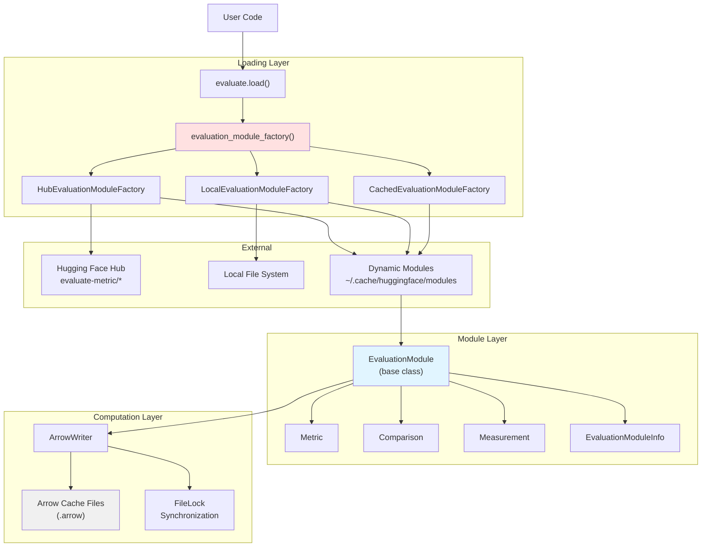

Sources: [src/evaluate/loading.py:1-687](), [src/evaluate/module.py:1-640](), [src/evaluate/info.py:1-158]()

## Loading Flow

The library uses a three-tier loading strategy to source evaluation modules:

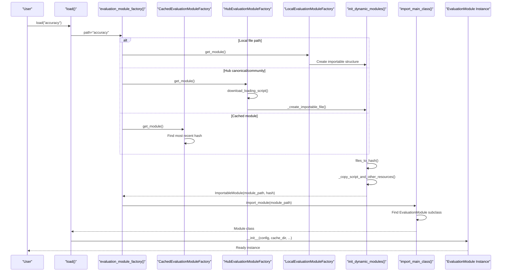

Sources: [src/evaluate/loading.py:689-754](), [src/evaluate/loading.py:559-687](), [src/evaluate/loading.py:74-88]()

## Module Class Hierarchy

All evaluation modules inherit from `EvaluationModule`, which provides a standardized interface:

```mermaid
classDiagram
    class EvaluationModuleInfoMixin {
        +EvaluationModuleInfo _module_info
        +name: str
        +description: str
        +features: Features
    }
    
    class EvaluationModule {
        +int num_process
        +int process_id
        +str cache_file_name
        +ArrowWriter writer
        +FileLock filelock
        +_info() EvaluationModuleInfo
        +add(prediction, reference)
        +add_batch(predictions, references)
        +compute(**kwargs) dict
        +_compute(**kwargs) dict
        #_init_writer()
        #_finalize()
        #_get_all_cache_files()
    }
    
    class Metric {
        +module_type: "metric"
    }
    
    class Comparison {
        +module_type: "comparison"
    }
    
    class Measurement {
        +module_type: "measurement"
    }
    
    EvaluationModuleInfoMixin <|-- EvaluationModule
    EvaluationModule <|-- Metric
    EvaluationModule <|-- Comparison
    EvaluationModule <|-- Measurement
```

Sources: [src/evaluate/module.py:83-148](), [src/evaluate/module.py:149-265](), [src/evaluate/info.py:34-119]()

## Lifecycle of an Evaluation

The `EvaluationModule` follows a specific lifecycle from instantiation to result computation:

| Phase | Method | Purpose | Process 0 | Process N |
|-------|--------|---------|-----------|-----------|
| **Initialization** | `__init__()` | Set up configuration, cache directories | Creates experiment lock | Waits for experiment lock |
| **Accumulation** | `add()` / `add_batch()` | Write predictions/references to Arrow cache | Writes to process-0 file | Writes to process-N file |
| **Writer Init** | `_init_writer()` | Create ArrowWriter with file lock | Creates writer | Creates writer |
| **Finalization** | `_finalize()` | Close writer, sync processes | Acquires all locks | Releases lock, returns None |
| **Aggregation** | `compute()` | Read all cache files, compute result | Reads all files, returns dict | Returns None |
| **Cleanup** | `compute()` (end) | Delete cache files, release locks | Deletes files | N/A |

Sources: [src/evaluate/module.py:180-252](), [src/evaluate/module.py:415-486](), [src/evaluate/module.py:381-413]()

**Detailed Lifecycle Diagram**

```mermaid
stateDiagram-v2
    [*] --> Uninitialized
    Uninitialized --> Initialized: __init__(num_process, process_id, experiment_id)
    
    state Initialized {
        [*] --> NoWriter
        NoWriter --> WriterInitialized: add() / add_batch()
        note right of WriterInitialized
            _init_writer() creates:
            - ArrowWriter
            - FileLock
            - rendez_vous_lock (process 0)
        end note
        WriterInitialized --> WriterInitialized: add() / add_batch()
    }
    
    Initialized --> Finalized: compute() calls _finalize()
    
    state Finalized {
        [*] --> WriterClosed
        WriterClosed --> LocksReleased: Process > 0 releases filelock
        WriterClosed --> AllLocksAcquired: Process 0 acquires all locks
        AllLocksAcquired --> DataRead: _get_all_cache_files()
    }
    
    Finalized --> Computed: _compute() on aggregated data
    Computed --> Cleaned: Delete cache files, release locks
    Cleaned --> [*]
```

Sources: [src/evaluate/module.py:625-665](), [src/evaluate/module.py:310-343]()

## Core Design Principles

### Factory Pattern for Module Loading

The library implements a factory pattern with three specialized factories:

- **`HubEvaluationModuleFactory`** - Downloads modules from Hugging Face Hub repositories (`evaluate-metric/*`, `evaluate-comparison/*`, `evaluate-measurement/*`)
- **`LocalEvaluationModuleFactory`** - Loads modules from local filesystem paths
- **`CachedEvaluationModuleFactory`** - Retrieves previously downloaded modules from cache

The `evaluation_module_factory()` function orchestrates these factories based on the input path format.

Sources: [src/evaluate/loading.py:395-398](), [src/evaluate/loading.py:400-441](), [src/evaluate/loading.py:443-509](), [src/evaluate/loading.py:511-557]()

### Hash-Based Module Versioning

Each evaluation module is stored in a hash-based directory structure:

```
~/.cache/huggingface/modules/
└── evaluate_modules/
    └── metrics/
        └── accuracy/
            ├── abc123def456.../  # hash of module code
            │   ├── __init__.py
            │   ├── accuracy.py
            │   └── accuracy.json  # metadata
            └── def789abc012.../  # different version
                └── ...
```

The hash is computed from all Python files using `files_to_hash()`, enabling:
- Multiple versions to coexist
- Automatic cache invalidation on code changes
- Reproducible evaluation across environments

Sources: [src/evaluate/loading.py:91-108](), [src/evaluate/loading.py:360-387]()

### Dynamic Module Import System

The library dynamically imports modules at runtime using `importlib`:

1. **Parse Imports** - `get_imports()` scans the module file for `import` statements and extracts dependencies
2. **Download Dependencies** - `_download_additional_modules()` fetches external imports (marked with `# From: URL`)
3. **Create Importable Structure** - `_create_importable_file()` copies the module into a proper Python package structure with `__init__.py` files
4. **Import Module** - `import_main_class()` dynamically imports the module and finds the `EvaluationModule` subclass

Sources: [src/evaluate/loading.py:139-209](), [src/evaluate/loading.py:212-271](), [src/evaluate/loading.py:273-357](), [src/evaluate/loading.py:74-88]()

### Apache Arrow for Efficient Caching

The library uses Apache Arrow tables for storing predictions and references during evaluation:

- **Memory Efficiency** - Arrow's columnar format provides compact storage
- **Lazy Loading** - Data is not loaded into memory until `compute()` is called
- **Multi-Process Support** - Multiple processes write to separate `.arrow` files
- **Type Safety** - Features define expected data types via `datasets.Features`

The `ArrowWriter` class (from `datasets` library) handles the actual writing, while `EvaluationModule` manages the lifecycle.

Sources: [src/evaluate/module.py:625-665](), [src/evaluate/module.py:233-238]()

### File Locking for Distributed Coordination

Multi-process evaluation requires careful synchronization:

**Lock Types**

```mermaid
graph LR
    subgraph "Process 0"
        FL0["FileLock<br/>experiment-2-0.arrow.lock"]
        RDV["FileLock<br/>experiment-2-rdv.lock<br/>(rendez-vous)"]
    end
    
    subgraph "Process 1"
        FL1["FileLock<br/>experiment-2-1.arrow.lock"]
    end
    
    FL0 --> Cache0["experiment-2-0.arrow"]
    FL1 --> Cache1["experiment-2-1.arrow"]
    RDV --> Coord["Coordination Point"]
    
    Coord --> FL0
    Coord --> FL1
```

**Synchronization Protocol**

1. Each process creates and locks its own cache file (`.arrow.lock`)
2. Process 0 creates a rendez-vous lock (`-rdv.lock`) 
3. On `compute()`, each process calls `_finalize()` which closes its writer
4. Non-zero processes release their locks and return `None`
5. Process 0 acquires locks on all cache files (via `_get_all_cache_files()`)
6. Process 0 reads all Arrow files, computes the final result, and cleans up

Sources: [src/evaluate/module.py:277-308](), [src/evaluate/module.py:310-343](), [src/evaluate/module.py:44-68]()

## Key Data Structures

### EvaluationModuleInfo

Stores metadata about an evaluation module:

```python
@dataclass
class EvaluationModuleInfo:
    description: str
    citation: str
    features: Union[Features, List[Features]]
    inputs_description: str
    homepage: str
    license: str
    codebase_urls: List[str]
    reference_urls: List[str]
    module_type: str  # "metric", "comparison", or "measurement"
    module_name: Optional[str]
    config_name: Optional[str]
    experiment_id: Optional[str]
```

Each module must implement `_info()` to return an instance of this class.

Sources: [src/evaluate/info.py:34-119]()

### ImportableModule

Returned by factory `get_module()` methods:

```python
@dataclass
class ImportableModule:
    module_path: str  # e.g., "evaluate_modules.metrics.accuracy.abc123.accuracy"
    hash: str         # e.g., "abc123def456..."
```

The `module_path` can be passed directly to `importlib.import_module()`.

Sources: [src/evaluate/loading.py:389-393]()

## Execution Paths

The library supports three ways to use an evaluation module:

### Direct Compute

```python
metric = evaluate.load("accuracy")
result = metric.compute(predictions=[0, 1], references=[0, 1])
```

Internally calls `add_batch()` then `_finalize()` then `_compute()`.

### Incremental Accumulation

```python
metric = evaluate.load("accuracy")
metric.add_batch(predictions=[0, 1], references=[0, 1])
metric.add_batch(predictions=[1, 0], references=[1, 1])
result = metric.compute()
```

Writes multiple batches to Arrow cache before final computation.

### Distributed Multi-Process

```python
# On each process
metric = evaluate.load(
    "accuracy",
    num_process=4,
    process_id=rank,
    experiment_id="my_eval"
)
metric.add_batch(predictions=local_preds, references=local_refs)
result = metric.compute()  # Only process 0 returns results
```

Each process writes to its own cache file; process 0 aggregates all results.

Sources: [tests/test_metric.py:155-189](), [tests/test_metric.py:319-368]()

## Configuration Options

The `EvaluationModule.__init__()` accepts several configuration parameters:

| Parameter | Type | Default | Purpose |
|-----------|------|---------|---------|
| `config_name` | str | `"default"` | Sub-configuration name (e.g., multilabel vs multiclass) |
| `keep_in_memory` | bool | `False` | Store data in memory instead of Arrow files |
| `cache_dir` | str | `~/.cache/huggingface/metrics` | Directory for cache files |
| `num_process` | int | `1` | Total number of processes in distributed setup |
| `process_id` | int | `0` | ID of current process (0 to num_process-1) |
| `experiment_id` | str | `"default_experiment"` | Unique identifier for this evaluation run |
| `seed` | int | Random | Random seed for reproducible computation |
| `timeout` | float | `100` | Timeout in seconds for lock acquisition |

Sources: [src/evaluate/module.py:180-222]()

## Error Handling

The system includes several validation checks:

- **Process ID validation** - Ensures `0 <= process_id < num_process` ([src/evaluate/module.py:203-206]())
- **Distributed + keep_in_memory** - Raises `ValueError` if both enabled ([src/evaluate/module.py:207-208]())
- **Lock timeout** - Raises `ValueError` if cannot acquire lock within timeout ([src/evaluate/module.py:334-339]())
- **Feature type validation** - Ensures predictions/references match expected schema ([src/evaluate/module.py:516-546]())

## Integration Points

The core architecture integrates with:

- **`datasets` library** - Provides `Features`, `ArrowWriter`, `ArrowReader`, file locking
- **`huggingface_hub`** - Used for downloading modules from Hub repositories
- **`importlib`** - Dynamic module importing at runtime
- **`pyarrow`** - Underlying Arrow table implementation

Sources: [src/evaluate/module.py:26-33](), [src/evaluate/loading.py:30-34]()

---

For detailed information on specific components:
- Module loading mechanics: [Module Loading System](#2.1)
- Base class implementation: [Evaluation Module Base Classes](#2.2)  
- Distributed computation details: [Caching and Distributed Computation](#2.3)

---

# Page: Module Loading System

# Module Loading System

<details>
<summary>Relevant source files</summary>

The following files were used as context for generating this wiki page:

- [src/evaluate/info.py](src/evaluate/info.py)
- [src/evaluate/inspect.py](src/evaluate/inspect.py)
- [src/evaluate/loading.py](src/evaluate/loading.py)
- [src/evaluate/module.py](src/evaluate/module.py)
- [src/evaluate/utils/file_utils.py](src/evaluate/utils/file_utils.py)
- [tests/test_file_utils.py](tests/test_file_utils.py)
- [tests/test_load.py](tests/test_load.py)

</details>


The Module Loading System is a core component of the Hugging Face evaluate library, responsible for loading evaluation modules (metrics, comparisons, and measurements) from various sources. This system enables users to seamlessly load modules from local files, the Hugging Face Hub, or a local cache using a unified interface.

For information about the evaluation modules themselves, see [Evaluation Module Base Classes](#2.2).

## Overview

The Module Loading System provides a unified interface (`evaluate.load()`) that handles:

- Loading modules from local files
- Downloading and loading modules from the Hugging Face Hub
- Loading previously cached modules
- Handling module dependencies and imports
- Creating dynamic importable modules
- Caching downloaded modules for reuse

```mermaid
flowchart TD
    subgraph "User Interface"
        load["evaluate.load(path)"]
        list["list_evaluation_modules()"]
    end

    subgraph "Module Factory System"
        factory["evaluation_module_factory()"]
        local_factory["LocalEvaluationModuleFactory"]
        hub_factory["HubEvaluationModuleFactory"]
        cached_factory["CachedEvaluationModuleFactory"]
    end

    subgraph "Module Import System"
        imports["get_imports()"]
        download_modules["_download_additional_modules()"]
        importable_file["_create_importable_file()"]
        import_class["import_main_class()"]
    end

    subgraph "Module Instance"
        eval_module["EvaluationModule"]
        compute["compute()"]
        add_batch["add_batch()"]
    end

    load --> factory
    factory --> local_factory
    factory --> hub_factory
    factory --> cached_factory
    
    local_factory --> imports
    hub_factory --> imports
    imports --> download_modules
    download_modules --> importable_file
    importable_file --> import_class
    import_class --> eval_module
    
    eval_module --> compute
    eval_module --> add_batch
    
    list --> factory
```

Sources: [src/evaluate/loading.py](), [src/evaluate/module.py]()

## Loading Interface

The primary interface for users is the `evaluate.load()` function, which streamlines the process of loading evaluation modules.

```python
import evaluate

# Load a metric from the Hub
accuracy = evaluate.load("accuracy")

# Load a local metric
my_metric = evaluate.load("./my_metric.py")

# Load a specific configuration of a metric
squad = evaluate.load("squad", config_name="v2")
```

The `load()` function accepts several parameters:

| Parameter | Type | Description |
|-----------|------|-------------|
| `path` | `str` | Path to the evaluation module (local file or Hub identifier) |
| `config_name` | `str` | Module configuration name (for modules with multiple configs) |
| `module_type` | `str` | Type of module ('metric', 'comparison', or 'measurement') |
| `process_id` | `int` | Process ID for distributed evaluation |
| `num_process` | `int` | Total number of processes for distributed evaluation |
| `cache_dir` | `str` | Directory for storing temporary data |
| `experiment_id` | `str` | ID for shared file systems in distributed setups |
| `keep_in_memory` | `bool` | Whether to store results in memory |
| `download_config` | `DownloadConfig` | Configuration for downloading modules |
| `revision` | `str` | Version of the module to load from the Hub |

Sources: [src/evaluate/loading.py:689-771]()

## Module Factory System

The loading system uses a factory pattern through the `evaluation_module_factory()` function, which determines the appropriate factory based on the path provided.

```mermaid
flowchart TD
    factory["evaluation_module_factory(path)"] --> path_check{"Path type?"}
    
    path_check -->|"Local file (./metric.py)"| local["LocalEvaluationModuleFactory"]
    path_check -->|"Hub canonical (accuracy)"| hub["HubEvaluationModuleFactory"]
    path_check -->|"Hub community (user/metric)"| hub
    path_check -->|"Not found"| cached["CachedEvaluationModuleFactory"]
    
    local --> importable["ImportableModule(module_path, hash)"]
    hub --> importable
    cached --> importable
    
    importable --> main_class["import_main_class()"]
    main_class --> module["EvaluationModule instance"]
    module --> initialize["download_and_prepare()"]
    initialize --> return["Return initialized module"]
```

Sources: [src/evaluate/loading.py:559-686]()

### Factory Types

The system includes three factory types:

1. **LocalEvaluationModuleFactory**: Loads modules from local files
   - Parses the file to find imports
   - Resolves local dependencies
   - Creates an importable module in the dynamic modules directory

2. **HubEvaluationModuleFactory**: Downloads and loads modules from the Hugging Face Hub
   - Downloads the module script from the Hub
   - Processes imports and dependencies
   - Creates an importable module

3. **CachedEvaluationModuleFactory**: Loads previously cached modules
   - Finds the most recent cached version
   - Creates an importable reference to the cached module

Sources: [src/evaluate/loading.py:400-440](), [src/evaluate/loading.py:443-508](), [src/evaluate/loading.py:511-556]()

## Module Resolution Process

When resolving a module path, the system follows this process:

```mermaid
flowchart TD
    load["evaluate.load(path)"] --> is_file{"Is path a file?"}
    is_file -->|Yes| local["Load as local file"]
    is_file -->|No| is_dir{"Path contains file?"}
    is_dir -->|Yes| local
    is_dir -->|No| is_relative{"Is relative path?"}
    
    is_relative -->|No| error["FileNotFoundError"]
    is_relative -->|Yes| canonical{"Contains '/'?"}
    
    canonical -->|No| try_types{"Try module types"}
    canonical -->|Yes| community["Load as community module"]
    
    try_types --> try_metric["Try as metric"]
    try_metric --> try_comparison["Try as comparison"]
    try_comparison --> try_measurement["Try as measurement"] 
    
    try_measurement --> connected{"Connection?"}
    community --> connected
    
    connected -->|Yes| hub["HubEvaluationModuleFactory"]
    connected -->|No| check_cache{"Check cache"}
    
    check_cache -->|Found| cached["CachedEvaluationModuleFactory"]
    check_cache -->|Not found| error
    
    local --> create["Create module instance"]
    hub --> create
    cached --> create
```

The resolution process handles:
- Absolute and relative local paths
- Canonical module names (e.g., "accuracy")
- Community module names (e.g., "username/module_name") 
- Fallback to cache when modules cannot be found

Sources: [src/evaluate/loading.py:559-686]()

## Dynamic Module Import System

To import modules without modifying the Python path, the system uses a dynamic module system:

```mermaid
flowchart TD
    init["init_dynamic_modules()"] --> create_dir["Create modules directory"]
    create_dir --> add_init["Add __init__.py"]
    
    importable["_create_importable_file()"] --> hash["files_to_hash()"]
    hash --> copy["_copy_script_and_other_resources_in_importable_dir()"]
    copy --> create_subdir["Create module subdirectory"]
    create_subdir --> add_init2["Add __init__.py files"]
    add_init2 --> copy_script["Copy main script"]
    copy_script --> copy_imports["Copy imports"]
    copy_imports --> create_meta["Create metadata JSON"]
    create_meta --> invalidate["importlib.invalidate_caches()"]
    invalidate --> return["Return module_path and hash"]
```

The dynamic module system:
- Creates a unique directory for each module based on its content hash
- Ensures modules with the same name but different content don't conflict
- Maintains metadata about the module's origin
- Makes modules importable without modifying sys.path

Sources: [src/evaluate/loading.py:56-71](), [src/evaluate/loading.py:360-386]()

## Module Import Handling

The system handles imports within evaluation modules using `get_imports()`:

```mermaid
flowchart TD
    get_imports["get_imports(file_path)"] --> read["Read file lines"]
    read --> find["Find import statements"]
    find --> process{"Process each import"}
    
    process --> is_relative{"Is relative import?"}
    is_relative -->|Yes| has_from{"Has 'From:' comment?"}
    has_from -->|Yes| external["External import from URL"]
    has_from -->|No| internal["Internal import"]
    
    is_relative -->|No| lib{"Is library import?"}
    lib -->|Yes| lib_from{"Has 'From:' comment?"}
    lib_from -->|Yes| lib_dep["Library with URL"]
    lib_from -->|No| std_lib["Standard library"]
    
    external --> convert["convert_github_url()"]
    convert --> imports["Add to imports list"]
    internal --> imports
    lib_dep --> imports
    std_lib --> imports
    
    imports --> return["Return imports list"]
```

The import system supports:
- Regular imports (`import module`)
- Relative imports (`from .module import X`)
- External imports with a "From:" comment (`from .module import X  # From: https://example.com/module.py`)
- GitHub repository imports that are automatically processed

Sources: [src/evaluate/loading.py:139-209]()

## Module Download and Caching

The system uses `cached_path()` to download and cache modules:

```mermaid
flowchart TD
    cached_path["cached_path(url_or_filename)"] --> is_remote{"Is remote URL?"}
    
    is_remote -->|Yes| cache_exists{"In cache?"}
    is_remote -->|No| local_exists{"File exists?"}
    
    local_exists -->|Yes| return_local["Return local path"]
    local_exists -->|No| error["FileNotFoundError"]
    
    cache_exists -->|Yes, not forced| return_cache["Return cached path"]
    cache_exists -->|No or forced| download["Download file"]
    
    download --> hash_url["hash_url_to_filename()"]
    hash_url --> lock["FileLock on cache path"]
    lock --> download_file["HTTP/FTP download"]
    download_file --> move["Move to cache"]
    move --> meta["Create metadata"]
    meta --> release["Release lock"]
    release --> return_downloaded["Return cached path"]
```

Features of the caching system:
- Downloads files to a central cache directory
- Uses content hashing to avoid name collisions
- Stores metadata including the source URL and ETag
- Supports HTTP/HTTPS and FTP protocols
- Handles network errors and retries

Sources: [src/evaluate/utils/file_utils.py:142-578]()

## Creating Custom Evaluation Modules

Users can create custom evaluation modules by subclassing `EvaluationModule`:

```python
import evaluate
from evaluate import EvaluationModuleInfo
from datasets import Features, Value

class MyCustomMetric(evaluate.EvaluationModule):
    def _info(self):
        return EvaluationModuleInfo(
            description="My custom metric",
            citation="...",
            features=Features({
                "predictions": Value("int"),
                "references": Value("int")
            })
        )
    
    def _compute(self, predictions, references):
        # Implement the computation
        return {"score": sum(p == r for p, r in zip(predictions, references)) / len(predictions)}
```

Custom modules can be:
- Used locally by path
- Shared on the Hugging Face Hub
- Discovered using `evaluate.list_evaluation_modules()`

Sources: [src/evaluate/module.py:149-732]()

## Key Components Reference

| Component | File Path | Purpose |
|-----------|-----------|---------|
| `evaluate.load()` | [src/evaluate/loading.py:689-771]() | Main function to load evaluation modules |
| `evaluation_module_factory()` | [src/evaluate/loading.py:559-686]() | Factory function that creates appropriate module factories |
| `LocalEvaluationModuleFactory` | [src/evaluate/loading.py:400-440]() | Factory for loading modules from local files |
| `HubEvaluationModuleFactory` | [src/evaluate/loading.py:443-508]() | Factory for loading modules from the Hugging Face Hub |
| `CachedEvaluationModuleFactory` | [src/evaluate/loading.py:511-556]() | Factory for loading previously cached modules |
| `get_imports()` | [src/evaluate/loading.py:139-209]() | Function to parse imports in module files |
| `_download_additional_modules()` | [src/evaluate/loading.py:212-270]() | Downloads dependencies for a module |
| `_create_importable_file()` | [src/evaluate/loading.py:360-386]() | Creates an importable module in the dynamic modules directory |
| `import_main_class()` | [src/evaluate/loading.py:74-88]() | Imports the main class from a module |
| `cached_path()` | [src/evaluate/utils/file_utils.py:142-578]() | Downloads and caches files from URLs |
| `init_dynamic_modules()` | [src/evaluate/loading.py:56-71]() | Initializes the dynamic modules directory |

## Conclusion

The Module Loading System is a fundamental component of the evaluate library that provides a flexible and user-friendly way to access evaluation modules. Key strengths include:

- Unified interface for loading modules from any source
- Robust error handling and fallback mechanisms
- Efficient caching to reduce network requests and improve performance
- Support for module dependencies and external imports
- Seamless integration with the Hugging Face Hub ecosystem

By abstracting away the complexity of loading modules from different sources, it allows users to focus on evaluation rather than infrastructure.

---

# Page: Evaluation Module Base Classes

# Evaluation Module Base Classes

<details>
<summary>Relevant source files</summary>

The following files were used as context for generating this wiki page:

- [src/evaluate/info.py](src/evaluate/info.py)
- [src/evaluate/inspect.py](src/evaluate/inspect.py)
- [src/evaluate/loading.py](src/evaluate/loading.py)
- [src/evaluate/module.py](src/evaluate/module.py)
- [src/evaluate/utils/file_utils.py](src/evaluate/utils/file_utils.py)
- [tests/test_metric.py](tests/test_metric.py)
- [tests/test_metric_common.py](tests/test_metric_common.py)

</details>


This page documents the core base classes that power the evaluation modules in the evaluate library. These classes provide the foundation for implementing metrics, comparisons, and measurements that can evaluate machine learning models and datasets.

For information about specific metric implementations, see [Metrics](#4). For information about the module loading system, see [Module Loading System](#2.1).

## Class Hierarchy and Relationships

The evaluate library uses a hierarchical class structure to implement its evaluation functionality. At the core are two main base classes:

1. `EvaluationModuleInfo` - Stores metadata about an evaluation module
2. `EvaluationModule` - Provides the core functionality for all evaluation modules

From these base classes, specialized classes are derived for different types of evaluations:

```mermaid
classDiagram
    class EvaluationModuleInfo {
        +description: str
        +citation: str
        +features: Features
        +inputs_description: str
        +module_type: str
    }
    
    class MetricInfo {
        +module_type: str = "metric"
    }
    
    class ComparisonInfo {
        +module_type: str = "comparison"
    }
    
    class MeasurementInfo {
        +module_type: str = "measurement"
    }
    
    class EvaluationModuleInfoMixin {
        +info: EvaluationModuleInfo
        +name: str
        +description: str
        +citation: str
        +features: Features
    }
    
    class EvaluationModule {
        +add(prediction, reference)
        +add_batch(predictions, references)
        +compute(predictions, references)
        -_compute()
        -_info()
    }
    
    class Metric {
        -_compute()
        -_info()
    }
    
    class Comparison {
        -_compute()
        -_info()
    }
    
    class Measurement {
        -_compute()
        -_info()
    }
    
    EvaluationModuleInfo <|-- MetricInfo
    EvaluationModuleInfo <|-- ComparisonInfo
    EvaluationModuleInfo <|-- MeasurementInfo
    
    EvaluationModuleInfoMixin o-- EvaluationModuleInfo
    EvaluationModule --|> EvaluationModuleInfoMixin
    
    EvaluationModule <|-- Metric
    EvaluationModule <|-- Comparison
    EvaluationModule <|-- Measurement
```

This class hierarchy allows for:
- Common functionality to be implemented once in the base classes
- Type-specific behavior to be implemented in the derived classes
- Consistent API across all evaluation module types

Sources: `src/evaluate/module.py`, `src/evaluate/info.py`, `docs/source/package_reference/main_classes.mdx`

## Types of Evaluation Modules

The evaluate library provides three types of evaluation modules, each designed for a specific purpose:

1. **Metrics** - Evaluate model outputs against ground truth references (e.g., accuracy, F1 score)
2. **Comparisons** - Compare outputs from two or more models (e.g., McNemar's test)
3. **Measurements** - Analyze properties of datasets or model outputs without requiring references (e.g., word length, toxicity)

Each type has its own specialized base class (`Metric`, `Comparison`, `Measurement`) that inherits from `EvaluationModule` and provides type-specific behavior.

Sources: `docs/source/package_reference/main_classes.mdx:17-25`

## EvaluationModuleInfo

The `EvaluationModuleInfo` class is responsible for storing metadata about an evaluation module. This includes information like:

- `description` - A text description of what the module does
- `citation` - Academic citation for the evaluation method
- `features` - The expected input and output formats
- `homepage` - URL to the homepage for the evaluation method
- `license` - The license under which the evaluation is distributed
- `module_type` - The type of module (metric, comparison, or measurement)

### Specialized Info Classes

`EvaluationModuleInfo` has three specialized subclasses, one for each type of evaluation module:

1. `MetricInfo` - For metric modules (e.g., accuracy, F1 score)
2. `ComparisonInfo` - For comparison modules (e.g., comparing two models)
3. `MeasurementInfo` - For measurement modules (e.g., analyzing dataset properties)

The main difference between these subclasses is the `module_type` field, which is set to "metric", "comparison", or "measurement" respectively.

```python
@dataclass
class MetricInfo(EvaluationModuleInfo):
    module_type: str = "metric"

@dataclass
class ComparisonInfo(EvaluationModuleInfo):
    module_type: str = "comparison"

@dataclass
class MeasurementInfo(EvaluationModuleInfo):
    module_type: str = "measurement"
```

Sources: `src/evaluate/info.py:35-157`

## EvaluationModuleInfoMixin

The `EvaluationModuleInfoMixin` class is a helper class that exposes attributes of `EvaluationModuleInfo` directly on the `EvaluationModule` class. This makes it easier to access metadata fields without having to go through the `info` property.

For example, instead of writing `module.info.description`, you can simply write `module.description`.

Properties exposed by this mixin include:
- `name`: The name of the module
- `experiment_id`: The experiment identifier
- `description`: The module description
- `citation`: The academic citation
- `features`: The expected input/output formats
- `inputs_description`: Detailed description of the inputs
- `homepage`: URL to the module's homepage
- `license`: The module's license
- `module_type`: The type of module (metric, comparison, or measurement)

Sources: `src/evaluate/module.py:83-147`

## EvaluationModule

The `EvaluationModule` class is the primary base class for all evaluation modules. It inherits from `EvaluationModuleInfoMixin` and provides the core functionality for:

- Loading and validating inputs
- Storing data during evaluation
- Computing results
- Distributed computation
- Caching results

```mermaid
classDiagram
    class EvaluationModule {
        +__init__(config_name, keep_in_memory, cache_dir, etc.)
        +add(prediction, reference, **kwargs)
        +add_batch(predictions, references, **kwargs)
        +compute(predictions, references, **kwargs)
        -_compute() abstract
        -_info() abstract
        -_finalize()
        -_init_writer()
        -_feature_names()
    }
    
    note for EvaluationModule "Base class for all evaluation modules.\nImplements data handling, caching, and API."
```

Sources: `src/evaluate/module.py:149-590`

### Key Methods

The `EvaluationModule` class defines several key methods that all evaluation modules must implement:

1. **Abstract Methods** (to be implemented by subclasses):
   - `_info()`: Returns an `EvaluationModuleInfo` object with metadata about the module
   - `_compute()`: Implements the actual computation logic

2. **Public API Methods**:
   - `add(prediction, reference, **kwargs)`: Add a single prediction/reference pair
   - `add_batch(predictions, references, **kwargs)`: Add a batch of prediction/reference pairs
   - `compute(predictions, references, **kwargs)`: Compute results on provided data or previously added data

3. **Internal Helper Methods**:
   - `_finalize()`: Prepares data for computation
   - `_init_writer()`: Initializes the Arrow writer for data storage
   - `_feature_names()`: Returns the names of the expected features

Sources: `src/evaluate/module.py:415-590`

### Initialization Parameters

The `EvaluationModule` constructor accepts several parameters to customize its behavior:

```python
def __init__(
    self,
    config_name: Optional[str] = None,
    keep_in_memory: bool = False,
    cache_dir: Optional[str] = None,
    num_process: int = 1,
    process_id: int = 0,
    seed: Optional[int] = None,
    experiment_id: Optional[str] = None,
    hash: str = None,
    max_concurrent_cache_files: int = 10000,
    timeout: Union[int, float] = 100,
    **kwargs,
):
```

Key parameters include:
- `config_name`: Configuration name for the module
- `keep_in_memory`: Whether to keep data in memory (not compatible with distributed computation)
- `cache_dir`: Directory to store temporary files
- `num_process`: Number of processes for distributed computation
- `process_id`: ID of the current process
- `seed`: Random seed for reproducibility
- `experiment_id`: ID for the current experiment, used to separate experiments in distributed settings

Sources: `src/evaluate/module.py:180-193`

## Data Flow and Processing

The following diagram illustrates how data flows through an evaluation module:

```mermaid
sequenceDiagram
    participant User
    participant EvalModule as EvaluationModule
    participant Storage as Arrow Storage
    participant Compute as _compute()
    
    User->>EvalModule: Create module
    EvalModule->>EvalModule: _info()
    
    rect rgba(0, 0, 0, 0.05)
        note right of User: Data Collection Phase
        alt Single Example
            User->>EvalModule: add(prediction, reference)
            EvalModule->>EvalModule: Validate inputs
            EvalModule->>Storage: Store data
        else Batch of Examples
            User->>EvalModule: add_batch(predictions, references)
            EvalModule->>EvalModule: Validate inputs
            EvalModule->>Storage: Store data
        end
    end
    
    rect rgba(0, 0, 0, 0.05)
        note right of User: Computation Phase
        User->>EvalModule: compute([predictions], [references])
        alt New data provided
            EvalModule->>EvalModule: add_batch(predictions, references)
        end
        EvalModule->>EvalModule: _finalize()
        EvalModule->>Storage: Load all data
        EvalModule->>Compute: Call _compute() with data
        Compute-->>EvalModule: Return results
        EvalModule->>Storage: Clean up (if not keep_in_memory)
        EvalModule-->>User: Return results
    end
```

This process allows for flexibility in how data is provided to the module:
1. You can add data incrementally using `add()` or `add_batch()` and then call `compute()`
2. You can provide all data at once directly to `compute()`
3. You can mix these approaches, adding some data incrementally and some in the final `compute()` call

Sources: `src/evaluate/module.py:415-486`, `tests/test_metric.py:156-189`

### Input Format Support

Evaluation modules can handle various input formats, including:
- Python lists
- NumPy arrays
- PyTorch tensors
- TensorFlow tensors

The `EvaluationModule` class automatically converts these formats to the expected types based on the `Features` defined in the module's info.

```python
# All these formats are supported:
module.compute(predictions=[1, 2, 3, 4], references=[1, 2, 3, 4])  # Python lists
module.compute(predictions=np.array([1, 2, 3, 4]), references=np.array([1, 2, 3, 4]))  # NumPy arrays
module.compute(predictions=torch.tensor([1, 2, 3, 4]), references=torch.tensor([1, 2, 3, 4]))  # PyTorch tensors
module.compute(predictions=tf.constant([1, 2, 3, 4]), references=tf.constant([1, 2, 3, 4]))  # TensorFlow tensors
```

Sources: `tests/test_metric.py:435-501`

### Input Validation

The `EvaluationModule` class enforces the expected input formats defined in the `features` field of the module's info. It validates inputs by:
1. Checking that all required inputs are provided
2. Verifying that the inputs match the expected types
3. Ensuring that all inputs have the same number of examples

If the inputs don't match the expected format, an error is raised with a detailed message about what went wrong.

Sources: `src/evaluate/module.py:510-546`

## Storage and Caching

Evaluation modules use Arrow files to cache prediction and reference data. This allows for efficient storage and retrieval, especially when working with large datasets.

The storage mechanism is determined by the `keep_in_memory` parameter:
- If `keep_in_memory=True`, data is stored in memory using an Arrow buffer
- If `keep_in_memory=False` (default), data is stored in Arrow files in the `cache_dir` directory

The caching system handles file locking and cleanup to ensure that:
1. Multiple processes don't try to write to the same file simultaneously
2. Temporary files are deleted when they're no longer needed

Sources: `src/evaluate/module.py:276-309`, `src/evaluate/module.py:385-414`

## Distributed Computation

The evaluate library supports distributed computation, where multiple processes can work together to compute a metric. This is especially useful for large datasets or computationally intensive metrics.

To use distributed computation:
1. Create multiple instances of the same evaluation module
2. Assign each instance a unique process ID (0 to num_process-1)
3. Use the same experiment ID for all instances
4. Add data to each instance
5. Call compute() on all instances

Only the instance with `process_id=0` will return results; the other instances will return `None`.

Key parameters for distributed computation:
- `num_process`: Total number of processes
- `process_id`: ID of the current process (0 to num_process-1)
- `experiment_id`: Shared ID to group processes together
- `timeout`: Time to wait for other processes to complete in seconds

Sources: `src/evaluate/module.py:191-208`, `src/evaluate/module.py:310-380`, `tests/test_metric.py:319-391`

## Combined Evaluations

The evaluate library provides a `combine` function that allows multiple evaluation modules to be used together. This creates a `CombinedEvaluations` object that exposes the same API as individual evaluation modules but runs multiple evaluations in one go.

```python
# Example usage:
combined = evaluate.combine([accuracy, f1, precision])
results = combined.compute(predictions=[0, 1, 1, 0], references=[0, 1, 0, 1])
# results contains scores from all three metrics
```

By default, this will return a dictionary with keys for each metric's outputs. You can also force prefixing to avoid name collisions:

```python
# With force_prefix=True:
combined = evaluate.combine({'acc': accuracy, 'f1': f1}, force_prefix=True)
# Results will have keys like 'acc_accuracy' and 'f1_precision'
```

Sources: `tests/test_metric.py:673-749`

## Creating Custom Evaluation Modules

To create a custom evaluation module, you need to subclass `EvaluationModule` (or one of its subclasses) and implement the `_info()` and `_compute()` methods:

```python
class DummyMetric(EvaluationModule):
    def _info(self):
        return EvaluationModuleInfo(
            description="dummy metric for tests",
            citation="insert citation here",
            features=Features({"predictions": Value("int64"), "references": Value("int64")}),
        )

    def _compute(self, predictions, references):
        result = {}
        if not predictions:
            return result
        else:
            result["accuracy"] = sum(i == j for i, j in zip(predictions, references)) / len(predictions)
            try:
                result["set_equality"] = set(predictions) == set(references)
            except TypeError:
                result["set_equality"] = None
        return result
```

The `_info()` method returns an `EvaluationModuleInfo` object that describes the metric, including its expected inputs and outputs.

The `_compute()` method takes the collected predictions and references and computes the actual metric values, returning them as a dictionary.

Sources: `tests/test_metric.py:16-70`

## Life Cycle of an Evaluation Module

An evaluation module goes through several stages during its life cycle:

```mermaid
sequenceDiagram
    participant User
    participant EvalModule as EvaluationModule
    participant Info as EvaluationModuleInfo
    participant Storage as Arrow Storage
    participant Compute as _compute()
    
    User->>EvalModule: Create evaluation module
    EvalModule->>EvalModule: _info()
    EvalModule->>Info: Create EvaluationModuleInfo
    Info-->>EvalModule: Return info object
    
    loop Data Collection (Optional)
        User->>EvalModule: add() or add_batch()
        EvalModule->>EvalModule: Validate inputs
        EvalModule->>Storage: Store data
    end
    
    User->>EvalModule: compute([predictions], [references])
    
    alt New data provided
        EvalModule->>EvalModule: add_batch(predictions, references)
    end
    
    EvalModule->>EvalModule: _finalize()
    EvalModule->>Storage: Load all data
    EvalModule->>Compute: Call _compute()
    Compute-->>EvalModule: Return results
    
    alt process_id == 0
        EvalModule->>Storage: Clean up (if not keep_in_memory)
        EvalModule-->>User: Return results
    else process_id > 0
        EvalModule-->>User: Return None
    end
```

This life cycle ensures that:
1. Metadata is properly initialized
2. Data is collected and stored efficiently
3. Computation is performed on all data
4. Resources are cleaned up afterward

Sources: `src/evaluate/module.py:415-486`, `tests/test_metric.py:156-189`

## Summary

The evaluation module base classes provide a robust foundation for implementing various types of evaluations in the evaluate library. By understanding these base classes, you can:

1. Use existing evaluation modules effectively
2. Extend the library with custom evaluation modules
3. Work with distributed computation for large-scale evaluations

The consistent API across all module types makes it easy to switch between different evaluations while maintaining the same workflow.

Sources: `src/evaluate/module.py`, `src/evaluate/info.py`, `tests/test_metric.py`

---

# Page: Caching and Distributed Computation

# Caching and Distributed Computation

<details>
<summary>Relevant source files</summary>

The following files were used as context for generating this wiki page:

- [src/evaluate/info.py](src/evaluate/info.py)
- [src/evaluate/inspect.py](src/evaluate/inspect.py)
- [src/evaluate/loading.py](src/evaluate/loading.py)
- [src/evaluate/module.py](src/evaluate/module.py)
- [src/evaluate/utils/file_utils.py](src/evaluate/utils/file_utils.py)
- [tests/test_metric.py](tests/test_metric.py)
- [tests/test_metric_common.py](tests/test_metric_common.py)

</details>


This page documents the caching infrastructure and distributed computation support in the evaluate library. It covers three interconnected systems: (1) module script caching for dynamic code loading, (2) data caching with Apache Arrow for efficient prediction/reference storage, and (3) distributed evaluation coordination using file-based locks. For information about module loading sources and factories, see [Module Loading System](#3.1). For the base evaluation module interface, see [Evaluation Module Base Classes](#3.2).

---

## Purpose and Architecture

The caching system serves two distinct purposes:

1. **Module Caching**: Downloaded evaluation module scripts are cached in `~/.cache/huggingface/modules/` to avoid repeated downloads and enable offline evaluation
2. **Data Caching**: During evaluation, predictions and references are written to Apache Arrow files in `~/.cache/huggingface/evaluate/` to support distributed computation and large-scale evaluation

The distributed computation system enables multi-process evaluation where different processes add data independently and a main process aggregates results, critical for non-additive metrics like F1 score.

**Sources**: [src/evaluate/loading.py:56-71](), [src/evaluate/module.py:180-223](), [src/evaluate/utils/file_utils.py:41-57]()

---

## Module Caching System

### Dynamic Modules Cache

Evaluation modules are Python scripts that must be dynamically imported. The `init_dynamic_modules()` function creates a special cache directory that is added to Python's import path:

```
~/.cache/huggingface/modules/
└── evaluate_modules/
    ├── __init__.py
    ├── metrics/
    │   ├── __init__.py
    │   └── accuracy/
    │       ├── __init__.py
    │       └── <hash>/
    │           ├── __init__.py
    │           ├── accuracy.py
    │           └── accuracy.json  # metadata
    ├── comparisons/
    └── measurements/
```

Each module type (metric, comparison, measurement) has its own subdirectory, and within each module name subdirectory, hash-based subdirectories enable multiple versions to coexist.

**Sources**: [src/evaluate/loading.py:56-71](), [src/evaluate/loading.py:363-390]()

### Hash-Based Versioning

The `files_to_hash()` function computes a SHA-256 hash of the module script and all its dependencies to create a unique identifier:

```mermaid
graph TB
    subgraph "Hash Computation"
        SCRIPT["Module Script<br/>(e.g., accuracy.py)"]
        DEPS["Dependencies<br/>(local imports)"]
        HASH["Hash Function<br/>_hash_python_lines()"]
        
        SCRIPT --> COLLECT["Collect Lines"]
        DEPS --> COLLECT
        COLLECT --> HASH
        HASH --> DIGEST["SHA-256 Digest<br/>(64-char hex)"]
    end
    
    subgraph "Cache Path Construction"
        DIGEST --> PATH["dynamic_modules_path/<br/>module_type/<br/>module_name/<br/><hash>/<br/>module_name.py"]
    end
    
    subgraph "Module Import"
        PATH --> IMPORT["importlib.import_module<br/>(evaluate_modules.metrics.accuracy.<hash>.accuracy)"]
        IMPORT --> CLASS["Import Main Class<br/>(EvaluationModule subclass)"]
    end
```

This hash-based system allows different versions of the same module to be cached simultaneously without conflicts, critical when switching between local and Hub versions or testing modifications.

**Sources**: [src/evaluate/loading.py:91-108](), [src/evaluate/loading.py:363-390]()

### Factory-Based Loading and Caching

Three factory classes handle module loading from different sources, all utilizing the cache:

```mermaid
graph TB
    subgraph "Factory Dispatch"
        CALL["evaluate.load('accuracy')"]
        FACTORY["evaluation_module_factory()"]
        
        CALL --> FACTORY
        
        FACTORY --> CHECK_LOCAL{"Local file<br/>exists?"}
        FACTORY --> CHECK_CACHE{"Already<br/>cached?"}
        FACTORY --> DEFAULT["Hub identifier"]
    end
    
    subgraph "LocalEvaluationModuleFactory"
        CHECK_LOCAL -->|Yes| LOCAL["LocalEvaluationModuleFactory"]
        LOCAL --> L_IMPORTS["get_imports()"]
        L_IMPORTS --> L_DOWNLOAD["_download_additional_modules()"]
        L_DOWNLOAD --> L_COPY["_create_importable_file()"]
        L_COPY --> L_CACHE["Copy to cache with hash"]
    end
    
    subgraph "CachedEvaluationModuleFactory"
        CHECK_CACHE -->|Yes| CACHED["CachedEvaluationModuleFactory"]
        CACHED --> C_FIND["Find latest hash by mtime"]
        C_FIND --> C_PATH["Return cached module_path"]
    end
    
    subgraph "HubEvaluationModuleFactory"
        DEFAULT --> HUB["HubEvaluationModuleFactory"]
        HUB --> H_DL["Download from Hub"]
        H_DL --> H_IMPORTS["get_imports()"]
        H_IMPORTS --> H_DEPS["_download_additional_modules()"]
        H_DEPS --> H_COPY["_create_importable_file()"]
        H_COPY --> H_CACHE["Copy to cache with hash"]
    end
    
    L_CACHE --> RESULT["ImportableModule<br/>(module_path, hash)"]
    C_PATH --> RESULT
    H_CACHE --> RESULT
    
    RESULT --> INVALIDATE["importlib.invalidate_caches()"]
    INVALIDATE --> RETURN["Return to load()"]
```

The `CachedEvaluationModuleFactory` provides fast loading by finding the most recently modified cached version without any network requests. This enables offline evaluation once a module has been loaded at least once.

**Sources**: [src/evaluate/loading.py:403-560](), [src/evaluate/loading.py:562-689]()

---

## Data Caching with Apache Arrow

### Cache File Lifecycle

During evaluation, the `EvaluationModule` writes predictions and references to Apache Arrow files. The lifecycle differs between single-process and distributed modes:

```mermaid
sequenceDiagram
    participant User as User Code
    participant Module as EvaluationModule
    participant Writer as ArrowWriter
    participant Lock as FileLock
    participant Disk as Cache File
    
    rect rgb(240, 240, 240)
        note right of User: INITIALIZATION
        User->>Module: add() or add_batch()
        Module->>Module: _infer_feature_format()
        Module->>Module: _init_writer()
        Module->>Module: _create_cache_file()
        Module->>Lock: FileLock(cache_file + ".lock")
        Lock->>Lock: acquire(timeout=1)
        Module->>Writer: ArrowWriter(cache_file)
        Module->>Disk: Create .arrow file
    end
    
    rect rgb(240, 240, 240)
        note right of User: DATA ACCUMULATION
        loop Multiple calls
            User->>Module: add_batch(predictions, references)
            Module->>Writer: write_batch(encoded_batch)
            Writer->>Disk: Append to Arrow file
        end
    end
    
    rect rgb(240, 240, 240)
        note right of User: FINALIZATION
        User->>Module: compute()
        Module->>Module: _finalize()
        Module->>Writer: finalize()
        Module->>Module: Read Arrow file(s)
        Module->>Module: Execute _compute()
        Module->>Disk: Delete cache file(s)
        Module->>Lock: release()
        Module->>User: Return results
    end
```

The cache files use a specific naming convention: `{experiment_id}-{num_process}-{process_id}.arrow`. The `experiment_id` distinguishes between concurrent evaluations on the same filesystem.

**Sources**: [src/evaluate/module.py:277-308](), [src/evaluate/module.py:625-658](), [src/evaluate/module.py:381-413]()

### Arrow vs In-Memory Storage

The `keep_in_memory` parameter controls storage backend:

| Parameter | Storage | Use Case | Distributed? |
|-----------|---------|----------|--------------|
| `keep_in_memory=False` | Arrow files on disk | Large-scale evaluation, distributed setups | Yes |
| `keep_in_memory=True` | In-memory buffer | Small datasets, single-process only | No |

When `keep_in_memory=True`, the system uses a `BytesIO` buffer instead of disk files:

**Sources**: [src/evaluate/module.py:180-223](), [src/evaluate/module.py:392-413]()

### Cache Directory Structure

Data cache files are organized by module and configuration:

```
~/.cache/huggingface/evaluate/
└── <module_name>/
    └── <config_name>/
        ├── <experiment_id>-<num_process>-0.arrow
        ├── <experiment_id>-<num_process>-0.arrow.lock
        ├── <experiment_id>-<num_process>-1.arrow
        ├── <experiment_id>-<num_process>-1.arrow.lock
        └── <experiment_id>-<num_process>-rdv.lock
```

Each process writes to its own `.arrow` file. The `.lock` files coordinate access, and the `-rdv.lock` file serves as a rendezvous point for distributed synchronization.

**Sources**: [src/evaluate/module.py:266-275](), [src/evaluate/module.py:277-308]()

---

## Distributed Evaluation Coordination

### Process Configuration

Distributed evaluation requires specifying process topology:

```python
# Process 0 (main process)
metric = evaluate.load(
    "accuracy",
    num_process=4,       # Total number of processes
    process_id=0,        # This process's ID (0 to num_process-1)
    experiment_id="exp_1"  # Shared identifier for this evaluation
)

# Process 1, 2, 3 would use process_id=1, 2, 3
```

The `experiment_id` is critical when multiple distributed evaluations share the same filesystem, preventing cache file collisions.

**Sources**: [src/evaluate/module.py:180-223](), [tests/test_metric.py:319-417]()

### Lock-Based Synchronization

The distributed coordination system uses three types of locks:

```mermaid
graph TB
    subgraph "Lock Types"
        FILELOCK["FileLock<br/>Standard file lock<br/>Exclusive access"]
        FREELOCK["FileFreeLock<br/>Custom lock<br/>Waits until file is NOT locked"]
        RDVLOCK["Rendezvous Lock<br/>Coordination point<br/>Process 0 acquires first"]
    end
    
    subgraph "Lock Usage Pattern"
        INIT["Process N starts"]
        
        INIT --> CREATE["_init_writer()"]
        CREATE --> CHECK_MAIN{"process_id == 0?"}
        
        CHECK_MAIN -->|Yes| RDV_ACQUIRE["Acquire rendezvous lock"]
        CHECK_MAIN -->|No| RDV_CHECK["Check rendezvous lock exists<br/>(FileFreeLock)"]
        
        RDV_ACQUIRE --> DATA_LOCK["Acquire own data file lock"]
        RDV_CHECK --> DATA_LOCK
        
        DATA_LOCK --> WRITE["Write predictions/references"]
        
        WRITE --> COMPUTE["compute() called"]
        
        COMPUTE --> CHECK_MAIN2{"process_id == 0?"}
        
        CHECK_MAIN2 -->|No| RELEASE["Release own lock<br/>Return None"]
        CHECK_MAIN2 -->|Yes| GATHER["_get_all_cache_files()"]
        
        GATHER --> LOCK_ALL["Acquire locks on all<br/>process files (timeout)"]
        LOCK_ALL --> READ["Read all Arrow files"]
        READ --> CALC["Execute _compute()"]
        CALC --> CLEANUP["Delete files, release locks"]
        CLEANUP --> RETURN_RESULT["Return results"]
    end
    
    FILELOCK -.-> DATA_LOCK
    FREELOCK -.-> RDV_CHECK
    RDVLOCK -.-> RDV_ACQUIRE
```

The `FileFreeLock` class is a custom lock implementation that waits until a file **cannot** be locked, indicating another process has acquired it. This is used to verify that expected lock files exist before proceeding.

**Sources**: [src/evaluate/module.py:44-68](), [src/evaluate/module.py:625-658](), [src/evaluate/module.py:310-343](), [src/evaluate/module.py:361-379]()

### Distributed Evaluation Timeline

Here's how a two-process distributed evaluation proceeds:

```mermaid
sequenceDiagram
    participant P0 as Process 0<br/>(main)
    participant RDV as Rendezvous<br/>Lock
    participant F0 as File 0<br/>(Arrow + Lock)
    participant F1 as File 1<br/>(Arrow + Lock)
    participant P1 as Process 1
    
    rect rgb(240, 240, 240)
        note right of P0: INITIALIZATION PHASE
        P0->>RDV: Acquire rendezvous lock
        RDV-->>P0: Locked
        P0->>F0: Create cache file
        P0->>F0: Acquire file lock
        
        P1->>RDV: Check rendezvous lock exists
        RDV-->>P1: Confirmed (FileFreeLock)
        P1->>F1: Create cache file
        P1->>F1: Acquire file lock
    end
    
    rect rgb(240, 240, 240)
        note right of P0: DATA WRITING PHASE
        par Parallel writes
            loop Batch 1, 2, 3...
                P0->>F0: write_batch()
            end
        and
            loop Batch 1, 2, 3...
                P1->>F1: write_batch()
            end
        end
    end
    
    rect rgb(240, 240, 240)
        note right of P0: COMPUTATION PHASE
        P0->>P0: compute() called
        P1->>P1: compute() called
        
        P0->>F0: finalize() own writer
        P1->>F1: finalize() own writer
        
        P1->>F1: Release lock
        P1-->>P1: Return None
        
        P0->>F0: Keep lock held
        P0->>F1: Acquire lock (wait for P1)
        
        P0->>F0: Read Arrow data
        P0->>F1: Read Arrow data
        P0->>P0: Concatenate data
        P0->>P0: Execute _compute()
        
        P0->>F0: Delete file
        P0->>F1: Delete file
        P0->>F0: Release lock
        P0->>F1: Release lock
        P0-->>P0: Return results
    end
```

Only process 0 returns results; all other processes return `None` after writing their data and releasing their locks.

**Sources**: [src/evaluate/module.py:381-413](), [src/evaluate/module.py:415-487](), [tests/test_metric.py:319-417]()

### Synchronization Checks

Before gathering data, process 0 performs validation checks:

1. **`_check_all_processes_locks()`**: Verifies that all expected lock files exist (one per process), ensuring all processes have started writing data
2. **`_check_rendez_vous()`**: Verifies the rendezvous lock exists before attempting to acquire process file locks

These checks use `FileFreeLock` with a configurable timeout (default 100 seconds) to detect missing processes or configuration errors.

**Sources**: [src/evaluate/module.py:345-379]()

---

## Concurrent Evaluation on Single Filesystem

Multiple independent evaluations can run simultaneously on the same filesystem using different `experiment_id` values:

```python
# Evaluation 1
metric1 = evaluate.load("f1", experiment_id="exp_1")
metric1.add_batch(predictions=[...], references=[...])
result1 = metric1.compute()

# Evaluation 2 (concurrent, same filesystem)
metric2 = evaluate.load("f1", experiment_id="exp_2")
metric2.add_batch(predictions=[...], references=[...])
result2 = metric2.compute()
```

Without distinct `experiment_id` values, concurrent evaluations would attempt to lock the same cache files, causing `ValueError: Error in _create_cache_file: another evaluation module instance is already using the local cache file`.

In distributed settings, all processes **must** use the same `experiment_id` to coordinate on the same set of cache files.

**Sources**: [src/evaluate/module.py:277-308](), [tests/test_metric.py:371-406]()

---

## Cache File Naming and Discovery

### Naming Convention

Cache files follow strict naming patterns:

| Component | Pattern | Example |
|-----------|---------|---------|
| Module script | `{module_name}-{hash}.py` | `accuracy-a1b2c3d4...py` |
| Data file | `{experiment_id}-{num_process}-{process_id}.arrow` | `default_experiment-4-2.arrow` |
| Data lock | `{experiment_id}-{num_process}-{process_id}.arrow.lock` | `default_experiment-4-2.arrow.lock` |
| Rendezvous lock | `{experiment_id}-{num_process}-rdv.lock` | `default_experiment-4-rdv.lock` |

The 64-character hash subdirectories in the module cache are the hexadecimal SHA-256 digest of the module code and dependencies.

**Sources**: [src/evaluate/loading.py:91-108](), [src/evaluate/module.py:277-308]()

### Cache File Discovery

When loading a cached module, `CachedEvaluationModuleFactory` finds the most recent version by modification time:

```python
hashes = [h for h in os.listdir(importable_directory_path) if len(h) == 64]
hash = sorted(hashes, key=_get_modification_time)[-1]
```

This allows automatic fallback to cached versions when offline or when the Hub is unreachable.

**Sources**: [src/evaluate/loading.py:531-559]()

---

## Configuration and Environment Variables

Several configuration options control caching behavior:

| Option | Environment Variable | Default | Purpose |
|--------|---------------------|---------|---------|
| `cache_dir` | `HF_EVALUATE_CACHE` | `~/.cache/huggingface/evaluate` | Data cache location |
| `dynamic_modules_path` | `HF_MODULES_CACHE` | `~/.cache/huggingface/modules` | Module script cache |
| `max_concurrent_cache_files` | N/A | `10000` | Max unique cache file names |
| `timeout` | N/A | `100` seconds | Lock acquisition timeout |
| `keep_in_memory` | N/A | `False` | Use memory instead of disk |

These can be overridden in the `load()` function or `EvaluationModule` constructor.

**Sources**: [src/evaluate/loading.py:692-774](), [src/evaluate/module.py:180-223](), [src/evaluate/config.py]()

---

## Error Handling and Edge Cases

### Common Cache-Related Errors

| Error | Cause | Solution |
|-------|-------|----------|
| `ValueError: Error in _create_cache_file` | Multiple processes using same experiment_id in non-distributed mode | Set unique experiment_id or configure num_process correctly |
| `FileNotFoundError: Metric ... is not cached` | Attempting to load from cache without prior download | Ensure network access or use local path |
| `ValueError: Cannot acquire lock` | Lock file timeout or missing process | Check all processes started, increase timeout |
| `ValueError: Using 'keep_in_memory' is not possible in distributed setting` | keep_in_memory=True with num_process > 1 | Use disk-based caching for distributed |

**Sources**: [src/evaluate/module.py:277-308](), [src/evaluate/loading.py:531-559]()

### Cache Cleanup

Cache files are automatically deleted after successful computation by process 0. However, if a process crashes, lock files may remain. These can be safely deleted manually. The module script cache is persistent and grows over time as new versions are downloaded.

To clear the module cache:
```bash
rm -rf ~/.cache/huggingface/modules/evaluate_modules/
```

To clear the data cache:
```bash
rm -rf ~/.cache/huggingface/evaluate/
```

**Sources**: [src/evaluate/module.py:469-482]()

---

## Performance Considerations

### Arrow Format Benefits

Apache Arrow provides several performance advantages:

1. **Zero-copy reads**: Data can be accessed without deserialization
2. **Columnar storage**: Efficient for batch operations
3. **Memory mapping**: Large datasets can be processed without loading entirely into RAM
4. **Language interoperability**: Same format works across Python, C++, Java, etc.

The `ArrowWriter` buffers data in memory and periodically flushes to disk, minimizing I/O operations.

**Sources**: [src/evaluate/module.py:625-658]()

### Lock Contention

In distributed settings, lock contention is minimized by:

1. Each process writing to its own file (no contention during data writing)
2. Process 0 acquiring locks sequentially (deterministic order prevents deadlocks)
3. Non-main processes releasing locks immediately after writing
4. Configurable timeout for lock acquisition

The default timeout of 100 seconds accommodates slow filesystems and large datasets.

**Sources**: [src/evaluate/module.py:310-343]()

---

## Testing Distributed Evaluation

The test suite demonstrates distributed evaluation patterns:

```python
def metric_compute(arg):
    num_process, process_id, preds, refs, exp_id, cache_dir, wait = arg
    metric = DummyMetric(
        num_process=num_process,
        process_id=process_id,
        experiment_id=exp_id,
        cache_dir=cache_dir,
        timeout=5
    )
    time.sleep(wait)
    results = metric.compute(predictions=preds, references=refs)
    return results

# Simulate two processes
pool = Pool(processes=2)
results = pool.map(
    metric_compute,
    [
        (2, 0, preds_0, refs_0, "exp_1", tmp_dir, 0),
        (2, 1, preds_1, refs_1, "exp_1", tmp_dir, 0.5),
    ],
)
# results[0] contains the metric output
# results[1] is None
```

The test adds artificial delays to ensure synchronization works correctly even when processes finish at different times.

**Sources**: [tests/test_metric.py:101-153](), [tests/test_metric.py:319-417]()

---

# Page: Evaluator System

# Evaluator System

<details>
<summary>Relevant source files</summary>

The following files were used as context for generating this wiki page:

- [docs/source/a_quick_tour.mdx](docs/source/a_quick_tour.mdx)
- [docs/source/base_evaluator.mdx](docs/source/base_evaluator.mdx)
- [docs/source/choosing_a_metric.mdx](docs/source/choosing_a_metric.mdx)
- [docs/source/considerations.mdx](docs/source/considerations.mdx)
- [docs/source/index.mdx](docs/source/index.mdx)
- [docs/source/package_reference/evaluator_classes.mdx](docs/source/package_reference/evaluator_classes.mdx)
- [src/evaluate/__init__.py](src/evaluate/__init__.py)
- [src/evaluate/evaluator/__init__.py](src/evaluate/evaluator/__init__.py)
- [src/evaluate/evaluator/audio_classification.py](src/evaluate/evaluator/audio_classification.py)
- [src/evaluate/evaluator/base.py](src/evaluate/evaluator/base.py)
- [src/evaluate/evaluator/image_classification.py](src/evaluate/evaluator/image_classification.py)
- [src/evaluate/evaluator/question_answering.py](src/evaluate/evaluator/question_answering.py)
- [src/evaluate/evaluator/text_classification.py](src/evaluate/evaluator/text_classification.py)
- [src/evaluate/evaluator/token_classification.py](src/evaluate/evaluator/token_classification.py)
- [src/evaluate/evaluator/utils.py](src/evaluate/evaluator/utils.py)
- [src/evaluate/utils/logging.py](src/evaluate/utils/logging.py)
- [tests/test_evaluator.py](tests/test_evaluator.py)

</details>


The Evaluator System provides a high-level abstraction for automated model evaluation that eliminates the need for manual inference loops, preprocessing, and postprocessing. It enables users to evaluate models on datasets with metrics using a simple API that handles the entire evaluation workflow internally.

For information about individual evaluation modules (metrics, comparisons, measurements), see [Evaluation Module Base Classes](#3.2). For multi-task benchmarking across multiple datasets, see [Evaluation Suite](#4.2).

## Overview

The Evaluator System transforms the typical multi-step evaluation process—loading data, initializing pipelines, running inference, processing predictions, computing metrics—into a single `compute()` call. Users specify a task type, model, dataset, and metric, and the evaluator handles all intermediate steps automatically.

The system is implemented as a factory pattern that routes tasks to specialized evaluator implementations. Each task-specific evaluator understands the data format, pipeline requirements, and prediction post-processing needs for its domain.

**Sources:** [src/evaluate/evaluator/__init__.py:113-141](), [docs/source/base_evaluator.mdx:1-17]()

## System Architecture

```mermaid
graph TB
    User["User Code"]
    Factory["evaluator(task)<br/>Factory Function"]
    
    subgraph "Task-Specific Evaluators"
        TC["TextClassificationEvaluator"]
        IC["ImageClassificationEvaluator"]
        QA["QuestionAnsweringEvaluator"]
        TOK["TokenClassificationEvaluator"]
        TG["TextGenerationEvaluator"]
        T2T["Text2TextGenerationEvaluator"]
        SUM["SummarizationEvaluator"]
        TR["TranslationEvaluator"]
        ASR["AutomaticSpeechRecognitionEvaluator"]
        AC["AudioClassificationEvaluator"]
    end
    
    Base["Evaluator<br/>Base Class"]
    
    Pipeline["transformers.Pipeline"]
    Dataset["datasets.Dataset"]
    Metric["EvaluationModule"]
    
    User --> Factory
    Factory --> TC
    Factory --> IC
    Factory --> QA
    Factory --> TOK
    Factory --> TG
    Factory --> T2T
    Factory --> SUM
    Factory --> TR
    Factory --> ASR
    Factory --> AC
    
    TC --> Base
    IC --> Base
    QA --> Base
    TOK --> Base
    TG --> Base
    T2T --> Base
    SUM --> Base
    TR --> Base
    ASR --> Base
    AC --> Base
    
    Base --> Pipeline
    Base --> Dataset
    Base --> Metric
```

The architecture consists of three layers: a factory function that creates evaluators, task-specific evaluator implementations that handle domain-specific logic, and a base class that provides common evaluation infrastructure. All evaluators integrate with `transformers.Pipeline` for inference, `datasets.Dataset` for data handling, and `EvaluationModule` for metric computation.

**Sources:** [src/evaluate/evaluator/__init__.py:38-79](), [src/evaluate/evaluator/base.py:102-108]()

## Factory Pattern and Task Routing

### Task Registration

The evaluator system maintains a registry mapping task names to evaluator implementations and default metrics:

```mermaid
graph LR
    SUPPORTED_EVALUATOR_TASKS["SUPPORTED_EVALUATOR_TASKS<br/>Dictionary"]
    
    TC_Entry["'text-classification':<br/>TextClassificationEvaluator<br/>default: 'accuracy'"]
    IC_Entry["'image-classification':<br/>ImageClassificationEvaluator<br/>default: 'accuracy'"]
    QA_Entry["'question-answering':<br/>QuestionAnsweringEvaluator<br/>default: 'squad'"]
    TOK_Entry["'token-classification':<br/>TokenClassificationEvaluator<br/>default: 'seqeval'"]
    
    SUPPORTED_EVALUATOR_TASKS --> TC_Entry
    SUPPORTED_EVALUATOR_TASKS --> IC_Entry
    SUPPORTED_EVALUATOR_TASKS --> QA_Entry
    SUPPORTED_EVALUATOR_TASKS --> TOK_Entry
```

The `SUPPORTED_EVALUATOR_TASKS` dictionary at [src/evaluate/evaluator/__init__.py:38-79]() defines the mapping between task strings, evaluator implementations, and default metrics. Each entry specifies the class to instantiate and the metric to use if none is provided.

### Factory Function Flow

```mermaid
sequenceDiagram
    participant User
    participant evaluator_func as "evaluator(task)"
    participant check_task
    participant SUPPORTED_EVALUATOR_TASKS
    participant EvaluatorClass as "Task Evaluator Class"
    
    User->>evaluator_func: evaluator("text-classification")
    evaluator_func->>check_task: Validate task string
    check_task->>SUPPORTED_EVALUATOR_TASKS: Lookup task config
    SUPPORTED_EVALUATOR_TASKS-->>check_task: implementation, default_metric_name
    check_task-->>evaluator_func: Task config dict
    evaluator_func->>EvaluatorClass: Instantiate with task + default_metric
    EvaluatorClass-->>User: Return evaluator instance
```

The factory function performs task validation against both `transformers` pipeline tasks and evaluator-supported tasks, retrieves the appropriate implementation class, and instantiates it with the task name and default metric.

**Sources:** [src/evaluate/evaluator/__init__.py:113-141](), [src/evaluate/evaluator/__init__.py:89-111]()

## Execution Pipeline

The `Evaluator.compute()` method orchestrates a seven-stage pipeline that handles the complete evaluation workflow:

```mermaid
graph TB
    Input["User Input:<br/>model, data, metric"]
    
    Stage1["Stage 1: Load Data<br/>load_data()"]
    Stage2["Stage 2: Prepare Data<br/>prepare_data()"]
    Stage3["Stage 3: Initialize Pipeline<br/>prepare_pipeline()"]
    Stage4["Stage 4: Run Inference<br/>call_pipeline()"]
    Stage5["Stage 5: Process Predictions<br/>predictions_processor()"]
    Stage6["Stage 6: Compute Metrics<br/>compute_metric()"]
    Stage7["Stage 7: Return Results<br/>scores + performance stats"]
    
    Input --> Stage1
    Stage1 --> Stage2
    Stage2 --> Stage3
    Stage3 --> Stage4
    Stage4 --> Stage5
    Stage5 --> Stage6
    Stage6 --> Stage7
```

**Sources:** [src/evaluate/evaluator/base.py:218-279]()

### Stage 1: Load Data

The `load_data()` method handles two input formats:

| Input Type | Processing | Output |
|------------|-----------|--------|
| `str` (dataset name) | Calls `datasets.load_dataset()` with automatic split selection via `choose_split()` | `Dataset` object |
| `Dataset` object | Returns as-is (ignores `subset` and `split` parameters) | `Dataset` object |

The `choose_split()` function at [src/evaluate/evaluator/utils.py:21-38]() implements a priority-ordered split selection: `test` > `testing` > `eval` > `evaluation` > `validation` > `val` > `valid` > `dev` > `train` > `training`.

**Sources:** [src/evaluate/evaluator/base.py:350-388](), [src/evaluate/evaluator/utils.py:21-38]()

### Stage 2: Prepare Data

The `prepare_data()` method is abstract in the base class and implemented by each task-specific evaluator. It performs three operations:

1. **Column validation**: Verifies required columns exist using `check_required_columns()`
2. **Reference extraction**: Extracts ground truth labels into a dictionary
3. **Input structuring**: Wraps input columns in `DatasetColumn` or `DatasetColumnPair` objects to avoid loading entire columns into memory

For example, `TextClassificationEvaluator.prepare_data()` at [src/evaluate/evaluator/text_classification.py:65-80]() returns:
- `metric_inputs`: `{"references": data[label_column]}`
- `pipe_inputs`: `DatasetColumnPair(data, input_column, second_input_column, "text", "text_pair")`

**Sources:** [src/evaluate/evaluator/base.py:390-420](), [src/evaluate/evaluator/text_classification.py:65-80]()

### Stage 3: Initialize Pipeline

The `prepare_pipeline()` method creates a `transformers.Pipeline` from various input formats:

```mermaid
graph TB
    Input["model_or_pipeline<br/>+ tokenizer<br/>+ feature_extractor<br/>+ device"]
    
    Check1{"Is str or<br/>PreTrainedModel?"}
    Check2{"Is None?"}
    Check3{"Is Pipeline?"}
    
    Create1["pipeline(task, model=...,<br/>tokenizer=..., device=...)"]
    Create2["pipeline(task, device=...)"]
    Return["Return Pipeline"]
    
    Input --> Check1
    Check1 -->|Yes| Create1
    Check1 -->|No| Check2
    Check2 -->|Yes| Create2
    Check2 -->|No| Check3
    Check3 -->|Yes| Return
    
    Create1 --> Return
    Create2 --> Return
```

Device inference occurs via `_infer_device()` at [src/evaluate/evaluator/base.py:182-209](), which checks for CUDA availability (PyTorch) or GPU devices (TensorFlow), defaulting to CPU if unavailable.

**Sources:** [src/evaluate/evaluator/base.py:422-478](), [src/evaluate/evaluator/base.py:182-209]()

### Stage 4: Run Inference

The `call_pipeline()` method executes the pipeline on input data while tracking performance:

```mermaid
sequenceDiagram
    participant call_pipeline
    participant perf_counter
    participant Pipeline
    participant _compute_time_perf
    
    call_pipeline->>perf_counter: start_time = perf_counter()
    call_pipeline->>Pipeline: pipe(inputs, **PIPELINE_KWARGS)
    Pipeline-->>call_pipeline: predictions
    call_pipeline->>perf_counter: end_time = perf_counter()
    call_pipeline->>_compute_time_perf: Calculate metrics
    _compute_time_perf-->>call_pipeline: {total_time, samples_per_second, latency}
    call_pipeline-->>call_pipeline: Return predictions + perf_results
```

Performance metrics calculated at [src/evaluate/evaluator/base.py:163-179]():
- `total_time_in_seconds`: Total inference time
- `samples_per_second`: Throughput (num_samples / latency)
- `latency_in_seconds`: Per-sample latency (total_time / num_samples)

**Sources:** [src/evaluate/evaluator/base.py:511-515](), [src/evaluate/evaluator/base.py:163-179]()

### Stage 5: Process Predictions

The `predictions_processor()` method is abstract and task-specific. It transforms pipeline outputs into metric-compatible format. Examples:

| Evaluator | Input Format | Processing | Output Format |
|-----------|--------------|------------|---------------|
| `TextClassificationEvaluator` | `[{"label": "POSITIVE"}, ...]` | Map labels via `label_mapping` | `{"predictions": [1, ...]}` |
| `ImageClassificationEvaluator` | `[[{"label": "cat", "score": 0.9}, ...], ...]` | Extract max score label, apply mapping | `{"predictions": [0, ...]}` |
| `QuestionAnsweringEvaluator` | `[{"answer": "text", "score": 0.95}, ...]` | Extract answer text, add no_answer_probability if SQuAD v2 | `{"predictions": [{"prediction_text": "text", "id": "...", ...}]}` |
| `TokenClassificationEvaluator` | `[[{"entity": "B-LOC", "start": 0}, ...], ...]` | Align token predictions to word boundaries | `{"predictions": [["B-LOC", "O", ...], ...]}` |

**Sources:** [src/evaluate/evaluator/text_classification.py:82-87](), [src/evaluate/evaluator/image_classification.py:62-66](), [src/evaluate/evaluator/question_answering.py:135-142](), [src/evaluate/evaluator/token_classification.py:99-136]()

### Stage 6: Compute Metrics

The `compute_metric()` method supports two strategies:

```mermaid
graph TB
    compute_metric["compute_metric()"]
    
    Check{"strategy ==<br/>'bootstrap'?"}
    
    Simple["Call metric.compute()<br/>with metric_inputs"]
    Bootstrap1["Call metric.compute()<br/>with metric_inputs"]
    Bootstrap2["Call _compute_confidence_interval()<br/>using scipy.stats.bootstrap"]
    Combine["Combine score with<br/>confidence_interval + standard_error"]
    
    compute_metric --> Check
    Check -->|"No ('simple')"| Simple
    Check -->|Yes| Bootstrap1
    Bootstrap1 --> Bootstrap2
    Bootstrap2 --> Combine
    
    Simple --> Result["Return metric dict"]
    Combine --> Result
```

Bootstrap strategy (when `strategy="bootstrap"`) uses `scipy.stats.bootstrap` at [src/evaluate/evaluator/base.py:125-160]() to compute confidence intervals via resampling. Each metric key gets wrapped in a dictionary containing:
- `score`: Original metric value
- `confidence_interval`: Tuple of (low, high) bounds
- `standard_error`: Bootstrap standard error

**Sources:** [src/evaluate/evaluator/base.py:517-544](), [src/evaluate/evaluator/base.py:125-160]()

### Stage 7: Return Results

Results combine metric scores with performance statistics:

```python
{
    "accuracy": 0.918,                    # Metric result(s)
    "total_time_in_seconds": 12.676,      # Performance metrics
    "samples_per_second": 78.887,
    "latency_in_seconds": 0.013
}
```

Or with bootstrap:

```python
{
    "accuracy": {
        "score": 0.918,
        "confidence_interval": (0.906, 0.941),
        "standard_error": 0.009
    },
    "total_time_in_seconds": 12.676,
    "samples_per_second": 78.887,
    "latency_in_seconds": 0.013
}
```

**Sources:** [src/evaluate/evaluator/base.py:273-279](), [docs/source/base_evaluator.mdx:76-83]()

## Task-Specific Evaluators

The system provides ten specialized evaluator implementations:

| Task | Evaluator Class | Default Metric | Key Parameters | Special Processing |
|------|----------------|----------------|----------------|-------------------|
| `text-classification` | `TextClassificationEvaluator` | `accuracy` | `input_column`, `second_input_column`, `label_column`, `label_mapping` | Supports two-column input (MNLI-style) via `DatasetColumnPair` |
| `image-classification` | `ImageClassificationEvaluator` | `accuracy` | `input_column`, `label_column`, `label_mapping` | Extracts highest-confidence prediction from multi-class output |
| `question-answering` | `QuestionAnsweringEvaluator` | `squad` | `question_column`, `context_column`, `id_column`, `label_column`, `squad_v2_format` | Auto-detects SQuAD v2 format, handles impossible answers |
| `token-classification` | `TokenClassificationEvaluator` | `seqeval` | `input_column`, `label_column`, `join_by` | Joins tokens with `join_by`, aligns subword predictions to words |
| `text-generation` | `TextGenerationEvaluator` | `word_count` | Standard evaluator params | Flattens multi-sequence outputs from beam search |
| `text2text-generation` | `Text2TextGenerationEvaluator` | `bleu` | Standard evaluator params | Base class for summarization/translation |
| `summarization` | `SummarizationEvaluator` | `rouge` | Standard evaluator params | Alias for `Text2TextGenerationEvaluator` |
| `translation` | `TranslationEvaluator` | `bleu` | Standard evaluator params | Alias for `Text2TextGenerationEvaluator` |
| `automatic-speech-recognition` | `AutomaticSpeechRecognitionEvaluator` | `wer` | `input_column`, `label_column` | Handles audio file paths and raw waveforms |
| `audio-classification` | `AudioClassificationEvaluator` | `accuracy` | `input_column`, `label_column`, `label_mapping` | Handles audio file paths and raw waveforms |

### Specialized Behaviors

**TokenClassificationEvaluator** performs word-to-character offset mapping at [src/evaluate/evaluator/token_classification.py:138-159]() to align subword tokenizer predictions back to original word boundaries. The `words_to_offsets()` method computes start/end character positions for each word, then `predictions_processor()` maps token-level predictions to these positions.

**QuestionAnsweringEvaluator** includes automatic SQuAD format detection at [src/evaluate/evaluator/question_answering.py:121-133]() by checking if any answers have empty text lists. It sets `handle_impossible_answer=True` in pipeline kwargs for SQuAD v2 format, enabling the model to predict "no answer".

**Sources:** [src/evaluate/evaluator/__init__.py:38-79](), [src/evaluate/evaluator/token_classification.py:84-273](), [src/evaluate/evaluator/question_answering.py:75-237]()

## Input Format Flexibility

### Model/Pipeline Input Formats

The evaluator accepts four input formats for the model:

```mermaid
graph TB
    Input["model_or_pipeline parameter"]
    
    Format1["str: Hub model ID<br/>'bert-base-uncased'"]
    Format2["PreTrainedModel/TFPreTrainedModel<br/>model object"]
    Format3["Pipeline object<br/>pre-initialized pipeline"]
    Format4["Callable<br/>custom prediction function"]
    
    Action1["Create pipeline from Hub"]
    Action2["Create pipeline from model"]
    Action3["Use pipeline directly"]
    Action4["Use callable directly"]
    
    Input --> Format1
    Input --> Format2
    Input --> Format3
    Input --> Format4
    
    Format1 --> Action1
    Format2 --> Action2
    Format3 --> Action3
    Format4 --> Action4
    
    Action1 --> Result["Pipeline ready for inference"]
    Action2 --> Result
    Action3 --> Result
    Action4 --> Result
```

Example usage from [docs/source/base_evaluator.mdx:37-69]():

```python
# 1. Pass model name/path
evaluator.compute(model_or_pipeline="lvwerra/distilbert-imdb", data=data)

# 2. Pass model object
model = AutoModelForSequenceClassification.from_pretrained("lvwerra/distilbert-imdb")
evaluator.compute(model_or_pipeline=model, data=data)

# 3. Pass pipeline
pipe = pipeline("text-classification", model="lvwerra/distilbert-imdb")
evaluator.compute(model_or_pipeline=pipe, data=data)

# 4. Pass custom callable (must follow pipeline signature)
def custom_predictor(inputs):
    # Custom inference logic
    return predictions
evaluator.compute(model_or_pipeline=custom_predictor, data=data)
```

**Sources:** [src/evaluate/evaluator/base.py:422-478](), [docs/source/base_evaluator.mdx:37-69]()

### Dataset Input Formats

Two input formats are supported for datasets:

| Input Type | Processing | Use Case |
|------------|-----------|----------|
| `str` | Loads dataset from Hub via `load_dataset(data, name=subset, split=split)` | Evaluate on standard benchmarks |
| `Dataset` | Uses pre-loaded dataset directly | Custom datasets, preprocessed data |

### Metric Input Formats

Three metric input formats are supported:

| Input Type | Processing | Example |
|------------|-----------|---------|
| `None` | Uses `default_metric_name` from evaluator | `evaluator.compute(data=data)` |
| `str` | Loads metric via `load(metric)` | `evaluator.compute(metric="f1", data=data)` |
| `EvaluationModule` | Uses pre-loaded metric directly | `evaluator.compute(metric=load("f1"), data=data)` |
| `CombinedEvaluations` | Evaluates multiple metrics | `evaluator.compute(metric=combine(["accuracy", "f1"]), data=data)` |

**Sources:** [src/evaluate/evaluator/base.py:480-509]()

## Advanced Features

### Bootstrap Confidence Intervals

The bootstrap strategy uses `scipy.stats.bootstrap` to estimate confidence intervals via resampling:

```mermaid
sequenceDiagram
    participant User
    participant compute_metric
    participant metric.compute
    participant _compute_confidence_interval
    participant scipy_bootstrap
    
    User->>compute_metric: strategy="bootstrap", n_resamples=100
    compute_metric->>metric.compute: Compute base score
    metric.compute-->>compute_metric: {accuracy: 0.85}
    compute_metric->>_compute_confidence_interval: metric, metric_inputs, ["accuracy"]
    
    loop For each metric key
        _compute_confidence_interval->>scipy_bootstrap: Resample and compute
        scipy_bootstrap-->>_compute_confidence_interval: confidence_interval, standard_error
    end
    
    _compute_confidence_interval-->>compute_metric: Bootstrap results
    compute_metric-->>User: {accuracy: {score: 0.85, confidence_interval: (0.82, 0.88), standard_error: 0.015}}
```

The bootstrap implementation at [src/evaluate/evaluator/base.py:125-160]() wraps the metric compute function to work with `scipy.stats.bootstrap`, which requires positional arguments. Parameters:
- `n_resamples`: Number of bootstrap samples (default: 9999)
- `confidence_level`: Confidence level for intervals (default: 0.95)
- `random_state`: Random seed for reproducibility

**Sources:** [src/evaluate/evaluator/base.py:125-160](), [docs/source/base_evaluator.mdx:217-255]()

### Device Management

Device selection follows this priority:

```mermaid
graph TB
    Start["Device parameter"]
    
    Check1{"device<br/>specified?"}
    Check2{"PyTorch<br/>available?"}
    Check3{"CUDA<br/>available?"}
    Check4{"TensorFlow<br/>available?"}
    Check5{"GPU<br/>available?"}
    
    Start --> Check1
    Check1 -->|Yes| Use["Use specified device"]
    Check1 -->|No| Check2
    Check2 -->|Yes| Check3
    Check2 -->|No| Check4
    Check3 -->|Yes| GPU["device = 0 (first GPU)"]
    Check3 -->|No| CPU1["device = -1 (CPU)"]
    Check4 -->|Yes| Check5
    Check4 -->|No| CPU2["device = -1 (CPU)"]
    Check5 -->|Yes| GPU
    Check5 -->|No| CPU1
```

The `_infer_device()` method at [src/evaluate/evaluator/base.py:182-209]() attempts to detect GPU availability via PyTorch first, then TensorFlow. It returns `0` for the first GPU or `-1` for CPU.

Device mismatch validation at [src/evaluate/evaluator/base.py:282-293]() raises an error if the user passes a `device` parameter that conflicts with a pre-initialized pipeline's device.

**Sources:** [src/evaluate/evaluator/base.py:182-209](), [src/evaluate/evaluator/base.py:282-293](), [docs/source/base_evaluator.mdx:72-73]()

### Performance Tracking

All evaluations automatically track inference performance:

| Metric | Calculation | Purpose |
|--------|-------------|---------|
| `total_time_in_seconds` | `end_time - start_time` | Overall inference duration |
| `samples_per_second` | `num_samples / total_time` | Throughput measurement |
| `latency_in_seconds` | `total_time / num_samples` | Per-sample latency |

Timing uses `time.perf_counter()` at [src/evaluate/evaluator/base.py:511-515]() for high-resolution measurements. These metrics help identify bottlenecks and compare model efficiency.

**Note:** Performance metrics include all pipeline overhead (tokenization, post-processing) and depend on hardware, so they should be compared under consistent conditions.

**Sources:** [src/evaluate/evaluator/base.py:163-179](), [src/evaluate/evaluator/base.py:511-515](), [docs/source/base_evaluator.mdx:85-89]()

### Label Mapping

The `label_mapping` parameter resolves mismatches between model output labels and dataset labels:

```python
# Dataset has integer labels: 0, 1
# Model outputs string labels: "NEGATIVE", "POSITIVE"
evaluator.compute(
    model_or_pipeline="lvwerra/distilbert-imdb",
    data=data,
    label_mapping={"NEGATIVE": 0, "POSITIVE": 1}
)
```

Each task-specific evaluator applies the mapping in its `predictions_processor()` method before passing predictions to the metric. This enables evaluation of models trained with different label schemes than the evaluation dataset.

**Sources:** [src/evaluate/evaluator/text_classification.py:82-87](), [docs/source/base_evaluator.mdx:46-50]()

## Integration Points

### Transformers Pipeline Integration

The evaluator system relies heavily on `transformers.Pipeline` abstraction:

```mermaid
graph TB
    Evaluator["Evaluator.prepare_pipeline()"]
    
    Check{"Input type?"}
    
    String["str: model identifier"]
    Model["PreTrainedModel object"]
    PipeObj["Pipeline object"]
    Callable["Custom callable"]
    
    Create["pipeline(task, model, tokenizer,<br/>feature_extractor, device)"]
    Validate["Validate task matches"]
    
    Evaluator --> Check
    Check --> String
    Check --> Model
    Check --> PipeObj
    Check --> Callable
    
    String --> Create
    Model --> Create
    Create --> Validate
    PipeObj --> Validate
    Callable --> Validate
    
    Validate --> Ready["Pipeline/Callable ready"]
```

Task validation at [src/evaluate/evaluator/base.py:474-477]() ensures the pipeline's task matches the evaluator's task (with special handling for translation subtasks). Custom pipelines must implement the `__call__` interface expected by the task.

**Sources:** [src/evaluate/evaluator/base.py:422-478]()

### Datasets Integration

The system uses `datasets` library features:

| Feature | Usage | Location |
|---------|-------|----------|
| `load_dataset()` | Load datasets from Hub | [src/evaluate/evaluator/base.py:379]() |
| `get_dataset_split_names()` | Auto-detect available splits | [src/evaluate/evaluator/utils.py:22]() |
| `Dataset.features` | Validate column types | [src/evaluate/evaluator/token_classification.py:164-169]() |
| `DatasetColumn` wrapper | Lazy column access without loading into memory | [src/evaluate/evaluator/utils.py:4-19]() |

The `DatasetColumn` class at [src/evaluate/evaluator/utils.py:4-19]() wraps a dataset column to provide list-like access without loading data into memory—it fetches items on-demand during iteration, which is crucial for large datasets.

**Sources:** [src/evaluate/evaluator/base.py:350-388](), [src/evaluate/evaluator/utils.py:4-19]()

### Metric Loading Integration

Evaluators load metrics via the module loading system (see [Module Loading System](#3.1)):

```python
# In prepare_metric() at base.py:480-509
if metric is None:
    metric = load(self.default_metric_name)
elif isinstance(metric, str):
    metric = load(metric)
# else: metric is already an EvaluationModule
```

This enables seamless use of all Hub metrics, community metrics, and combined metrics via `combine()`.

**Sources:** [src/evaluate/evaluator/base.py:480-509]()

### Common Usage Patterns

**Simple evaluation:**
```python
from evaluate import evaluator
task_evaluator = evaluator("text-classification")
results = task_evaluator.compute(
    model_or_pipeline="distilbert-base-uncased-finetuned-sst-2-english",
    data="sst2",
    split="validation[:100]"
)
```

**Multi-metric evaluation:**
```python
import evaluate
results = task_evaluator.compute(
    model_or_pipeline="distilbert-base-uncased-finetuned-sst-2-english",
    data="sst2",
    metric=evaluate.combine(["accuracy", "f1", "precision", "recall"])
)
```

**Bootstrap confidence intervals:**
```python
results = task_evaluator.compute(
    model_or_pipeline="distilbert-base-uncased-finetuned-sst-2-english",
    data="sst2",
    strategy="bootstrap",
    n_resamples=100,
    confidence_level=0.95
)
```

**Sources:** [docs/source/base_evaluator.mdx:37-118](), [docs/source/a_quick_tour.mdx:244-289]()

---

# Page: Task-Specific Evaluators

# Task-Specific Evaluators

<details>
<summary>Relevant source files</summary>

The following files were used as context for generating this wiki page:

- [docs/source/base_evaluator.mdx](docs/source/base_evaluator.mdx)
- [docs/source/package_reference/evaluator_classes.mdx](docs/source/package_reference/evaluator_classes.mdx)
- [src/evaluate/__init__.py](src/evaluate/__init__.py)
- [src/evaluate/evaluator/__init__.py](src/evaluate/evaluator/__init__.py)
- [src/evaluate/evaluator/base.py](src/evaluate/evaluator/base.py)
- [src/evaluate/evaluator/image_classification.py](src/evaluate/evaluator/image_classification.py)
- [src/evaluate/evaluator/question_answering.py](src/evaluate/evaluator/question_answering.py)
- [src/evaluate/evaluator/text_classification.py](src/evaluate/evaluator/text_classification.py)
- [src/evaluate/evaluator/token_classification.py](src/evaluate/evaluator/token_classification.py)
- [src/evaluate/evaluator/utils.py](src/evaluate/evaluator/utils.py)
- [tests/test_evaluator.py](tests/test_evaluator.py)

</details>


## Introduction

Task-Specific Evaluators in the Hugging Face Evaluate library provide standardized, task-oriented interfaces for evaluating machine learning models across various NLP and computer vision tasks. These evaluators abstract away the complexities of data preparation, model inference, and metric calculation, allowing users to evaluate models with minimal code.

Task-Specific Evaluators are part of the larger Evaluator System in the library, sitting between the user interfaces and the implementation types (metrics, comparisons, measurements). For an overview of the complete Evaluator System architecture, see [Evaluator System](#3).

```mermaid
graph TD
    subgraph "Evaluator System"
        EvaluatorFactory["evaluator(task)"]
        BaseEvaluator["Evaluator (Abstract Base Class)"]
        
        subgraph "Task-Specific Evaluators"
            TextClass["TextClassificationEvaluator"]
            ImageClass["ImageClassificationEvaluator"]
            QA["QuestionAnsweringEvaluator"]
            TokenClass["TokenClassificationEvaluator"]
            TextGen["TextGenerationEvaluator"]
            Text2Text["Text2TextGenerationEvaluator"]
            AudioClass["AudioClassificationEvaluator"]
            ASR["AutomaticSpeechRecognitionEvaluator"]
        end
    end
    
    EvaluatorFactory --> BaseEvaluator
    BaseEvaluator --> Task-Specific Evaluators
    
    subgraph "User Code"
        UserCode["User Application Code"]
    end
    
    subgraph "Metrics"
        Metrics["EvaluationModule (Metrics)"]
    end
    
    subgraph "ML Models/Pipelines"
        Models["Transformers Models/Pipelines"]
    end
    
    UserCode --> EvaluatorFactory
    Task-Specific Evaluators --> Metrics
    Task-Specific Evaluators --> Models
```

Sources: [src/evaluate/evaluator/text_classification.py](), [src/evaluate/evaluator/image_classification.py](), [src/evaluate/evaluator/question_answering.py](), [src/evaluate/evaluator/token_classification.py]()

## Common Architecture and Workflow

All Task-Specific Evaluators inherit from the abstract base class `Evaluator`, which defines the common interface and workflow. Each task-specific evaluator implements methods to prepare data, process predictions, and compute metrics appropriate for its task.

### Core Components and Data Flow

The standard evaluation workflow involves:

1. **Loading data**: Prepare dataset for evaluation
2. **Preparing inputs**: Format data for the model and metrics
3. **Model inference**: Generate predictions using the model or pipeline
4. **Processing predictions**: Convert raw model outputs to a format suitable for metrics
5. **Computing metrics**: Calculate and return metric results

```mermaid
sequenceDiagram
    participant User
    participant Evaluator as "Task-Specific Evaluator"
    participant Pipeline as "Model/Pipeline"
    participant Dataset as "Dataset"
    participant Metric as "Evaluation Metric"
    
    User->>Evaluator: compute(model, data, metric, ...)
    
    Evaluator->>Dataset: load_data()
    Dataset-->>Evaluator: dataset
    
    Evaluator->>Evaluator: prepare_data()
    
    Evaluator->>Pipeline: prepare_pipeline()
    Pipeline-->>Evaluator: pipeline
    
    Evaluator->>Metric: prepare_metric()
    Metric-->>Evaluator: metric
    
    Evaluator->>Pipeline: call_pipeline()
    Pipeline-->>Evaluator: predictions
    
    Evaluator->>Evaluator: predictions_processor()
    
    Evaluator->>Metric: compute_metric()
    Metric-->>Evaluator: metric_results
    
    Evaluator-->>User: evaluation results
```

Sources: [src/evaluate/evaluator/base.py](), [src/evaluate/evaluator/text_classification.py:89-160](), [src/evaluate/evaluator/question_answering.py:147-239]()

## Available Task-Specific Evaluators

### TextClassificationEvaluator

Evaluates text classification models, including sentiment analysis and other categorical text classification tasks. Supports both single-text inputs and paired-text inputs (for tasks like MNLI).

**Key features:**
- Handles single text or text pairs
- Supports label mapping between model outputs and dataset labels
- Works with standard classification metrics like accuracy, F1, etc.

```python
# Example usage
from evaluate import evaluator
from datasets import load_dataset

task_evaluator = evaluator("text-classification")
data = load_dataset("imdb", split="test[:2]")
results = task_evaluator.compute(
    model_or_pipeline="huggingface/prunebert-base-uncased-6-finepruned-w-distil-mnli",
    data=data,
    metric="accuracy",
    label_mapping={"LABEL_0": 0.0, "LABEL_1": 1.0},
    strategy="bootstrap"
)
```

Sources: [src/evaluate/evaluator/text_classification.py:51-160]()

### ImageClassificationEvaluator

Evaluates image classification models, handling the complexities of image inputs and label mapping.

**Key features:**
- Processes image inputs from datasets
- Handles label mapping for image categories
- Works with standard classification metrics

```python
# Example usage
from evaluate import evaluator
from datasets import load_dataset

task_evaluator = evaluator("image-classification")
data = load_dataset("beans", split="test[:40]")
results = task_evaluator.compute(
    model_or_pipeline="nateraw/vit-base-beans",
    data=data,
    label_column="labels",
    metric="accuracy",
    label_mapping={'angular_leaf_spot': 0, 'bean_rust': 1, 'healthy': 2},
    strategy="bootstrap"
)
```

Sources: [src/evaluate/evaluator/image_classification.py:49-119]()

### QuestionAnsweringEvaluator

Evaluates extractive question answering models, where the answer to a question is a span of text from a provided context.

**Key features:**
- Supports SQuAD v1 and SQuAD v2 formats
- Automatically detects if the dataset has unanswerable questions
- Computes specialized QA metrics like exact match and F1

```python
# Example usage
from evaluate import evaluator
from datasets import load_dataset

task_evaluator = evaluator("question-answering")
data = load_dataset("squad", split="validation[:2]")
results = task_evaluator.compute(
    model_or_pipeline="sshleifer/tiny-distilbert-base-cased-distilled-squad",
    data=data,
    metric="squad",
)
```

Sources: [src/evaluate/evaluator/question_answering.py:78-239]()

### TokenClassificationEvaluator

Evaluates token classification models such as Named Entity Recognition (NER) systems.

**Key features:**
- Handles sequence-based token classification
- Processes token-level predictions
- Works with sequence evaluation metrics like seqeval

```python
# Example usage
from evaluate import evaluator
from datasets import load_dataset

task_evaluator = evaluator("token-classification")
data = load_dataset("conll2003", split="validation[:2]")
results = task_evaluator.compute(
    model_or_pipeline="elastic/distilbert-base-uncased-finetuned-conll03-english",
    data=data,
    metric="seqeval",
)
```

Sources: [src/evaluate/evaluator/token_classification.py:90-278]()

## Implementation Details

### Data Preparation Methods

Each task-specific evaluator implements a `prepare_data` method that:
1. Validates the required columns exist in the dataset
2. Formats the data for both the model pipeline and the metric
3. Uses utility classes like `DatasetColumn` to avoid loading the entire dataset into memory

```mermaid
classDiagram
    class DatasetColumn {
        +dataset: Dataset
        +key: str
        +__len__()
        +__getitem__(i)
        +__iter__()
    }
    
    class DatasetColumnPair {
        +dataset: Dataset
        +first_col: str
        +second_col: str
        +first_key: str
        +second_key: str
        +__len__()
        +__getitem__(i)
        +__iter__()
    }
    
    class Evaluator {
        +prepare_data()
        +prepare_pipeline()
        +predictions_processor()
        +compute_metric()
        +compute()
    }
    
    Evaluator --> DatasetColumn : uses
    Evaluator --> DatasetColumnPair : uses
```

Sources: [src/evaluate/evaluator/utils.py:4-19](), [src/evaluate/evaluator/utils.py:41-84](), [src/evaluate/evaluator/question_answering.py:96-122](), [src/evaluate/evaluator/text_classification.py:65-80]()

### Prediction Processing

The `predictions_processor` method in each evaluator handles task-specific conversion of model outputs to a format suitable for the metric:

- **TextClassificationEvaluator**: Converts predicted label strings to numeric values using the label mapping
- **ImageClassificationEvaluator**: Extracts the highest probability class and applies label mapping
- **QuestionAnsweringEvaluator**: Formats predictions with answer text and handles SQuAD v2 format (unanswerable questions)
- **TokenClassificationEvaluator**: Aligns token-level predictions with the original word boundaries

This standardizes the format for metric computation and handles any task-specific peculiarities.

Sources: [src/evaluate/evaluator/text_classification.py:82-87](), [src/evaluate/evaluator/image_classification.py:62-66](), [src/evaluate/evaluator/question_answering.py:138-145](), [src/evaluate/evaluator/token_classification.py:105-142]()

### Compute Method Configuration

Each evaluator's `compute` method is extensively parameterized to support task-specific requirements:

| Evaluator | Key Parameters | Description |
|-----------|---------------|-------------|
| TextClassificationEvaluator | `input_column`, `second_input_column`, `label_column`, `label_mapping` | Handles both single-text and paired-text inputs |
| ImageClassificationEvaluator | `input_column`, `label_column`, `label_mapping` | Maps model output labels to dataset labels |
| QuestionAnsweringEvaluator | `question_column`, `context_column`, `id_column`, `label_column`, `squad_v2_format` | Supports datasets with or without unanswerable questions |
| TokenClassificationEvaluator | `input_column`, `label_column`, `join_by` | Controls how tokens are joined into words |

Sources: [src/evaluate/evaluator/text_classification.py:91-111](), [src/evaluate/evaluator/image_classification.py:70-89](), [src/evaluate/evaluator/question_answering.py:149-185](), [src/evaluate/evaluator/token_classification.py:220-247]()

## Integration with Models and Metrics

Task-Specific Evaluators act as a bridge between models/pipelines and metrics, ensuring that:

1. Models are correctly initialized and configured for the task
2. Inputs are formatted appropriately for the model
3. Model outputs are processed into the format expected by metrics
4. Metrics are computed correctly with appropriate statistical analysis

```mermaid
graph TD
    subgraph "Model Space"
        ModelOrPipeline["model_or_pipeline Parameter"]
        Transformers["Transformers Model"]
        Pipeline["Transformers Pipeline"]
        CustomFunction["Custom Function"]
    end
    
    subgraph "Evaluator Space"
        TaskEvaluator["Task-Specific Evaluator"]
        subgraph "Method Flow"
            PrepData["prepare_data()"]
            PrepPipeline["prepare_pipeline()"]
            CallPipeline["call_pipeline()"]
            PredProcessor["predictions_processor()"]
            CompMetric["compute_metric()"]
        end
    end
    
    subgraph "Data Space"
        Dataset["Dataset Parameter"]
        HFDataset["Hugging Face Dataset"]
        MetricInputs["Metric Inputs"]
    end
    
    subgraph "Metric Space"
        MetricParam["metric Parameter"]
        EvalModule["EvaluationModule"]
        Strategy["Strategy (simple/bootstrap)"]
    end
    
    ModelOrPipeline --> Transformers
    ModelOrPipeline --> Pipeline
    ModelOrPipeline --> CustomFunction
    
    Dataset --> HFDataset
    
    MetricParam --> EvalModule
    
    HFDataset --> PrepData
    PrepData --> MetricInputs
    
    Transformers --> PrepPipeline
    Pipeline --> PrepPipeline
    CustomFunction --> PrepPipeline
    
    PrepPipeline --> CallPipeline
    CallPipeline --> PredProcessor
    PredProcessor --> MetricInputs
    
    MetricInputs --> CompMetric
    EvalModule --> CompMetric
    Strategy --> CompMetric
    
    CompMetric --> TaskEvaluator
```

Sources: [src/evaluate/evaluator/text_classification.py:91-160](), [src/evaluate/evaluator/question_answering.py:147-239](), [tests/test_trainer_evaluator_parity.py:36-314]()

## Using Task-Specific Evaluators

All Task-Specific Evaluators follow a consistent pattern:

1. Create an evaluator instance for the desired task
2. Call the `compute` method with the model, data, and metric
3. Receive a dictionary of metric results

```python
from evaluate import evaluator
from datasets import load_dataset

# Create a task-specific evaluator
task_evaluator = evaluator("text-classification")  # Or other task names

# Load evaluation data
data = load_dataset("imdb", split="test[:100]")

# Compute metrics
results = task_evaluator.compute(
    model_or_pipeline="distilbert-base-uncased-finetuned-sst-2-english",
    data=data,
    metric="accuracy",
    input_column="text",
    label_column="label",
    label_mapping={"NEGATIVE": 0, "POSITIVE": 1}
)

print(results)
# Output: {'accuracy': 0.92, ...}
```

For detailed usage and examples for each task-specific evaluator, refer to their individual documentation and examples.

Sources: [src/evaluate/evaluator/text_classification.py:32-47](), [src/evaluate/evaluator/image_classification.py:30-46](), [src/evaluate/evaluator/question_answering.py:42-74](), [src/evaluate/evaluator/token_classification.py:30-86]()

---

# Page: Evaluation Suite

# Evaluation Suite

<details>
<summary>Relevant source files</summary>

The following files were used as context for generating this wiki page:

- [docs/source/a_quick_tour.mdx](docs/source/a_quick_tour.mdx)
- [docs/source/base_evaluator.mdx](docs/source/base_evaluator.mdx)
- [docs/source/choosing_a_metric.mdx](docs/source/choosing_a_metric.mdx)
- [docs/source/considerations.mdx](docs/source/considerations.mdx)
- [docs/source/index.mdx](docs/source/index.mdx)
- [docs/source/package_reference/evaluator_classes.mdx](docs/source/package_reference/evaluator_classes.mdx)
- [src/evaluate/__init__.py](src/evaluate/__init__.py)
- [src/evaluate/evaluator/__init__.py](src/evaluate/evaluator/__init__.py)
- [src/evaluate/evaluator/audio_classification.py](src/evaluate/evaluator/audio_classification.py)
- [src/evaluate/utils/logging.py](src/evaluate/utils/logging.py)

</details>


The Evaluation Suite is a higher-level component in the evaluate library that enables users to run multiple evaluation tasks on a model or pipeline. It provides a structured way to define a suite of evaluations, each with its own dataset, task type, and evaluation metrics, and run them as a unified evaluation.

For information about individual metrics, see [Metrics](#4), and for task-specific evaluators, see [Task-Specific Evaluators](#3.1).

## 1. Overview and Purpose

The Evaluation Suite allows you to:

1. Define multiple evaluation tasks with different datasets
2. Run all evaluations on a single model/pipeline 
3. Collect and organize results from all evaluations
4. Share evaluation suites via the Hugging Face Hub

This functionality is particularly useful when you want to comprehensively evaluate a model across multiple datasets or tasks to get a holistic view of its performance.

Sources: [src/evaluate/evaluation_suite/__init__.py:59-70]()

## 2. Architecture

The Evaluation Suite system consists of two main components:

1. `EvaluationSuite` - The main class for loading and running evaluation suites
2. `SubTask` - A dataclass representing individual tasks within a suite

These components work together with the evaluator system (see [Evaluator System](#3)) to run evaluations for different task types.

```mermaid
flowchart TD
    subgraph "Evaluation Suite System"
        EvalSuite["EvaluationSuite"]
        SubTask["SubTask"]
        Suite["Custom Suite Class"]
    end
    
    subgraph "Evaluator System"
        Evaluator["evaluator(task_type)"]
        TaskEval["Task-Specific Evaluator"]
    end
    
    subgraph "Core Systems"
        ModuleLoading["evaluation_module_factory"]
        Metrics["Metrics"]
    end
    
    User([User]) --> |"1. load(path)"| EvalSuite
    EvalSuite --> |"2. Load module"| ModuleLoading
    ModuleLoading --> |"3. Return module"| EvalSuite
    EvalSuite --> |"4. Import Suite class"| Suite
    User --> |"5. run(model)"| EvalSuite
    EvalSuite --> |"6. For each task"| SubTask
    SubTask --> |"7. Get evaluator"| Evaluator
    Evaluator --> |"8. Return task evaluator"| TaskEval
    TaskEval --> |"9. Compute metrics"| Metrics
    Metrics --> |"10. Return results"| EvalSuite
    EvalSuite --> |"11. Return combined results"| User
```

Sources: [src/evaluate/evaluation_suite/__init__.py:59-128]()

## 3. SubTask Definition

The `SubTask` dataclass defines the structure of individual evaluation tasks within a suite. It contains all the necessary information to run a specific evaluation.

```mermaid
classDiagram
    class SubTask {
        +task_type: str
        +data: Optional[Union[str, Dataset]]
        +subset: Optional[str]
        +split: Optional[str]
        +data_preprocessor: Optional[Callable]
        +args_for_task: Optional[dict]
    }
```

| Attribute | Type | Description |
|-----------|------|-------------|
| `task_type` | str | The type of task (e.g., "text-classification", "summarization") |
| `data` | str or Dataset | The dataset for evaluation (either a Dataset object or a string identifier) |
| `subset` | str (optional) | A specific subset of the dataset |
| `split` | str (optional) | A specific split of the dataset (e.g., "train", "validation") |
| `data_preprocessor` | Callable (optional) | A function to preprocess the dataset |
| `args_for_task` | dict (optional) | Additional arguments for the task evaluator |

The `SubTask` class also includes validation in `__post_init__` to ensure that the attributes have the correct types.

Sources: [src/evaluate/evaluation_suite/__init__.py:18-41]()

## 4. EvaluationSuite Class

The `EvaluationSuite` class is the main interface for loading and running evaluation suites.

### 4.1 Loading an Evaluation Suite

The `load` static method allows loading an evaluation suite from a local path or the Hugging Face Hub:

```python
suite = EvaluationSuite.load("evaluate/evaluation-suite-ci")
```

Internally, this method:
1. Uses `evaluation_module_factory` to load the module from the specified path
2. Imports the `Suite` class from that module using `import_main_class`
3. Creates and returns an instance of that class

Sources: [src/evaluate/evaluation_suite/__init__.py:75-90]()

### 4.2 Running an Evaluation Suite

The `run` method executes all tasks in the suite on the specified model or pipeline:

```python
results = suite.run("lvwerra/distilbert-imdb")
```

The workflow for running an evaluation suite is:

1. Verify that the suite contains at least one task
2. For each task in the suite:
   - Load the dataset if necessary
   - Apply the data preprocessor if specified
   - Get the appropriate evaluator for the task type
   - Run the evaluator on the model/pipeline and dataset
   - Collect the results
3. Return all results as a list

Sources: [src/evaluate/evaluation_suite/__init__.py:102-128]()

## 5. Integration with Task-Specific Evaluators

The Evaluation Suite leverages the task-specific evaluators from the evaluator system to run each task. When you call `suite.run()`, it obtains the appropriate evaluator for each task's `task_type` using `evaluator(task.task_type)` and then calls the evaluator's `compute()` method with the appropriate arguments.

The available task types include:

- Text generation tasks:
  - `text2text-generation`
  - `summarization`
  - `translation`
- Speech tasks:
  - `automatic-speech-recognition`
  - `audio-classification`
- And more (see [Task-Specific Evaluators](#3.1))

This integration allows the Evaluation Suite to handle diverse task types without duplicating evaluation logic.

Sources: [src/evaluate/evaluator/text2text_generation.py:88-102](), [src/evaluate/evaluator/audio_classification.py:81-87](), [src/evaluate/evaluator/automatic_speech_recognition.py:47-53]()

## 6. Creating a Custom Evaluation Suite

To create a custom evaluation suite, you need to:

1. Create a Python module with a `Suite` class that inherits from `EvaluationSuite`
2. Define a `suite` attribute as a list of `SubTask` objects
3. Optionally upload it to the Hugging Face Hub

Here's an example structure of a custom evaluation suite:

```python
from evaluate import EvaluationSuite, SubTask

class Suite(EvaluationSuite):
    def __init__(self, name):
        super().__init__(name)
        
        self.suite = [
            SubTask(
                task_type="text-classification",
                data="imdb",
                split="test",
                args_for_task={
                    "metric": "accuracy"
                }
            ),
            SubTask(
                task_type="summarization",
                data="cnn_dailymail",
                subset="3.0.0",
                split="validation",
                args_for_task={
                    "metric": "rouge",
                    "input_column": "article",
                    "label_column": "highlights"
                }
            )
        ]
```

This custom evaluation suite defines two tasks:
1. A text classification task on the IMDB dataset
2. A summarization task on the CNN/DailyMail dataset

Sources: [src/evaluate/evaluation_suite/__init__.py:59-70]()

## 7. Example Usage

Here's a complete example demonstrating how to load and run an evaluation suite:

```python
from evaluate import EvaluationSuite

# Load the evaluation suite
suite = EvaluationSuite.load("evaluate/evaluation-suite-ci")

# Run the suite on a model
results = suite.run("lvwerra/distilbert-imdb")

# Print the results
for result in results:
    print(f"Task: {result['task_name']}")
    for metric_name, metric_value in result.items():
        if metric_name not in ["task_name", "data_preprocessor"]:
            print(f"  {metric_name}: {metric_value}")
```

This example loads an evaluation suite from the Hugging Face Hub, runs it on the "lvwerra/distilbert-imdb" model, and then prints the results for each task.

Sources: [src/evaluate/evaluation_suite/__init__.py:64-70]()

## 8. Data Flow Diagram

The following diagram illustrates the complete data flow when using an Evaluation Suite:

```mermaid
sequenceDiagram
    participant User
    participant EvalSuite as EvaluationSuite
    participant Factory as evaluation_module_factory
    participant ImportMain as import_main_class
    participant Suite as Custom Suite Class
    participant SubTask
    participant Evaluator as evaluator(task_type)
    participant TaskEval as Task-Specific Evaluator
    
    User->>EvalSuite: load(path)
    EvalSuite->>Factory: evaluation_module_factory(path)
    Factory-->>EvalSuite: evaluation_module
    EvalSuite->>ImportMain: import_main_class(module_path)
    ImportMain-->>EvalSuite: Suite class
    EvalSuite->>Suite: instantiate(name)
    Suite-->>EvalSuite: suite instance
    EvalSuite-->>User: suite instance
    
    User->>EvalSuite: run(model_or_pipeline)
    EvalSuite->>EvalSuite: assert_suite_nonempty()
    
    loop For each task in suite
        EvalSuite->>SubTask: get task details
        alt task requires preprocessing
            EvalSuite->>EvalSuite: load_dataset(task.data)
            EvalSuite->>EvalSuite: ds.map(task.data_preprocessor)
        end
        EvalSuite->>Evaluator: evaluator(task.task_type)
        Evaluator-->>EvalSuite: task_evaluator
        EvalSuite->>TaskEval: compute(model_or_pipeline, data, ...)
        TaskEval-->>EvalSuite: results
        EvalSuite->>EvalSuite: add task_name to results
        EvalSuite->>EvalSuite: add data_preprocessor to results
        EvalSuite->>EvalSuite: results_all.append(results)
    end
    
    EvalSuite-->>User: results_all
```

Sources: [src/evaluate/evaluation_suite/__init__.py:59-128]()

---

# Page: Metrics

# Metrics

<details>
<summary>Relevant source files</summary>

The following files were used as context for generating this wiki page:

- [docs/source/a_quick_tour.mdx](docs/source/a_quick_tour.mdx)
- [docs/source/choosing_a_metric.mdx](docs/source/choosing_a_metric.mdx)
- [docs/source/considerations.mdx](docs/source/considerations.mdx)
- [docs/source/index.mdx](docs/source/index.mdx)
- [metrics/accuracy/accuracy.py](metrics/accuracy/accuracy.py)
- [metrics/bleu/bleu.py](metrics/bleu/bleu.py)
- [metrics/f1/f1.py](metrics/f1/f1.py)
- [metrics/glue/glue.py](metrics/glue/glue.py)
- [metrics/indic_glue/indic_glue.py](metrics/indic_glue/indic_glue.py)
- [metrics/precision/precision.py](metrics/precision/precision.py)
- [metrics/recall/recall.py](metrics/recall/recall.py)
- [metrics/rouge/README.md](metrics/rouge/README.md)
- [metrics/rouge/requirements.txt](metrics/rouge/requirements.txt)
- [metrics/rouge/rouge.py](metrics/rouge/rouge.py)
- [metrics/sacrebleu/sacrebleu.py](metrics/sacrebleu/sacrebleu.py)
- [metrics/seqeval/seqeval.py](metrics/seqeval/seqeval.py)
- [metrics/squad/squad.py](metrics/squad/squad.py)
- [metrics/super_glue/super_glue.py](metrics/super_glue/super_glue.py)
- [metrics/xnli/xnli.py](metrics/xnli/xnli.py)
- [src/evaluate/evaluator/audio_classification.py](src/evaluate/evaluator/audio_classification.py)
- [src/evaluate/utils/logging.py](src/evaluate/utils/logging.py)

</details>


## Purpose and Scope

Metrics are the primary evaluation module type in the Hugging Face evaluate library, used to quantify model performance by comparing predictions against ground truth reference labels. Metrics form one of three evaluation module categories (alongside Comparisons and Measurements) and constitute the largest category with approximately 70+ implementations spanning multiple domains and tasks.

This page provides an overview of the metric module type, its implementation pattern, and a taxonomy of available metrics. For implementation details of the base classes, see [Evaluation Module Base Classes](#3.2). For specific metric categories, see the subsection pages:
- [Classification Metrics](#5.1)
- [Text Generation Metrics](#5.2)
- [Sequence Labeling Metrics](#5.3)
- [Question Answering Metrics](#5.4)
- [Advanced Metrics](#5.5)

Sources: [docs/source/a_quick_tour.mdx:1-19]()

## Metric Taxonomy

The evaluate library organizes metrics into several categories based on their application domain and task type. This taxonomy helps users select appropriate metrics for their evaluation needs.

**Taxonomy Overview: Metrics by Domain**

```mermaid
graph TB
    Metrics["Metrics (~70 implementations)"]
    
    Metrics --> Generic["Generic Metrics<br/>Task-agnostic"]
    Metrics --> NLP["NLP-Specific Metrics"]
    Metrics --> CV["Computer Vision Metrics"]
    Metrics --> Audio["Audio Metrics"]
    Metrics --> Benchmarks["Benchmark Suites"]
    
    Generic --> GenExamples["accuracy<br/>precision<br/>recall<br/>f1"]
    
    NLP --> TextGen["Text Generation<br/>rouge, bleu, sacrebleu,<br/>meteor, bertscore, bleurt"]
    NLP --> SeqLabel["Sequence Labeling<br/>seqeval"]
    NLP --> QA["Question Answering<br/>squad, squad_v2"]
    
    CV --> CVExamples["mean_iou"]
    
    Audio --> AudioExamples["wer (Word Error Rate)<br/>cer (Character Error Rate)"]
    
    Benchmarks --> BenchExamples["glue<br/>super_glue<br/>xnli<br/>indic_glue"]
```

Sources: [docs/source/a_quick_tour.mdx:9-11](), [docs/source/choosing_a_metric.mdx:7-14](), [metrics/accuracy/accuracy.py](), [metrics/f1/f1.py](), [metrics/rouge/rouge.py](), [metrics/bleu/bleu.py](), [metrics/seqeval/seqeval.py](), [metrics/squad/squad.py](), [metrics/glue/glue.py]()

## Role in the Evaluation Ecosystem

Metrics are one of three evaluation module types that serve distinct purposes in the ML evaluation workflow:

| Module Type | Purpose | Ground Truth Required | Example Use Cases |
|-------------|---------|----------------------|-------------------|
| **Metric** | Measure model performance against ground truth | Yes | Model selection, hyperparameter tuning, benchmark comparison |
| **Comparison** | Statistically compare two models | Yes | A/B testing, model selection with significance testing |
| **Measurement** | Analyze data or predictions without ground truth | No | Bias detection, dataset characterization, production monitoring |

All three types inherit from the `EvaluationModule` base class and follow the same loading and computation patterns. Metrics are loaded using `evaluate.load()` and always require both `predictions` and `references` inputs.

Sources: [docs/source/a_quick_tour.mdx:5-11](), [docs/source/index.mdx:53-60]()

## Metric Implementation Pattern

All metrics in the evaluate library inherit from `evaluate.Metric` and implement two required methods that define the metric's behavior:

**Metric Class Structure**

```mermaid
classDiagram
    class EvaluationModule {
        <<abstract>>
        +add()
        +add_batch()
        +compute()
        #_info()
        #_compute()
        #_download_and_prepare()
    }
    
    class Metric {
        <<subclass>>
        +_info() MetricInfo
        +_compute() dict
    }
    
    class Accuracy {
        +_info() MetricInfo
        +_compute(predictions, references, normalize, sample_weight) dict
    }
    
    class F1 {
        +_info() MetricInfo
        +_compute(predictions, references, labels, pos_label, average, sample_weight) dict
    }
    
    class Rouge {
        +_info() MetricInfo
        +_compute(predictions, references, rouge_types, use_stemmer, use_aggregator, tokenizer) dict
    }
    
    class BLEU {
        +_info() MetricInfo
        +_compute(predictions, references, tokenizer, max_order, smooth) dict
    }
    
    EvaluationModule <|-- Metric
    Metric <|-- Accuracy
    Metric <|-- F1
    Metric <|-- Rouge
    Metric <|-- BLEU
```

Sources: [metrics/accuracy/accuracy.py:81-106](), [metrics/f1/f1.py:106-130](), [metrics/rouge/rouge.py:93-158](), [metrics/bleu/bleu.py:87-133]()

### Required Methods

**1. `_info()` Method**

Returns a `MetricInfo` object that defines the metric's metadata and input schema:

```python
def _info(self):
    return evaluate.MetricInfo(
        description=_DESCRIPTION,           # Text description of the metric
        citation=_CITATION,                 # BibTeX citation
        inputs_description=_KWARGS_DESCRIPTION,  # Description of inputs
        features=datasets.Features({        # Input schema definition
            "predictions": datasets.Value("int32"),
            "references": datasets.Value("int32"),
        }),
        reference_urls=[...],               # URLs for more information
    )
```

Sources: [metrics/accuracy/accuracy.py:82-99](), [metrics/f1/f1.py:107-124]()

**2. `_compute()` Method**

Implements the actual metric calculation logic:

```python
def _compute(self, predictions, references, **kwargs):
    # Metric calculation logic
    score = compute_metric_score(predictions, references, **kwargs)
    return {"metric_name": score}
```

The `_compute()` method receives predictions and references (along with any additional parameters) and returns a dictionary of metric values.

Sources: [metrics/accuracy/accuracy.py:101-106](), [metrics/f1/f1.py:126-130]()

## Loading and Computing Metrics

**Loading a Metric**

Metrics are loaded using `evaluate.load()` which routes through the module loading system:

```python
import evaluate

# Load from Hub (default)
accuracy = evaluate.load("accuracy")

# Load specific module type explicitly
rouge = evaluate.load("rouge", module_type="metric")

# Load community metric
custom_metric = evaluate.load("username/my_metric", module_type="metric")
```

Sources: [docs/source/a_quick_tour.mdx:22-28](), [docs/source/a_quick_tour.mdx:36-43]()

**Computing Metrics: Two Approaches**

Metrics support two computation patterns depending on the evaluation workflow:

**Computation Flow Diagram**

```mermaid
graph LR
    subgraph "Approach 1: Direct Computation"
        User1["User"] --> Compute1["metric.compute(predictions, references)"]
        Compute1 --> Impl1["_compute() implementation"]
        Impl1 --> Result1["Return dict of scores"]
    end
    
    subgraph "Approach 2: Incremental Computation"
        User2["User"] --> Add["metric.add(prediction, reference)<br/>or<br/>metric.add_batch(predictions, references)"]
        Add --> Cache["Apache Arrow Table<br/>(temporary storage)"]
        User2 --> Compute2["metric.compute()"]
        Compute2 --> Cache
        Cache --> Impl2["_compute() on all accumulated data"]
        Impl2 --> Result2["Return dict of scores"]
    end
```

Sources: [docs/source/a_quick_tour.mdx:119-166]()

**Example: Direct Computation**

```python
accuracy = evaluate.load("accuracy")
results = accuracy.compute(
    predictions=[0, 1, 0, 1], 
    references=[0, 1, 1, 0]
)
print(results)  # {'accuracy': 0.5}
```

**Example: Incremental Computation**

Useful for large datasets or streaming evaluation:

```python
accuracy = evaluate.load("accuracy")

# Add predictions incrementally
for pred, ref in zip(predictions, references):
    accuracy.add(predictions=pred, references=ref)

# Or add in batches
for pred_batch, ref_batch in zip(pred_batches, ref_batches):
    accuracy.add_batch(predictions=pred_batch, references=ref_batch)

# Compute final score
results = accuracy.compute()
print(results)  # {'accuracy': 0.5}
```

Sources: [docs/source/a_quick_tour.mdx:133-157]()

## Metric Categories and Examples

### Generic Metrics

Task-agnostic metrics applicable across multiple domains:

| Metric | Input Type | Description | Key Parameters |
|--------|-----------|-------------|----------------|
| `accuracy` | `int32` | Proportion of correct predictions | `normalize`, `sample_weight` |
| `precision` | `int32` | True positives / predicted positives | `average`, `pos_label`, `labels` |
| `recall` | `int32` | True positives / actual positives | `average`, `pos_label`, `labels` |
| `f1` | `int32` | Harmonic mean of precision and recall | `average`, `pos_label`, `labels` |

For detailed documentation, see [Classification Metrics](#5.1).

Sources: [metrics/accuracy/accuracy.py:22-30](), [metrics/precision/precision.py:22-26](), [metrics/recall/recall.py:22-26](), [metrics/f1/f1.py:22-25]()

### Text Generation Metrics

Metrics for evaluating machine translation, summarization, and text generation:

| Metric | Input Type | Description | Key Parameters |
|--------|-----------|-------------|----------------|
| `bleu` | `string` | N-gram precision with brevity penalty | `max_order`, `smooth`, `tokenizer` |
| `sacrebleu` | `string` | Standardized BLEU with reproducible tokenization | `tokenize`, `smooth_method`, `lowercase` |
| `rouge` | `string` | Recall-oriented summarization evaluation | `rouge_types`, `use_stemmer`, `tokenizer` |
| `meteor` | `string` | Alignment-based MT evaluation | N/A |

For detailed documentation, see [Text Generation Metrics](#5.2).

Sources: [metrics/bleu/bleu.py:46-54](), [metrics/sacrebleu/sacrebleu.py:37-43](), [metrics/rouge/rouge.py:41-50]()

### Task-Specific Metrics

Metrics designed for specific NLP tasks:

| Metric | Task | Input Type | Description |
|--------|------|-----------|-------------|
| `seqeval` | Sequence Labeling | List of label strings | NER/POS tagging evaluation with IOB support |
| `squad` | Question Answering | Dict with id and text | Exact match and token-level F1 |
| `squad_v2` | Question Answering | Dict with id and text | SQuAD v2 with unanswerable questions |
| `wer` | Speech Recognition | `string` | Word Error Rate for ASR |
| `cer` | Speech Recognition | `string` | Character Error Rate for ASR |

For detailed documentation, see [Sequence Labeling Metrics](#5.3) and [Question Answering Metrics](#5.4).

Sources: [metrics/seqeval/seqeval.py:43-58](), [metrics/squad/squad.py:32-38]()

### Benchmark Suite Metrics

Composite metrics for standardized evaluation benchmarks:

| Metric | Domain | Subtasks | Output Format |
|--------|--------|----------|---------------|
| `glue` | General NLU | SST-2, MNLI, QQP, QNLI, RTE, WNLI, CoLA, STS-B, MRPC | Task-dependent (accuracy, F1, correlation) |
| `super_glue` | Advanced NLU | BoolQ, CB, COPA, MultiRC, ReCoRD, RTE, WiC, WSC, AXb, AXg | Task-dependent |
| `xnli` | Cross-lingual NLI | 15 language variants | Accuracy |
| `indic_glue` | Indian Languages | 11 language variants across multiple tasks | Task-dependent |

Benchmark metrics automatically select the appropriate evaluation metric based on the specified subtask.

Sources: [metrics/glue/glue.py:32-36](), [metrics/super_glue/super_glue.py:33-37](), [metrics/xnli/xnli.py:39-45](), [metrics/indic_glue/indic_glue.py:34-37]()

## Usage Examples

### Basic Metric Usage

```python
import evaluate

# Load and compute accuracy
accuracy = evaluate.load("accuracy")
results = accuracy.compute(predictions=[0, 1, 0], references=[0, 1, 1])
print(results)  # {'accuracy': 0.6666666666666666}
```

Sources: [metrics/accuracy/accuracy.py:45-49]()

### Classification Metrics with Parameters

```python
# F1 with macro averaging for multiclass
f1_metric = evaluate.load("f1")
results = f1_metric.compute(
    predictions=[0, 2, 1, 0, 0, 1],
    references=[0, 1, 2, 0, 1, 2],
    average="macro"
)
print(results)  # {'f1': 0.26666666666666666}

# Precision with sample weights
precision = evaluate.load("precision")
results = precision.compute(
    predictions=[0, 1, 0, 1, 0],
    references=[0, 0, 1, 1, 0],
    sample_weight=[0.9, 0.5, 3.9, 1.2, 0.3]
)
print(results)  # {'precision': 0.23529411764705882}
```

Sources: [metrics/f1/f1.py:66-71](), [metrics/precision/precision.py:66-70]()

### Text Generation Metrics

```python
# ROUGE for summarization
rouge = evaluate.load("rouge")
results = rouge.compute(
    predictions=["hello there", "general kenobi"],
    references=["hello there", "general kenobi"]
)
print(results)
# {'rouge1': 1.0, 'rouge2': 1.0, 'rougeL': 1.0, 'rougeLsum': 1.0}

# BLEU for machine translation
bleu = evaluate.load("bleu")
results = bleu.compute(
    predictions=["hello there general kenobi"],
    references=[["hello there general kenobi", "hello there!"]]
)
print(results)
# {'bleu': 1.0, 'precisions': [1.0, 1.0, 1.0, 1.0], ...}
```

Sources: [metrics/rouge/rouge.py:74-79](), [metrics/bleu/bleu.py:75-83]()

### Benchmark Metrics with Configuration

```python
# GLUE with specific subtask
glue_metric = evaluate.load("glue", "mrpc")
results = glue_metric.compute(
    predictions=[0, 1], 
    references=[0, 1]
)
print(results)  # {'accuracy': 1.0, 'f1': 1.0}

# SQuAD for question answering
squad_metric = evaluate.load("squad")
predictions = [{
    'id': '56e10a3be3433e1400422b22',
    'prediction_text': '1976'
}]
references = [{
    'id': '56e10a3be3433e1400422b22',
    'answers': {'answer_start': [97], 'text': ['1976']}
}]
results = squad_metric.compute(predictions=predictions, references=references)
print(results)  # {'exact_match': 100.0, 'f1': 100.0}
```

Sources: [metrics/glue/glue.py:60-65](), [metrics/squad/squad.py:59-64]()

### Combining Multiple Metrics

```python
# Evaluate with multiple metrics at once
import evaluate

clf_metrics = evaluate.combine(["accuracy", "f1", "precision", "recall"])
results = clf_metrics.compute(
    predictions=[0, 1, 0], 
    references=[0, 1, 1]
)
print(results)
# {'accuracy': 0.667, 'f1': 0.667, 'precision': 1.0, 'recall': 0.5}
```

Sources: [docs/source/a_quick_tour.mdx:178-197]()

## Common Metric Parameters

### Classification Metric Parameters

| Parameter | Type | Description | Default | Applicable Metrics |
|-----------|------|-------------|---------|-------------------|
| `average` | `str` | Averaging method: `"binary"`, `"micro"`, `"macro"`, `"weighted"`, `"samples"`, or `None` | `"binary"` | F1, Precision, Recall |
| `pos_label` | `int` or `str` | Label to treat as positive class in binary classification | `1` | F1, Precision, Recall |
| `labels` | `list` | Subset of labels to include in calculation | `None` (all labels) | F1, Precision, Recall |
| `sample_weight` | `list` of `float` | Per-sample weights for weighted averaging | `None` | Accuracy, F1, Precision, Recall |
| `normalize` | `bool` | Return fraction (True) or count (False) of correct predictions | `True` | Accuracy |
| `zero_division` | `str` or `int` | Value to return when division by zero occurs: `"warn"`, `0`, or `1` | `"warn"` | Precision, Recall |

Sources: [metrics/f1/f1.py:29-42](), [metrics/precision/precision.py:29-48](), [metrics/recall/recall.py:29-46](), [metrics/accuracy/accuracy.py:33-41]()

### Text Generation Metric Parameters

| Parameter | Type | Description | Default | Applicable Metrics |
|-----------|------|-------------|---------|-------------------|
| `tokenizer` | `callable` | Custom tokenization function | Metric-specific | BLEU, ROUGE |
| `max_order` | `int` | Maximum n-gram order to consider | `4` | BLEU |
| `smooth` | `bool` | Apply Lin et al. 2004 smoothing | `False` | BLEU |
| `rouge_types` | `list` of `str` | ROUGE variants to compute: `"rouge1"`, `"rouge2"`, `"rougeL"`, `"rougeLsum"` | `["rouge1", "rouge2", "rougeL", "rougeLsum"]` | ROUGE |
| `use_stemmer` | `bool` | Apply Porter stemmer to words | `False` | ROUGE |
| `use_aggregator` | `bool` | Return aggregated scores vs. per-sample scores | `True` | ROUGE |
| `lowercase` | `bool` | Convert input to lowercase | `False` | SacreBLEU |

Sources: [metrics/bleu/bleu.py:56-67](), [metrics/rouge/rouge.py:52-67](), [metrics/sacrebleu/sacrebleu.py:45-68]()

### Sequence Labeling Metric Parameters

| Parameter | Type | Description | Default | Applicable Metrics |
|-----------|------|-------------|---------|-------------------|
| `scheme` | `str` | Tagging scheme: `"IOB1"`, `"IOB2"`, `"IOE1"`, `"IOE2"`, `"IOBES"`, `"BILOU"` | `None` | Seqeval |
| `mode` | `str` | Evaluation mode: `None` or `"strict"` (exact boundary matching) | `None` | Seqeval |
| `suffix` | `bool` | Whether IOB tag is suffix (e.g., `PERSON-B`) vs. prefix (e.g., `B-PERSON`) | `False` | Seqeval |

Sources: [metrics/seqeval/seqeval.py:60-75]()

## Metric Metadata and Discovery

### Viewing Metric Information

Each metric provides comprehensive metadata accessible via its attributes:

| Attribute | Description | Example |
|-----------|-------------|---------|
| `description` | Plain-text description of the metric | "Accuracy is the proportion of correct predictions..." |
| `citation` | BibTeX citation for the metric | Academic paper reference |
| `inputs_description` | Description of expected inputs | Documentation of parameters |
| `features` | Input schema (predictions/references types) | `datasets.Features` object |
| `homepage` | URL to metric homepage | Link to official documentation |
| `codebase_urls` | Links to implementation code | GitHub repositories |
| `reference_urls` | Additional reference materials | Papers, tutorials |

**Example: Accessing Metric Metadata**

```python
accuracy = evaluate.load("accuracy")

print(accuracy.description)
# "Accuracy is the proportion of correct predictions among the total 
# number of cases processed. It can be computed with:
# Accuracy = (TP + TN) / (TP + TN + FP + FN)..."

print(accuracy.citation)
# "@article{scikit-learn, ...}"

print(accuracy.features)
# {'predictions': Value(dtype='int32'), 'references': Value(dtype='int32')}
```

Sources: [docs/source/a_quick_tour.mdx:60-114]()

### Listing Available Metrics

Use `evaluate.list_evaluation_modules()` to discover metrics:

```python
import evaluate

# List all metrics
all_metrics = evaluate.list_evaluation_modules(
    module_type="metric",
    include_community=True,
    with_details=True
)

# Filter for specific metrics
classification_metrics = [
    m for m in all_metrics 
    if m['name'] in ['accuracy', 'precision', 'recall', 'f1']
]
```

Sources: [docs/source/a_quick_tour.mdx:46-58]()

## Advanced Topics

### Distributed Evaluation

Metrics support distributed evaluation across multiple processes or nodes using Apache Arrow for efficient data sharing:

```mermaid
graph LR
    subgraph "Process 1"
        P1["Predictions<br/>Batch 1"]
        P1 --> A1["Arrow Table 1"]
    end
    
    subgraph "Process 2"
        P2["Predictions<br/>Batch 2"]
        P2 --> A2["Arrow Table 2"]
    end
    
    subgraph "Process N"
        PN["Predictions<br/>Batch N"]
        PN --> AN["Arrow Table N"]
    end
    
    A1 --> M["Main Process<br/>metric.compute()"]
    A2 --> M
    AN --> M
    M --> R["Final Metric<br/>Scores"]
```

In distributed settings, each process accumulates predictions/references in local Arrow tables. When `compute()` is called, the main process gathers all data and computes the final metric. This enables efficient evaluation on large datasets without memory overhead.

Sources: [docs/source/a_quick_tour.mdx:168-176]()

### Metric Input Validation

Metrics enforce input schemas via the `features` attribute in `_info()`:

```python
# Example: F1 metric with multilabel support
def _info(self):
    return evaluate.MetricInfo(
        features=datasets.Features({
            "predictions": datasets.Sequence(datasets.Value("int32")),
            "references": datasets.Sequence(datasets.Value("int32")),
        }) if self.config_name == "multilabel" else {
            "predictions": datasets.Value("int32"),
            "references": datasets.Value("int32"),
        }
    )
```

The library validates inputs against this schema and converts various formats (Python lists, NumPy arrays, PyTorch tensors) to the appropriate internal representation.

Sources: [metrics/f1/f1.py:112-122](), [docs/source/a_quick_tour.mdx:108-117]()

### Custom Tokenization

Text generation metrics (BLEU, ROUGE) support custom tokenization:

```python
rouge = evaluate.load("rouge")

# Custom tokenizer (e.g., for non-Latin scripts)
def custom_tokenizer(text):
    return text.split()  # Simple whitespace tokenization

results = rouge.compute(
    predictions=["hello there"],
    references=["hello there"],
    tokenizer=custom_tokenizer
)
```

Sources: [metrics/rouge/rouge.py:129-131](), [metrics/rouge/README.md:45-52]()

## Implementing Custom Metrics

To implement a custom metric, you need to inherit from `evaluate.Metric` and implement the required methods:

```python
import evaluate
import datasets

class CustomMetric(evaluate.Metric):
    def _info(self):
        return evaluate.MetricInfo(
            description="My custom metric",
            citation="",
            inputs_description="",
            features=datasets.Features({
                "predictions": datasets.Value("int32"),
                "references": datasets.Value("int32"),
            }),
            reference_urls=[],
        )

    def _compute(self, predictions, references):
        # Custom calculation logic here
        score = sum(p == r for p, r in zip(predictions, references)) / len(predictions)
        return {"custom_score": score}
```

Custom metrics can be used just like built-in metrics once they are properly defined.

Sources: [metrics/f1/f1.py:106-130](), [metrics/accuracy/accuracy.py:81-106]()

## Summary

The metrics system in the evaluate library provides a standardized way to evaluate model performance across various tasks. With a consistent interface for loading and computing metrics, it simplifies the evaluation process while offering flexibility through customizable parameters. The library includes a wide range of metrics from simple classification measures to complex generation metrics, making it suitable for evaluating different types of machine learning models.

---

# Page: Classification Metrics

# Classification Metrics

<details>
<summary>Relevant source files</summary>

The following files were used as context for generating this wiki page:

- [metrics/accuracy/accuracy.py](metrics/accuracy/accuracy.py)
- [metrics/f1/f1.py](metrics/f1/f1.py)
- [metrics/glue/glue.py](metrics/glue/glue.py)
- [metrics/indic_glue/indic_glue.py](metrics/indic_glue/indic_glue.py)
- [metrics/precision/precision.py](metrics/precision/precision.py)
- [metrics/recall/recall.py](metrics/recall/recall.py)
- [metrics/super_glue/super_glue.py](metrics/super_glue/super_glue.py)

</details>


## Purpose and Scope

This document covers classification metrics available in the evaluate library. Classification metrics measure the performance of models that assign discrete labels to inputs. This includes binary classification (two classes), multiclass classification (more than two classes), and multilabel classification (multiple labels per instance).

For metrics specific to text generation tasks (ROUGE, BLEU), see [Text Generation Metrics](#5.2). For sequence labeling tasks (NER, POS tagging), see [Sequence Labeling Metrics](#5.3). For question answering, see [Question Answering Metrics](#5.4).

## Core Classification Metrics

The evaluate library provides four fundamental classification metrics, all implemented as wrappers around scikit-learn functions. Each metric extends the `evaluate.Metric` base class and follows the standard `_info()` and `_compute()` pattern.

### Metric Class Hierarchy

```mermaid
graph TB
    EM["evaluate.Metric<br/>(Base Class)"]
    ACC["Accuracy<br/>metrics/accuracy/accuracy.py"]
    PREC["Precision<br/>metrics/precision/precision.py"]
    REC["Recall<br/>metrics/recall/recall.py"]
    F1["F1<br/>metrics/f1/f1.py"]
    
    EM --> ACC
    EM --> PREC
    EM --> REC
    EM --> F1
    
    ACC --> SKL_ACC["sklearn.metrics.accuracy_score"]
    PREC --> SKL_PREC["sklearn.metrics.precision_score"]
    REC --> SKL_REC["sklearn.metrics.recall_score"]
    F1 --> SKL_F1["sklearn.metrics.f1_score"]
```

**Sources:** [metrics/accuracy/accuracy.py:81-106](), [metrics/precision/precision.py:106-145](), [metrics/recall/recall.py:96-135](), [metrics/f1/f1.py:106-130]()

### Accuracy

The `Accuracy` class computes the proportion of correct predictions. It is the simplest classification metric and works for binary, multiclass, and multilabel settings.

**Formula:** Accuracy = (TP + TN) / (TP + TN + FP + FN)

**Key Parameters:**
- `predictions` (list of int): Predicted labels
- `references` (list of int): Ground truth labels
- `normalize` (bool): If False, returns count instead of proportion (default: True)
- `sample_weight` (list of float): Optional weights for each sample

**Implementation:** The `_compute()` method at [metrics/accuracy/accuracy.py:101-106]() directly delegates to `sklearn.metrics.accuracy_score`.

**Configuration:** Supports a `"multilabel"` config via `config_name`, which changes the feature schema to use `datasets.Sequence(datasets.Value("int32"))` instead of scalar `int32` values [metrics/accuracy/accuracy.py:87-96]().

### Precision

The `Precision` class measures the fraction of positive predictions that are actually correct.

**Formula:** Precision = TP / (TP + FP)

**Key Parameters:**
- `predictions` (list of int): Predicted class labels
- `references` (list of int): Actual class labels
- `labels` (list of int): Subset of labels to include in calculation
- `pos_label` (int): The positive class for binary classification (default: 1)
- `average` (string): Averaging strategy for multiclass (default: "binary")
- `sample_weight` (list of float): Optional sample weights
- `zero_division` (int or string): Value to return when denominator is zero (default: "warn")

**Implementation:** [metrics/precision/precision.py:126-145]() wraps `sklearn.metrics.precision_score`.

### Recall

The `Recall` class measures the fraction of actual positive examples that were correctly identified.

**Formula:** Recall = TP / (TP + FN)

**Key Parameters:** Identical to Precision (see above).

**Implementation:** [metrics/recall/recall.py:116-135]() wraps `sklearn.metrics.recall_score`.

### F1 Score

The `F1` class computes the harmonic mean of precision and recall, providing a balanced measure of both metrics.

**Formula:** F1 = 2 × (precision × recall) / (precision + recall)

**Key Parameters:** Identical to Precision and Recall.

**Implementation:** [metrics/f1/f1.py:126-130]() wraps `sklearn.metrics.f1_score`. The return value handling at line 130 converts arrays to native Python types when needed.

**Sources:** [metrics/accuracy/accuracy.py:1-107](), [metrics/precision/precision.py:1-146](), [metrics/recall/recall.py:1-136](), [metrics/f1/f1.py:1-131]()

## Averaging Strategies for Multiclass Classification

All metrics except accuracy support multiple averaging strategies for multiclass problems via the `average` parameter. This determines how per-class metrics are aggregated into a single score.

### Averaging Strategy Flowchart

```mermaid
graph TB
    START["Compute metric(predictions, references, average=?)"]
    
    BINARY{"average == 'binary'?"}
    MICRO{"average == 'micro'?"}
    MACRO{"average == 'macro'?"}
    WEIGHTED{"average == 'weighted'?"}
    SAMPLES{"average == 'samples'?"}
    NONE{"average == None?"}
    
    BINARY_COMP["Calculate metric<br/>for pos_label only"]
    MICRO_COMP["Pool all TP, FP, FN globally<br/>Calculate single metric"]
    MACRO_COMP["Calculate metric per class<br/>Return unweighted mean"]
    WEIGHTED_COMP["Calculate metric per class<br/>Return support-weighted mean"]
    SAMPLES_COMP["Calculate metric per sample<br/>Return mean (multilabel only)"]
    NONE_COMP["Calculate metric per class<br/>Return array of scores"]
    
    START --> BINARY
    BINARY -->|Yes| BINARY_COMP
    BINARY -->|No| MICRO
    MICRO -->|Yes| MICRO_COMP
    MICRO -->|No| MACRO
    MACRO -->|Yes| MACRO_COMP
    MACRO -->|No| WEIGHTED
    WEIGHTED -->|Yes| WEIGHTED_COMP
    WEIGHTED -->|No| SAMPLES
    SAMPLES -->|Yes| SAMPLES_COMP
    SAMPLES -->|No| NONE
    NONE -->|Yes| NONE_COMP
```

**Sources:** [metrics/f1/f1.py:28-87](), [metrics/precision/precision.py:29-87](), [metrics/recall/recall.py:29-87]()

### Averaging Strategy Comparison

| Strategy | Use Case | Formula | Label Imbalance Handling |
|----------|----------|---------|--------------------------|
| `binary` | Binary classification only | Metric for `pos_label` class | N/A (two classes) |
| `micro` | Multiclass, emphasis on overall performance | Global TP, FP, FN pooled | Yes (naturally weighted by frequency) |
| `macro` | Multiclass, equal importance per class | Mean of per-class metrics | No (treats all classes equally) |
| `weighted` | Multiclass, account for class imbalance | Support-weighted mean | Yes (weighted by true label frequency) |
| `samples` | Multilabel only | Per-sample metric, then mean | Yes (per-sample basis) |
| `None` | Need per-class breakdown | Array of per-class metrics | N/A (no aggregation) |

**Example:** For a 3-class problem with predictions `[0, 2, 1, 0, 0, 1]` and references `[0, 1, 2, 0, 1, 2]`:
- `average='macro'` at [metrics/f1/f1.py:69-71]() yields F1=0.27 (mean of [0.8, 0.0, 0.0])
- `average='micro'` at [metrics/f1/f1.py:72-74]() yields F1=0.33 (global pooling)
- `average=None` at [metrics/f1/f1.py:78-80]() yields array `[0.8, 0.0, 0.0]`

**Sources:** [metrics/f1/f1.py:28-87](), [metrics/precision/precision.py:29-87](), [metrics/recall/recall.py:29-87]()

## Benchmark Suites

Benchmark suites are specialized metrics that select the appropriate scoring function based on a configuration name. They enable consistent evaluation across standardized datasets.

### GLUE Benchmark

The `Glue` class implements the General Language Understanding Evaluation benchmark, supporting 12 different task configurations.

```mermaid
graph TB
    GLUE["Glue Metric<br/>metrics/glue/glue.py"]
    
    subgraph "Configuration-Based Routing"
        INFO["_info()<br/>Validates config_name<br/>Lines 107-140"]
        COMPUTE["_compute()<br/>Routes to appropriate scorer<br/>Lines 142-156"]
    end
    
    subgraph "Scoring Functions"
        ACC["simple_accuracy()<br/>Lines 83-84"]
        ACC_F1["acc_and_f1()<br/>Lines 87-93"]
        CORR["pearson_and_spearman()<br/>Lines 96-102"]
        MCC["matthews_corrcoef<br/>from sklearn"]
    end
    
    subgraph "Task Configurations"
        SST2["sst2, mnli, qnli, rte, wnli, hans"]
        MRPC["mrpc, qqp"]
        STSB["stsb"]
        COLA["cola"]
    end
    
    GLUE --> INFO
    GLUE --> COMPUTE
    
    COMPUTE --> SST2
    COMPUTE --> MRPC
    COMPUTE --> STSB
    COMPUTE --> COLA
    
    SST2 --> ACC
    MRPC --> ACC_F1
    STSB --> CORR
    COLA --> MCC
```

**Configuration Logic:**

The `_compute()` method at [metrics/glue/glue.py:142-156]() routes to different scorers based on `self.config_name`:

1. **cola**: Returns Matthews correlation coefficient via `sklearn.metrics.matthews_corrcoef` [metrics/glue/glue.py:143-144]()
2. **stsb** (regression): Returns Pearson and Spearman correlations via `scipy.stats` [metrics/glue/glue.py:145-146]()
3. **mrpc, qqp**: Returns both accuracy and F1 score [metrics/glue/glue.py:147-148]()
4. **sst2, mnli, mnli_mismatched, mnli_matched, qnli, rte, wnli, hans**: Returns simple accuracy [metrics/glue/glue.py:149-150]()

**Input Schema:** The `_info()` method configures features at [metrics/glue/glue.py:131-136](). For **stsb**, it uses `float32` for regression; all others use `int64` for classification.

**Sources:** [metrics/glue/glue.py:1-157]()

### SuperGLUE Benchmark

The `SuperGlue` class extends GLUE with more challenging tasks and supports complex prediction formats for ReCoRD and MultiRC.

```mermaid
graph TB
    SGLUE["SuperGlue Metric<br/>metrics/super_glue/super_glue.py"]
    
    subgraph "Special Formats"
        RECORD_FORMAT["ReCoRD Format<br/>predictions: {'idx': {...}, 'prediction_text': str}<br/>references: {'idx': {...}, 'answers': [str]}"]
        MULTIRC_FORMAT["MultiRC Format<br/>predictions: {'idx': {...}, 'prediction': int}<br/>references: int"]
    end
    
    subgraph "Task-Specific Evaluators"
        RECORD_EVAL["evaluate_record()<br/>From record_evaluation.py<br/>F1 + Exact Match"]
        MULTIRC_EVAL["evaluate_multirc()<br/>Lines 122-144<br/>F1_m, F1_a, EM"]
        ACC_F1["acc_and_f1()<br/>Lines 113-119"]
        SIMPLE_ACC["simple_accuracy()<br/>Lines 109-110"]
        MCC["matthews_corrcoef<br/>from sklearn"]
    end
    
    subgraph "Configurations"
        RECORD["record"]
        MULTIRC["multirc"]
        CB["cb"]
        AXB["axb"]
        OTHERS["copa, rte, wic, wsc,<br/>wsc.fixed, boolq, axg"]
    end
    
    SGLUE --> RECORD
    SGLUE --> MULTIRC
    SGLUE --> CB
    SGLUE --> AXB
    SGLUE --> OTHERS
    
    RECORD --> RECORD_FORMAT
    MULTIRC --> MULTIRC_FORMAT
    
    RECORD --> RECORD_EVAL
    MULTIRC --> MULTIRC_EVAL
    CB --> ACC_F1
    AXB --> MCC
    OTHERS --> SIMPLE_ACC
```

**Special Task Handling:**

1. **ReCoRD** [metrics/super_glue/super_glue.py:218-228](): Transforms predictions into a format expected by the ReCoRD evaluator imported from `record_evaluation.py`. Returns exact match and token-level F1.

2. **MultiRC** [metrics/super_glue/super_glue.py:229-230](): Groups predictions by question ID (constructed from paragraph + question indices), computes per-question macro F1 (`f1_m`), overall F1 (`f1_a`), and exact match. Implementation at [metrics/super_glue/super_glue.py:122-144]().

3. **CB** [metrics/super_glue/super_glue.py:216-217](): Uses macro-averaged F1 instead of binary.

4. **axb** [metrics/super_glue/super_glue.py:214-215](): Returns Matthews correlation coefficient.

**Feature Schema:** The `_get_feature_types()` method at [metrics/super_glue/super_glue.py:177-211]() returns different schemas for ReCoRD (nested dict with string answers), MultiRC (nested dict with int predictions), and others (simple int64 predictions/references).

**Sources:** [metrics/super_glue/super_glue.py:1-238]()

### IndicGLUE Benchmark

The `IndicGlue` class provides evaluation for Indian language understanding tasks, including a unique cross-lingual similarity retrieval task.

**Unique Task - cvit-mkb-clsr:** This configuration at [metrics/indic_glue/indic_glue.py:149-150]() evaluates cross-lingual sentence retrieval. The `precision_at_10()` function at [metrics/indic_glue/indic_glue.py:89-102]() computes cosine similarity between English and Indian language sentence vectors, then checks if the correct match appears in the top 10 results. This is the only metric that operates on vector embeddings rather than discrete labels.

**Other Configurations:**
- **wiki-ner**: Returns accuracy and F1 [metrics/indic_glue/indic_glue.py:151-152]()
- **wnli, copa, sna, csqa, wstp, inltkh, bbca, iitp-mr, iitp-pr, actsa-sc, md**: Return simple accuracy [metrics/indic_glue/indic_glue.py:153-166]()

**Sources:** [metrics/indic_glue/indic_glue.py:1-174]()

## Implementation Architecture

### Data Flow Through Classification Metrics

```mermaid
graph TB
    USER["User Code"]
    LOAD["evaluate.load('f1')"]
    METRIC_INST["F1 Metric Instance"]
    
    subgraph "Data Accumulation (Optional)"
        ADD["add_batch(predictions, references)"]
        ARROW["Apache Arrow Table Storage"]
    end
    
    subgraph "Computation Phase"
        COMPUTE["compute(predictions, references, **kwargs)"]
        GATHER["EvaluationModule._compute()<br/>Gathers accumulated data"]
        USER_COMPUTE["F1._compute()<br/>metrics/f1/f1.py:126-130"]
        SKLEARN["sklearn.metrics.f1_score"]
    end
    
    RESULT["{'f1': float or array}"]
    
    USER --> LOAD
    LOAD --> METRIC_INST
    
    METRIC_INST --> ADD
    ADD --> ARROW
    
    METRIC_INST --> COMPUTE
    COMPUTE --> GATHER
    GATHER --> USER_COMPUTE
    USER_COMPUTE --> SKLEARN
    SKLEARN --> RESULT
    
    ARROW -.-> GATHER
```

**Sources:** [metrics/f1/f1.py:126-130](), [metrics/accuracy/accuracy.py:101-106]()

### Metric Configuration Pattern

All classification metrics follow a consistent pattern:

1. **_info() method:** Defines metadata, input schemas, and documentation
2. **_compute() method:** Implements the scoring logic (delegates to sklearn)
3. **config_name support:** Some metrics support multiple configurations (e.g., `"multilabel"`)

**Multilabel Configuration Example:**

```mermaid
graph LR
    LOAD["evaluate.load('f1', 'multilabel')"]
    
    subgraph "Feature Schema Selection"
        CONFIG_CHECK{"config_name == 'multilabel'?"}
        SEQ_SCHEMA["Features:<br/>predictions: Sequence(int32)<br/>references: Sequence(int32)"]
        SCALAR_SCHEMA["Features:<br/>predictions: int32<br/>references: int32"]
    end
    
    LOAD --> CONFIG_CHECK
    CONFIG_CHECK -->|Yes| SEQ_SCHEMA
    CONFIG_CHECK -->|No| SCALAR_SCHEMA
```

This pattern appears in [metrics/f1/f1.py:112-122](), [metrics/accuracy/accuracy.py:87-96](), [metrics/precision/precision.py:112-122](), and [metrics/recall/recall.py:102-112]().

**Sources:** [metrics/f1/f1.py:107-130](), [metrics/accuracy/accuracy.py:82-106](), [metrics/precision/precision.py:107-145](), [metrics/recall/recall.py:97-135]()

## Usage Patterns

### Basic Usage

```python
# Load metric
metric = evaluate.load("accuracy")

# Compute on full dataset
predictions = [0, 1, 1, 2, 1, 0]
references = [0, 1, 2, 0, 1, 2]
results = metric.compute(predictions=predictions, references=references)
# {'accuracy': 0.5}
```

### Multiclass with Different Averaging

```python
f1_metric = evaluate.load("f1")

predictions = [0, 2, 1, 0, 0, 1]
references = [0, 1, 2, 0, 1, 2]

# Macro averaging (equal weight per class)
f1_metric.compute(predictions=predictions, references=references, average="macro")
# {'f1': 0.27}

# Weighted averaging (weight by support)
f1_metric.compute(predictions=predictions, references=references, average="weighted")
# {'f1': 0.27}

# Per-class scores
f1_metric.compute(predictions=predictions, references=references, average=None)
# {'f1': array([0.8, 0., 0.])}
```

**Sources:** [metrics/f1/f1.py:66-80]()

### Multilabel Classification

```python
# Load with multilabel config
f1_metric = evaluate.load("f1", "multilabel")

# Each sample can have multiple labels (binary vector)
predictions = [[0, 1, 1], [1, 1, 0]]
references = [[0, 1, 1], [0, 1, 0]]

results = f1_metric.compute(predictions=predictions, references=references, average="macro")
# {'f1': 0.67}
```

**Sources:** [metrics/f1/f1.py:82-86]()

### GLUE Benchmark Usage

```python
# Load with task-specific configuration
glue_metric = evaluate.load("glue", "mrpc")

predictions = [0, 1, 0, 1]
references = [0, 1, 1, 1]

results = glue_metric.compute(predictions=predictions, references=references)
# {'accuracy': 0.75, 'f1': 0.8}
```

The configuration name determines which metrics are computed:
- **cola**: Matthews correlation
- **stsb**: Pearson and Spearman correlations
- **mrpc/qqp**: Accuracy and F1
- **Others**: Accuracy only

**Sources:** [metrics/glue/glue.py:53-79]()

### SuperGLUE with Complex Formats

```python
# ReCoRD task with structured predictions
super_glue_metric = evaluate.load("super_glue", "record")

predictions = [{
    'idx': {'passage': 0, 'query': 0}, 
    'prediction_text': 'answer'
}]
references = [{
    'idx': {'passage': 0, 'query': 0}, 
    'answers': ['answer', 'another_answer']
}]

results = super_glue_metric.compute(predictions=predictions, references=references)
# {'exact_match': 1.0, 'f1': 1.0}
```

**Sources:** [metrics/super_glue/super_glue.py:86-91]()

### Incremental Computation

For large datasets, metrics support incremental data accumulation:

```python
metric = evaluate.load("accuracy")

# Add batches incrementally
for batch in dataset.iter(batch_size=1000):
    metric.add_batch(
        predictions=batch["predictions"],
        references=batch["labels"]
    )

# Compute on all accumulated data
final_results = metric.compute()
```

This pattern is particularly useful in distributed training scenarios where data is processed across multiple processes.

**Sources:** Based on the standard `EvaluationModule` API documented in [Core Architecture](#3)

## Key Implementation Details

### Sklearn Delegation

All core metrics delegate computation to scikit-learn functions:

| Metric | sklearn Function | File Location |
|--------|-----------------|---------------|
| Accuracy | `sklearn.metrics.accuracy_score` | [metrics/accuracy/accuracy.py:104]() |
| Precision | `sklearn.metrics.precision_score` | [metrics/precision/precision.py:136]() |
| Recall | `sklearn.metrics.recall_score` | [metrics/recall/recall.py:126]() |
| F1 | `sklearn.metrics.f1_score` | [metrics/f1/f1.py:127]() |
| Matthews (GLUE) | `sklearn.metrics.matthews_corrcoef` | [metrics/glue/glue.py:18]() |
| F1 (SuperGLUE) | `sklearn.metrics.f1_score` | [metrics/super_glue/super_glue.py:18]() |

### Return Value Normalization

Metrics normalize return values to handle both scalar and array outputs. Example from F1 at [metrics/f1/f1.py:130]():

```python
return {"f1": score if getattr(score, "size", 1) > 1 else float(score)}
```

This converts numpy scalars to Python floats when `average` is not None, but preserves arrays when `average=None`.

### Configuration Validation

Benchmark metrics validate configuration names in `_info()`:
- GLUE: [metrics/glue/glue.py:108-126]()
- SuperGLUE: [metrics/super_glue/super_glue.py:150-166]()
- IndicGLUE: [metrics/indic_glue/indic_glue.py:108-128]()

Invalid configurations raise `KeyError` with a helpful message listing valid options.

**Sources:** [metrics/accuracy/accuracy.py:1-107](), [metrics/precision/precision.py:1-146](), [metrics/recall/recall.py:1-136](), [metrics/f1/f1.py:1-131](), [metrics/glue/glue.py:1-157](), [metrics/super_glue/super_glue.py:1-238](), [metrics/indic_glue/indic_glue.py:1-174]()

---

# Page: Text Generation Metrics

# Text Generation Metrics

<details>
<summary>Relevant source files</summary>

The following files were used as context for generating this wiki page:

- [measurements/word_length/word_length.py](measurements/word_length/word_length.py)
- [metrics/bertscore/bertscore.py](metrics/bertscore/bertscore.py)
- [metrics/bleu/bleu.py](metrics/bleu/bleu.py)
- [metrics/bleurt/bleurt.py](metrics/bleurt/bleurt.py)
- [metrics/meteor/meteor.py](metrics/meteor/meteor.py)
- [metrics/rouge/README.md](metrics/rouge/README.md)
- [metrics/rouge/requirements.txt](metrics/rouge/requirements.txt)
- [metrics/rouge/rouge.py](metrics/rouge/rouge.py)
- [metrics/sacrebleu/sacrebleu.py](metrics/sacrebleu/sacrebleu.py)
- [metrics/seqeval/seqeval.py](metrics/seqeval/seqeval.py)
- [metrics/squad/squad.py](metrics/squad/squad.py)
- [metrics/xnli/xnli.py](metrics/xnli/xnli.py)

</details>


## Purpose and Scope

This page documents metrics designed for evaluating text generation tasks, including machine translation, summarization, and general sequence-to-sequence generation. These metrics assess the quality of generated text by comparing predictions against one or more reference texts.

For classification-based NLP tasks, see [Classification Metrics](#5.1). For token-level sequence labeling, see [Sequence Labeling Metrics](#5.3). For extractive question answering, see [Question Answering Metrics](#5.4). For semantic similarity metrics using pretrained models, see [Advanced Metrics](#5.5).

## Overview

Text generation metrics evaluate the correspondence between machine-generated text and human-written reference texts. The evaluate library provides several implementations spanning different approaches:

| Metric | Primary Use Case | Approach | Key Characteristic |
|--------|-----------------|----------|-------------------|
| BLEU | Machine Translation | N-gram precision | Original MT metric, word-level matching |
| SacreBLEU | Machine Translation | N-gram precision | Standardized BLEU with reproducible tokenization |
| ROUGE | Summarization, Translation | N-gram overlap | Recall-oriented, multiple variants |
| METEOR | Machine Translation | Unigram alignment | Stemming, synonyms, word ordering |
| BERTScore | General Generation | Contextual embeddings | Semantic similarity via BERT |
| BLEURT | General Generation | Learned metric | Fine-tuned BERT on human judgments |

The first four metrics use surface-form matching with various tokenization and matching strategies. The latter two leverage pretrained language models for semantic evaluation and are covered in detail in [Advanced Metrics](#5.5).

**Sources**: [metrics/bleu/bleu.py:46-54](), [metrics/rouge/rouge.py:41-50](), [metrics/meteor/meteor.py:49-66](), [metrics/sacrebleu/sacrebleu.py:37-43]()

## Metric Architecture

### Component Relationships

```mermaid
graph TB
    User["User Code"]
    Load["evaluate.load()"]
    
    subgraph "Text Generation Metrics"
        BLEU["Bleu<br/>metrics/bleu/bleu.py"]
        SacreBLEU["Sacrebleu<br/>metrics/sacrebleu/sacrebleu.py"]
        ROUGE["Rouge<br/>metrics/rouge/rouge.py"]
        METEOR["Meteor<br/>metrics/meteor/meteor.py"]
    end
    
    subgraph "External Libraries"
        NMT["nmt_bleu.py<br/>compute_bleu()"]
        SCB["sacrebleu library<br/>scb.corpus_bleu()"]
        RS["rouge_score library<br/>RougeScorer"]
        NLTK["nltk.translate.meteor_score"]
    end
    
    subgraph "Supporting Components"
        Tok13a["Tokenizer13a<br/>WMT tokenization"]
        WordNet["NLTK WordNet<br/>synonym matching"]
    end
    
    User --> Load
    Load --> BLEU
    Load --> SacreBLEU
    Load --> ROUGE
    Load --> METEOR
    
    BLEU --> NMT
    BLEU --> Tok13a
    SacreBLEU --> SCB
    ROUGE --> RS
    METEOR --> NLTK
    METEOR --> WordNet
```

**Sources**: [metrics/bleu/bleu.py:20-21](), [metrics/sacrebleu/sacrebleu.py:17](), [metrics/rouge/rouge.py:22](), [metrics/meteor/meteor.py:18]()

## Common Characteristics

### Input Format

All text generation metrics follow a consistent input schema defined through the `_info()` method:

```python
features=[
    datasets.Features({
        "predictions": datasets.Value("string", id="sequence"),
        "references": datasets.Sequence(datasets.Value("string", id="sequence"), id="references"),
    }),
    datasets.Features({
        "predictions": datasets.Value("string", id="sequence"),
        "references": datasets.Value("string", id="sequence"),
    }),
]
```

This allows metrics to accept either:
- **Single reference**: Each prediction has one reference string
- **Multiple references**: Each prediction has a list of reference strings

The metric implementations automatically detect which format is provided at runtime by checking `isinstance(references[0], str)` or `isinstance(references[0], list)`.

**Sources**: [metrics/rouge/rouge.py:100-113](), [metrics/meteor/meteor.py:98-111](), [metrics/bleu/bleu.py:94-107]()

### String Tokenization

Most metrics expect predictions and references as strings with tokens separated by spaces:

```
Input: "hello there general kenobi"
Internal: ["hello", "there", "general", "kenobi"]
```

Some metrics provide tokenization customization:
- **ROUGE**: Accepts a custom `tokenizer` callable wrapped by the `Tokenizer` helper class [metrics/rouge/rouge.py:83-91]()
- **BLEU**: Provides the `Tokenizer13a` class for WMT-style tokenization [metrics/bleu/bleu.py:21]()
- **SacreBLEU**: Offers multiple tokenization schemes via the `tokenize` parameter including "13a", "intl", "zh", "ja-mecab", "char" [metrics/sacrebleu/sacrebleu.py:58-64]()

**Sources**: [metrics/rouge/rouge.py:122-132](), [metrics/bleu/bleu.py:115](), [metrics/sacrebleu/sacrebleu.py:58-64]()

## Core Metrics

### BLEU (Bilingual Evaluation Understudy)

**Implementation**: The `Bleu` class [metrics/bleu/bleu.py:88-133]() wraps the TensorFlow NMT implementation [metrics/bleu/bleu.py:20]().

**Key Parameters**:
- `tokenizer` (default: `Tokenizer13a()`): Tokenization function applied to all text
- `max_order` (default: 4): Maximum n-gram order (1 through 4 for BLEU-4)
- `smooth` (default: False): Apply Lin et al. 2004 smoothing for short sentences

**Computation Process**:

```mermaid
graph TB
    Input["predictions: list[str]<br/>references: list[list[str]] or list[str]"]
    Normalize["Normalize References<br/>if isinstance(references[0], str):<br/>  references = [[ref] for ref in references]"]
    TokenizeRef["Tokenize References<br/>references = [[tokenizer(r) for r in ref]<br/>             for ref in references]"]
    TokenizePred["Tokenize Predictions<br/>predictions = [tokenizer(p) for p in predictions]"]
    ComputeBLEU["compute_bleu()<br/>from nmt_bleu module"]
    Extract["Extract Results<br/>bleu, precisions, bp,<br/>ratio, trans_len, ref_len"]
    Return["Return dict with<br/>6 metrics"]
    
    Input --> Normalize
    Normalize --> TokenizeRef
    TokenizeRef --> TokenizePred
    TokenizePred --> ComputeBLEU
    ComputeBLEU --> Extract
    Extract --> Return
```

**Implementation Details** [metrics/bleu/bleu.py:115-133]():
1. Reference format normalization ensures list of lists
2. All references tokenized into lists of token lists
3. All predictions tokenized into lists of tokens
4. `compute_bleu()` computes modified n-gram precision with brevity penalty
5. Returns comprehensive statistics

**Output Format**:
```python
{
    'bleu': float,              # Overall BLEU score (0-1)
    'precisions': list[float],  # N-gram precisions [1-gram, 2-gram, 3-gram, 4-gram]
    'brevity_penalty': float,   # BP value (≤1.0)
    'length_ratio': float,      # prediction_length / reference_length
    'translation_length': int,  # Total tokens in predictions
    'reference_length': int     # Total tokens in references
}
```

**Sources**: [metrics/bleu/bleu.py:46-84](), [metrics/bleu/bleu.py:88-133]()

### SacreBLEU

**Implementation**: The `Sacrebleu` class [metrics/sacrebleu/sacrebleu.py:106-178]() wraps the `sacrebleu` library [metrics/sacrebleu/sacrebleu.py:17]().

**Key Parameters**:
- `smooth_method` (default: "exp"): Smoothing strategy ("none", "floor", "add-k", "exp")
- `smooth_value` (optional): Smoothing parameter (depends on `smooth_method`)
- `tokenize` (optional): Tokenization scheme ("none", "zh", "13a", "intl", "char", "ja-mecab")
- `lowercase` (default: False): Enable case-insensitive scoring
- `force` (default: False): Require detokenized input
- `use_effective_order` (default: False): Stop at zero precision n-gram orders

**Reference Transformation**:

SacreBLEU requires references grouped by position rather than by prediction. The implementation transposes the structure [metrics/sacrebleu/sacrebleu.py:155-158]():

```python
# Input format: [[ref1_for_pred1, ref2_for_pred1], [ref1_for_pred2, ...]]
# SacreBLEU format: [[ref1_for_pred1, ref1_for_pred2, ...], [ref2_for_pred1, ...]]
transformed_references = [
    [refs[i] for refs in references] 
    for i in range(references_per_prediction)
]
```

**Output Format**:
```python
{
    'score': float,           # BLEU score (0-100 scale) ← NOTE: Different from BLEU
    'counts': list[int],      # Matched n-gram counts
    'totals': list[int],      # Total n-gram counts  
    'precisions': list[float], # Precision for each order
    'bp': float,              # Brevity penalty
    'sys_len': int,           # System (prediction) length
    'ref_len': int            # Reference length
}
```

**Important**: SacreBLEU returns scores on a 0-100 scale, while the base BLEU metric uses 0-1. A score of `45.0` in SacreBLEU equals `0.45` in BLEU.

**Sources**: [metrics/sacrebleu/sacrebleu.py:45-102](), [metrics/sacrebleu/sacrebleu.py:140-178]()

### ROUGE (Recall-Oriented Understudy for Gisting Evaluation)

**Implementation**: The `Rouge` class [metrics/rouge/rouge.py:94-158]() wraps the Google Research `rouge_score` library [metrics/rouge/rouge.py:22]().

**ROUGE Types**:

| Type | Description | Computation | Best For |
|------|-------------|-------------|----------|
| `rouge1` | Unigram overlap | F1 of word matches | Overall content coverage |
| `rouge2` | Bigram overlap | F1 of 2-gram matches | Fluency and phrase quality |
| `rougeL` | Longest Common Subsequence | LCS-based F1 | Sentence-level structure |
| `rougeLsum` | LCS with newline splitting | LCS per sentence, summed | Multi-sentence documents |

**Key Parameters**:
- `rouge_types` (default: `["rouge1", "rouge2", "rougeL", "rougeLsum"]`): Which variants to compute
- `use_stemmer` (default: False): Apply Porter stemmer before matching
- `use_aggregator` (default: True): Return single aggregated score vs. per-sample list
- `tokenizer` (optional): Custom tokenization callable

**Computation Flow**:

```mermaid
graph TB
    Input["predictions & references<br/>(strings)"]
    WrapTok{"tokenizer<br/>provided?"}
    Wrap["Tokenizer(tokenizer)<br/>Wrap in helper class"]
    NoWrap["Use default<br/>tokenization"]
    Scorer["RougeScorer()<br/>rouge_types, use_stemmer"]
    Loop["for ref, pred in zip():"]
    CheckMulti{"Multi-ref?"}
    ScoreMulti["scorer.score_multi(ref, pred)<br/>Max score across refs"]
    ScoreSingle["scorer.score(ref, pred)"]
    Agg{"use_aggregator?"}
    Bootstrap["BootstrapAggregator<br/>aggregator.add_scores()"]
    List["Append to scores list"]
    Final["aggregator.aggregate()<br/>Extract fmeasure"]
    ListOut["Return list of fmeasures"]
    
    Input --> WrapTok
    WrapTok -->|Yes| Wrap
    WrapTok -->|No| NoWrap
    Wrap --> Scorer
    NoWrap --> Scorer
    Scorer --> Loop
    Loop --> CheckMulti
    CheckMulti -->|Yes| ScoreMulti
    CheckMulti -->|No| ScoreSingle
    ScoreMulti --> Agg
    ScoreSingle --> Agg
    Agg -->|True| Bootstrap
    Agg -->|False| List
    Bootstrap --> Final
    List --> ListOut
```

**Implementation Details** [metrics/rouge/rouge.py:121-158]():

1. **Custom Tokenizer Wrapping** [metrics/rouge/rouge.py:129-130](): If provided, tokenizer wrapped in `Tokenizer` class with `tokenize()` method
2. **Scorer Creation** [metrics/rouge/rouge.py:132](): `RougeScorer` initialized with types and options
3. **Multi-reference Handling** [metrics/rouge/rouge.py:138-142](): Uses `score_multi()` for multiple references, `score()` for single
4. **Aggregation** [metrics/rouge/rouge.py:143-157]():
   - With aggregator: Uses bootstrap resampling, returns F-measure `.mid.fmeasure`
   - Without aggregator: Returns list of F-measures

**Output Format**:

With aggregation (`use_aggregator=True`):
```python
{
    'rouge1': float,     # 0-1 scale
    'rouge2': float,
    'rougeL': float,
    'rougeLsum': float
}
```

Without aggregation (`use_aggregator=False`):
```python
{
    'rouge1': list[float],     # Per-sample scores
    'rouge2': list[float],
    'rougeL': list[float],
    'rougeLsum': list[float]
}
```

**rougeLsum vs rougeL**: `rougeLsum` splits text by `"\n"` before computing LCS, making it suitable for multi-sentence summaries. Use `rougeL` for single sentences, `rougeLsum` for documents [metrics/rouge/README.md:71-76]().

**Sources**: [metrics/rouge/rouge.py:41-80](), [metrics/rouge/rouge.py:94-158](), [metrics/rouge/README.md:71-76]()

### METEOR (Metric for Evaluation of Translation with Explicit ORdering)

**Implementation**: The `Meteor` class [metrics/meteor/meteor.py:92-171]() uses NLTK's `meteor_score` module [metrics/meteor/meteor.py:18]().

**Key Features**:
- **Flexible matching**: Surface form, stemmed form, and synonyms via WordNet
- **Fragmentation penalty**: Captures word order quality
- **Balanced precision/recall**: Harmonic mean weighted by `alpha`
- **Better human correlation**: Designed to improve on BLEU's correlation with human judgments

**Key Parameters**:
- `alpha` (default: 0.9): Weight of recall vs. precision in harmonic mean
- `beta` (default: 3): Shape parameter for fragmentation penalty
- `gamma` (default: 0.5): Weight assigned to fragmentation penalty in final score

**Dependencies**:

The `_download_and_prepare()` method [metrics/meteor/meteor.py:119-129]() downloads required NLTK data:
- `wordnet`: For synonym matching via Open Multilingual WordNet
- `punkt` or `punkt_tab`: For tokenization (version-dependent)
- `omw-1.4`: Open Multilingual WordNet data (NLTK ≥ 3.6.6)

**Version Compatibility**:

```mermaid
graph TB
    Version["NLTK Version Check<br/>NLTK_VERSION"]
    Old["NLTK < 3.6.5"]
    New["NLTK ≥ 3.6.5"]
    OldPath["Use raw strings<br/>No tokenization"]
    NewPath["Tokenize with<br/>word_tokenize()"]
    MultiOld{"Multiple refs?"}
    MultiNew{"Multiple refs?"}
    OldMulti["meteor_score()<br/>Pre-3.6.5 API"]
    OldSingle["single_meteor_score()<br/>Pre-3.6.5 API"]
    NewMulti["meteor_score()<br/>List of tokenized refs"]
    NewSingle["single_meteor_score()<br/>Tokenized inputs"]
    Mean["np.mean(scores)"]
    
    Version --> Old
    Version --> New
    Old --> OldPath
    New --> NewPath
    OldPath --> MultiOld
    NewPath --> MultiNew
    MultiOld -->|Yes| OldMulti
    MultiOld -->|No| OldSingle
    MultiNew -->|Yes| NewMulti
    MultiNew -->|No| NewSingle
    OldMulti --> Mean
    OldSingle --> Mean
    NewMulti --> Mean
    NewSingle --> Mean
```

**Implementation Details** [metrics/meteor/meteor.py:130-170]():

The metric handles two NLTK API versions:
- **NLTK ≥ 3.6.5**: Expects tokenized inputs [metrics/meteor/meteor.py:132-151]()
  - Applies `word_tokenize()` to all texts
  - Uses `meteor_score()` for multi-ref, `single_meteor_score()` for single-ref
- **NLTK < 3.6.5**: Expects raw strings [metrics/meteor/meteor.py:152-168]()
  - Passes strings directly to scoring functions

**Output Format**:
```python
{
    'meteor': float  # Average METEOR score across all samples (0-1 scale)
}
```

Unlike BLEU/ROUGE, METEOR returns only the final averaged score without component statistics.

**Sources**: [metrics/meteor/meteor.py:35-88](), [metrics/meteor/meteor.py:92-171](), [metrics/meteor/meteor.py:119-129]()

## Usage Patterns

### Basic Loading and Computation

```python
# Load metric
metric = evaluate.load("rouge")  # or "bleu", "meteor", "sacrebleu"

# Single reference per prediction
predictions = ["hello there", "general kenobi"]
references = ["hello there", "general kenobi"]
results = metric.compute(predictions=predictions, references=references)

# Multiple references per prediction
predictions = ["hello there"]
references = [["hello there", "hello", "greetings"]]
results = metric.compute(predictions=predictions, references=references)
```

All metrics auto-detect reference format by checking `isinstance(references[0], str)` or `isinstance(references[0], list)`.

**Sources**: [metrics/bleu/bleu.py:116-118](), [metrics/rouge/rouge.py:127](), [metrics/meteor/meteor.py:131]()

### Multiple Reference Handling

Different metrics handle multiple references differently:

```mermaid
graph LR
    Input["predictions: ['pred1', 'pred2']<br/>references: [['ref1a', 'ref1b'], ['ref2']]"]
    
    BLEU["BLEU/SacreBLEU<br/>Max n-gram precision<br/>across all refs"]
    ROUGE["ROUGE<br/>score_multi()<br/>Max score across refs"]
    METEOR["METEOR<br/>Best alignment<br/>across refs"]
    
    Input --> BLEU
    Input --> ROUGE
    Input --> METEOR
```

- **BLEU/SacreBLEU**: Use maximum n-gram precision across references [metrics/sacrebleu/sacrebleu.py:155-158]()
- **ROUGE**: `score_multi()` computes score against each reference, returns max [metrics/rouge/rouge.py:140]()
- **METEOR**: Computes alignment with each reference, uses best [metrics/meteor/meteor.py:136-143]()

**Sources**: [metrics/rouge/rouge.py:138-142](), [metrics/meteor/meteor.py:134-143](), [metrics/sacrebleu/sacrebleu.py:155-158]()

### Custom Tokenization

Some metrics support custom tokenization for non-Latin scripts:

```python
# ROUGE with custom tokenizer
def japanese_tokenizer(text):
    # Your tokenization logic
    return text.split()  # Simplified example

rouge = evaluate.load('rouge')
results = rouge.compute(
    predictions=predictions,
    references=references,
    tokenizer=japanese_tokenizer
)

# BLEU with custom tokenizer
bleu = evaluate.load('bleu')
results = bleu.compute(
    predictions=predictions,
    references=references,
    tokenizer=japanese_tokenizer
)
```

The ROUGE metric wraps custom tokenizers in a helper class [metrics/rouge/rouge.py:83-91]() to provide the `tokenize()` method expected by `rouge_score`.

**Sources**: [metrics/rouge/rouge.py:83-91](), [metrics/rouge/rouge.py:129-132](), [metrics/bleu/bleu.py:115]()

### Combining Multiple Metrics

For comprehensive evaluation, combine multiple metrics:

```python
import evaluate

# Combine multiple text generation metrics
combined = evaluate.combine(["bleu", "rouge", "meteor"])

results = combined.compute(
    predictions=predictions,
    references=references
)

# Returns merged dictionary:
# {
#     'bleu': 0.45, 'precisions': [...], 'brevity_penalty': 0.98, ...
#     'rouge1': 0.65, 'rouge2': 0.42, 'rougeL': 0.58, 'rougeLsum': 0.60,
#     'meteor': 0.52
# }
```

**Sources**: Based on combine functionality described in architecture diagrams

## Comparison and Selection Guide

### Decision Tree

```mermaid
graph TB
    Start["Select Text Generation Metric"]
    Task["What is your primary task?"]
    
    MT["Machine Translation"]
    Summ["Summarization"]
    Gen["General Generation"]
    
    Reproduce["Need WMT-comparable<br/>benchmark scores?"]
    SB["Use SacreBLEU<br/>Official, reproducible"]
    Quick["Use BLEU<br/>Quick baseline"]
    
    Length["Document length?"]
    Multi["Multi-sentence/<br/>long-form"]
    Single["Single sentence/<br/>short"]
    
    UseLsum["Use ROUGE<br/>with rougeLsum"]
    UseL["Use ROUGE<br/>with rougeL"]
    
    Semantic["Is semantic similarity<br/>more important than<br/>surface form?"]
    Advanced["Use BERTScore or BLEURT<br/>See Advanced Metrics"]
    Surface["Use BLEU/ROUGE<br/>Fast, interpretable"]
    
    Start --> Task
    Task --> MT
    Task --> Summ
    Task --> Gen
    
    MT --> Reproduce
    Reproduce -->|Yes| SB
    Reproduce -->|No| Quick
    
    Summ --> Length
    Length --> Multi
    Length --> Single
    Multi --> UseLsum
    Single --> UseL
    
    Gen --> Semantic
    Semantic -->|Yes| Advanced
    Semantic -->|No| Surface
```

**Sources**: Synthesized from metric descriptions in provided files

### Metric Characteristics Comparison

| Characteristic | BLEU | SacreBLEU | ROUGE | METEOR |
|---------------|------|-----------|-------|--------|
| **Orientation** | Precision | Precision | Recall | Balanced |
| **N-gram order** | 1-4 | 1-4 | 1-2, LCS | 1 (unigram) |
| **Word order** | Implicit | Implicit | Limited (LCS) | Explicit penalty |
| **Linguistics** | None | None | Optional stemming | Stemming, synonyms |
| **Speed** | Fast | Fast | Fast | Medium |
| **External deps** | Minimal | Minimal | Minimal | NLTK data |
| **Score scale** | 0-1 | 0-100 | 0-1 | 0-1 |
| **Multi-ref** | ✓ | ✓ | ✓ | ✓ |
| **Reproducibility** | Low | High | Medium | Medium |

**Sources**: Inferred from implementation details in metric files

### When to Use Each Metric

**BLEU** [metrics/bleu/bleu.py]():
- Quick baseline for machine translation
- When precision is more important than recall
- Fast computation needed
- Legacy comparison with older work

**SacreBLEU** [metrics/sacrebleu/sacrebleu.py]():
- Publishing WMT-comparable scores
- Reproducible benchmarking required
- Multiple tokenization schemes needed
- Official MT evaluation

**ROUGE** [metrics/rouge/rouge.py]():
- Summarization evaluation (especially `rougeLsum`)
- Recall more important than precision
- Multiple variants for comprehensive analysis
- Fast computation on large datasets

**METEOR** [metrics/meteor/meteor.py]():
- MT evaluation with linguistic features
- Word order matters
- Synonym/stemming matching needed
- Better human correlation desired

**Sources**: [metrics/rouge/README.md:24-31](), metric descriptions in implementation files

## Common Issues and Solutions

### Issue: Reference Format Confusion

**Problem**: Unclear whether to pass single strings or lists of strings.

**Solution**: All metrics auto-detect format. Both work:

```python
# Single reference (one string per prediction)
references = ["ref1", "ref2", "ref3"]

# Multiple references (list of strings per prediction)
references = [
    ["ref1a", "ref1b"],      # Two refs for prediction 1
    ["ref2"],                # One ref for prediction 2
    ["ref3a", "ref3b", "ref3c"]  # Three refs for prediction 3
]
```

Detection logic: `if isinstance(references[0], str):` [metrics/bleu/bleu.py:117]()

**Sources**: [metrics/bleu/bleu.py:116-118](), [metrics/rouge/rouge.py:127](), [metrics/meteor/meteor.py:131]()

### Issue: Tokenization Format Mismatch

**Problem**: Passing already-tokenized lists instead of space-separated strings.

**Solution**: Metrics expect strings with space-separated tokens:

```python
# Correct format ✓
predictions = ["hello there", "general kenobi"]

# Incorrect format ✗
predictions = [["hello", "there"], ["general", "kenobi"]]

# If you have token lists, join them:
predictions = [" ".join(tokens) for tokens in token_lists]
```

**Sources**: Based on feature schemas in [metrics/rouge/rouge.py:100-113]()

### Issue: SacreBLEU vs BLEU Score Scale Difference

**Problem**: Scores differ by factor of 100 between BLEU and SacreBLEU.

**Solution**: Remember the scale difference:
- BLEU: 0-1 scale (`0.45` means 45%)
- SacreBLEU: 0-100 scale (`45.0` means 45%)

Both represent the same quality level, just different scales.

**Sources**: [metrics/bleu/bleu.py:126-127](), [metrics/sacrebleu/sacrebleu.py:170]()

### Issue: METEOR NLTK Data Not Found

**Problem**: `LookupError: Resource wordnet not found.`

**Solution**: The metric automatically downloads NLTK data via `_download_and_prepare()` [metrics/meteor/meteor.py:119-129](), but ensure NLTK is installed:

```bash
pip install nltk
```

The download happens on first use and is cached for future runs.

**Sources**: [metrics/meteor/meteor.py:119-129]()

### Issue: ROUGE rougeLsum on Single Sentences

**Problem**: Using `rougeLsum` on single-sentence texts without newlines gives unexpected results.

**Solution**: Choose the right ROUGE type:
- **Single sentence**: Use `rougeL`
- **Multi-sentence documents**: Use `rougeLsum`

```python
# For single sentences
rouge.compute(
    predictions=predictions,
    references=references,
    rouge_types=["rouge1", "rouge2", "rougeL"]
)

# For multi-sentence documents
rouge.compute(
    predictions=predictions,
    references=references,
    rouge_types=["rouge1", "rouge2", "rougeLsum"]
)
```

`rougeLsum` splits on `"\n"` before computing LCS [metrics/rouge/README.md:75-76]().

**Sources**: [metrics/rouge/README.md:71-76]()

### Issue: SacreBLEU Version Requirement

**Problem**: Old `sacrebleu` versions cause import errors.

**Solution**: The metric checks version and raises informative error [metrics/sacrebleu/sacrebleu.py:108-112]():

```bash
pip install "sacrebleu>=1.4.12"
```

**Sources**: [metrics/sacrebleu/sacrebleu.py:108-112]()

## Implementation Pattern

All text generation metrics follow the standard `EvaluationModule` pattern:

```mermaid
graph TB
    Load["evaluate.load('rouge')"]
    Factory["evaluation_module_factory"]
    Download["Download metric script<br/>from Hub or local"]
    Import["Import Rouge class<br/>from metrics/rouge/rouge.py"]
    Instantiate["Instantiate Rouge()"]
    Info["_info() called<br/>Returns MetricInfo"]
    DownloadPrep["_download_and_prepare()<br/>(if needed for external resources)"]
    Ready["Metric ready for use"]
    
    Compute["User calls compute()"]
    Gather["Gather accumulated data<br/>from Arrow tables"]
    ComputeImpl["_compute() implementation<br/>with predictions, references, params"]
    Library["Call external library<br/>rouge_score, sacrebleu, nltk"]
    Format["Format output dict"]
    Return["Return scores to user"]
    
    Load --> Factory
    Factory --> Download
    Download --> Import
    Import --> Instantiate
    Instantiate --> Info
    Info --> DownloadPrep
    DownloadPrep --> Ready
    
    Ready --> Compute
    Compute --> Gather
    Gather --> ComputeImpl
    ComputeImpl --> Library
    Library --> Format
    Format --> Return
```

**Key Methods**:

1. **`_info()`** [metrics/rouge/rouge.py:95-119](): Returns `MetricInfo` object with:
   - Description and citation strings
   - Input/output documentation
   - Feature schema for validation
   - Codebase and reference URLs

2. **`_download_and_prepare()`** (optional): Downloads external resources before first use
   - METEOR: Downloads WordNet and punkt tokenizer [metrics/meteor/meteor.py:119-129]()
   - BLEURT: Downloads model checkpoint [metrics/bleurt/bleurt.py:98-121]()
   - Not needed for BLEU, SacreBLEU, or ROUGE

3. **`_compute()`**: Core scoring logic
   - Receives predictions and references (plus optional parameters)
   - Calls underlying library implementation
   - Returns dictionary with metric values

**Sources**: [metrics/rouge/rouge.py:94-158](), [metrics/meteor/meteor.py:92-171](), [metrics/bleu/bleu.py:88-133]()

## File Organization

Text generation metrics follow a consistent directory structure:

```
metrics/
├── bleu/
│   ├── bleu.py              # Bleu class with _info() and _compute()
│   ├── nmt_bleu.py          # TensorFlow NMT BLEU implementation
│   ├── tokenizer_13a.py     # WMT tokenization
│   └── README.md            # Usage documentation
├── sacrebleu/
│   ├── sacrebleu.py         # Sacrebleu class
│   ├── requirements.txt     # sacrebleu>=1.4.12
│   └── README.md
├── rouge/
│   ├── rouge.py             # Rouge class with Tokenizer helper
│   ├── requirements.txt     # rouge_score>=0.1.2, nltk, absl-py
│   ├── app.py               # Gradio widget
│   └── README.md
└── meteor/
    ├── meteor.py            # Meteor class with NLTK integration
    └── README.md
```

Each metric directory contains:
- **Main Python file**: Metric class inheriting from `evaluate.Metric`
- **README.md**: Detailed documentation with examples
- **requirements.txt**: External dependencies
- **Helper modules**: Optional supporting code (tokenizers, scorers)

**Sources**: [metrics/bleu/bleu.py:1](), [metrics/rouge/rouge.py:1](), [metrics/meteor/meteor.py:1](), [metrics/sacrebleu/sacrebleu.py:1](), [metrics/rouge/requirements.txt:1-4]()

---

# Page: Sequence Labeling Metrics

# Sequence Labeling Metrics

<details>
<summary>Relevant source files</summary>

The following files were used as context for generating this wiki page:

- [metrics/bleu/bleu.py](metrics/bleu/bleu.py)
- [metrics/rouge/README.md](metrics/rouge/README.md)
- [metrics/rouge/requirements.txt](metrics/rouge/requirements.txt)
- [metrics/rouge/rouge.py](metrics/rouge/rouge.py)
- [metrics/sacrebleu/sacrebleu.py](metrics/sacrebleu/sacrebleu.py)
- [metrics/seqeval/seqeval.py](metrics/seqeval/seqeval.py)
- [metrics/squad/squad.py](metrics/squad/squad.py)
- [metrics/xnli/xnli.py](metrics/xnli/xnli.py)

</details>


## Purpose and Scope

This document describes metrics for evaluating sequence labeling tasks such as Named Entity Recognition (NER), Part-of-Speech (POS) tagging, chunking, and semantic role labeling. These tasks involve assigning labels to each token in a sequence, where labels often indicate entity boundaries and types.

For metrics on classification tasks, see [Classification Metrics](#5.1). For text generation evaluation, see [Text Generation Metrics](#5.2). For advanced semantic evaluation metrics, see [Advanced Metrics](#5.5).

## Overview

Sequence labeling differs from simple classification in that:
- Labels are assigned to each token in a sequence
- Labels often encode both entity boundaries and entity types
- Evaluation must consider entity spans, not just individual tokens
- Multiple tagging schemes exist (IOB, IOBES, etc.) with different encoding conventions

The primary metric for sequence labeling in the evaluate library is **seqeval**, which provides entity-level evaluation using precision, recall, and F1 scores per entity type and overall.

Sources: [metrics/seqeval/seqeval.py:43-58]()

## Seqeval Metric

### Core Functionality

The `Seqeval` class in [metrics/seqeval/seqeval.py:103]() wraps the seqeval Python framework, which implements the standard CoNLL evaluation methodology. Unlike token-level accuracy, seqeval evaluates complete entity spans - an entity prediction is only considered correct if both the entity type and boundaries match exactly.

**Diagram: Seqeval Evaluation Pipeline**

```mermaid
graph TB
    subgraph "Input Layer"
        PRED["predictions<br/>List[List[str]]<br/>e.g. [['B-PER', 'I-PER', 'O']]"]
        REF["references<br/>List[List[str]]<br/>e.g. [['B-PER', 'I-PER', 'O']]"]
    end
    
    subgraph "Seqeval Class"
        INFO["_info()<br/>Defines features schema"]
        COMPUTE["_compute()<br/>Main evaluation logic"]
    end
    
    subgraph "Configuration"
        SUFFIX["suffix: bool<br/>IOB prefix position"]
        SCHEME["scheme: Optional[str]<br/>IOB1, IOB2, IOE1, IOE2, IOBES, BILOU"]
        MODE["mode: Optional[str]<br/>strict vs lenient matching"]
    end
    
    subgraph "seqeval Library"
        REPORT["classification_report()<br/>from seqeval.metrics"]
        ACC["accuracy_score()<br/>from seqeval.metrics"]
        SCHEME_MOD["scheme module<br/>for validation"]
    end
    
    subgraph "Output Layer"
        TYPE_SCORES["Per-Type Scores<br/>precision, recall, f1, number"]
        OVERALL["Overall Scores<br/>overall_precision, overall_recall<br/>overall_f1, overall_accuracy"]
    end
    
    PRED --> COMPUTE
    REF --> COMPUTE
    INFO --> COMPUTE
    
    SUFFIX --> COMPUTE
    SCHEME --> COMPUTE
    MODE --> COMPUTE
    
    COMPUTE --> SCHEME_MOD
    COMPUTE --> REPORT
    COMPUTE --> ACC
    
    REPORT --> TYPE_SCORES
    REPORT --> OVERALL
    ACC --> OVERALL
```

Sources: [metrics/seqeval/seqeval.py:103-164]()

### Tagging Schemes

Seqeval supports multiple tagging schemes that encode entity boundaries differently. The `scheme` parameter in `_compute()` specifies which scheme to use.

**Diagram: Tagging Scheme Comparison**

```mermaid
graph TB
    subgraph "Token Sequence"
        T1["John"]
        T2["Smith"]
        T3["visited"]
        T4["New"]
        T5["York"]
    end
    
    subgraph "IOB2 (Default)"
        IOB2_1["B-PER"]
        IOB2_2["I-PER"]
        IOB2_3["O"]
        IOB2_4["B-LOC"]
        IOB2_5["I-LOC"]
    end
    
    subgraph "IOB1"
        IOB1_1["I-PER"]
        IOB1_2["I-PER"]
        IOB1_3["O"]
        IOB1_4["I-LOC"]
        IOB1_5["I-LOC"]
    end
    
    subgraph "IOBES"
        IOBES_1["B-PER"]
        IOBES_2["E-PER"]
        IOBES_3["O"]
        IOBES_4["B-LOC"]
        IOBES_5["E-LOC"]
    end
    
    subgraph "IOE2"
        IOE2_1["I-PER"]
        IOE2_2["E-PER"]
        IOE2_3["O"]
        IOE2_4["I-LOC"]
        IOE2_5["E-LOC"]
    end
    
    T1 -.-> IOB2_1
    T1 -.-> IOB1_1
    T1 -.-> IOBES_1
    T1 -.-> IOE2_1
    
    T2 -.-> IOB2_2
    T2 -.-> IOB1_2
    T2 -.-> IOBES_2
    T2 -.-> IOE2_2
    
    T3 -.-> IOB2_3
    T3 -.-> IOB1_3
    T3 -.-> IOBES_3
    T3 -.-> IOE2_3
    
    T4 -.-> IOB2_4
    T4 -.-> IOB1_4
    T4 -.-> IOBES_4
    T4 -.-> IOE2_4
    
    T5 -.-> IOB2_5
    T5 -.-> IOB1_5
    T5 -.-> IOBES_5
    T5 -.-> IOE2_5
```

**Scheme Descriptions:**

| Scheme | Description | Usage |
|--------|-------------|-------|
| **IOB1** | I tag for all tokens; B only when entity follows same-type entity | Rare, legacy format |
| **IOB2** | B tag for first token, I for continuations | Most common, default in many frameworks |
| **IOE1** | E tag for last token, I for earlier tokens | Less common |
| **IOE2** | E tag marks entity ends explicitly | Less common |
| **IOBES** | B (begin), I (inside), E (end), S (single), O (outside) | Most explicit, better for single-token entities |
| **BILOU** | B (begin), I (inside), L (last), O (outside), U (unit) | Alternative to IOBES |

The scheme is specified via the `scheme` parameter and validated in [metrics/seqeval/seqeval.py:130-135](). The implementation imports the scheme module dynamically and retrieves the appropriate scheme class.

Sources: [metrics/seqeval/seqeval.py:50-56](), [metrics/seqeval/seqeval.py:130-135]()

### Input Format

The seqeval metric expects predictions and references as nested lists of strings, where each inner list represents a sequence of labels for one example.

**Expected Features Schema** (from [metrics/seqeval/seqeval.py:110-115]()):

```python
datasets.Features({
    "predictions": datasets.Sequence(datasets.Value("string", id="label"), id="sequence"),
    "references": datasets.Sequence(datasets.Value("string", id="label"), id="sequence")
})
```

Each label string follows the format `{PREFIX}-{TYPE}` (e.g., `"B-PER"`, `"I-LOC"`) or just `"O"` for outside tokens. The `suffix` parameter (default `False`) controls whether the format is `{PREFIX}-{TYPE}` or `{TYPE}-{PREFIX}`.

Sources: [metrics/seqeval/seqeval.py:110-115]()

## Parameters and Configuration

### Core Parameters

The `_compute()` method in [metrics/seqeval/seqeval.py:120-129]() accepts the following parameters:

| Parameter | Type | Default | Description |
|-----------|------|---------|-------------|
| `predictions` | `List[List[str]]` | Required | List of predicted label sequences |
| `references` | `List[List[str]]` | Required | List of reference label sequences |
| `suffix` | `bool` | `False` | Whether the tag type comes after the IOB prefix (e.g., `PER-B` vs `B-PER`) |
| `scheme` | `Optional[str]` | `None` | Tagging scheme: `"IOB1"`, `"IOB2"`, `"IOE1"`, `"IOE2"`, `"IOBES"`, or `"BILOU"` |
| `mode` | `Optional[str]` | `None` | Evaluation mode: `"strict"` for exact boundary matching only |
| `sample_weight` | `Optional[List[int]]` | `None` | Weights for individual samples |
| `zero_division` | `Union[str, int]` | `"warn"` | Value to use when division by zero occurs: `0`, `1`, or `"warn"` |

### Mode Parameter

The `mode` parameter controls entity matching strictness:
- **Default (None)**: Counts entities as correct if both type and boundaries match, but may be lenient with I/B tag mismatches within the entity
- **"strict"**: Only counts exact matches where all tags (including I/B distinctions) are correct

Sources: [metrics/seqeval/seqeval.py:120-145]()

## Entity-Level Evaluation

### Evaluation Logic

The seqeval metric performs entity-level evaluation rather than token-level. This means:

1. **Entity Extraction**: Labels are parsed to extract entity spans (start, end, type)
2. **Entity Matching**: Predicted entities are matched against reference entities
3. **Metrics Calculation**: Precision, recall, and F1 are computed based on matched entities

**Diagram: Entity-Level vs Token-Level Evaluation**

```mermaid
graph TB
    subgraph "Example Sequence"
        EX["Tokens: ['John', 'Smith', 'visited', 'New', 'York']<br/>Reference: ['B-PER', 'I-PER', 'O', 'B-LOC', 'I-LOC']<br/>Prediction: ['B-PER', 'I-PER', 'O', 'B-MISC', 'I-MISC']"]
    end
    
    subgraph "Token-Level Evaluation"
        TL_CORRECT["Tokens 0-2: Correct (3/5)"]
        TL_WRONG["Tokens 3-4: Incorrect (2/5)"]
        TL_ACC["Token Accuracy: 60%"]
    end
    
    subgraph "Entity-Level Evaluation"
        EL_ENTITIES["Reference Entities:<br/>PER(0-1), LOC(3-4)<br/>Predicted Entities:<br/>PER(0-1), MISC(3-4)"]
        EL_MATCH["Matched: PER(0-1)<br/>Unmatched: LOC(3-4) vs MISC(3-4)"]
        EL_SCORES["Precision: 1/2 = 50%<br/>Recall: 1/2 = 50%<br/>F1: 50%"]
    end
    
    EX --> TL_CORRECT
    EX --> TL_WRONG
    TL_CORRECT --> TL_ACC
    TL_WRONG --> TL_ACC
    
    EX --> EL_ENTITIES
    EL_ENTITIES --> EL_MATCH
    EL_MATCH --> EL_SCORES
```

Sources: [metrics/seqeval/seqeval.py:136-145]()

### Output Structure

The `_compute()` method returns a dictionary with per-type and overall scores:

**Per-Type Scores** (for each entity type like `"PER"`, `"LOC"`, `"ORG"`):
- `precision`: Ratio of correct predictions to total predictions for this type
- `recall`: Ratio of correct predictions to total references for this type  
- `f1`: Harmonic mean of precision and recall
- `number`: Number of reference entities of this type

**Overall Scores**:
- `overall_precision`: Micro-averaged precision across all types
- `overall_recall`: Micro-averaged recall across all types
- `overall_f1`: Micro-averaged F1 score
- `overall_accuracy`: Token-level accuracy (computed via `accuracy_score()`)

The output structure is assembled in [metrics/seqeval/seqeval.py:150-164]():

```python
scores = {
    type_name: {
        "precision": score["precision"],
        "recall": score["recall"],
        "f1": score["f1-score"],
        "number": score["support"],
    }
    for type_name, score in report.items()
}
scores["overall_precision"] = overall_score["precision"]
scores["overall_recall"] = overall_score["recall"]
scores["overall_f1"] = overall_score["f1-score"]
scores["overall_accuracy"] = accuracy_score(y_true=references, y_pred=predictions)
```

Sources: [metrics/seqeval/seqeval.py:150-164]()

## Implementation Details

### Delegation to seqeval Library

The `Seqeval` class delegates to the external seqeval library for core functionality:

1. **classification_report()** [metrics/seqeval/seqeval.py:136](): Computes precision, recall, F1 per entity type
2. **accuracy_score()** [metrics/seqeval/seqeval.py:162](): Computes token-level accuracy
3. **scheme module** [metrics/seqeval/seqeval.py:132-133](): Provides tagging scheme classes for validation

The classification report returns macro avg, weighted avg, and micro avg scores. The implementation removes macro and weighted averages [metrics/seqeval/seqeval.py:146-148]() and extracts the micro avg as "overall" scores.

### Schema Validation

The `_info()` method defines the expected input schema using `datasets.Features` [metrics/seqeval/seqeval.py:110-115](), which ensures that:
- Both predictions and references are sequences of sequences
- Each element is a string representing a label
- The structure is validated before `_compute()` is called

Sources: [metrics/seqeval/seqeval.py:104-118](), [metrics/seqeval/seqeval.py:136-162]()

## Usage Examples

### Basic Usage

```python
import evaluate

seqeval = evaluate.load("seqeval")

predictions = [
    ['O', 'O', 'B-MISC', 'I-MISC', 'I-MISC', 'I-MISC', 'O'],
    ['B-PER', 'I-PER', 'O']
]
references = [
    ['O', 'O', 'O', 'B-MISC', 'I-MISC', 'I-MISC', 'O'],
    ['B-PER', 'I-PER', 'O']
]

results = seqeval.compute(predictions=predictions, references=references)
# Returns: {
#     'MISC': {'precision': 0.0, 'recall': 0.0, 'f1': 0.0, 'number': 1},
#     'PER': {'precision': 1.0, 'recall': 1.0, 'f1': 1.0, 'number': 1},
#     'overall_precision': 0.5,
#     'overall_recall': 0.5,
#     'overall_f1': 0.5,
#     'overall_accuracy': 0.8
# }
```

From [metrics/seqeval/seqeval.py:89-98]()

### With Specific Tagging Scheme

```python
# Specify IOB2 scheme explicitly
results = seqeval.compute(
    predictions=predictions,
    references=references,
    scheme="IOB2"
)

# Use IOBES scheme
predictions_iobes = [
    ['O', 'B-PER', 'E-PER', 'S-LOC']
]
references_iobes = [
    ['O', 'B-PER', 'E-PER', 'S-LOC']
]
results = seqeval.compute(
    predictions=predictions_iobes,
    references=references_iobes,
    scheme="IOBES"
)
```

### With Strict Mode

```python
# Strict mode: only exact tag matches count
results = seqeval.compute(
    predictions=predictions,
    references=references,
    mode="strict"
)
```

Sources: [metrics/seqeval/seqeval.py:60-75]()

## Comparison with Other Metrics

Unlike classification metrics such as accuracy, precision, and recall (see [Classification Metrics](#5.1)), sequence labeling metrics must account for:

1. **Multi-token spans**: Entities often span multiple tokens
2. **Boundary detection**: Both entity boundaries and types must be correct
3. **Partial matches**: Token-level vs entity-level correctness
4. **Tagging conventions**: Different schemes encode the same entities differently

The seqeval metric provides the standard evaluation methodology for sequence labeling tasks, consistent with CoNLL shared task evaluations and widely used in NLP research.

Sources: [metrics/seqeval/seqeval.py:43-58]()

## Related Metrics

For other sequence-based tasks, see:
- [Text Generation Metrics](#5.2) for ROUGE, BLEU (sequence-to-sequence generation)
- [Question Answering Metrics](#5.4) for SQuAD (span extraction)
- [Classification Metrics](#5.1) for token-level classification without entity spans

---

# Page: Question Answering Metrics

# Question Answering Metrics

<details>
<summary>Relevant source files</summary>

The following files were used as context for generating this wiki page:

- [Makefile](Makefile)
- [metrics/bleu/bleu.py](metrics/bleu/bleu.py)
- [metrics/rouge/README.md](metrics/rouge/README.md)
- [metrics/rouge/requirements.txt](metrics/rouge/requirements.txt)
- [metrics/rouge/rouge.py](metrics/rouge/rouge.py)
- [metrics/sacrebleu/sacrebleu.py](metrics/sacrebleu/sacrebleu.py)
- [metrics/seqeval/seqeval.py](metrics/seqeval/seqeval.py)
- [metrics/squad/squad.py](metrics/squad/squad.py)
- [metrics/super_glue/record_evaluation.py](metrics/super_glue/record_evaluation.py)
- [metrics/xnli/xnli.py](metrics/xnli/xnli.py)
- [setup.cfg](setup.cfg)

</details>


## Purpose and Scope

This document covers metrics designed for evaluating **extractive question answering** tasks, where models must identify spans of text from a given passage that answer questions. The primary focus is on the SQuAD (Stanford Question Answering Dataset) metrics, which compute exact match and F1 scores for comparing predicted answer spans against reference answers.

For metrics used in other NLP tasks, see:
- Text generation metrics like ROUGE and BLEU: [5.2](#5.2)
- Classification metrics for entailment and sentiment: [5.1](#5.1)
- Semantic similarity metrics like BERTScore: [5.5](#5.5)

---

## Overview of Question Answering Evaluation

Question answering metrics evaluate how well a model extracts answer spans from text passages. Unlike generation tasks where metrics compare generated sequences, QA metrics compare predicted text spans against one or more reference answer texts. The two standard metrics are:

- **Exact Match (EM)**: Binary metric indicating whether the normalized prediction exactly matches any normalized reference
- **F1 Score**: Token-level overlap between prediction and references, treating the problem as a bag-of-words comparison

These metrics prioritize semantic correctness over exact string matching by applying text normalization (lowercasing, removing articles and punctuation) before comparison.

**Metric Flow for QA Evaluation**

```mermaid
graph TB
    PRED["Predictions<br/>(id, prediction_text)"]
    REF["References<br/>(id, answers dict)"]
    
    PRED --> NORM1["normalize_answer()"]
    REF --> NORM2["normalize_answer()<br/>for each reference"]
    
    NORM1 --> EM_COMP["exact_match_score()"]
    NORM2 --> EM_COMP
    
    NORM1 --> F1_COMP["f1_score()"]
    NORM2 --> F1_COMP
    
    EM_COMP --> MAX["metric_max_over_ground_truths()"]
    F1_COMP --> MAX
    
    MAX --> AGG["aggregate across<br/>all examples"]
    
    AGG --> RESULTS["Results<br/>{exact_match, f1}"]
    
    subgraph "normalize_answer operations"
        LOWER["lowercase()"]
        REM_ART["remove_articles()"]
        REM_PUNC["remove_punctuation()"]
        WHITE["whitespace_fix()"]
    end
```

Sources: [metrics/squad/squad.py:1-112](), [metrics/super_glue/record_evaluation.py:15-83]()

---

## SQuAD Metrics

The `Squad` class in [metrics/squad/squad.py:69-111]() implements the official evaluation metrics for SQuAD v1.0. It inherits from `evaluate.Metric` and follows the standard `_info()` and `_compute()` pattern.

### Exact Match Score

Exact match is a binary metric that checks whether the normalized predicted answer exactly equals any of the normalized reference answers. The normalization process ensures case-insensitive comparison and removes common linguistic variations.

**Normalization steps** (from [metrics/super_glue/record_evaluation.py:15-31]()):
1. Convert to lowercase
2. Remove articles (a, an, the)
3. Remove punctuation
4. Normalize whitespace

```python
# Example from record_evaluation.py showing normalization
def normalize_answer(s):
    def remove_articles(text):
        return re.sub(r"\b(a|an|the)\b", " ", text)
    
    def white_space_fix(text):
        return " ".join(text.split())
    
    def remove_punc(text):
        exclude = set(string.punctuation)
        return "".join(ch for ch in text if ch not in exclude)
    
    def lower(text):
        return text.lower()
    
    return white_space_fix(remove_articles(remove_punc(lower(s))))
```

### F1 Score Computation

The F1 score treats prediction and reference as bags of tokens and computes token-level precision and recall. This provides a softer metric than exact match, giving partial credit for overlapping tokens.

**F1 Calculation** (from [metrics/super_glue/record_evaluation.py:34-44]()):

```
precision = (common_tokens) / (prediction_tokens)
recall = (common_tokens) / (reference_tokens)
f1 = 2 * precision * recall / (precision + recall)
```

The implementation uses `Counter` objects to handle token multiplicities correctly.

### Multiple Reference Handling

When multiple valid answers exist (e.g., "1976" and "the year 1976"), the metric computes scores against each reference and takes the maximum. This is implemented in [metrics/super_glue/record_evaluation.py:51-56]():

```python
def metric_max_over_ground_truths(metric_fn, prediction, ground_truths):
    scores_for_ground_truths = []
    for ground_truth in ground_truths:
        score = metric_fn(prediction, ground_truth)
        scores_for_ground_truths.append(score)
    return max(scores_for_ground_truths)
```

Sources: [metrics/squad/squad.py:69-111](), [metrics/super_glue/record_evaluation.py:1-84]()

---

## Data Format Requirements

The SQuAD metric expects specific data structures that align with the SQuAD dataset format.

### Input Schema

The schema is defined in [metrics/squad/squad.py:75-87]():

| Component | Field | Type | Description |
|-----------|-------|------|-------------|
| **Predictions** | `id` | string | Unique identifier matching reference |
| | `prediction_text` | string | The predicted answer text |
| **References** | `id` | string | Unique identifier matching prediction |
| | `answers` | Sequence | Dict containing answer texts and positions |
| | `answers.text` | list[string] | List of valid answer texts |
| | `answers.answer_start` | list[int] | Start positions (not used in scoring) |

### Example Data Structure

```python
predictions = [
    {
        'id': '56e10a3be3433e1400422b22',
        'prediction_text': '1976'
    }
]

references = [
    {
        'id': '56e10a3be3433e1400422b22',
        'answers': {
            'text': ['1976', 'the year 1976'],
            'answer_start': [97, 93]
        }
    }
]
```

**Note**: The `answer_start` field is included for compatibility with the SQuAD dataset format but is **not used** in metric computation. Only the `text` field affects scoring.

**Internal Data Transformation**

```mermaid
graph LR
    INPUT["Input Format<br/>predictions: list[dict]<br/>references: list[dict]"]
    
    TRANS1["Transform predictions<br/>to dict mapping<br/>id → prediction_text"]
    
    TRANS2["Transform references<br/>to SQuAD format<br/>nested paragraphs/qas"]
    
    INPUT --> TRANS1
    INPUT --> TRANS2
    
    TRANS1 --> SCORE["compute_score()<br/>from compute_score.py"]
    TRANS2 --> SCORE
    
    SCORE --> OUTPUT["Output<br/>{exact_match: float,<br/>f1: float}"]
```

The transformation logic is in [metrics/squad/squad.py:93-110](), where predictions are converted to a dictionary and references are restructured into the nested format expected by the official scoring script.

Sources: [metrics/squad/squad.py:75-111]()

---

## Usage Examples

### Basic Usage

```python
>>> import evaluate
>>> squad_metric = evaluate.load("squad")
>>> 
>>> predictions = [
...     {'prediction_text': '1976', 'id': '56e10a3be3433e1400422b22'}
... ]
>>> references = [
...     {
...         'answers': {'answer_start': [97], 'text': ['1976']},
...         'id': '56e10a3be3433e1400422b22'
...     }
... ]
>>> 
>>> results = squad_metric.compute(predictions=predictions, references=references)
>>> print(results)
{'exact_match': 100.0, 'f1': 100.0}
```

### Multiple Valid Answers

When multiple reference answers are provided, the metric automatically computes scores against all references and returns the maximum:

```python
>>> predictions = [
...     {'prediction_text': 'the year 1976', 'id': 'q1'}
... ]
>>> references = [
...     {
...         'answers': {
...             'text': ['1976', 'the year 1976', 'in 1976'],
...             'answer_start': [97, 93, 90]
...         },
...         'id': 'q1'
...     }
... ]
>>> 
>>> results = squad_metric.compute(predictions=predictions, references=references)
>>> print(results)
{'exact_match': 100.0, 'f1': 100.0}
```

### Batch Evaluation

For evaluating multiple questions efficiently:

```python
>>> predictions = [
...     {'prediction_text': 'Denver Broncos', 'id': 'q1'},
...     {'prediction_text': 'Carolina Panthers', 'id': 'q2'},
...     {'prediction_text': 'Levi\'s Stadium', 'id': 'q3'}
... ]
>>> 
>>> references = [
...     {'answers': {'text': ['Denver Broncos'], 'answer_start': [177]}, 'id': 'q1'},
...     {'answers': {'text': ['Carolina Panthers'], 'answer_start': [249]}, 'id': 'q2'},
...     {'answers': {'text': ['Levi\'s Stadium'], 'answer_start': [403]}, 'id': 'q3'}
... ]
>>> 
>>> results = squad_metric.compute(predictions=predictions, references=references)
>>> print(results)
{'exact_match': 100.0, 'f1': 100.0}
```

Sources: [metrics/squad/squad.py:59-64]()

---

## Implementation Architecture

### Class Structure

```mermaid
graph TB
    BASE["evaluate.Metric<br/>(base class)"]
    
    SQUAD["Squad<br/>metrics/squad/squad.py"]
    
    BASE --> SQUAD
    
    SQUAD --> INFO["_info()<br/>Returns MetricInfo<br/>with schema definition"]
    
    SQUAD --> COMPUTE["_compute()<br/>predictions, references<br/>→ {exact_match, f1}"]
    
    COMPUTE --> PRED_DICT["pred_dict = dict<br/>id → prediction_text"]
    
    COMPUTE --> REF_TRANS["dataset = list<br/>nested paragraphs/qas<br/>structure"]
    
    PRED_DICT --> SCORE_FUNC["compute_score()<br/>from compute_score.py"]
    REF_TRANS --> SCORE_FUNC
    
    SCORE_FUNC --> RETURN["return<br/>{exact_match, f1}"]
```

### Core Components

| Component | Location | Responsibility |
|-----------|----------|----------------|
| `Squad` class | [metrics/squad/squad.py:69]() | Main metric implementation |
| `_info()` method | [metrics/squad/squad.py:70-91]() | Defines input/output schema |
| `_compute()` method | [metrics/squad/squad.py:93-111]() | Transforms data and delegates to scorer |
| `compute_score()` | [metrics/squad/compute_score.py:1-end]() | Official SQuAD scoring implementation |
| `normalize_answer()` | [metrics/super_glue/record_evaluation.py:15-31]() | Text normalization (ReCoRD variant) |
| `f1_score()` | [metrics/super_glue/record_evaluation.py:34-44]() | Token-level F1 computation |
| `exact_match_score()` | [metrics/super_glue/record_evaluation.py:47-48]() | Normalized string comparison |

### Metric Loading and Execution

```mermaid
sequenceDiagram
    participant User
    participant Load as "evaluate.load()"
    participant Factory as "evaluation_module_factory"
    participant Squad as "Squad instance"
    participant ComputeScore as "compute_score module"
    
    User->>Load: evaluate.load("squad")
    Load->>Factory: Load from Hub/cache
    Factory->>Squad: Instantiate Squad class
    Squad->>Squad: Call _info()
    Squad-->>User: Return metric instance
    
    User->>Squad: compute(predictions, references)
    Squad->>Squad: Transform to pred_dict
    Squad->>Squad: Transform to dataset structure
    Squad->>ComputeScore: compute_score(dataset, pred_dict)
    ComputeScore->>ComputeScore: For each QA pair:<br/>- normalize answers<br/>- compute EM and F1<br/>- take max over references
    ComputeScore-->>Squad: {exact_match, f1}
    Squad-->>User: Return scores
```

Sources: [metrics/squad/squad.py:1-112]()

---

## Related Question Answering Metrics

### SQuAD v2.0

SQuAD v2.0 extends v1.0 with **unanswerable questions** where the answer is not present in the passage. The metric adds:
- Handling of null predictions for unanswerable questions
- Additional scoring for null threshold optimization
- Separate tracking of answerable vs. unanswerable performance

The v2.0 metric is available as `evaluate.load("squad_v2")`.

### ReCoRD (Reading Comprehension with Commonsense Reasoning)

ReCoRD uses identical EM and F1 scoring but applies to a different dataset format. The implementation in [metrics/super_glue/record_evaluation.py:59-83]() shows the same `normalize_answer`, `f1_score`, and `exact_match_score` functions, demonstrating that these are standard components for extractive QA evaluation.

**Key differences from SQuAD:**
- Part of SuperGLUE benchmark suite
- Focus on commonsense reasoning
- Same scoring methodology but different data source

### Comparison with Text Generation Metrics

| Aspect | QA Metrics (SQuAD) | Generation Metrics (ROUGE/BLEU) |
|--------|-------------------|----------------------------------|
| **Task Type** | Extractive span selection | Free-form text generation |
| **Scoring Unit** | Token bag-of-words | N-gram sequences |
| **Normalization** | Heavy (remove articles, punct) | Minimal (case, stemming optional) |
| **Multiple References** | Max score over references | Average or max over references |
| **Key Metrics** | EM (binary), F1 (overlap) | ROUGE-L (LCS), BLEU (precision) |

For ROUGE metrics used in summarization, see [5.2](#5.2).

Sources: [metrics/super_glue/record_evaluation.py:1-112](), [metrics/squad/squad.py:1-112]()

---

## Integration with Evaluator System

The SQuAD metric integrates with the high-level Evaluator system for automated evaluation. For question answering tasks, use the `QuestionAnsweringEvaluator`:

```python
from evaluate import evaluator

# Initialize task-specific evaluator
qa_evaluator = evaluator("question-answering")

# Run evaluation with model, data, and metric
results = qa_evaluator.compute(
    model_or_pipeline="bert-large-uncased-whole-word-masking-finetuned-squad",
    data="squad",
    metric="squad",
    split="validation[:100]"
)
```

The `QuestionAnsweringEvaluator` automatically:
1. Loads the model pipeline
2. Extracts question/context pairs from the dataset
3. Runs inference to get predicted spans
4. Formats predictions/references for the SQuAD metric
5. Computes EM and F1 scores

For details on the Evaluator system, see [4](#4) and [4.1](#4.1).

Sources: [metrics/squad/squad.py:1-112]()

---

## Metadata and References

### Citation Information

The SQuAD metric implementation includes citation metadata in [metrics/squad/squad.py:23-30]():

```bibtex
@inproceedings{Rajpurkar2016SQuAD10,
  title={SQuAD: 100, 000+ Questions for Machine Comprehension of Text},
  author={Pranav Rajpurkar and Jian Zhang and Konstantin Lopyrev and Percy Liang},
  booktitle={EMNLP},
  year={2016}
}
```

### Reference URLs

- Official SQuAD website: https://rajpurkar.github.io/SQuAD-explorer/
- SQuAD v2.0 paper and leaderboard
- ReCoRD benchmark (similar methodology)

### Codebase References

- Official scoring script: The implementation wraps the official SQuAD v1.0 evaluation script
- Codebase URL listed in [metrics/squad/squad.py:89](): https://rajpurkar.github.io/SQuAD-explorer/

Sources: [metrics/squad/squad.py:23-90]()

---

# Page: Advanced Metrics

# Advanced Metrics

<details>
<summary>Relevant source files</summary>

The following files were used as context for generating this wiki page:

- [measurements/word_length/word_length.py](measurements/word_length/word_length.py)
- [metrics/bertscore/bertscore.py](metrics/bertscore/bertscore.py)
- [metrics/bleurt/bleurt.py](metrics/bleurt/bleurt.py)
- [metrics/meteor/meteor.py](metrics/meteor/meteor.py)

</details>


## Purpose and Scope

This document covers advanced evaluation metrics that leverage pretrained neural models for semantic evaluation of text generation tasks. Unlike traditional metrics that rely on surface-form matching (see [Text Generation Metrics](#5.2)), advanced metrics use contextual embeddings to assess semantic similarity between predictions and references.

The two primary advanced metrics in the evaluate library are:
- **BERTScore**: Uses BERT embeddings and cosine similarity for token-level matching
- **BLEURT**: A learned metric trained on human judgments via transfer learning

For metrics that measure sequence labeling or question answering, see [Sequence Labeling Metrics](#5.3) and [Question Answering Metrics](#5.4).

---

## Semantic vs Surface-Form Evaluation

Traditional metrics like BLEU, ROUGE, and METEOR rely on exact or stemmed word matches to compute similarity. Advanced metrics instead use pretrained language models to capture semantic equivalence, enabling them to recognize paraphrases and synonyms that surface-form metrics would miss.

### Comparison of Evaluation Approaches

```mermaid
graph TB
    subgraph "Surface-Form Metrics"
        PRED1["Prediction: 'The car is fast'"]
        REF1["Reference: 'The automobile is quick'"]
        MATCH1["Token Matching"]
        PRED1 --> MATCH1
        REF1 --> MATCH1
        MATCH1 --> SCORE1["Low Score<br/>Few exact matches"]
    end
    
    subgraph "Semantic Metrics"
        PRED2["Prediction: 'The car is fast'"]
        REF2["Reference: 'The automobile is quick'"]
        EMBED["Contextual Embeddings<br/>BERT/RoBERTa"]
        COS["Cosine Similarity"]
        PRED2 --> EMBED
        REF2 --> EMBED
        EMBED --> COS
        COS --> SCORE2["High Score<br/>Semantic equivalence"]
    end
    
    ROUGE["ROUGE"] -.-> MATCH1
    BLEU["BLEU"] -.-> MATCH1
    METEOR["METEOR"] -.-> MATCH1
    
    BERTSCORE["BERTScore"] -.-> EMBED
    BLEURT["BLEURT"] -.-> EMBED
```

**Key Differences:**

| Aspect | Surface-Form Metrics | Advanced Metrics |
|--------|---------------------|------------------|
| Matching Strategy | Exact/stemmed tokens | Contextual embeddings |
| Paraphrase Recognition | Limited | Strong |
| Computational Cost | Low | High (GPU recommended) |
| External Dependencies | Rule-based (NLTK, etc.) | Pretrained models (transformers) |
| Correlation with Humans | Moderate | High |

Sources: [metrics/bertscore/bertscore.py:49-57](), [metrics/bleurt/bleurt.py:37-43]()

---

## BERTScore

BERTScore evaluates text generation by computing token-level similarity using contextual embeddings from BERT or similar models. It produces precision, recall, and F1 scores based on maximum cosine similarity matches between tokens in the candidate and reference sentences.

### Architecture

```mermaid
graph TB
    subgraph "Input Processing"
        PREDS["predictions<br/>List[str]"]
        REFS["references<br/>List[str] or List[List[str]]"]
    end
    
    subgraph "BERTScore Class"
        CLASS["BERTScore(evaluate.Metric)"]
        INFO["_info()<br/>defines features schema"]
        COMPUTE["_compute()<br/>main scoring logic"]
        CLASS --> INFO
        CLASS --> COMPUTE
    end
    
    subgraph "Scorer Initialization"
        CACHE["cached_bertscorer<br/>instance attribute"]
        SCORER["bert_score.BERTScorer"]
        MODEL["model_type<br/>e.g., 'roberta-large'"]
        LAYERS["num_layers<br/>layer to extract"]
        IDF["idf<br/>inverse document frequency"]
        
        CACHE --> SCORER
        MODEL --> SCORER
        LAYERS --> SCORER
        IDF --> SCORER
    end
    
    subgraph "Computation"
        TOKENIZE["Tokenize with HF tokenizer"]
        EXTRACT["Extract contextual embeddings"]
        ALIGN["Token alignment via<br/>greedy max cosine similarity"]
        AGGREGATE["Aggregate to P, R, F1"]
        
        TOKENIZE --> EXTRACT
        EXTRACT --> ALIGN
        ALIGN --> AGGREGATE
    end
    
    subgraph "Output"
        RESULT["{'precision': List[float],<br/>'recall': List[float],<br/>'f1': List[float],<br/>'hashcode': str}"]
    end
    
    PREDS --> COMPUTE
    REFS --> COMPUTE
    COMPUTE --> CACHE
    CACHE --> TOKENIZE
    AGGREGATE --> RESULT
```

Sources: [metrics/bertscore/bertscore.py:101-127](), [metrics/bertscore/bertscore.py:129-215]()

### Implementation Details

The `BERTScore` class implements the `evaluate.Metric` interface and manages scorer lifecycle through caching:

**Class Structure:**
- **_info()**: Defines two feature schemas - one for single references, one for multiple references per prediction [metrics/bertscore/bertscore.py:102-127]()
- **_compute()**: Handles scorer initialization, caching, and score computation [metrics/bertscore/bertscore.py:129-215]()

**Key Parameters:**

| Parameter | Type | Purpose |
|-----------|------|---------|
| `lang` | str | Language code (e.g., 'en') for automatic model selection |
| `model_type` | str | Explicit model specification (e.g., 'microsoft/deberta-xlarge-mnli') |
| `num_layers` | int | Layer index to extract embeddings from |
| `idf` | bool/dict | Enable IDF weighting for importance scoring |
| `device` | str | Device placement ('cuda:0', 'cpu') |
| `rescale_with_baseline` | bool | Rescale scores using precomputed baselines |
| `use_fast_tokenizer` | bool | Use Rust-based fast tokenizers (requires bert-score>=0.3.10) |

**Scorer Caching:**

The implementation maintains a `cached_bertscorer` instance attribute and reuses it when the hashcode (computed from model configuration) matches [metrics/bertscore/bertscore.py:188-201](). This avoids reloading the model for multiple `compute()` calls:

```python
if not hasattr(self, "cached_bertscorer") or self.cached_bertscorer.hash != hashcode:
    self.cached_bertscorer = scorer(
        model_type=model_type,
        num_layers=num_layers,
        batch_size=batch_size,
        # ... other parameters
    )
```

**Multiple References:**

When references is a list of lists, BERTScore automatically handles multiple references by converting single-reference format [metrics/bertscore/bertscore.py:147-148]():

```python
if isinstance(references[0], str):
    references = [[ref] for ref in references]
```

Sources: [metrics/bertscore/bertscore.py:101-215]()

### Usage Example

```python
import evaluate

bertscore = evaluate.load("bertscore")

predictions = ["The cat sat on the mat", "A dog barked loudly"]
references = ["A feline rested on the rug", "The canine made noise"]

results = bertscore.compute(
    predictions=predictions,
    references=references,
    lang="en",
    model_type="microsoft/deberta-xlarge-mnli"
)

# results = {
#     'precision': [0.89, 0.82],
#     'recall': [0.87, 0.79],
#     'f1': [0.88, 0.80],
#     'hashcode': 'microsoft-deberta-xlarge-mnli_L40_no-idf_version=0.3.12(hug_trans=4.25.1)'
# }
```

Sources: [metrics/bertscore/bertscore.py:89-97]()

---

## BLEURT

BLEURT (Bilingual Evaluation Understudy with Representations from Transformers) is a learned metric that uses transfer learning to predict human judgments of text quality. Unlike BERTScore which uses fixed similarity computations, BLEURT fine-tunes a pretrained model on human evaluation data.

### Architecture

```mermaid
graph TB
    subgraph "Training Pipeline (External)"
        BERT["Pretrained BERT"]
        PRETRAIN["Synthetic Pre-training<br/>mask filling, backtranslation"]
        FINETUNE["Fine-tune on WMT<br/>human annotations"]
        
        BERT --> PRETRAIN
        PRETRAIN --> FINETUNE
        FINETUNE --> CHECKPOINT["Model Checkpoint<br/>(bleurt-base-512, BLEURT-20, etc.)"]
    end
    
    subgraph "BLEURT Class"
        CLASS["BLEURT(evaluate.Metric)"]
        INFO["_info()<br/>single feature schema"]
        DOWNLOAD["_download_and_prepare()<br/>fetch checkpoint"]
        COMPUTE["_compute()<br/>score predictions"]
        
        CLASS --> INFO
        CLASS --> DOWNLOAD
        CLASS --> COMPUTE
    end
    
    subgraph "Checkpoint Management"
        CONFIG["config_name<br/>e.g., 'bleurt-large-512'"]
        URLS["CHECKPOINT_URLS<br/>10 available checkpoints"]
        DL_MGR["dl_manager.download_and_extract()"]
        
        CONFIG --> URLS
        URLS --> DL_MGR
        DL_MGR --> SCORER["self.scorer<br/>score.BleurtScorer instance"]
    end
    
    subgraph "Scoring"
        PREDS_IN["predictions: List[str]"]
        REFS_IN["references: List[str]"]
        SCORE_CALL["scorer.score()<br/>batch processing"]
        OUTPUT["{'scores': List[float]}"]
        
        PREDS_IN --> SCORE_CALL
        REFS_IN --> SCORE_CALL
        SCORE_CALL --> OUTPUT
    end
    
    CHECKPOINT -.->|hosted on GCS| URLS
    DOWNLOAD --> DL_MGR
    SCORER --> SCORE_CALL
```

Sources: [metrics/bleurt/bleurt.py:80-96](), [metrics/bleurt/bleurt.py:98-121]()

### Implementation Details

**Class Structure:**
- **_info()**: Defines a single feature schema (predictions and references as strings) [metrics/bleurt/bleurt.py:81-96]()
- **_download_and_prepare()**: Downloads and initializes the BLEURT checkpoint [metrics/bleurt/bleurt.py:98-121]()
- **_compute()**: Delegates scoring to the `BleurtScorer` instance [metrics/bleurt/bleurt.py:123-125]()

**Available Checkpoints:**

The library provides 10 pre-trained BLEURT checkpoints [metrics/bleurt/bleurt.py:65-76]():

| Checkpoint | Max Sequence Length | Model Size | Use Case |
|------------|---------------------|------------|----------|
| `bleurt-tiny-128` | 128 | Tiny | Fast prototyping |
| `bleurt-base-128` | 128 | Base | Default for short texts |
| `bleurt-large-512` | 512 | Large | High-quality long texts |
| `BLEURT-20` | 512 | Large | Latest, best correlation |
| `BLEURT-20-D12` | 512 | XLarge | Maximum performance |

**Checkpoint Loading:**

The `_download_and_prepare()` method handles checkpoint selection and download [metrics/bleurt/bleurt.py:98-121]():

1. Defaults to `bleurt-base-128` if no config specified
2. Normalizes checkpoint name (case-insensitive)
3. Downloads checkpoint from Google Cloud Storage
4. Initializes `score.BleurtScorer` with the checkpoint path

**Dependency Management:**

BLEURT requires the `bleurt` package installed from GitHub [metrics/bleurt/bleurt.py:19]():

```python
from bleurt import score  # From: git+https://github.com/google-research/bleurt.git
```

The special comment `# From: ...` instructs the module loading system to install this dependency from the specified Git URL.

Sources: [metrics/bleurt/bleurt.py:80-125]()

### Usage Example

```python
import evaluate

bleurt = evaluate.load("bleurt", config_name="BLEURT-20")

predictions = ["The weather is nice today", "I enjoy reading books"]
references = ["Today's weather is pleasant", "Reading is my hobby"]

results = bleurt.compute(predictions=predictions, references=references)

# results = {
#     'scores': [0.95, 0.87]
# }
```

Sources: [metrics/bleurt/bleurt.py:56-62]()

---

## Implementation Patterns

Both BERTScore and BLEURT follow common patterns for neural metric implementation:

### Lifecycle Pattern

```mermaid
sequenceDiagram
    participant User
    participant Metric["BERTScore/BLEURT"]
    participant DLManager["dl_manager"]
    participant External["External Resources<br/>(Model Hub/GCS)"]
    participant Scorer["Scorer Instance<br/>(BERTScorer/BleurtScorer)"]
    
    User->>Metric: evaluate.load("bertscore")
    Metric->>Metric: _info() - define schemas
    Metric->>DLManager: _download_and_prepare()
    DLManager->>External: Download model checkpoint
    External-->>DLManager: Model files
    DLManager->>Scorer: Initialize scorer
    Scorer-->>Metric: Store in instance attribute
    Metric-->>User: Return metric instance
    
    User->>Metric: compute(predictions, references)
    Metric->>Scorer: score(predictions, references)
    Scorer-->>Metric: Numeric scores
    Metric-->>User: Return dict with scores
```

Sources: [metrics/bertscore/bertscore.py:102-127](), [metrics/bleurt/bleurt.py:81-96]()

### Resource Management

**BERTScore Approach:**
- Lazy initialization: scorer created on first `compute()` call
- Caching by hashcode: reuses scorer if configuration unchanged
- Supports custom model paths and Hub identifiers

**BLEURT Approach:**
- Eager initialization: scorer created in `_download_and_prepare()`
- Single scorer per metric instance
- Fixed checkpoint selected at load time via `config_name`

### Feature Schema Definitions

Both metrics use `datasets.Features` to specify input formats [metrics/bertscore/bertscore.py:108-121](), [metrics/bleurt/bleurt.py:88-93]():

```python
# BERTScore supports two schemas
features=[
    # Multiple references per prediction
    datasets.Features({
        "predictions": datasets.Value("string", id="sequence"),
        "references": datasets.Sequence(datasets.Value("string", id="sequence"), id="references"),
    }),
    # Single reference per prediction
    datasets.Features({
        "predictions": datasets.Value("string", id="sequence"),
        "references": datasets.Value("string", id="sequence"),
    }),
]

# BLEURT uses single schema
features=datasets.Features({
    "predictions": datasets.Value("string", id="sequence"),
    "references": datasets.Value("string", id="sequence"),
})
```

Sources: [metrics/bertscore/bertscore.py:108-121](), [metrics/bleurt/bleurt.py:88-93]()

---

## Performance Considerations

### Computational Requirements

Advanced metrics are significantly more expensive than surface-form metrics:

```mermaid
graph LR
    subgraph "Traditional Metrics"
        TRAD_INPUT["1000 samples"]
        TRAD_PROC["CPU processing<br/>~1-2 seconds"]
        TRAD_OUTPUT["Scores"]
        TRAD_INPUT --> TRAD_PROC
        TRAD_PROC --> TRAD_OUTPUT
    end
    
    subgraph "Advanced Metrics"
        ADV_INPUT["1000 samples"]
        ADV_PROC["GPU processing<br/>~30-60 seconds<br/>+ model loading ~5-10s"]
        ADV_OUTPUT["Scores"]
        ADV_INPUT --> ADV_PROC
        ADV_PROC --> ADV_OUTPUT
    end
```

**Resource Usage:**

| Metric | GPU Memory | CPU Memory | Typical Throughput |
|--------|------------|------------|-------------------|
| BERTScore (base) | ~1-2 GB | ~3-4 GB | 50-100 samples/sec |
| BERTScore (large) | ~3-4 GB | ~5-6 GB | 20-40 samples/sec |
| BLEURT (base) | ~1-2 GB | ~3-4 GB | 40-80 samples/sec |
| BLEURT-20 | ~3-4 GB | ~5-6 GB | 20-30 samples/sec |

### Optimization Strategies

**Batch Size Tuning:**

BERTScore accepts a `batch_size` parameter [metrics/bertscore/bertscore.py:139]() that controls memory-speed tradeoff:

```python
# Larger batch = faster but more memory
results = bertscore.compute(
    predictions=predictions,
    references=references,
    lang="en",
    batch_size=128  # Default: 64
)
```

**Device Selection:**

Both metrics support explicit device placement [metrics/bertscore/bertscore.py:138]():

```python
# Force CPU usage
results = bertscore.compute(
    predictions=predictions,
    references=references,
    lang="en",
    device="cpu"
)

# Explicit GPU
results = bertscore.compute(
    predictions=predictions,
    references=references,
    lang="en",
    device="cuda:1"
)
```

**Model Selection:**

For BERTScore, smaller models trade accuracy for speed [metrics/bertscore/bertscore.py:174]():

```python
# Fast but less accurate
bertscore.compute(predictions, references, model_type="bert-base-uncased")

# Slower but more accurate
bertscore.compute(predictions, references, model_type="microsoft/deberta-xlarge-mnli")
```

For BLEURT, checkpoint size matters [metrics/bleurt/bleurt.py:65-76]():

```python
# Fast prototyping
bleurt_tiny = evaluate.load("bleurt", config_name="bleurt-tiny-128")

# Production quality
bleurt_large = evaluate.load("bleurt", config_name="BLEURT-20")
```

Sources: [metrics/bertscore/bertscore.py:129-215](), [metrics/bleurt/bleurt.py:98-121]()

---

## Comparison with METEOR

METEOR [metrics/meteor/meteor.py]() represents a middle ground between purely surface-form metrics and advanced neural metrics. It uses linguistic resources (stemming, synonyms from WordNet) without requiring neural models:

```mermaid
graph TB
    subgraph "Metric Complexity Spectrum"
        SIMPLE["Surface-Form<br/>BLEU, ROUGE<br/>exact matches only"]
        MIDDLE["Linguistic Resources<br/>METEOR<br/>stemming + synonyms"]
        ADVANCED["Neural Models<br/>BERTScore, BLEURT<br/>contextual embeddings"]
        
        SIMPLE -->|"more sophisticated"| MIDDLE
        MIDDLE -->|"more sophisticated"| ADVANCED
    end
    
    subgraph "Characteristics"
        SIMPLE_CHAR["Fast<br/>No external models<br/>Limited paraphrase detection"]
        MIDDLE_CHAR["Medium speed<br/>WordNet dependency<br/>Basic synonym detection"]
        ADVANCED_CHAR["Slow<br/>Large model dependencies<br/>Strong semantic understanding"]
    end
    
    SIMPLE -.-> SIMPLE_CHAR
    MIDDLE -.-> MIDDLE_CHAR
    ADVANCED -.-> ADVANCED_CHAR
```

**METEOR Architecture** [metrics/meteor/meteor.py:92-170]():
- Uses NLTK's `word_tokenize` for tokenization
- Leverages `meteor_score.meteor_score()` for computation
- Downloads WordNet and punkt tokenizer data in `_download_and_prepare()`
- Supports configurable alpha, beta, gamma parameters for precision/recall/fragmentation weighting

Sources: [metrics/meteor/meteor.py:92-170]()

---

## When to Use Advanced Metrics

**Use BERTScore when:**
- Evaluating paraphrase quality
- Semantic similarity is more important than exact wording
- You have GPU resources available
- You need interpretable precision/recall/F1 breakdowns

**Use BLEURT when:**
- Maximum correlation with human judgment is critical
- Evaluating generation tasks (summarization, translation, dialogue)
- You can afford the computational cost
- You need a single aggregated score

**Stick with traditional metrics when:**
- Computational budget is limited
- Exact wording matters (code generation, structured outputs)
- You need reproducibility across different environments
- Speed is critical (large-scale evaluation)

Sources: [metrics/bertscore/bertscore.py:49-57](), [metrics/bleurt/bleurt.py:37-43]()

---

# Page: Comparisons

# Comparisons

<details>
<summary>Relevant source files</summary>

The following files were used as context for generating this wiki page:

- [README.md](README.md)
- [docs/source/a_quick_tour.mdx](docs/source/a_quick_tour.mdx)
- [docs/source/choosing_a_metric.mdx](docs/source/choosing_a_metric.mdx)
- [docs/source/considerations.mdx](docs/source/considerations.mdx)
- [docs/source/creating_and_sharing.mdx](docs/source/creating_and_sharing.mdx)
- [docs/source/index.mdx](docs/source/index.mdx)
- [docs/source/transformers_integrations.mdx](docs/source/transformers_integrations.mdx)
- [docs/source/types_of_evaluations.mdx](docs/source/types_of_evaluations.mdx)
- [src/evaluate/evaluator/audio_classification.py](src/evaluate/evaluator/audio_classification.py)
- [src/evaluate/utils/logging.py](src/evaluate/utils/logging.py)

</details>


Comparisons are evaluation modules designed to statistically compare the predictions of two or more models. Unlike metrics (see [Metrics](#5)) which measure individual model performance against ground truth, comparisons analyze the differences and agreements between multiple models' predictions.

For information about measuring model performance, see [Metrics](#5). For analyzing datasets or predictions without ground truth, see [Measurements](#7).

---

## Purpose and Scope

Comparisons provide statistical tests and analyses that quantify whether and how significantly two models' predictions differ from each other. They answer questions like "Are these two models producing statistically different predictions?" rather than "How accurate is this model?" This enables more rigorous model selection and performance analysis beyond simply comparing leaderboard scores.

Sources: [docs/source/types_of_evaluations.mdx:17-23](), [README.md:36]()

---

## Comparison vs Metric Distinction

The key distinction between comparisons and metrics:

| Aspect | Metrics | Comparisons |
|--------|---------|-------------|
| **Input** | Single model's predictions + references | Multiple models' predictions (+ references) |
| **Output** | Performance score (accuracy, F1, etc.) | Statistical test results (p-values, agreement scores) |
| **Purpose** | Measure absolute performance | Measure relative differences |
| **Example** | "Model A has 85% accuracy" | "Models A and B predictions differ significantly (p=0.03)" |

Sources: [docs/source/types_of_evaluations.mdx:17-23](), [docs/source/a_quick_tour.mdx:9-11]()

---

## Architecture and Module Type

```mermaid
graph TB
    subgraph "Evaluation Module Type Hierarchy"
        BASE["EvaluationModule<br/>(base class)"]
        BASE --> METRIC["Metric<br/>(~70 modules)"]
        BASE --> COMPARISON["Comparison<br/>(~5 modules)"]
        BASE --> MEASUREMENT["Measurement<br/>(~15 modules)"]
    end
    
    subgraph "Comparison Examples"
        COMPARISON --> MCNEMAR["mcnemar<br/>Statistical hypothesis test"]
        COMPARISON --> EXACT_MATCH_COMP["exact_match<br/>Agreement metric"]
    end
    
    subgraph "Usage Context"
        USER["User"]
        LOAD["evaluate.load()"]
        COMPUTE["comparison.compute()"]
        
        USER --> LOAD
        LOAD --> COMPARISON
        COMPARISON --> COMPUTE
    end
    
    subgraph "Input Requirements"
        PRED1["predictions1<br/>(Model A predictions)"]
        PRED2["predictions2<br/>(Model B predictions)"]
        REF["references<br/>(Ground truth labels)"]
        
        PRED1 --> COMPUTE
        PRED2 --> COMPUTE
        REF -.->|optional| COMPUTE
    end
    
    subgraph "Output"
        COMPUTE --> PVALUE["p-value<br/>(statistical significance)"]
        COMPUTE --> AGREEMENT["agreement scores<br/>(prediction overlap)"]
    end
```

**Comparisons in the Module Loading System**

Comparisons inherit from the same `EvaluationModule` base class as metrics and measurements, following the same loading, caching, and execution patterns. They are distinguished by the `module_type="comparison"` parameter during loading.

Sources: [docs/source/a_quick_tour.mdx:9-11](), [README.md:33-37]()

---

## Loading Comparison Modules

### Basic Loading

```python
import evaluate

# Load a comparison module
comparison = evaluate.load("mcnemar", module_type="comparison")
```

The `module_type="comparison"` parameter ensures the correct type is loaded when there are naming conflicts.

### Discovering Available Comparisons

```python
import evaluate

# List all comparison modules
comparisons = evaluate.list_evaluation_modules(
    module_type="comparison",
    include_community=False,
    with_details=True
)

# Example output:
# [{'name': 'mcnemar', 'type': 'comparison', 'community': False, 'likes': 1},
#  {'name': 'exact_match', 'type': 'comparison', 'community': False, 'likes': 0}]
```

Comparisons are hosted on the Hugging Face Hub under the `evaluate-comparison` organization (e.g., [https://huggingface.co/evaluate-comparison](https://huggingface.co/evaluate-comparison)).

Sources: [docs/source/a_quick_tour.mdx:22-34](), [docs/source/a_quick_tour.mdx:48-58]()

---

## Computing Comparisons

### Input Format

Comparisons typically require predictions from two models and optionally reference labels:

```python
import evaluate

# Load comparison
comparison = evaluate.load("mcnemar")

# Model predictions (must be same length)
predictions1 = [0, 1, 0, 1, 1, 0]  # Model A predictions
predictions2 = [0, 1, 1, 1, 0, 0]  # Model B predictions
references = [0, 1, 0, 1, 1, 1]     # Ground truth

# Compute comparison
results = comparison.compute(
    predictions1=predictions1,
    predictions2=predictions2,
    references=references
)
```

### Batch Processing

Like metrics, comparisons support incremental addition of predictions:

```python
comparison = evaluate.load("mcnemar")

# Add predictions in batches
for batch_pred1, batch_pred2, batch_ref in zip(batches_model1, batches_model2, batches_ref):
    comparison.add_batch(
        predictions1=batch_pred1,
        predictions2=batch_pred2,
        references=batch_ref
    )

# Compute final results
results = comparison.compute()
```

Sources: [docs/source/a_quick_tour.mdx:119-157]()

---

## Available Comparison Modules

### McNemar Test

```mermaid
graph LR
    subgraph "McNemar Test Flow"
        INPUT["Input:<br/>predictions1, predictions2, references"]
        CONTINGENCY["Build Contingency Table<br/>(correct/incorrect for each model)"]
        CHISQ["Chi-square Test<br/>(statistical significance)"]
        OUTPUT["Output:<br/>p-value, statistic"]
        
        INPUT --> CONTINGENCY
        CONTINGENCY --> CHISQ
        CHISQ --> OUTPUT
    end
    
    subgraph "Interpretation"
        PVAL["p-value"]
        SIG["p < 0.05:<br/>Models differ significantly"]
        NONSIG["p ≥ 0.05:<br/>No significant difference"]
        
        PVAL --> SIG
        PVAL --> NONSIG
    end
```

**McNemar Test** ([https://github.com/huggingface/evaluate/tree/main/comparisons/mcnemar](https://github.com/huggingface/evaluate/tree/main/comparisons/mcnemar))

A paired nonparametric statistical hypothesis test that compares two models' predictions on the same dataset. It tests whether the models make errors on different instances.

**Key characteristics:**
- Requires paired predictions (same instances for both models)
- Tests null hypothesis: "models have same error rate"
- Outputs p-value (0.0 to 1.0) indicating significance of difference
- Lower p-value = more significant difference

**Usage:**
```python
mcnemar = evaluate.load("mcnemar")
results = mcnemar.compute(
    predictions1=[1, 0, 1, 1, 0],
    predictions2=[1, 1, 1, 0, 0],
    references=[1, 0, 1, 1, 1]
)
# Returns: {'p-value': ..., 'statistic': ...}
```

### Exact Match Comparison

**Exact Match Comparison** analyzes prediction agreement between models rather than testing statistical significance. It computes metrics like:
- Percentage of instances where both models agree
- Percentage where both are correct
- Percentage where both are incorrect
- Percentage where they disagree

Sources: [docs/source/types_of_evaluations.mdx:17-23](), [docs/source/a_quick_tour.mdx:54-58]()

---

## Module Attributes

All comparison modules provide metadata through the `EvaluationModuleInfo` object:

```python
comparison = evaluate.load("mcnemar")

# Access module information
print(comparison.description)  # Detailed description of the comparison
print(comparison.citation)     # BibTeX citation
print(comparison.features)     # Expected input format
print(comparison.inputs_description)  # Documentation of inputs/outputs
```

| Attribute | Description |
|-----------|-------------|
| `description` | Explanation of the comparison methodology |
| `citation` | BibTeX citation for academic use |
| `features` | Input schema (predictions1, predictions2, references types) |
| `inputs_description` | Documentation with usage examples |
| `homepage` | Link to comparison's documentation |
| `reference_urls` | Academic papers or resources |

Sources: [docs/source/a_quick_tour.mdx:60-74]()

---

## Common Use Cases

### Model Selection and Validation

```mermaid
graph TB
    subgraph "Model Selection Workflow"
        MODELS["Multiple Candidate Models"]
        EVAL["Evaluate on Test Set"]
        METRIC_SCORES["Compute Metrics<br/>(accuracy, F1, etc.)"]
        SIMILAR["Similar Scores?"]
        COMPARISON["Run Statistical Comparison<br/>(McNemar test)"]
        DECISION["Make Selection Decision"]
        
        MODELS --> EVAL
        EVAL --> METRIC_SCORES
        METRIC_SCORES --> SIMILAR
        SIMILAR -->|Yes| COMPARISON
        SIMILAR -->|No| DECISION
        COMPARISON --> DECISION
    end
    
    subgraph "Example Scenario"
        SCORE1["Model A: 84.5% accuracy"]
        SCORE2["Model B: 85.1% accuracy"]
        QUESTION["Is 0.6% difference<br/>statistically significant?"]
        MCNEMAR["McNemar Test"]
        RESULT["p = 0.23<br/>Not significant"]
        
        SCORE1 --> QUESTION
        SCORE2 --> QUESTION
        QUESTION --> MCNEMAR
        MCNEMAR --> RESULT
    end
```

**When to use comparisons:**

1. **Close Performance Scores**: When multiple models have similar metric scores (e.g., 84.5% vs 85.1% accuracy), comparisons determine if the difference is statistically meaningful.

2. **Model Validation**: Before replacing a production model with a new one, verify the improvement is significant, not random variation.

3. **Ensemble Analysis**: Understand whether ensemble components make complementary or redundant errors.

4. **Ablation Studies**: Test if removing/adding a model component significantly affects predictions.

Sources: [docs/source/types_of_evaluations.mdx:17-23]()

### Research and Publication

Statistical comparisons provide rigor for academic claims:

```python
# Compare baseline vs improved model
baseline_preds = [...]
improved_preds = [...]
references = [...]

mcnemar = evaluate.load("mcnemar")
results = mcnemar.compute(
    predictions1=baseline_preds,
    predictions2=improved_preds,
    references=references
)

# Report in paper: "The improved model's predictions differ 
# significantly from the baseline (McNemar's test, p < 0.05)"
```

Sources: [docs/source/considerations.mdx:1-88]()

---

## Distributed Computation

Comparisons support distributed evaluation using the same Apache Arrow-based caching system as metrics:

```python
# Each process adds its portion of predictions
comparison = evaluate.load("mcnemar")

# Process 1
comparison.add_batch(
    predictions1=model1_batch_p1,
    predictions2=model2_batch_p1,
    references=refs_p1
)

# Process 2
comparison.add_batch(
    predictions1=model1_batch_p2,
    predictions2=model2_batch_p2,
    references=refs_p2
)

# Compute aggregates all data from all processes
results = comparison.compute()
```

The caching system ensures predictions from all processes are gathered before computing the final comparison statistics.

Sources: [docs/source/a_quick_tour.mdx:168-176]()

---

## Creating Custom Comparisons

### Module Structure

Custom comparison modules follow the same template as metrics. Use the CLI to generate scaffolding:

```bash
pip install evaluate[template]
evaluate-cli create "My Comparison" --module_type "comparison"
```

This creates a Space on the Hub with the required structure:
- `my_comparison.py` - Main module script
- `README.md` - Documentation card
- `requirements.txt` - Dependencies
- `app.py` - Gradio widget

### Required Methods

```mermaid
graph TB
    subgraph "Custom Comparison Implementation"
        INFO["_info()<br/>Define metadata & input schema"]
        DOWNLOAD["_download_and_prepare()<br/>Fetch external resources"]
        COMPUTE["_compute()<br/>Implement comparison logic"]
        
        INFO --> DOWNLOAD
        DOWNLOAD --> COMPUTE
    end
    
    subgraph "Input Schema Definition"
        FEATURES["EvaluationModuleInfo.features"]
        PRED1["predictions1: Value(dtype='int32')"]
        PRED2["predictions2: Value(dtype='int32')"]
        REF["references: Value(dtype='int32')"]
        
        FEATURES --> PRED1
        FEATURES --> PRED2
        FEATURES --> REF
    end
    
    subgraph "Computation"
        INPUTS["predictions1, predictions2, references"]
        LOGIC["Statistical test or<br/>agreement calculation"]
        OUTPUT["Return dict<br/>{'{'}metric_name: value{'}'}"]
        
        INPUTS --> LOGIC
        LOGIC --> OUTPUT
    end
```

### Example Implementation Skeleton

```python
import evaluate
import datasets

class MyComparison(evaluate.EvaluationModule):
    def _info(self):
        return evaluate.EvaluationModuleInfo(
            description="Description of comparison",
            citation="BibTeX citation",
            features=datasets.Features({
                'predictions1': datasets.Value('int32'),
                'predictions2': datasets.Value('int32'),
                'references': datasets.Value('int32'),
            }),
            inputs_description="Documentation of inputs",
        )
    
    def _download_and_prepare(self, dl_manager):
        # Download any required resources (e.g., lookup tables)
        pass
    
    def _compute(self, predictions1, predictions2, references):
        # Implement comparison logic
        # Return dictionary with results
        return {"score": computed_value}
```

Sources: [docs/source/creating_and_sharing.mdx:1-114]()

---

## Integration with Evaluation Workflows

### Combining with Metrics

Comparisons complement metrics in comprehensive evaluation pipelines:

```python
import evaluate

# Evaluate individual model performance
accuracy = evaluate.load("accuracy")
f1 = evaluate.load("f1")

model1_accuracy = accuracy.compute(predictions=pred1, references=refs)
model2_accuracy = accuracy.compute(predictions=pred2, references=refs)

# Compare models statistically
mcnemar = evaluate.load("mcnemar")
comparison_result = mcnemar.compute(
    predictions1=pred1,
    predictions2=pred2,
    references=refs
)

print(f"Model 1: {model1_accuracy}")
print(f"Model 2: {model2_accuracy}")
print(f"Statistical difference: p={comparison_result['p-value']}")
```

### Not Supported by Evaluator System

The high-level `Evaluator` abstraction (see [Evaluator System](#4)) is designed for single-model evaluation and does not currently support comparisons, which require multiple models' predictions. Use the direct `evaluate.load()` interface for comparisons.

Sources: [docs/source/a_quick_tour.mdx:179-197](), [docs/source/a_quick_tour.mdx:244-291]()

---

## Hub Organization

Comparison modules are hosted under the `evaluate-comparison` organization on the Hugging Face Hub:
- Each comparison lives in a dedicated Space
- Interactive Gradio widgets allow testing with custom inputs
- Metric cards document methodology, limitations, and usage
- Community members can contribute new comparisons

Browse all comparisons: [https://huggingface.co/evaluate-comparison](https://huggingface.co/evaluate-comparison)

Sources: [README.md:41](), [docs/source/a_quick_tour.mdx:13]()

---

## Limitations and Considerations

### Statistical Validity Requirements

1. **Sample Size**: Statistical tests like McNemar require sufficient sample size for valid results (typically n > 20)
2. **Independence**: Assumes predictions are independent; may not hold for sequence models with long-range dependencies
3. **Paired Predictions**: Models must be evaluated on identical test instances

### Interpretation Caveats

1. **P-value Interpretation**: A non-significant p-value doesn't prove models are equivalent, only that there's insufficient evidence they differ
2. **Multiple Comparisons**: When comparing many model pairs, adjust significance thresholds to avoid false positives
3. **Practical Significance**: Statistical significance doesn't imply practical importance; consider effect sizes and deployment constraints

Sources: [docs/source/considerations.mdx:1-88]()

---

## Summary

Comparisons provide statistical rigor for model selection decisions by quantifying whether performance differences are meaningful or due to chance. They complement metrics by analyzing relative performance rather than absolute scores. The evaluate library's comparison modules integrate seamlessly with the same loading and computation interfaces as metrics, while being hosted and discoverable through the Hugging Face Hub's `evaluate-comparison` organization.

Sources: [README.md:33-37](), [docs/source/types_of_evaluations.mdx:17-23]()

---

# Page: Measurements

# Measurements

<details>
<summary>Relevant source files</summary>

The following files were used as context for generating this wiki page:

- [docs/source/a_quick_tour.mdx](docs/source/a_quick_tour.mdx)
- [docs/source/choosing_a_metric.mdx](docs/source/choosing_a_metric.mdx)
- [docs/source/considerations.mdx](docs/source/considerations.mdx)
- [docs/source/index.mdx](docs/source/index.mdx)
- [measurements/honest/requirements.txt](measurements/honest/requirements.txt)
- [measurements/perplexity/README.md](measurements/perplexity/README.md)
- [measurements/perplexity/app.py](measurements/perplexity/app.py)
- [measurements/perplexity/perplexity.py](measurements/perplexity/perplexity.py)
- [measurements/perplexity/requirements.txt](measurements/perplexity/requirements.txt)
- [measurements/regard/requirements.txt](measurements/regard/requirements.txt)
- [measurements/toxicity/README.md](measurements/toxicity/README.md)
- [measurements/toxicity/app.py](measurements/toxicity/app.py)
- [measurements/toxicity/requirements.txt](measurements/toxicity/requirements.txt)
- [measurements/toxicity/toxicity.py](measurements/toxicity/toxicity.py)
- [metrics/perplexity/README.md](metrics/perplexity/README.md)
- [metrics/perplexity/app.py](metrics/perplexity/app.py)
- [metrics/perplexity/perplexity.py](metrics/perplexity/perplexity.py)
- [src/evaluate/evaluator/audio_classification.py](src/evaluate/evaluator/audio_classification.py)
- [src/evaluate/utils/logging.py](src/evaluate/utils/logging.py)

</details>


## Purpose and Scope

Measurements are evaluation modules that analyze properties of datasets, model outputs, or model behavior **without requiring ground truth labels**. Unlike metrics (see [Metrics](#5)) which compare predictions against references, measurements quantify characteristics such as text toxicity, perplexity, or linguistic properties. This page documents the Measurement module type, its architecture, and common implementations.

For comparing model predictions against ground truth, see [Metrics](#5). For statistically comparing two models, see [Comparisons](#6).

---

## Measurement Module Architecture

Measurements extend the `EvaluationModule` base class (see [Evaluation Module Base Classes](#3.2)) but differ from metrics in their input requirements and use cases.

### Class Hierarchy and Key Differences

```mermaid
graph TB
    subgraph "Base Architecture"
        EM["EvaluationModule<br/>(base class)"]
    end
    
    subgraph "Module Types"
        EM --> Metric["Metric<br/>requires references"]
        EM --> Comparison["Comparison<br/>requires two prediction sets"]
        EM --> Measurement["Measurement<br/>no references required"]
    end
    
    subgraph "Measurement Implementations"
        Measurement --> Toxicity["Toxicity<br/>measurements/toxicity/toxicity.py"]
        Measurement --> Perplexity["Perplexity<br/>measurements/perplexity/perplexity.py"]
        Measurement --> Regard["Regard<br/>measurements/regard/"]
        Measurement --> Honest["Honest<br/>measurements/honest/"]
        Measurement --> WordLen["Word Length<br/>measurements/word_length/"]
    end
    
    subgraph "Key Methods"
        Measurement --> Info["_info()<br/>returns MeasurementInfo"]
        Measurement --> DnP["_download_and_prepare()<br/>loads models"]
        Measurement --> Comp["_compute()<br/>analyzes data"]
    end
```

**Sources:** [measurements/toxicity/toxicity.py:110-141](), [measurements/perplexity/perplexity.py:89-102](), [docs/source/a_quick_tour.mdx:1-378]()

### The Measurement Base Class

Measurements inherit from `evaluate.Measurement` which provides the standard lifecycle methods:

| Method | Return Type | Purpose |
|--------|-------------|---------|
| `_info()` | `MeasurementInfo` | Defines metadata, input schema, and documentation |
| `_download_and_prepare()` | None | Downloads pretrained models or resources |
| `_compute()` | Dict | Performs the actual measurement computation |

**Key distinction:** The `features` field in `MeasurementInfo` does not include a `references` field, only the data to be analyzed.

**Sources:** [measurements/toxicity/toxicity.py:111-124](), [measurements/perplexity/perplexity.py:90-102]()

---

## Input Schema Patterns

Measurements use different input patterns than metrics:

```mermaid
graph LR
    subgraph "Metric Input Pattern"
        MP["predictions<br/>(list)"]
        MR["references<br/>(list)"]
        MP --> MC["compute()"]
        MR --> MC
        MC --> MOUT["metric scores"]
    end
    
    subgraph "Measurement Input Pattern"
        MD["data/predictions<br/>(list, no ground truth)"]
        MD --> MCOMP["compute()"]
        MCOMP --> MOUT2["measurement scores"]
    end
    
    subgraph "Feature Schema Examples"
        FS1["Toxicity:<br/>predictions: string"]
        FS2["Perplexity:<br/>data: string"]
    end
```

**Example feature definitions:**

**Toxicity measurement** [measurements/toxicity/toxicity.py:117-121]():
```python
features=datasets.Features({
    "predictions": datasets.Value("string", id="sequence"),
})
```

**Perplexity measurement** [measurements/perplexity/perplexity.py:96-100]():
```python
features=datasets.Features({
    "data": datasets.Value("string"),
})
```

**Sources:** [measurements/toxicity/toxicity.py:117-121](), [measurements/perplexity/perplexity.py:96-100]()

---

## Loading and Using Measurements

### Loading a Measurement

Measurements are loaded using `evaluate.load()` with the `module_type="measurement"` parameter:

```python
import evaluate

# Load toxicity measurement
toxicity = evaluate.load("toxicity", module_type="measurement")

# Load perplexity measurement
perplexity = evaluate.load("perplexity", module_type="measurement")
```

The `module_type` parameter is required to distinguish measurements from metrics with similar names (e.g., perplexity exists as both a metric and measurement).

**Sources:** [docs/source/a_quick_tour.mdx:23-34](), [measurements/toxicity/README.md:63-92]()

### Basic Usage Pattern

```python
# Toxicity measurement example
toxicity = evaluate.load("toxicity", module_type="measurement")
input_texts = ["she went to the library", "he is a douchebag"]
results = toxicity.compute(predictions=input_texts)
# Returns: {'toxicity': [0.0002, 0.8564]}

# Perplexity measurement example
perplexity = evaluate.load("perplexity", module_type="measurement")
data = ["lorem ipsum", "Happy Birthday!", "Bienvenue"]
results = perplexity.compute(model_id='gpt2', data=data)
# Returns: {'perplexities': [...], 'mean_perplexity': 646.75}
```

**Sources:** [measurements/toxicity/README.md:62-92](), [measurements/perplexity/README.md:66-78]()

---

## Measurement Categories

### Content Quality Measurements

Content quality measurements detect potentially harmful or biased content in text using pretrained classification models. For detailed documentation, see [Content Quality Measurements](#7.1).

#### Toxicity Measurement

The toxicity measurement quantifies harmful or offensive content using hate speech classification models.

```mermaid
graph TB
    subgraph "Toxicity Measurement Pipeline"
        Input["Input Texts<br/>predictions parameter"]
        
        DnP["_download_and_prepare()<br/>Line 126-132"]
        DnP --> Model["Load Pipeline<br/>text-classification<br/>default: roberta-hate-speech-dynabench-r4-target"]
        
        Input --> Compute["_compute()<br/>Line 134-141"]
        Compute --> Classify["Classify each text<br/>toxicity() function<br/>Line 96-106"]
        Model --> Classify
        
        Classify --> Agg{"aggregation<br/>parameter"}
        
        Agg -->|"all"| List["Return list<br/>{'toxicity': [scores]}"]
        Agg -->|"ratio"| Ratio["Threshold count<br/>{'toxicity_ratio': 0.5}"]
        Agg -->|"maximum"| Max["Maximum score<br/>{'max_toxicity': 0.86}"]
    end
```

**Configuration options** [measurements/toxicity/toxicity.py:134-141]():

| Parameter | Type | Default | Description |
|-----------|------|---------|-------------|
| `predictions` | list[str] | Required | Input texts to analyze |
| `toxic_label` | str | `"hate"` | Label to detect (model-dependent) |
| `aggregation` | str | `"all"` | `"all"`, `"ratio"`, or `"maximum"` |
| `threshold` | float | `0.5` | Threshold for ratio aggregation |

**Custom models:** The measurement can use any `AutoModelForSequenceClassification`-compatible model by specifying it as the `config_name` parameter when loading [measurements/toxicity/toxicity.py:126-132]():

```python
toxicity = evaluate.load("toxicity", "DaNLP/da-electra-hatespeech-detection")
results = toxicity.compute(predictions=texts, toxic_label='offensive')
```

**Sources:** [measurements/toxicity/toxicity.py:1-142](), [measurements/toxicity/README.md:1-118]()

### Text Analysis Measurements

Text analysis measurements quantify linguistic or statistical properties of text. For detailed documentation, see [Text Analysis Measurements](#7.2).

#### Perplexity Measurement

Perplexity measures how well a dataset matches the distribution of text a language model was trained on. Lower perplexity indicates text is more similar to the model's training distribution.

```mermaid
graph TB
    subgraph "Perplexity Computation Pipeline"
        Input["Input Data<br/>data parameter"]
        
        Load["Load Model<br/>AutoModelForCausalLM<br/>Line 114-116"]
        LoadTok["Load Tokenizer<br/>AutoTokenizer<br/>Line 117"]
        
        Input --> Tokenize["Tokenize Texts<br/>Line 140-148"]
        LoadTok --> Tokenize
        
        Tokenize --> Batch["Batch Processing<br/>Line 164-167"]
        
        Batch --> AddBOS{"add_start_token?<br/>Line 169-174"}
        AddBOS -->|Yes| BOS["Prepend BOS token"]
        AddBOS -->|No| Forward
        BOS --> Forward
        
        Load --> Forward["Forward Pass<br/>Line 178-179"]
        Forward --> Loss["Compute Loss<br/>CrossEntropyLoss<br/>Line 162, 181-188"]
        
        Loss --> PPL["Calculate Perplexity<br/>exp(loss)<br/>Line 185-188"]
        PPL --> Return["Return Results<br/>{'perplexities': [...],<br/>'mean_perplexity': ...}<br/>Line 192"]
    end
```

**Configuration options** [measurements/perplexity/perplexity.py:104-106]():

| Parameter | Type | Default | Description |
|-----------|------|---------|-------------|
| `data` | list[str] | Required | Text samples to evaluate |
| `model_id` | str | Required | Causal language model identifier |
| `batch_size` | int | `16` | Batch size for processing |
| `add_start_token` | bool | `True` | Include BOS token probability |
| `device` | str | Auto | `"cuda"`, `"cpu"`, or auto-detect |
| `max_length` | int | `None` | Maximum sequence length |

**Important constraints** [measurements/perplexity/perplexity.py:40-44]():
- Only works with causal language models (`AutoModelForCausalLM`)
- Examples: GPT-2, causal BERT variants, causal T5 variants
- See [transformers AutoModelForCausalLM documentation](https://huggingface.co/docs/transformers/master/en/model_doc/auto#transformers.AutoModelForCausalLM)

**Mathematical definition** [measurements/perplexity/README.md:28]():
```
perplexity = e^(sum(losses) / num_tokenized_tokens)
```

**Sources:** [measurements/perplexity/perplexity.py:1-194](), [measurements/perplexity/README.md:1-117]()

---

## Implementation Workflow

### Typical Measurement Lifecycle

```mermaid
sequenceDiagram
    participant User
    participant Load as evaluate.load()
    participant Factory as evaluation_module_factory
    participant Measure as Measurement Instance
    participant Model as Pretrained Model
    
    User->>Load: load("toxicity", module_type="measurement")
    Load->>Factory: Resolve and download module
    Factory->>Measure: Instantiate Toxicity class
    Measure->>Measure: _info() sets metadata
    Measure-->>User: Return measurement instance
    
    User->>Measure: compute(predictions=[...])
    
    rect rgb(240, 240, 240)
        Note over Measure,Model: First compute() call only
        Measure->>Measure: _download_and_prepare()
        Measure->>Model: Load pipeline/model
        Model-->>Measure: Ready for inference
    end
    
    Measure->>Model: Classify/analyze each input
    Model-->>Measure: Scores/logits
    Measure->>Measure: Aggregate results
    Measure-->>User: Return measurement dict
```

**Sources:** [measurements/toxicity/toxicity.py:110-141](), [measurements/perplexity/perplexity.py:89-193]()

### Model Loading and Caching

Measurements that use pretrained models leverage the `_download_and_prepare()` method to load resources once:

**Toxicity model loading** [measurements/toxicity/toxicity.py:126-132]():
```python
def _download_and_prepare(self, dl_manager):
    if self.config_name == "default":
        model_name = "facebook/roberta-hate-speech-dynabench-r4-target"
    else:
        model_name = self.config_name
    self.toxic_classifier = pipeline("text-classification", model=model_name, 
                                     top_k=99999, truncation=True)
```

**Perplexity model loading** [measurements/perplexity/perplexity.py:114-117]():
```python
model = AutoModelForCausalLM.from_pretrained(model_id)
model = model.to(device)
tokenizer = AutoTokenizer.from_pretrained(model_id)
```

Models are cached by the `transformers` library in the standard cache directory (`~/.cache/huggingface/`).

**Sources:** [measurements/toxicity/toxicity.py:126-132](), [measurements/perplexity/perplexity.py:114-117]()

---

## Use Cases and Applications

### Dataset Analysis

Measurements enable understanding dataset characteristics before training:

```mermaid
graph LR
    subgraph "Dataset Analysis Workflow"
        DS["Load Dataset"]
        DS --> M1["Perplexity<br/>Distribution similarity"]
        DS --> M2["Toxicity<br/>Harmful content rate"]
        DS --> M3["Word Length<br/>Linguistic properties"]
        
        M1 --> Analysis["Dataset Report<br/>- Avg perplexity: X<br/>- Toxicity ratio: Y%<br/>- Avg word length: Z"]
        M2 --> Analysis
        M3 --> Analysis
        
        Analysis --> Decision{"Dataset<br/>suitable?"}
        Decision -->|Yes| Train["Proceed with training"]
        Decision -->|No| Clean["Clean/filter dataset"]
    end
```

**Example:** Analyzing a dataset for harmful content before training [measurements/toxicity/README.md:74-76]():
```python
toxicity = evaluate.load("toxicity", module_type="measurement")
texts = dataset["text"][:1000]  # Sample
results = toxicity.compute(predictions=texts, aggregation="ratio")
print(f"Toxic content: {results['toxicity_ratio']*100:.1f}%")
```

**Sources:** [docs/source/a_quick_tour.mdx:3-11](), [measurements/perplexity/README.md:31]()

### Model Behavior Analysis

Measurements can analyze model outputs without ground truth:

```python
# Analyze generation toxicity
model_outputs = model.generate(prompts)
toxicity = evaluate.load("toxicity", module_type="measurement")
results = toxicity.compute(predictions=model_outputs, aggregation="maximum")

# Check if maximum toxicity exceeds threshold
if results['max_toxicity'] > 0.7:
    print("Warning: Model generating potentially toxic content")
```

**Sources:** [measurements/toxicity/README.md:78-84](), [docs/source/considerations.mdx:82-88]()

### Production Monitoring

Measurements enable continuous monitoring of deployed models:

| Measurement | Monitoring Use Case |
|-------------|---------------------|
| Toxicity | Track harmful content generation rate |
| Perplexity | Detect distribution drift in inputs |
| Word Length | Monitor output verbosity changes |

**Sources:** [docs/source/a_quick_tour.mdx:3-11]()

---

## Comparison: Measurements vs Metrics

Understanding when to use measurements versus metrics:

| Aspect | Measurements | Metrics |
|--------|--------------|---------|
| **Ground Truth** | Not required | Required (references) |
| **Input Schema** | `data` or `predictions` only | `predictions` + `references` |
| **Use Case** | Dataset/model analysis | Model performance evaluation |
| **Examples** | Toxicity, perplexity, word length | Accuracy, F1, BLEU |
| **Return Type** | Analysis scores/statistics | Performance scores (0-1 or 0-100) |
| **Base Class** | `evaluate.Measurement` | `evaluate.Metric` |

**Loading distinction** [docs/source/a_quick_tour.mdx:30-34]():
```python
# Must specify module_type for measurements
word_length = evaluate.load("word_length", module_type="measurement")

# Metrics can omit module_type
accuracy = evaluate.load("accuracy")  # defaults to metric
```

**Sources:** [docs/source/a_quick_tour.mdx:1-378](), [docs/source/choosing_a_metric.mdx:1-64]()

---

## Advanced Features

### Aggregation Strategies

The toxicity measurement demonstrates flexible aggregation [measurements/toxicity/toxicity.py:134-141]():

```python
# Individual scores for each text
results = toxicity.compute(predictions=texts, aggregation="all")
# {'toxicity': [0.0002, 0.8564, 0.1234, ...]}

# Percentage above threshold
results = toxicity.compute(predictions=texts, aggregation="ratio", threshold=0.5)
# {'toxicity_ratio': 0.35}  # 35% of texts are toxic

# Maximum toxicity score
results = toxicity.compute(predictions=texts, aggregation="maximum")
# {'max_toxicity': 0.8564}
```

**Sources:** [measurements/toxicity/toxicity.py:134-141](), [measurements/toxicity/README.md:42-54]()

### Batch Processing

Perplexity measurement handles large datasets efficiently through batching [measurements/perplexity/perplexity.py:164-167]():

```python
perplexity = evaluate.load("perplexity", module_type="measurement")
results = perplexity.compute(
    data=large_dataset,
    model_id='gpt2',
    batch_size=32,  # Process 32 texts at a time
    device='cuda'
)
```

Progress tracking is automatically displayed via tqdm [measurements/perplexity/perplexity.py:164]().

**Sources:** [measurements/perplexity/perplexity.py:164-191](), [src/evaluate/utils/logging.py:196-213]()

---

## Available Measurements

The evaluate library provides measurements across multiple categories. Use `evaluate.list_evaluation_modules(module_type="measurement")` to discover all available measurements.

### Content Quality Category
- **toxicity**: Harmful or offensive content detection
- **regard**: Social group bias measurement
- **honest**: Hurtful sentence completion evaluation

### Text Analysis Category
- **perplexity**: Distribution similarity measurement
- **word_length**: Word and sentence length statistics

**Finding measurements:** Browse all measurements at [evaluate-measurement](https://huggingface.co/evaluate-measurement) on the Hub.

**Sources:** [docs/source/a_quick_tour.mdx:46-58](), [docs/source/index.mdx:1-81]()

---

## Dependencies and Requirements

Measurements often require additional dependencies beyond the core `evaluate` library:

**Toxicity requirements** [measurements/toxicity/requirements.txt:1-4]():
```
evaluate
transformers
torch
```

**Perplexity requirements** [measurements/perplexity/requirements.txt:1-3]():
```
evaluate
torch
transformers
```

**Honest requirements** [measurements/honest/requirements.txt:1-5]():
```
evaluate
transformers
unidecode==1.3.4
torch
```

Install these when loading custom measurements or when the automatic dependency resolution reports missing packages.

**Sources:** [measurements/toxicity/requirements.txt:1-4](), [measurements/perplexity/requirements.txt:1-3](), [measurements/honest/requirements.txt:1-5]()

---

## Creating Custom Measurements

To create custom measurements, extend the `evaluate.Measurement` class and implement the three required methods. See [Creating Custom Modules](#10.1) for detailed guidance on implementing custom evaluation modules.

**Basic template structure:**

```python
import evaluate
import datasets

class CustomMeasurement(evaluate.Measurement):
    def _info(self):
        return evaluate.MeasurementInfo(
            module_type="measurement",
            description="...",
            citation="...",
            features=datasets.Features({
                "data": datasets.Value("string"),
            }),
        )
    
    def _download_and_prepare(self, dl_manager):
        # Load any required models or resources
        pass
    
    def _compute(self, data, **kwargs):
        # Perform measurement computation
        return {"score": ...}
```

**Sources:** [measurements/toxicity/toxicity.py:110-141](), [measurements/perplexity/perplexity.py:89-102]()

---

# Page: Content Quality Measurements

# Content Quality Measurements

<details>
<summary>Relevant source files</summary>

The following files were used as context for generating this wiki page:

- [measurements/honest/requirements.txt](measurements/honest/requirements.txt)
- [measurements/regard/requirements.txt](measurements/regard/requirements.txt)
- [measurements/toxicity/README.md](measurements/toxicity/README.md)
- [measurements/toxicity/app.py](measurements/toxicity/app.py)
- [measurements/toxicity/requirements.txt](measurements/toxicity/requirements.txt)
- [measurements/toxicity/toxicity.py](measurements/toxicity/toxicity.py)

</details>


This page documents content quality measurements, a specialized category of evaluation modules that assess potentially harmful or biased content in text predictions. These measurements analyze text for toxicity, bias, and fairness concerns without requiring ground truth labels. For general information about measurements as a module type, see [Measurements](#7). For text analysis measurements like word length and perplexity, see [Text Analysis Measurements](#7.2).

## Overview

Content quality measurements focus on responsible AI evaluation by detecting harmful content patterns in model outputs. The evaluate library provides three primary content quality measurements:

| Measurement | Purpose | Default Model |
|-------------|---------|---------------|
| **toxicity** | Detects hate speech and abusive language | `facebook/roberta-hate-speech-dynabench-r4-target` |
| **regard** | Measures social biases toward demographic groups | `sasha/regardv3` |
| **honest** | Evaluates hurtful sentence completions | Custom BERT-based classifier |

These measurements differ from traditional metrics in that they:
- Do not require reference/ground truth labels
- Use pretrained classification models as oracles
- Focus on content safety rather than task performance
- Support custom models for domain-specific detection

Sources: [measurements/toxicity/toxicity.py:15-37](), [measurements/toxicity/README.md:1-25]()

## Architecture Pattern

All content quality measurements follow a standardized implementation pattern inheriting from `evaluate.Measurement`. The diagram below shows the core architecture:

**Content Quality Measurement Architecture**

```mermaid
graph TB
    subgraph "User Interface"
        USER["User calls compute(predictions)"]
    end
    
    subgraph "Measurement Base Class"
        MEAS["evaluate.Measurement"]
        INFO["_info()<br/>Define metadata & features"]
        PREP["_download_and_prepare()<br/>Initialize classifier pipeline"]
        COMPUTE["_compute()<br/>Score predictions"]
    end
    
    subgraph "Toxicity Implementation"
        TOX_CLASS["Toxicity class<br/>measurements/toxicity/toxicity.py:110"]
        TOX_INFO["_info()<br/>Line 111-124"]
        TOX_PREP["_download_and_prepare()<br/>Line 126-132<br/>Creates toxic_classifier pipeline"]
        TOX_COMPUTE["_compute()<br/>Line 134-141<br/>Calls toxicity() helper"]
        TOX_HELPER["toxicity() helper<br/>Line 96-106<br/>Extracts scores from classifier"]
    end
    
    subgraph "External Dependencies"
        PIPELINE["transformers.pipeline<br/>text-classification"]
        MODEL["Pretrained Model<br/>Hub: facebook/roberta-*"]
    end
    
    USER --> TOX_CLASS
    TOX_CLASS --> MEAS
    
    TOX_CLASS --> TOX_INFO
    TOX_CLASS --> TOX_PREP
    TOX_CLASS --> TOX_COMPUTE
    
    TOX_INFO --> INFO
    TOX_PREP --> PREP
    TOX_COMPUTE --> COMPUTE
    
    TOX_PREP --> PIPELINE
    PIPELINE --> MODEL
    TOX_COMPUTE --> TOX_HELPER
    TOX_HELPER --> PIPELINE
```

Sources: [measurements/toxicity/toxicity.py:96-142]()

### Implementation Components

Each content quality measurement implements three required methods:

**1. `_info()` - Metadata Definition**

Defines measurement metadata and input schema. Example from toxicity:

[measurements/toxicity/toxicity.py:111-124]()

Key elements:
- `module_type="measurement"` - distinguishes from metrics
- `features` - defines expected input structure (predictions as strings)
- `description` and `citation` - documentation metadata

**2. `_download_and_prepare()` - Model Initialization**

Initializes the classification pipeline used for scoring:

[measurements/toxicity/toxicity.py:126-132]()

This method:
- Resolves model name from `self.config_name` (defaults or custom)
- Creates a `transformers.pipeline` with `text-classification` task
- Configures `top_k=99999` to return all label scores
- Enables `truncation=True` for long texts
- Stores pipeline in `self.toxic_classifier` for compute phase

**3. `_compute()` - Score Calculation**

Processes predictions through the classifier and applies aggregation:

[measurements/toxicity/toxicity.py:134-141]()

Sources: [measurements/toxicity/toxicity.py:96-142]()

## Toxicity Measurement

The toxicity measurement quantifies hate speech and abusive language in text using a pretrained classification model.

### Loading and Configuration

**Toxicity Classifier Pipeline Flow**

```mermaid
graph LR
    subgraph "Load Phase"
        LOAD["evaluate.load('toxicity')"]
        CONFIG["config_name parameter<br/>'default' or custom model"]
    end
    
    subgraph "Initialization"
        PREP["_download_and_prepare()"]
        CHECK["Check config_name"]
        DEFAULT["Use facebook/roberta-hate-<br/>speech-dynabench-r4-target"]
        CUSTOM["Use specified model"]
        PIPELINE["pipeline('text-classification',<br/>model, top_k=99999, truncation=True)"]
    end
    
    subgraph "Runtime"
        CLASSIFIER["self.toxic_classifier<br/>Ready for inference"]
    end
    
    LOAD --> CONFIG
    CONFIG --> PREP
    PREP --> CHECK
    CHECK -->|"config_name=='default'"| DEFAULT
    CHECK -->|"custom model"| CUSTOM
    DEFAULT --> PIPELINE
    CUSTOM --> PIPELINE
    PIPELINE --> CLASSIFIER
```

Example usage patterns:

```python
# Default model
toxicity = evaluate.load("toxicity", module_type="measurement")

# Custom model
toxicity = evaluate.load("toxicity", "DaNLP/da-electra-hatespeech-detection", 
                         module_type="measurement")
```

Sources: [measurements/toxicity/toxicity.py:126-132](), [measurements/toxicity/README.md:23-30]()

### Compute Parameters

The `_compute()` method accepts several parameters controlling behavior:

| Parameter | Type | Default | Description |
|-----------|------|---------|-------------|
| `predictions` | list[str] | (required) | Input texts to analyze |
| `aggregation` | str | `"all"` | Aggregation strategy: `"all"`, `"maximum"`, `"ratio"` |
| `toxic_label` | str | `"hate"` | Model label identifying toxic content |
| `threshold` | float | `0.5` | Threshold for ratio aggregation |

**Toxic Label Identification**

Different models use different label schemes. To identify the correct `toxic_label`:

[measurements/toxicity/README.md:34-42]()

The toxicity helper function validates the label exists:

[measurements/toxicity/toxicity.py:98-101]()

Sources: [measurements/toxicity/toxicity.py:134-141](), [measurements/toxicity/README.md:32-46]()

### Aggregation Strategies

The measurement supports three aggregation modes:

**Aggregation Strategy Decision Tree**

```mermaid
graph TB
    INPUT["Input: predictions list"]
    COMPUTE["_compute(predictions, aggregation)"]
    
    AGG_CHECK{"aggregation parameter"}
    
    ALL["aggregation == 'all'<br/>(default)"]
    MAX["aggregation == 'maximum'"]
    RATIO["aggregation == 'ratio'"]
    
    SCORES["toxicity() helper<br/>Returns score list"]
    
    RETURN_ALL["Return {'toxicity': [scores]}"]
    RETURN_MAX["Return {'max_toxicity': max(scores)}"]
    CALC_RATIO["sum(i >= threshold for i in scores)<br/>/ len(scores)"]
    RETURN_RATIO["Return {'toxicity_ratio': ratio}"]
    
    INPUT --> COMPUTE
    COMPUTE --> SCORES
    SCORES --> AGG_CHECK
    
    AGG_CHECK --> ALL
    AGG_CHECK --> MAX
    AGG_CHECK --> RATIO
    
    ALL --> RETURN_ALL
    MAX --> RETURN_MAX
    RATIO --> CALC_RATIO
    CALC_RATIO --> RETURN_RATIO
```

Implementation details:

[measurements/toxicity/toxicity.py:135-141]()

**Examples:**

Default behavior (individual scores):
```python
>>> toxicity = evaluate.load("toxicity", module_type="measurement")
>>> results = toxicity.compute(predictions=["she went to the library", "he is a douchebag"])
>>> print([round(s, 4) for s in results["toxicity"]])
[0.0002, 0.8564]
```

Maximum toxicity:
```python
>>> results = toxicity.compute(predictions=texts, aggregation="maximum")
>>> print(round(results['max_toxicity'], 4))
0.8564
```

Toxicity ratio (using default threshold=0.5):
```python
>>> results = toxicity.compute(predictions=texts, aggregation="ratio")
>>> print(results['toxicity_ratio'])
0.5
```

Sources: [measurements/toxicity/toxicity.py:134-141](), [measurements/toxicity/README.md:60-92]()

### Score Extraction Implementation

The core scoring logic resides in the `toxicity()` helper function:

[measurements/toxicity/toxicity.py:96-106]()

This function:
1. Validates that `toxic_label` exists in model's `id2label` mapping
2. Passes all predictions through the classifier pipeline
3. Extracts the score for the specified `toxic_label` from each result
4. Returns a list of toxicity scores aligned with input predictions

The classifier returns predictions in the format:
```python
[
    [{'label': 'not hate', 'score': 0.9998}, {'label': 'hate', 'score': 0.0002}],
    [{'label': 'not hate', 'score': 0.1436}, {'label': 'hate', 'score': 0.8564}]
]
```

Sources: [measurements/toxicity/toxicity.py:96-106]()

## Regard Measurement

The regard measurement quantifies language polarity toward social groups, detecting positive, negative, or neutral regard in text. It helps identify subtle biases in language model outputs.

The measurement uses a specialized model trained on regard detection and follows the same architectural pattern as toxicity:
- Inherits from `evaluate.Measurement`
- Initializes a classification pipeline in `_download_and_prepare()`
- Processes predictions through the classifier in `_compute()`

Sources: [measurements/regard/requirements.txt:1-4]()

## Honest Measurement

The honest (Hurtful Sentence Completion) measurement evaluates language model completions for potentially hurtful content, particularly in the context of demographic group references. It uses unidecode for text normalization.

Like other content quality measurements, honest:
- Loads a pretrained classification model
- Scores text without requiring references
- Supports aggregation of scores across predictions

Additional dependency: `unidecode==1.3.4` for handling special characters.

Sources: [measurements/honest/requirements.txt:1-5]()

## Usage Patterns

### Common Workflow

**Content Quality Measurement Workflow**

```mermaid
sequenceDiagram
    participant User
    participant evaluate_load as "evaluate.load()"
    participant Measurement as "Toxicity/Regard/Honest"
    participant Pipeline as "transformers.pipeline"
    participant Model as "Pretrained Model"
    
    rect rgb(240, 240, 240)
        note right of User: Setup Phase
        User->>evaluate_load: load("toxicity", module_type="measurement")
        evaluate_load->>Measurement: Instantiate Toxicity class
        Measurement->>Measurement: Call _info()
        Measurement->>Measurement: Call _download_and_prepare()
        Measurement->>Pipeline: pipeline("text-classification", model_name)
        Pipeline->>Model: Load from Hub
        Model-->>Pipeline: Return classifier
        Pipeline-->>Measurement: Store in self.toxic_classifier
        Measurement-->>User: Return measurement instance
    end
    
    rect rgb(240, 240, 240)
        note right of User: Computation Phase
        User->>Measurement: compute(predictions=texts)
        Measurement->>Measurement: Call _compute()
        Measurement->>Pipeline: __call__(predictions)
        Pipeline->>Model: Batch inference
        Model-->>Pipeline: Label scores
        Pipeline-->>Measurement: Classification results
        Measurement->>Measurement: Extract toxic_label scores
        Measurement->>Measurement: Apply aggregation
        Measurement-->>User: Return scores dict
    end
```

Sources: [measurements/toxicity/toxicity.py:96-142]()

### Integration with Evaluation Pipelines

Content quality measurements can be used standalone or combined with other metrics:

```python
# Standalone analysis
toxicity = evaluate.load("toxicity", module_type="measurement")
generated_texts = model.generate(prompts)
toxicity_scores = toxicity.compute(predictions=generated_texts)

# Combined with task metrics
from evaluate import combine
combined = combine([
    evaluate.load("rouge"),
    evaluate.load("toxicity", module_type="measurement")
])
results = combined.compute(predictions=predictions, references=references)
```

### Custom Model Integration

To use domain-specific or multilingual toxicity models:

1. Identify model on Hub compatible with `AutoModelForSequenceClassification`
2. Check model's `id2label` mapping for appropriate toxic label
3. Load measurement with custom model name
4. Specify `toxic_label` parameter in compute

Example:
```python
toxicity = evaluate.load("toxicity", "DaNLP/da-electra-hatespeech-detection",
                         module_type="measurement")
results = toxicity.compute(predictions=texts, toxic_label="offensive")
```

Sources: [measurements/toxicity/README.md:23-42](), [measurements/toxicity/toxicity.py:86-92]()

## Requirements and Dependencies

All content quality measurements share common dependencies:

| Package | Purpose |
|---------|---------|
| `transformers` | Pipeline API and model loading |
| `torch` | PyTorch backend for model inference |
| `evaluate` | Base Measurement class |

Additional measurement-specific dependencies:
- **honest**: `unidecode==1.3.4` for text normalization

Sources: [measurements/toxicity/requirements.txt:1-4](), [measurements/regard/requirements.txt:1-4](), [measurements/honest/requirements.txt:1-5]()

## Gradio Widget Integration

Each content quality measurement includes a Gradio app for interactive testing. The app file pattern:

[measurements/toxicity/app.py:1-7]()

This creates an interactive widget on Hugging Face Spaces where users can:
- Input sample texts
- See toxicity/regard/honest scores in real-time
- Experiment with different aggregation strategies
- Test custom models

Sources: [measurements/toxicity/app.py:1-7]()

---

# Page: Text Analysis Measurements

# Text Analysis Measurements

<details>
<summary>Relevant source files</summary>

The following files were used as context for generating this wiki page:

- [measurements/perplexity/README.md](measurements/perplexity/README.md)
- [measurements/perplexity/app.py](measurements/perplexity/app.py)
- [measurements/perplexity/perplexity.py](measurements/perplexity/perplexity.py)
- [measurements/perplexity/requirements.txt](measurements/perplexity/requirements.txt)
- [metrics/perplexity/README.md](metrics/perplexity/README.md)
- [metrics/perplexity/app.py](metrics/perplexity/app.py)
- [metrics/perplexity/perplexity.py](metrics/perplexity/perplexity.py)

</details>


## Purpose and Scope

Text analysis measurements analyze intrinsic properties of text data without requiring ground truth references. Unlike metrics (which compare predictions to references) or comparisons (which statistically compare models), measurements characterize text datasets themselves. This enables dataset exploration, distribution analysis, and text property quantification.

For content quality measurements such as toxicity detection, see page 7.1.

## Overview

Text analysis measurements serve three primary use cases:

1. **Dataset Characterization**: Analyze text properties to understand dataset composition
2. **Distribution Similarity**: Evaluate how closely text matches a model's training distribution
3. **Quality Assessment**: Quantify text complexity and characteristics for preprocessing decisions

```mermaid
graph TB
    subgraph "Base Classes"
        EM["EvaluationModule<br/>src/evaluate/module.py"]
        MEAS["Measurement<br/>inherits EvaluationModule"]
        EM --> MEAS
    end
    
    subgraph "Text Analysis Implementations"
        MEAS --> PPL["Perplexity<br/>measurements/perplexity/perplexity.py:89"]
    end
    
    subgraph "Dependencies"
        TF["transformers.AutoModelForCausalLM<br/>transformers.AutoTokenizer"]
        TORCH["torch.nn.CrossEntropyLoss<br/>torch.cuda"]
        PPL --> TF
        PPL --> TORCH
    end
    
    subgraph "User Interface"
        LOAD["evaluate.load"]
        COMPUTE["measurement.compute"]
        LOAD --> PPL
        PPL --> COMPUTE
    end
```

**Diagram: Text Analysis Measurement Architecture**

Sources: [measurements/perplexity/perplexity.py:1-193]()

## Available Measurements

| Measurement | Purpose | Input Parameters | Output Keys | Dependencies |
|-------------|---------|------------------|-------------|--------------|
| Perplexity | Measures dataset similarity to model training distribution | `data` (List[str]), `model_id` (str), `batch_size` (int), `add_start_token` (bool), `device` (str), `max_length` (int) | `perplexities` (List[float]), `mean_perplexity` (float) | transformers, torch |

Sources: [measurements/perplexity/perplexity.py:37-57]()

## Perplexity Measurement

The `Perplexity` measurement evaluates dataset similarity to a language model's training distribution. It computes the exponentiated average negative log-likelihood of text sequences using log base e: `perplexity = e^(sum(losses) / num_tokenized_tokens)`.

Lower perplexity indicates higher similarity to the model's training data. This measurement is useful for:
- Assessing whether a dataset is appropriate for a particular model
- Detecting distribution shift between training and evaluation data
- Comparing text complexity across datasets

Sources: [measurements/perplexity/perplexity.py:30-35](), [measurements/perplexity/README.md:22-28]()

### Implementation Architecture

The `Perplexity` class at [measurements/perplexity/perplexity.py:89]() inherits from `evaluate.Measurement` and implements the standard evaluation module pattern:

```mermaid
classDiagram
    class EvaluationModule {
        +compute()
        +add()
        +add_batch()
        #_compute()
        #_info()
    }
    
    class Measurement {
        <<abstract>>
    }
    
    class Perplexity {
        +_info() MeasurementInfo
        +_compute(data, model_id, batch_size, add_start_token, device, max_length) dict
    }
    
    EvaluationModule <|-- Measurement
    Measurement <|-- Perplexity
    
    note for Perplexity "measurements/perplexity/perplexity.py:89"
```

**Diagram: Perplexity Class Hierarchy**

Sources: [measurements/perplexity/perplexity.py:89-193]()

### Computation Pipeline

The `_compute` method implements a five-stage pipeline:

```mermaid
graph TB
    INPUT["Input Parameters<br/>data: List[str]<br/>model_id: str<br/>batch_size: int<br/>add_start_token: bool<br/>device: str<br/>max_length: int"]
    
    DEVICE["Device Selection<br/>Line 107-113<br/>Auto-detect CUDA availability<br/>or use specified device"]
    
    LOAD["Model Loading<br/>Lines 114-117<br/>AutoModelForCausalLM.from_pretrained(model_id)<br/>AutoTokenizer.from_pretrained(model_id)<br/>Move model to device"]
    
    PADTOKEN["Pad Token Setup<br/>Lines 122-129<br/>If batch_size > 1 and no pad_token:<br/>Assign existing special token as pad_token"]
    
    TOKENIZE["Tokenization<br/>Lines 140-148<br/>tokenizer(data, padding=True,<br/>truncation=True, max_length,<br/>return_attention_mask=True)<br/>Optional: leave room for BOS token"]
    
    VALIDATE["Validation<br/>Lines 154-159<br/>Check minimum token lengths:<br/>add_start_token=True: >= 1 token<br/>add_start_token=False: >= 2 tokens"]
    
    BATCH["Batch Processing<br/>Lines 164-190<br/>For each batch:<br/>1. Add BOS token if add_start_token=True<br/>2. Forward pass: model(encoded_batch)<br/>3. Shift logits/labels for next-token prediction<br/>4. Compute CrossEntropyLoss<br/>5. Calculate perplexity: exp(loss / num_tokens)"]
    
    OUTPUT["Output<br/>perplexities: List[float]<br/>mean_perplexity: float"]
    
    INPUT --> DEVICE
    DEVICE --> LOAD
    LOAD --> PADTOKEN
    PADTOKEN --> TOKENIZE
    TOKENIZE --> VALIDATE
    VALIDATE --> BATCH
    BATCH --> OUTPUT
```

**Diagram: Perplexity Computation Flow**

Sources: [measurements/perplexity/perplexity.py:104-193]()

### Key Implementation Details

#### Model and Device Management

Device selection at [measurements/perplexity/perplexity.py:107-113]():
- Accepts `"gpu"`, `"cpu"`, or `"cuda"` as device strings
- Converts `"gpu"` to `"cuda"` internally
- Auto-detects CUDA availability if device is None
- Loads model using `AutoModelForCausalLM.from_pretrained(model_id)` and moves to device

Sources: [measurements/perplexity/perplexity.py:107-117]()

#### Tokenization and Special Tokens

Tokenization at [measurements/perplexity/perplexity.py:140-148]():
- Pads sequences when batch_size > 1 for efficient batching
- Handles padding token assignment at [measurements/perplexity/perplexity.py:122-129]()
- Optionally reserves space for BOS token when `add_start_token=True` and `max_length` is specified
- Returns `input_ids` and `attention_mask` tensors

BOS token handling at [measurements/perplexity/perplexity.py:169-174]():
- Prepends BOS token tensor to encoded batch: `torch.cat([bos_tokens_tensor, encoded_batch], dim=1)`
- Updates attention mask to cover BOS token
- Only executed when `add_start_token=True` and tokenizer has `bos_token_id`

Sources: [measurements/perplexity/perplexity.py:122-148](), [measurements/perplexity/perplexity.py:169-174]()

#### Loss Computation

Perplexity calculation at [measurements/perplexity/perplexity.py:178-190]():

1. **Forward Pass**: `model(encoded_batch, attention_mask=attn_mask).logits` with gradients disabled
2. **Shift for Next-Token Prediction**: 
   - Logits shifted left: `out_logits[..., :-1, :]`
   - Labels shifted left: `labels[..., 1:]`
   - Attention mask shifted: `attn_mask[..., 1:]`
3. **Cross-Entropy Loss**: `CrossEntropyLoss(reduction="none")` applied element-wise
4. **Perplexity Formula**: `torch.exp((loss * shift_attention_mask).sum(1) / shift_attention_mask.sum(1))`
   - Multiplies loss by attention mask to exclude padding
   - Sums over sequence length
   - Divides by number of valid tokens
   - Exponentiates to get perplexity

Sources: [measurements/perplexity/perplexity.py:162-190]()

### Usage Examples

#### Basic Usage

Load the measurement and compute perplexity on a list of text strings:

```python
import evaluate

perplexity = evaluate.load("perplexity", module_type="measurement")
data = ["lorem ipsum", "Happy Birthday!", "Bienvenue"]
results = perplexity.compute(
    model_id='gpt2',
    add_start_token=False,
    data=data
)
print(list(results.keys()))
# ['perplexities', 'mean_perplexity']
print(round(results["mean_perplexity"], 0))
# 647.0
print(round(results["perplexities"][0], 0))
# 32.0
```

Sources: [measurements/perplexity/README.md:60-78]()

#### Dataset Integration

Compute perplexity on dataset samples:

```python
from datasets import load_dataset
import evaluate

perplexity = evaluate.load("perplexity", module_type="measurement")
data = load_dataset("wikitext", "wikitext-2-raw-v1", split="test")["text"][:10]
# Filter empty strings
data = [s for s in data if s != '']
results = perplexity.compute(model_id='gpt2', data=data)
print(round(results["mean_perplexity"], 2))
# 576.76
```

Sources: [measurements/perplexity/README.md:79-94]()

### Parameters

The `compute` method accepts the following parameters:

| Parameter | Type | Default | Description |
|-----------|------|---------|-------------|
| `data` | List[str] | Required | Input text sequences to evaluate |
| `model_id` | str | Required | HuggingFace model ID for causal language model |
| `batch_size` | int | 16 | Number of texts processed per batch |
| `add_start_token` | bool | True | Whether to prepend BOS token to sequences |
| `device` | str | None | Device for computation ("cuda", "cpu", "gpu"), auto-detected if None |
| `max_length` | int | None | Maximum sequence length for truncation, defaults to model's max |

Sources: [measurements/perplexity/perplexity.py:37-52](), [measurements/perplexity/perplexity.py:104-105]()

### Model Compatibility

Perplexity requires causal language models from `AutoModelForCausalLM`. Compatible model types include:

- **GPT-2**: `gpt2`, `gpt2-medium`, `gpt2-large`, `gpt2-xl`
- **GPT-Neo/GPT-J**: `EleutherAI/gpt-neo-*`, `EleutherAI/gpt-j-*`
- **Causal BERT variants**: Models with causal attention masks
- **Causal T5 variants**: T5 models configured for causal language modeling

The full list is available in the [AutoModelForCausalLM documentation](https://huggingface.co/docs/transformers/master/en/model_doc/auto#transformers.AutoModelForCausalLM).

Sources: [measurements/perplexity/perplexity.py:39-44](), [measurements/perplexity/README.md:44-45]()

### Output Format

The measurement returns a dictionary with two keys:

```python
{
    'perplexities': [8.18, 33.42, 27.01],  # Per-text perplexity scores
    'mean_perplexity': 22.87                # Average across all texts
}
```

**Interpretation**:
- Range: [0, ∞)
- Lower values indicate better fit to model's training distribution
- Values are not comparable across different models or datasets

Sources: [measurements/perplexity/README.md:52-59]()

## Metric vs Measurement Distinction

The evaluate library contains both a perplexity **metric** and a perplexity **measurement** with identical implementations but different semantic purposes:

```mermaid
graph TB
    subgraph "metrics/perplexity/"
        METRIC_CLASS["Perplexity(evaluate.Metric)<br/>Line 88"]
        METRIC_INFO["MetricInfo<br/>module_type='metric'<br/>Line 90"]
        METRIC_PARAM["Input: predictions<br/>Line 96"]
        METRIC_USE["Use case:<br/>Evaluate model quality"]
        
        METRIC_CLASS --> METRIC_INFO
        METRIC_INFO --> METRIC_PARAM
        METRIC_PARAM --> METRIC_USE
    end
    
    subgraph "measurements/perplexity/"
        MEAS_CLASS["Perplexity(evaluate.Measurement)<br/>Line 89"]
        MEAS_INFO["MeasurementInfo<br/>module_type='measurement'<br/>Line 91"]
        MEAS_PARAM["Input: data<br/>Line 98"]
        MEAS_USE["Use case:<br/>Analyze dataset distribution"]
        
        MEAS_CLASS --> MEAS_INFO
        MEAS_INFO --> MEAS_PARAM
        MEAS_PARAM --> MEAS_USE
    end
    
    SHARED["Shared Implementation<br/>_compute() logic identical<br/>Both compute exp(avg_loss)"]
    
    METRIC_CLASS -.-> SHARED
    MEAS_CLASS -.-> SHARED
```

**Diagram: Perplexity Metric vs Measurement**

### Key Differences

| Aspect | Metric | Measurement |
|--------|--------|-------------|
| **Module Type** | `"metric"` | `"measurement"` |
| **Base Class** | `evaluate.Metric` | `evaluate.Measurement` |
| **Input Parameter** | `predictions` | `data` |
| **Purpose** | Evaluate how well a model learned its training distribution | Evaluate dataset similarity to a model's training distribution |
| **Typical Use** | Model validation: "Did my model learn the training data?" | Dataset analysis: "Is this dataset similar to what GPT-2 was trained on?" |
| **Features Schema** | `predictions: Value("string")` | `data: Value("string")` |
| **Module Path** | `metrics/perplexity/perplexity.py:88` | `measurements/perplexity/perplexity.py:89` |

### Loading Examples

```python
# Load as metric for model evaluation
metric = evaluate.load("perplexity", module_type="metric")
results = metric.compute(predictions=model_outputs, model_id='gpt2')

# Load as measurement for dataset analysis
measurement = evaluate.load("perplexity", module_type="measurement")
results = measurement.compute(data=dataset_texts, model_id='gpt2')
```

### Implementation Comparison

Both versions implement identical computation logic at [metrics/perplexity/perplexity.py:103-192]() and [measurements/perplexity/perplexity.py:104-193](). The only differences are:

1. **Class Inheritance**: `evaluate.Metric` vs `evaluate.Measurement`
2. **Info Object**: `MetricInfo` vs `MeasurementInfo`
3. **Feature Name**: `"predictions"` vs `"data"`
4. **Description Text**: Lines 30-35 in each file describe different use cases

Sources: [metrics/perplexity/perplexity.py:1-193](), [measurements/perplexity/perplexity.py:1-193](), [metrics/perplexity/README.md:22-29](), [measurements/perplexity/README.md:22-28]()

## Integration with Evaluate Library

### Module Loading and Execution

Text analysis measurements integrate through the standard `EvaluationModule` lifecycle:

```mermaid
sequenceDiagram
    participant User
    participant load["evaluate.load"]
    participant Factory["evaluation_module_factory"]
    participant Hub["HubEvaluationModuleFactory"]
    participant PPL["Perplexity Instance"]
    participant Compute["_compute method"]
    
    User->>load: load("perplexity", module_type="measurement")
    load->>Factory: Resolve module source
    Factory->>Hub: Download module script from Hub
    Hub-->>Factory: Return script path
    Factory->>Factory: Dynamic import from<br/>measurements/perplexity/perplexity.py
    Factory->>PPL: Instantiate Perplexity class
    PPL->>PPL: Call _info() to set metadata
    PPL-->>User: Return measurement instance
    
    User->>PPL: compute(data=texts, model_id='gpt2')
    PPL->>PPL: Validate inputs against features schema
    PPL->>Compute: Call _compute(data, model_id, ...)
    Compute->>Compute: Load model, tokenize, compute perplexities
    Compute-->>PPL: Return {"perplexities": [...], "mean_perplexity": ...}
    PPL-->>User: Return results dict
```

**Diagram: Measurement Loading and Execution Flow**

Sources: [measurements/perplexity/perplexity.py:89-193]()

### EvaluationModule Contract

The `Perplexity` measurement implements the standard `EvaluationModule` pattern:

#### 1. Class Definition

Inherits from `evaluate.Measurement` at [measurements/perplexity/perplexity.py:89]():

```python
class Perplexity(evaluate.Measurement):
```

Sources: [measurements/perplexity/perplexity.py:89]()

#### 2. Metadata via `_info()`

Returns `MeasurementInfo` object at [measurements/perplexity/perplexity.py:90-101]():

```python
def _info(self):
    return evaluate.MeasurementInfo(
        module_type="measurement",
        description=_DESCRIPTION,
        citation=_CITATION,
        inputs_description=_KWARGS_DESCRIPTION,
        features=datasets.Features({
            "data": datasets.Value("string"),
        }),
        reference_urls=["https://huggingface.co/docs/transformers/perplexity"],
    )
```

The `features` schema defines the expected input format using `datasets.Features`, enabling automatic validation.

Sources: [measurements/perplexity/perplexity.py:90-101]()

#### 3. Computation via `_compute()`

Implements the measurement logic at [measurements/perplexity/perplexity.py:104-193]():

```python
def _compute(
    self, data, model_id, batch_size: int = 16, 
    add_start_token: bool = True, device=None, max_length=None
):
    # Implementation details covered in previous sections
    return {"perplexities": ppls, "mean_perplexity": np.mean(ppls)}
```

Sources: [measurements/perplexity/perplexity.py:104-193]()

### Resource Management

Unlike metrics that typically use lightweight dependencies, the perplexity measurement loads large pretrained models at runtime:

**Model Loading**: Deferred to `_compute()` execution at [measurements/perplexity/perplexity.py:114-117]():
- Downloads model checkpoint from Hub if not cached
- Uses `AutoModelForCausalLM.from_pretrained(model_id)`
- Automatically leverages Hub cache directory
- Moves model to compute device

**Memory Considerations**:
- Models remain in memory only during `compute()` execution
- No `_download_and_prepare()` method (unlike measurements that pre-download resources)
- Supports incremental batching via `batch_size` parameter

Sources: [measurements/perplexity/perplexity.py:114-117](), [measurements/perplexity/requirements.txt:1-3]()

## Gradio Integration

Text analysis measurements deploy as interactive Gradio widgets on Hugging Face Spaces. The perplexity measurement includes an `app.py` for this purpose:

```python
import evaluate
from evaluate.utils import launch_gradio_widget

module = evaluate.load("perplexity", module_type="measurement")
launch_gradio_widget(module)
```

This creates an interactive interface where users can:
1. Enter text data
2. Specify model ID
3. Configure measurement parameters
4. View perplexity results

The widget automatically generates input fields based on the measurement's `_info()` metadata and parameter signatures.

Sources: [measurements/perplexity/app.py:1-6]()

## Datasets Integration

Text analysis measurements integrate seamlessly with the `datasets` library:

```python
from datasets import load_dataset
import evaluate

# Load dataset
wiki = load_dataset("wikitext", "wikitext-2-raw-v1", split="test")

# Filter empty strings
texts = [s for s in wiki["text"][:50] if s != '']

# Apply measurement
perplexity = evaluate.load("perplexity", module_type="measurement")
results = perplexity.compute(data=texts, model_id='gpt2')
print(f"Mean perplexity: {results['mean_perplexity']:.2f}")
```

The `features` schema in `_info()` uses `datasets.Features` for compatibility, ensuring consistent data types.

Sources: [measurements/perplexity/README.md:79-94](), [measurements/perplexity/perplexity.py:96-100]()

## Best Practices

When working with text analysis measurements:

1. **Memory Considerations**: 
   - For large datasets, be cautious with measurements that retain all data (like `text_duplicates` with `list_duplicates=True`)
   - Use the `max_vocab` parameter in `word_count` when working with very large vocabularies

2. **Preprocessing**:
   - Consider normalizing text (lowercase, removing punctuation) before measurement for more meaningful results
   - Be consistent in preprocessing across different analyses

3. **Integration**:
   - Text analysis measurements can be combined with other evaluate modules in evaluation suites
   - Consider using alongside content quality measurements for comprehensive text analysis

## Conclusion

Text analysis measurements provide valuable tools for understanding text data characteristics. By quantifying properties like word counts and duplicates, they help with dataset exploration, quality assessment, and model output analysis. These measurements integrate seamlessly with the broader Hugging Face ecosystem, making them accessible tools for NLP practitioners.

---

# Page: Integration with ML Frameworks

# Integration with ML Frameworks

<details>
<summary>Relevant source files</summary>

The following files were used as context for generating this wiki page:

- [docs/source/a_quick_tour.mdx](docs/source/a_quick_tour.mdx)
- [docs/source/base_evaluator.mdx](docs/source/base_evaluator.mdx)
- [docs/source/choosing_a_metric.mdx](docs/source/choosing_a_metric.mdx)
- [docs/source/considerations.mdx](docs/source/considerations.mdx)
- [docs/source/index.mdx](docs/source/index.mdx)
- [docs/source/package_reference/evaluator_classes.mdx](docs/source/package_reference/evaluator_classes.mdx)
- [src/evaluate/__init__.py](src/evaluate/__init__.py)
- [src/evaluate/evaluator/__init__.py](src/evaluate/evaluator/__init__.py)
- [src/evaluate/evaluator/audio_classification.py](src/evaluate/evaluator/audio_classification.py)
- [src/evaluate/evaluator/base.py](src/evaluate/evaluator/base.py)
- [src/evaluate/evaluator/image_classification.py](src/evaluate/evaluator/image_classification.py)
- [src/evaluate/evaluator/question_answering.py](src/evaluate/evaluator/question_answering.py)
- [src/evaluate/evaluator/text_classification.py](src/evaluate/evaluator/text_classification.py)
- [src/evaluate/evaluator/token_classification.py](src/evaluate/evaluator/token_classification.py)
- [src/evaluate/evaluator/utils.py](src/evaluate/evaluator/utils.py)
- [src/evaluate/utils/logging.py](src/evaluate/utils/logging.py)
- [tests/test_evaluator.py](tests/test_evaluator.py)

</details>


This document describes how the evaluate library integrates with machine learning frameworks, primarily **transformers** and **datasets**, to enable seamless model evaluation. It covers the interfaces, data flow, and extension points for custom frameworks.

For information about the high-level Evaluator abstraction and task-specific evaluators, see [Evaluator System](#4). For details on individual metrics and their computation, see [Metrics](#5).

---

## Overview

The evaluate library provides multiple integration points with ML frameworks:

1. **Pipeline Integration**: Uses `transformers.Pipeline` for standardized inference
2. **Trainer Integration**: Provides `compute_metrics` callbacks for training-time evaluation
3. **Dataset Integration**: Leverages `datasets.Dataset` for efficient data handling
4. **Custom Framework Support**: Accepts any callable that follows the pipeline interface

The primary integration mechanism is the `Evaluator.prepare_pipeline()` method, which accepts models in multiple formats and wraps them in a standardized interface for inference.

**Sources**: [src/evaluate/evaluator/base.py:422-478](), [src/evaluate/__init__.py:30-43]()

---

## Transformers Pipeline Integration

### Pipeline as the Core Abstraction

The `transformers.Pipeline` serves as the standardized interface between the evaluate library and model inference. All evaluators expect inputs compatible with pipeline semantics.

```mermaid
graph TB
    subgraph "User Input Formats"
        STR["Model String<br/>'bert-base-uncased'"]
        MODEL["Model Object<br/>AutoModelForSequenceClassification"]
        PIPE["Pipeline Object<br/>pipeline('text-classification')"]
        CUSTOM["Custom Callable<br/>user_inference_function"]
    end
    
    subgraph "Pipeline Preparation"
        PREP["Evaluator.prepare_pipeline()"]
        CHECK["Check input type"]
        WRAP["Wrap in Pipeline if needed"]
        VALIDATE["Validate task compatibility"]
    end
    
    subgraph "Standardized Interface"
        UNIFIED["Unified Pipeline Interface"]
        CALL["pipeline(inputs, **kwargs)"]
        OUTPUT["Standardized outputs"]
    end
    
    STR --> CHECK
    MODEL --> CHECK
    PIPE --> CHECK
    CUSTOM --> CHECK
    
    CHECK --> PREP
    PREP --> WRAP
    WRAP --> VALIDATE
    VALIDATE --> UNIFIED
    
    UNIFIED --> CALL
    CALL --> OUTPUT
```

**Sources**: [src/evaluate/evaluator/base.py:422-478]()

### Pipeline Initialization Methods

The `prepare_pipeline()` method handles four input types:

| Input Type | Detection Logic | Processing |
|------------|----------------|------------|
| **String** | `isinstance(model_or_pipeline, str)` | Calls `pipeline(task, model=model_or_pipeline)` |
| **Model Object** | `isinstance(..., PreTrainedModel)` or `TFPreTrainedModel` | Wraps in `pipeline(task, model=...)` |
| **Pipeline Object** | Pre-initialized pipeline | Uses directly after task validation |
| **None** | No model specified | Creates default pipeline via `pipeline(task)` |

**Code Implementation**:

```python
# From prepare_pipeline() method
if isinstance(model_or_pipeline, str) or \
   isinstance(model_or_pipeline, transformers.PreTrainedModel) or \
   isinstance(model_or_pipeline, transformers.TFPreTrainedModel):
    pipe = pipeline(self.task, model=model_or_pipeline, 
                   tokenizer=tokenizer, feature_extractor=feature_extractor, 
                   device=device)
else:
    if model_or_pipeline is None:
        pipe = pipeline(self.task, device=device)
    else:
        pipe = model_or_pipeline
```

**Sources**: [src/evaluate/evaluator/base.py:452-471]()

### Task Validation

After pipeline initialization, the evaluator validates that the pipeline's task matches the evaluator's expected task:

```python
if (pipe.task != self.task) and not \
   (self.task == "translation" and pipe.task.startswith("translation")):
    raise ValueError(
        f"Incompatible `model_or_pipeline`. Please specify compatible with `{self.task}` task."
    )
```

This ensures that a text classification evaluator doesn't accidentally receive a question-answering pipeline.

**Sources**: [src/evaluate/evaluator/base.py:474-477]()

### Preprocessor Handling

Each pipeline may require task-specific preprocessors:

- **Text tasks**: Tokenizer (`tokenizer` parameter)
- **Vision tasks**: Feature extractor (`feature_extractor` parameter)  
- **Audio tasks**: Feature extractor (`feature_extractor` parameter)

These are passed to the `pipeline()` constructor and ignored if a pre-initialized pipeline is provided:

```python
if tokenizer is not None and feature_extractor is not None:
    logger.warning("Ignoring preprocessor argument for pre-initialized pipeline.")
```

**Sources**: [src/evaluate/evaluator/base.py:472-473]()

---

## Pipeline Execution Flow

### Data Flow Through Pipeline

```mermaid
graph TB
    subgraph "Data Preparation"
        DATA["Dataset"]
        EXTRACT["Extract columns"]
        DCOL["DatasetColumn wrapper"]
    end
    
    subgraph "Pipeline Execution"
        PIPE["pipeline object"]
        BATCH["Batch processing"]
        TIMING["Performance timing"]
    end
    
    subgraph "Output Processing"
        RAW["Raw predictions"]
        PROC["predictions_processor()"]
        ALIGN["Align to metric format"]
    end
    
    subgraph "Performance Metrics"
        PERF["Time measurements"]
        COMPUTE["_compute_time_perf()"]
        STATS["throughput, latency"]
    end
    
    DATA --> EXTRACT
    EXTRACT --> DCOL
    DCOL --> PIPE
    
    PIPE --> BATCH
    BATCH --> TIMING
    TIMING --> RAW
    
    RAW --> PROC
    PROC --> ALIGN
    
    TIMING --> PERF
    PERF --> COMPUTE
    COMPUTE --> STATS
```

**Sources**: [src/evaluate/evaluator/base.py:511-515](), [src/evaluate/evaluator/base.py:163-179]()

### The call_pipeline Method

The `call_pipeline()` method orchestrates inference with timing:

```python
def call_pipeline(self, pipe, *args, **kwargs):
    start_time = perf_counter()
    pipe_output = pipe(*args, **kwargs, **self.PIPELINE_KWARGS)
    end_time = perf_counter()
    return pipe_output, self._compute_time_perf(start_time, end_time, len(pipe_output))
```

Each evaluator defines task-specific `PIPELINE_KWARGS`:
- `TextClassificationEvaluator`: `{"truncation": True}`
- `TokenClassificationEvaluator`: `{"ignore_labels": []}`
- `QuestionAnsweringEvaluator`: `{"handle_impossible_answer": True/False}` (dynamic)

**Sources**: [src/evaluate/evaluator/base.py:511-515](), [src/evaluate/evaluator/text_classification.py:60](), [src/evaluate/evaluator/token_classification.py:94]()

### Performance Tracking

The `_compute_time_perf()` static method calculates three metrics:

| Metric | Formula | Description |
|--------|---------|-------------|
| `total_time_in_seconds` | `end_time - start_time` | Total inference duration |
| `samples_per_second` | `num_samples / total_time` | Throughput |
| `latency_in_seconds` | `total_time / num_samples` | Per-sample latency |

**Sources**: [src/evaluate/evaluator/base.py:163-179]()

---

## Transformers Trainer Integration

### Using Metrics with Trainer

The `transformers.Trainer` accepts a `compute_metrics` callback that receives `EvalPrediction` objects. Evaluate metrics can be integrated directly:

```python
from transformers import Trainer
import evaluate

metric = evaluate.load("accuracy")

def compute_metrics(eval_pred):
    predictions, labels = eval_pred
    predictions = predictions.argmax(axis=-1)
    return metric.compute(predictions=predictions, references=labels)

trainer = Trainer(
    model=model,
    args=training_args,
    train_dataset=train_dataset,
    eval_dataset=eval_dataset,
    compute_metrics=compute_metrics,
)
```

### Integration Pattern

```mermaid
graph LR
    subgraph "Training Loop"
        TRAIN["Training step"]
        EVAL["Evaluation step"]
    end
    
    subgraph "Trainer Callback"
        PRED["EvalPrediction<br/>predictions, label_ids"]
        CALLBACK["compute_metrics()"]
        LOAD["evaluate.load()"]
    end
    
    subgraph "Metric Computation"
        PROCESS["Preprocess predictions"]
        COMPUTE["metric.compute()"]
        RESULTS["Return dict"]
    end
    
    TRAIN --> EVAL
    EVAL --> PRED
    PRED --> CALLBACK
    CALLBACK --> LOAD
    LOAD --> PROCESS
    PROCESS --> COMPUTE
    COMPUTE --> RESULTS
    RESULTS --> TRAIN
```

**Sources**: [docs/source/a_quick_tour.mdx:162-166]()

### Combining Multiple Metrics

The `evaluate.combine()` function enables computing multiple metrics in one pass:

```python
import evaluate

clf_metrics = evaluate.combine(["accuracy", "f1", "precision", "recall"])

def compute_metrics(eval_pred):
    predictions, labels = eval_pred
    predictions = predictions.argmax(axis=-1)
    return clf_metrics.compute(predictions=predictions, references=labels)
```

This returns a dictionary with all metric scores:
```python
{
  'accuracy': 0.667,
  'f1': 0.667,
  'precision': 1.0,
  'recall': 0.5
}
```

**Sources**: [docs/source/a_quick_tour.mdx:180-197]()

---

## Datasets Library Integration

### Dataset as Primary Data Format

The evaluate library uses `datasets.Dataset` as its primary data container. The integration provides several benefits:

1. **Memory Efficiency**: Memory-mapped storage avoids loading entire datasets into RAM
2. **Consistent Interface**: Standardized column access and iteration
3. **Hub Integration**: Seamless loading from Hugging Face Hub
4. **Schema Validation**: Features system ensures data type compatibility

### Data Loading Flow

```mermaid
graph TB
    subgraph "Data Input"
        STR_INPUT["String<br/>'imdb'"]
        DATASET["Dataset object"]
    end
    
    subgraph "Evaluator.load_data()"
        CHECK_TYPE{"isinstance(data, str)?"}
        INFER_SPLIT["get_dataset_split()"]
        LOAD_DS["load_dataset()"]
        VALIDATE["Validate dataset"]
    end
    
    subgraph "Split Selection"
        SPLITS["get_dataset_split_names()"]
        PRIORITY["Prefer: test > eval > validation > train"]
        SELECTED["Selected split"]
    end
    
    STR_INPUT --> CHECK_TYPE
    DATASET --> CHECK_TYPE
    
    CHECK_TYPE -->|Yes| INFER_SPLIT
    CHECK_TYPE -->|No| VALIDATE
    
    INFER_SPLIT --> SPLITS
    SPLITS --> PRIORITY
    PRIORITY --> SELECTED
    SELECTED --> LOAD_DS
    LOAD_DS --> VALIDATE
```

**Sources**: [src/evaluate/evaluator/base.py:350-388](), [src/evaluate/evaluator/utils.py:21-38]()

### DatasetColumn Wrapper

To avoid loading entire columns into memory, the evaluator uses `DatasetColumn`:

```python
class DatasetColumn(list):
    """Helper class to avoid loading a dataset column into memory when accessing it."""
    
    def __init__(self, dataset: Dataset, key: str):
        self.dataset = dataset
        self.key = key
    
    def __getitem__(self, i):
        return self.dataset[i][self.key]
    
    def __iter__(self):
        return (self.dataset[i][self.key] for i in range(len(self)))
```

This wrapper provides a list-like interface without materializing the column data until accessed.

**Sources**: [src/evaluate/evaluator/utils.py:4-18]()

### Column Validation

The `check_required_columns()` method ensures datasets have the expected structure:

```python
def check_required_columns(self, data: Union[str, Dataset], columns_names: Dict[str, str]):
    for input_name, column_name in columns_names.items():
        if column_name not in data.column_names:
            raise ValueError(
                f"Invalid `{input_name}` {column_name} specified. "
                f"The dataset contains: {data.column_names}."
            )
```

**Sources**: [src/evaluate/evaluator/base.py:295-319]()

### Task-Specific Data Preparation

Each evaluator implements `prepare_data()` to extract relevant columns:

**Text Classification**:
```python
def prepare_data(self, data, input_column, second_input_column, label_column):
    self.check_required_columns(data, {
        "input_column": input_column, 
        "label_column": label_column
    })
    return (
        {"references": data[label_column]},
        DatasetColumnPair(data, input_column, second_input_column, "text", "text_pair")
    )
```

**Token Classification**:
```python
def prepare_data(self, data, input_column, label_column, join_by):
    # Join tokens with specified separator
    data = data.map(lambda x: {input_column: join_by.join(x[input_column])})
    return (
        {"references": references},
        DatasetColumn(data, input_column)
    )
```

**Question Answering**:
```python
def prepare_data(self, data, question_column, context_column, id_column, label_column):
    metric_inputs = {
        "references": [
            {"id": element[id_column], "answers": element[label_column]} 
            for element in data
        ]
    }
    return metric_inputs, {
        "question": DatasetColumn(data, question_column),
        "context": DatasetColumn(data, context_column),
    }
```

**Sources**: [src/evaluate/evaluator/text_classification.py:65-80](), [src/evaluate/evaluator/token_classification.py:161-191](), [src/evaluate/evaluator/question_answering.py:93-119]()

---

## Device Management

### Automatic Device Inference

The `_infer_device()` method detects available hardware:

```mermaid
graph TB
    START["_infer_device()"]
    
    TRY_TORCH{"Import torch?"}
    CHECK_CUDA{"torch.cuda.is_available()?"}
    TORCH_GPU["device = 0<br/>(first GPU)"]
    
    TRY_TF{"Import tensorflow?"}
    CHECK_TF_GPU{"tf.config.list_physical_devices('GPU')"}
    TF_GPU["device = 0<br/>(first GPU)"]
    
    CPU["device = -1<br/>(CPU)"]
    
    START --> TRY_TORCH
    TRY_TORCH -->|Success| CHECK_CUDA
    TRY_TORCH -->|ImportError| TRY_TF
    
    CHECK_CUDA -->|True| TORCH_GPU
    CHECK_CUDA -->|False| CPU
    
    TRY_TF -->|Success| CHECK_TF_GPU
    TRY_TF -->|ImportError| CPU
    
    CHECK_TF_GPU -->|Has GPUs| TF_GPU
    CHECK_TF_GPU -->|Empty list| CPU
```

**Device Codes**:
- `-1`: CPU
- `0` or positive integer: CUDA device index

**Sources**: [src/evaluate/evaluator/base.py:182-209]()

### Device Validation

When a pre-initialized pipeline is passed with an explicit `device` parameter, the evaluator validates consistency:

```python
@staticmethod
def check_for_mismatch_in_device_setup(device, model_or_pipeline):
    if device is not None and device != -1 and isinstance(model_or_pipeline, Pipeline):
        if model_or_pipeline.device.type == "cpu":
            raise ValueError(
                "The `device` kwarg suggests GPU but pipe instantiated on CPU. "
                "Pass `device` to pipeline during initialization."
            )
        elif device != model_or_pipeline.device.index:
            raise ValueError(
                f"Pipeline on device {model_or_pipeline.device.index} "
                f"but device={device} passed to compute()."
            )
```

This prevents silent performance issues where evaluation expects GPU but runs on CPU.

**Sources**: [src/evaluate/evaluator/base.py:281-293]()

---

## Custom Framework Support

### Custom Callable Interface

Any callable that follows the pipeline interface can be used:

```python
class CustomModel:
    def __init__(self):
        self.task = "text-classification"
    
    def __call__(self, inputs, **kwargs):
        # inputs: list of strings or dicts
        # returns: list of dicts with task-specific structure
        return [{"label": "POSITIVE", "score": 0.9} for _ in inputs]

custom_model = CustomModel()

evaluator = evaluate.evaluator("text-classification")
results = evaluator.compute(
    model_or_pipeline=custom_model,
    data=data,
    label_mapping={"POSITIVE": 1, "NEGATIVE": 0}
)
```

### Requirements for Custom Callables

To be compatible with evaluators, custom models must:

1. **Have a `task` attribute**: String indicating the task type
2. **Accept list inputs**: Process batches efficiently
3. **Return task-specific output**: Follow pipeline output schema
4. **Support keyword arguments**: Accept and ignore evaluator-specific kwargs

### Task-Specific Output Schemas

**Text Classification**:
```python
[{"label": "POSITIVE", "score": 0.9}, {"label": "NEGATIVE", "score": 0.1}]
```

**Token Classification**:
```python
[[{"entity": "B-LOC", "start": 0, "end": 3}, ...]]
```

**Question Answering**:
```python
[{"answer": "text", "score": 0.95, "start": 10, "end": 15}]
```

**Image Classification**:
```python
[[{"label": "cat", "score": 0.9}, {"label": "dog", "score": 0.1}]]
```

**Sources**: Test examples in [tests/test_evaluator.py:52-139]()

---

## Integration Example: Full Pipeline

### End-to-End Evaluation Flow

```mermaid
graph TB
    subgraph "User Code"
        USER["evaluator('text-classification')"]
        CALL["evaluator.compute()"]
    end
    
    subgraph "Framework Integration"
        LOAD_DATA["load_data()<br/>datasets.load_dataset()"]
        PREP_DATA["prepare_data()<br/>extract columns"]
        PREP_PIPE["prepare_pipeline()<br/>transformers.pipeline()"]
        PREP_METRIC["prepare_metric()<br/>evaluate.load()"]
    end
    
    subgraph "Inference"
        INFER["call_pipeline()<br/>pipe(inputs)"]
        PROCESS["predictions_processor()<br/>align outputs"]
    end
    
    subgraph "Evaluation"
        UPDATE["metric_inputs.update(predictions)"]
        COMPUTE["compute_metric()<br/>metric.compute()"]
        BOOTSTRAP["Optional: bootstrap confidence intervals"]
    end
    
    subgraph "Results"
        METRIC_SCORES["Metric scores"]
        PERF_STATS["Performance statistics"]
        FINAL["Combined results dict"]
    end
    
    USER --> CALL
    CALL --> LOAD_DATA
    LOAD_DATA --> PREP_DATA
    PREP_DATA --> PREP_PIPE
    PREP_PIPE --> PREP_METRIC
    
    PREP_METRIC --> INFER
    INFER --> PROCESS
    
    PROCESS --> UPDATE
    UPDATE --> COMPUTE
    COMPUTE --> BOOTSTRAP
    
    BOOTSTRAP --> METRIC_SCORES
    INFER --> PERF_STATS
    METRIC_SCORES --> FINAL
    PERF_STATS --> FINAL
```

**Sources**: [src/evaluate/evaluator/base.py:218-279]()

### Code Example

```python
import evaluate
from transformers import pipeline
from datasets import load_dataset

# 1. Initialize evaluator
task_evaluator = evaluate.evaluator("text-classification")

# 2. Load data (integrates with datasets)
data = load_dataset("imdb", split="test[:100]")

# 3. Prepare model (integrates with transformers)
pipe = pipeline("text-classification", 
                model="distilbert-base-uncased-finetuned-sst-2-english",
                device=0)  # Use GPU

# 4. Evaluate with multiple metrics (integrates with evaluate)
results = task_evaluator.compute(
    model_or_pipeline=pipe,
    data=data,
    metric=evaluate.combine(["accuracy", "f1"]),
    label_mapping={"POSITIVE": 1, "NEGATIVE": 0},
    strategy="bootstrap",
    n_resamples=100
)

# Results include metric scores and performance stats
print(results)
# {
#   'accuracy': {'score': 0.91, 'confidence_interval': (0.88, 0.94), ...},
#   'f1': {'score': 0.90, 'confidence_interval': (0.87, 0.93), ...},
#   'total_time_in_seconds': 12.5,
#   'samples_per_second': 8.0,
#   'latency_in_seconds': 0.125
# }
```

**Sources**: [docs/source/a_quick_tour.mdx:244-289](), [docs/source/base_evaluator.mdx:1-118]()

---

## Advanced Integration Features

### Label Mapping

The `label_mapping` parameter aligns model outputs with dataset labels:

```python
# Model outputs: {"LABEL_0": ..., "LABEL_1": ...}
# Dataset labels: {0, 1}
label_mapping = {"LABEL_0": 0, "LABEL_1": 1}

results = evaluator.compute(
    model_or_pipeline=model,
    data=data,
    label_mapping=label_mapping
)
```

This is applied in `predictions_processor()` for each evaluator:

```python
def predictions_processor(self, predictions, label_mapping):
    predictions = [
        label_mapping[element["label"]] if label_mapping is not None else element["label"]
        for element in predictions
    ]
    return {"predictions": predictions}
```

**Sources**: [src/evaluate/evaluator/text_classification.py:82-87](), [src/evaluate/evaluator/image_classification.py:62-66]()

### Bootstrap Strategy Integration

The bootstrap strategy uses `scipy.stats.bootstrap` for confidence intervals:

```python
def _compute_confidence_interval(
    metric, metric_inputs, metric_keys, 
    confidence_level=0.95, n_resamples=9999, random_state=None
):
    bootstrap_dict = {}
    for key in metric_keys:
        bs = bootstrap(
            data=list(metric_inputs.values()),
            statistic=build_args_metric(metric, key, **metric_inputs),
            paired=True,
            vectorized=False,
            confidence_level=confidence_level,
            n_resamples=n_resamples,
            random_state=random_state,
        )
        bootstrap_dict[key] = {
            "confidence_interval": (bs.confidence_interval.low, bs.confidence_interval.high),
            "standard_error": bs.standard_error,
        }
    return bootstrap_dict
```

This wraps around the metric computation, resampling predictions and references.

**Sources**: [src/evaluate/evaluator/base.py:125-160]()

### Memory-Mapped Dataset Support

The integration supports large datasets through memory mapping:

```python
# ImageNet-1k evaluation (150+ GB) with minimal RAM usage
data = load_dataset("imagenet-1k", split="validation", token=True)

pipe = pipeline("image-classification", 
                model="facebook/deit-small-distilled-patch16-224")

task_evaluator = evaluate.evaluator("image-classification")
results = task_evaluator.compute(
    model_or_pipeline=pipe,
    data=data,
    metric="accuracy",
    label_mapping=pipe.model.config.label2id
)
# Uses ~1.5 GB RAM despite 30+ GB validation split
```

The `DatasetColumn` wrapper ensures only accessed samples are loaded into memory.

**Sources**: [docs/source/base_evaluator.mdx:267-289]()

---

## Summary of Integration Points

| Framework | Integration Type | Key Classes/Functions | Purpose |
|-----------|-----------------|----------------------|---------|
| **transformers** | Pipeline API | `Pipeline`, `pipeline()` | Standardized inference interface |
| **transformers** | Trainer callback | `compute_metrics` | Training-time evaluation |
| **datasets** | Data handling | `Dataset`, `load_dataset()` | Memory-efficient data access |
| **datasets** | Schema validation | `Features`, `ClassLabel` | Type checking and alignment |
| **scipy** | Statistical analysis | `bootstrap()` | Confidence intervals |
| **Custom** | Callable interface | Any callable with `task` attribute | Framework-agnostic evaluation |

**Sources**: [src/evaluate/__init__.py:1-52](), [src/evaluate/evaluator/__init__.py:16-141]()

---

# Page: Command-line Interface

# Command-line Interface

<details>
<summary>Relevant source files</summary>

The following files were used as context for generating this wiki page:

- [README.md](README.md)
- [docs/source/creating_and_sharing.mdx](docs/source/creating_and_sharing.mdx)
- [docs/source/transformers_integrations.mdx](docs/source/transformers_integrations.mdx)
- [docs/source/types_of_evaluations.mdx](docs/source/types_of_evaluations.mdx)
- [setup.py](setup.py)

</details>


The `evaluate-cli` command-line tool automates the creation and setup of new evaluation modules. It creates a Hugging Face Space, generates local scaffolding with pre-configured templates, and provides instructions for implementing custom metrics, comparisons, or measurements. This tool eliminates manual setup steps and ensures consistency across community-contributed modules.

For information about implementing the actual evaluation logic within created modules, see [Creating Custom Modules](#10.1). For details on the Python API for loading and using modules, see [Package Structure and Entrypoints](#2).

## Installation

The CLI requires additional template dependencies that are not included in the base `evaluate` installation:

```bash
pip install evaluate[template]
```

This installs two critical dependencies defined in [setup.py:59-64]():
- `cookiecutter`: Populates the module template with user-specified values
- `gradio>=3.0.0`: Generates the interactive widget for the module's Space

Additionally, the CLI requires authentication with the Hugging Face Hub:

```bash
huggingface-cli login
```

Sources: [setup.py:59-64](), [docs/source/creating_and_sharing.mdx:5-15]()

## Entry Point Configuration

The CLI is registered as a console script entry point during package installation. The setup.py configuration maps the `evaluate-cli` command to the main function:

```
evaluate-cli -> evaluate.commands.evaluate_cli:main
```

This registration occurs in [setup.py:140](), making the command globally available after installation. The command delegates to the `main()` function in the `evaluate.commands.evaluate_cli` module, which handles argument parsing and command dispatching.

Sources: [setup.py:140]()

## Command Structure

```mermaid
graph TB
    CLI["evaluate-cli"]
    CREATE["create"]
    
    CLI --> CREATE
    
    CREATE --> NAME["module_name<br/>(positional argument)"]
    CREATE --> TYPE["--module_type<br/>(optional: metric/comparison/measurement)"]
    CREATE --> ORG["--organization<br/>(optional: Hub organization)"]
    CREATE --> DATASET["--dataset_id<br/>(optional: associated dataset)"]
    
    style CLI fill:#f9f9f9
    style CREATE fill:#f9f9f9
```

**Diagram: evaluate-cli Command Structure**

The CLI currently provides one primary command with several configuration options. The module name is a required positional argument, while the module type and organization are specified via optional flags.

Sources: [docs/source/creating_and_sharing.mdx:22-23](), [README.md:76-79]()

## The `create` Command

### Syntax

```bash
evaluate-cli create "Module Name" [--module_type TYPE] [--organization ORG]
```

### Arguments

| Argument | Type | Required | Description |
|----------|------|----------|-------------|
| `module_name` | positional | Yes | Display name for the evaluation module (e.g., "Awesome Metric") |
| `--module_type` | flag | No | Type of module: `"metric"`, `"comparison"`, or `"measurement"`. Defaults to `"metric"` |
| `--organization` | flag | No | Hub organization to create the Space under. Defaults to user's account |
| `--dataset_id` | flag | No | Associate the module with a specific dataset for task-specific evaluation |

### Functionality

The `create` command executes the following operations:

1. **Space Creation**: Calls the Hugging Face Hub API to create a new Space in the specified namespace (user account or organization)
2. **Space Configuration**: Configures the Space as an evaluation module Space with appropriate tags and metadata
3. **Local Cloning**: Uses `git clone` to copy the newly created Space to the local filesystem
4. **Template Population**: Invokes `cookiecutter` to generate the module structure from a template, substituting user-provided values
5. **Instruction Display**: Outputs step-by-step instructions in the terminal for implementing the module

Sources: [docs/source/creating_and_sharing.mdx:19-25](), [README.md:76-79]()

## Module Creation Workflow

```mermaid
sequenceDiagram
    participant User
    participant CLI as "evaluate-cli"
    participant Hub as "Hugging Face Hub API"
    participant Git
    participant Cookie as "cookiecutter"
    participant FS as "Local Filesystem"
    
    User->>CLI: evaluate-cli create "My Metric"
    
    CLI->>Hub: POST /spaces with metadata
    Hub-->>CLI: Space URL + credentials
    
    CLI->>Git: git clone <space_url>
    Git->>FS: Create local directory
    Git-->>CLI: Clone complete
    
    CLI->>Cookie: Populate template with values
    Cookie->>FS: Generate module files
    Note over FS: my_metric.py<br/>README.md<br/>app.py<br/>requirements.txt
    
    CLI->>User: Display implementation instructions
    Note over User: Instructions:<br/>1. Implement _info()<br/>2. Implement _compute()<br/>3. Fill README.md<br/>4. git push
```

**Diagram: Module Creation Sequence**

This sequence shows the automated workflow triggered by the `create` command. The CLI orchestrates interactions between the Hub API (for Space creation), Git (for repository cloning), cookiecutter (for template generation), and the local filesystem (for file placement).

Sources: [docs/source/creating_and_sharing.mdx:19-25]()

## Generated Template Structure

The `create` command generates a complete module structure with all required files:

```mermaid
graph TB
    ROOT["Module Directory<br/>(e.g., my_metric/)"]
    
    ROOT --> PY["module_name.py<br/>Evaluation module script"]
    ROOT --> README["README.md<br/>Module documentation card"]
    ROOT --> APP["app.py<br/>Gradio widget launcher"]
    ROOT --> REQ["requirements.txt<br/>Python dependencies"]
    ROOT --> GIT[".gitignore<br/>Git exclusions"]
    
    PY --> INFO["_info() method<br/>Metadata and schema"]
    PY --> COMPUTE["_compute() method<br/>Metric calculation logic"]
    PY --> DOWNLOAD["_download_and_prepare()<br/>Resource fetching (optional)"]
    
    README --> DESC["Description section"]
    README --> USAGE["Usage examples"]
    README --> LIMITS["Limitations section"]
    README --> CITE["Citation information"]
    
    APP --> LOAD["evaluate.load() call"]
    APP --> WIDGET["launch_gradio_widget()"]
    
    style ROOT fill:#f9f9f9
    style PY fill:#ffe1e1
    style README fill:#e1f5ff
    style APP fill:#fff4e1
```

**Diagram: Template File Structure**

The template provides scaffolding for all essential components. The Python module script contains method stubs with docstrings explaining what to implement. The README follows the Hugging Face evaluation module card format. The app.py file is pre-configured for automatic widget generation.

Sources: [docs/source/creating_and_sharing.mdx:29-102]()

## Module Script Template

The generated `.py` file (e.g., `my_metric.py`) contains the `EvaluationModule` subclass with three key methods:

### `_info()` Method Stub

This method must return an `EvaluationModuleInfo` object with required attributes:

- **`description`**: Brief overview of what the module measures
- **`citation`**: BibTeX citation for the evaluation method
- **`inputs_description`**: Explanation of expected inputs/outputs with examples
- **`features`**: `datasets.Features` schema defining prediction/reference types

The template includes placeholder comments guiding implementation for each field ([docs/source/creating_and_sharing.mdx:35-44]()).

### `_compute()` Method Stub

This method receives predictions and references as arguments and must return a dictionary of metric scores. The template includes a basic skeleton:

```python
def _compute(self, predictions, references):
    # TODO: Implement metric calculation
    return {"metric_name": score}
```

The method signature matches the features defined in `_info()` ([docs/source/creating_and_sharing.mdx:68-77]()).

### `_download_and_prepare()` Method Stub (Optional)

For modules requiring external resources (NLTK data, model checkpoints), this method provides a hook for downloading and caching:

```python
def _download_and_prepare(self, dl_manager):
    # TODO: Download resources if needed
    # Example: nltk.download("punkt_tab")
    # Example: checkpoint = dl_manager.download_and_extract(url)
```

The `dl_manager` argument provides methods for downloading and extracting files with automatic caching ([docs/source/creating_and_sharing.mdx:48-63]()).

Sources: [docs/source/creating_and_sharing.mdx:35-77]()

## README Template

The generated README.md follows a standardized structure for evaluation module documentation:

| Section | Purpose |
|---------|---------|
| **Metric Description** | High-level explanation of what the module measures and when to use it |
| **How to Load** | Code snippet showing `evaluate.load()` usage |
| **Inputs** | Detailed specification of required arguments (types, formats, constraints) |
| **Output Values** | Description of returned dictionary keys and value ranges |
| **Examples** | Working code examples with sample inputs and outputs |
| **Limitations and Bias** | Known issues, edge cases, and fairness considerations |
| **Citation** | BibTeX reference and links to original papers |
| **Further References** | Additional resources and related work |

The template includes placeholder text and instructions for each section ([docs/source/creating_and_sharing.mdx:80-82]()).

Sources: [docs/source/creating_and_sharing.mdx:80-82]()

## App.py Widget Launcher

The generated `app.py` file provides a minimal Gradio interface for testing the module in the Space:

```python
import evaluate
from evaluate.utils import launch_gradio_widget

module = evaluate.load("username/module_name")
launch_gradio_widget(module)
```

The `launch_gradio_widget()` function automatically generates input fields based on the module's `features` schema and displays computed results. This provides an interactive testing interface immediately after pushing to the Hub ([docs/source/creating_and_sharing.mdx:90-101]()).

For custom widget requirements, developers can replace the auto-generated interface with a custom Gradio app.

Sources: [docs/source/creating_and_sharing.mdx:90-101]()

## Requirements File

The `requirements.txt` file follows pip format and initially contains only the base `evaluate` dependency:

```
evaluate
```

Developers must add any additional dependencies their module requires (e.g., `scikit-learn`, `nltk`, `scipy`). These dependencies are automatically installed in the Space environment when the Space builds ([docs/source/creating_and_sharing.mdx:84-87]()).

Sources: [docs/source/creating_and_sharing.mdx:84-87]()

## Post-Creation Workflow

After the CLI generates the template, developers follow a standard Git workflow to implement and deploy the module:

```mermaid
graph TB
    GEN["Template Generated Locally"]
    IMPL["Implement _info() and _compute()"]
    FILL["Complete README.md"]
    DEPS["Update requirements.txt"]
    TEST["Test locally with evaluate.load()"]
    
    STAGE["git add ."]
    COMMIT["git commit -m 'Implement module'"]
    PUSH["git push"]
    
    DEPLOY["Space Auto-Deploys"]
    WIDGET["Gradio Widget Available"]
    PUBLIC["Module Publicly Loadable"]
    
    GEN --> IMPL
    IMPL --> FILL
    FILL --> DEPS
    DEPS --> TEST
    
    TEST --> STAGE
    STAGE --> COMMIT
    COMMIT --> PUSH
    
    PUSH --> DEPLOY
    DEPLOY --> WIDGET
    DEPLOY --> PUBLIC
    
    style GEN fill:#f9f9f9
    style DEPLOY fill:#d4edda
    style PUBLIC fill:#d4edda
```

**Diagram: Post-Creation Implementation Workflow**

The development process is intentionally Git-based, leveraging Spaces' automatic deployment. When changes are pushed to the Space repository, the Hub automatically rebuilds the Space, making the updated module immediately available for loading via `evaluate.load()`.

Sources: [docs/source/creating_and_sharing.mdx:103-113]()

## Usage Examples

### Creating a Metric

```bash
evaluate-cli create "Awesome Metric" --module_type "metric"
```

This creates a Space named `awesome_metric` (normalized from display name) under the authenticated user's account. The local directory `awesome_metric/` contains the template files.

Sources: [README.md:76-79]()

### Creating a Comparison

```bash
evaluate-cli create "Statistical Test" --module_type "comparison"
```

The `--module_type` flag changes the template to use comparison-specific documentation and examples. Comparisons typically implement methods that compare two models' predictions rather than measuring against references.

Sources: [docs/source/creating_and_sharing.mdx:22-23]()

### Creating a Measurement

```bash
evaluate-cli create "Dataset Analyzer" --module_type "measurement"
```

Measurement templates guide implementation of modules that analyze datasets or predictions without requiring ground truth references. The template adjusts the `features` schema to not require references.

Sources: [docs/source/creating_and_sharing.mdx:22-23]()

### Creating Under an Organization

```bash
evaluate-cli create "Team Metric" --organization "my-team"
```

This creates the Space at `my-team/team_metric` instead of `username/team_metric`, useful for organizational evaluation modules. The authenticated user must have write permissions to the specified organization.

## Relationship to Hub and Loading System

The CLI creates modules that integrate directly with the module loading system described in [Module Loading System](#3.1):

```mermaid
graph LR
    CLI["evaluate-cli create"]
    SPACE["Hub Space<br/>evaluate-metric/my_metric"]
    LOAD["evaluate.load('my_metric')"]
    FACTORY["HubEvaluationModuleFactory"]
    INSTANCE["EvaluationModule Instance"]
    
    CLI -->|creates| SPACE
    SPACE -->|hosts| CODE["module_name.py"]
    
    LOAD -->|triggers| FACTORY
    FACTORY -->|downloads from| SPACE
    FACTORY -->|imports| CODE
    FACTORY -->|instantiates| INSTANCE
    
    style CLI fill:#f9f9f9
    style SPACE fill:#d4edda
    style INSTANCE fill:#ffe1e1
```

**Diagram: CLI-to-Loading Integration**

Modules created via the CLI are immediately loadable by any user. The `HubEvaluationModuleFactory` (part of the loading system) handles downloading the module script from the Space, resolving dependencies, and instantiating the module class. This seamless integration enables the "create once, use everywhere" paradigm.

Sources: [docs/source/creating_and_sharing.mdx:19-25]()

## Terminal Output and Instructions

After successful execution, the CLI displays implementation instructions directly in the terminal:

```
✅ Space created: https://huggingface.co/spaces/username/my_metric
✅ Cloned locally to: ./my_metric/

📝 Next steps:
1. cd my_metric
2. Implement your metric in my_metric.py:
   - Fill in _info() method with description, citation, and features
   - Implement _compute() method with your metric logic
3. Complete the README.md with examples and limitations
4. Add dependencies to requirements.txt if needed
5. git add . && git commit -m "Implement metric" && git push

🎉 After pushing, your metric will be available at:
   evaluate.load("username/my_metric")
```

This output provides a clear path from template generation to published module, reducing friction in the contribution process.

## Module Types and Templates

The three module types have slightly different template structures:

| Module Type | Base Class | Required Features | Primary Use Case |
|-------------|------------|-------------------|------------------|
| **metric** | `EvaluationModule` | `predictions` + `references` | Measuring model performance against ground truth |
| **comparison** | `EvaluationModule` | `predictions1` + `predictions2` + `references` | Statistical comparison of two models |
| **measurement** | `EvaluationModule` | `data` or `predictions` (no references required) | Analyzing data or prediction properties |

The template adjusts the feature schema and README guidance based on the specified `--module_type` flag. For detailed information on each module type, see [Metrics](#5), [Comparisons](#6), and [Measurements](#7).

Sources: [docs/source/types_of_evaluations.mdx:7-32]()

---

# Page: Contributing & Development

# Contributing & Development

<details>
<summary>Relevant source files</summary>

The following files were used as context for generating this wiki page:

- [README.md](README.md)
- [docs/source/a_quick_tour.mdx](docs/source/a_quick_tour.mdx)
- [docs/source/choosing_a_metric.mdx](docs/source/choosing_a_metric.mdx)
- [docs/source/considerations.mdx](docs/source/considerations.mdx)
- [docs/source/creating_and_sharing.mdx](docs/source/creating_and_sharing.mdx)
- [docs/source/index.mdx](docs/source/index.mdx)
- [docs/source/transformers_integrations.mdx](docs/source/transformers_integrations.mdx)
- [docs/source/types_of_evaluations.mdx](docs/source/types_of_evaluations.mdx)
- [src/evaluate/evaluator/audio_classification.py](src/evaluate/evaluator/audio_classification.py)
- [src/evaluate/utils/logging.py](src/evaluate/utils/logging.py)

</details>


This page provides an overview of the contribution workflow for the 🤗 Evaluate library, including how to create new evaluation modules, development setup, quality standards, and the automated deployment pipeline to the Hugging Face Hub.

For detailed implementation guidance on creating custom metrics and measurements, see [Creating Custom Metrics](#9.1). For information on how modules are shared and deployed to Spaces, see [Hub Integration](#9.2). For development tooling and testing infrastructure, see [Development Tooling](#9.3).

## Overview of Contribution Process

The 🤗 Evaluate library follows a community-driven development model where new metrics, comparisons, and measurements are contributed as individual modules that live on the Hugging Face Hub as Spaces. The contribution process involves local development, quality checks, and automated deployment.

### Contribution Workflow

```mermaid
sequenceDiagram
    participant Dev as "Contributor"
    participant CLI as "evaluate-cli"
    participant Local as "Local Development"
    participant Quality as "Quality Checks<br/>(black, isort, flake8)"
    participant Tests as "pytest Suite"
    participant PR as "Pull Request"
    participant CI as "GitHub Actions"
    participant Hub as "Hugging Face Hub"
    participant Space as "Hub Spaces"
    
    Dev->>CLI: evaluate-cli create "My Metric"
    CLI->>Hub: Create Space
    CLI->>Local: Clone and scaffold template
    
    Dev->>Local: Implement _info(), _download_and_prepare(), _compute()
    Dev->>Local: Write requirements.txt
    Dev->>Local: Update README.md
    
    Dev->>Quality: make quality
    Quality-->>Dev: Check code style
    
    Dev->>Tests: make test
    Tests-->>Dev: Run unit tests
    
    Dev->>PR: Push to GitHub main branch
    PR->>CI: Trigger ci.yml workflow
    CI->>CI: check_code_quality job
    CI->>CI: test job (unit + parity)
    
    CI->>CI: Trigger update_spaces.yml workflow
    CI->>Hub: push_evaluations_to_hub.py
    Hub->>Space: Update Space with latest code
    Hub->>Space: Add git tags for releases
    
    Note over Space: Module available at<br/>evaluate-{type}/{name}
```

**Sources:** [docs/source/creating_and_sharing.mdx:1-113](), [.github/workflows/ci.yml:1-66](), [.github/workflows/update_spaces.yml:1-41]()

## Module Structure and Creation

Evaluation modules consist of several key files that work together to provide functionality, documentation, and an interactive interface.

### Module File Structure

| File | Purpose | Required |
|------|---------|----------|
| `{module_name}.py` | Core module implementation with `_info()`, `_compute()`, and optionally `_download_and_prepare()` | Yes |
| `README.md` | Documentation including description, usage examples, limitations, and citations | Yes |
| `requirements.txt` | Python dependencies with pinned versions, includes placeholder for evaluate package | Yes |
| `app.py` | Gradio widget for interactive demonstration on Spaces | Yes |

### Creating a New Module

The `evaluate-cli` command provides scaffolding for new modules:

```bash
evaluate-cli create "My Metric" --module_type "metric"
```

This command performs the following actions:
1. Creates a new Space on the Hugging Face Hub at `evaluate-metric/my_metric`
2. Clones the Space locally to your machine
3. Populates it with a template structure including all required files
4. Provides terminal instructions for next steps

**Sources:** [docs/source/creating_and_sharing.mdx:17-25]()

### Module Implementation Requirements

All evaluation modules must inherit from the appropriate base class and implement specific methods:

```mermaid
graph TB
    subgraph "Base Classes"
        EM["EvaluationModule<br/>(abstract base)"]
        Metric["evaluate.Metric"]
        Comparison["evaluate.Comparison"]
        Measurement["evaluate.Measurement"]
        
        EM --> Metric
        EM --> Comparison
        EM --> Measurement
    end
    
    subgraph "Required Methods"
        Info["_info()<br/>Return MetricInfo/ComparisonInfo/MeasurementInfo"]
        Compute["_compute(predictions, references, **kwargs)<br/>Return dict of results"]
        Download["_download_and_prepare(dl_manager)<br/>(optional)"]
    end
    
    subgraph "Module Attributes in _info()"
        Desc["description: Brief description"]
        Cite["citation: BibTeX citation"]
        Input["inputs_description: Expected inputs/outputs"]
        Feat["features: datasets.Features definition"]
    end
    
    Metric --> Info
    Metric --> Compute
    Metric -.optional.-> Download
    
    Info --> Desc
    Info --> Cite
    Info --> Input
    Info --> Feat
    
    style Info fill:#e1f5ff
    style Compute fill:#e1f5ff
```

**Sources:** [metrics/meteor/meteor.py:92-170](), [measurements/word_length/word_length.py:65-96](), [docs/source/creating_and_sharing.mdx:29-78]()

### Example: METEOR Metric Implementation Structure

The METEOR metric implementation demonstrates the standard structure:

- **`_info()` method** [metrics/meteor/meteor.py:93-117](): Returns `evaluate.MetricInfo` with description, citation, inputs description, and features defining the input format (supports both single reference and multiple references per prediction)

- **`_download_and_prepare()` method** [metrics/meteor/meteor.py:119-128](): Downloads required NLTK resources (`wordnet`, `punkt` or `punkt_tab` depending on NLTK version, and `omw-1.4`)

- **`_compute()` method** [metrics/meteor/meteor.py:130-170](): Implements the actual metric calculation, handling version-specific NLTK API differences and supporting both single and multiple references

**Sources:** [metrics/meteor/meteor.py:1-171]()

### Example: Word Length Measurement Structure

The word_length measurement shows a simpler structure:

- **`_info()` method** [measurements/word_length/word_length.py:68-82](): Returns `evaluate.MeasurementInfo` with `module_type="measurement"` and features expecting a list of strings

- **`_download_and_prepare()` method** [measurements/word_length/word_length.py:84-90](): Downloads NLTK punkt resources based on version

- **`_compute()` method** [measurements/word_length/word_length.py:92-96](): Takes a `data` parameter (not predictions/references) and returns average word length using a configurable tokenizer

**Sources:** [measurements/word_length/word_length.py:1-97]()

## Development Environment Setup

Contributors need to install development dependencies and configure their environment for quality checks and testing.

### Installation for Development

```bash
# Install with all development dependencies
pip install evaluate[template]

# Authenticate with Hugging Face Hub
huggingface-cli login
```

The `[template]` extra includes dependencies for creating new modules via the CLI.

**Sources:** [docs/source/creating_and_sharing.mdx:3-15]()

## Code Quality Standards

The library enforces consistent code style and quality through automated tools defined in the Makefile and setup.cfg.

### Quality Tools and Configuration

| Tool | Purpose | Configuration |
|------|---------|---------------|
| `black` | Code formatting with 119 character line length, Python 3.6 target | [Makefile:6](), [setup.cfg:8]() |
| `isort` | Import sorting with trailing commas, grid wrap mode | [Makefile:7](), [setup.cfg:4-11]() |
| `flake8` | Linting with specific ignores (E203, E501, W503) | [Makefile:8](), [setup.cfg:13-20]() |

### Makefile Targets

```mermaid
graph LR
    subgraph "Development Commands"
        MakeQuality["make quality"]
        MakeStyle["make style"]
        MakeTest["make test"]
    end
    
    subgraph "Quality Checks (Read-only)"
        Black1["black --check"]
        Isort1["isort --check-only"]
        Flake8["flake8"]
    end
    
    subgraph "Auto-formatting"
        Black2["black"]
        Isort2["isort"]
    end
    
    subgraph "Testing"
        Pytest["pytest -n auto --dist=loadfile"]
    end
    
    MakeQuality --> Black1
    MakeQuality --> Isort1
    MakeQuality --> Flake8
    
    MakeStyle --> Black2
    MakeStyle --> Isort2
    
    MakeTest --> Pytest
    
    Black1 -.Checks.-> Src["tests/<br/>src/<br/>metrics/<br/>comparisons/<br/>measurements/"]
    Black2 -.Formats.-> Src
```

**Usage:**
- `make quality` - Check code meets standards without modifying files
- `make style` - Automatically format code to meet standards
- `make test` - Run the full test suite with parallel execution

**Sources:** [Makefile:1-19](), [setup.cfg:1-20]()

### Per-file Configuration

The flake8 configuration includes special handling for metrics files [setup.cfg:19-20]():
- `metrics/*:F401` - Ignores unused imports in metric modules (commonly needed for imports used only in `_compute`)

## Continuous Integration Pipeline

The library uses GitHub Actions for automated testing and deployment, with two primary workflows.

### CI Workflow Architecture

```mermaid
graph TB
    subgraph "Triggers"
        PullRequest["Pull Request<br/>to main"]
        Push["Push to main<br/>or ci-* branches"]
    end
    
    subgraph "ci.yml Jobs"
        CheckQuality["check_code_quality<br/>Ubuntu, Python 3.9"]
        TestUnit["test: unit<br/>Ubuntu + Windows"]
        TestParity["test: parity<br/>Ubuntu + Windows"]
    end
    
    subgraph "Quality Checks"
        BlackCheck["black --check"]
        IsortCheck["isort --check-only"]
        Flake8Check["flake8"]
    end
    
    subgraph "Unit Tests"
        InstallDeps["pip install .[tests]<br/>+ additional-tests-requirements.txt"]
        RunUnit["pytest -n 2 --dist loadfile<br/>(exclude parity tests)"]
    end
    
    subgraph "Parity Tests"
        RunParity["pytest -n 2<br/>test_trainer_evaluator_parity.py"]
    end
    
    PullRequest --> CheckQuality
    Push --> CheckQuality
    
    CheckQuality --> BlackCheck
    CheckQuality --> IsortCheck
    CheckQuality --> Flake8Check
    
    CheckQuality --> TestUnit
    CheckQuality --> TestParity
    
    TestUnit --> InstallDeps
    InstallDeps --> RunUnit
    
    TestParity --> RunParity
    
    style CheckQuality fill:#e1f5ff
    style TestUnit fill:#fff4e1
    style TestParity fill:#fff4e1
```

**Sources:** [.github/workflows/ci.yml:1-66]()

### Hub Deployment Workflow

The `update_spaces.yml` workflow automatically deploys modules to the Hugging Face Hub when changes are pushed to main:

```mermaid
sequenceDiagram
    participant Push as "Push to main"
    participant Workflow as "update_spaces.yml"
    participant Script as "push_evaluations_to_hub.py"
    participant Git as "Git Operations"
    participant Hub as "Hugging Face Hub"
    
    Push->>Workflow: Trigger on push
    Workflow->>Workflow: checkout with fetch-depth: 0
    Workflow->>Workflow: Setup Python 3.8
    Workflow->>Workflow: Configure Git user/email
    Workflow->>Workflow: Install huggingface_hub==0.35.0
    
    Workflow->>Script: Execute with environment vars:<br/>HF_TOKEN, GIT_USER, GIT_EMAIL,<br/>EVALUATE_LIB_PATH, GIT_HASH
    
    loop For each type (metric, comparison, measurement)
        Script->>Script: Iterate directories
        loop For each module
            Script->>Git: get_git_tag(commit_hash)
            Git-->>Script: tag (if exists)
            
            Script->>Hub: repo_exists(evaluate-{type}/{name})
            alt Repo doesn't exist
                Script->>Hub: create_repo(space_sdk="gradio")
            end
            
            Script->>Git: git clone with token
            Script->>Script: copy_recursive(module_path, repo_path)
            Script->>Script: update_evaluate_dependency(commit_hash)
            
            Script->>Git: git add, git commit, git push
            
            alt Git tag exists
                Script->>Git: repo.add_tag(tag, remote="origin")
            end
        end
    end
    
    Hub-->>Hub: Spaces auto-update with new code
```

**Key Functions in push_evaluations_to_hub.py:**

| Function | Purpose | Lines |
|----------|---------|-------|
| `get_git_tag()` | Checks if commit has a version tag matching `v*.*.*` pattern | [.github/hub/push_evaluations_to_hub.py:28-42]() |
| `copy_recursive()` | Recursively copies module files to Hub repo, overwriting existing | [.github/hub/push_evaluations_to_hub.py:45-53]() |
| `update_evaluate_dependency()` | Replaces `{COMMIT_PLACEHOLDER}` in requirements.txt with actual commit hash | [.github/hub/push_evaluations_to_hub.py:55-61]() |
| `push_module_to_hub()` | Orchestrates cloning, updating, committing, and pushing to Hub | [.github/hub/push_evaluations_to_hub.py:63-107]() |

**Sources:** [.github/workflows/update_spaces.yml:1-41](), [.github/hub/push_evaluations_to_hub.py:1-130]()

### Hub Organization Structure

Modules are deployed to separate Hub organizations based on type:

```mermaid
graph TB
    subgraph "Source: GitHub Repository"
        Main["main branch"]
        Metrics["metrics/ directory"]
        Comparisons["comparisons/ directory"]
        Measurements["measurements/ directory"]
    end
    
    subgraph "Destination: Hugging Face Hub"
        MetricOrg["evaluate-metric/*<br/>(~300+ Spaces)"]
        CompOrg["evaluate-comparison/*"]
        MeasureOrg["evaluate-measurement/*"]
    end
    
    Main --> Metrics
    Main --> Comparisons
    Main --> Measurements
    
    Metrics --> MetricOrg
    Comparisons --> CompOrg
    Measurements --> MeasureOrg
    
    MetricOrg --> Space1["evaluate-metric/accuracy<br/>Gradio Space"]
    MetricOrg --> Space2["evaluate-metric/bleu<br/>Gradio Space"]
    MetricOrg --> Space3["evaluate-metric/meteor<br/>Gradio Space"]
    
    style MetricOrg fill:#e1f5ff
    style CompOrg fill:#e1f5ff
    style MeasureOrg fill:#e1f5ff
```

Each Space includes:
- The module's Python implementation
- `requirements.txt` with the evaluate dependency pointing to the specific commit hash
- `app.py` containing the Gradio widget for interactive demonstration
- `README.md` with full documentation
- Git tags matching library version tags (e.g., `v0.4.0`)

**Sources:** [.github/hub/push_evaluations_to_hub.py:110-129]()

## Testing Infrastructure

The testing infrastructure provides fixtures and configuration for evaluation module testing.

### Test Configuration

The `conftest.py` file sets up test-specific cache directories and HTTP headers [tests/conftest.py:18-58]():

| Configuration | Purpose |
|---------------|---------|
| `HF_EVALUATE_CACHE` | Test-specific cache for downloaded modules |
| `HF_METRICS_CACHE` | Test-specific cache for metrics |
| `HF_MODULES_CACHE` | Test-specific cache for dynamic imports |
| `CI_HEADERS` | Custom headers for Hub requests during CI |
| `HF_UPDATE_DOWNLOAD_COUNTS` | Disabled to exclude tests from download statistics |

### Test Dataset Fixtures

The test suite provides numerous fixtures for different data formats, including Arrow, CSV, JSON, Parquet, and text files [tests/conftest.py:66-482](). These fixtures enable testing of module loading and computation across various input formats.

**Sources:** [tests/conftest.py:1-483]()

## Requirements Management

Each evaluation module includes a `requirements.txt` file specifying its dependencies.

### Dependency Template

```
evaluate @ git+https://github.com/huggingface/evaluate@{COMMIT_PLACEHOLDER}
nltk>=3.6
# Additional dependencies specific to the module
```

The `{COMMIT_PLACEHOLDER}` is automatically replaced with the actual commit hash during deployment by `update_evaluate_dependency()` [.github/hub/push_evaluations_to_hub.py:55-61](). This ensures that each Space uses the correct version of the evaluate library corresponding to when it was deployed.

**Sources:** [.github/hub/push_evaluations_to_hub.py:55-61](), [docs/source/creating_and_sharing.mdx:84-87]()

## Contributing Guidelines Summary

To contribute a new evaluation module:

1. **Setup**: Install `evaluate[template]` and authenticate with `huggingface-cli login`
2. **Create**: Use `evaluate-cli create` to scaffold the module structure
3. **Implement**: Write `_info()`, `_compute()`, and optionally `_download_and_prepare()`
4. **Document**: Update README.md with description, usage, limitations, and citations
5. **Test**: Run `make quality` and `make test` locally
6. **Submit**: Push to GitHub, where CI will validate and automatically deploy to Hub
7. **Verify**: Check that your module appears on the Hub and the Gradio widget works

The automated pipeline handles Space creation, dependency resolution, and deployment, making contributions straightforward and ensuring consistency across all modules.

**Sources:** [docs/source/creating_and_sharing.mdx:1-113]()

---

# Page: Creating Custom Modules

# Creating Custom Metrics

<details>
<summary>Relevant source files</summary>

The following files were used as context for generating this wiki page:

- [README.md](README.md)
- [docs/source/a_quick_tour.mdx](docs/source/a_quick_tour.mdx)
- [docs/source/choosing_a_metric.mdx](docs/source/choosing_a_metric.mdx)
- [docs/source/considerations.mdx](docs/source/considerations.mdx)
- [docs/source/creating_and_sharing.mdx](docs/source/creating_and_sharing.mdx)
- [docs/source/index.mdx](docs/source/index.mdx)
- [docs/source/transformers_integrations.mdx](docs/source/transformers_integrations.mdx)
- [docs/source/types_of_evaluations.mdx](docs/source/types_of_evaluations.mdx)
- [measurements/honest/requirements.txt](measurements/honest/requirements.txt)
- [measurements/regard/requirements.txt](measurements/regard/requirements.txt)
- [measurements/toxicity/README.md](measurements/toxicity/README.md)
- [measurements/toxicity/app.py](measurements/toxicity/app.py)
- [measurements/toxicity/requirements.txt](measurements/toxicity/requirements.txt)
- [measurements/toxicity/toxicity.py](measurements/toxicity/toxicity.py)
- [src/evaluate/evaluator/audio_classification.py](src/evaluate/evaluator/audio_classification.py)
- [src/evaluate/utils/logging.py](src/evaluate/utils/logging.py)

</details>


This page provides a comprehensive guide on how to create, implement, and share custom metrics for the Hugging Face Evaluate library. Custom metrics allow you to extend the evaluation capabilities of the library beyond the built-in metrics to address specific evaluation needs for your machine learning models.

For information about using existing metrics, see [Metrics](#4). For details on the overall evaluation module architecture, see [Evaluation Module Base Classes](#2.2).

## Overview of Custom Metrics

Custom metrics in the Evaluate library follow the same structure as built-in metrics, inheriting from the `EvaluationModule` base class. The process of creating a custom metric involves:

1. Creating the metric module structure
2. Implementing the metric computation logic
3. Testing the metric locally
4. Sharing the metric on the Hugging Face Hub (optional)

```mermaid
flowchart TD
    A["Define Metric Requirements"] --> B["Create Module Structure"]
    B --> C["Implement Metric Logic"]
    C --> D["Test Locally"]
    D --> E["Share on Hub (Optional)"]
    
    B --> B1["Python Implementation"]
    B --> B2["README Documentation"]
    B --> B3["Requirements.txt"]
    B --> B4["Gradio App (Optional)"]
    
    C --> C1["Implement _info()"]
    C --> C2["Implement _compute()"]
```

Sources: [measurements/label_distribution/label_distribution.py](), [measurements/label_distribution/README.md]()

## Metric Module Structure

A custom metric module consists of several files organized in a specific structure:

```mermaid
graph TD
    subgraph "Metric Module Directory Structure"
        A["metric_name/"] --> B["metric_name.py"]
        A --> C["README.md"]
        A --> D["requirements.txt"]
        A --> E["app.py (optional)"]
    end
    
    subgraph "Python Implementation Components"
        B --> F["class MetricName<br>(evaluate.Metric)"]
        F --> G["_info() method"]
        F --> H["_compute() method"]
    end
```

Sources: [measurements/label_distribution/label_distribution.py](), [measurements/label_distribution/README.md](), [measurements/label_distribution/requirements.txt](), [measurements/label_distribution/app.py]()

### Required Files

1. **Python Implementation File**: The main implementation file (e.g., `metric_name.py`) containing the metric class
2. **README.md**: Documentation for the metric including description, usage examples, and limitations
3. **requirements.txt**: Dependencies required by the metric
4. **app.py**: (Optional) A Gradio app for interactive demonstration of the metric

## Implementing a Custom Metric

To implement a custom metric, you need to create a class that inherits from `evaluate.Metric` and implements the required methods.

### Basic Implementation Structure

```mermaid
classDiagram
    class EvaluationModule {
        +compute()
        +add()
        +add_batch()
        -_compute()*
        -_info()*
    }
    
    class Metric {
        -_compute()
        -_info()
    }
    
    EvaluationModule <|-- Metric
    
    note for EvaluationModule "Abstract base class with common interface"
    note for Metric "Your custom metric inherits from this"
```

Sources: [measurements/label_distribution/label_distribution.py:72-93]()

### Implementation Steps

1. **Create the class**: Define a class that inherits from `evaluate.Metric`
2. **Implement `_info()`**: Define metadata about your metric (description, features, etc.)
3. **Implement `_compute()`**: Implement the actual metric computation logic

### The `_info()` Method

The `_info()` method returns metadata about your metric using the `evaluate.MetricInfo` class. It should include:

- Description of the metric
- Citation information
- Input and output descriptions
- Feature specifications

Example based on the label distribution measurement:

```python
def _info(self):
    return evaluate.MetricInfo(
        module_type="metric",
        description="Description of what your metric calculates",
        citation="Citation for the metric if applicable",
        inputs_description="Description of the inputs expected by the metric",
        features=[
            datasets.Features({"predictions": datasets.Value("int32")}),
            datasets.Features({"references": datasets.Value("int32")}),
        ],
    )
```

Sources: [measurements/label_distribution/label_distribution.py:73-83]()

### The `_compute()` Method

The `_compute()` method contains the actual logic for calculating your metric. It takes inputs like predictions and references and returns the metric results:

```python
def _compute(self, predictions, references, **kwargs):
    """
    Compute the metric.
    
    Args:
        predictions: Model predictions
        references: Ground truth references
        **kwargs: Additional metric-specific parameters
        
    Returns:
        Dictionary containing the metric results
    """
    # Implement your metric calculation logic here
    result = {...}  # Your computation
    return result
```

Sources: [measurements/label_distribution/label_distribution.py:85-93]()

## Documentation

Good documentation is essential for custom metrics. Your README.md should include:

1. **Metric Card Header**: Metadata about the metric (title, emoji, colors, etc.)
2. **Metric Description**: Clear explanation of what the metric calculates
3. **Intended Uses**: When and why to use this metric
4. **Usage Examples**: Code examples showing how to use the metric
5. **Input Format**: Description of the expected inputs
6. **Output Format**: Description of the returned values
7. **Limitations and Bias**: Any limitations or potential biases of the metric
8. **Citations**: References to relevant papers or resources

Sources: [measurements/label_distribution/README.md:1-94]()

## Testing Your Custom Metric

Before sharing your metric, test it thoroughly:

1. Install your metric locally in development mode:
   ```bash
   cd /path/to/your/metric_directory
   pip install -e .
   ```

2. Test loading and using your metric:
   ```python
   import evaluate
   metric = evaluate.load("path/to/your/metric_directory")
   results = metric.compute(predictions=[...], references=[...])
   ```

3. Verify the results against expected values

## Sharing on the Hugging Face Hub

Once your metric is working correctly, you can share it on the Hugging Face Hub to make it available to the community.

```mermaid
flowchart TD
    A["Prepare Metric<br>Files Locally"] --> B["Create Repository<br>on Hub"]
    B --> C["Push Metric<br>to Hub"]
    C --> D["Use Metric<br>from Hub"]
    
    subgraph "Hub Repository Structure"
        E["metric_name/"] --> F["metric_name.py"]
        E --> G["README.md"]
        E --> H["requirements.txt"]
        E --> I["app.py"]
    end
```

Sources: [.github/hub/push_evaluations_to_hub.py:53-96]()

### Steps to Share Your Metric

1. **Prepare your files**: Ensure all required files are present and properly formatted
2. **Create a repository**: Use the Hugging Face Hub interface or API to create a new repository for your metric
3. **Push your metric**: Upload your metric files to the repository
4. **Test from the Hub**: Verify that your metric can be loaded from the Hub

Example of the push process:

```python
# Manual approach
from huggingface_hub import create_repo, Repository
import tempfile
import shutil

# Create the repo
repo_url = create_repo("evaluate-metric/your_metric_name", repo_type="space", space_sdk="gradio")

# Clone and add files
repo_path = tempfile.mkdtemp()
repo = Repository(local_dir=repo_path, clone_from=repo_url)

# Copy your files to repo_path
# ...

# Commit and push
repo.git_add()
repo.git_commit("Initial commit")
repo.git_push()
```

Sources: [.github/hub/push_evaluations_to_hub.py:53-96]()

### Using Your Hub-Shared Metric

Once your metric is on the Hub, it can be loaded using:

```python
import evaluate
metric = evaluate.load("evaluate-metric/your_metric_name")
results = metric.compute(predictions=[...], references=[...])
```

## Best Practices

1. **Clear Naming**: Use descriptive names for your metric that indicate its purpose
2. **Comprehensive Documentation**: Include detailed documentation with examples
3. **Efficient Implementation**: Optimize your computation for speed and memory usage
4. **Error Handling**: Implement robust error checking and provide helpful error messages
5. **Versioning**: Consider versioning your metric if you make significant changes
6. **Test with Real Data**: Test your metric with realistic data scenarios

## Real Example: Creating a Label Distribution Measurement

The label distribution measurement provided in the repository demonstrates how to implement an evaluation module:

1. The class `LabelDistribution` inherits from `evaluate.Measurement`
2. It implements `_info()` to define the measurement metadata
3. It implements `_compute()` to calculate the label distribution and skewness
4. The README provides detailed documentation on usage and interpretation

Sources: [measurements/label_distribution/label_distribution.py:72-93](), [measurements/label_distribution/README.md:1-94]()

Note: While this example is a measurement rather than a metric, the implementation pattern is the same for custom metrics, as both inherit from the `EvaluationModule` base class.

## Summary

Creating custom metrics for the Hugging Face Evaluate library involves:
- Creating a class that inherits from `evaluate.Metric`
- Implementing the required `_info()` and `_compute()` methods
- Providing comprehensive documentation
- Testing thoroughly
- Optionally sharing on the Hugging Face Hub

By following this guide, you can extend the evaluation capabilities of the Evaluate library to meet your specific model evaluation needs.

---

# Page: Hub Integration

# Hub Integration

<details>
<summary>Relevant source files</summary>

The following files were used as context for generating this wiki page:

- [README.md](README.md)
- [docs/source/a_quick_tour.mdx](docs/source/a_quick_tour.mdx)
- [docs/source/choosing_a_metric.mdx](docs/source/choosing_a_metric.mdx)
- [docs/source/considerations.mdx](docs/source/considerations.mdx)
- [docs/source/creating_and_sharing.mdx](docs/source/creating_and_sharing.mdx)
- [docs/source/index.mdx](docs/source/index.mdx)
- [docs/source/transformers_integrations.mdx](docs/source/transformers_integrations.mdx)
- [docs/source/types_of_evaluations.mdx](docs/source/types_of_evaluations.mdx)
- [src/evaluate/evaluator/audio_classification.py](src/evaluate/evaluator/audio_classification.py)
- [src/evaluate/info.py](src/evaluate/info.py)
- [src/evaluate/inspect.py](src/evaluate/inspect.py)
- [src/evaluate/loading.py](src/evaluate/loading.py)
- [src/evaluate/module.py](src/evaluate/module.py)
- [src/evaluate/utils/file_utils.py](src/evaluate/utils/file_utils.py)
- [src/evaluate/utils/logging.py](src/evaluate/utils/logging.py)

</details>


This document explains how evaluation modules are shared and distributed through the Hugging Face Hub, including the automated CI/CD pipeline that deploys modules as interactive Spaces, and how users can discover and load both official and community modules.

For information about creating custom metrics, see [Creating Custom Metrics](#9.1). For general development setup and tooling, see [Development Tooling](#9.3).

## Hub Organization Structure

The 🤗 Evaluate library distributes evaluation modules across three dedicated Hub organizations, each corresponding to a module type:

| Organization | Module Type | Example |
|-------------|-------------|---------|
| `evaluate-metric/*` | Metrics (performance measurement) | `evaluate-metric/accuracy` |
| `evaluate-comparison/*` | Comparisons (model comparison) | `evaluate-comparison/mcnemar` |
| `evaluate-measurement/*` | Measurements (dataset analysis) | `evaluate-measurement/word_length` |

Each module within these organizations is deployed as a **Hugging Face Space** with SDK `"gradio"`, providing an interactive widget for users to test the module before using it in code.

**Module Distribution Flow:**

```mermaid
graph TB
    subgraph "GitHub Repository"
        MainBranch["main branch<br/>metrics/, comparisons/, measurements/"]
    end
    
    subgraph "Hub Organizations"
        MetricOrg["evaluate-metric/*<br/>~300+ metrics"]
        CompOrg["evaluate-comparison/*<br/>~5 comparisons"]
        MeasureOrg["evaluate-measurement/*<br/>~10 measurements"]
    end
    
    subgraph "Space Features"
        Widget["Gradio Widget<br/>Interactive demo"]
        Card["README.md<br/>Metric card"]
        Code["Module code<br/>.py files"]
        Req["requirements.txt<br/>Dependencies"]
    end
    
    MainBranch --> MetricOrg
    MainBranch --> CompOrg
    MainBranch --> MeasureOrg
    
    MetricOrg --> Widget
    MetricOrg --> Card
    MetricOrg --> Code
    MetricOrg --> Req
```

Sources: [README.md:35-41](), [docs/source/a_quick_tour.mdx:9-17]()

## Automatic Deployment Pipeline

The library uses a GitHub Actions workflow to automatically synchronize evaluation modules from the main repository to their corresponding Hub Spaces whenever changes are pushed to the `main` branch.

### Workflow Configuration

The workflow is defined in [.github/workflows/update_spaces.yml:1-41]() and executes the following steps:

```mermaid
sequenceDiagram
    participant Dev as Developer
    participant GH as GitHub main branch
    participant CI as update_spaces.yml
    participant Script as push_evaluations_to_hub.py
    participant Hub as Hugging Face Hub
    participant Space as evaluate-{type}/{name}
    
    Dev->>GH: Push to main branch
    GH->>CI: Trigger workflow
    CI->>CI: Set up Python 3.8
    CI->>CI: Configure git user (evaluate-bot)
    CI->>CI: Install huggingface_hub==0.35.0
    CI->>Script: Execute with environment vars
    Note over Script: HF_TOKEN, GIT_USER, GIT_EMAIL<br/>EVALUATE_LIB_PATH, GIT_HASH
    
    loop For each module in metrics/, comparisons/, measurements/
        Script->>Script: get_git_tag(commit_hash)
        Script->>Hub: Check if Space exists
        alt Space does not exist
            Script->>Hub: create_repo(space_sdk="gradio")
        end
        Script->>Space: Clone Space repository
        Script->>Space: copy_recursive(module_path)
        Script->>Space: update_evaluate_dependency()
        Script->>Space: git commit & push
        alt Tag exists
            Script->>Space: Add git tag to Space
        end
    end
```

Sources: [.github/workflows/update_spaces.yml:1-41](), [.github/hub/push_evaluations_to_hub.py:110-130]()

### Push Script Implementation

The core deployment logic is implemented in [.github/hub/push_evaluations_to_hub.py]():

**Key Functions:**

1. **`get_git_tag(lib_path, commit_hash)`** [.github/hub/push_evaluations_to_hub.py:28-42]()
   - Checks if the commit has an associated version tag matching `v\d*\.\d*\.\d*`
   - Tags are used to mark released versions on Hub Spaces

2. **`copy_recursive(source_base_path, target_base_path)`** [.github/hub/push_evaluations_to_hub.py:45-53]()
   - Recursively copies module files to the cloned Space repository
   - Overwrites existing files to ensure latest version is deployed

3. **`update_evaluate_dependency(requirements_path, commit_hash)`** [.github/hub/push_evaluations_to_hub.py:55-61]()
   - Updates the `requirements.txt` file with the specific commit hash
   - Replaces placeholder `{COMMIT_PLACEHOLDER}` with actual commit
   - Ensures the Space uses the exact version of evaluate that the module was tested with

4. **`push_module_to_hub(module_path, type, token, commit_hash, tag=None)`** [.github/hub/push_evaluations_to_hub.py:63-107]()
   - Main orchestration function
   - Creates Space if it doesn't exist using `create_repo()`
   - Clones Space repository to temporary directory
   - Copies module files and updates requirements
   - Commits changes with message format: `"Update Space (evaluate main: {commit_hash[:8]})"`
   - Adds git tag if a version tag exists

**Module Iteration Logic:**

```python
# From push_evaluations_to_hub.py:110-130
evaluation_paths = ["metrics", "comparisons", "measurements"]
evaluation_types = ["metric", "comparison", "measurement"]

for type, dir in zip(evaluation_types, evaluation_paths):
    if (evaluate_lib_path/dir).exists():
        for module_path in (evaluate_lib_path/dir).iterdir():
            if module_path.is_dir():
                push_module_to_hub(module_path, type, token, commit_hash, tag=git_tag)
```

Sources: [.github/hub/push_evaluations_to_hub.py:63-130]()

## Module Distribution as Spaces

Each evaluation module is distributed as a Hugging Face Space, which provides several features:

### Space Structure

A typical Space for an evaluation module contains:

| File/Directory | Purpose |
|----------------|---------|
| `README.md` | Metric card with description, usage, citations, limitations |
| `app.py` or module `.py` files | Module implementation code |
| `requirements.txt` | Python dependencies including evaluate version |
| `.gitattributes` | Git LFS configuration |

### Requirements Management

The `requirements.txt` in each Space includes:

```python
# Example structure (placeholder replaced during deployment)
evaluate @ git+https://github.com/huggingface/evaluate@{COMMIT_PLACEHOLDER}
# Additional metric-specific dependencies
```

The placeholder is replaced with the actual commit hash during deployment via `update_evaluate_dependency()` [.github/hub/push_evaluations_to_hub.py:55-61](), ensuring that the Space uses the exact version of the library that the module was developed and tested with.

### Interactive Widget

Each Space includes an interactive Gradio widget that allows users to:
- Input example predictions and references
- See the computed metric values
- Understand the metric's input format and output structure
- Explore the metric card documentation

Sources: [.github/hub/push_evaluations_to_hub.py:55-61](), [docs/source/a_quick_tour.mdx:13-17](), [README.md:35-41]()

## Loading and Discovering Modules

### Loading Official Modules

Users can load evaluation modules using `evaluate.load()` with just the module name:

```python
import evaluate

# Load from evaluate-metric organization
accuracy = evaluate.load("accuracy")

# Explicitly specify module type to avoid ambiguity
word_length = evaluate.load("word_length", module_type="measurement")
```

The loading system automatically searches the appropriate Hub organization based on the module type. See [Module Loading System](#2.1) for implementation details.

Sources: [docs/source/a_quick_tour.mdx:23-34]()

### Loading Community Modules

Community members can share custom evaluation modules in their personal namespaces. These are loaded by specifying the full repository ID:

```python
# Load community module from user namespace
custom_metric = evaluate.load("username/metric_name", module_type="metric")

# Example from documentation
element_count = evaluate.load("lvwerra/element_count", module_type="measurement")
```

**Community vs Official Modules:**

```mermaid
graph LR
    subgraph "Loading API"
        LoadFunc["evaluate.load()"]
    end
    
    subgraph "Official Modules"
        OfficialShort["Short name:<br/>'accuracy'"]
        OfficialOrg["Resolved to:<br/>evaluate-metric/accuracy"]
    end
    
    subgraph "Community Modules"
        CommunityFull["Full repo ID:<br/>'username/metric'"]
        CommunitySpace["User namespace:<br/>username/metric"]
    end
    
    LoadFunc --> OfficialShort
    OfficialShort --> OfficialOrg
    
    LoadFunc --> CommunityFull
    CommunityFull --> CommunitySpace
```

Sources: [docs/source/a_quick_tour.mdx:36-44]()

### Module Discovery

The `list_evaluation_modules()` function provides programmatic discovery of available modules:

```python
import evaluate

# List all modules of a specific type
evaluate.list_evaluation_modules(
    module_type="comparison",
    include_community=False,  # Exclude community modules
    with_details=True         # Include metadata like likes
)
# Returns: [{'name': 'mcnemar', 'type': 'comparison', 'community': False, 'likes': 1}, ...]

# List all modules including community contributions
all_modules = evaluate.list_evaluation_modules(
    include_community=True
)
```

**Discovery Options:**

| Parameter | Type | Description |
|-----------|------|-------------|
| `module_type` | `str` | Filter by type: `"metric"`, `"comparison"`, or `"measurement"` |
| `include_community` | `bool` | Include community-contributed modules |
| `with_details` | `bool` | Return additional metadata (likes, author, etc.) |

Sources: [docs/source/a_quick_tour.mdx:46-58](), [README.md:41]()

## Community Module Sharing

Community members can create and share custom evaluation modules on the Hub.

### Creating and Sharing Workflow

```mermaid
graph TB
    subgraph "1. Scaffold Module"
        CLI["evaluate-cli create 'My Metric'"]
        Template["Generated template with<br/>_info(), _compute(), etc."]
    end
    
    subgraph "2. Develop Locally"
        Implement["Implement _compute() logic"]
        Test["Test locally"]
        MetricCard["Write metric card (README.md)"]
    end
    
    subgraph "3. Share on Hub"
        CreateSpace["Create Space on Hub<br/>space_sdk='gradio'"]
        PushFiles["Push module files<br/>to Space repository"]
        Widget["Add Gradio app.py<br/>for interactive widget"]
    end
    
    subgraph "4. Community Use"
        LoadByID["Users load via:<br/>evaluate.load('username/metric')"]
        Discovery["Discoverable via<br/>list_evaluation_modules()"]
    end
    
    CLI --> Template
    Template --> Implement
    Implement --> Test
    Test --> MetricCard
    
    MetricCard --> CreateSpace
    CreateSpace --> PushFiles
    PushFiles --> Widget
    
    Widget --> LoadByID
    Widget --> Discovery
```

**Steps to Share a Community Module:**

1. **Scaffold with CLI**: Use `evaluate-cli create` to generate template (see [Command-line Interface](#8))
2. **Implement Logic**: Fill in `_info()`, `_compute()`, and optionally `_download_and_prepare()`
3. **Create Hub Space**: 
   - Go to huggingface.co and create a new Space
   - Set SDK to "Gradio"
   - Name it following convention: `username/metric_name`
4. **Push Module Files**:
   - Push your module Python files
   - Include `requirements.txt` with dependencies
   - Add `README.md` with metric card documentation
5. **Optional**: Add `app.py` for custom Gradio interface

Sources: [README.md:70-80](), [docs/source/a_quick_tour.mdx:36-44]()

## Version Management

The deployment pipeline handles versioning through git tags and commit hashes:

### Commit Hash Tracking

Every Space deployment includes the specific commit hash of the evaluate library:

```python
# In requirements.txt of deployed Space
evaluate @ git+https://github.com/huggingface/evaluate@abc12345
```

This ensures reproducibility - the Space uses the exact version of evaluate that the module was tested with.

### Version Tags

When a commit in the main repository has a version tag (format: `v\d*\.\d*\.\d*`), the deployment script:

1. Detects the tag using `get_git_tag()` [.github/hub/push_evaluations_to_hub.py:28-42]()
2. Adds the same tag to the Space repository using `repo.add_tag()` [.github/hub/push_evaluations_to_hub.py:104-105]()

This allows users to:
- Track which evaluate library version each Space corresponds to
- Pin to specific versions if needed
- Browse version history on the Hub

**Version Tagging Flow:**

```mermaid
graph LR
    subgraph "Main Repository"
        Commit["Commit abc123"]
        Tag["Tag: v0.4.0"]
        Commit --> Tag
    end
    
    subgraph "Deployment Script"
        Check["get_git_tag(abc123)"]
        Extract["Extract 'v0.4.0'"]
        Check --> Extract
    end
    
    subgraph "Hub Space"
        Update["Update Space files"]
        SpaceTag["Add tag: v0.4.0"]
        Update --> SpaceTag
    end
    
    Tag --> Check
    Extract --> Update
```

Sources: [.github/hub/push_evaluations_to_hub.py:28-42](), [.github/hub/push_evaluations_to_hub.py:104-105](), [.github/hub/push_evaluations_to_hub.py:117-120]()

## CI/CD Integration

The deployment pipeline integrates with the broader CI/CD system:

### Quality Checks Before Deployment

Before modules are deployed to the Hub, they pass through quality checks defined in [.github/workflows/ci.yml:18-35]():

```yaml
check_code_quality:
  - black --check (code formatting)
  - isort --check (import sorting)  
  - flake8 (linting)
```

### Test Suite

The CI runs two types of tests [.github/workflows/ci.yml:36-65]():

1. **Unit Tests**: `pytest` on `./tests/` (excluding parity tests)
2. **Parity Tests**: Integration tests with `transformers` library

Only after these checks pass does code get merged to `main`, which triggers the `update_spaces.yml` workflow.

### Environment Configuration

The deployment workflow sets specific environment variables [.github/workflows/update_spaces.yml:24-40]():

| Variable | Purpose |
|----------|---------|
| `HF_TOKEN` | Authentication for Hub API |
| `GIT_USER` | Git committer name (`evaluate-bot`) |
| `GIT_EMAIL` | Git committer email |
| `EVALUATE_LIB_PATH` | Path to repository root |
| `GIT_HASH` | Current commit hash |
| `GIT_LFS_SKIP_SMUDGE` | Skip LFS downloads for performance |
| `CI_HEADERS` | Custom headers for CI identification |

Sources: [.github/workflows/ci.yml:18-65](), [.github/workflows/update_spaces.yml:24-40](), [.github/hub/push_evaluations_to_hub.py:23-25]()

---

# Page: Development Tooling

# Development Tooling

<details>
<summary>Relevant source files</summary>

The following files were used as context for generating this wiki page:

- [Makefile](Makefile)
- [metrics/super_glue/record_evaluation.py](metrics/super_glue/record_evaluation.py)
- [setup.cfg](setup.cfg)
- [setup.py](setup.py)

</details>


This document covers the development infrastructure for contributing to the evaluate library, including environment setup, code quality tools, Makefile automation, and testing infrastructure. For creating custom evaluation modules, see [Creating Custom Metrics](#9.1). For Hub deployment and CI/CD pipelines, see [Hub Integration](#9.2).

## Development Environment Setup

The evaluate library provides several dependency groups for different development needs, defined in [setup.py:112-125]():

| Dependency Group | Purpose | Installation Command |
|-----------------|---------|---------------------|
| `dev` | Full development environment (tests + quality tools) | `pip install -e ".[dev]"` |
| `tests` | Testing dependencies only | `pip install -e ".[tests]"` |
| `quality` | Code quality tools only | `pip install -e ".[quality]"` |
| `template` | Metric template creation | `pip install -e ".[template]"` |
| `evaluator` | Task evaluator dependencies | `pip install -e ".[evaluator]"` |

### Development Dependencies

The `dev` extra combines test and quality dependencies [setup.py:116]():

**Quality Tools** [setup.py:109]():
- `black~=22.0` - Code formatting
- `flake8>=3.8.3` - Linting
- `isort>=5.0.0` - Import sorting
- `pyyaml>=5.3.1` - Configuration parsing

**Test Dependencies** [setup.py:72-107]() include:
- Core testing: `pytest`, `pytest-datadir`, `pytest-xdist`
- Framework support: `tensorflow>=2.3`, `torch`
- Metric-specific: `bert_score>=0.3.6`, `rouge_score>=0.1.2`, `sacrebleu`, `seqeval`, `scikit-learn`, `jiwer`
- Evaluator support: `transformers`, `accelerate`, `scipy>=1.10.0`

```mermaid
graph TB
    subgraph "Development Installation"
        DevInstall["pip install -e .[dev]"]
    end
    
    subgraph "Quality Dependencies"
        Black["black~=22.0<br/>Code formatter"]
        Isort["isort>=5.0.0<br/>Import sorter"]
        Flake8["flake8>=3.8.3<br/>Linter"]
        PyYAML["pyyaml>=5.3.1<br/>Config parser"]
    end
    
    subgraph "Test Dependencies"
        Pytest["pytest<br/>Test runner"]
        PytestXdist["pytest-xdist<br/>Parallel testing"]
        Frameworks["tensorflow, torch<br/>ML frameworks"]
        MetricDeps["bert_score, rouge_score<br/>sacrebleu, seqeval<br/>Metric implementations"]
        EvalDeps["transformers, scipy<br/>Evaluator support"]
    end
    
    DevInstall --> Black
    DevInstall --> Isort
    DevInstall --> Flake8
    DevInstall --> PyYAML
    DevInstall --> Pytest
    DevInstall --> PytestXdist
    DevInstall --> Frameworks
    DevInstall --> MetricDeps
    DevInstall --> EvalDeps
```

**Sources:** [setup.py:72-125]()

## Code Quality Configuration

Code quality tools are configured through [setup.cfg:1-21]() and enforced via Makefile targets.

### Black Configuration

Black formatting is enforced with specific parameters [Makefile:6](), [Makefile:13]():
- Line length: 119 characters
- Target version: Python 3.6
- Applied to: `tests`, `src`, `metrics`, `comparisons`, `measurements`

### isort Configuration

Import sorting follows [setup.cfg:4-11]() settings:

```
[isort]
ensure_newline_before_comments = True
force_grid_wrap = 0
include_trailing_comma = True
line_length = 119
lines_after_imports = 2
multi_line_output = 3
use_parentheses = True
```

These settings ensure imports are formatted consistently with:
- 119-character line length matching Black
- Two blank lines after imports
- Trailing commas in multi-line imports
- Parentheses for line continuation

### Flake8 Configuration

Linting rules are defined in [setup.cfg:13-20]():

```
[flake8]
ignore = E203, E501, W503
max-line-length = 119
exclude =
    src/datasets/datasets
    src/datasets/metrics
per-file-ignores =
    metrics/*:F401
```

**Key settings:**
- **E203**: Whitespace before ':' (ignored for Black compatibility)
- **E501**: Line too long (ignored, Black handles this)
- **W503**: Line break before binary operator (ignored, allows readable multi-line expressions)
- **F401** ignored in `metrics/*`: Allows unused imports in metric modules (common for re-exports)

**Sources:** [setup.cfg:1-21](), [Makefile:6,13]()

## Makefile Automation

The [Makefile:1-20]() provides three primary targets for development workflows:

```mermaid
flowchart LR
    subgraph "Developer Actions"
        Dev["Developer writes code"]
    end
    
    subgraph "Makefile Targets"
        Style["make style<br/>Auto-format code"]
        Quality["make quality<br/>Check code quality"]
        Test["make test<br/>Run test suite"]
    end
    
    subgraph "Tools Executed"
        BlackRun["black --line-length 119"]
        IsortRun["isort"]
        BlackCheck["black --check"]
        IsortCheck["isort --check-only"]
        Flake8Run["flake8"]
        PytestRun["pytest -n auto"]
    end
    
    subgraph "Outcomes"
        Formatted["Code formatted"]
        Passed["Quality checks pass"]
        Failed["Quality checks fail"]
        TestPass["Tests pass"]
        TestFail["Tests fail"]
    end
    
    Dev --> Style
    Dev --> Quality
    Dev --> Test
    
    Style --> BlackRun
    Style --> IsortRun
    BlackRun --> Formatted
    IsortRun --> Formatted
    
    Quality --> BlackCheck
    Quality --> IsortCheck
    Quality --> Flake8Run
    BlackCheck --> Passed
    BlackCheck --> Failed
    IsortCheck --> Passed
    IsortCheck --> Failed
    Flake8Run --> Passed
    Flake8Run --> Failed
    
    Test --> PytestRun
    PytestRun --> TestPass
    PytestRun --> TestFail
```

**Sources:** [Makefile:1-20]()

### make style

Auto-formats code according to project standards [Makefile:12-14]():

```bash
black --line-length 119 --target-version py36 tests src metrics comparisons measurements
isort tests src metrics measurements
```

This target:
- Reformats all Python files to 119-character lines
- Sorts imports alphabetically with proper grouping
- Modifies files in-place
- Should be run before committing code

### make quality

Checks code quality without modifying files [Makefile:5-8]():

```bash
black --check --line-length 119 --target-version py36 tests src metrics comparisons measurements
isort --check-only tests src metrics measurements
flake8 tests src metrics
```

This target:
- Verifies code is formatted correctly (exits with error if not)
- Checks import ordering
- Runs linting checks
- Used in CI/CD pipelines to enforce quality

**Note:** Comparisons are checked by Black/isort but not Flake8 [Makefile:8]()

### make test

Runs the test suite with parallel execution [Makefile:18-19]():

```bash
python -m pytest -n auto --dist=loadfile -s -v ./tests/
```

**Test execution parameters:**
- `-n auto`: Automatically detect CPU count and run tests in parallel
- `--dist=loadfile`: Distribute tests by file (keeps tests from same file together)
- `-s`: Don't capture stdout (shows print statements)
- `-v`: Verbose output
- `./tests/`: Test directory

**Sources:** [Makefile:5-19]()

## Testing Infrastructure

### Test Dependencies

The test suite requires numerous dependencies for comprehensive coverage [setup.py:72-107]():

**Core Testing Framework:**
- `pytest` - Test runner
- `pytest-datadir` - Test data management
- `pytest-xdist` - Parallel test execution

**Framework Compatibility Testing:**
- `tensorflow>=2.3,!=2.6.0,!=2.6.1, <=2.10`
- `torch`
- `numpy<2.0.0` (TensorFlow constraint)

**Metric Implementation Testing:**
```python
# From setup.py TESTS_REQUIRE
"accelerate",          # for frugalscore
"bert_score>=0.3.6",   # BERTScore metric
"rouge_score>=0.1.2",  # ROUGE metric
"sacrebleu",           # BLEU variants
"sacremoses",          # Tokenization for BLEU
"scipy>=1.10.0",       # Statistical computations
"seqeval",             # Sequence labeling metrics
"scikit-learn",        # Classification metrics
"jiwer",               # Word/character error rate
"sentencepiece",       # For BLEURT
"transformers",        # For evaluator
"mauve-text",          # MAUVE metric
"trectools",           # Information retrieval metrics
```

### Test Execution

```mermaid
graph TB
    subgraph "Test Invocation"
        MakeTest["make test"]
        DirectPytest["pytest -n auto --dist=loadfile -s -v ./tests/"]
    end
    
    subgraph "Pytest-xdist Processing"
        Detect["Detect CPU count"]
        Distribute["Distribute test files<br/>across workers"]
        Worker1["Worker 1<br/>Process"]
        Worker2["Worker 2<br/>Process"]
        WorkerN["Worker N<br/>Process"]
    end
    
    subgraph "Test Categories"
        UnitTests["Unit tests<br/>Individual functions"]
        IntegrationTests["Integration tests<br/>Module loading"]
        MetricTests["Metric tests<br/>Parity with reference"]
        EvaluatorTests["Evaluator tests<br/>End-to-end pipelines"]
    end
    
    subgraph "Test Results"
        Collect["Collect results<br/>from all workers"]
        Report["Generate report"]
        ExitCode["Exit with status"]
    end
    
    MakeTest --> DirectPytest
    DirectPytest --> Detect
    Detect --> Distribute
    Distribute --> Worker1
    Distribute --> Worker2
    Distribute --> WorkerN
    
    Worker1 --> UnitTests
    Worker1 --> IntegrationTests
    Worker2 --> MetricTests
    WorkerN --> EvaluatorTests
    
    UnitTests --> Collect
    IntegrationTests --> Collect
    MetricTests --> Collect
    EvaluatorTests --> Collect
    
    Collect --> Report
    Report --> ExitCode
```

**Sources:** [setup.py:72-107](), [Makefile:18-19]()

## Development Workflow

The typical development workflow combines these tools:

```mermaid
graph TD
    Start["Start: Modify code"]
    
    Format["Run: make style"]
    
    LocalCheck["Run: make quality"]
    QualityPass{Quality<br/>checks pass?}
    FixQuality["Fix formatting/linting issues"]
    
    LocalTest["Run: make test"]
    TestPass{Tests pass?}
    FixTests["Fix failing tests"]
    
    Commit["git commit"]
    Push["git push"]
    
    CI["CI/CD Pipeline runs<br/>make quality<br/>make test"]
    CIPass{CI passes?}
    
    PR["Create/Update PR"]
    Review["Code review"]
    Merge["Merge to main"]
    
    Start --> Format
    Format --> LocalCheck
    LocalCheck --> QualityPass
    QualityPass -->|No| FixQuality
    FixQuality --> Format
    QualityPass -->|Yes| LocalTest
    
    LocalTest --> TestPass
    TestPass -->|No| FixTests
    FixTests --> Start
    TestPass -->|Yes| Commit
    
    Commit --> Push
    Push --> CI
    CI --> CIPass
    CIPass -->|No| Start
    CIPass -->|Yes| PR
    
    PR --> Review
    Review --> Merge
```

**Sources:** [Makefile:1-20](), [setup.py:1-24]()

## Package Configuration

### Version Management

Version is defined in two locations [setup.py:11-14]():
1. `setup.py` line 129: `version="0.4.7.dev0"`
2. `src/evaluate/__init__.py`

Version format follows `MAJOR.MINOR.PATCH` convention [setup.py:6]():
- Development versions: `X.Y.Z.dev0`
- Release candidates: `X.Y.Z.rc1`
- Stable releases: `X.Y.Z`

### Entry Points

The CLI is registered as a console script [setup.py:140]():
```python
entry_points={
    "console_scripts": ["evaluate-cli=evaluate.commands.evaluate_cli:main"]
}
```

This creates the `evaluate-cli` command that maps to the `main()` function in the CLI module.

### Python Version Requirement

Minimum Python version is 3.8.0 [setup.py:143](). The package supports Python 3.8, 3.9, and 3.10 [setup.py:152-154]().

**Sources:** [setup.py:127-159]()

## Tool Integration Matrix

| Tool | Configuration File | Makefile Target | Purpose | Auto-fix |
|------|-------------------|-----------------|---------|----------|
| **black** | Command-line args | `style`, `quality` | Code formatting | Yes (with `style`) |
| **isort** | [setup.cfg:4-11]() | `style`, `quality` | Import sorting | Yes (with `style`) |
| **flake8** | [setup.cfg:13-20]() | `quality` | Linting | No |
| **pytest** | - | `test` | Test execution | N/A |

**Command Examples:**

```bash
# Setup development environment
pip install -e ".[dev]"

# Auto-format code before committing
make style

# Check code quality (CI-style)
make quality

# Run all tests in parallel
make test

# Run specific test file
pytest tests/test_module_factory.py

# Run tests with coverage
pytest --cov=evaluate --cov-report=html tests/
```

**Sources:** [Makefile:1-20](), [setup.cfg:1-21](), [setup.py:109-125]()