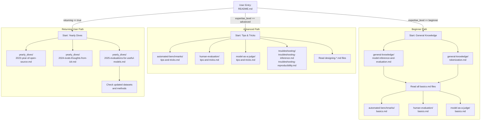
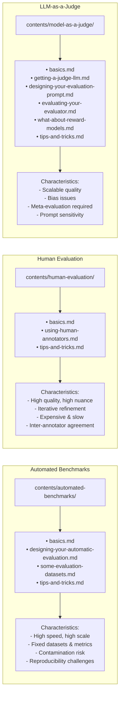
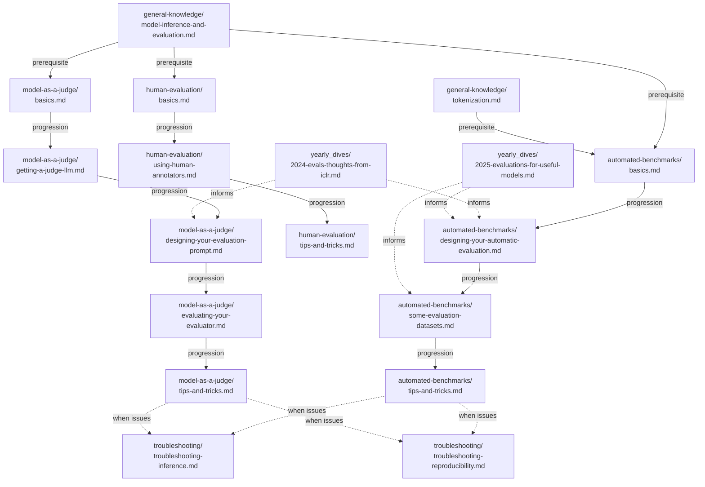

<!-- source: DeepWiki mcp.deepwiki.com · repo huggingface/evaluation-guidebook · page 1 Overview · fetched 2026-10-26 -->

# Overview

<details>
<summary>Relevant source files</summary>

The following files were used as context for generating this wiki page:

- [README.md](README.md)

</details>


## Purpose and Scope

The LLM Evaluation Guidebook is a technical reference for designing, implementing, and troubleshooting evaluations of Large Language Models. It provides practical guidance on three primary evaluation methodologies: automated benchmarks, human evaluation, and LLM-as-a-judge approaches. The guidebook addresses the complete evaluation lifecycle, from selecting appropriate datasets and metrics to resolving common implementation issues such as contamination, reproducibility failures, and parsing errors.

This overview documents the guidebook's architecture, navigation strategies, and content organization. For specific evaluation methodologies, see [Evaluation Methodologies](#2). For foundational concepts required to understand evaluation mechanics, see [Foundational Knowledge](#3). For temporal context on how evaluation practices have evolved from 2023-2025, see [Evolution of LLM Evaluation](#5).

**Sources:** [README.md:1-6]()

## Repository Architecture

The guidebook is organized as a GitHub repository with content structured into six primary directories, each containing multiple markdown files that implement specific evaluation topics.

### File Structure

```mermaid
graph TD
    ROOT["README.md<br/>(main entry point)"]
    
    subgraph "contents/"
        AUTO["automated-benchmarks/"]
        AUTO_BASICS["basics.md"]
        AUTO_DESIGN["designing-your-automatic-evaluation.md"]
        AUTO_DATASETS["some-evaluation-datasets.md"]
        AUTO_TIPS["tips-and-tricks.md"]
        
        HUMAN["human-evaluation/"]
        HUMAN_BASICS["basics.md"]
        HUMAN_ANNOTATORS["using-human-annotators.md"]
        HUMAN_TIPS["tips-and-tricks.md"]
        
        JUDGE["model-as-a-judge/"]
        JUDGE_BASICS["basics.md"]
        JUDGE_GET["getting-a-judge-llm.md"]
        JUDGE_PROMPT["designing-your-evaluation-prompt.md"]
        JUDGE_EVAL["evaluating-your-evaluator.md"]
        JUDGE_REWARD["what-about-reward-models.md"]
        JUDGE_TIPS["tips-and-tricks.md"]
        
        TROUBLE["troubleshooting/"]
        TROUBLE_INF["troubleshooting-inference.md"]
        TROUBLE_REPRO["troubleshooting-reproducibility.md"]
        
        GENERAL["general-knowledge/"]
        GENERAL_INF["model-inference-and-evaluation.md"]
        GENERAL_TOK["tokenization.md"]
    end
    
    subgraph "yearly_dives/"
        Y2023["2023-year-of-open-source.md"]
        Y2024["2024-evals-thoughts-from-iclr.md"]
        Y2025["2025-evaluations-for-useful-models.md"]
    end
    
    subgraph "resources/"
        RES_EVAL["about-evaluation.md"]
        RES_NLP["about-NLP.md"]
    end
    
    subgraph "translations/"
        TRANS_ZH["zh/"]
    end
    
    ROOT --> AUTO
    ROOT --> HUMAN
    ROOT --> JUDGE
    ROOT --> TROUBLE
    ROOT --> GENERAL
    ROOT --> Y2023
    ROOT --> Y2024
    ROOT --> Y2025
    ROOT --> RES_EVAL
    ROOT --> RES_NLP
    ROOT --> TRANS_ZH
    
    AUTO --> AUTO_BASICS
    AUTO --> AUTO_DESIGN
    AUTO --> AUTO_DATASETS
    AUTO --> AUTO_TIPS
    
    HUMAN --> HUMAN_BASICS
    HUMAN --> HUMAN_ANNOTATORS
    HUMAN --> HUMAN_TIPS
    
    JUDGE --> JUDGE_BASICS
    JUDGE --> JUDGE_GET
    JUDGE --> JUDGE_PROMPT
    JUDGE --> JUDGE_EVAL
    JUDGE --> JUDGE_REWARD
    JUDGE --> JUDGE_TIPS
    
    TROUBLE --> TROUBLE_INF
    TROUBLE --> TROUBLE_REPRO
    
    GENERAL --> GENERAL_INF
    GENERAL --> GENERAL_TOK
```



**Repository Structure Diagram: Maps README.md navigation to actual file paths in the contents/, yearly_dives/, resources/, and translations/ directories**

The `README.md` file at [README.md:1-93]() serves as the central navigation hub, linking to all subsections. Each methodology (automated benchmarks, human evaluation, LLM-as-a-judge) follows a consistent file naming pattern: `basics.md` for introductory material, methodology-specific design guides, and `tips-and-tricks.md` for practical advice.

**Sources:** [README.md:19-60]()

### Content Organization Pattern

Each evaluation methodology directory follows a three-tier information architecture:

| Tier | File Pattern | Target Audience | Wiki Pages |
|------|-------------|-----------------|------------|
| **Basics** | `basics.md` | Beginners requiring conceptual introduction | [2.1](#2.1), [2.2](#2.2), [2.3](#2.3) |
| **Design** | `designing-*.md`, `getting-*.md`, `using-*.md` | Practitioners implementing evaluations | [2.1.1](#2.1.1), [2.2.1](#2.2.1), [2.3.1](#2.3.1), [2.3.2](#2.3.2) |
| **Advanced** | `tips-and-tricks.md` | Experienced users troubleshooting issues | [2.1.3](#2.1.3), [2.2.2](#2.2.2), [2.3.4](#2.3.4) |

This pattern ensures consistent navigation across methodologies while accommodating different expertise levels.

**Sources:** [README.md:22-39]()

## User Navigation Strategies

The guidebook defines three distinct navigation paths based on user expertise level, as specified in [README.md:9-15](). Each path prioritizes different content types and entry points.

### Navigation Path Mapping



**User Navigation Diagram: Shows three distinct paths through the codebase based on expertise level, mapping to specific markdown files in the repository**

### Path Characteristics

**Beginner Path** ([README.md:9-11]()):
- **Entry point**: `general-knowledge/` directory, specifically [3.1](#3.1) and [3.2](#3.2)
- **Progression**: Foundational concepts → methodology basics → simple implementations
- **Key files**: All `basics.md` files across methodologies
- **Objective**: Build understanding of tokenization, inference mechanics, and basic evaluation types

**Advanced Path** ([README.md:12-13]()):
- **Entry point**: `tips-and-tricks.md` files and `troubleshooting/` directory
- **Focus areas**: [2.1.3](#2.1.3), [2.2.2](#2.2.2), [2.3.4](#2.3.4), [4](#4)
- **Key files**: `designing-your-*.md`, `troubleshooting-*.md`
- **Objective**: Resolve practical implementation issues and optimize evaluation design

**Returning User Path** ([README.md:14-15]()):
- **Entry point**: `yearly_dives/` directory, particularly [5.3](#5.3) for 2025 updates
- **Focus**: Temporal evolution of evaluation practices and new methodologies
- **Key files**: Year-specific markdown files in `yearly_dives/`
- **Objective**: Understand paradigm shifts and new dataset/metric releases

**Sources:** [README.md:8-16]()

## Three Evaluation Methodologies

The guidebook's core content is organized around three evaluation paradigms, each implemented as a separate directory under `contents/`. These methodologies represent different trade-offs between automation, quality, and scalability.

### Methodology Comparison



**Methodology Implementation Diagram: Maps evaluation paradigms to their implementation directories and characteristic trade-offs**

### Methodology Selection Criteria

| Criterion | Automated Benchmarks | Human Evaluation | LLM-as-a-Judge |
|-----------|---------------------|------------------|----------------|
| **Speed** | Fast (batch inference) | Slow (hours per annotation) | Medium (depends on judge model) |
| **Cost** | Low (compute only) | High (annotator wages) | Medium (judge inference cost) |
| **Scale** | High (1000s of examples) | Low (100s of examples) | High (limited by judge capacity) |
| **Quality** | Fixed by dataset | Highest (human nuance) | Variable (judge-dependent) |
| **Reproducibility** | Challenging (prompt sensitivity) | Low (annotator variance) | Medium (stochastic judge outputs) |
| **Primary Risk** | Contamination | Annotation drift | Position/verbosity bias |
| **Wiki Reference** | [2.1](#2.1) | [2.2](#2.2) | [2.3](#2.3) |

**Automated Benchmarks** ([README.md:22-26]()):
- **Directory**: `contents/automated-benchmarks/`
- **Core files**: `designing-your-automatic-evaluation.md` covers dataset selection, inference methods, prompt engineering, and metric choice
- **Dataset catalog**: `some-evaluation-datasets.md` contains domain-specific benchmark listings (math, code, reasoning)
- **Use case**: High-throughput regression testing, leaderboard rankings
- **Limitations**: See [2.1.3](#2.1.3) for contamination and tokenization issues

**Human Evaluation** ([README.md:28-31]()):
- **Directory**: `contents/human-evaluation/`
- **Core files**: `using-human-annotators.md` details workforce selection, guideline design, and quality control
- **Process**: Iterative annotation refinement with inter-annotator agreement validation
- **Use case**: Validating automated methods, evaluating subjective qualities (helpfulness, harmlessness)
- **Limitations**: See [2.2.2](#2.2.2) for annotation drift and cognitive load management

**LLM-as-a-Judge** ([README.md:33-39]()):
- **Directory**: `contents/model-as-a-judge/`
- **Core files**: `getting-a-judge-llm.md` (judge acquisition), `designing-your-evaluation-prompt.md` (prompt engineering), `evaluating-your-evaluator.md` (meta-evaluation)
- **Special topic**: `what-about-reward-models.md` covers Bradley-Terry models as alternative judge approach
- **Use case**: Scaling human-like evaluation, pairwise preference ranking
- **Limitations**: See [2.3.4](#2.3.4) for position bias, verbosity bias, and self-preference issues

**Sources:** [README.md:22-39]()

## Supporting Systems

Beyond the three core methodologies, the guidebook includes foundational knowledge, troubleshooting resources, and external ecosystem references that enable successful evaluation implementation.

### Supporting Content Architecture

```mermaid
graph TD
    subgraph "Foundational Knowledge"
        GK_DIR["contents/general-knowledge/"]
        GK_INF["model-inference-and-evaluation.md<br/>- Tokenization → prediction process<br/>- Log-likelihood vs generative eval<br/>- Output constraint methods"]
        GK_TOK["tokenization.md<br/>- Character/word/sub-word (BPE)<br/>- Vocabulary considerations<br/>- Multilingual challenges<br/>- Numerical representation"]
    end
    
    subgraph "Troubleshooting"
        TR_DIR["contents/troubleshooting/"]
        TR_INF["troubleshooting-inference.md<br/>- Model output parsing<br/>- Format compliance<br/>- Verbose outputs"]
        TR_REPRO["troubleshooting-reproducibility.md<br/>- Prompt sensitivity<br/>- Score variance<br/>- Tokenization spacing"]
    end
    
    subgraph "External Ecosystem"
        RES_DIR["resources/"]
        RES_EVAL["about-evaluation.md<br/>- Evaluation frameworks<br/>- Leaderboards<br/>- Research papers"]
        RES_NLP["about-NLP.md<br/>- NLP courses<br/>- Architecture guides<br/>- Tutorials"]
    end
    
    subgraph "Temporal Context"
        YD_DIR["yearly_dives/"]
        YD_2023["2023-year-of-open-source.md<br/>- LLaMA, Falcon, Mistral<br/>- RLHF, DPO methods"]
        YD_2024["2024-evals-thoughts-from-iclr.md<br/>- Evaluation crisis identification<br/>- Three purposes framework"]
        YD_2025["2025-evaluations-for-useful-models.md<br/>- Multi-layer architecture<br/>- Utility over intelligence"]
    end
    
    GK_DIR --> GK_INF
    GK_DIR --> GK_TOK
    TR_DIR --> TR_INF
    TR_DIR --> TR_REPRO
    RES_DIR --> RES_EVAL
    RES_DIR --> RES_NLP
    YD_DIR --> YD_2023
    YD_DIR --> YD_2024
    YD_DIR --> YD_2025
    
    GK_INF -.required for.-> AB_DIR["All evaluation methodologies"]
    TR_INF -.resolves issues in.-> AB_DIR
    TR_REPRO -.resolves issues in.-> AB_DIR
    YD_2024 -.informs design of.-> AB_DIR
    YD_2025 -.informs design of.-> AB_DIR
    RES_EVAL -.provides tools for.-> AB_DIR
```



**Supporting Systems Diagram: Shows how foundational knowledge, troubleshooting, resources, and temporal context support the three core methodologies**

### Foundational Knowledge

The `general-knowledge/` directory ([README.md:46-50]()) provides prerequisite understanding:

- **Model Inference** ([3.1](#3.1)): Documents the tokenization → prediction pipeline, distinguishing between log-likelihood evaluation (computing probabilities of fixed completions) and generative evaluation (sampling new text)
- **Tokenization** ([3.2](#3.2)): Explains BPE (Byte-Pair Encoding) sub-word tokenization, vocabulary size trade-offs, and multilingual/numerical representation challenges
- **Target audience**: Beginners should read these before methodology-specific content
- **Advanced users**: [README.md:48]() recommends skimming to "Going further" sections for advanced references

### Troubleshooting

The `troubleshooting/` directory ([README.md:41-44]()) addresses common implementation failures:

- **Inference issues** ([4](#4)): Model output parsing failures, format non-compliance, handling verbose outputs
- **Reproducibility issues**: Prompt sensitivity (same prompt, different scores), tokenization spacing effects, score variance across runs
- **Practical focus**: [README.md:42]() describes this as "the most densely practical part of this guide"
- **Example**: Math parsing issues (documented in [4.1](#4.1)) detail sympy limitations causing ~6% failure rate on valid LaTeX expressions

### External Ecosystem

The `resources/` directory ([README.md:57-61]()) connects to external tools and learning materials:

- **Evaluation tools** ([6.1](#6.1)): lm_eval harness, lighteval, Argilla, distilabel frameworks
- **Leaderboards** ([6.2](#6.2)): Open LLM Leaderboard, HELM, Chatbot Arena
- **Learning resources** ([6.3](#6.3)): NLP courses, architecture guides, prompting tutorials
- **Curation**: [README.md:58]() notes these are "Links I like", indicating editorial selection

### Yearly Dives

The `yearly_dives/` directory ([README.md:52-55]()) provides temporal context:

- **2023** ([5.1](#5.1)): Open-source model emergence (LLaMA, Falcon, Mistral), fine-tuning methods (RLHF, DPO)
- **2024** ([5.2](#5.2)): Evaluation crisis recognition (contamination, score instability, undefined capabilities), three purposes framework
- **2025** ([5.3](#5.3)): Paradigm shift to multi-layer evaluation architecture (specific capabilities → assistant tasks → dynamic environments → forecasters)
- **Recommended for**: [README.md:15]() identifies returning users as primary audience

**Sources:** [README.md:41-61]()

## Content Dependencies

Evaluation methodologies depend on foundational knowledge and are supported by troubleshooting resources. This dependency structure informs the recommended reading order.

### Dependency Graph



**Content Dependency Diagram: Shows prerequisite relationships between markdown files, indicating recommended reading order for beginners and dependency resolution for implementation**

### Reading Order Recommendations

**For Beginners** (implementing [README.md:9-11]()):
1. `general-knowledge/model-inference-and-evaluation.md` ([3.1](#3.1))
2. `general-knowledge/tokenization.md` ([3.2](#3.2))
3. Methodology-specific `basics.md` file ([2.1](#2.1), [2.2](#2.2), or [2.3](#2.3))
4. Methodology-specific design/implementation files
5. `tips-and-tricks.md` for chosen methodology
6. `troubleshooting/` files as issues arise

**For Advanced Users** (implementing [README.md:12-13]()):
- Start with `designing-*.md` files in chosen methodology
- Reference `troubleshooting/` proactively
- Consult `tips-and-tricks.md` for optimization strategies
- Skip foundational knowledge unless encountering conceptual gaps

**For Returning Users** (implementing [README.md:14-15]()):
- Start with `yearly_dives/2025-evaluations-for-useful-models.md` ([5.3](#5.3))
- Identify new datasets in `some-evaluation-datasets.md` ([2.1.2](#2.1.2))
- Review updated methodologies informed by 2024-2025 paradigm shifts

**Sources:** [README.md:8-16](), [README.md:22-60]()

## Community and Contributions

The guidebook is a community-driven project with translation support and contribution mechanisms.

### Translation Architecture

Translations are organized under the `translations/` directory using ISO 639-2 language codes:

| Language | Code | Directory | Status | Contributor |
|----------|------|-----------|--------|-------------|
| Chinese | `zh` | `translations/zh/` | Active | @SuSung-boy |
| French | `fr` | External (HuggingFace Space) | Active | @lbourdois |

**Translation process** (documented in [7](#7)):
1. Fork repository
2. Create language branch using ISO 639-2 code
3. Translate markdown files maintaining directory structure
4. Submit pull request
5. Review and merge by maintainers

**Sources:** [README.md:63-66]()

### Acknowledgments

The guidebook acknowledges influences from:
- **Structural inspiration**: ML Engineering Guidebook by Stas Bekman [README.md:69]()
- **Industry contributors**: Representatives from Allen AI, Cohere, Meta, OpenAI, Anthropic, Max Planck Institute [README.md:72]()
- **Community**: Open LLM Leaderboard users, lighteval community [README.md:73]()
- **Hugging Face team**: Lewis Tunstall, Hynek Kydlíček, Guilherme Penedo, Thom Wolf, Nathan Habib [README.md:74]()

**Sources:** [README.md:68-76]()

## Citation and Licensing

The guidebook is licensed under Creative Commons BY-NC-SA 4.0 [README.md:79-83]().

**Citation format**:
```
@misc{fourrier2024evaluation,
  author = {Clémentine Fourrier and The Hugging Face Community},
  title = {LLM Evaluation Guidebook},
  year = {2024},
  journal = {GitHub repository},
  url = {https://github.com/huggingface/evaluation-guidebook}
}
```

The BY-NC-SA license permits:
- **Share**: Copy and redistribute material in any medium or format
- **Adapt**: Remix, transform, and build upon material

Under the conditions:
- **Attribution**: Credit the original author
- **NonCommercial**: Non-commercial purposes only
- **ShareAlike**: Distribute adaptations under identical license

**Sources:** [README.md:78-93]()

## Next Steps

After understanding the guidebook's architecture and navigation strategy, proceed to:

- **[Evaluation Methodologies](#2)**: Overview of the three evaluation paradigms and selection criteria
- **[Automated Benchmarks](#2.1)**: If prioritizing speed and scale over nuance
- **[Human Evaluation](#2.2)**: If requiring highest quality subjective judgments
- **[LLM-as-a-Judge](#2.3)**: If seeking scalable quality evaluation
- **[Foundational Knowledge](#3)**: If unfamiliar with LLM inference mechanics and tokenization
- **[Evolution of LLM Evaluation](#5)**: For historical context on evaluation paradigm shifts from 2023-2025

**Sources:** [README.md:1-93]()

---

