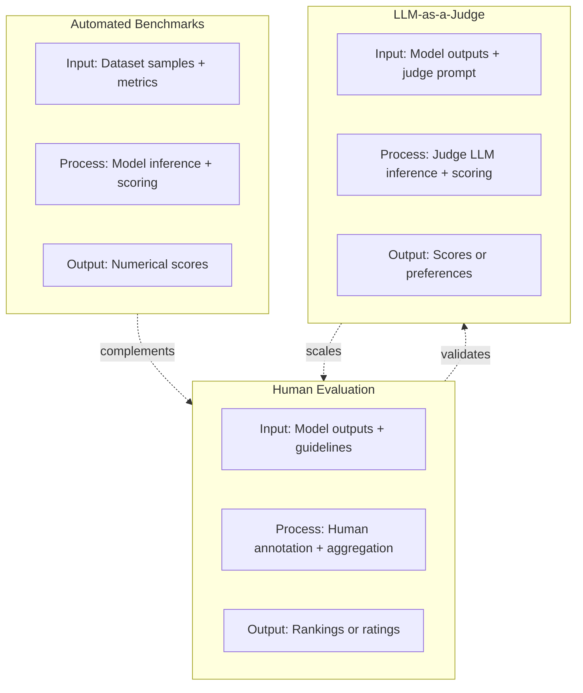
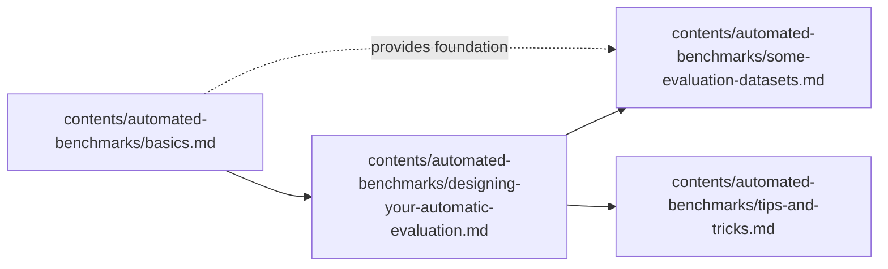
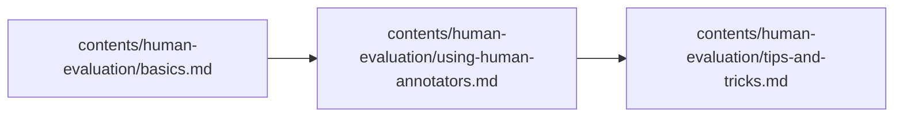
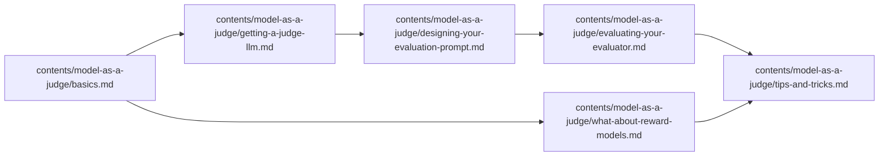
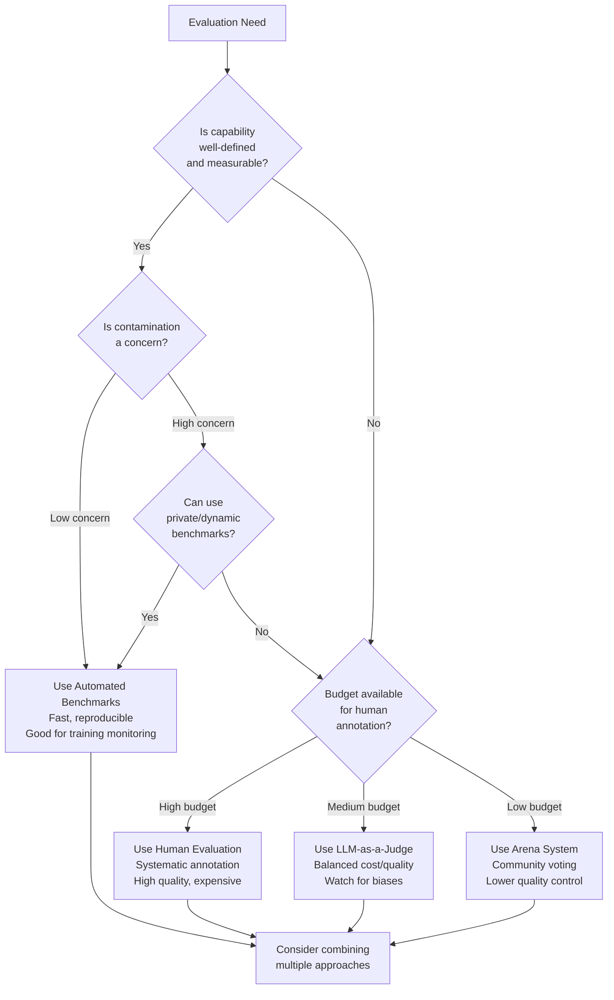
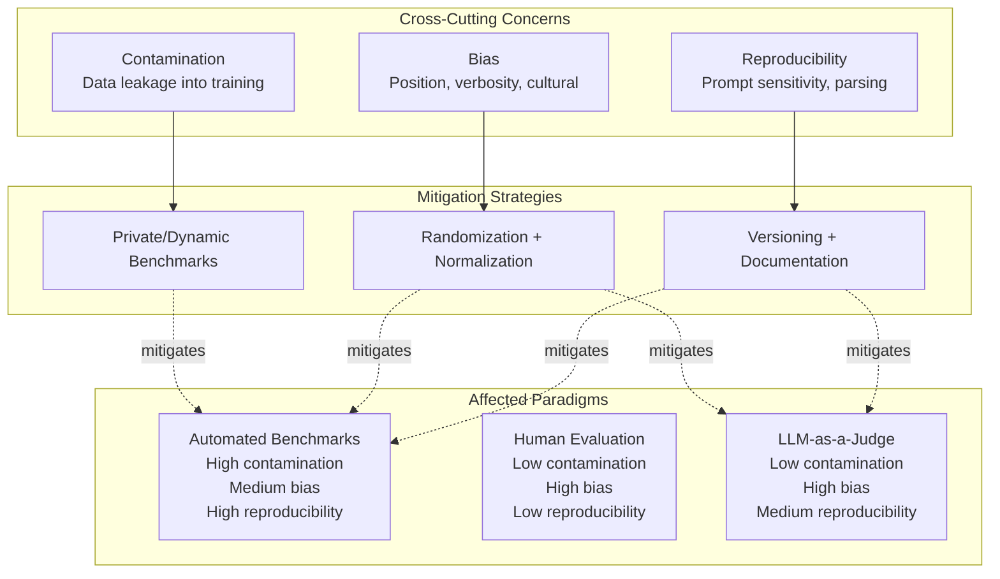
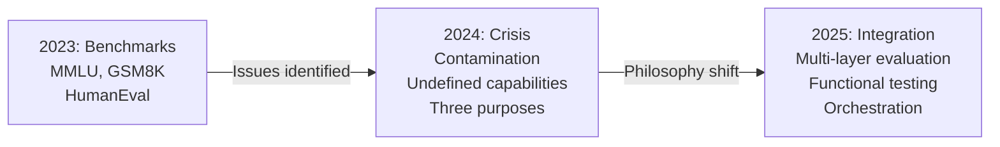

<!-- source: DeepWiki mcp.deepwiki.com · repo huggingface/evaluation-guidebook · page 2 Evaluation Methodologies · fetched 2026-10-26 -->

# Evaluation Methodologies

Relevant source files

The following files were used as context for generating this wiki page:

- [README.md](README.md)
- [yearly_dives/2023-year-of-open-source.md](yearly_dives/2023-year-of-open-source.md)
- [yearly_dives/2024-evals-thoughts-from-iclr.md](yearly_dives/2024-evals-thoughts-from-iclr.md)
- [yearly_dives/2025-evaluations-for-useful-models.md](yearly_dives/2025-evaluations-for-useful-models.md)

## Purpose and Scope

This document provides an overview of the three primary approaches to evaluating Large Language Models (LLMs): automated benchmarks, human evaluation, and LLM-as-a-judge. It explains the technical characteristics, appropriate use cases, and fundamental limitations of each methodology.

For detailed implementation guidance on specific methodologies, see:
- Automated benchmarks: [Automated Benchmarks](#2.1)
- Human evaluation: [Human Evaluation](#2.2)
- LLM-as-a-judge: [LLM-as-a-Judge](#2.3)

For historical context on how evaluation practices evolved from 2023-2025, see [Evolution of LLM Evaluation](#5).

Sources: [README.md:1-93](), [yearly_dives/2024-evals-thoughts-from-iclr.md:1-121]()

## The Three Evaluation Paradigms

Modern LLM evaluation relies on three distinct methodologies, each answering different questions and serving different purposes in the model development lifecycle.

### High-Level Comparison

Sources: [yearly_dives/2024-evals-thoughts-from-iclr.md:12-64]()

| Methodology | Speed | Cost | Reproducibility | Contamination Risk | Best For |
|-------------|-------|------|-----------------|-------------------|----------|
| Automated Benchmarks | Fast (minutes-hours) | Low (compute only) | High | High | Specific capabilities, training monitoring, model comparison |
| Human Evaluation | Slow (days-weeks) | High (labor intensive) | Low-Medium | Low | Open-ended tasks, preference assessment, quality validation |
| LLM-as-a-Judge | Medium (hours) | Medium (API costs) | Medium | Low | Scalable quality assessment, preference learning |

Sources: [yearly_dives/2024-evals-thoughts-from-iclr.md:12-64]()

## Automated Benchmarks

### Technical Description

Automated benchmarks evaluate models using pre-constructed datasets paired with algorithmic metrics. The evaluation consists of:

1. **Sample Collection**: A dataset containing inputs (prompts, questions, code problems) and often reference outputs (ground truth answers)
2. **Inference Method**: Either log-likelihood evaluation (comparing probability scores across multiple choice options) or generative evaluation (producing free-form text)
3. **Scoring Metric**: Algorithmic comparison of model output to reference (exact match, normalized match, BLEU/ROUGE, functional correctness)

Sources: [yearly_dives/2024-evals-thoughts-from-iclr.md:16-27]()

### Guidebook Structure Mapping

Sources: [README.md:22-26]()

### Key Use Cases

**Non-Regression Testing**: Monitoring training progress by evaluating whether performance trajectories and score ranges fall within expected bounds for a model of given size and training setup. The absolute score is less important than the trend and range.

**Model Comparison**: Establishing rankings across models using stable evaluation methodologies. When scores are susceptible to prompt variations, rankings provide more robust signal than absolute numbers.

**Capability Assessment**: Testing specific, well-defined capabilities like mathematical reasoning (GSM8K, MATH), code generation (HumanEval, MBPP), or instruction following (IFEval).

Sources: [yearly_dives/2024-evals-thoughts-from-iclr.md:71-95]()

### Fundamental Limitations

**Contamination**: Public benchmarks inevitably appear in model training data, either intentionally or through web scraping. This inflates scores without genuine capability improvement. The contamination problem has driven creation of dataset variants (GSM1K from GSM8K, MATH-500 from MATH) and private benchmarks.

**Proxy Measurement**: For abstract capabilities like "reasoning" or "intelligence," benchmarks can only measure performance on specific tasks that serve as proxies. Success on GSM8K indicates ability to solve grade-school math problems, not general mathematical reasoning.

**Evaluation Sensitivity**: Scores fluctuate significantly with minor prompt changes, answer ordering in multiple choice questions, and output parsing strategies.

Sources: [yearly_dives/2024-evals-thoughts-from-iclr.md:16-36](), [yearly_dives/2025-evaluations-for-useful-models.md:19-49]()

## Human Evaluation

### Technical Description

Human evaluation tasks annotators with judging model outputs according to specified criteria. Three primary approaches exist:

**Vibe-Checks**: Individual community members manually test models on personal prompts, sharing anecdotal findings. Highly susceptible to confirmation bias but useful for rapid capability exploration.

**Arena Systems**: Large-scale community voting where users compare model outputs and vote for preferences. Votes aggregate into Elo rankings. Example: LMSYS Chatbot Arena aggregates thousands of community votes.

**Systematic Annotation**: Professional annotators follow detailed guidelines to rate or rank outputs. Requires careful annotator selection, guideline design, and quality control mechanisms (inter-annotator agreement, error annotation).

Sources: [yearly_dives/2024-evals-thoughts-from-iclr.md:38-54]()

### Guidebook Structure Mapping

Sources: [README.md:28-31]()

### Key Use Cases

**Open-Ended Quality Assessment**: Evaluating dimensions difficult to measure algorithmically, such as helpfulness, coherence, creativity, or stylistic preferences.

**Contamination-Proof Evaluation**: New prompts written by humans avoid training set overlap, providing genuine out-of-distribution testing.

**Preference Alignment Validation**: Determining whether model outputs align with human values and expectations, serving as ground truth for preference models.

Sources: [yearly_dives/2024-evals-thoughts-from-iclr.md:38-42]()

### Fundamental Limitations

**Subjectivity and Cultural Bias**: Annotator preferences vary by culture, identity, and personal values. Different demographic groups rate toxicity, helpfulness, and quality differently.

**Psychological Biases**: Humans favor assertive answers over accurate ones, preferring confident tone regardless of factual correctness. They also prefer answers aligning with their existing beliefs over factually correct contradictions.

**Scalability and Cost**: Each new model requires fresh human evaluation, making continuous assessment expensive. Systematic annotation with quality control costs scale linearly with evaluation volume.

**Reproducibility**: Arena-style evaluations provide aggregated preferences but individual judgments vary significantly, making specific score reproduction impossible.

Sources: [yearly_dives/2024-evals-thoughts-from-iclr.md:44-54]()

## LLM-as-a-Judge

### Technical Description

LLM-as-a-judge uses language models to evaluate other language models' outputs. Two implementation approaches exist:

**Generalist LLMs**: High-capability models (GPT-4, Claude) receive prompts describing evaluation criteria, example outputs, and target outputs to judge. The judge provides scores or rankings based on specified dimensions.

**Specialist Reward Models**: Small models trained on human preference data to predict preference scores. Often use Bradley-Terry models for pairwise comparisons, outputting relative preference probabilities.

Sources: [yearly_dives/2024-evals-thoughts-from-iclr.md:56-63]()

### Guidebook Structure Mapping

Sources: [README.md:33-39]()

### Key Use Cases

**Scaled Human Preference Approximation**: When human evaluation is too expensive but automated metrics insufficient, judge LLMs approximate human preferences at lower cost.

**Reward Model Training**: Generating preference data for reinforcement learning from human feedback (RLHF) or direct preference optimization (DPO) training procedures.

**Multi-Dimensional Assessment**: Evaluating multiple quality dimensions (helpfulness, harmlessness, honesty) simultaneously with structured prompts.

Sources: [yearly_dives/2024-evals-thoughts-from-iclr.md:56-63]()

### Fundamental Limitations

**Self-Preference Bias**: Judge models systematically favor their own outputs when comparing against other models, inflating self-scores.

**Position Bias**: Judges disproportionately prefer outputs presented first in pairwise comparisons, regardless of quality.

**Verbosity Bias**: Longer, more detailed answers receive higher scores even when less accurate or helpful than concise alternatives.

**Score Consistency**: Judges struggle to maintain consistent score ranges across evaluations, and rarely explain reasoning before scoring leads to arbitrary judgments.

**Uninterpretable Bias Introduction**: Using LLMs to train LLMs creates subtle, difficult-to-detect biases that may compound across model generations.

Sources: [yearly_dives/2024-evals-thoughts-from-iclr.md:61-63]()

## Decision Framework: Choosing an Evaluation Approach

Sources: [yearly_dives/2024-evals-thoughts-from-iclr.md:66-113]()

### Selection Criteria Table

| Criterion | Automated Benchmarks | Human Evaluation | LLM-as-a-Judge |
|-----------|---------------------|------------------|----------------|
| **Use when capability is...** | Well-defined, testable | Open-ended, subjective | Complex but describable |
| **Use when you need...** | Training monitoring | Preference validation | Scalable quality assessment |
| **Avoid when...** | High contamination risk | Budget constrained | Self-evaluation required |
| **Best for model stage...** | Pretraining, base models | Post-training, chat models | Post-training evaluation |
| **Evaluation speed** | Minutes to hours | Days to weeks | Hours to days |

Sources: [yearly_dives/2024-evals-thoughts-from-iclr.md:66-113](), [yearly_dives/2025-evaluations-for-useful-models.md:1-167]()

## Cross-Cutting Concerns

All three evaluation methodologies face shared challenges that must be addressed regardless of approach selected.

### Contamination

**Definition**: Evaluation data appearing in model training sets, either intentionally or through web scraping, causing inflated scores without genuine capability.

**Mitigation Strategies**:
- Use private or gated datasets (GPQA diamond subset, Humanity's Last Exam)
- Implement dynamic benchmarks with regular refresh (LiveCodeBench adds problems by publication date)
- Create dataset variants (GSM-Symbolic generates infinite variations from templates)
- Add canary strings for detection (BigBench approach)

Sources: [yearly_dives/2024-evals-thoughts-from-iclr.md:33-36](), [yearly_dives/2025-evaluations-for-useful-models.md:40-49]()

### Bias

**Types**:
- **Position bias**: Preference for first-presented options in multiple choice or pairwise comparisons
- **Verbosity bias**: Preference for longer outputs regardless of quality
- **Self-preference bias**: Models favoring their own generations when judging
- **Cultural bias**: Preference variations across demographic groups

**Mitigation Strategies**:
- Randomize answer ordering in multiple choice evaluations
- Normalize by length or request concise answers
- Use third-party judges, never self-evaluation
- Diversify annotator pools and guidelines

Sources: [yearly_dives/2024-evals-thoughts-from-iclr.md:27-63]()

### Reproducibility

**Challenges**:
- Prompt sensitivity: Minor wording changes cause significant score variation
- Tokenization differences: Whitespace, special characters affect parsing
- Output parsing: Normalization strategies impact generative evaluation scores
- Judge model changes: API-based judges change without notice

**Mitigation Strategies**:
- Document exact prompts, parsers, and normalization procedures
- Version control evaluation code and judge models
- Report score variance across multiple runs
- Use local models rather than APIs when possible

Sources: [yearly_dives/2024-evals-thoughts-from-iclr.md:88-94]()

### Cross-Cutting Concerns Architecture

Sources: [yearly_dives/2024-evals-thoughts-from-iclr.md:27-94](), [yearly_dives/2025-evaluations-for-useful-models.md:1-167]()

## Three Purposes of Evaluation

Evaluation serves three distinct purposes that are often conflated but require different methodologies and interpretation frameworks.

### Purpose 1: Non-Regression Testing

**Question Answered**: "Is my model training correctly? Have my changes broken expected behavior?"

**Methodology**: Monitor evaluation score trajectories and ranges during training. Compare against expected performance bounds for model size and architecture.

**Interpretation**: Absolute scores matter less than trends and ranges. A 7B base model scoring 50-65 on MMLU indicates normal training; scores of 20-30 indicate training failure.

**Best Approach**: Automated benchmarks with high signal-to-noise ratio

Sources: [yearly_dives/2024-evals-thoughts-from-iclr.md:71-84]()

### Purpose 2: Model Ranking

**Question Answered**: "Which model is best? Should I select model A or model B for my use case?"

**Methodology**: Establish consistent rankings across models using stable evaluation methods. Focus on relative ordering rather than absolute scores.

**Interpretation**: Rankings are more robust than scores to minor perturbations. If top-ranked model fails on your use case, lower-ranked models likely will too.

**Best Approach**: Combination of automated benchmarks (for stability) and human evaluation (for preference)

Sources: [yearly_dives/2024-evals-thoughts-from-iclr.md:85-94]()

### Purpose 3: Capability Assessment

**Question Answered**: "Can models do X? What are current field-wide capabilities?"

**Methodology**: Use benchmarks as proxies for broader capabilities, acknowledging fundamental measurement limitations.

**Interpretation**: Performance on GSM8K indicates ability to solve grade-school math, not general reasoning. No benchmark currently measures abstract capabilities reliably.

**Best Approach**: Multi-layered evaluation (specific capabilities → assistant tasks → dynamic environments)

Sources: [yearly_dives/2024-evals-thoughts-from-iclr.md:95-104](), [yearly_dives/2025-evaluations-for-useful-models.md:1-167]()

## Evolution of Evaluation Philosophy

The LLM evaluation field has matured significantly from 2023 to 2025, shifting from simple benchmark-centric approaches to multi-layered capability orchestration.

### 2023: Benchmark-Centric Era

Focus on standard automated benchmarks (MMLU, GSM8K, HumanEval) for comparing open-source models against closed alternatives. Contamination and saturation began emerging as concerns.

Sources: [yearly_dives/2023-year-of-open-source.md:1-166]()

### 2024: Crisis Recognition

Recognition of fundamental problems: contamination prevalence, score instability, undefined capabilities, and pervasive biases in all evaluation types. Community identified three distinct evaluation purposes (non-regression, ranking, capability assessment).

Sources: [yearly_dives/2024-evals-thoughts-from-iclr.md:1-121]()

### 2025: Integrated Capability Testing

Shift toward evaluating practical utility through multi-layered architecture:
1. **Layer 1**: Specific capabilities (math, code, reasoning, tool-calling)
2. **Layer 2**: Assistant tasks (GAIA, DABStep requiring capability integration)
3. **Layer 3**: Dynamic environments (games, forecasting)
4. **Layer 4**: Contamination-proof evaluation (forecasting, dynamic benchmarks)

Emphasis on functional testing and parser-based validation over model judges for interpretability.

Sources: [yearly_dives/2025-evaluations-for-useful-models.md:1-167]()

Sources: [yearly_dives/2023-year-of-open-source.md:1-166](), [yearly_dives/2024-evals-thoughts-from-iclr.md:1-121](), [yearly_dives/2025-evaluations-for-useful-models.md:1-167]()

## Practical Recommendations

Based on current understanding of evaluation limitations and best practices:

### For Model Builders

**During Training**: Use automated benchmarks for non-regression testing. Monitor MMLU-Pro, MATH-500, basic reasoning benchmarks for trajectory validation.

**Post-Training**: Combine specific capability tests (IFEval, AIME, SWE-Bench, TauBench/BFCL) with integrated assistant tasks (GAIA, DABStep).

### For Model Users

**Model Selection**: Prioritize rankings from diverse benchmark suites over individual scores. Check performance on domain-specific evaluations matching your use case.

**Deployment Validation**: Conduct systematic human evaluation on representative production prompts before deployment.

### For Researchers

**Benchmark Design**: Favor functional testing with algorithmic validation over model judges. Create mechanisms for regular dataset refresh or template-based generation.

**Reporting**: Document exact prompts, parsers, and evaluation procedures. Report score variance and statistical significance. Provide both scores and rankings.

Sources: [yearly_dives/2025-evaluations-for-useful-models.md:153-167]()

---

