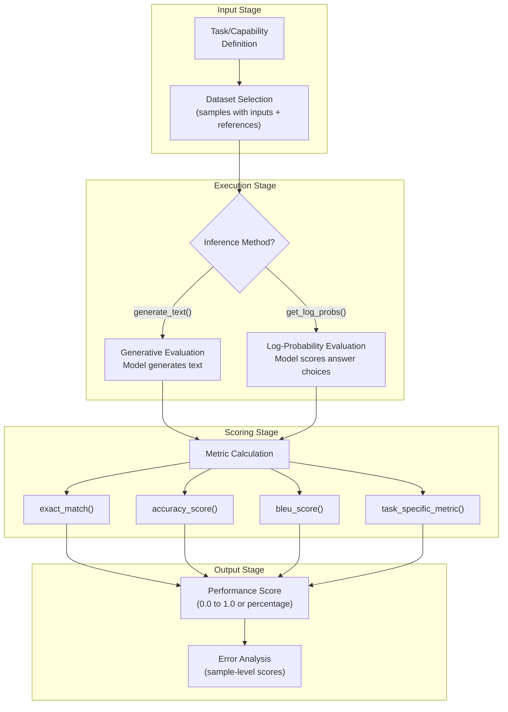
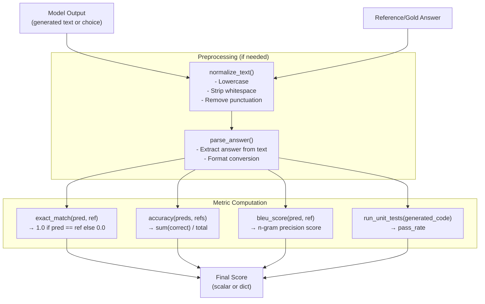
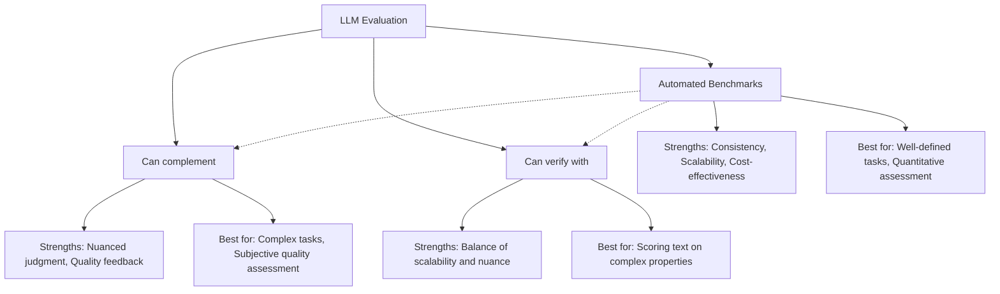

<!-- source: DeepWiki mcp.deepwiki.com · repo huggingface/evaluation-guidebook · page 2.1 Automated Benchmarks · fetched 2026-10-26 -->

# Automated Benchmarks

<details>
<summary>Relevant source files</summary>

The following files were used as context for generating this wiki page:

- [README.md](README.md)
- [contents/automated-benchmarks/basics.md](contents/automated-benchmarks/basics.md)

</details>


Automated benchmarks are standardized, reproducible procedures for evaluating LLM performance on specific tasks or capabilities without human intervention during the evaluation process. They represent one of three primary evaluation methodologies (alongside Human Evaluation and LLM-as-a-Judge), offering consistency and scalability at limited cost.

This page covers the fundamentals of automated benchmarking: what they are, how they work, their core components (datasets, metrics, inference methods), and their advantages and limitations. For detailed guidance on designing evaluations, see page 2.1.1. For a comprehensive catalog of evaluation datasets, see page 2.1.2. For implementation advice and troubleshooting, see page 2.1.3.

## What are Automated Benchmarks?

Automated benchmarks evaluate model performance by comparing model outputs against predefined references or correct answers. They can assess two types of targets:

- **Concrete tasks**: Well-defined objectives with clear success criteria (e.g., "How accurately can my model classify spam from non-spam emails?")
- **Abstract capabilities**: General abilities that are harder to define precisely (e.g., "How good is my model at mathematical reasoning?")

The key characteristic of automated benchmarks is that evaluation happens programmatically: once the dataset and metric are defined, the scoring process requires no human judgment during execution.

Sources: [contents/automated-benchmarks/basics.md:4-7]()
</thinking>

## Evaluation Objectives: Tasks vs. Capabilities

Automated benchmarks target two distinct levels of evaluation:

| Evaluation Type | Definition | Example | Measurement Approach |
|----------------|------------|---------|---------------------|
| **Task-based** | Concrete, well-defined objective | Email spam classification | Direct accuracy on labeled samples |
| **Capability-based** | Abstract skill or knowledge domain | Mathematical reasoning | Proxy through task performance (e.g., solving math problems) |

Task-based evaluations are straightforward: the success criteria are explicit. Capability-based evaluations are more challenging because they require decomposing an abstract ability into measurable tasks. For instance, "good at math" could mean arithmetic skill, logical reasoning, or understanding new mathematical concepts—leading to the use of generalist evaluation datasets as proxies for broader capabilities.

Sources: [contents/automated-benchmarks/basics.md:4-7](), [contents/automated-benchmarks/basics.md:32-36]()

## Core Architecture of Automated Benchmarks

Automated benchmarks consist of three essential components that work together to produce evaluation scores:

1. **Dataset**: A collection of samples, each containing:
   - An **input** (prompt, question, or context) for the model
   - A **reference** or "gold" answer to compare against the model's output
   - Metadata (task type, difficulty level, domain)

2. **Inference Method**: The approach to obtaining model outputs:
   - **Generative evaluation**: Model generates text following the input
   - **Log-probability evaluation**: Model provides probabilities for predefined answer choices

3. **Metric**: A function that compares model outputs to references and computes a score quantifying performance

These components form a pipeline: dataset samples → model inference → metric computation → performance score.

Sources: [contents/automated-benchmarks/basics.md:8-18]()

### Diagram: Automated Benchmark Pipeline



This pipeline enables **reproducibility**: running the same benchmark multiple times with the same model yields identical results (barring hardware differences or model-internal randomness), allowing fair comparison across models.

Sources: [contents/automated-benchmarks/basics.md:8-18](), [contents/automated-benchmarks/basics.md:25-27]()

## Two Evaluation Modes: Generative vs. Log-Probability

LLM evaluation frameworks typically support two distinct inference modes, each suited to different task types:

### Generative Evaluation

In generative evaluation, the model produces text tokens sequentially in response to an input prompt. The generated text is then compared to a reference answer using string-based or semantic metrics.

**Characteristics:**
- Model calls: `model.generate(input_prompt, max_new_tokens=...)`
- Output: Generated text string
- Comparison: Model output vs. reference answer
- Use cases: Open-ended questions, code generation, creative writing, question answering

**Example workflow:**
```
Input: "What is the capital of France?"
Model generates: "Paris"
Reference: "Paris"
Metric (exact_match): 1.0 (match)
```

### Log-Probability Evaluation (Multiple-Choice)

In log-probability evaluation, the model computes the probability of each pre-defined answer choice without generating new tokens. The choice with the highest log-probability is selected as the model's answer.

**Characteristics:**
- Model calls: `model.compute_log_probs(input_prompt, answer_choices)`
- Output: Log-probability scores for each choice
- Comparison: Highest-probability choice vs. correct answer label
- Use cases: Classification tasks, multiple-choice questions, tasks with discrete answer sets

**Example workflow:**
```
Input: "What is the capital of France? A) London B) Paris C) Berlin D) Madrid"
Model computes log-probs: A: -2.3, B: -0.1, C: -3.2, D: -2.8
Selected: B (highest probability)
Reference: B
Metric (accuracy): 1.0 (correct)
```

### Comparison Table

| Aspect | Generative Evaluation | Log-Probability Evaluation |
|--------|----------------------|---------------------------|
| Model operation | Sequential token generation | Probability computation |
| Suitable for | Open-ended, creative tasks | Classification, discrete choices |
| Speed | Slower (generation required) | Faster (no generation) |
| Output format | Free-form text | Selected choice |
| Common metrics | Exact match, BLEU, ROUGE | Accuracy, F1 score |
| Sensitivity | Prompt-sensitive, format-dependent | Less format-sensitive |

For more technical details on how these evaluation modes work at the inference level, see page 3.1 on Model Inference and Evaluation.

Sources: [contents/automated-benchmarks/basics.md:15-18]()

## Dataset Requirements and Generalization

Evaluation datasets must satisfy specific criteria to produce meaningful performance measurements:

### Core Requirements

1. **Representative samples**: Samples should emulate the real-world distribution of the target task, including edge cases and difficult examples
2. **Out-of-distribution data**: Ideally, evaluation samples should not have appeared in the model's training data
3. **Quality references**: Gold answers should be accurate and unambiguous
4. **Sufficient coverage**: Dataset size should be large enough to distinguish between model capabilities statistically

### The Generalization Problem

Automated benchmarks test **generalization**—the model's ability to perform well on unseen data by learning underlying patterns rather than memorizing training examples.

**Example**: A spam classifier that generalizes well can identify spam emails about "health products" after training only on spam about "fake banks," because it has learned abstract spam indicators (urgency, suspicious links, poor grammar) rather than memorizing specific content.

**Overfitting vs. Generalization:**
- **Overfitting**: Model performs well on training data but fails on new examples (like a student memorizing test questions without understanding the subject)
- **Generalization**: Model performs well on both training and evaluation data by learning transferable patterns

This is why evaluating on training data is meaningless—it measures memorization, not capability. The contamination problem (when evaluation data leaks into training sets) undermines this distinction, making it difficult to assess true generalization.

Sources: [contents/automated-benchmarks/basics.md:9-23]()

## Common Metrics in Automated Evaluation

Metrics convert model outputs into quantitative performance scores. The choice of metric depends on the evaluation mode and task requirements.

### Metric Categories and Implementation

| Metric Type | Examples | Input Requirements | Output Range | Best Used For |
|-------------|----------|-------------------|--------------|---------------|
| **Classification** | `accuracy`, `F1`, `precision`, `recall` | Predicted labels vs. true labels | 0.0 to 1.0 | Multiple-choice, binary decisions |
| **Exact matching** | `exact_match`, `string_match` | Generated text vs. reference | 0.0 or 1.0 | Factual answers, deterministic outputs |
| **N-gram overlap** | `BLEU`, `ROUGE-N`, `ROUGE-L` | Generated text vs. reference(s) | 0.0 to 1.0 | Translation, summarization |
| **Functional testing** | `pass@k`, `unit_test_pass_rate` | Generated code vs. test suite | Pass rate | Code generation |
| **Task-specific** | `sympy_equality` (math), `IFEval` (instruction following) | Task-dependent | Task-dependent | Specialized domains |

### Metric Selection Considerations

- **Interpretability**: `accuracy` and `exact_match` are intuitive; `BLEU` and `ROUGE` require domain knowledge to interpret
- **Strictness**: `exact_match` is binary (0 or 1); `BLEU/ROUGE` allow partial credit
- **Normalization**: String metrics often require preprocessing (lowercasing, whitespace removal, punctuation handling) to avoid penalizing formatting differences
- **Task alignment**: Metrics should reflect what matters for the task (e.g., functional correctness for code, semantic similarity for paraphrasing)

For detailed guidance on metric selection and prompt design to maximize metric reliability, see page 2.1.1 on Designing Automated Evaluations.

Sources: [contents/automated-benchmarks/basics.md:12-15](), [contents/automated-benchmarks/basics.md:27-30]()

### Diagram: Metric Calculation Pipeline



Sources: [contents/automated-benchmarks/basics.md:12-15](), [contents/automated-benchmarks/basics.md:27-30]()

## Advantages of Automated Benchmarks

Automated benchmarks offer distinct advantages that make them the foundation of LLM evaluation:

### 1. Consistency and Reproducibility

Running the same benchmark multiple times on the same model yields identical results (barring hardware differences or model-internal randomness). This enables:
- **Fair model comparisons**: All models are evaluated under identical conditions
- **Leaderboard rankings**: Models can be objectively ranked on standardized benchmarks
- **Regression testing**: Model updates can be validated to ensure they don't degrade performance on existing tasks

### 2. Scale at Limited Cost

Automated benchmarks can evaluate thousands of samples across multiple benchmarks with minimal human effort and cost:
- **Batch processing**: Evaluate entire datasets programmatically
- **Multi-model evaluation**: Compare dozens of models simultaneously
- **Rapid iteration**: Test model variations quickly during development
- **Cost efficiency**: No per-sample human annotation required

### 3. Metric Interpretability

Most automated metrics are straightforward to understand and communicate:
- `accuracy = 0.85` means "85% of answers were correct"
- `exact_match = 0.72` means "72% of generated answers matched references exactly"
- Clear, quantitative results facilitate decision-making and performance tracking

### 4. Dataset Quality (When Available)

Many established benchmarks leverage high-quality data sources:
- **Expert-generated**: Datasets like MATH use competition-level problems created by mathematicians
- **Pre-existing high-quality data**: MMLU aggregates exam questions from reliable educational sources
- **Rigorous validation**: Many datasets undergo multiple quality control rounds

**Caveat**: Not all datasets are created equal. MMLU, for instance, has documented issues (parsing errors, ambiguous questions), leading to follow-up datasets like MMLU-Pro and MMLU-Redux. Always assess dataset quality critically.

Sources: [contents/automated-benchmarks/basics.md:25-30]()

## Limitations of Automated Benchmarks

Automated benchmarks have fundamental limitations that impact their reliability and scope:

### 1. Reduced Effectiveness for Complex Tasks

Automated benchmarks excel at well-defined tasks with clear success criteria but struggle with complex, multifaceted capabilities:

**Works well for:**
- Classification (spam detection, sentiment analysis)
- Factual question answering (single correct answer)
- Code functionality (pass/fail tests)

**Struggles with:**
- Abstract capabilities ("reasoning ability," "creativity")
- Subjective quality (writing style, persuasiveness)
- Multi-step problem-solving with multiple valid approaches

**The proxy problem**: When evaluating abstract capabilities like "mathematical reasoning," benchmarks use task performance (solving math problems) as a proxy. This assumes performance on specific tasks generalizes to the broader capability, which may not always hold.

### 2. Data Contamination

Once a dataset is published publicly in plain text, it will eventually appear in web scrapes and model training data. This creates fundamental uncertainty:

**The contamination lifecycle:**
```
Dataset publication → Web scraping → Training corpus → Model training → Evaluation
                                                            ↑____contaminated__|
```

**Consequences:**
- **Inflated scores**: Models may have memorized evaluation samples during training
- **Invalid comparisons**: Newer models trained on larger web scrapes are more likely to be contaminated
- **Metric gaming**: High benchmark scores may not reflect true capability

**Mitigation strategies** (see page 2.1.3):
- Private evaluation datasets (not publicly released)
- Dynamic benchmarks (regularly updated with new samples)
- Contamination detection methods (perplexity analysis, canary strings)
- Dataset variants (e.g., GSM8K → GSM-Symbolic with template variations)

### 3. Prompt Sensitivity and Reproducibility Issues

Generative evaluation scores can vary significantly based on:
- Exact prompt wording
- Few-shot example selection and order
- Output formatting instructions
- Model temperature and sampling parameters

This makes it challenging to reproduce results across different implementations or compare results from different evaluation frameworks. See page 4 (Troubleshooting) for practical solutions.

### 4. Metric-Task Misalignment

Not all metrics accurately capture what matters for a task:
- `BLEU` score correlates poorly with human judgment of translation quality
- `exact_match` penalizes semantically correct but differently worded answers
- Task-specific metrics may not generalize across domains

The choice of metric significantly impacts measured performance and can create misleading conclusions about model capabilities.

Sources: [contents/automated-benchmarks/basics.md:32-36]()

## Relationship to Other Evaluation Approaches

Automated benchmarks are one of three primary approaches to LLM evaluation, alongside Human Evaluation and LLM-as-a-Judge.



Sources: contents/automated-benchmarks/basics.md:24-36, contents/model-as-a-judge/basics.md:3-18

---

