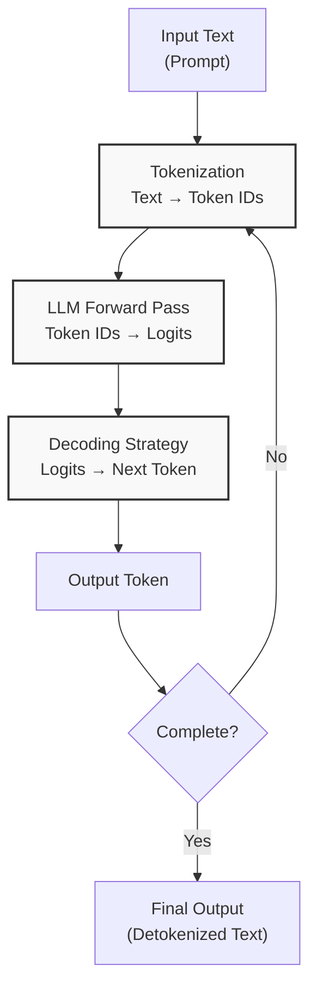
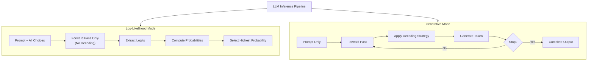
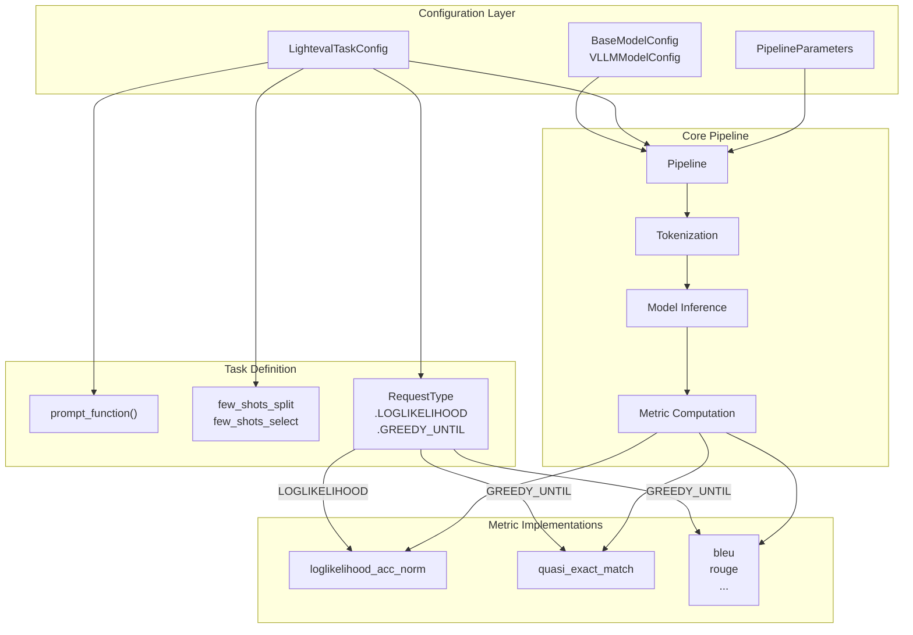
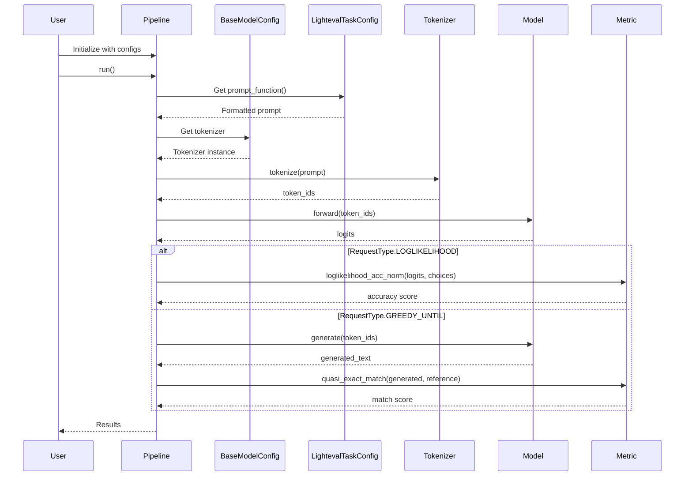
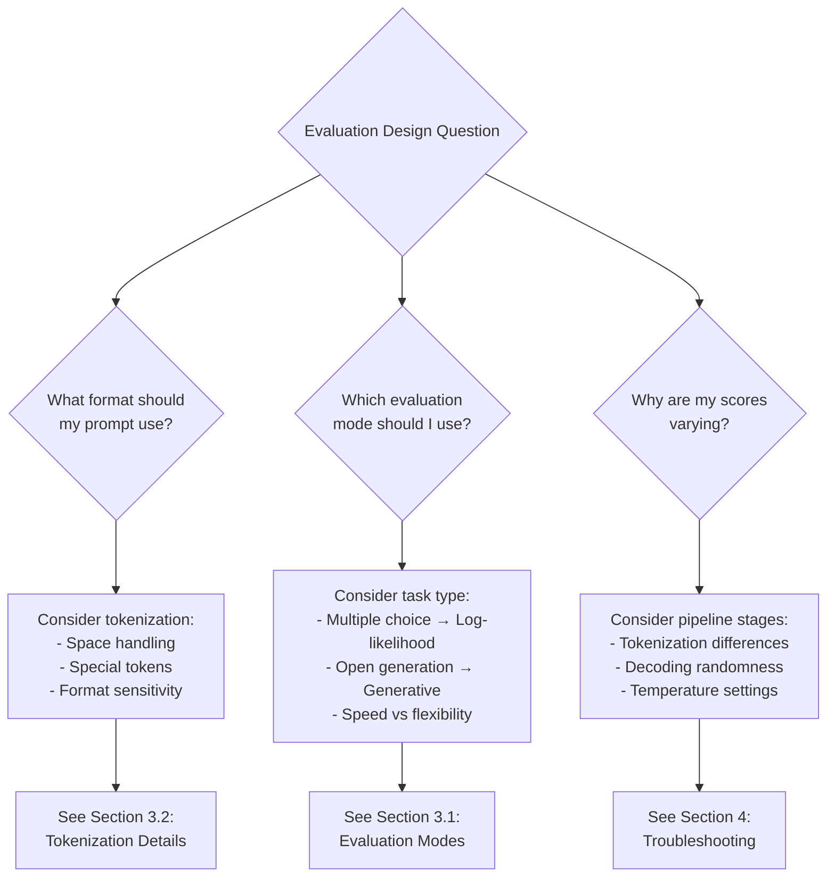
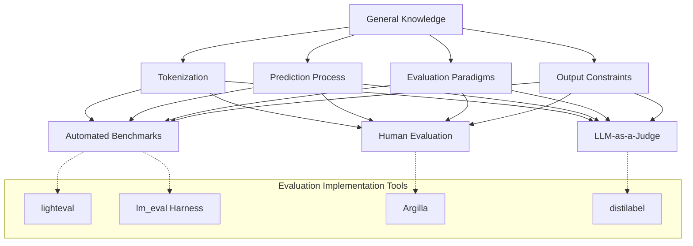

<!-- source: DeepWiki mcp.deepwiki.com · repo huggingface/evaluation-guidebook · page 3 Foundational Knowledge · fetched 2026-10-26 -->

# Foundational Knowledge

<details>
<summary>Relevant source files</summary>

The following files were used as context for generating this wiki page:

- [README.md](README.md)

</details>


This section provides essential background on LLM mechanics that underpins all evaluation approaches. Understanding how models process text, generate predictions, and produce outputs is critical for designing effective evaluations, interpreting results, and troubleshooting issues.

The foundational concepts covered here apply equally to:
- **Automated Benchmarks** (Section 2.1): Understanding tokenization helps explain why prompts must be carefully designed and why small format changes can affect scores
- **Human Evaluation** (Section 2.2): Knowing how models generate text helps annotators understand what they're evaluating
- **LLM-as-a-Judge** (Section 2.3): Judge LLMs use the same inference mechanisms, which informs prompt design and bias mitigation

This overview introduces the core inference pipeline and evaluation modes. For detailed explanations, see:
- **Section 3.1 (Model Inference and Evaluation)**: Complete coverage of tokenization, prediction, evaluation paradigms, and output constraints
- **Section 3.2 (Tokenization)**: Deep dive into tokenization methods, vocabulary considerations, and multilingual challenges

## The LLM Inference Pipeline

Understanding how LLMs process and generate text is fundamental to evaluation design. The inference pipeline consists of three stages: tokenization, prediction, and decoding.

### Inference Pipeline Overview



Sources: [contents/general-knowledge/model-inference-and-evaluation.md:1-16]()

### Why This Matters for Evaluation

Each stage of the pipeline introduces considerations for evaluation:

| Pipeline Stage | Evaluation Impact | Common Issues |
|----------------|------------------|---------------|
| **Tokenization** | Prompt format sensitivity, multilingual differences | Inconsistent space handling, numeric representation |
| **Prediction** | Score calibration, probability interpretation | Log-probability instability, length bias |
| **Decoding** | Output variance, reproducibility | Temperature effects, sampling randomness |

Understanding these stages helps explain phenomena like:
- Why adding a space changes model performance (tokenization differences)
- Why models prefer certain answer formats (prediction distribution bias)
- Why scores vary between runs (decoding randomness)

**For detailed coverage**, see Section 3.1 (Model Inference and Evaluation) and Section 3.2 (Tokenization).

Sources: [contents/general-knowledge/model-inference-and-evaluation.md:1-67](), [contents/general-knowledge/tokenization.md]()

## Two Evaluation Modes

Evaluation frameworks operate in two distinct modes, each leveraging different aspects of the inference pipeline.

### Evaluation Mode Comparison



Sources: [contents/general-knowledge/model-inference-and-evaluation.md:16-46]()

### Mode Characteristics

| Characteristic | Log-Likelihood | Generative |
|---------------|----------------|------------|
| **Speed** | Fast (single forward pass per choice) | Slower (multiple passes to generate) |
| **Determinism** | Deterministic | Varies with decoding strategy |
| **Use Cases** | Multiple choice, classification | Open-ended generation, reasoning |
| **Metrics** | Accuracy, perplexity | BLEU, exact match, human/LLM judgment |
| **Variance** | Low | High (especially with sampling) |

**When to use each mode:**
- **Log-likelihood**: Multiple-choice datasets (MMLU, ARC), classification tasks, fast screening
- **Generative**: Math problems (GSM8K), code generation (HumanEval), assistant evaluation (MT-Bench)

**For implementation details**, see Section 3.1 which covers request types, metric selection, and output constraints.

Sources: [contents/general-knowledge/model-inference-and-evaluation.md:16-67]()

## Mapping Concepts to Code

Understanding how foundational concepts map to evaluation framework code helps bridge theory and practice.

### Framework Architecture: lighteval Example



Sources: [contents/examples/comparing_task_formulations.ipynb:70-87](), [contents/examples/comparing_task_formulations.ipynb:132-151](), [contents/examples/comparing_task_formulations.ipynb:173-174]()

### Key Code Entities and Their Roles

| Code Entity | Role | Maps To Concept |
|-------------|------|-----------------|
| `BaseModelConfig` / `VLLMModelConfig` | Specifies model and inference parameters | Tokenization + Prediction stages |
| `LightevalTaskConfig` | Defines evaluation task structure | Evaluation mode selection |
| `RequestType.LOGLIKELIHOOD` | Signals log-probability evaluation | Log-likelihood mode |
| `RequestType.GREEDY_UNTIL` | Signals generative evaluation | Generative mode |
| `prompt_function()` | Formats input for model | Output constraint (prompt engineering) |
| `few_shots_split` / `few_shots_select` | Controls example selection | Output constraint (few-shot learning) |
| `loglikelihood_acc_norm` | Computes accuracy from probabilities | Log-likelihood metric |
| `quasi_exact_match` | Compares generated vs reference text | Generative metric |

### Example: Defining a Task

```python
# Maps foundational concepts to code
task_config = LightevalTaskConfig(
    name="my_task",
    prompt_function=my_prompt_fn,        # Output constraint: prompt design
    suite=["custom"],
    hf_repo="my_dataset",
    hf_subset="default",
    evaluation_splits=["test"],
    few_shots_split="train",             # Output constraint: few-shot examples
    few_shots_select="random",           
    metric=[Metrics.loglikelihood_acc_norm],  # Evaluation mode: log-likelihood
)
```

**This configuration connects:**
1. Prompt design (`prompt_function`) to output constraint methods
2. Few-shot learning (`few_shots_split`) to in-context learning
3. Metric selection (`Metrics.loglikelihood_acc_norm`) to evaluation mode (log-likelihood)

Sources: [contents/examples/comparing_task_formulations.ipynb:132-151](), [contents/examples/comparing_task_formulations.ipynb:173-174]()
</thinking>

### Code-Level Workflow



Sources: [contents/examples/comparing_task_formulations.ipynb:460-477](), [contents/examples/comparing_task_formulations.ipynb:541-583]()

## Practical Implications for Evaluation Design

Foundational knowledge directly informs evaluation design decisions across all methodologies.

### Design Decision Framework



Sources: [contents/general-knowledge/model-inference-and-evaluation.md:1-67](), [contents/troubleshooting/troubleshooting-reproducibility.md]()

### Common Evaluation Scenarios

| Scenario | Relevant Concept | Guideline |
|----------|-----------------|-----------|
| Designing prompts for MMLU | Tokenization sensitivity | Test with/without spaces; check special tokens |
| Comparing models on math tasks | Generative mode + output parsing | Use structured generation or robust parsers |
| Creating a new benchmark | Evaluation mode selection | Log-likelihood for speed; generative for realism |
| Debugging score variance | Decoding strategy | Fix temperature=0 for deterministic results |
| Evaluating multilingual models | Tokenization differences | Check vocabulary coverage per language |
| Building LLM-as-judge | All concepts | Judge uses same inference; understand biases |

**These scenarios are covered in depth in:**
- **Section 2.1 (Automated Benchmarks)**: Prompt design, dataset selection
- **Section 2.3 (LLM-as-a-Judge)**: Judge prompt engineering, bias mitigation
- **Section 4 (Troubleshooting)**: Inference issues, reproducibility problems

Sources: [contents/automated-benchmarks/designing-your-automatic-evaluation.md](), [contents/model-as-a-judge/designing-your-evaluation-prompt.md](), [contents/troubleshooting/troubleshooting-inference.md]()

## Relationship to Main Evaluation Approaches

These general knowledge concepts form the foundation for the three main evaluation approaches covered in this guidebook:



Sources: README.md:9-11, README.md:17-49

Understanding these core concepts enables more effective implementation of specific evaluation approaches and better interpretation of evaluation results across all methodologies.

---

