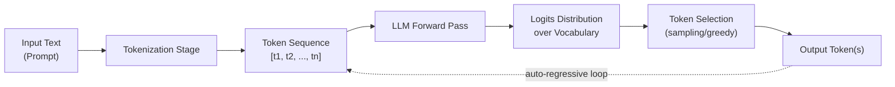
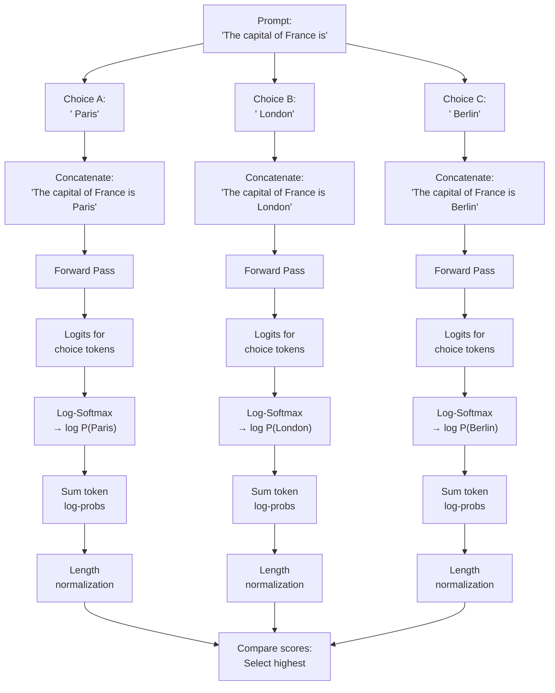
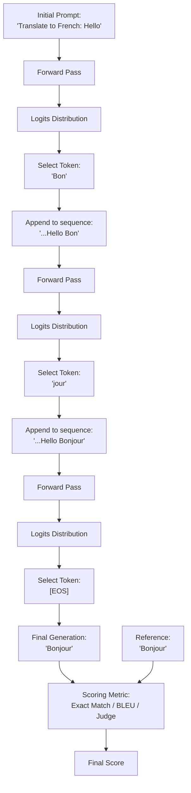
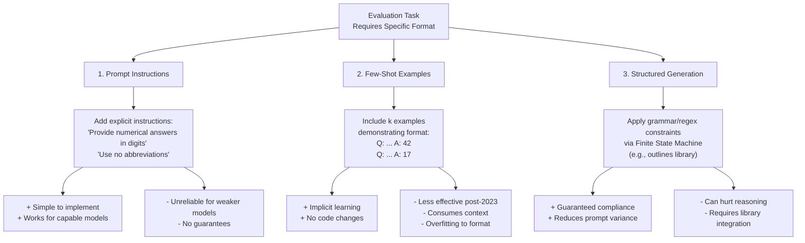

<!-- source: DeepWiki mcp.deepwiki.com · repo huggingface/evaluation-guidebook · page 3.1 Model Inference and Evaluation · fetched 2026-10-26 -->

# Model Inference and Evaluation

Relevant source files

The following files were used as context for generating this wiki page:

- [contents/general-knowledge/model-inference-and-evaluation.md](contents/general-knowledge/model-inference-and-evaluation.md)

## Purpose and Scope

This page explains the foundational mechanics of how large language models perform inference and how this process enables two distinct evaluation paradigms. Understanding these mechanics is prerequisite to implementing any evaluation methodology described in this guidebook.

**Scope**: This page covers (1) the two-stage inference process (tokenization and prediction), (2) log-likelihood vs. generative evaluation methods, and (3) techniques for constraining model outputs. For detailed tokenization mechanics, see [Tokenization](#3.2). For practical evaluation frameworks implementing these concepts, see [Automated Benchmarks](#2.1) and [LLM-as-a-Judge](#2.3).

Sources: [contents/general-knowledge/model-inference-and-evaluation.md:1-8]()

---

## The Inference Pipeline

At a fundamental level, LLMs predict plausible continuations of input text through a two-stage process.

**Diagram: Two-Stage Inference Pipeline**

### Stage 1: Tokenization

The input text is segmented into tokens—small text units ranging from single characters to full words. Each token maps to a unique integer ID from the model's vocabulary. This vocabulary defines the complete set of tokens the model can process.

| Concept | Description | Example |
|---------|-------------|---------|
| Token | Smallest unit of text processed by model | "Hello" might be one token or ["He", "llo"] |
| Vocabulary | Complete set of valid tokens | GPT-4: ~100K tokens, LLaMA: 32K tokens |
| Token ID | Integer representation of token | "Hello" → 15496 |

Sources: [contents/general-knowledge/model-inference-and-evaluation.md:7-8]()

### Stage 2: Prediction

The model generates a probability distribution over its entire vocabulary for the next token. This distribution is computed using the logits (raw scores) output by the model's final layer. To generate continued text, the highest-probability token (with optional randomness for diversity) is selected and appended to the input sequence. The process repeats auto-regressively until a stopping condition is met.

Sources: [contents/general-knowledge/model-inference-and-evaluation.md:10-14]()

---

## Evaluation Paradigms

The inference mechanism enables two fundamentally different evaluation approaches, each measuring different model capabilities.

Sources: [contents/general-knowledge/model-inference-and-evaluation.md:16-19]()

### Log-Likelihood Evaluation

This paradigm measures the conditional probability of specific continuations given a prompt. It answers: "What is the likelihood that the model would generate this specific text as a continuation?"

**Diagram: Log-Likelihood Evaluation Flow for Multiple Choice**

#### Computation Steps

1. **Concatenation**: Append each candidate choice to the prompt
2. **Forward Pass**: Process concatenated sequences through the model
3. **Logit Extraction**: Retain only logits corresponding to choice tokens (discard prompt logits)
4. **Log-Probability Conversion**: Apply log-softmax to convert logits to log-probabilities in range `[-∞, 0]`
5. **Token Aggregation**: Sum individual token log-probabilities to obtain overall choice log-probability
6. **Length Normalization** (optional): Divide by number of tokens to avoid bias toward shorter choices

Sources: [contents/general-knowledge/model-inference-and-evaluation.md:20-26]()

#### Use Cases

| Application | Description | Example Benchmark |
|-------------|-------------|-------------------|
| Multiple-choice selection | Identify model's preferred answer among options | MMLU, ARC-Challenge |
| Binary classification | Test if probability exceeds threshold (e.g., 0.5) | TruthfulQA (some versions) |
| Calibration analysis | Assess if correct answers receive highest probabilities | Anthropic calibration studies |

**Important Limitation**: This method can assign high scores to answers the model would not freely generate. For instance, if the model would naturally produce "Zygote" as the next token, forcing it to select among "Paris/London/Berlin" yields a winner that may not reflect the model's true preference distribution.

Sources: [contents/general-knowledge/model-inference-and-evaluation.md:30-34]()

#### Calibration

A well-calibrated model assigns the highest probabilities to correct answers. Calibration can be measured and trained explicitly. Research shows calibration is not universal—models can be calibrated on some domains but not others.

**Further Reading**:
- Anthropic calibration paper: [arxiv.org/abs/2207.05221](https://arxiv.org/abs/2207.05221)
- Calibration limits: [arxiv.org/abs/2311.14648](https://arxiv.org/abs/2311.14648)

Sources: [contents/general-knowledge/model-inference-and-evaluation.md:33-34]()

### Generative Evaluation

This paradigm evaluates the text the model freely generates in response to a prompt. It measures the model's unconstrained behavior rather than forced-choice selection.

**Diagram: Auto-Regressive Generative Evaluation Flow**

#### Process

1. **Initial Forward Pass**: Process the prompt through the model
2. **Token Selection**: Choose the most likely next token (with optional sampling for temperature/top-p)
3. **Sequence Augmentation**: Append selected token to the sequence
4. **Iteration**: Repeat steps 1-3 until stopping condition:
   - Maximum length reached
   - Special end-of-sequence token generated
   - Custom termination logic triggered
5. **Scoring**: Compare generated text against reference answer(s) using appropriate metrics

Sources: [contents/general-knowledge/model-inference-and-evaluation.md:36-39]()

#### Common Metrics

| Metric Type | Examples | Use Cases |
|-------------|----------|-----------|
| Exact Match | String equality (possibly normalized) | Factual QA, math problems |
| Overlap-based | BLEU, ROUGE, F1 | Translation, summarization |
| Semantic | BERTScore, embedding similarity | Paraphrase detection |
| Functional | Unit test execution, code correctness | Code generation |
| Judge-based | LLM-as-a-judge scores | Open-ended generation |

Sources: [contents/general-knowledge/model-inference-and-evaluation.md:45]()

#### Log-Likelihood vs. Generative Tradeoffs

The choice between evaluation paradigms has significant implications:

- **Log-likelihood**: Faster (single forward pass per choice), deterministic, but may not reflect free generation behavior. Can create ranking instabilities when switching methods.
- **Generative**: Reflects actual model behavior, necessary for open-ended tasks, but slower and introduces sampling variance.

For detailed analysis of how switching between these methods affects MMLU scores and rankings, see the Hugging Face blog post on MMLU evaluation methodologies.

**Further Reading**: [Blog on several ways to evaluate MMLU](https://huggingface.co/blog/open-llm-leaderboard-mmlu)

Sources: [contents/general-knowledge/model-inference-and-evaluation.md:48-49]()

---

## Output Constraint Methods

Many evaluation tasks require outputs in specific formats to enable automated scoring. Three primary approaches exist for constraining model outputs.

**Diagram: Output Constraint Method Tradeoffs**

### Comparison Table

| Method | Reliability | Implementation Complexity | Context Overhead | Works Post-2023? |
|--------|-------------|---------------------------|------------------|------------------|
| **Prompt Instructions** | Medium | Low | Minimal | Yes (for capable models) |
| **Few-Shot Examples** | Medium-Low | Low | High (k examples) | Declining effectiveness |
| **Structured Generation** | High (guaranteed) | Medium-High | None | Yes |

Sources: [contents/general-knowledge/model-inference-and-evaluation.md:51-66]()

### Method 1: Prompt Instructions

Explicit instructions specify the desired output format directly in the prompt. Example: *"Provide numerical answers in digits. Use no abbreviation."*

This approach is sufficient for high-capability models but provides no guarantees. The GAIA benchmark uses this method; their task prompt is available in the [GAIA leaderboard submission tab](https://huggingface.co/spaces/gaia-benchmark/leaderboard).

Sources: [contents/general-knowledge/model-inference-and-evaluation.md:53-56]()

### Method 2: Few-Shot In-Context Learning

Providing k examples of the desired format in the prompt implicitly biases the model toward following that pattern. This was highly effective until late 2023.

**Degradation Post-2023**: Widespread instruction-tuning and inclusion of instruction data in continued pre-training has biased recent models toward specific output formats, reducing few-shot effectiveness. This phenomenon has been termed "training on the test task" or "overfitting the prompt format." Additionally, few-shot examples consume valuable context, which is limiting for models with smaller context windows.

Sources: [contents/general-knowledge/model-inference-and-evaluation.md:57-60]()

### Method 3: Structured Text Generation

Structured generation enforces output compliance via formal constraints (grammar rules, regular expressions) implemented as finite state machines (FSM). The `outlines` library provides production-ready FSM implementation.

#### Advantages

- **Guaranteed Compliance**: Outputs provably match specified format
- **Reduced Variance**: Eliminates prompt sensitivity related to formatting
- **Stable Rankings**: Evaluation results become more reproducible across prompt variations

A joint Hugging Face/Outlines study demonstrated that structured generation significantly reduces prompt variance in evaluation, stabilizing model rankings.

**Further Reading**: [Evaluation with Structured Outputs](https://huggingface.co/blog/evaluation-structured-outputs)

Sources: [contents/general-knowledge/model-inference-and-evaluation.md:61-64]()

#### Potential Drawbacks

Recent research indicates structured generation can degrade performance on reasoning tasks by shifting the probability distribution too far from the model's natural generation prior. This tradeoff requires task-specific consideration.

**Further Reading**: [Research on structured generation performance](https://arxiv.org/abs/2408.02442)

Sources: [contents/general-knowledge/model-inference-and-evaluation.md:66]()

#### Technical Implementation

The `outlines` library uses FSM to constrain generation:

1. Define output schema (JSON, regex, grammar)
2. Compile schema to FSM
3. During generation, mask invalid tokens at each step
4. Select only from valid continuations

**Further Reading**:
- [Understanding FSM in structured generation](https://blog.dottxt.co/coalescence.html)
- [Outlines method paper](https://arxiv.org/abs/2307.09702)
- [Interleaved generation alternative](https://github.com/guidance-ai/guidance)

Sources: [contents/general-knowledge/model-inference-and-evaluation.md:69-71]()

---

## Implementation References

Key code patterns for implementing these concepts can be found in evaluation frameworks:

- **Log-likelihood evaluation**: `lm_eval` computes token-level log-probabilities and aggregates them
- **Generative evaluation**: Auto-regressive loops with stopping conditions
- **Structured generation**: Integration of `outlines` FSM or `guidance` interleaved generation

For practical implementations, see [Evaluation Tools and Frameworks](#6.1).

Sources: [contents/general-knowledge/model-inference-and-evaluation.md:48-71]()

---

## Mathematical Formalization

For rigorous mathematical treatment of log-likelihood and generative evaluation, see the EleutherAI formalization paper, particularly Appendix A:

**Reference**: [EleutherAI evaluation formalization](https://arxiv.org/abs/2405.14782v2)

Sources: [contents/general-knowledge/model-inference-and-evaluation.md:50]()

---

