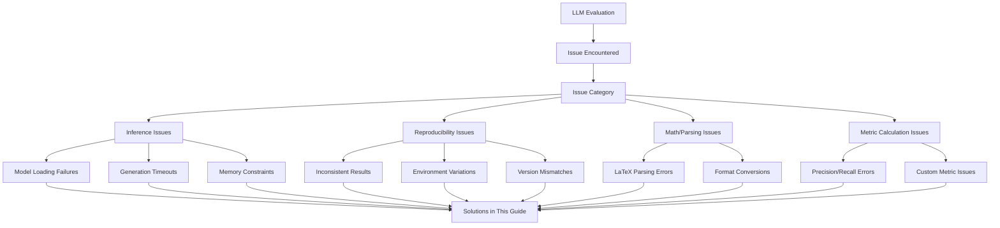
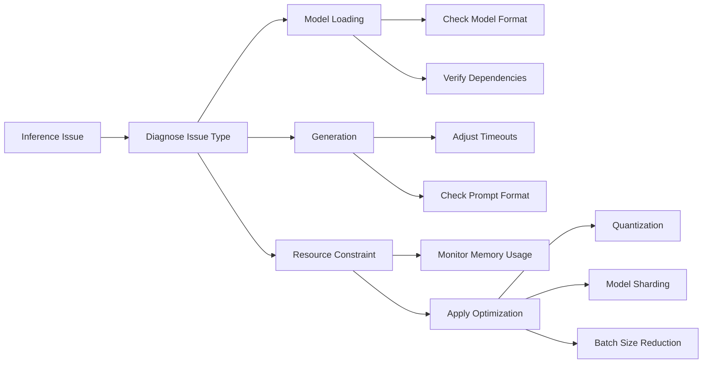
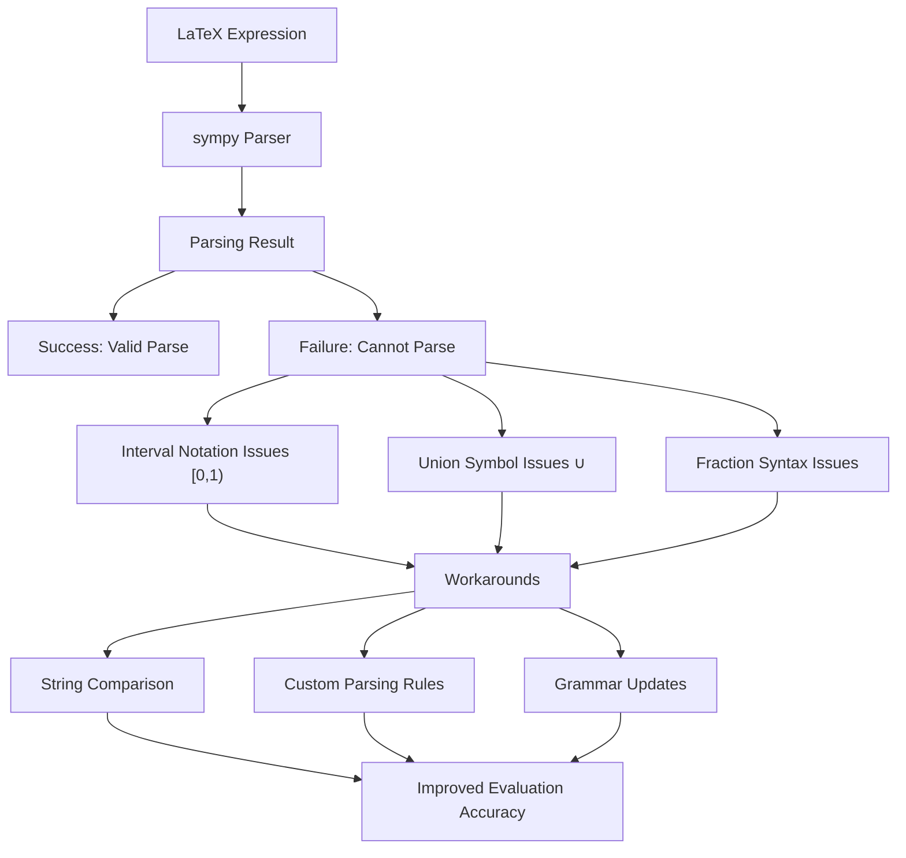
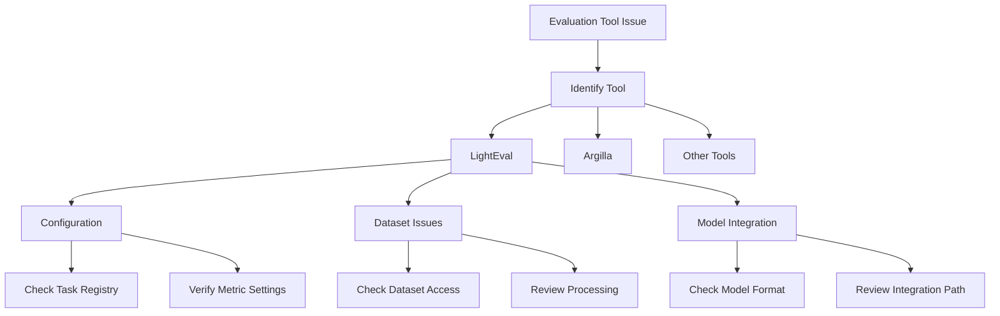

<!-- source: DeepWiki mcp.deepwiki.com · repo huggingface/evaluation-guidebook · page 4 Troubleshooting · fetched 2026-10-26 -->

# Troubleshooting

Relevant source files

The following files were used as context for generating this wiki page:

- [README.md](README.md)

This page provides solutions for common issues encountered during LLM evaluation. It covers key problems across automated benchmarks, human evaluation, and LLM-as-a-judge approaches, focusing on practical solutions to keep your evaluation pipeline running smoothly.

For information about specific evaluation approaches, refer to the respective sections: [Automated Benchmarks](#2.1), [Human Evaluation](#2.2), or [LLM-as-a-Judge](#2.3).

## Common Evaluation Issues Overview

LLM evaluation can encounter several types of issues that affect your results or prevent evaluation from completing properly:

Sources: `README.md`

## Inference Troubleshooting

When running models for evaluation, you may encounter various issues with model loading, generation, or resource constraints.

### Model Loading Issues

Common model loading problems include:

1. **Incompatible model formats** - Ensure your model format is compatible with the framework you're using
2. **Missing dependencies** - Check if all required packages are installed and at the correct versions
3. **Hardware constraints** - Verify your hardware meets the requirements for the model size

### Generation Timeouts

If your evaluation is timing out during generation:

1. **Reduce batch size** - Processing fewer examples at once can help
2. **Adjust maximum generation length** - Limit output token length appropriately
3. **Implement chunking** - Process dataset in smaller chunks

### Memory Management

For memory-related issues:

1. **Quantization** - Use lower precision (e.g., int8, float16) where accuracy permits
2. **Gradient checkpointing** - Enable for larger models to trade computation for memory
3. **Model sharding** - Split model across multiple devices if available

Sources: `README.md:39-42`

## Reproducibility Troubleshooting

Ensuring consistent results across evaluation runs is crucial for reliable comparisons and experiments.

### Setting Deterministic Execution

To ensure reproducibility:

1. **Set random seeds** - Set seeds for all sources of randomness (Python, PyTorch, NumPy)
2. **Control environment variables** - Document and control relevant environment variables
3. **Fix versions** - Pin dependency versions in your environment

### Common Reproducibility Issues

| Issue | Possible Causes | Solution |
|-------|-----------------|----------|
| Different results across runs | Random seeds not set | Set global and framework-specific seeds |
| Results vary across machines | Hardware differences | Control precision settings, use deterministic algorithms |
| Results differ from published | Version differences | Match exact versions of frameworks and models |
| Sampling inconsistency | Temperature/top-k/top-p settings | Document and standardize sampling parameters |

### Reproducibility Checklist

- [ ] Set all random seeds (Python, PyTorch, NumPy, etc.)
- [ ] Document hardware specifications
- [ ] Pin dependency versions
- [ ] Record model version/checkpoint
- [ ] Save prompts and generation parameters
- [ ] Document pre/post-processing steps
- [ ] Record evaluation metric implementation details

Sources: `README.md:39-42`

## Math Parsing Issues

Math-related evaluations, particularly those using LaTeX notation like the MATH benchmark, can encounter parsing difficulties.

### LaTeX Parsing Challenges

The `sympy` library commonly used for parsing mathematical expressions has limitations when handling certain LaTeX constructs:

### Common Parsing Errors

Some examples of LaTeX expressions that `sympy` struggles to parse include:

1. Interval notation: `[0,1)` 
2. Set union operations: `(-\infty,-5]\cup[5,\infty)`
3. Complex fractions: `-\frac{1}{{}2x}`

### Solutions for Math Parsing

Two main approaches to address math parsing issues:

1. **Add string comparison checks** - Implement string-based comparisons when symbolic parsing fails
2. **Update parsing grammar** - Modify the LaTeX grammar used by the parser to support additional constructs

The first approach is typically simpler to implement and can significantly improve evaluation accuracy.

### Impact on Evaluation Results

Implementing proper math parsing solutions can substantially affect evaluation scores. For example, adding string comparison checks to the MATH benchmark evaluation improved scores by 2-3 percentage points across models, as shown in the documentation.

Sources: `contents/troubleshooting/troubleshooting-math-parsing.md:1-52`, `assets/sympy_doc.png`

## Evaluation Tool Troubleshooting

Each evaluation tool has its own common issues and solutions.

### LightEval Issues

When using the LightEval framework for automated benchmarks:

1. **Dataset loading errors** - Check network connectivity and dataset configurations
2. **Model incompatibility** - Ensure model format and configuration match expectations
3. **Metric calculation errors** - Verify metrics are appropriate for the task

### Example: Comparing Task Formulations

When comparing different prompt formulations using LightEval (as shown in the examples), common issues include:

1. **Inconsistent scoring across formulations** - Ensure metric definitions are consistent
2. **Batch size limitations** - Adjust batch size based on prompt length and model capacity
3. **Task registration issues** - Verify task configurations are correctly registered

Sources: `contents/examples/comparing_task_formulations.ipynb:101-584`

## Troubleshooting by Evaluation Approach

Different evaluation approaches (automated benchmarks, human evaluation, LLM-as-a-judge) have specific issues to consider.

### Automated Benchmark Issues

| Issue | Description | Solution |
|-------|-------------|----------|
| Dataset compatibility | Model cannot process dataset format | Convert to compatible format |
| Token limit exceeded | Prompts too long for model context | Truncate or chunk prompts |
| Output parsing | Cannot extract answers from model output | Implement more robust parsing |
| Batching failures | Batch processing errors | Reduce batch size or implement error handling |

### Human Evaluation Issues

| Issue | Description | Solution |
|-------|-------------|----------|
| Annotator disagreement | High variance in human ratings | Improve guidelines, increase annotator count |
| Guideline misinterpretation | Annotators misunderstand task | Clarify guidelines, provide examples |
| Bias in ratings | Systematic bias in human judgments | Implement controls, randomize presentation |
| Low inter-annotator agreement | Inconsistent ratings across annotators | Refine task definition, train annotators |

### LLM-as-a-Judge Issues

| Issue | Description | Solution |
|-------|-------------|----------|
| Judge model bias | Judge favors certain response styles | Use multiple judges, control for biases |
| Prompt sensitivity | Results highly dependent on judge prompt | Standardize and test prompts thoroughly |
| Inconsistent reasoning | Judge provides inconsistent rationales | Use chain-of-thought or structured output formats |
| Reference dependency | Over-reliance on reference answers | Design appropriate evaluation criteria |

Sources: `README.md:20-38`

## Conclusion

Troubleshooting is an essential part of the LLM evaluation process. By understanding common issues and their solutions, you can ensure more reliable and accurate evaluation results. When encountering problems:

1. Identify the category of the issue (inference, reproducibility, parsing, etc.)
2. Check if the issue is specific to your evaluation approach
3. Follow the relevant troubleshooting steps in this guide
4. Document your solution for future reference

For specific troubleshooting on math parsing issues, see the dedicated section [Math Parsing Issues](#4.1).

---

