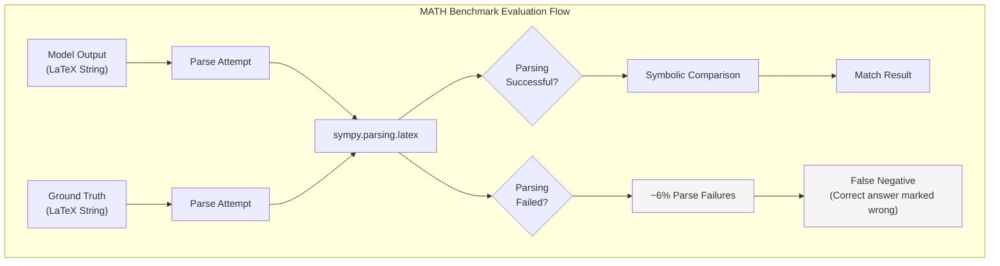
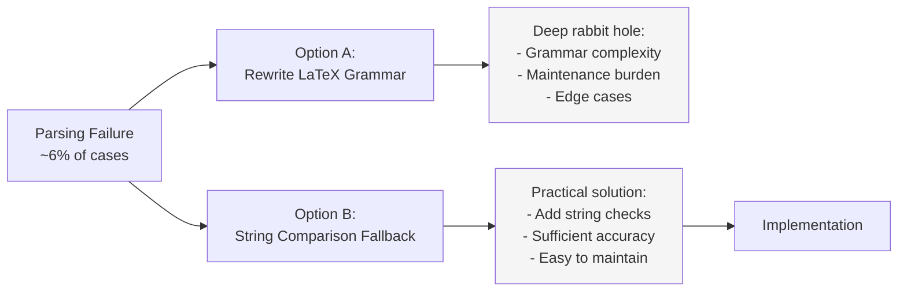
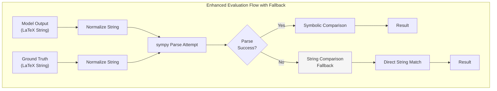
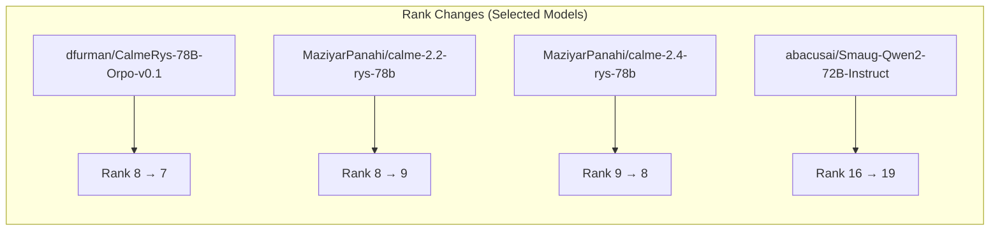
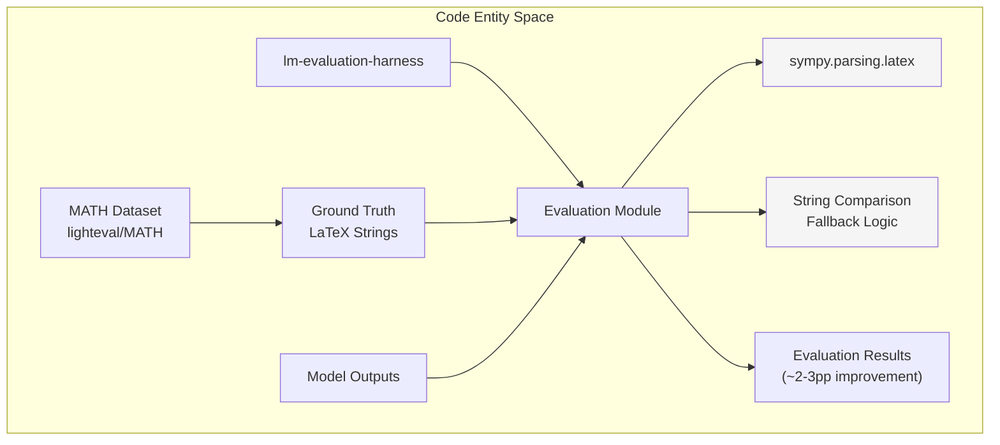

<!-- source: DeepWiki mcp.deepwiki.com · repo huggingface/evaluation-guidebook · page 4.1 Math Parsing Issues · fetched 2026-10-26 -->

# Math Parsing Issues

Relevant source files

The following files were used as context for generating this wiki page:

- [assets/lm_eval_diff.png](assets/lm_eval_diff.png)
- [assets/sympy_doc.png](assets/sympy_doc.png)
- [contents/troubleshooting/troubleshooting-math-parsing.md](contents/troubleshooting/troubleshooting-math-parsing.md)

## Purpose and Scope

This document explains the technical challenges encountered when evaluating models on the MATH benchmark, which requires parsing LaTeX mathematical expressions to compare model outputs against ground truth answers. We focus on the limitations of symbolic parsing libraries, their impact on evaluation accuracy, and practical workarounds.

For general information about designing automated evaluations, see [Designing Automated Evaluations](#2.1.1). For a catalog of math-specific datasets beyond MATH, see [Evaluation Datasets Catalog](#2.1.2).

Sources: [contents/troubleshooting/troubleshooting-math-parsing.md:1-6]()

## The LaTeX Parsing Challenge

### Why LaTeX Parsing is Fundamentally Hard

The MATH benchmark uses LaTeX notation to represent mathematical calculations and symbols. While LaTeX is a standard format for mathematical typesetting, parsing it programmatically is inherently difficult because there is no canonical "correct" way to parse LaTeX expressions.

The `sympy` library, which the `lm-evaluation-harness` uses for parsing, explicitly acknowledges this limitation in its documentation:

> "There is no such thing as a canonical form of a LaTeX expression"

This fundamental ambiguity creates reliability issues when trying to automatically evaluate mathematical correctness.

**Diagram: MATH Benchmark Evaluation Flow Without Fallback**

Sources: [contents/troubleshooting/troubleshooting-math-parsing.md:3-14](), [assets/sympy_doc.png]()

### Empirical Failure Rate

When testing `sympy` by parsing ground truth expressions against themselves (a self-consistency test), the parser achieves only **~94% accuracy**. This means that approximately 6% of valid, correctly-formatted LaTeX expressions cannot be parsed by `sympy`, even when comparing identical strings.

Sources: [contents/troubleshooting/troubleshooting-math-parsing.md:12-14]()

## Common Parsing Failures

### Example Cases

The following table shows LaTeX expressions that `sympy` fails to parse, along with the error messages:

| LaTeX Expression | Error Message | Issue Type |
|------------------|---------------|------------|
| `[0,1)` | `couldn't parse one of [0,1) or [0,1), I expected one of these: ']'` | Interval notation with mixed brackets |
| `(-\inf,-5]\cup[5,\inf)` | `couldn't parse one of (-\inf,-5]\cup[5,\inf) or (-\inf,-5]\cup[5,\inf), I expected something else here` | Set union notation |
| `-\frac{1}{{}2x}` | `couldn't parse one of -\frac{1}{{}2x} or -\frac{1}{{}2x}, I don't understand this` | Fraction with double braces |

Sources: [contents/troubleshooting/troubleshooting-math-parsing.md:16-34]()

### Grammar Limitations

The parsing failures stem from limitations in `sympy`'s LaTeX grammar definition, which is defined in [sympy/parsing/latex/lark/grammar/latex.lark](). The grammar does not support all valid LaTeX mathematical notation, particularly:

- Half-open interval notation (e.g., `[a,b)`)
- Complex set operations with union symbols (`\cup`)
- Non-standard brace patterns in fractions

Sources: [contents/troubleshooting/troubleshooting-math-parsing.md:16-34](), [contents/troubleshooting/troubleshooting-math-parsing.md:38]()

## Solutions and Workarounds

### Approach Comparison

**Diagram: Solution Decision Tree**

Sources: [contents/troubleshooting/troubleshooting-math-parsing.md:36-41]()

### Implemented Solution: String Comparison Fallback

Rather than attempting to fix the `sympy` grammar (described as "almost falling into a deep rabbit hole"), the practical solution is to add a string comparison fallback when symbolic parsing fails.

The implementation adds manual string comparison checks to the evaluation code, improving model scores without requiring complex grammar modifications.

**Diagram: Enhanced Evaluation Flow with String Comparison Fallback**

Sources: [contents/troubleshooting/troubleshooting-math-parsing.md:36-44]()

### Code Changes

The fix was implemented in the LM Evaluation Harness codebase. The modification adds string comparison as a fallback mechanism when `sympy` parsing fails.

Sources: [contents/troubleshooting/troubleshooting-math-parsing.md:43-44](), [assets/lm_eval_diff.png]()

## Impact on Evaluation Results

### Score Improvements

The string comparison fallback significantly improves evaluation scores across models. The following table shows the impact on the top 25 models:

| Model | Original Score | Fixed Parser Score | Score Improvement |
|-------|----------------|-------------------|-------------------|
| rombodawg/Rombos-LLM-V2.5-Qwen-72b | 47.58 | 50.68 | +3.10 |
| MaziyarPanahi/calme-2.2-qwen2-72b | 41.16 | 43.43 | +2.27 |
| arcee-ai/Arcee-Nova | 40.48 | 42.90 | +2.42 |
| fblgit/TheBeagle-v2beta-32B-MGS | 39.43 | 42.52 | +3.09 |
| rombodawg/Rombos-LLM-V2.5-Qwen-32b | 39.12 | 41.99 | +2.87 |
| dnhkng/RYS-XLarge | 38.97 | 41.24 | +2.27 |
| Qwen/Qwen2.5-72B | 36.10 | 38.67 | +2.57 |

**Average improvement:** Approximately **2-3 percentage points** across all models tested.

Sources: [contents/troubleshooting/troubleshooting-math-parsing.md:46-250]()

### Ranking Stability

Most model rankings remain stable after the fix, indicating that the parsing issues affect models relatively uniformly. Some rank changes occur:

**Diagram: Example Rank Changes After Parser Fix**

The majority of models (21 out of 25 in the sample) maintain their relative rankings, with only minor position swaps primarily affecting models with very similar scores.

Sources: [contents/troubleshooting/troubleshooting-math-parsing.md:48-250]()

## Key Takeaways

### For Evaluation Practitioners

1. **Parsing is not perfect**: Even mature libraries like `sympy` cannot parse all valid mathematical notation
2. **Fallback mechanisms are essential**: String comparison provides a simple, effective fallback for parsing failures
3. **Score impact is significant**: The ~6% parsing failure rate translates to 2-3 percentage point differences in final scores
4. **Rankings are relatively stable**: The systematic nature of parsing failures means most relative rankings remain unchanged

### Technical Considerations

| Consideration | Detail |
|---------------|--------|
| **Library Used** | `sympy.parsing.latex` |
| **Failure Rate** | ~6% of valid LaTeX expressions |
| **Impact on Scores** | 2-3 percentage point improvement |
| **Grammar Location** | [sympy/parsing/latex/lark/grammar/latex.lark]() |
| **Common Failures** | Interval notation, set operations, non-standard braces |
| **Recommended Fix** | String comparison fallback |

Sources: [contents/troubleshooting/troubleshooting-math-parsing.md:1-250]()

## Implementation Mapping

**Diagram: Code Entity Relationships in MATH Evaluation**

This diagram maps the natural language concepts discussed in this document to their corresponding code entities in the evaluation pipeline.

Sources: [contents/troubleshooting/troubleshooting-math-parsing.md:3-12](), [contents/troubleshooting/troubleshooting-math-parsing.md:43-44]()

---

