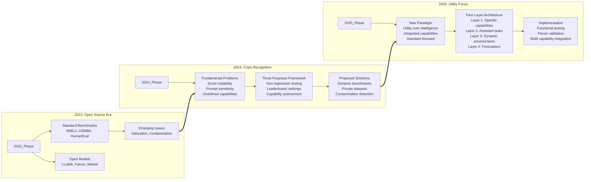
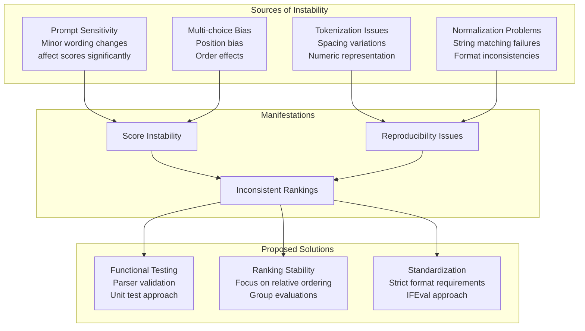
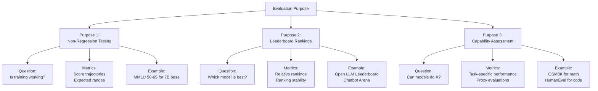
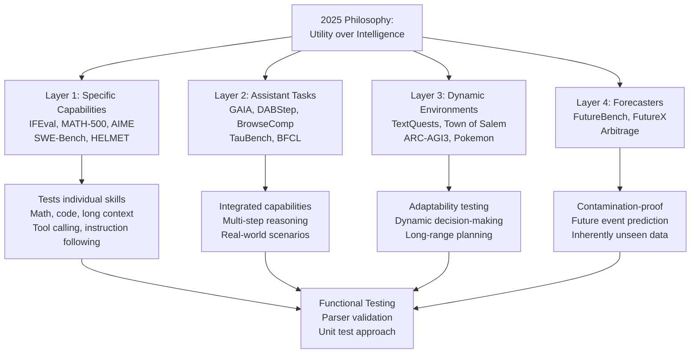
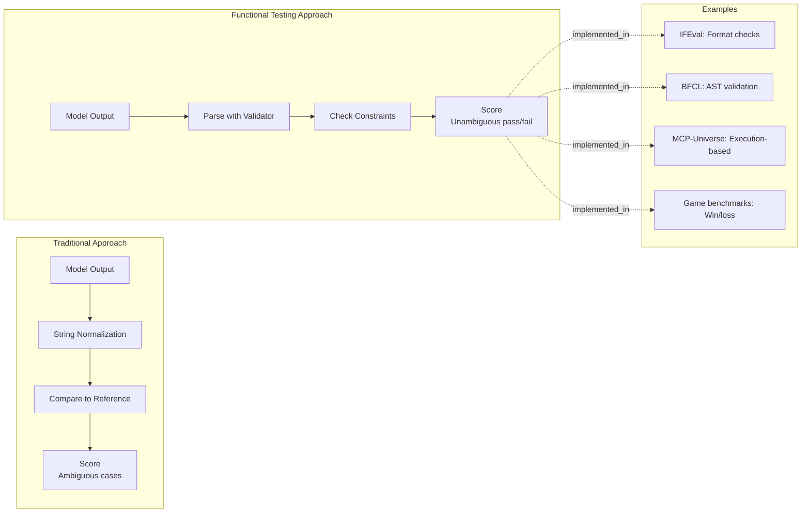
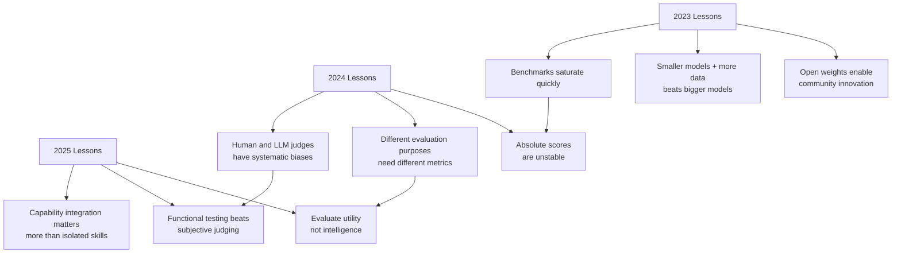

<!-- source: DeepWiki mcp.deepwiki.com · repo huggingface/evaluation-guidebook · page 5 Evolution of LLM Evaluation · fetched 2026-10-26 -->

# Evolution of LLM Evaluation

Relevant source files

The following files were used as context for generating this wiki page:

- [yearly_dives/2023-year-of-open-source.md](yearly_dives/2023-year-of-open-source.md)
- [yearly_dives/2024-evals-thoughts-from-iclr.md](yearly_dives/2024-evals-thoughts-from-iclr.md)
- [yearly_dives/2025-evaluations-for-useful-models.md](yearly_dives/2025-evaluations-for-useful-models.md)

## Purpose and Scope

This document traces the historical development of LLM evaluation methodologies from 2023 through 2025, documenting how the field matured from simple benchmark-focused approaches to sophisticated multi-layered utility assessment frameworks. It provides temporal context for understanding why current evaluation practices exist and how they address problems discovered in earlier approaches.

For detailed year-by-year analysis:
- [2023: Year of Open Source](#5.1) - The emergence of open models and standard benchmarks
- [2024: The Evaluation Crisis](#5.2) - Recognition of fundamental problems in evaluation
- [2025: Evaluating Useful Models](#5.3) - The shift toward utility-focused, multi-layered evaluation

For specific evaluation methodologies, see [Evaluation Methodologies](#2).

Sources: [yearly_dives/2025-evaluations-for-useful-models.md:1-12](), [yearly_dives/2023-year-of-open-source.md:1-10](), [yearly_dives/2024-evals-thoughts-from-iclr.md:1-10]()

## Evaluation Timeline: Three Phases of Development

**Timeline of Evaluation Evolution**: This diagram traces the three distinct phases of LLM evaluation development, showing how problems identified in each phase drove the evolution of the next. The progression moves from benchmark-centric (2023) through crisis recognition (2024) to utility-focused assessment (2025).

Sources: [yearly_dives/2023-year-of-open-source.md:1-50](), [yearly_dives/2024-evals-thoughts-from-iclr.md:66-114](), [yearly_dives/2025-evaluations-for-useful-models.md:1-11]()

## Core Problems That Emerged

### Contamination Crisis

**Contamination** occurs when evaluation datasets appear in model training data, either accidentally or intentionally. This was recognized as early as 2023 but became critical by 2024.

| Problem | Impact | Detection Methods |
|---------|--------|-------------------|
| Benchmark Leakage | Inflated scores that don't reflect true capability | Canary strings, perplexity analysis |
| Dataset Saturation | Models memorize answers rather than learn patterns | Performance comparison across variants |
| Training Data Inclusion | Non-generalizable performance | Dynamic benchmark approaches |

**GSM8K Contamination Response**: The community created multiple variants to detect and mitigate contamination:
- `GSM1K` - 1K new problems to test contamination on original GSM8K
- `GSM-Plus` - 8 variations per question with adversarial changes
- `GSM-Symbolic` - Template-based generation for infinite problem creation

Sources: [yearly_dives/2024-evals-thoughts-from-iclr.md:33-36](), [yearly_dives/2025-evaluations-for-useful-models.md:40-41]()

### Score Instability

**Score Instability Problem Space**: Multiple factors contribute to evaluation score instability. The 2024 crisis identified that absolute scores are less meaningful than relative rankings, leading to functional testing approaches in 2025.

Sources: [yearly_dives/2024-evals-thoughts-from-iclr.md:88-93](), [yearly_dives/2025-evaluations-for-useful-models.md:83-86]()

### Undefined Capabilities

The field struggled with defining what "capabilities" mean for LLMs. Abstract terms like "reasoning," "intelligence," or "understanding" lacked rigorous definitions.

**From 2024 Crisis Recognition**:
> "We cannot at the moment just say 'this model is the best at this', but instead 'this model is the best on this task that we hope is a good proxy for this capability, without any guarantee'."

This led to the 2025 shift: instead of testing abstract "intelligence," evaluate concrete utility through integrated task performance.

Sources: [yearly_dives/2024-evals-thoughts-from-iclr.md:96-104]()

## The Three Purposes Framework (2024)

The 2024 evaluation crisis clarified that different evaluation use cases require different approaches:

**Three Purposes of Evaluation**: The 2024 framework recognized that evaluation serves distinct purposes, each requiring different metrics and interpretation. Conflating these purposes leads to misinterpretation of results.

Sources: [yearly_dives/2024-evals-thoughts-from-iclr.md:66-104]()

## Paradigm Shifts Across Years

### 2023: Benchmark-Centric Evaluation

| Aspect | Approach | Datasets Used |
|--------|----------|---------------|
| **Focus** | Standard benchmarks for open models | MMLU, GSM8K, HumanEval, ARC |
| **Philosophy** | Bigger models = better performance | 7B to 70B parameter models |
| **Data Strategy** | More tokens, smaller models (Chinchilla scaling) | 1T-2T tokens |
| **Evaluation Type** | Multiple choice and exact match | Log-probability and string matching |
| **Open-ness** | High transparency on training data | Data mixes documented |

**Key Insight**: The Chinchilla paper showed that models should be smaller but trained on more data, shifting from 100B+ parameter models to 7-70B models trained on 1-2T tokens.

Sources: [yearly_dives/2023-year-of-open-source.md:43-73]()

### 2024: Crisis and Framework Development

**Recognition of Fundamental Issues**:
1. **Contamination** - Benchmarks leaked into training data
2. **Score Instability** - Minute prompt changes caused large score variations
3. **Human Biases** - Annotators prefer assertive answers over factual ones
4. **LLM Judge Biases** - Self-preference, position bias, verbosity bias
5. **Undefined Capabilities** - No rigorous definitions for "reasoning" or "intelligence"

**Response**: Development of contamination detection methods, dynamic benchmarks, and the three purposes framework.

Sources: [yearly_dives/2024-evals-thoughts-from-iclr.md:1-114]()

### 2025: Multi-Layered Utility Assessment

**2025 Four-Layer Architecture**: Evaluation moved from isolated benchmarks to a layered approach testing capability integration. Each layer serves a different assessment purpose, with emphasis on functional correctness over model judging.

Sources: [yearly_dives/2025-evaluations-for-useful-models.md:11-166]()

## Functional Testing: The 2025 Solution

**IFEval as Paradigm Example**: IFEval tests instruction following through format constraints (keywords, punctuation, word counts, file formatting). Each constraint is validated with parsing tests, providing strict scores without LLM judges.

**Functional Testing vs Traditional Evaluation**: Functional testing provides unambiguous pass/fail metrics through parser validation rather than string matching or LLM judging. This approach is emphasized in 2025 evaluations.

Sources: [yearly_dives/2025-evaluations-for-useful-models.md:82-86](), [yearly_dives/2025-evaluations-for-useful-models.md:166]()

## Dataset Evolution: GSM8K Family as Case Study

The evolution of the GSM8K dataset family demonstrates how the community responds to contamination and saturation:

| Dataset | Year | Purpose | Approach |
|---------|------|---------|----------|
| **GSM8K** | 2021 | Original grade school math | 8.5K human-written problems |
| **GSM1K** | 2024 | Contamination analysis | 1K new problems to compare performance |
| **GSM-Plus** | 2024 | Adversarial robustness | 8 variations per question (distractors, numerical) |
| **GSM-Symbolic** | 2024 | Template generation | Problems generated from templates ad infinitum |
| **MATH-500** | 2024 | Representative subset | 500 sampled problems to avoid overfitting |
| **AIME** | 2024-2025 | Annual contamination check | New problems every year, compare year-over-year |

**Pattern**: Rather than replacing saturated benchmarks, the community creates variants that test robustness, check contamination, and enable infinite generation.

Sources: [yearly_dives/2025-evaluations-for-useful-models.md:37-49]()

## Current Recommendations (2025)

### For Model Builders

**Core Capabilities During Training**:
- MMLU-Pro (pretraining signal)
- MATH-500, AIME24 (post-training math)
- GPQA (post-training knowledge)
- IFEval (instruction following)
- SWE-Bench (code understanding)
- HELMET (long context)
- TauBench or BFCL (tool use)

### For Comparing Models at Inference

**Recommended Evaluation Suite**:
- IFBench (instruction following)
- HLE (Humanity's Last Exam - knowledge)
- MathArena (math competitions)
- AiderBench, LiveCodeBench (code)
- MCP-Universe (tool calling)

### For Real-World Performance

**Long Horizon Tasks**:
- GAIA (information retrieval)
- DABStep (data analysis)
- SciCode (scientific computing)
- Domain-specific evaluations

### For Robustness and Adaptability

**Games and Dynamic Environments**:
- ARC-AGI3 (formal reasoning)
- TextQuests (long-range planning)
- Town of Salem (deception/safety testing)

Sources: [yearly_dives/2025-evaluations-for-useful-models.md:153-166]()

## Key Lessons Across the Timeline

**Lessons Learned Across Timeline**: Each year's insights directly informed the next year's approach. The field progressively matured from simple benchmark usage to sophisticated multi-layered evaluation.

Sources: [yearly_dives/2023-year-of-open-source.md:152-159](), [yearly_dives/2024-evals-thoughts-from-iclr.md:105-114](), [yearly_dives/2025-evaluations-for-useful-models.md:153-166]()

## From Closed Book to Open Book Evaluation

A fundamental shift occurred in evaluation philosophy regarding knowledge access:

**2023 Approach**: Test latent knowledge in models (closed book)
- MMLU for factual knowledge
- Models evaluated without tool access
- Knowledge stored in parameters

**2025 Approach**: Test information retrieval and reasoning (open book)
- Models have internet access, tools
- Evaluation focuses on search, retrieval, reasoning
- Knowledge access assumed

**Rationale**: As models gain tool access, pure knowledge recall becomes less relevant than the ability to find, retrieve, and reason over information. This mirrors the shift from high school (closed book) to university (open book) examinations.

Sources: [yearly_dives/2025-evaluations-for-useful-models.md:32-36]()

## Future Directions

Based on the 2025 trajectory, evaluation is moving toward:

1. **Functional Correctness** - Parser-based validation over LLM judging
2. **Understandable Datasets** - Tasks comprehensible by general public (games, real-world scenarios)
3. **Dynamic Evaluation** - Continuously updated benchmarks (Math-Arena, LiveCodeBench)
4. **Integrated Testing** - Multi-capability orchestration rather than isolated skills
5. **Contamination-Proof** - Forecasting benchmarks with inherently unseen data

The field emphasizes building models that "work well" rather than models that are "intelligent," reflecting a pragmatic turn toward utility assessment.

Sources: [yearly_dives/2025-evaluations-for-useful-models.md:153-167]()

---

**Related Pages**:
- For detailed 2023 history: [2023: Year of Open Source](#5.1)
- For 2024 crisis analysis: [2024: The Evaluation Crisis](#5.2)
- For current approaches: [2025: Evaluating Useful Models](#5.3)
- For methodology details: [Evaluation Methodologies](#2)
- For specific datasets: [Evaluation Datasets Catalog](#2.1.2)

---

