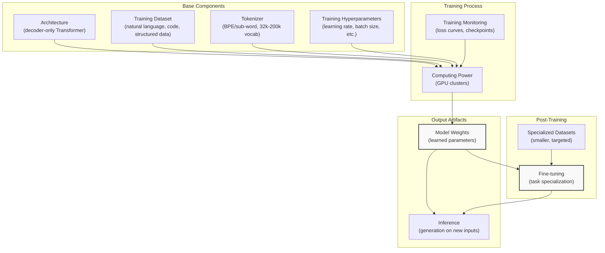
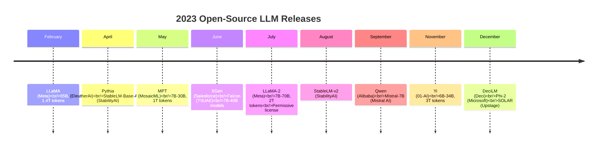
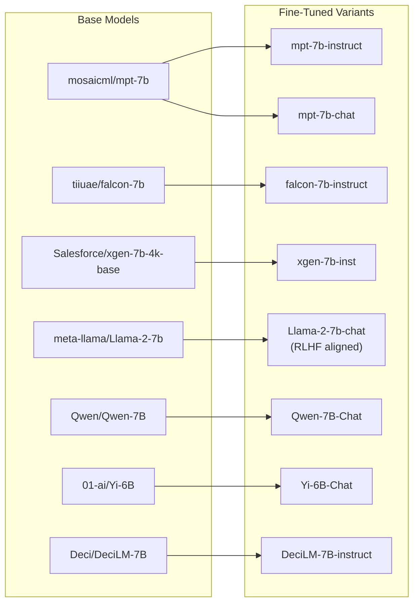
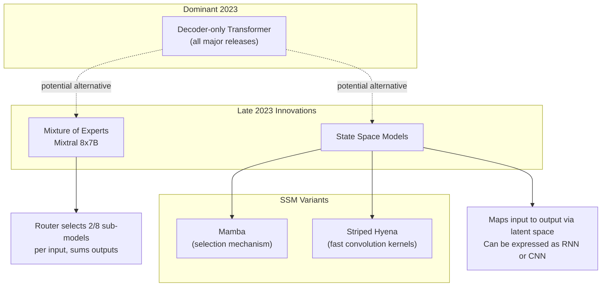

<!-- source: DeepWiki mcp.deepwiki.com · repo huggingface/evaluation-guidebook · page 5.1 2023: Year of Open Source · fetched 2026-10-26 -->

# 2023: Year of Open Source

Relevant source files

The following files were used as context for generating this wiki page:

- [yearly_dives/2023-year-of-open-source.md](yearly_dives/2023-year-of-open-source.md)
- [yearly_dives/2024-evals-thoughts-from-iclr.md](yearly_dives/2024-evals-thoughts-from-iclr.md)
- [yearly_dives/2025-evaluations-for-useful-models.md](yearly_dives/2025-evaluations-for-useful-models.md)

## Purpose and Scope

This page documents the landscape of open-source Large Language Models (LLMs) in 2023, focusing on the technical characteristics, training approaches, and community developments that shaped this period. This historical context is essential for understanding current evaluation practices, as many benchmarks and evaluation methodologies emerged in response to the capabilities and limitations of these models.

For evaluation crisis insights that emerged from 2023's benchmark saturation, see [2024: The Evaluation Crisis](#5.2). For the shift toward utility-focused evaluation, see [2025: Evaluating Useful Models](#5.3).

**Key developments covered:**
- Transition from scale-focused to data-efficient training paradigms
- Release of foundational open-weight models (LLaMA, Falcon, Mistral, Qwen, Yi)
- Proliferation of fine-tuning methods (RLHF, DPO, instruction tuning)
- Community-driven dataset creation and model merging
- Democratization through quantization and PEFT techniques

Sources: [yearly_dives/2023-year-of-open-source.md:1-167]()

---

## The Paradigm Shift: From Scale to Data Efficiency

### 2022 Baseline: Large Models

Before 2023, the prevailing assumption was that larger models with more parameters yielded better performance. The concept of "emergent abilities" and "scaling laws" drove development toward massive models:

| Model Family | Parameters | Training Tokens | Notable Characteristics |
|--------------|-----------|----------------|------------------------|
| BLOOM | 176B | 350B | 46 languages, 13 programming languages, post-embedding normalization, ALiBi embeddings |
| OPT | 175B | 180B | Alternating dense/locally banded attention, GPT-3 comparable |
| GLM-130B | 130B | 400B | Post-layer-norm with DeepNorm, RoPE embeddings, English/Chinese |
| Galactica | 120B | 106B | Scientific literature specialized |
| GPT-NeoX-20B | 20B | 500B | Fully open (architecture, weights, data) |

These models required ~220GB of memory to load a 100B parameter model, making them inaccessible to most practitioners.

### The Chinchilla Findings

The March 2022 DeepMind paper fundamentally changed training philosophy. Key finding: for a fixed compute budget, **models should be smaller but trained on considerably more data**. 

- Chinchilla: 70B parameters (1/3 the size of competitors) trained on 1.4T tokens (3-4x more data)
- Achieved similar or better performance than larger models
- Shifted focus from parameter count to token count

This insight, while likely known in closed labs, catalyzed the open-source community's approach in 2023.

Sources: [yearly_dives/2023-year-of-open-source.md:25-46]()

---

## Model Architecture Foundation

**Core Components Explained:**

1. **Architecture**: Decoder-only Transformer variations with modifications:
   - Attention mechanisms: Flash-Attention, GQA, sliding windows
   - Position encodings: ALiBi, RoPE (Rotary Position Embeddings)
   - Normalization: Pre-norm (RMSNorm), post-norm (LayerNorm)
   - Activation functions: SwiGLU

2. **Tokenization**: Conversion of text to numerical tokens
   - Methods: Character-level, word-level, sub-word (BPE)
   - Vocabulary size: Typically 32,000 to 200,000 tokens
   - Dataset size measured in tokens (hundreds of billions to trillions)

3. **Training Hyperparameters**: Control the learning process
   - Learning rate schedules
   - Batch sizes and gradient accumulation
   - Optimizer configuration (AdamW variants)

4. **Weights**: The trained model parameters
   - Primary artifact released by open-source models
   - Enables inference and fine-tuning without retraining from scratch
   - Environmental and financial benefit through checkpoint reuse

Sources: [yearly_dives/2023-year-of-open-source.md:10-23]()

---

## The 2023 Wave: Open Model Releases

### Key Model Families and Technical Details

#### LLaMA Family
**LLaMA 1** (February 2023)
- Sizes: 7B, 13B, 33B, 65B parameters
- Training: 1.4T tokens (65B), 1T tokens (6B, 13B)
- Notable: Optimized for inference cost, not just training efficiency
- Performance: 13B model outperformed GPT-3 on most benchmarks
- License: Non-commercial (limited adoption)
- HuggingFace path: `meta-llama/Llama-*`

**LLaMA 2** (July 2023)
- Sizes: 7B, 13B, 70B parameters
- Training: 2T tokens from "publicly available sources"
- License: Permissive community license
- Includes extensive RLHF alignment
- HuggingFace path: `meta-llama/Llama-2-*`

#### EleutherAI Pythia
- Suite of models: Multiple sizes for research
- Training: Completely public data
- Purpose: Understanding LLM training dynamics
- Collection: `EleutherAI/pythia-scaling-suite-64fb5dfa8c21ebb3db7ad2e1`

#### MosaicML MPT
- Sizes: 7B, 30B parameters
- Training: 1T tokens (C4, CommonCrawl, The Stack, S2ORC)
- License: Commercial use allowed
- Path: `mosaicml/mpt-*`

#### TIIUAE Falcon
- Sizes: 7B, 40B, 180B parameters
- Training: 1-1.5T tokens (RefinedWeb, Project Gutenberg, Reddit, StackOverflow, GitHub, arXiv, Wikipedia)
- Collection: `tiiuae/falcon-*`
- Technical report and research paper published

#### StabilityAI StableLM
**Base-Alpha** (April 2023)
- Sizes: 3B, 7B
- Training: 1.5T tokens (experimental dataset on ThePile)
- Path: `stabilityai/stablelm-base-alpha-*`

**v2 Series** (August 2023)
- Data: RefinedWeb, RedPajama, ThePile, internal datasets

**3B-4e1T** (December 2023)
- Size: 3B parameters
- Training: 4T tokens
- Includes detailed technical report

#### Mistral AI
**Mistral-7B** (September 2023)
- Size: 7B parameters
- Training: Undisclosed tokens from "open Web"
- Architecture: Sliding window attention
- Path: `mistralai/Mistral-7B-v0.1`

**Mixtral 8x7B** (December 2023)
- Architecture: Mixture of Experts (8 sub-models)
- Routing: For each input, router selects 2 best sub-models

#### Chinese Models
**Qwen (Alibaba)**
- Sizes: 7B-72B parameters
- Training: 2.4T tokens (English/Chinese bilingual)
- Path: `Qwen/Qwen-*`
- Strong performance on open leaderboards

**Yi (01-AI)**
- Sizes: 6B-34B parameters
- Training: 3T tokens (English/Chinese)
- Path: `01-ai/Yi-*`
- Step ahead on Skill-Mix benchmark

### Model Release Characteristics

**Openness Spectrum:**
- **Early 2023**: High openness (dataset mixes, weights, architectures detailed)
- **Late 2023**: Reduced transparency (undisclosed training data, unreproducible)
- All provided starting points through released weights

**Common Architecture Tweaks:**
- Position embeddings: ALiBi or RoPE
- Normalization: RMS pre-normalization
- Activation: SwiGLU
- Attention: Flash-Attention, GQA (Grouped Query Attention), sliding windows
- Code optimizations for training/inference speed

Sources: [yearly_dives/2023-year-of-open-source.md:47-72]()

---

## Fine-Tuning and Alignment Methods

### Method Comparison Table

| Method | Approach | Data Required | Computational Cost | Primary Use |
|--------|----------|---------------|-------------------|-------------|
| Chat Fine-tuning | Supervised learning on dialogue data | Multi-turn conversations | Moderate | General chat behavior |
| Instruction Fine-tuning (IFT) | Supervised learning on instruction-response pairs | Query-answer datasets | Moderate | Task following |
| Distillation | Use larger model outputs as training data | Model generations (e.g., GPT-4) | Moderate | Knowledge transfer |
| RLHF | Train preference model, then RL update | Ranked human preferences | High | Safety alignment |
| RLAIF | Use LLM to rank outputs | Ranked AI preferences | High | Safety (lower cost) |
| DPO | Direct optimization on preference data | Ranked preferences | Moderate | Alignment (simpler than RLHF) |

### Detailed Method Descriptions

#### Chat-Based Fine-Tuning
- Variant of supervised fine-tuning using dialogue data
- Multi-turn conversation format (social media style)
- Auto-regressive next-word prediction
- Teaches conversational flow and context management

#### Instruction Fine-Tuning (IFT)
- Dataset structure: Query/prompt + answer + optional input context
- Teaches instruction-following behavior
- Datasets can be human-generated or LLM-generated
- Enables "distillation" from high-performing models (e.g., GPT-4 outputs)

#### Reinforcement Learning from Human Feedback (RLHF)
Process flow:
1. Generate multiple answers from prompt
2. Humans rank answers
3. Train preference/reward model from rankings
4. Use RL to fine-tune language model with preference model
5. Model learns to maximize human preference scores

Characteristics:
- Costly (annotation + preference model training + RL fine-tuning)
- Primary use: Safety objectives
- References: See HuggingFace RLHF blog and papers [1909.08593](), [2204.05862]()

#### Reinforcement Learning from AI Feedback (RLAIF)
- Same as RLHF but uses high-quality LLM for ranking instead of humans
- Lower cost than RLHF
- Trade-off: Inherits biases from judge LLM

#### Direct Preference Optimization (DPO)
- Eliminates separate preference model
- Directly updates model using preference rankings
- Compares original policy vs optimal policy
- Simpler optimization, equivalent performance to RLHF
- The aligned model IS the preference model

### Models Released with Fine-Tuned Variants

**LLaMA-2's Safety Focus:**
- Extensive safety considerations in pretraining and fine-tuning
- Multiple RLHF iterations for safety alignment
- Red-teaming and adversarial testing
- Most comprehensive safety-focused release of 2023

Sources: [yearly_dives/2023-year-of-open-source.md:74-88]()

---

## Community Ecosystem: Datasets and Models

### Instruction/Chat Dataset Timeline

```mermaid
graph TB
    subgraph "Pre-2023 Foundation"
        WEBGPT["openai/webgpt_comparisons<br/>(OpenAI, preferences)"]
        HHRLHF["anthropics/hh-rlhf<br/>(Anthropic, preferences)"]
        SUMMARIZE["openai/summarize_from_feedback<br/>(OpenAI, preferences)"]
        P3["bigscience/P3<br/>(BigScience, instructions)"]
        FLAN["google-research/FLAN<br/>(Google, instructions)"]
        NATINST["allenai/natural-instructions<br/>(AllenAI, instructions)"]
        SELFINST["yizhongw/self-instruct<br/>(Framework)"]
    end
    
    subgraph "Winter 2022-2023"
        HC3["Hello-SimpleAI/HC3<br/>(Jan, human vs ChatGPT)"]
        ALPACA["tatsu-lab/stanford_alpaca<br/>(Mar, 52K LLM-generated)"]
        OIG["laion.ai/oig-dataset<br/>(Mar, 43M instructions)"]
        VICUNA["ShareGPT conversations<br/>(Mar, ChatGPT user shares)"]
        GUANACO["JosephusCheung/GuanacoDataset<br/>(Mar, 500K multilingual)"]
    end
    
    subgraph "Spring 2023"
        KOALA["BAIR Koala<br/>(Apr, compilation)"]
        DOLLY["databricks/databricks-dolly-15k<br/>(Apr, human-generated)"]
        ULTRACHAT["UltraChat<br/>(May, 1.5M conversations)"]
        GPT4LLM["Microsoft GPT4-LLM<br/>(May, framework)"]
        ORCA["Orca method<br/>(Jun, reasoning traces)"]
        CAMEL["camel-ai datasets<br/>(Jun, 20K+ per domain)"]
        AIROBOROS["Airoboros framework<br/>(Jun, self-instruct)"]
    end
    
    subgraph "Summer-Autumn 2023"
        ULTRALM["OpenBMB UltraLM<br/>(Aug, chat tuned)"]
        ULTRAFEED["openbmb/UltraFeedback<br/>(Sep, GPT-4 ranked)"]
        HERMES["NousResearch/Hermes<br/>(Summer, collections)"]
        OPENCHAT["OpenChat<br/>(Sep, new RL strategy)"]
        ORCADPO["Intel/orca_dpo_pairs<br/>(Sep, DPO dataset)"]
    end
    
    subgraph "End 2023"
        ZEPHYR["HuggingFaceH4/zephyr-7b-beta<br/>(Oct, DPO+AIF)"]
        OPENHERMES["teknium/OpenHermes-2<br/>(Oct, 900K entries)"]
        LMSYS["LMSYS-Chat-1M<br/>(Oct, user conversations)"]
        HELPSTEER["nvidia/HelpSteer<br/>(Nov, graded responses)"]
        ORCA2["microsoft/Orca-2-13b<br/>(Nov, synthetic reasoning)"]
        NEURAL["Intel/neural-chat-7b-v3-1<br/>(Nov, Orca+DPO)"]
        STARLING["berkeley-nest/Starling-LM<br/>(Dec, RLAIF)"]
        NECTAR["berkeley-nest/Nectar<br/>(Dec, 200K comparisons)"]
    end
    
    WEBGPT --> KOALA
    HHRLHF --> KOALA
    SUMMARIZE --> KOALA
    
    ALPACA --> GUANACO
    
    VICUNA --> ULTRACHAT
    
    ULTRACHAT --> ZEPHYR
    ULTRAFEED --> ZEPHYR
    
    ZEPHYR --> STARLING
```

### Community Fine-Tuning Highlights

**Stanford Alpaca** (March 2023)
- First instruction-following LLaMA model (7B)
- Dataset: 52K instructions generated with LLM
- Demonstrated community's ability to rapidly adapt base models

**LMSYS Vicuna** (March 2023)
- LLaMA 13B fine-tuned on ShareGPT conversations
- User-shared ChatGPT conversations as training data
- Pioneered using public user data for model improvement

**Databricks Dolly** (April 2023)
- 15K manually generated instructions
- Significant human annotation effort
- Pythia fine-tune demonstrating data quality importance

**Open Orca** (June 2023)
- Community reproduction of Microsoft's Orca method
- Several million entries
- Used to fine-tune multiple model families (LLaMA, Mistral)

**Hugging Face Zephyr** (October 2023)
- Mistral-7B + DPO + AIF
- Training: UltraChat + UltraFeedback
- Path: `HuggingFaceH4/zephyr-7b-beta`
- Demonstrated DPO effectiveness

**Berkeley Starling** (December 2023)
- RLAIF fine-tuned OpenChat
- Nectar dataset: 200K comparison entries
- Path: `berkeley-nest/Starling-LM-7B-alpha`

### Community Characteristics

**Discussion Platforms:**
- Reddit discussions on model quality
- Discord servers for fine-tuning techniques
- Hugging Face Hub model cards and discussions
- Twitter/X for release announcements

**Collaborative Development:**
- Spontaneous expertise sharing
- Dataset quality validation through community testing
- Model merging experiments shared openly
- Rapid iteration and improvement cycles

Sources: [yearly_dives/2023-year-of-open-source.md:90-104]()

---

## Democratization Techniques

### Model Merging

Model merging combines weights from different fine-tuned models sharing a common architecture to unify their strengths.

**Merging Methods:**

| Method | Approach | Reference |
|--------|----------|-----------|
| Simple Averaging | Average parameters across models | Papers [2204.03044](), [2109.01903]() |
| Weighted Averaging | Weight parameters by task importance | Paper [2111.09832]() |
| TIES Merging | Consider parameter interference before merging | Paper [2306.01708]() |

**Example Merged Model Naming:**
- `llama2-zephyr-orca-ultra`: Likely LLaMA-2 + Zephyr merged, trained on Orca + Ultra datasets
- Model cards on Hugging Face Hub provide merge details

**Community Impact:**
- Enables customization without training resources
- Exploits common architecture across 2023 releases
- Creates unique model variants for specific use cases
- Submitted models to Open LLM Leaderboard often have merge lineage

**Traceability Challenges:**
- Complex merge/commit histories
- Dataset provenance difficult to track (compilations of compilations)
- Models may be "fine-tuned versions of fine-tuned versions"
- Example: Mistral's child models tree visualization

### Parameter Efficient Fine-Tuning (PEFT)

Technique for fine-tuning without loading entire model in memory.

**Process:**
1. Freeze pretrained model parameters
2. Add small "adapter" layers on top
3. Fine-tune only the lightweight adapters
4. Share adapter weights (much smaller than base model)

**Benefits:**
- Reduces memory requirements dramatically
- Enables fine-tuning on consumer hardware
- Quick iteration on specialized tasks
- Easy sharing and swapping of adapters

**Implementations:**
- Hugging Face PEFT library: `github.com/huggingface/peft`
- Multiple adapter architectures available

### Quantization

Reduces model size by decreasing parameter precision.

**Precision Levels and Memory Requirements:**

| Model Size | float16 | int8 | int4 |
|------------|---------|------|------|
| 30B params | ~66 GB | ~33 GB | ~16 GB |
| 70B params | ~154 GB | ~77 GB | ~38 GB |
| 7B params | ~15 GB | ~7.5 GB | ~3.75 GB |

**How Quantization Works:**
- Numbers stored at different precisions: `float32`, `float16`, `int8`, `int4`
- Higher precision = more bits = more memory
- Lower precision = less memory but potential performance degradation
- Large models show limited performance loss when quantized

**Popular Methods:**

| Method | Description | Paper |
|--------|-------------|-------|
| bitsandbytes | 8-bit and 4-bit quantization | [2208.07339]() |
| GPTQ | Post-training quantization | [2210.17323]() |
| AWQ | Activation-aware weight quantization | [2306.00978]() |

**Community Quantization:**
- Users like TheBloke (`TheBloke` on Hugging Face) convert popular models
- Provides quantized versions in multiple formats
- Dramatically improves accessibility for consumer hardware

**Performance Impact:**
- Minimal degradation on larger models (30B+)
- More noticeable on smaller models
- Trade-off: accessibility vs precision

Sources: [yearly_dives/2023-year-of-open-source.md:107-139]()

---

## Emerging Architectures

### Mixture of Experts: Mixtral

**Mixtral 8x7B** (December 2023)
- Path: `mistralai/Mixtral-8x7B-v0.1`
- Architecture: 8 decoder sub-models
- Routing mechanism: For each input, router selects 2 best sub-models
- Combines outputs via summation
- Effective parameter usage: ~12.9B active parameters per token
- Total parameters: ~47B

### State Space Models (SSMs)

Fundamentally different from Transformers: map inputs to outputs through a latent state space.

**Theoretical Properties:**
- Can be expressed as RNN (Recurrent Neural Network)
- Can be expressed as CNN (Convolutional Neural Network)
- Depends on task and formulation

**Mamba**
- Paper: [2312.00752]()
- Innovation: Added selection mechanism to state space model
- Enables selective information retention
- More efficient long-range dependency modeling

**Striped Hyena**
- Path: `togethercomputer/StripedHyena-Nous-7B`
- Innovation: Fast convolution kernels
- Hybrid architecture optimizing for speed

**Status at End 2023:**
- Too early to determine if SSMs will replace Transformers
- Promising computational efficiency characteristics
- Requires further validation on diverse tasks
- Active area of research entering 2024

Sources: [yearly_dives/2023-year-of-open-source.md:140-151]()

---

## Evaluation Implications

### Benchmark Saturation

By end of 2023, several evaluation trends emerged:

**Contamination Concerns:**
- Open datasets increasingly in training data
- Models achieving high scores without true capability
- Need for dynamic benchmarks recognized

**Common Benchmarks Reaching Limits:**
- GSM8K (grade school math): Near-saturated
- MMLU (knowledge): Approaching ceiling
- HumanEval (code): Top models scoring >80%

**Response Strategies:**
- GSM-variants created: GSM1K, GSM-Plus, GSM-Symbolic
- MMLU cleaned and extended: MMLU-Redux, MMLU-Pro
- Private benchmarks emerged: GPQA (gated access)

### Open LLM Leaderboard

The Hugging Face Open LLM Leaderboard (`HuggingFaceH4/open_llm_leaderboard`) became the primary public benchmark aggregator:

**Characteristics:**
- Aggregates scores across multiple benchmarks
- Enables model comparison
- Receives merged model submissions
- Democratizes model evaluation

**Issues Identified:**
- Score instability with prompt variations
- Merged models with complex lineage
- Contamination difficult to detect
- Rankings fluctuate with minor perturbations

These evaluation challenges directly led to the 2024 evaluation crisis (see [2024: The Evaluation Crisis](#5.2)).

### Vibe-Check Culture

**Manual Evaluation Practices:**
- Individual practitioners test models on personal use cases
- Shared anecdotally on Reddit, Twitter, Discord
- Ranges from coding to creative writing
- Highly subjective but provides real-world signal

**Systematic Community Reviews:**
- Users like Wolfram Ravenwolf publish methodical comparisons
- Consistent testing methodology across models
- Helps practitioners select models for specific tasks

Sources: [yearly_dives/2023-year-of-open-source.md:1-167](), [yearly_dives/2024-evals-thoughts-from-iclr.md:1-122]()

---

## Key Takeaways

| Theme | Development |
|-------|-------------|
| **Openness** | Ebbs and flows: early 2023 very open (datasets, architecture), late 2023 less transparent (undisclosed training data) |
| **Geography** | Emergence of strong Chinese contenders (Qwen, Yi, DeepSeek) |
| **Scale** | Shift from 100B+ to efficient 7B-70B models trained on more data |
| **Accessibility** | Quantization and PEFT enabled consumer hardware deployment |
| **Community** | Unprecedented community-driven fine-tuning and dataset creation |
| **Alignment** | RLHF, DPO, and instruction tuning became standard practice |
| **Architecture** | Transformer dominant but SSMs and MoE emerged as alternatives |
| **Licensing** | Mix of permissive (LLaMA-2) and restrictive (LLaMA-1) licenses |
| **Evaluation** | Benchmark saturation and contamination concerns grew |

**Impact on Current Practice:**

1. **Evaluation Design**: Recognition that benchmarks saturate led to dynamic evaluation approaches (see [2025: Evaluating Useful Models](#5.3))

2. **Capability Assessment**: Difficulty defining and measuring "reasoning" or "general intelligence" became apparent (see [2024: The Evaluation Crisis](#5.2))

3. **Open Science**: Community demonstrated ability to rapidly iterate on and improve base models without massive compute resources

4. **Training Paradigm**: Data quality and quantity became more important than parameter count alone

5. **Accessibility**: Democratization techniques (quantization, PEFT, merging) made LLMs accessible to broader practitioner base

Sources: [yearly_dives/2023-year-of-open-source.md:152-162]()

---

