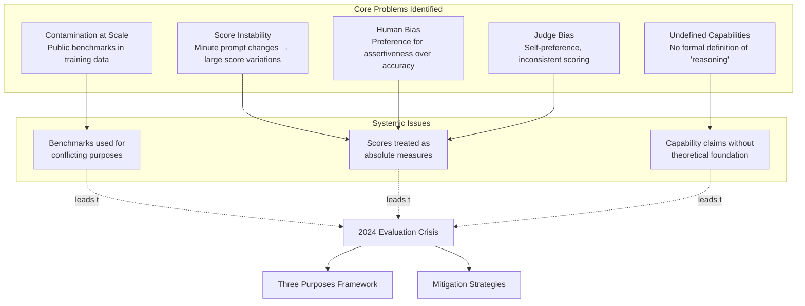
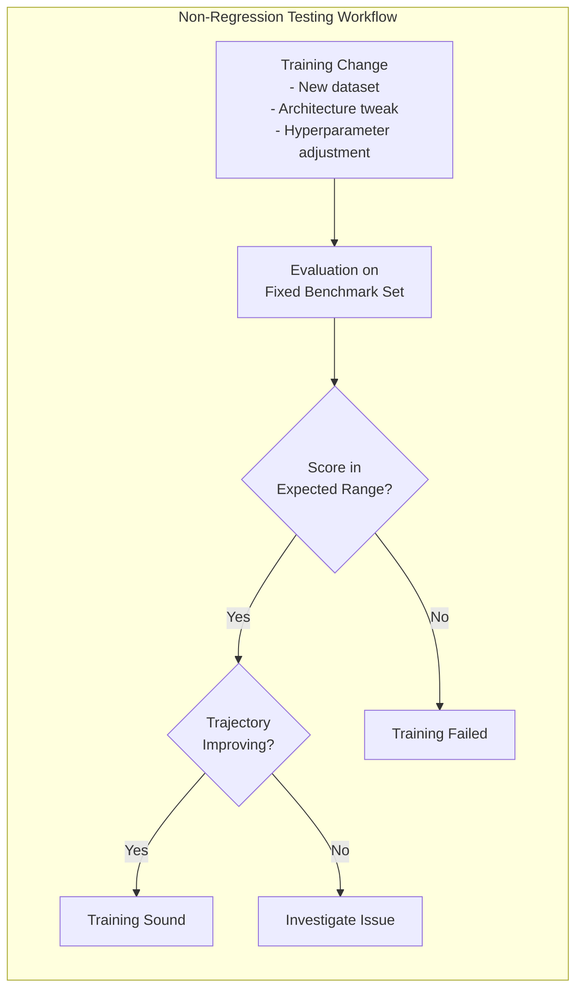
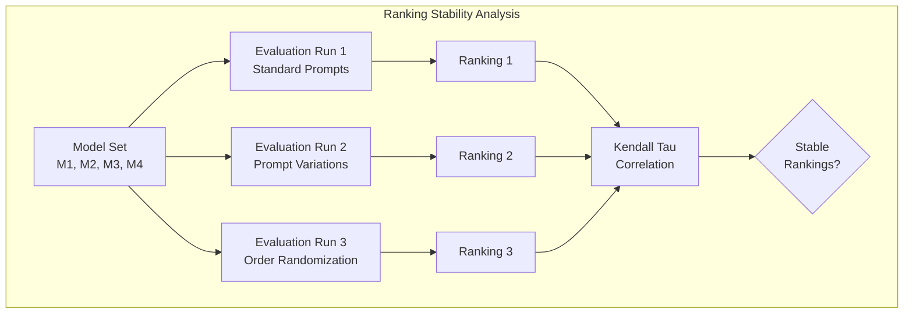
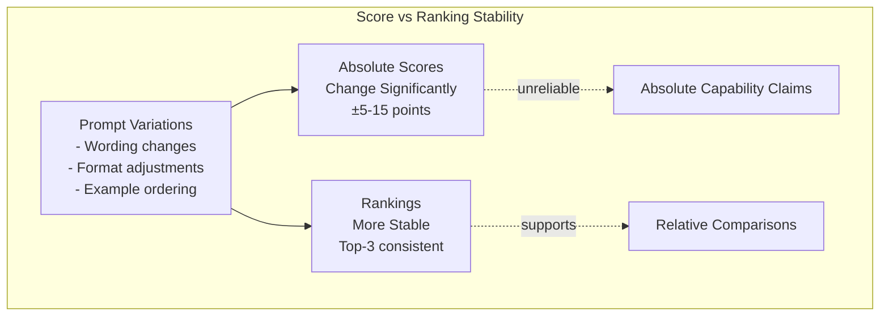
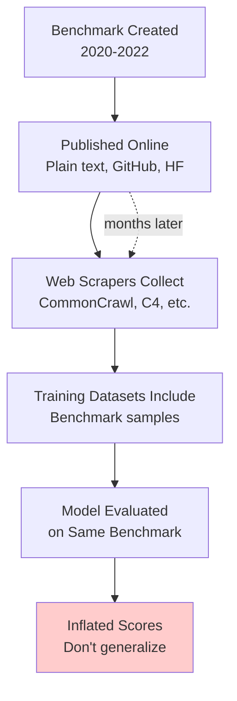
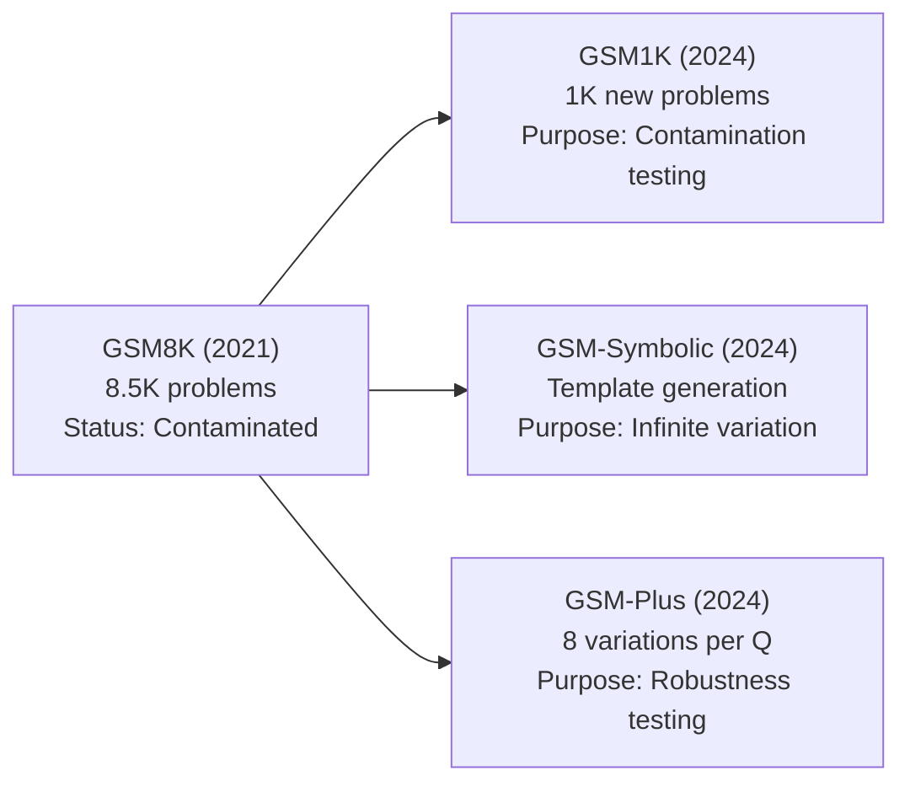
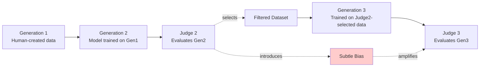
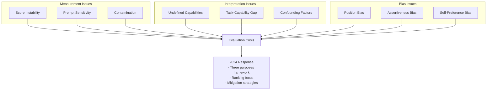

<!-- source: DeepWiki mcp.deepwiki.com · repo huggingface/evaluation-guidebook · page 5.2 2024: The Evaluation Crisis · fetched 2026-10-26 -->

# 2024: The Evaluation Crisis

<details>
<summary>Relevant source files</summary>

The following files were used as context for generating this wiki page:

- [yearly_dives/2023-year-of-open-source.md](yearly_dives/2023-year-of-open-source.md)
- [yearly_dives/2024-evals-thoughts-from-iclr.md](yearly_dives/2024-evals-thoughts-from-iclr.md)
- [yearly_dives/2025-evaluations-for-useful-models.md](yearly_dives/2025-evaluations-for-useful-models.md)

</details>


**Purpose**: This page documents the fundamental evaluation problems recognized in 2024, including score instability, contamination at scale, and the inability to define model "capabilities." It presents the three-purpose framework that emerged from this crisis (non-regression testing, leaderboard rankings, capability assessment) and analyzes the limitations discovered in all three evaluation paradigms: automated benchmarks, human evaluation, and LLM-as-judge.

**Context**: For background on the pre-crisis evaluation landscape, see [2023: Year of Open Source](#5.1). For how the field evolved in response to these challenges, see [2025: Evaluating Useful Models](#5.3).

---

## Overview: The Crisis Recognition

In early 2024, particularly around the ICLR conference, the LLM evaluation community confronted a series of interconnected problems that challenged the validity of existing evaluation approaches. These issues had been accumulating throughout 2023 but reached critical mass as model capabilities expanded and evaluation became increasingly central to research and product development.



**Sources**: [yearly_dives/2024-evals-thoughts-from-iclr.md:1-10](), [yearly_dives/2025-evaluations-for-useful-models.md:1-166]()

---

## The Three Purposes Framework

The critical insight of 2024 was recognizing that evaluation serves **three distinct purposes** that were being conflated. Each purpose requires different methodologies, metrics, and interpretation frameworks.

### Purpose 1: Non-Regression Testing

**Question Addressed**: "Is my model training well? Is my training method sound?"

Non-regression testing validates that training procedures produce expected behaviors, not that models achieve specific capability levels. This concept borrowed from software engineering ensures that changes to training data, architecture, or hyperparameters do not "break" the learning process.

**Key Characteristics**:
- Focus on **score trajectories** (improvement over training) rather than absolute values
- Focus on **score ranges** (performance within expected bounds for model size)
- Benchmark contamination is less critical since goal is relative measurement
- Perplexity-based metrics may be sufficient

**Example**: A 7B base LLM should score 50-65 on MMLU (multiple choice). Performance of 20-30 indicates failed learning, regardless of the "target" capability.



**Table: Non-Regression vs Capability Evaluation**

| Aspect | Non-Regression Testing | Capability Evaluation |
|--------|------------------------|----------------------|
| **Goal** | Validate training process | Measure model abilities |
| **Metric Focus** | Trajectory and range | Absolute score |
| **Contamination Risk** | Low concern | Critical concern |
| **Score Interpretation** | "Within bounds?" | "How capable?" |
| **Benchmark Requirements** | High signal-to-noise ratio | Task representativeness |
| **Stability Needs** | Moderate | High |

**Sources**: [yearly_dives/2024-evals-thoughts-from-iclr.md:71-84](), [yearly_dives/2025-evaluations-for-useful-models.md:157-159]()

### Purpose 2: Leaderboard Rankings and Model Selection

**Question Addressed**: "Which model is the best? Is my model better than your model?"

Leaderboards exist to establish relative model ordering, not to provide absolute capability measurements. The 2024 insight was that **rankings are more stable than scores** when using robust evaluation methods, even though individual scores fluctuate with prompt variations.

**Critical Finding**: In the ICLR 2024 plenary, Moritz Hardt demonstrated that neither the Open LLM Leaderboard nor Chatbot Arena provided stable rankings under perturbations. The Open LLM Leaderboard showed instability when adding minuscule score modifications (within expected variance), while Chatbot Arena's Elo rankings shifted significantly when introducing bad contenders.

**Ranking Stability Requirements**:
- Consistent relative ordering across evaluation runs
- Robustness to minor prompt variations
- Broad groups of evaluations providing convergent rankings
- Statistical significance testing between adjacent ranks



**Sources**: [yearly_dives/2024-evals-thoughts-from-iclr.md:86-94]()

### Purpose 3: Capability Assessment

**Question Addressed**: "Where are we, as a field, in terms of model capabilities? Can my model do X?"

This is the most problematic purpose identified in 2024. The community recognized that **we cannot define what constitutes a "capability" for machine learning models**, especially for complex behaviors like reasoning or theory of mind.

**The Fundamental Problem**: For any complex capability, the best available statement is: "This model is the best on this task that we hope is a good proxy for this capability, **without any guarantee**."

**Why Capabilities Are Undefined**:

| Challenge | Description | Example |
|-----------|-------------|---------|
| **No Theoretical Framework** | No formal definition of what "reasoning" means for ML systems | GSM8K tests math problem-solving, not "mathematical reasoning" as an abstract capability |
| **Confounding Factors** | Performance affected by memorization, pattern matching, spurious correlations | High MMLU scores may reflect training data overlap rather than knowledge |
| **Task-Capability Gap** | Tasks measure observable behavior, not underlying mechanism | Models that "draw" unicorns may be retrieving patterns, not understanding visual concepts |
| **Anthropomorphic Projection** | Human capability frameworks don't transfer to models | IQ/EQ metrics controversial even for humans |

**Key Quote from 2024**: 
> "We are strongly missing any kind of good definitions and framework on what a capability is for a machine learning model, especially for those surrounding reasoning and mind theory. However, this is not specific to machine learning! In human and animal studies, it is also quite hard to define what constitutes a 'capability'."

**Sources**: [yearly_dives/2024-evals-thoughts-from-iclr.md:96-104](), [yearly_dives/2025-evaluations-for-useful-models.md:3-9]()

---

## Score Instability and Prompt Sensitivity

One of the most disruptive discoveries in 2024 was that LLM benchmark scores exhibit extreme sensitivity to superficial prompt variations, making absolute scores nearly meaningless for model comparison.

### Manifestations of Instability

**Multiple Choice Position Bias**: Models favor specific answer positions (A, B, C, D) based on training data patterns rather than content. Randomizing answer order produces different scores for the same model.

**Generative Evaluation Normalization**: String comparison methods for matching generated answers to references are highly sensitive to:
- Whitespace handling
- Case sensitivity  
- Punctuation normalization
- Numeric formatting (e.g., "1,000" vs "1000")

**Prompt Formatting**: Minor wording changes produce score variations of 5-15 points on benchmarks like MMLU:
- "Answer the following question" vs "Question:"
- Few-shot example ordering
- Instruction placement (before vs after context)

### Implications for Evaluation Design



**Consequence**: The field shifted from reporting absolute scores (e.g., "Model X achieves 82.3 on MMLU") to reporting rankings and score ranges (e.g., "Model X ranks #3 on MMLU with scores 80-84 across prompt variations").

**Sources**: [yearly_dives/2024-evals-thoughts-from-iclr.md:27-28](), [yearly_dives/2024-evals-thoughts-from-iclr.md:86-94]()

---

## Contamination at Scale

By 2024, benchmark contamination evolved from an occasional problem to a systemic crisis. Most public benchmarks published before 2023 appeared in training datasets, either deliberately or accidentally through web scraping.

### The Contamination Lifecycle



### Detection Methods (2024)

**Canary Strings**: Unique character sequences added to benchmarks for dataset authors to search and remove (e.g., BigBench). **Problem**: Requires awareness and effort from data curators; not widely adopted.

**Perplexity Analysis**: Contaminated models show unusually low perplexity on benchmark text compared to similar unseen text. **Problem**: Difficult to establish baseline thresholds.

**Temporal Analysis**: Compare model performance on problems created before vs after training cutoff date (e.g., AIME 2024 vs AIME 2025). **Problem**: Requires regularly updated benchmarks.

**Behavioral Testing**: GSM-Symbolic approach where problems are regenerated from templates, testing if performance degrades on structurally identical but numerically different problems.

### Contamination Mitigation Strategies

| Strategy | Implementation | Advantages | Disadvantages |
|----------|----------------|------------|---------------|
| **Gated Access** | Benchmark requires application approval | Prevents casual scraping | Limits research accessibility |
| **Encrypted Datasets** | Samples encrypted, decryption requires expertise | Prevents accidental inclusion | High barrier to entry |
| **Dynamic Benchmarks** | Regular refresh with new samples | Always uncontaminated | High maintenance cost |
| **Private Test Sets** | Hold-out test split never released | Guaranteed clean evaluation | No external verification |

**Example: GSM8K Family Evolution**



**Sources**: [yearly_dives/2024-evals-thoughts-from-iclr.md:33-36](), [yearly_dives/2025-evaluations-for-useful-models.md:38-46]()

---

## Automated Benchmark Limitations

### The Generalization vs Specificity Paradox

Automated benchmarks face an irreconcilable tension: tasks must be either **well-defined and specific** (enabling automatic scoring) or **holistic and general** (measuring broad capabilities). They cannot be both.

**Well-Defined Tasks**: 
- Example: Email spam classification
- **Pros**: Clear success criteria, interpretable results, automatic metrics
- **Cons**: Narrow scope, doesn't generalize to related tasks

**Holistic Capabilities**:
- Example: "Good at math"
- **Pros**: Broad coverage, relevant to real use cases
- **Cons**: Success/failure hard to interpret, poor proxy for actual capability

**2024 Realization**: Most "capability" benchmarks (MMLU, GSM8K, HumanEval) are actually **proxy tasks** with no theoretical justification for why performance should indicate the target capability.

### Multiple Choice Artifacts

Multiple choice evaluations revealed systematic biases in 2024:

**Position Bias**: Models trained on data where correct answers appear more frequently in position A or C will favor those positions regardless of content.

**Distributional Artifacts**: Models learn spurious correlations from training data:
- Longer answers more likely correct
- Answers with specific formatting patterns
- Semantic similarity to question text

**The MMLU Crisis**: In 2024, MMLU underwent scrutiny revealing:
- Incomplete questions referring to absent documents
- Incorrect ground truth answers  
- Ambiguous questions with multiple valid answers
- Americano-centric topic selection

This led to cleaned/extended versions: **MMLU-Redux** (2024), **MMLU-Pro** (2024), and **Global-MMLU** (2024).

**Sources**: [yearly_dives/2024-evals-thoughts-from-iclr.md:17-31](), [yearly_dives/2025-evaluations-for-useful-models.md:26-30]()

---

## Human Evaluation Limitations

### The Assertiveness Bias

A critical finding in 2024: **human evaluators rate answer quality based on tone rather than factuality**. Studies showed that crowdsourced annotators significantly underestimate factual errors in confidently-phrased incorrect answers.

**Experimental Results**:
- Assertive wrong answers rated higher than tentative correct answers
- Expert annotators less susceptible to this bias
- Effect strongest in crowdsourced annotation

**Table: Human Evaluator Biases (2024 Studies)**

| Bias Type | Description | Affected Domains | Mitigation |
|-----------|-------------|------------------|------------|
| **First Impression** | Quality estimated from initial tone, not full analysis | All domains | Expert annotators, structured guidelines |
| **Assertiveness** | Confident tone → higher ratings, regardless of accuracy | Factual knowledge, code, reasoning | Fact-checking protocols |
| **Alignment** | Prefer answers matching annotator's views/errors | Opinion-based tasks | Multiple annotators, calibration |
| **Cultural** | Preferences vary by cultural background | Conversation style, formality | Diverse annotator pool |

### The Three Human Evaluation Approaches

```mermaid
graph TB
    subgraph "Vibes-checks"
        V1["Individual Assessment"]
        V2["Undisclosed Prompts"]
        V3["Anecdotal Evidence"]
        V4["High Confirmation Bias"]
        
        V1 --> V2 --> V3 --> V4
    end
    
    subgraph "Arena Voting"
        A1["Community Scale"]
        A2["Pairwise Comparison"]
        A3["Elo Ranking"]
        A4["Subjectivity Smoothing"]
        
        A1 --> A2 --> A3 --> A4
    end
    
    subgraph "Systematic Annotation"
        S1["Paid Annotators"]
        S2["Detailed Guidelines"]
        S3["Quality Control"]
        S4["High Cost"]
        
        S1 --> S2 --> S3 --> S4
    end
```



**Vibes-checks**: Individual, unsystematic evaluations. High bias, low reproducibility. **Use case**: Personal exploration, not rigorous comparison.

**Arena Voting** (e.g., LMSYS Chatbot Arena): Large-scale community voting with Elo rankings. Subject to cultural bias and inconsistent criteria. **Use case**: Capturing general user preference.

**Systematic Annotation** (e.g., ScaleAI): Detailed guidelines, trained annotators, rigorous protocols. Expensive and still subject to human biases. **Use case**: High-stakes evaluation requiring consistency.

**Sources**: [yearly_dives/2024-evals-thoughts-from-iclr.md:38-54]()

---

## LLM-as-Judge Biases

Using models to evaluate other models emerged as a cost-effective alternative to human annotation, but 2024 revealed fundamental limitations.

### Self-Preference Bias

Models consistently rate their own outputs higher than equivalent outputs from other models. This effect persists even when outputs are anonymized, suggesting models recognize their own generation patterns.

**Measurement**: When GPT-4 judges GPT-4 vs Claude outputs of equivalent quality, GPT-4 outputs receive ~15% higher scores.

### Inconsistent Scoring

LLM judges exhibit poor calibration across score ranges:
- Tend to cluster scores in middle range (6-8 out of 10)
- Avoid extreme scores (1-3 or 9-10)
- Score compression reduces discriminative power

**Mitigation**: Chain-of-Thought prompting (asking models to explain reasoning before scoring) improves consistency but doesn't eliminate bias.

### Ranking Inconsistency with Humans

2024 studies found that LLM judges correlate moderately with human preference (0.6-0.7 correlation) but diverge on key dimensions:
- Overweight fluency and formatting
- Underweight factual accuracy
- Prefer longer, more verbose answers

### The Generational Bias Problem



**Concern**: Using LLMs to select training data for future LLMs introduces compounding subtle biases across generations, similar to inbreeding problems in genetics. Long-term effects unknown but potentially severe.

**Specialist Judge Exception**: Small, specialized models trained specifically as judges (e.g., toxicity classifiers) show more reliable behavior than generalist LLMs, but still require careful validation.

**Sources**: [yearly_dives/2024-evals-thoughts-from-iclr.md:56-64]()

---

## Proposed Solutions and Mitigation Strategies

### Dynamic Benchmark Framework

**Concept**: Continuously refresh evaluation datasets to prevent contamination and maintain discriminative power.

**Implementation Requirements**:
- Automated sample generation pipeline
- Quality control mechanisms
- Version tracking and historical comparison
- Cost-effective data sourcing

**Examples**:
- **LiveCodeBench**: Continuously updated with LeetCode problems, tracking temporal contamination
- **Math-Arena**: Regularly updated competition problems from ongoing olympiads
- **FutureBench**: Questions about future events, inherently contamination-proof

**Challenges**:
- High maintenance cost
- Difficulty ensuring consistent difficulty across versions
- Need for automated quality validation

### Private Dataset Strategy

**Approach**: Maintain evaluation datasets that are never publicly released, with access only through controlled evaluation services.

**Table: Private Dataset Trade-offs**

| Aspect | Advantage | Disadvantage |
|--------|-----------|--------------|
| **Contamination** | Guaranteed prevention | No community verification |
| **Reproducibility** | Eliminated for external researchers | N/A |
| **Cost** | One-time creation | Ongoing access management |
| **Trust** | Requires trusting evaluator | Critical for acceptance |

**Example**: Humanity's Last Exam (2024) - 2.5K expert-written questions, mostly private. Problem: No fast scoring, so people use LLM judges as proxy, making comparisons unreliable.

### Contamination Detection Techniques

**Template-Based Generation** (GSM-Symbolic model):
```
Template: "John has X apples. He gives Y to Mary. How many remain?"
Generate: Replace X, Y with random values
Test: Does performance degrade on new instances?
```

If model performance drops significantly on template variations, original dataset likely contaminated.

**Temporal Testing** (AIME approach):
1. Train model with cutoff date T
2. Evaluate on benchmark created before T (e.g., AIME 2024)
3. Evaluate on benchmark created after T (e.g., AIME 2025)
4. Compare performance: large gap suggests contamination

### Ranking-First Evaluation

**Principle**: Report rankings and confidence intervals rather than point scores.

**Implementation**:
1. Evaluate each model multiple times with prompt variations
2. Compute score distribution for each model
3. Establish ranking with statistical significance testing
4. Report: "Model A ranks #1 (p < 0.05 vs Model B)"

**Benefits**:
- More robust to score instability
- Provides uncertainty quantification
- Focuses on actionable comparisons

**Sources**: [yearly_dives/2024-evals-thoughts-from-iclr.md:33-36](), [yearly_dives/2025-evaluations-for-useful-models.md:40-49](), [yearly_dives/2025-evaluations-for-useful-models.md:60-62]()

---

## The State of Evaluation Paradigms in 2024

### Summary Matrix

| Paradigm | Strengths (2024) | Limitations (2024) | Recommended Use |
|----------|------------------|-------------------|-----------------|
| **Automated Benchmarks** | - Fast, cheap, reproducible<br/>- Good for non-regression testing<br/>- Useful for rankings | - Contamination widespread<br/>- Score instability<br/>- Poor capability proxies | Non-regression testing, relative rankings on stable benchmarks |
| **Human Evaluation** | - Captures subjective quality<br/>- Flexible for new tasks<br/>- Detects subtle issues | - Assertiveness bias<br/>- Cultural variation<br/>- High cost, low scale | Subjective quality assessment, preference modeling |
| **LLM-as-Judge** | - Scalable, cost-effective<br/>- Correlates with human preference<br/>- Flexible prompt design | - Self-preference bias<br/>- Inconsistent scoring<br/>- Generational concerns | Preliminary filtering, tasks where subtle bias acceptable |

### The Unsolved Problem

At the end of 2024, the field recognized that:

> **"We cannot at the moment just say 'this model is the best at this', but instead 'this model is the best on this task that we hope is a good proxy for this capability, without any guarantee'."**

The theoretical framework for defining and measuring model capabilities remained absent. The field acknowledged this limitation but had no clear path forward, setting the stage for the 2025 paradigm shift toward evaluating practical utility rather than abstract intelligence.

### Cross-Cutting Concerns Identified



**Sources**: [yearly_dives/2024-evals-thoughts-from-iclr.md:105-114]()

---

## Key Takeaways for Practitioners

1. **Separate Evaluation Purposes**: Distinguish between non-regression testing (training validation), leaderboard ranking (model selection), and capability assessment (field progress). Each requires different methodologies.

2. **Report Ranges, Not Points**: Given score instability, report confidence intervals and rankings rather than single scores. Example: "Model ranks #2 with MMLU 79.2±3.1" instead of "Model scores 82.3 on MMLU."

3. **Assume Contamination**: For benchmarks published before 2023, assume training data contamination. Use post-2024 benchmarks or private datasets for critical decisions.

4. **Validate Human Annotations**: For factual domains (code, math, knowledge), supplement human evaluation with automatic correctness checks to mitigate assertiveness bias.

5. **Use LLM Judges Carefully**: Acceptable for preliminary filtering or subjective quality (helpfulness, style). Avoid for factual accuracy or when evaluating models from the same family as the judge.

6. **Prioritize Ranking Stability**: When designing benchmarks, optimize for consistent relative model ordering across evaluation variations rather than absolute score precision.

7. **Acknowledge Capability Uncertainty**: Avoid claiming "Model X can reason" or "Model Y understands language." Instead: "Model X ranks highest on reasoning-proxy tasks" or "Model Y shows strong performance on language understanding benchmarks."

**Sources**: [yearly_dives/2024-evals-thoughts-from-iclr.md:1-122]()

---

