<!-- source: DeepWiki mcp.deepwiki.com · repo huggingface/evaluation-guidebook · page 5.3 2025: Evaluating Useful Models · fetched 2026-10-26 -->

# 2025: Evaluating Useful Models

Relevant source files

The following files were used as context for generating this wiki page:

- [yearly_dives/2023-year-of-open-source.md](yearly_dives/2023-year-of-open-source.md)
- [yearly_dives/2024-evals-thoughts-from-iclr.md](yearly_dives/2024-evals-thoughts-from-iclr.md)
- [yearly_dives/2025-evaluations-for-useful-models.md](yearly_dives/2025-evaluations-for-useful-models.md)

## Purpose and Scope

This page documents the 2025 paradigm shift in LLM evaluation from measuring abstract "intelligence" to assessing practical utility. It presents the multi-layered evaluation architecture that emerged in 2025, progressing from isolated capabilities through integrated assistant tasks to dynamic adaptation testing. This represents the culmination of lessons learned from the evaluation crisis of 2024 (see [2024: The Evaluation Crisis](#5.2)).

For historical context on the open-source movement that preceded these evaluation changes, see [2023: Year of Open Source](#5.1). For practical implementation of these evaluation approaches, see [Designing Automated Evaluations](#2.1.1) and [Evaluation Datasets Catalog](#2.1.2).

**Sources:** [yearly_dives/2025-evaluations-for-useful-models.md:1-11]()

## The Philosophical Shift: From Intelligence to Utility

The core insight of 2025 was recognizing that evaluating whether models are "intelligent" is both philosophically intractable and practically less useful than evaluating whether they function as effective assistants. Modern LLMs are primarily deployed as assistants for coding, administrative support, and agentic tasks rather than as general intelligence systems.

According to reports from Anthropic and OpenAI, the dominant use cases for LLMs center on assistant-like behavior: managing ambiguous instructions, constructing step-by-step plans, identifying necessary resources, applying plans while calling tools, and adapting to unexpected events—all without hallucinating.

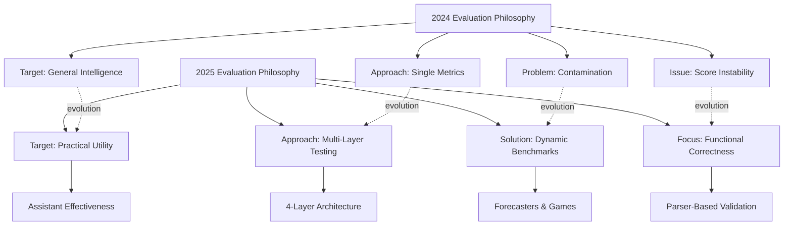

**Diagram: Paradigm Evolution from 2024 to 2025**

This shift emphasizes that a good assistant requires orchestrating multiple capabilities simultaneously rather than excelling at isolated tasks. A model might perform well on math benchmarks but fail when that math reasoning must integrate with tool calling and long context management in realistic scenarios.

**Sources:** [yearly_dives/2025-evaluations-for-useful-models.md:1-11, 109-111, 153-167]()

## The Four-Layer Evaluation Architecture

The 2025 evaluation framework structures testing across four distinct layers, each serving a different purpose and measuring increasingly integrated capabilities:

| Layer | Purpose | Signal Type | Contamination Risk | Example Benchmarks |
|-------|---------|-------------|-------------------|-------------------|
| **Layer 1: Specific Capabilities** | Validate individual skills during development | Training signal, model comparison | High (static datasets) | MATH-500, IFEval, HELMET |
| **Layer 2: Assistant Tasks** | Measure integrated multi-capability performance | Real-world utility | Medium (can be gated) | GAIA, DABStep, SciCode |
| **Layer 3: Dynamic Environments** | Test adaptability and robustness | Behavioral patterns | Low (games change state) | TextQuests, Town of Salem, ARC-AGI3 |
| **Layer 4: Forecasters** | Contamination-proof capability testing | Reasoning quality | None (future events) | FutureBench, FutureX, Arbitrage |

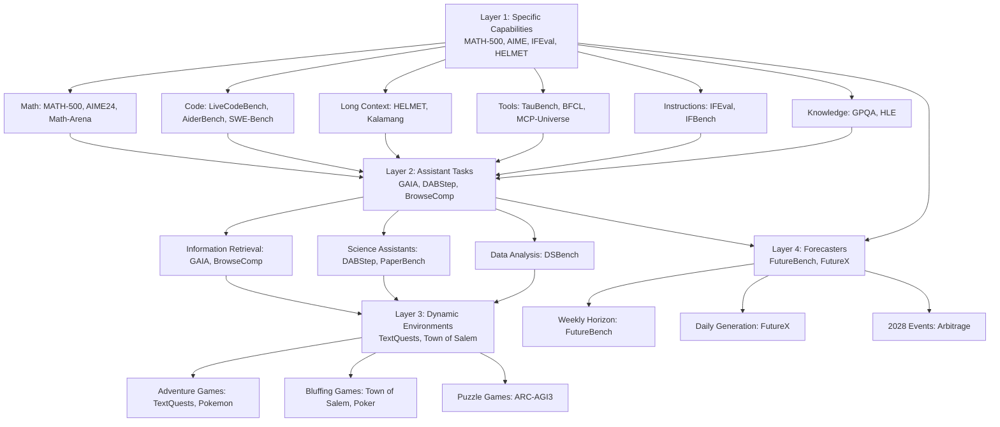

**Diagram: Four-Layer Evaluation Architecture**

The architecture recognizes that no single layer is sufficient. Layer 1 provides fast iteration feedback during development but is vulnerable to contamination. Layer 2 tests realistic integration but remains static. Layer 3 evaluates adaptation but may not reflect useful tasks. Layer 4 offers contamination immunity but has unclear discriminative power.

**Sources:** [yearly_dives/2025-evaluations-for-useful-models.md:11-13, 153-167]()

## Layer 1: Specific Capabilities

### Reasoning and Commonsense

Historic reasoning datasets from the pre-LLM era (ARC, WinoGrande, HellaSwag, CommonsenseQA, PIQA, OpenBookQA) are now primarily used for pretraining ablations rather than final model evaluation. These datasets, built between 2018-2019, reached saturation by 2023 and suffer from contamination. They were originally designed to be adversarial for BERT-era models but are now too easy for modern LLMs.

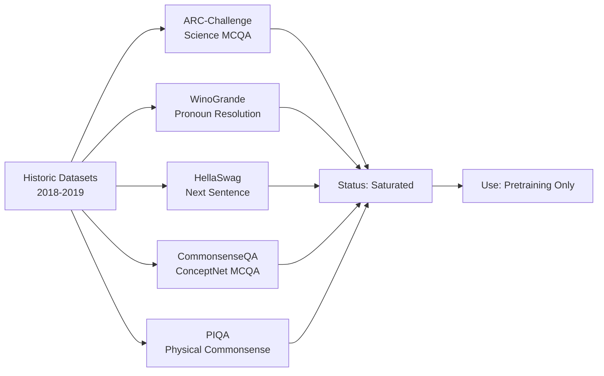

**Diagram: Historic Reasoning Datasets Status**

**Sources:** [yearly_dives/2025-evaluations-for-useful-models.md:17-23]()

### Knowledge Evaluation

Knowledge evaluation has evolved through several generations, each addressing contamination and quality issues:

- **MMLU** (2020): Original 57-subject exam dataset, now saturated with identified issues (incomplete questions, incorrect ground truths, americano-centrism)
- **MMLU-Redux** (2024): Cleaned version removing problematic questions
- **MMLU-Pro** (2024): Extended with complex questions and more answer choices - current community standard for pretraining
- **Global-MMLU** (2024): Translated and annotated for cultural bias
- **GPQA** (2023): PhD-level questions in biology/chemistry/physics, diamond subset most used, contamination emerging
- **Humanity's Last Exam** (2024): 2.5K expert-crowdsourced questions across domains, mostly private, unbroken but evaluated via LLM judges

The field is moving away from pure knowledge benchmarks for two reasons: (1) questions become too complex for non-experts to validate, and (2) with tool access, these become web search evaluations rather than latent knowledge tests.

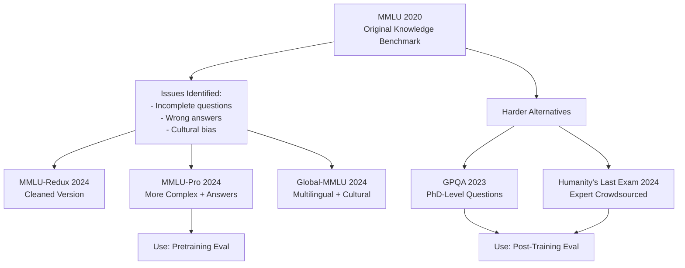

**Diagram: Knowledge Evaluation Evolution**

**Sources:** [yearly_dives/2025-evaluations-for-useful-models.md:25-36]()

### Math Evaluation

Math datasets serve dual purposes: evaluating mathematical capability and providing reasoning/logic proxies. The evolution shows increasing sophistication in contamination prevention:

**GSM8K Family:**
- `GSM8K` (2021): 8.5K grade school problems - saturated/contaminated
- `GSM1K` (2024): 1K new problems for contamination detection
- `GSM-Plus` (2024): Adversarial rewrites with distractors
- `GSM-Symbolic` (2024): Template-based generation for infinite problems

**Current Recommendations:**
- **MATH-500**: Representative 500-problem subset avoiding overfitting
- **AIME** (2024, 2025): American Olympiad datasets renewed yearly, enabling contamination detection by comparing year-over-year performance
- **Math-Arena**: Continuously updated competition compilation including AIME25

**Frontier Benchmarks:**
- `FrontierMath` (2024): Mathematician-written problems, theoretically private but OpenAI accessed portions
- `Humanity's Last Exam` (2025): Contains theorem proving requiring complex reasoning

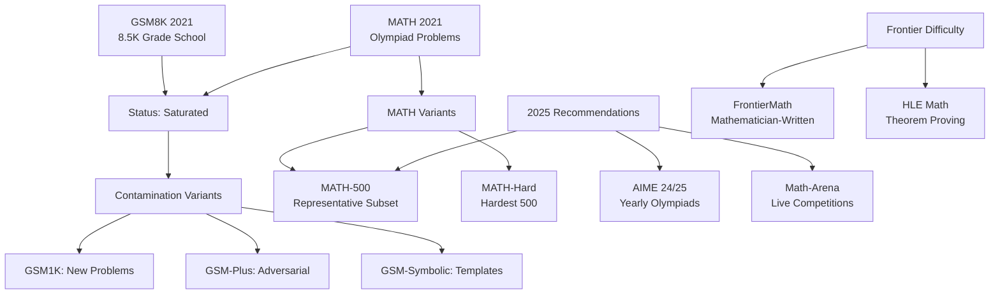

**Diagram: Math Evaluation Ecosystem**

The community recommends `AIME25` and `MATH-500` for pretraining, `Math-Arena` for post-training evaluation.

**Sources:** [yearly_dives/2025-evaluations-for-useful-models.md:37-50]()

### Code Evaluation

Code evaluation tests both tool interaction capability and reasoning ability. Models need coding skills to call tools (code agents) or debug tool output (JSON agents).

**Historic Benchmarks (2021):**
- `MBPP`: 1K crowdsourced Python entry-level problems
- `APPS`: 10K problems from interviews and competitive sites
- `HumanEval`: Codex-era problems with sandbox execution, introduced `pass@k` estimator

**Extensions (2023-2024):**
- `HumanEval+` / `MBPP+`: Additional test cases, bug fixes
- `EvoEval`: Semantic rewrites with difficulty labeling

**Current Recommendations:**
- **LiveCodeBench** (2024): Problems from LeetCode with publication dates for contamination detection
- **AiderBench** (2024): Code editing and refactoring from Exercism
- **SWE-Bench** (2024): Real GitHub issue resolution testing cross-file editing, logic understanding, execution

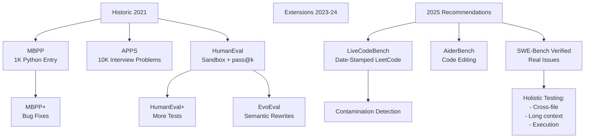

**Diagram: Code Evaluation Evolution**

Practitioners should follow `LiveCodeBench`, `AiderBench`, and `SWE-Bench Verified`, along with the METR report on actual code assistant usefulness.

**Sources:** [yearly_dives/2025-evaluations-for-useful-models.md:51-69]()

### Long Context Management

Long context evaluation tests whether models maintain information across extended conversations without losing track. Maximum context lengths evolved from 2K tokens (2022) to 128K+ (2025).

**Foundational Benchmarks:**
- **NIAH** (2023): Needle in a Haystack - places random fact in unrelated text
- **RULER** (2024): Multi-hop tracing, word frequency, QA variation of NIAH
- **Michelangelo/MRCR** (2024, 2025): Reproducing unique context portions, sequence modifications

**Synthetic Evaluations:**
- **InfinityBench** (2024): 100K token multilingual (En/Zh) tasks across QA, retrieval, computation
- **HELMET** (2024): Aggregation of RAG, QA, recall, generation, summarization, reranking, in-context learning tasks

**Novel Approaches:**
- **Novel Challenge** (2024): 1K true/false claims about recent fictional books requiring full-text understanding
- **Kalamang Translation** (2024): Translating English to ultra-low-resource language from grammar book (200 speakers, no online presence)

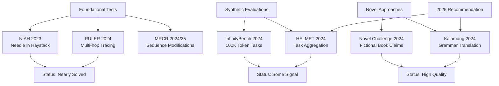

**Diagram: Long Context Evaluation Landscape**

**HELMET** (2024) still provides discriminative power for comparing models in 2025. The Kalamang dataset is particularly notable for its contamination immunity (language has no online presence) and potential for expansion to other low-resource languages.

**Sources:** [yearly_dives/2025-evaluations-for-useful-models.md:71-81]()

### Instruction Following

**IFEval** (2023) represents one of the most innovative evaluation designs by testing formatting instructions through parser-based validation. Models receive instructions about keywords, punctuation, word/sentence counts, file formatting (markdown, HTML), each verifiable through specific parsing tests.

**IFBench** (2025) extends this approach.

This evaluation type exemplifies **functional correctness / unit test evaluation**—the preferred approach for 2025. Key advantages:
- Strict scoring without model judges
- Easy regeneration/extension preventing contamination
- Verifiable pass/fail criteria

**CoCoNot** (2024) tests complementary "non-compliance" behavior: whether models appropriately refuse incomplete (underspecified/unclear), unanswerable (lacking information, AI-humanizing), or unsafe requests.

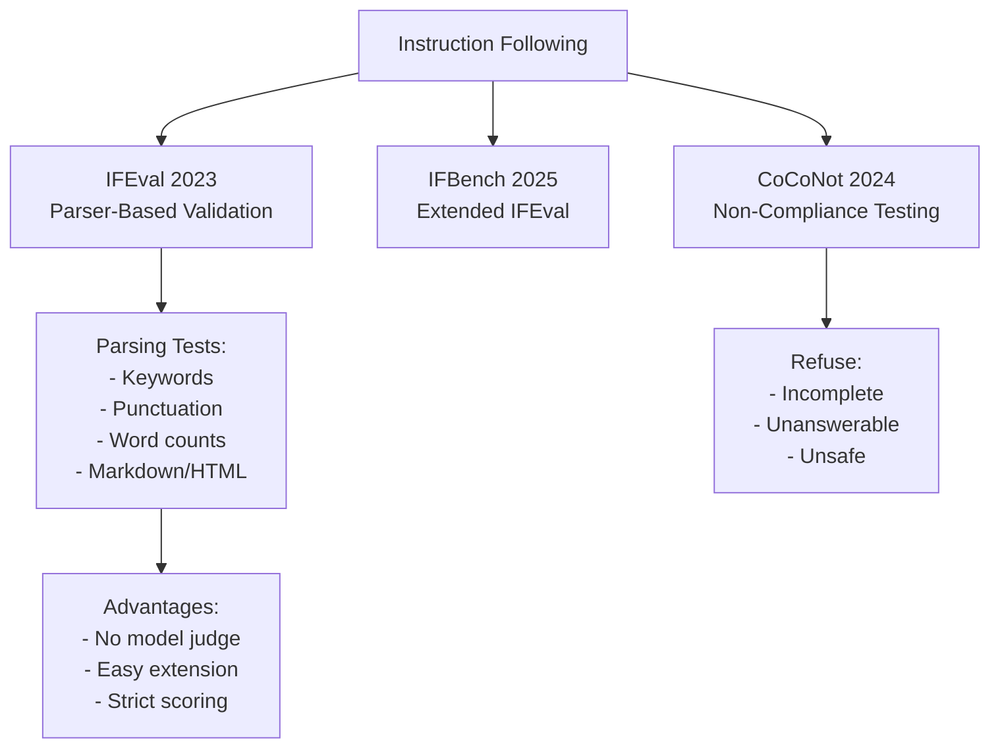

**Diagram: Instruction Following Evaluation**

The functional testing approach of IFEval sets a standard for 2025 evaluation design.

**Sources:** [yearly_dives/2025-evaluations-for-useful-models.md:82-88]()

### Tool Calling

Tool calling evaluation tests models' ability to interact with external systems—a critical capability for agentic behavior.

**TauBench** (2024): Retail and airline domain tasks (ordering, booking, searching) using synthetic databases. Correctness evaluated by: (1) database state updates, (2) appropriate user responses. Uses LLM-mocked users (costly, error-prone).

**ToolBench/StableToolBench** (2023/2025): 100 test cases requiring 1-10 API calls across various domains (OpenWeather, HomeSearch, GoogleSheets, WebShop). StableToolBench introduces `VirtualAPIServer` for stability, uses LLM judge (introduces bias).

**BFCL** (2025): Four subsets testing:
- v3: Simple single-turn tool calls
- v4: Crowdsourced real user function calls
- Multi-turn: Accuracy in long context with tool calls
- Agentic: Web search, memory, SQL interaction

Evaluation uses AST (Abstract Syntax Trees), execution response, and state matching.

**MCP Benchmarks** (2025): Testing Model Context Protocol tool use:
- **MCPBench**: Live MCP servers (Wikipedia, HuggingFace, Reddit, Steam, arXiv) with multi-turn synthetic tasks, rule-based + LLM judge evaluation
- **MCP-Universe**: 11 servers (navigation, 3D design, web search) with format correctness and task-dependent execution-based evaluation (dynamic answer grabbing for time-sensitive queries)
- **LiveMCPBench**: Local MCP server collection testing tool selection from long lists

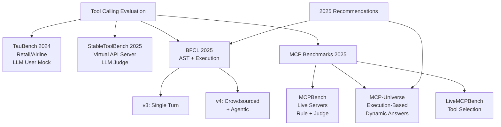

**Diagram: Tool Calling Evaluation Ecosystem**

**MCP-Universe** stands out for its execution-based evaluation avoiding LLM judges, automatically grabbing correct answers for dynamic queries (weather, GitHub stars) from source systems. **BFCL v3** tests general tool calling, **v4** tests web/search tool use. **LiveMCPBench** addresses the emerging need to select tools from extensive lists as the web adopts MCP.

**Sources:** [yearly_dives/2025-evaluations-for-useful-models.md:89-107]()

## Layer 2: Assistant Tasks

Assistant tasks require orchestrating multiple capabilities simultaneously. While individual capability testing provides development signal, real-world assistant performance emerges from capability integration. A model excelling at reasoning but failing to integrate it with tool calling and long context management will not succeed as an assistant.

These benchmarks provide insights into specific domains while remaining understandable to general audiences (unlike abstract capability benchmarks). General benchmarks verify end results rather than prescribing specific tool usage, allowing multiple solution paths.

### Information Retrieval

**GAIA** (2023): Pioneering modern agentic evaluation, requires tool use, reasoning, and retrieval for real-life queries (sometimes with documents). Three difficulty levels—level 1 saturated, level 3 remains challenging. Evaluation complexity arises because results are spread across validation (public) vs test (private, LLM-judge-evaluated) sets.

**BrowseComp** (2025): Similar goal (finding specific answers with online tools) but builds questions from results backward (e.g., "which paper about Topic at Conference with one Nationality author and two Entity affiliations?"). Does not guarantee answer uniqueness, generally harder than GAIA.

**GAIA2**: Extends beyond retrieval using mock mobile environments to test assistants answering queries requiring event chains and tool calls. Time-sensitive and deliberately noisy subsets (mocking API failures) are hardest; search and execution are easy for SOTA models.

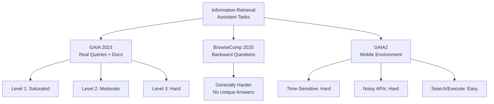

**Diagram: Information Retrieval Assistant Tasks**

**Sources:** [yearly_dives/2025-evaluations-for-useful-models.md:110-119]()

### Science Assistants

**SciCode** (2024): Real scientific problems requiring code across STEM fields (biology to math/chemistry). Problems drawn from actual workflows, decomposed into subproblems. Original evaluation by scientists + model judge; at publication, models scored <5% (current results unclear).

**PaperBench** (2025): Tests ML research replication from ICML papers. Models must reconstruct matching codebases—8K individually graded tasks grouped as rubric trees with weighting. Evaluated with LLM judge (though some automation may be possible with code structure constraints).

**DSBench** (2025): Multimodal data analysis using Kaggle and ModelOff (financial) samples. ModelOff provides multiple choice (easier), Kaggle uses task-specific metrics.

**DABStep** (2025): Previously private (uncontaminated) operational data analysis workloads. Real-world questions requiring multi-step reasoning, varied document parsing, and data manipulation. Each problem has ground truth enabling unbiased, low-cost evaluation—ideal for hard, realistic use cases.

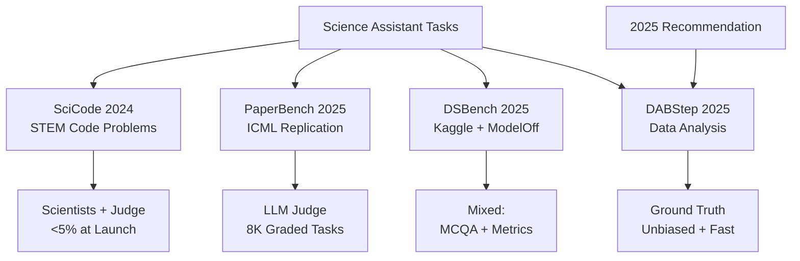

**Diagram: Science Assistant Benchmarks**

**DABStep** stands out for ground truth evaluation, difficulty, and real-world relevance without requiring expensive LLM judges.

**Sources:** [yearly_dives/2025-evaluations-for-useful-models.md:120-129]()

## Layer 3: Game-Based Evaluations

Game-based benchmarks evaluate adaptability to changing environments—unlike static assistant tasks. They require long context reasoning while remaining **understandable** by general audiences. However, they lack real-world grounding and may not reflect useful capabilities.

### Formal Logic Games

**ARC-AGI** (2019): Puzzle grid sequences where models infer rules to predict final items—resembling IQ tests. Nearly solved in 2024. **ARC-AGI3** (2025, ongoing) contains new games requiring exploration, planning, and memory management. Current solutions brute-force problems.

**Baba is AI** (2024): Similar rule extrapolation approach.

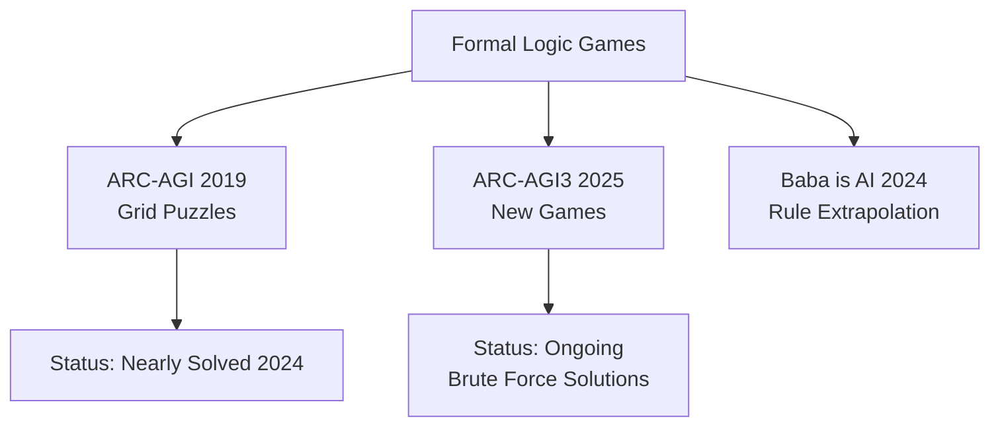

**Diagram: Formal Logic Game Evaluations**

**Sources:** [yearly_dives/2025-evaluations-for-useful-models.md:132-134]()

### Adventure and Survival Games

Single-player games requiring long-range planning, context management, reasoning, and backtracking:

- **TextQuests** (2025): Text-based adventure requiring objective planning
- **Pokemon** (2024): Examples include Twitch streams for Claude and Gemini
- **Crafter** (2021): Minecraft-inspired survival requiring resource management

**Balrog** (2024) integrates multiple single-player environments.

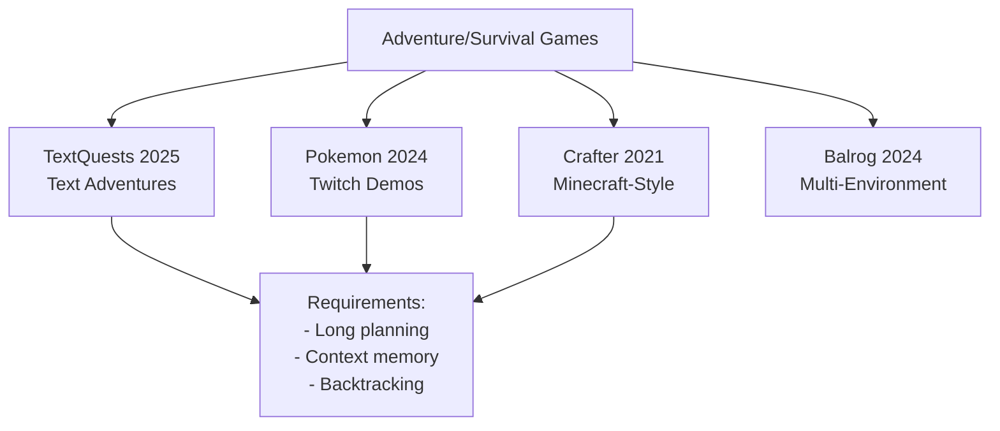

**Diagram: Adventure Game Evaluations**

**Sources:** [yearly_dives/2025-evaluations-for-useful-models.md:135-137]()

### Bluffing and Deception Games

Competitive games testing logic, reasoning, and deception:

- **Poker** (2025): Probabilistic reasoning
- **Town of Salem** (2025): Mafia variant testing deception capability (Claude Opus 4 cannot win as vampire but succeeds as peasant)
- **Werewolf** (2025): Multiple implementations

**Hanabi**: Cooperative constrained-communication game testing adaptability.

These games provide unambiguous pass/fail metrics (did the LLM win?). Recommended: **TextQuests** for capabilities, **Town of Salem** for safety evaluation.

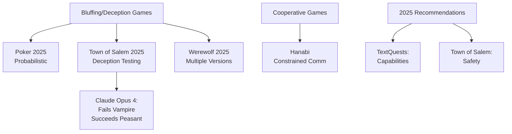

**Diagram: Bluffing and Cooperative Game Evaluations**

**Sources:** [yearly_dives/2025-evaluations-for-useful-models.md:137-141]()

## Layer 4: Forecasting Evaluations

Forecasting tasks are inherently contamination-proof—they test predictions about future events. They require reasoning across sources but their discriminative value is uncertain. The fundamental question: when models fail predictions, is it because the event was unpredictable or because the model is inadequate? Conversely, successful predictions may indicate overly easy questions.

These evaluations may reinforce the "slot machine" perception of LLMs due to outcome randomness.

**FutureBench**: Predicts newsworthy future events using browsing and LLM-generated questions with weekly time horizons, plus user predictions from betting markets. Models barely exceed random on human bets, achieve 75% on model-generated questions (likely easier).

**FutureX**: Uses prediction markets, government websites, ranking platforms, and real-time data. Template-based question generation (`when will STOCK reach POINT?`) with 500 daily questions and irrelevant question filtering.

**Arbitrage**: Similar template approach but 2028 time horizon.

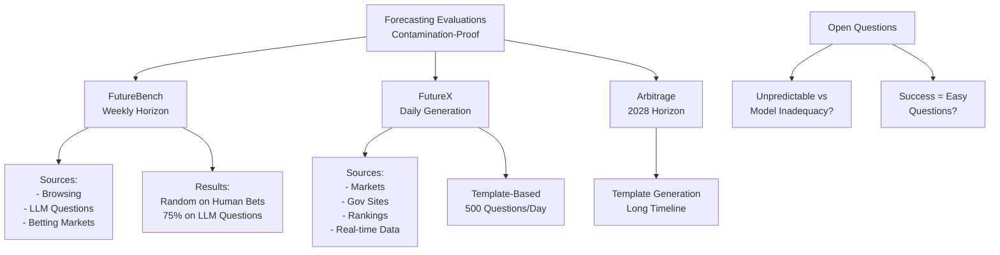

**Diagram: Forecasting Evaluation Landscape**

While theoretically appealing for contamination immunity, forecasting evaluations face fundamental interpretability challenges about what they actually measure.

**Sources:** [yearly_dives/2025-evaluations-for-useful-models.md:142-152]()

## 2025 Evaluation Recommendations

### For Model Builders

**Core Capabilities (Training Phase):**
- Historic capability evaluations for training signal
- **Post-training:** `MATH-500`, `AIME24`, `GPQA`, `IFEval`, `SWE-Bench Verified`
- **Long context:** `HELMET` or equivalent
- **Tool use:** `TauBench` or `BFCL` v3 if targeting tools

### For Model Comparison at Inference

**Core Capabilities:**
- **Instructions:** `IFBench`
- **Knowledge:** `Humanity's Last Exam`
- **Math:** `Math-Arena`
- **Code:** `AiderBench`, `LiveCodeBench`
- **Tools:** `MCP-Universe`

### For Real-World Performance

**Long Horizon Tasks:**
- `GAIA` (information retrieval)
- `DABStep` (data analysis)
- `SciCode` (scientific problems)
- Domain-specific evaluations for targeted use cases

### For Robustness and Adaptability

**Games:**
- `ARC-AGI3` (when released)
- `TextQuests` (capabilities)
- `Town of Salem` (safety)
- Any engaging game beyond traditional Chess/Go/Poker

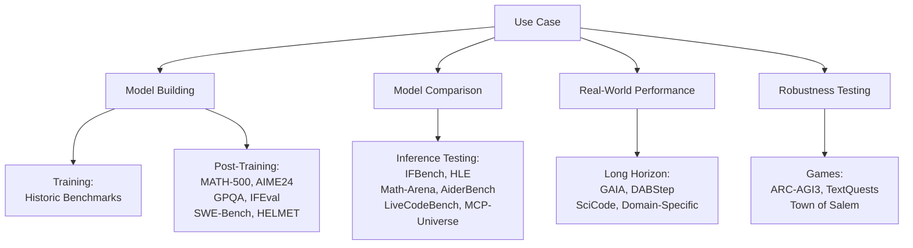

**Diagram: 2025 Evaluation Recommendations by Use Case**

**Sources:** [yearly_dives/2025-evaluations-for-useful-models.md:153-167]()

## Emphasis on Functional Testing

The 2025 guidebook advocates for functional testing over model judges wherever possible. Functional testing includes:

- **Parser-based validation** (IFEval format checks)
- **Unit tests** (code execution)
- **Execution-based evaluation** (MCP-Universe dynamic answer grabbing)
- **State matching** (database correctness verification)

These approaches provide strict, unbiased scoring without introducing LLM judge biases. They make datasets more **understandable**—evaluators and model creators can directly inspect pass/fail criteria rather than trusting opaque judge decisions.

This philosophical shift reflects the move toward engineering rigor: treating evaluation as software testing rather than subjective assessment.

**Sources:** [yearly_dives/2025-evaluations-for-useful-models.md:82-88, 96, 102, 166]()

## Conclusion

The 2025 evaluation paradigm represents maturation from single-metric optimization to multi-layered utility assessment. The field moved from asking "is this model intelligent?" to "can this model reliably help users accomplish tasks?"

The four-layer architecture acknowledges that:
1. Specific capabilities provide fast development signal but face contamination
2. Assistant tasks test realistic integration but remain static
3. Games evaluate adaptation but may lack practical relevance
4. Forecasters offer contamination immunity but uncertain discriminative power

No single layer suffices—effective evaluation requires strategic combination across layers depending on development stage and intended use.

The emphasis on functional testing, understandable tasks, and contamination-proof approaches signals a field maturing toward engineering discipline. Models are increasingly evaluated as tools rather than theoretical constructs, which better serves the community building practical applications.

**Sources:** [yearly_dives/2025-evaluations-for-useful-models.md:1-167]()

---

