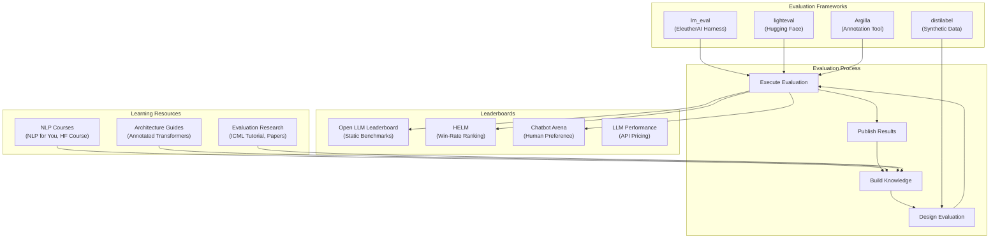
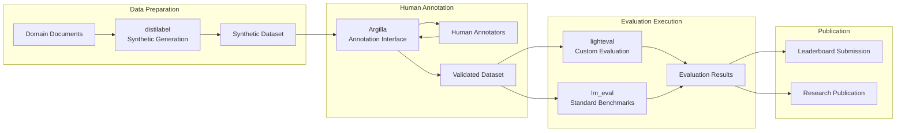
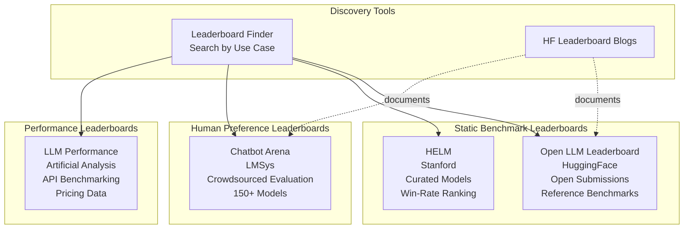
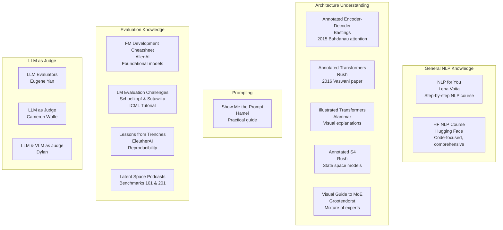
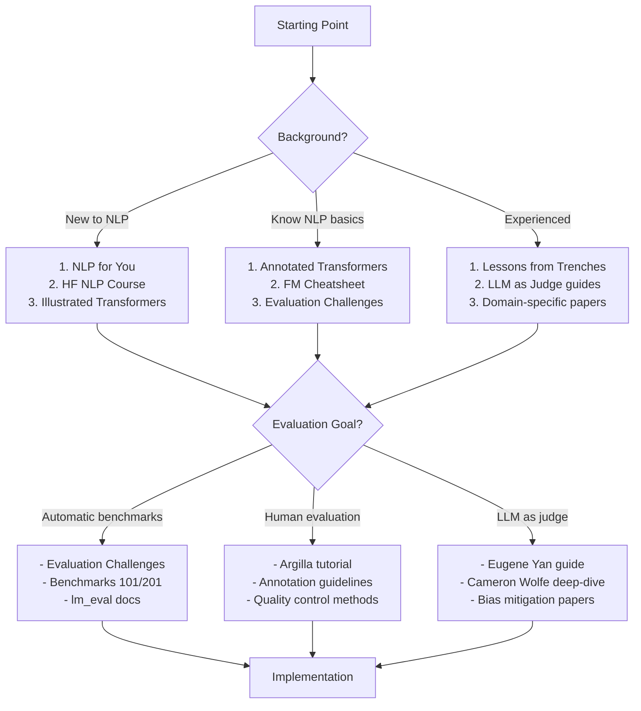
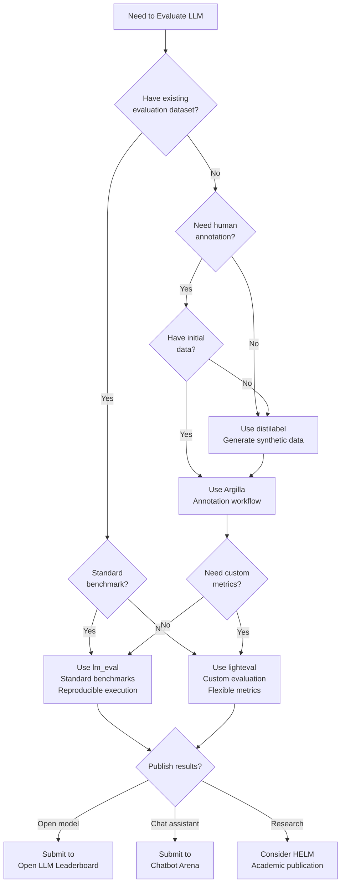

<!-- source: DeepWiki mcp.deepwiki.com · repo huggingface/evaluation-guidebook · page 6 Resources and Ecosystem · fetched 2026-10-26 -->

# Resources and Ecosystem

Relevant source files

The following files were used as context for generating this wiki page:

- [contents/human-evaluation/tips-and-tricks.md](contents/human-evaluation/tips-and-tricks.md)
- [resources/about-NLP.md](resources/about-NLP.md)
- [resources/about-evaluation.md](resources/about-evaluation.md)

## Purpose and Scope

This page provides a comprehensive guide to the external tools, frameworks, leaderboards, and learning resources that complement the evaluation methodologies described in [Evaluation Methodologies](#2). These resources form the practical infrastructure for implementing evaluations, publishing results, and building foundational knowledge.

For information about the evaluation methods themselves, see [Evaluation Methodologies](#2). For temporal context on how the ecosystem has evolved, see [Evolution of LLM Evaluation](#5). For practical implementation issues, see [Troubleshooting](#4).

## Overview of the Ecosystem

The evaluation ecosystem consists of three interconnected layers: evaluation frameworks that execute benchmarks, leaderboards that aggregate and publish results, and learning resources that provide foundational knowledge. Understanding how these components interact is essential for effective LLM evaluation.

### Ecosystem Architecture

**Sources:** [resources/about-evaluation.md:1-40](), [resources/about-NLP.md:1-15]()

## Evaluation Tools and Frameworks

Evaluation frameworks provide the execution infrastructure for running benchmarks at scale. The ecosystem includes specialized tools for different evaluation paradigms and integration patterns.

### Primary Evaluation Frameworks

#### lm_eval (EleutherAI Harness)

The `lm_eval` framework, also known as "the Harness," is the powerhouse of LLM evaluations. It provides a stable, reproducible environment for evaluating models from multiple providers on a comprehensive range of benchmarks.

**Key Capabilities:**
- Multi-provider support (Hugging Face, OpenAI, Anthropic, etc.)
- Extensive benchmark library (hundreds of tasks)
- Reproducible evaluation environment
- Standardized metric computation

**Primary Use Cases:**
- Large-scale benchmark sweeps
- Cross-provider model comparison
- Leaderboard submission preparation
- Reproducibility requirements

#### lighteval (Hugging Face)

The `lighteval` framework focuses on customization and recent benchmarks. It provides a lightweight alternative with emphasis on extensibility and modern evaluation tasks.

**Key Capabilities:**
- Customizable task definitions
- Recent benchmark integration
- Flexible metric computation
- Rapid prototyping support

**Primary Use Cases:**
- Custom evaluation development
- New benchmark integration
- Domain-specific evaluation
- Rapid iteration workflows

### Annotation and Data Generation Tools

#### Argilla and distilabel

`Argilla` and `distilabel` form a complementary pair for human-in-the-loop evaluation and synthetic data generation.

**Argilla:** Annotation platform for building evaluation datasets with human supervision
- Task design interface
- Annotator workflow management
- Quality control mechanisms
- Integration with evaluation frameworks

**distilabel:** Synthetic data generation using LLMs
- Prompt-based data creation
- Multi-model generation
- Quality filtering
- Dataset augmentation

**Integration Pattern:** The typical workflow combines `distilabel` for initial data generation, `Argilla` for human validation and refinement, and `lighteval` for final evaluation execution.

**Sources:** [resources/about-evaluation.md:20-24](), [human-evaluation/tips-and-tricks.md:32]()

### Tool Integration Workflow

**Sources:** [human-evaluation/tips-and-tricks.md:30-32](), [resources/about-evaluation.md:37-38]()

### Framework Comparison

| Framework | Provider | Primary Focus | Benchmark Count | Customization | Best For |
|-----------|----------|---------------|-----------------|---------------|----------|
| `lm_eval` | EleutherAI | Stability & reproducibility | 200+ | Medium | Leaderboard submissions, standard benchmarks |
| `lighteval` | Hugging Face | Recent benchmarks & customization | 50+ | High | Custom evaluation, new benchmarks |
| `Argilla` | Argilla | Human annotation | N/A | High | Building evaluation datasets |
| `distilabel` | Argilla | Synthetic data | N/A | High | Data augmentation, rapid prototyping |

**Sources:** [resources/about-evaluation.md:21-23]()

## Leaderboards

Leaderboards aggregate evaluation results and provide standardized comparison across models. The ecosystem includes multiple leaderboards with distinct evaluation philosophies and target use cases.

### Leaderboard Taxonomy

Leaderboards can be categorized along two primary dimensions: evaluation methodology (static benchmarks vs. human preference) and accessibility (open submission vs. curated).

**Sources:** [resources/about-evaluation.md:25-35]()

### Static Benchmark Leaderboards

#### Open LLM Leaderboard

The Open LLM Leaderboard provides neutral third-party evaluation of open LLMs on reference static benchmarks.

**Characteristics:**
- **Provider:** Hugging Face
- **Submission:** Open to community submissions
- **Benchmarks:** Fixed set of reference tasks (MMLU, GSM8K, etc.)
- **Ranking:** Aggregate score across benchmarks
- **Update Frequency:** Continuous as submissions arrive

**Use Cases:**
- Comparing open-source models
- Validating model performance claims
- Tracking evaluation over time
- Community benchmarking

#### HELM (Holistic Evaluation of Language Models)

HELM evaluates models on static benchmarks but uses win-rate methodology for ranking.

**Characteristics:**
- **Provider:** Stanford CRFM
- **Submission:** Curated model selection
- **Benchmarks:** Comprehensive benchmark suite
- **Ranking:** Win-rate computation (pairwise comparisons)
- **Update Frequency:** Periodic releases

**Differentiators:**
- Win-rate ranking provides relative performance
- Holistic evaluation across multiple dimensions
- Academic research focus

**Sources:** [resources/about-evaluation.md:26-29]()

### Human Preference Leaderboards

#### Chatbot Arena

Chatbot Arena uses crowdsourced human evaluation to rank models based on real user preferences.

**Characteristics:**
- **Provider:** LMSys (Berkeley)
- **Evaluation:** Human voters compare model outputs
- **Scale:** 150+ models evaluated
- **Ranking:** ELO-based scoring system
- **Update Frequency:** Real-time as votes accumulate

**Methodology:**
- Users chat with two anonymous models
- Vote for preferred response
- ELO scores computed from voting patterns
- Bias mitigation through position randomization

**Use Cases:**
- Evaluating conversational quality
- Capturing human preferences
- Validating chat assistant performance
- Complementing static benchmarks

**Sources:** [resources/about-evaluation.md:30-31]()

### Performance and Pricing Leaderboards

#### LLM Performance Leaderboard

The LLM Performance Leaderboard focuses on API provider benchmarks including performance metrics and pricing.

**Characteristics:**
- **Provider:** Artificial Analysis
- **Focus:** Commercial API providers
- **Metrics:** Latency, throughput, pricing
- **Use Cases:** API provider selection, cost optimization

**Covered Dimensions:**
- Inference speed (tokens/second)
- Response latency (time to first token)
- Pricing per token
- Quality benchmarks

**Sources:** [resources/about-evaluation.md:32-33]()

### Leaderboard Philosophy Comparison

| Leaderboard | Evaluation Type | Ranking Method | Model Coverage | Best For |
|-------------|-----------------|----------------|----------------|----------|
| Open LLM Leaderboard | Static benchmarks | Aggregate score | Open-source | Standard benchmark comparison |
| HELM | Static benchmarks | Win-rate | Curated selection | Relative performance analysis |
| Chatbot Arena | Human preference | ELO rating | 150+ models | Conversational quality |
| LLM Performance | Performance metrics | Multi-dimensional | API providers | API selection, cost optimization |

### Leaderboard Discovery

The ecosystem includes discovery tools to help identify the most relevant leaderboard:

- **Leaderboard Finder:** Search interface to find leaderboards by use case and evaluation requirements
- **Hugging Face Leaderboard Blogs:** Documentation and analysis of leaderboard methodologies and results

**Sources:** [resources/about-evaluation.md:34-35]()

## Learning Resources

Building expertise in LLM evaluation requires foundational knowledge across multiple domains: general NLP concepts, model architectures, prompting techniques, and evaluation methodologies.

### Resource Categories

**Sources:** [resources/about-NLP.md:1-14](), [resources/about-evaluation.md:1-18]()

### General NLP Knowledge

#### Foundational Courses

**NLP for You (Lena Voita)**
- **URL:** https://lena-voita.github.io/nlp_course.html
- **Focus:** Step-by-step progression through NLP concepts
- **Audience:** Beginners to intermediate
- **Strengths:** Clear explanations, well-structured, accessible

**The NLP Course (Hugging Face)**
- **URL:** https://huggingface.co/learn/nlp-course/chapter1/1
- **Focus:** Comprehensive coverage with code examples
- **Audience:** Practitioners wanting hands-on experience
- **Strengths:** Extensive code snippets, integration with Hugging Face ecosystem

**Sources:** [resources/about-NLP.md:1-3]()

### Understanding LLM Architectures

Architecture understanding is crucial for interpreting evaluation results and designing appropriate benchmarks.

#### Annotated Paper Series

**Annotated Encoder-Decoder (Jasmijn Bastings)**
- **Focus:** 2015 Bahdanau attention mechanism for RNNs
- **Format:** Code walkthrough of paper
- **Prerequisites:** Basic neural network knowledge

**Annotated Transformers (Sasha Rush)**
- **Focus:** 2016 Vaswani transformer paper
- **Format:** Code implementation with step-by-step explanations
- **Prerequisites:** Encoder-decoder understanding

**Illustrated Transformers (Jay Alammar)**
- **Focus:** Transformer architecture
- **Format:** Visual diagrams and illustrations
- **Complement:** Use alongside Annotated Transformers for visual learners

**Annotated S4 (Sasha Rush)**
- **Focus:** Structured State Space for Sequence Modeling
- **Format:** Code walkthrough
- **Use Case:** Understanding state space model alternatives to transformers

#### Architecture Extensions

**Visual Guide to Mixture of Experts (Maarten Grootendorst)**
- **Focus:** MoE architecture patterns
- **Prerequisites:** Transformer understanding
- **Format:** Visual explanations with diagrams

**Sources:** [resources/about-NLP.md:5-10]()

### Prompting Techniques

**Show Me the Prompt (Hamel Husain)**
- **URL:** https://hamel.dev/blog/posts/prompt/
- **Focus:** Practical prompting strategies
- **Relevance:** Essential for designing evaluation prompts (see [Designing Evaluation Prompts](#2.3.2))

**Sources:** [resources/about-NLP.md:12-13]()

### Evaluation-Specific Knowledge

#### Foundational Resources

**Foundational Model Development Cheatsheet (AllenAI)**
- **URL:** https://fmcheatsheet.org/
- **Coverage:** End-to-end model development and evaluation
- **Audience:** Practitioners and researchers

#### Automatic Evaluation

**Challenges in LM Evaluation (Schoelkopf & Sutawika)**
- **Format:** ICML 2024 tutorial presentation
- **Topics:** Reproducibility, contamination, metric design
- **Context:** Informs [2024: The Evaluation Crisis](#5.2)

**Lessons from the Trenches on Reproducible Evaluation of LMs (EleutherAI)**
- **Format:** Research paper (arXiv:2405.14782)
- **Focus:** Practical reproducibility challenges
- **Relevance:** Directly applicable to [Troubleshooting](#4)

**Latent Space Podcasts**
- **Benchmarks 101:** Automatic benchmark history and common issues
- **Benchmarks 201:** Evaluation method selection and leaderboard operations

#### LLM as a Judge

**LLM Evaluators (Eugene Yan)**
- **URL:** https://eugeneyan.com/writing/llm-evaluators/
- **Format:** Experience report
- **Topics:** Judge selection, prompt design, bias mitigation

**LLM as a Judge (Cameron Wolfe)**
- **URL:** https://cameronrwolfe.substack.com/p/llm-as-a-judge
- **Format:** Technical deep-dive
- **Topics:** Meta-evaluation, reward modeling

**LLM & VLM-as-a-Judge (Dylan)**
- **URL:** https://dylandigitalgarden.com/2024/July/July+31%2C+2024+LLM+%26+VLM-as-a-Judge
- **Format:** Guide with vision-language model coverage
- **Scope:** Extends judge methodology to multimodal evaluation

**Sources:** [resources/about-evaluation.md:1-18]()

### Learning Pathway

The recommended learning pathway depends on your background and evaluation goals:

**Sources:** [resources/about-NLP.md:1-14](), [resources/about-evaluation.md:1-18]()

### Resource Table Summary

| Category | Resource | Provider | Format | Target Audience |
|----------|----------|----------|--------|-----------------|
| **General NLP** | NLP for You | Lena Voita | Online course | Beginners |
| | HF NLP Course | Hugging Face | Interactive course | Practitioners |
| **Architecture** | Annotated Transformers | Sasha Rush | Code walkthrough | Intermediate |
| | Illustrated Transformers | Jay Alammar | Visual guide | Visual learners |
| | Visual MoE Guide | Maarten Grootendorst | Visual guide | Advanced |
| **Prompting** | Show Me the Prompt | Hamel Husain | Blog post | All levels |
| **Evaluation** | FM Cheatsheet | AllenAI | Reference guide | All levels |
| | Evaluation Challenges | EleutherAI | Tutorial | Intermediate |
| | Lessons from Trenches | EleutherAI | Research paper | Advanced |
| **LLM as Judge** | LLM Evaluators | Eugene Yan | Experience report | Intermediate |
| | LLM as a Judge | Cameron Wolfe | Technical analysis | Advanced |

## Practical Integration

### Tutorial: End-to-End Custom Domain Evaluation

The ecosystem provides a complete end-to-end tutorial for building custom evaluation tasks, integrating multiple tools from the ecosystem.

**Tutorial Location:** https://github.com/argilla-io/argilla-cookbook/tree/main/domain-eval

**Workflow Steps:**
1. **Start with domain documents:** Your specific domain knowledge
2. **Generate synthetic data:** Use `distilabel` for initial dataset creation
3. **Human annotation:** Validate and refine with `Argilla`
4. **Evaluation execution:** Run evaluation with `lighteval`

**Tools Integrated:**
- `distilabel`: Synthetic data generation
- `Argilla`: Annotation interface and quality control
- `lighteval`: Custom evaluation execution

**Learning Outcomes:**
- Design custom annotation tasks
- Manage annotation workflows
- Integrate multiple tools
- Build domain-specific evaluations

**Sources:** [resources/about-evaluation.md:37-38](), [human-evaluation/tips-and-tricks.md:30-32]()

### Tool Selection Decision Tree

**Sources:** [resources/about-evaluation.md:20-38]()

## Ecosystem Evolution and Future Directions

The evaluation ecosystem continues to evolve in response to the challenges documented in [2024: The Evaluation Crisis](#5.2) and the paradigm shift described in [2025: Evaluating Useful Models](#5.3).

**Current Trends:**
- Integration of multiple evaluation paradigms (automatic + human + judge)
- Focus on contamination-resistant evaluation methods
- Emphasis on practical utility over abstract capabilities
- Growth of domain-specific evaluation frameworks

**Ecosystem Gaps:**
- Limited tools for dynamic environment evaluation
- Insufficient standardization across frameworks
- Need for better contamination detection tools
- Lack of meta-evaluation infrastructure

For the latest developments, consult the [Yearly Dives](#5) section and the Hugging Face blog on leaderboards and evaluations.

**Sources:** [resources/about-evaluation.md:34]()

---

