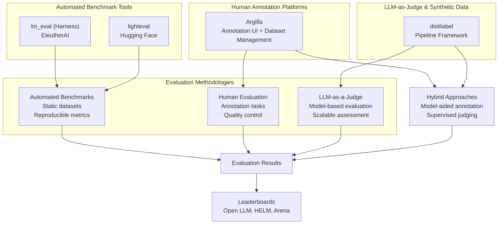
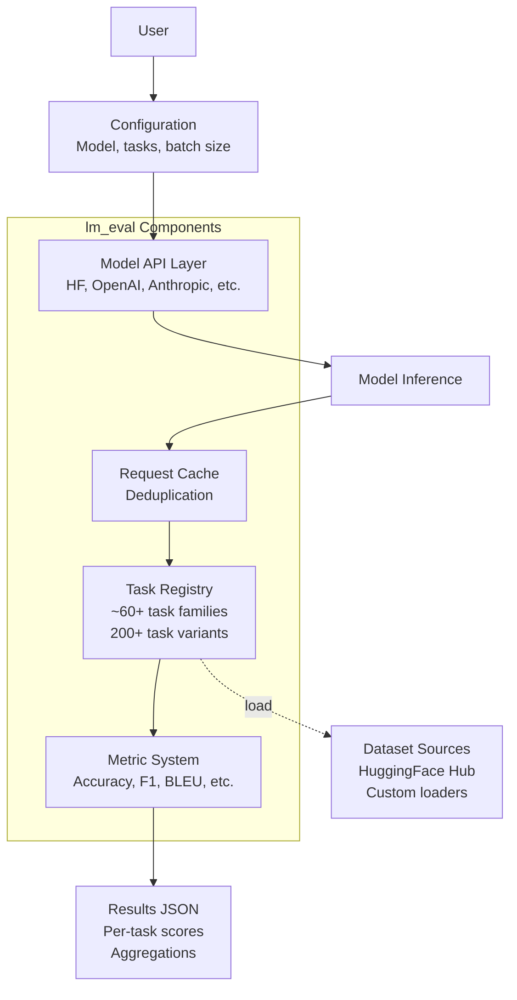
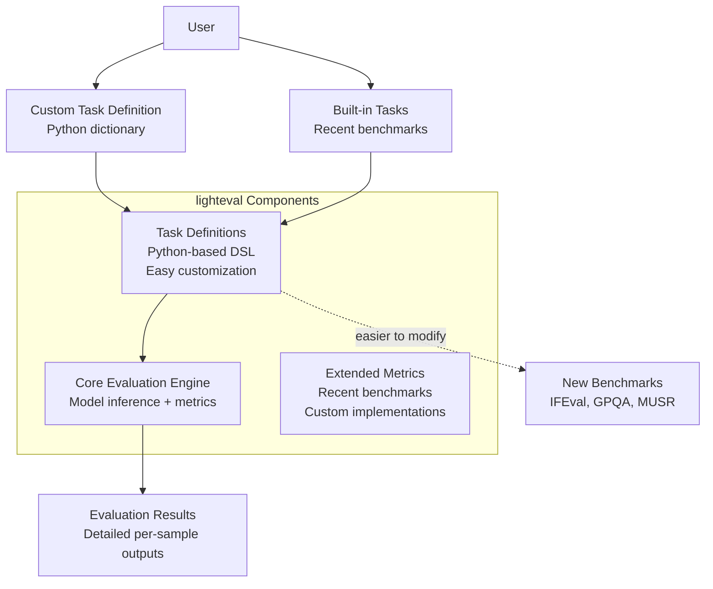
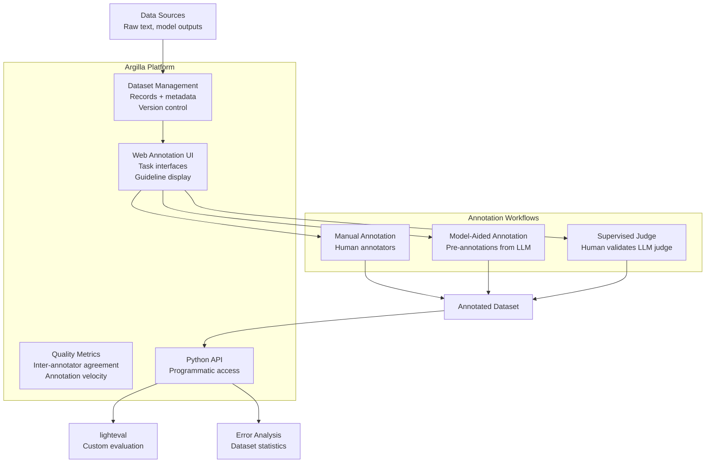
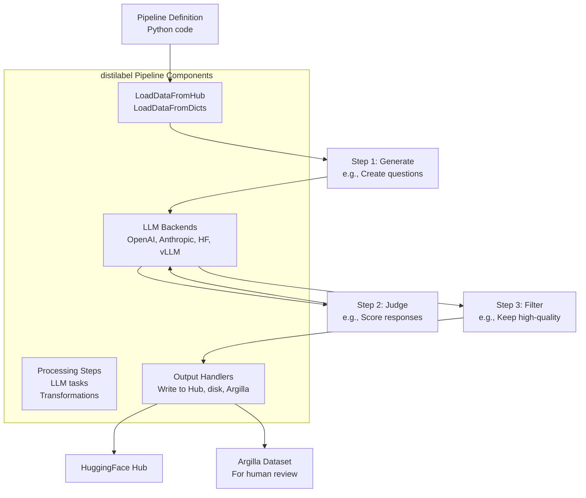
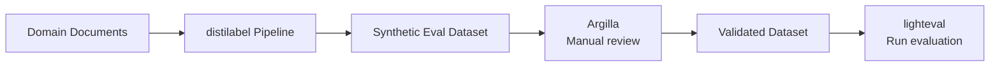
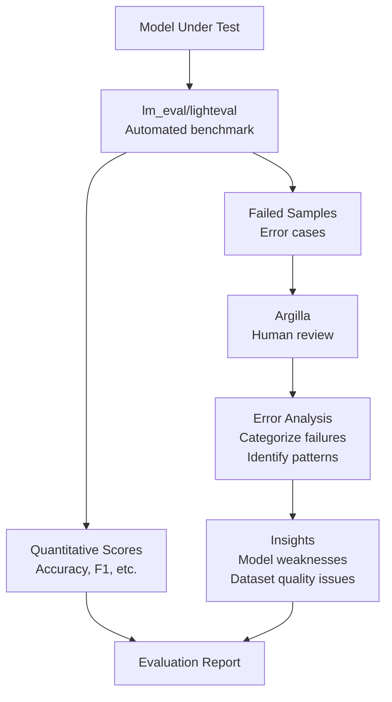
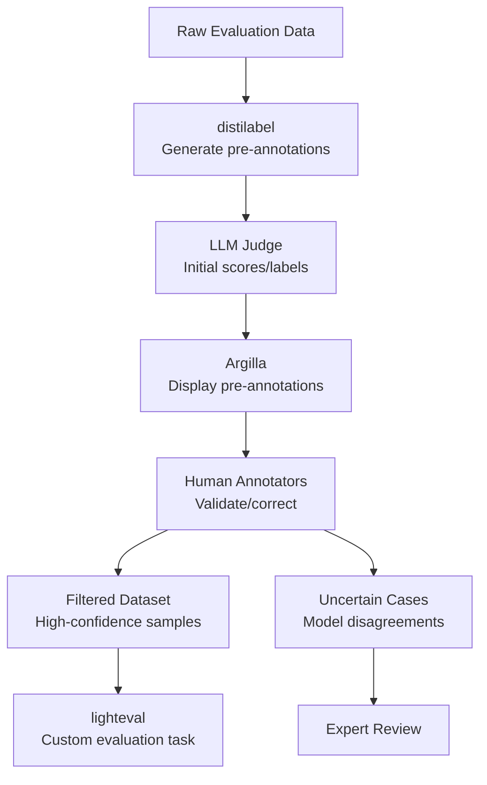
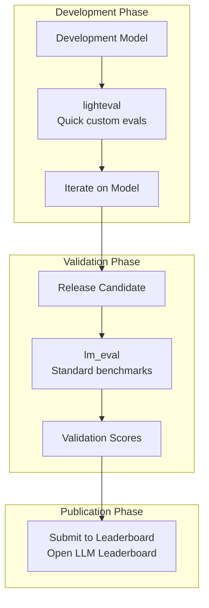
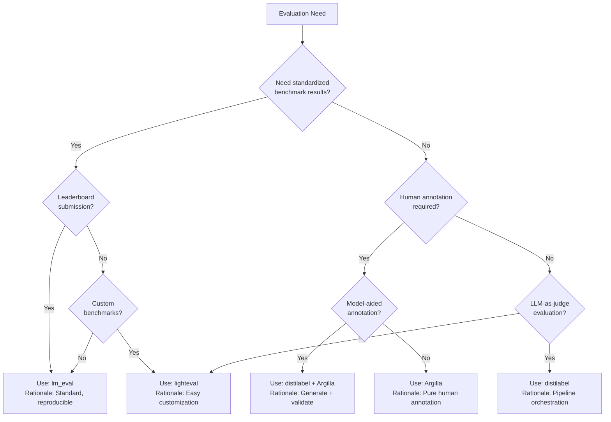

<!-- source: DeepWiki mcp.deepwiki.com · repo huggingface/evaluation-guidebook · page 6.1 Evaluation Tools and Frameworks · fetched 2026-10-26 -->

# Evaluation Tools and Frameworks

<details>
<summary>Relevant source files</summary>

The following files were used as context for generating this wiki page:

- [contents/human-evaluation/tips-and-tricks.md](contents/human-evaluation/tips-and-tricks.md)
- [resources/about-NLP.md](resources/about-NLP.md)
- [resources/about-evaluation.md](resources/about-evaluation.md)

</details>


## Purpose and Scope

This page provides an overview of key evaluation frameworks and tools that implement the evaluation methodologies described in this guidebook. These tools translate the conceptual approaches from automated benchmarks ([#2.1](#2.1)), human evaluation ([#2.2](#2.2)), and LLM-as-a-judge ([#2.3](#2.3)) into practical software systems.

For information about leaderboards that aggregate results from these tools, see [Leaderboards](#6.2). For broader learning resources about NLP and evaluation theory, see [Learning Resources](#6.3).

---

## Evaluation Tools Ecosystem

The evaluation tools ecosystem consists of specialized frameworks for different evaluation paradigms. These tools handle the infrastructure complexity of model inference, dataset management, metric computation, and result aggregation.

### Tool Categories and Use Cases



**Sources:** [resources/about-evaluation.md:21-31]()

| Tool Category | Primary Framework(s) | Main Use Case | Key Strength |
|--------------|---------------------|---------------|--------------|
| Automated Evaluation | `lm_eval`, `lighteval` | Benchmark execution on static datasets | Reproducibility, stability |
| Human Annotation | `Argilla` | Creating evaluation datasets, annotation workflows | Quality control, UI/UX |
| LLM-as-Judge | `distilabel` | Pipeline-based model evaluation, synthetic data | Flexibility, composability |

---

## Automated Evaluation Frameworks

Automated evaluation frameworks execute models on benchmark datasets and compute metrics. These tools are the foundation for reproducible, large-scale evaluation.

### lm_eval (EleutherAI Harness)

The **lm_eval harness** is the most established automated evaluation framework, used by major leaderboards including the Open LLM Leaderboard.

#### Architecture and Capabilities



**Key Features:**
- **Stability:** Designed for reproducible evaluation with fixed versions
- **Coverage:** Supports hundreds of benchmarks out-of-the-box
- **Provider Support:** Works with local models (HuggingFace), APIs (OpenAI, Anthropic), and custom implementations
- **Request Caching:** Deduplicates identical prompts to reduce compute

**Typical Workflow:**
```bash
# Basic evaluation command structure
lm_eval --model hf \
    --model_args pretrained=<model_name> \
    --tasks <task_name> \
    --batch_size <batch_size> \
    --output_path <results_path>
```

**Use Cases:**
- Leaderboard submissions requiring standardized evaluation
- Non-regression testing during model development
- Large-scale benchmark sweeps across model families

**Sources:** [resources/about-evaluation.md:22]()

### lighteval (Hugging Face)

**lighteval** is a lighter-weight evaluation framework optimized for customization and rapid iteration on recent benchmarks.

#### Architecture and Focus



**Key Features:**
- **Customization:** Task definitions are simple Python dictionaries
- **Recent Benchmarks:** Focus on post-2023 evaluation datasets
- **Per-Sample Outputs:** Detailed logging for error analysis
- **Integration:** Native integration with Argilla for human review workflows

**Typical Workflow:**
```python
# Task definition example (conceptual)
task = {
    "name": "custom_task",
    "dataset": "organization/dataset_name",
    "prompt_function": custom_prompt_fn,
    "metric": ["exact_match", "f1"]
}
```

**Use Cases:**
- Rapid prototyping of new evaluation tasks
- Custom domain-specific benchmarks
- Integration with human annotation workflows (via Argilla)
- Research requiring per-sample analysis

**Comparison: lm_eval vs lighteval**

| Dimension | lm_eval | lighteval |
|-----------|---------|-----------|
| Stability | High (production-grade) | Moderate (evolving) |
| Customization | Lower (requires task class) | Higher (simple Python dict) |
| Benchmark Coverage | Extensive (legacy + recent) | Focused (recent benchmarks) |
| Best For | Leaderboards, reproducibility | Research, custom evaluations |

**Sources:** [resources/about-evaluation.md:23](), [contents/human-evaluation/tips-and-tricks.md:32]()

---

## Human Annotation Platforms

Human annotation platforms provide the infrastructure for creating evaluation datasets through crowdsourced or expert annotation.

### Argilla

**Argilla** is an annotation platform that bridges automated evaluation with human judgment, supporting both dataset creation and model-assisted workflows.

#### Architecture and Workflow Integration



**Key Features:**
- **Task Types:** Supports classification, span annotation, ranking, and free-text annotation
- **Guideline Management:** Built-in guideline display and versioning
- **Quality Control:** Real-time inter-annotator agreement calculation
- **Model Integration:** Can display model predictions as pre-annotations
- **Python API:** Programmatic dataset access for training or evaluation

**Workflow Patterns:**

1. **Pure Human Annotation:**
   - Define task and guidelines in Argilla UI
   - Annotators work independently ([#2.2.1](#2.2.1) best practices apply)
   - Export annotated dataset for evaluation

2. **Model-Aided Annotation:**
   - Generate pre-annotations using an LLM
   - Annotators validate/correct in Argilla UI
   - Reduces annotation time but may introduce model bias

3. **Supervised LLM-as-Judge:**
   - LLM judge generates evaluations
   - Human supervisors review edge cases or disagreements in Argilla
   - Combines scalability with quality control

**Sources:** [contents/human-evaluation/tips-and-tricks.md:24-28](), [contents/human-evaluation/tips-and-tricks.md:32]()

---

## LLM-as-Judge and Synthetic Data Tools

Tools in this category orchestrate LLM-based evaluation pipelines and generate synthetic data for training or evaluation.

### distilabel

**distilabel** is a pipeline framework for building complex LLM workflows, including judge-based evaluation and synthetic data generation.

#### Pipeline Architecture



**Key Features:**
- **Pipeline Composition:** Chain multiple LLM operations (generation, judging, filtering)
- **Multi-Provider:** Supports OpenAI, Anthropic, HuggingFace, vLLM, and local models
- **Parallel Execution:** Distributes workload across multiple LLM instances
- **Quality Control:** Integrates with Argilla for human-in-the-loop validation
- **Synthetic Data:** Can generate training data, evaluation sets, or preference pairs

**Typical Use Cases:**

1. **LLM-as-Judge Pipeline:**
   ```
   Input Dataset → Judge Prompt Generation → LLM Judge → Aggregate Scores
   ```

2. **Synthetic Evaluation Set:**
   ```
   Domain Docs → Generate Questions → Generate Answers → Judge Quality → Filter
   ```

3. **Preference Dataset Creation:**
   ```
   Questions → Multiple Models → Judge Preferences → Create Pairs → Human Validation
   ```

**Integration Pattern:**


This end-to-end pattern is demonstrated in the domain evaluation tutorial that guides users from domain documents to a custom evaluation task.

**Sources:** [contents/human-evaluation/tips-and-tricks.md:32](), [resources/about-evaluation.md:38]()

---

## Tool Integration Patterns

Evaluation frameworks rarely operate in isolation. Understanding integration patterns helps build robust evaluation workflows.

### Pattern 1: Automated Evaluation + Human Validation



**Use Case:** After automated benchmark evaluation, load failed samples into Argilla for human annotators to categorize error types (e.g., reasoning failures, knowledge gaps, formatting issues).

**Sources:** [contents/human-evaluation/tips-and-tricks.md:32]()

### Pattern 2: Hybrid Annotation with Model-Aided Workflow



**Use Case:** Generate initial judgments with distilabel, present them to human annotators in Argilla, have humans focus on edge cases where the model is uncertain.

**Sources:** [contents/human-evaluation/tips-and-tricks.md:24-28]()

### Pattern 3: Multi-Tool Benchmark Pipeline



**Use Case:** Use lighteval for rapid iteration during development (custom tasks, domain-specific benchmarks), then validate with lm_eval on standardized benchmarks before leaderboard submission.

---

## Tool Selection Guide

Choosing the right evaluation framework depends on your evaluation goals, resources, and constraints.

### Decision Matrix



### Selection Criteria Table

| Criterion | lm_eval | lighteval | Argilla | distilabel |
|-----------|---------|-----------|---------|------------|
| **Reproducibility** | ⭐⭐⭐ | ⭐⭐ | N/A | ⭐⭐ |
| **Customization** | ⭐ | ⭐⭐⭐ | ⭐⭐⭐ | ⭐⭐⭐ |
| **Human Annotation** | ❌ | ❌ | ⭐⭐⭐ | ❌ |
| **LLM-as-Judge** | ❌ | Limited | ❌ | ⭐⭐⭐ |
| **Learning Curve** | Moderate | Easy | Easy | Moderate |
| **Community Size** | Large | Growing | Growing | Growing |
| **Best For** | Leaderboards | Research | Quality control | Complex pipelines |

### Practical Recommendations

**For Automated Benchmarks ([#2.1](#2.1)):**
- **Leaderboard work:** Use `lm_eval` for reproducibility and standardization
- **Research/custom tasks:** Use `lighteval` for faster iteration
- **Both:** Run `lighteval` during development, validate with `lm_eval` before publication

**For Human Evaluation ([#2.2](#2.2)):**
- **Dataset creation:** Use `Argilla` for annotation workflows with quality control
- **Annotation guidelines:** Follow best practices from [#2.2.1](#2.2.1) and [#2.2.2](#2.2.2)
- **Quality metrics:** Track inter-annotator agreement in Argilla's built-in metrics

**For LLM-as-a-Judge ([#2.3](#2.3)):**
- **Judge orchestration:** Use `distilabel` to build evaluation pipelines
- **Prompt engineering:** Apply techniques from [#2.3.2](#2.3.2)
- **Bias mitigation:** Implement strategies from [#2.3.4](#2.3.4) in pipeline
- **Validation:** Route uncertain cases to `Argilla` for human review

**For Hybrid Workflows:**
- Combine tools: `distilabel` (generate) → `Argilla` (validate) → `lighteval` (evaluate)
- End-to-end tutorial: Follow the domain evaluation tutorial for complete implementation

**Sources:** [resources/about-evaluation.md:21-40](), [contents/human-evaluation/tips-and-tricks.md:20-32]()

---

## Additional Resources

For hands-on implementation guidance:
- **End-to-end tutorial:** [Domain evaluation tutorial](https://github.com/argilla-io/argilla-cookbook/tree/main/domain-eval) demonstrating distilabel + Argilla + lighteval integration
- **Tool documentation:**
  - lm_eval: https://github.com/EleutherAI/lm-evaluation-harness/
  - lighteval: https://github.com/huggingface/lighteval
  - Argilla: https://github.com/argilla-io/argilla/
  - distilabel: https://github.com/argilla-io/distilabel

For information about where these tools publish results, see [Leaderboards](#6.2). For broader learning about evaluation theory and NLP fundamentals, see [Learning Resources](#6.3).

**Sources:** [resources/about-evaluation.md:22-38]()

---

