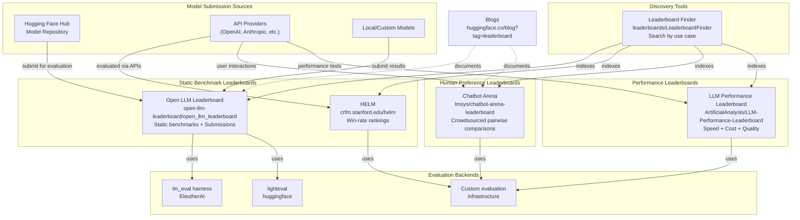
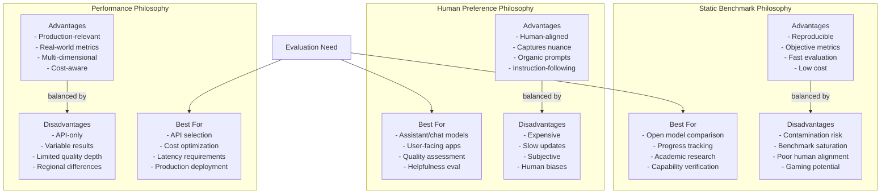
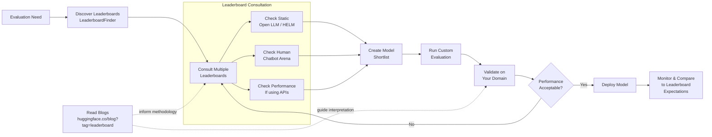

<!-- source: DeepWiki mcp.deepwiki.com · repo huggingface/evaluation-guidebook · page 6.2 Leaderboards · fetched 2026-10-26 -->

# Leaderboards

Relevant source files

The following files were used as context for generating this wiki page:

- [resources/about-NLP.md](resources/about-NLP.md)
- [resources/about-evaluation.md](resources/about-evaluation.md)

## Purpose and Scope

This page describes the major public leaderboards used to evaluate and rank Large Language Models, including their different evaluation philosophies, methodologies, and appropriate use cases. Leaderboards serve as both aggregation points for model performance data and as standardized comparison frameworks that enable the community to assess relative model capabilities.

For information about the underlying evaluation methodologies that feed into leaderboards, see [Automated Benchmarks](#2.1), [Human Evaluation](#2.2), and [LLM-as-a-Judge](#2.3). For practical evaluation tools and frameworks, see [Evaluation Tools and Frameworks](#6.1). For historical context on evaluation challenges, see [The Evaluation Crisis](#5.2).

## Overview of LLM Leaderboards

LLM leaderboards aggregate evaluation results across multiple models and present them in a standardized format, enabling direct comparison of model capabilities. They serve several critical functions in the evaluation ecosystem:

**Standardization**: Leaderboards establish common evaluation protocols, ensuring that all models are tested under identical conditions with the same benchmarks, prompts, and metrics.

**Transparency**: Public leaderboards provide visibility into model performance beyond vendor-reported metrics, enabling independent verification of capabilities.

**Discovery**: Leaderboards help practitioners identify appropriate models for their use cases by comparing performance across relevant benchmarks.

**Progress Tracking**: By maintaining historical records, leaderboards document the evolution of model capabilities over time.

Leaderboards differ fundamentally in their evaluation philosophy, falling into three primary categories: static benchmark leaderboards, human preference leaderboards, and performance/cost leaderboards.

Sources: [resources/about-evaluation.md:25-36]()

## Leaderboard Architecture and Evaluation Flows

**Diagram: Leaderboard Ecosystem and Submission Flows**

This diagram maps the primary leaderboards to their code entities (Hugging Face Spaces, GitHub repositories) and shows how models flow from submission sources through evaluation backends to ranking systems. The Leaderboard Finder provides a meta-search capability across all platforms.

Sources: [resources/about-evaluation.md:25-36]()

## Static Benchmark Leaderboards

Static benchmark leaderboards evaluate models on fixed, curated datasets using automatic metrics. They prioritize reproducibility, standardization, and objectivity at the cost of potential benchmark saturation and contamination risks.

### Open LLM Leaderboard

**Location**: `huggingface.co/spaces/open-llm-leaderboard/open_llm_leaderboard`

**Evaluation Philosophy**: Neutral third-party evaluation of open-source LLMs on reference static benchmarks with open submission process.

**Key Characteristics**:

| Aspect | Implementation |
|--------|----------------|
| **Submission Model** | Open submissions from community; any model on Hugging Face Hub can be submitted |
| **Evaluation Backend** | Uses `lm_eval` harness and `lighteval` (see [Evaluation Tools](#6.1)) |
| **Benchmark Suite** | Rotating set of benchmarks selected to minimize contamination (see [Evaluation Datasets Catalog](#2.1.2)) |
| **Reproducibility** | Full evaluation logs and configurations published with results |
| **Update Frequency** | Continuous evaluation queue; new submissions evaluated within days |

**Primary Use Cases**:
- Comparing open-source models for selection decisions
- Tracking progress in open LLM development
- Validating claims made by model developers
- Identifying contamination through cross-version comparisons

**Limitations**:
- Static benchmarks subject to saturation and contamination (see [The Evaluation Crisis](#5.2))
- Does not capture human-perceived quality or instruction-following ability
- Limited to models compatible with Hugging Face Transformers library

Sources: [resources/about-evaluation.md:26-27]()

### HELM (Holistic Evaluation of Language Models)

**Location**: `crfm.stanford.edu/helm/lite/latest/#/leaderboard`

**Evaluation Philosophy**: Comprehensive evaluation on static benchmarks with win-rate based rankings rather than absolute scores.

**Key Characteristics**:

| Aspect | Implementation |
|--------|----------------|
| **Ranking Method** | Win-rate calculation: models compared across multiple scenarios, ranked by proportion of "wins" |
| **Evaluation Coverage** | Broader scenario coverage than single-benchmark leaderboards |
| **Submission Model** | Curated selection; not open submission |
| **Granularity** | Multiple sub-leaderboards for different capability dimensions |

**Win-Rate Methodology**: Instead of reporting raw accuracy scores, HELM computes how often each model outperforms others across evaluation scenarios. This approach:
- Reduces sensitivity to benchmark-specific score scales
- Provides more interpretable relative rankings
- Highlights models that perform consistently well across diverse tasks

**Primary Use Cases**:
- Holistic model comparison across multiple dimensions
- Understanding relative strengths/weaknesses between models
- Academic research requiring comprehensive evaluation coverage

**Limitations**:
- Not real-time; evaluations run in batches
- Limited to models with API access or those run by Stanford team
- Win-rate aggregation can obscure performance on specific capabilities

Sources: [resources/about-evaluation.md:28-29]()

## Human Preference Leaderboards

Human preference leaderboards use real human judgments to rank models, capturing subjective quality dimensions that automated metrics miss. They trade reproducibility for better alignment with human perception of model utility.

### Chatbot Arena

**Location**: `huggingface.co/spaces/lmsys/chatbot-arena-leaderboard`

**Evaluation Philosophy**: Crowdsourced pairwise comparisons using real user interactions in an anonymous arena format.

**Key Characteristics**:

| Aspect | Implementation |
|--------|----------------|
| **Evaluation Method** | Pairwise blind comparisons: users interact with two models simultaneously without knowing their identities |
| **Ranking Algorithm** | Elo rating system (similar to chess rankings) based on win/loss/tie outcomes |
| **Sample Size** | Evaluates ~150 LLMs with millions of comparison votes |
| **Prompt Distribution** | Organic user queries, not curated benchmarks |
| **Annotation Quality** | Crowdsourced; inherent variability in human judgment |

**Arena Methodology**:
1. User submits a prompt to the arena
2. Two randomly selected models generate responses
3. User votes for the better response (or declares tie) without knowing which model produced which response
4. Elo ratings updated based on outcome and pre-existing ratings
5. After voting, model identities revealed

This approach addresses several limitations of static benchmarks:
- Captures instruction-following and helpfulness not measured by accuracy metrics
- Evaluates on diverse, organic user queries rather than academic benchmarks
- Blind comparison reduces bias toward popular model brands
- Continuous evaluation as new models are added

**Primary Use Cases**:
- Evaluating chat/assistant model quality
- Understanding human preference trends
- Comparing instruction-following capabilities
- Selecting models for user-facing applications

**Limitations**:
- Lower reproducibility due to variable crowd quality
- Subject to human biases (verbosity bias, style preferences)
- Expensive to scale; requires continuous human annotation
- Prompt distribution may not match your specific use case
- Lacks granular capability breakdowns

Sources: [resources/about-evaluation.md:30-31]()

## Performance and Cost Leaderboards

### LLM Performance Leaderboard

**Location**: `huggingface.co/spaces/ArtificialAnalysis/LLM-Performance-Leaderboard`

**Evaluation Philosophy**: Multi-dimensional evaluation of API providers focusing on speed, cost, and quality trade-offs.

**Key Characteristics**:

| Aspect | Implementation |
|--------|----------------|
| **Metrics** | Latency (time-to-first-token, tokens-per-second), cost-per-token, quality scores |
| **Scope** | Major API providers (OpenAI, Anthropic, Google, etc.) |
| **Update Frequency** | Regular re-evaluation as APIs update |
| **Primary Audience** | Organizations selecting API providers for production deployment |

**Evaluated Dimensions**:
- **Speed**: Time-to-first-token (TTFT), output tokens per second
- **Cost**: Price per input/output token
- **Quality**: Integration of benchmark scores or human preference ratings
- **Reliability**: Uptime, rate limits, error rates

**Primary Use Cases**:
- Selecting API providers for production systems
- Cost-benefit analysis for model selection
- Understanding performance vs cost trade-offs
- Comparing same model across different providers

**Limitations**:
- Does not evaluate open-source or locally-hosted models
- API performance varies by region and time
- Quality metrics secondary to performance/cost

Sources: [resources/about-evaluation.md:32-33]()

## Evaluation Philosophy Comparison

**Diagram: Comparing Leaderboard Evaluation Philosophies**

This table provides a detailed comparison across multiple dimensions:

| Dimension | Static Benchmarks | Human Preference | Performance/Cost |
|-----------|-------------------|------------------|------------------|
| **Reproducibility** | High: Same inputs → same outputs | Low: Human judgment varies | Medium: API performance varies |
| **Contamination Risk** | High: Public datasets can leak into training | Low: Organic user prompts | N/A: Measures speed/cost |
| **Human Alignment** | Low: Metrics may not capture quality | High: Direct human judgment | Medium: Quality secondary to speed |
| **Cost** | Low: Automated evaluation | High: Requires human annotators | Low: Automated testing |
| **Update Frequency** | Continuous (Open LLM) or Batched (HELM) | Continuous but slow | Regular re-evaluation |
| **Model Coverage** | Open models + some APIs | ~150 models (expanding) | Major API providers only |
| **Capability Granularity** | High: Specific benchmarks | Low: Overall preference | High: Multiple metrics |
| **Gaming Resistance** | Low: Can optimize for specific benchmarks | Medium: Blind comparison helps | High: Harder to game latency/cost |

Sources: [resources/about-evaluation.md:25-36]()

## Using Leaderboards Effectively

### Selection Strategy

Choose leaderboards based on your evaluation objectives:

**For Model Selection (Open Source)**:
1. Start with **Open LLM Leaderboard** for capability overview
2. Validate top candidates on your specific domain benchmarks (see [Designing Automated Evaluations](#2.1.1))
3. Consider **Chatbot Arena** if instruction-following is critical
4. Run custom evaluations for your specific use case

**For API Provider Selection**:
1. Check **LLM Performance Leaderboard** for speed/cost baseline
2. Validate quality on **Chatbot Arena** or **HELM**
3. Run custom evaluations on your expected prompt distribution
4. Consider regional availability and rate limits

**For Research/Academic Work**:
1. Use **HELM** for comprehensive coverage
2. Supplement with **Open LLM Leaderboard** for open models
3. Report both automated and human evaluation results
4. Disclose any benchmark overlap with training data

### Interpretation Guidelines

**Understanding Score Differences**:
- Small differences (<2-3 percentage points) often within evaluation noise
- Statistical significance varies by benchmark size and metric type
- Consider score variance across multiple runs when available

**Avoiding Common Pitfalls**:

| Pitfall | Mitigation |
|---------|------------|
| **Over-reliance on single leaderboard** | Consult multiple leaderboards; validate on custom benchmarks |
| **Ignoring contamination** | Check model training cutoff dates vs benchmark publication dates |
| **Treating rankings as absolute** | Understand that rankings reflect specific evaluation choices |
| **Assuming transferability** | Model A > Model B on leaderboard doesn't guarantee A > B on your task |
| **Ignoring confidence intervals** | Request or compute statistical significance when possible |

**Contextual Considerations**:
- Leaderboard rankings reflect aggregate performance; check sub-scores for capabilities relevant to your use case
- Models may perform differently on your specific domain vs general benchmarks
- Consider model size, inference cost, and deployment requirements alongside leaderboard position
- Evaluate instruction-following separately from raw capability if building user-facing applications

Sources: [resources/about-evaluation.md:25-36]()

## Leaderboard Discovery and Resources

### Leaderboard Finder

**Location**: `huggingface.co/spaces/leaderboards/LeaderboardFinder`

A meta-search tool that indexes multiple leaderboards and enables discovery based on:
- **Capability dimensions**: Math, code, reasoning, instruction-following, etc.
- **Model characteristics**: Open source, API, size constraints
- **Evaluation methodology**: Automated, human preference, domain-specific

**Use Cases**:
- Finding specialized leaderboards for niche domains (legal, medical, scientific)
- Discovering new leaderboards as the ecosystem evolves
- Comparing how the same model ranks across different evaluation frameworks

### Official Documentation and Updates

**Leaderboard-Related Blogs**: `huggingface.co/blog?tag=leaderboard`

This collection includes:
- Announcement posts for new leaderboards or major updates
- Methodology explanations and changes
- Analysis of trends (model performance over time, common failure modes)
- Contamination investigations and benchmark updates
- Best practices for interpretation

**Recommended Reading**:
- Benchmark-specific blog posts explaining methodology changes
- Contamination detection case studies
- Comparison analyses between different leaderboards

### Integration with Evaluation Workflow

**Diagram: Integrating Leaderboards into Evaluation Workflow**

This workflow shows how leaderboards fit into a comprehensive model selection process:

1. **Discovery Phase**: Use LeaderboardFinder to identify relevant leaderboards
2. **Consultation Phase**: Check multiple leaderboards (static, human, performance)
3. **Shortlisting**: Create candidate list based on leaderboard performance
4. **Custom Evaluation**: Don't rely solely on leaderboard scores (see [Designing Automated Evaluations](#2.1.1))
5. **Validation**: Test on your specific domain and use case
6. **Monitoring**: Compare production performance to leaderboard expectations

Sources: [resources/about-evaluation.md:34-36]()

## Relationship to Evaluation Methodologies

Leaderboards aggregate results from the three core evaluation methodologies:

**Static Benchmark Leaderboards** ← **Automated Benchmarks** ([#2.1](#2.1))
- Open LLM Leaderboard and HELM use automated evaluation on static datasets
- Implement the dataset selection, prompt design, and metric choice discussed in automated benchmark design
- Face the same contamination and saturation challenges

**Human Preference Leaderboards** ← **Human Evaluation** ([#2.2](#2.2))
- Chatbot Arena uses crowdsourced human annotators
- Implements pairwise comparison annotation tasks
- Must manage annotation quality and inter-annotator agreement

**Some Leaderboards Use** ← **LLM-as-a-Judge** ([#2.3](#2.3))
- Emerging leaderboards experiment with LLM judges for scalability
- Must address judge biases (position, verbosity, self-preference)
- Enable faster iteration than pure human evaluation

Understanding these underlying methodologies is essential for interpreting leaderboard results and knowing when to trust them versus when to run custom evaluations.

## Limitations and Future Directions

### Current Limitations

**Temporal Instability**: As noted in [The Evaluation Crisis](#5.2), leaderboard rankings can shift dramatically with:
- Benchmark updates to address contamination
- Changes in evaluation protocols
- Updates to models (same name, different weights)

**Coverage Gaps**:
- Limited representation of specialized domains (medical, legal, scientific)
- Underrepresentation of non-English languages
- Few leaderboards for multi-modal models
- Limited evaluation of agent capabilities

**Interpretation Challenges**:
- Aggregate scores obscure specific capability strengths/weaknesses
- Difficult to predict performance on novel tasks
- Rankings optimized for leaderboard metrics may not reflect real-world utility

### Emerging Trends

**Dynamic Evaluation**: Moving toward contamination-resistant evaluation through:
- Regularly rotated benchmark sets
- Private test sets with public validation sets
- Adversarial benchmark generation

**Multi-Dimensional Leaderboards**: Rather than single rankings, providing:
- Capability-specific sub-leaderboards
- User-segmented rankings (by use case or preference)
- Confidence intervals and uncertainty estimates

**Integrated Assessment**: Following the philosophy from [Evaluating Useful Models](#5.3), future leaderboards may evaluate:
- Multi-capability integration rather than isolated skills
- Dynamic adaptation in agent environments
- Long-term forecasting accuracy (contamination-proof)

These trends reflect the maturation from single-metric optimization toward holistic utility assessment discussed throughout the guidebook's evolution from 2023-2025.

Sources: [resources/about-evaluation.md:25-36]()

---

