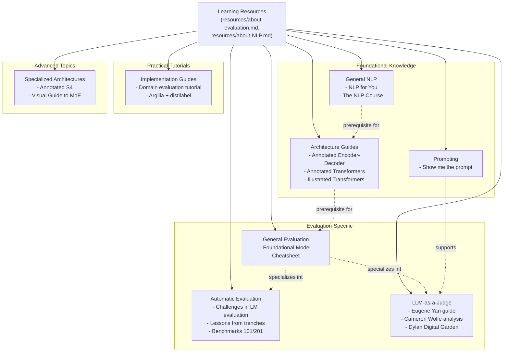
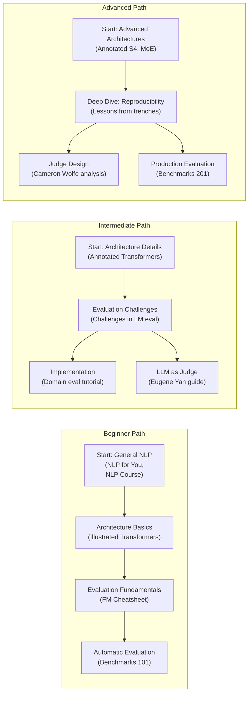
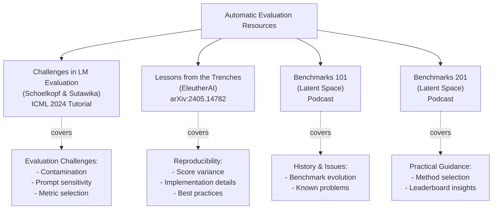
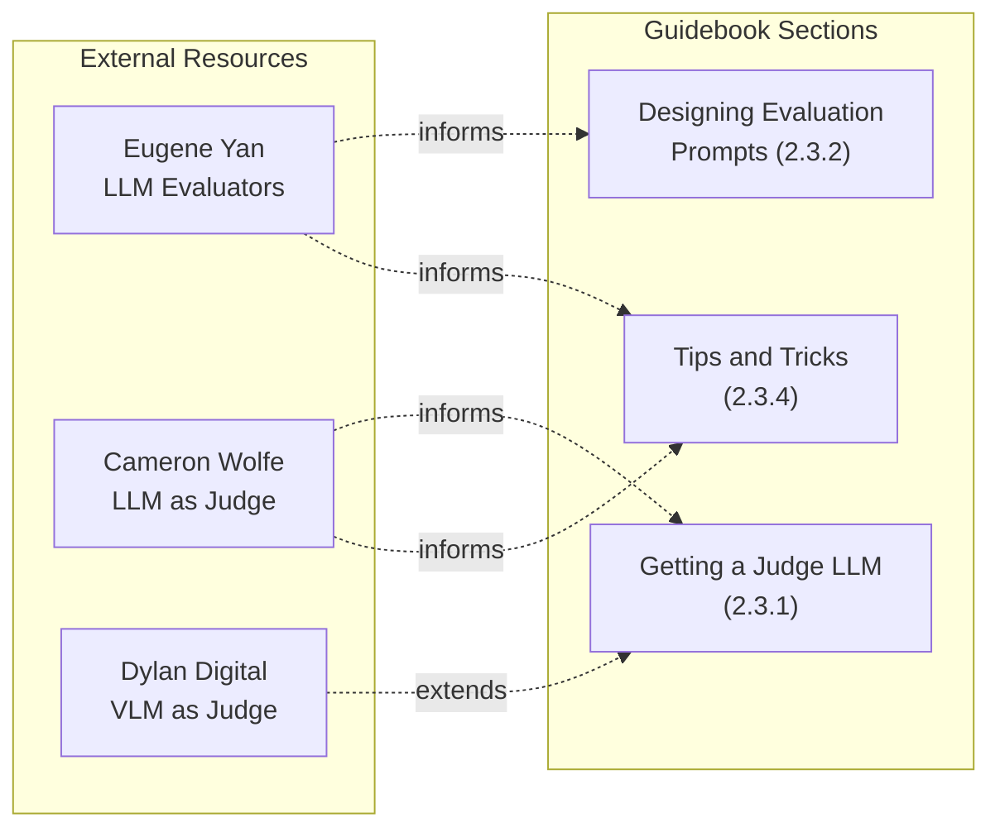
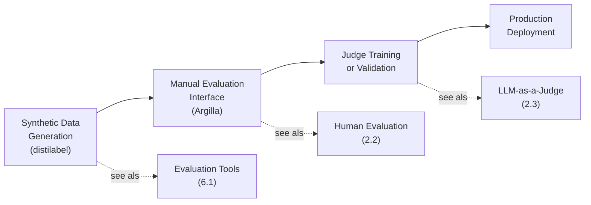
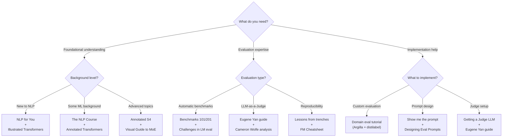
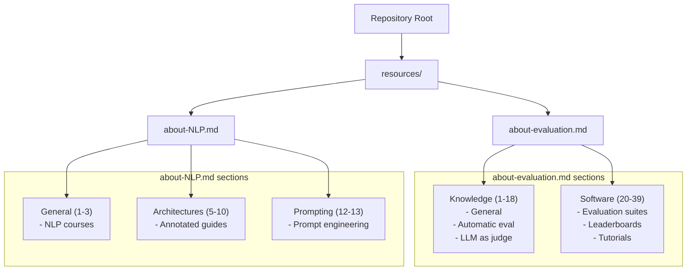

<!-- source: DeepWiki mcp.deepwiki.com · repo huggingface/evaluation-guidebook · page 6.3 Learning Resources · fetched 2026-10-26 -->

# Learning Resources

Relevant source files

The following files were used as context for generating this wiki page:

- [resources/about-NLP.md](resources/about-NLP.md)
- [resources/about-evaluation.md](resources/about-evaluation.md)

## Purpose and Scope

This page provides a curated collection of external learning resources that complement the evaluation methodologies presented in this guidebook. These resources cover foundational NLP knowledge, LLM architecture understanding, evaluation-specific guidance, and practical tutorials. They are organized by topic to help readers build the prerequisite knowledge needed for effective LLM evaluation.

For practical evaluation tools and frameworks, see [Evaluation Tools and Frameworks](#6.1). For model comparison and ranking platforms, see [Leaderboards](#6.2). For foundational concepts about model inference and tokenization, see [Model Inference and Evaluation](#3.1) and [Tokenization](#3.2).

## Resource Organization

The learning resources are organized into four main categories corresponding to different knowledge domains:

**Sources:** [resources/about-evaluation.md:1-40](), [resources/about-NLP.md:1-15]()

## Learning Pathways by User Profile

Different user profiles should follow different learning pathways depending on their background and evaluation needs:

**Sources:** [resources/about-evaluation.md:1-40](), [resources/about-NLP.md:1-15]()

## Foundational NLP Knowledge

### General NLP Courses

| Resource | Author/Organization | Coverage | Best For |
|----------|-------------------|----------|----------|
| [NLP for You](https://lena-voita.github.io/nlp_course.html) | Lena Voita | Step-by-step NLP fundamentals | Beginners, comprehensive learning |
| [The NLP Course](https://huggingface.co/learn/nlp-course/chapter1/1) | Hugging Face | Complete course with code snippets | Fast implementation, hands-on learning |
| [Foundational Model Development Cheatsheet](https://fmcheatsheet.org/) | AllenAI | Quick reference for FM development | Quick lookup, experienced practitioners |

**Sources:** [resources/about-NLP.md:1-3](), [resources/about-evaluation.md:1-3]()

### Architecture Understanding

The following resources provide progressive depth in understanding transformer and related architectures:

| Resource | Focus | Format | Prerequisites |
|----------|-------|--------|---------------|
| [The Illustrated Transformers](https://jalammar.github.io/illustrated-transformer/) | Visual explanations | Diagrams and visualizations | Basic ML knowledge |
| [The Annotated Transformers](https://nlp.seas.harvard.edu/2018/04/03/attention.html) | Code walkthrough of Vaswani 2016 | Code + explanations | Python, PyTorch |
| [The Annotated Encoder-Decoder](https://bastings.github.io/annotated_encoder_decoder/) | Bahdanau 2015 attention mechanism | Code + explanations | RNN knowledge helpful |
| [The Annotated S4](https://srush.github.io/annotated-s4/) | State space models | Code + explanations | Transformer knowledge |
| [A Visual Guide to MoE](https://newsletter.maartengrootendorst.com/p/a-visual-guide-to-mixture-of-experts) | Mixture of Experts architectures | Visualizations | Transformer knowledge |

**Sources:** [resources/about-NLP.md:5-10]()

### Prompting Techniques

| Resource | Focus | Relevance to Evaluation |
|----------|-------|------------------------|
| [Show me the prompt](https://hamel.dev/blog/posts/prompt/) | Practical prompting strategies | Essential for designing evaluation prompts and judge prompts (see [Designing Evaluation Prompts](#2.3.2)) |

**Sources:** [resources/about-NLP.md:12-13]()

## Evaluation-Specific Knowledge

### Automatic Evaluation Resources

**Sources:** [resources/about-evaluation.md:5-11]()

**Detailed Resource Descriptions:**

- **Challenges in LM evaluation** ([presentation](https://github.com/lm-evaluation-challenges/lm-evaluation-challenges.github.io/blob/main/%5BMain%5D%20ICML%20Tutorial%202024%20-%20Challenges%20in%20LM%20Evaluation.pdf)) by Hailey Schoelkopf and Lintang Sutawika provides a comprehensive overview of evaluation challenges including contamination, reproducibility issues, and metric limitations. This complements the [Designing Automated Evaluations](#2.1.1) section.

- **Lessons from the trenches on Reproducible Evaluation of LMs** ([arXiv:2405.14782](https://arxiv.org/abs/2405.14782)) by EleutherAI documents practical experiences with reproducibility challenges, directly supporting the [Troubleshooting](#4) section content.

- **Benchmarks 101 and 201** ([Latent Space podcasts](https://www.latent.space/p/benchmarks-101)) cover the history of automatic benchmarks, common issues, method selection guidance, and insights about the Open LLM Leaderboard. Episode 201 features discussion of leaderboard operations.

**Sources:** [resources/about-evaluation.md:5-11]()

### LLM-as-a-Judge Resources

Three comprehensive guides provide different perspectives on using LLMs as evaluators:

| Resource | Author | Focus | Key Topics |
|----------|--------|-------|------------|
| [LLM Evaluators Guide](https://eugeneyan.com/writing/llm-evaluators/) | Eugene Yan | Practical implementation | Reference-free evaluation, pairwise comparison, prompt design |
| [LLM as a Judge](https://cameronrwolfe.substack.com/p/llm-as-a-judge) | Cameron Wolfe | Analytical deep-dive | Judge selection, bias analysis, meta-evaluation |
| [LLM & VLM-as-a-Judge](https://dylandigitalgarden.com/2024/July/July+31%2C+2024+LLM+%26+VLM-as-a-Judge) | Dylan Digital Garden | Experience feedback | Vision-language models as judges, multimodal evaluation |

**Sources:** [resources/about-evaluation.md:14-18]()

**Resource-to-Guidebook Section Mapping:**

**Sources:** [resources/about-evaluation.md:14-18]()

## Practical Implementation Tutorials

### End-to-End Domain Evaluation Tutorial

The [Argilla + distilabel domain evaluation tutorial](https://github.com/argilla-io/argilla-cookbook/tree/main/domain-eval) provides a complete implementation guide for building custom evaluation tasks. This tutorial demonstrates the full pipeline:

**Tutorial Components:**

1. **Synthetic data generation** using `distilabel` - creates evaluation datasets for specific domains
2. **Annotation interface** with `Argilla` - manages human annotator workflows
3. **Hybrid evaluation** - combines human and LLM judgments
4. **Quality control** - validates consistency between annotators and judges

This tutorial directly implements concepts from [Using Human Annotators](#2.2.1) and [Designing Evaluation Prompts](#2.3.2).

**Sources:** [resources/about-evaluation.md:37-38]()

## Resource Selection Guide

The following decision tree helps select appropriate resources based on current needs:

**Sources:** [resources/about-evaluation.md:1-40](), [resources/about-NLP.md:1-15]()

## Resource Access Patterns

All learning resources are catalogued in two primary files within the repository:

| File Path | Content Focus | Primary Sections |
|-----------|---------------|------------------|
| `resources/about-evaluation.md` | Evaluation-specific resources | Knowledge (lines 1-18), Software (lines 20-39) |
| `resources/about-NLP.md` | NLP foundational resources | General knowledge (lines 1-3), Architectures (lines 5-10), Prompting (lines 12-13) |

**File Structure Mapping:**

**Sources:** [resources/about-evaluation.md:1-40](), [resources/about-NLP.md:1-15]()

## Integration with Guidebook Sections

Learning resources support and complement specific guidebook sections:

| Guidebook Section | Supporting Learning Resources |
|------------------|------------------------------|
| [Model Inference and Evaluation](#3.1) | NLP for You, The NLP Course, Annotated Transformers |
| [Tokenization](#3.2) | The NLP Course (tokenization chapters), Annotated Transformers |
| [Designing Automated Evaluations](#2.1.1) | Challenges in LM evaluation, Benchmarks 101, Lessons from trenches |
| [Evaluation Datasets Catalog](#2.1.2) | FM Cheatsheet, Benchmarks 201 |
| [Using Human Annotators](#2.2.1) | Domain evaluation tutorial (Argilla implementation) |
| [Getting a Judge LLM](#2.3.1) | Eugene Yan guide, Cameron Wolfe analysis |
| [Designing Evaluation Prompts](#2.3.2) | Show me the prompt, Eugene Yan guide |
| [Tips and Tricks](#2.3.4) | Cameron Wolfe analysis (bias mitigation), Dylan Digital Garden |
| [2024: The Evaluation Crisis](#5.2) | Challenges in LM evaluation, Lessons from trenches |
| [2025: Evaluating Useful Models](#5.3) | Benchmarks 201, FM Cheatsheet |

**Sources:** [resources/about-evaluation.md:1-40](), [resources/about-NLP.md:1-15]()

## Advanced Architecture Resources

For readers interested in specialized architectures beyond standard transformers:

### State Space Models

**The Annotated S4** by Sasha Rush provides a code walkthrough of the Structured State Space for Sequence Modeling paper. This is relevant for understanding alternative architectures that may require different evaluation approaches than transformer-based models.

**Sources:** [resources/about-NLP.md:9]()

### Mixture of Experts

**A Visual Guide to MoE** by Maarten Grootendorst explains Mixture of Experts architectures through visualizations. Understanding MoE is increasingly important as many frontier models (e.g., Mixtral, GPT-4) use this architecture, which affects inference characteristics and evaluation considerations.

**Sources:** [resources/about-NLP.md:10]()

## Recommended Reading Order

For readers working through the entire guidebook, the recommended resource engagement order is:

1. **Foundation** (parallel with [Foundational Knowledge](#3)): NLP for You OR The NLP Course
2. **Architecture** (parallel with [Model Inference](#3.1)): Illustrated Transformers, then Annotated Transformers
3. **Evaluation Theory** (parallel with [Evaluation Methodologies](#2)): FM Cheatsheet, Benchmarks 101
4. **Specific Methods** (parallel with methodology sections):
   - For automatic evaluation: Challenges in LM evaluation, Lessons from trenches
   - For LLM-as-a-Judge: Eugene Yan guide, Cameron Wolfe analysis
5. **Implementation** (parallel with designing sections): Domain evaluation tutorial
6. **Advanced Topics** (parallel with [Evolution](#5)): Benchmarks 201, specialized architecture guides

**Sources:** [resources/about-evaluation.md:1-40](), [resources/about-NLP.md:1-15]()

---

