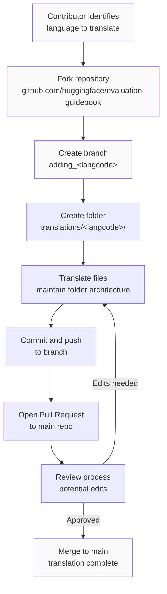
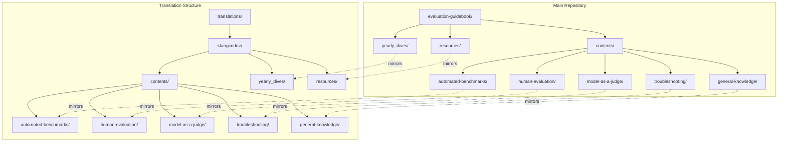
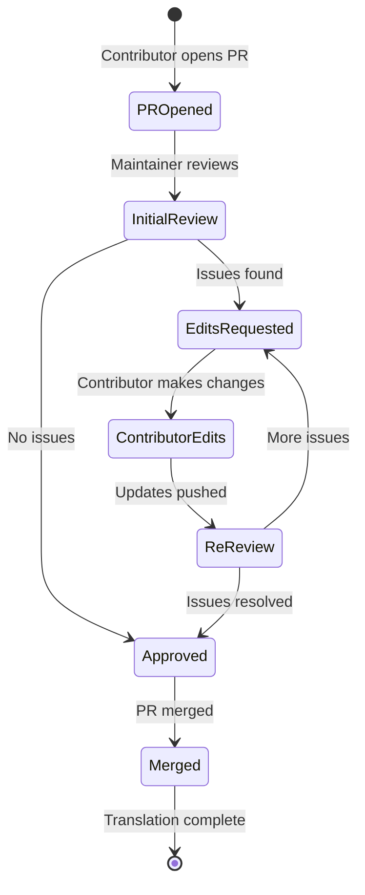
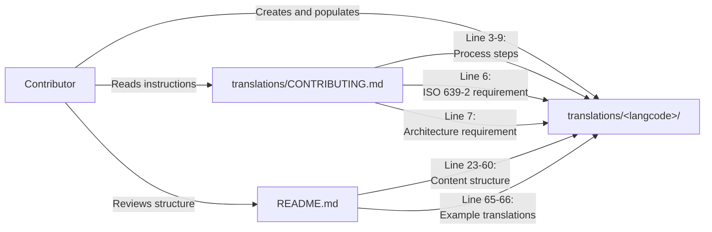

<!-- source: DeepWiki mcp.deepwiki.com · repo huggingface/evaluation-guidebook · page 7 Contributing to the Guidebook · fetched 2026-10-26 -->

# Contributing to the Guidebook

<details>
<summary>Relevant source files</summary>

The following files were used as context for generating this wiki page:

- [README.md](README.md)
- [translations/CONTRIBUTING.md](translations/CONTRIBUTING.md)

</details>


## Purpose and Scope

This document describes how community members can contribute to the LLM Evaluation Guidebook, with a primary focus on the translation process. The guidebook is community-driven and welcomes translations into multiple languages. For information about the guidebook's content structure, see [Overview](#1). For details on specific evaluation methodologies covered in the guidebook, see [Evaluation Methodologies](#2).

The contribution process follows a standard fork-and-pull-request workflow with specific requirements for folder architecture and language code conventions. All contributions are licensed under CC BY-NC-SA 4.0 [README.md:79-83]().

---

## Translation Contribution Workflow

The guidebook uses a systematic process for accepting community translations. The workflow progresses through five distinct phases, from initial fork to final merge.

### Process Overview



**Diagram: Translation Contribution State Machine**

The workflow is explicitly documented in [translations/CONTRIBUTING.md:3-13](), which defines each step:

1. **Fork** the repository to your GitHub account
2. **Create a branch** on your fork named `adding_<langcode>`
3. **Create a folder** using the ISO 639-2 language code
4. **Translate files** while maintaining the original folder architecture
5. **Commit and push** changes to your branch
6. **Open a PR** to the main repository
7. **Review and iterate** with maintainers if edits are needed
8. **Merge** once approved

Sources: [translations/CONTRIBUTING.md:1-13](), [README.md:63-66]()

---

## Language Code Requirements

Translations must use ISO 639-2 language codes for folder naming. This standardization ensures consistent organization across all translations.

### ISO 639-2 Standard

The guidebook requires ISO 639-2 codes as specified in [translations/CONTRIBUTING.md:6](). These are three-letter language codes maintained by the Library of Congress.

| Language | ISO 639-2 Code | Folder Path | Status |
|----------|----------------|-------------|--------|
| Chinese | `zh` | `translations/zh/contents` | Complete |
| French | `fr` | `translations/fr/` | Complete (external) |
| Example: Spanish | `spa` | `translations/spa/contents` | N/A |
| Example: German | `deu` | `translations/deu/contents` | N/A |
| Example: Japanese | `jpn` | `translations/jpn/contents` | N/A |

**Reference**: Full ISO 639-2 code list available at https://www.loc.gov/standards/iso639-2/php/code_list.php [translations/CONTRIBUTING.md:6]()

Sources: [translations/CONTRIBUTING.md:6](), [README.md:65-66]()

---

## Folder Architecture

Translations must preserve the original guidebook's folder structure. This requirement ensures consistency across languages and simplifies maintenance.

### Directory Structure Mapping



**Diagram: Folder Architecture Mirror Structure**

The requirement to "respect the folder architecture" [translations/CONTRIBUTING.md:7]() means:

- All translated files must maintain their relative paths
- Directory hierarchy from `contents/` must be replicated under `translations/<langcode>/contents/`
- Files like `basics.md`, `tips-and-tricks.md`, and `designing-your-evaluation.md` stay in their respective subdirectories

### Example Translation Mapping

Original file paths map directly to translated equivalents:

| Original Path | Chinese Translation Path |
|--------------|--------------------------|
| `contents/automated-benchmarks/basics.md` | `translations/zh/contents/automated-benchmarks/basics.md` |
| `contents/human-evaluation/using-human-annotators.md` | `translations/zh/contents/human-evaluation/using-human-annotators.md` |
| `contents/model-as-a-judge/designing-your-evaluation-prompt.md` | `translations/zh/contents/model-as-a-judge/designing-your-evaluation-prompt.md` |
| `yearly_dives/2025-evaluations-for-useful-models.md` | `translations/zh/yearly_dives/2025-evaluations-for-useful-models.md` |

Sources: [translations/CONTRIBUTING.md:7](), [README.md:23-60]()

---

## Branch Naming Convention

Contributors must follow a specific branch naming pattern to maintain consistency across the contribution ecosystem.

### Branch Name Format

The required pattern is `adding_<langcode>` where `<langcode>` is the ISO 639-2 code [translations/CONTRIBUTING.md:5]().

**Examples**:
- Chinese translation: `adding_zh`
- French translation: `adding_fr`
- Spanish translation: `adding_spa`
- German translation: `adding_deu`

This convention allows maintainers to quickly identify translation branches and their target languages.

Sources: [translations/CONTRIBUTING.md:5]()

---

## Pull Request and Review Process

After pushing translated content to a branch, contributors open a Pull Request (PR) to the main repository for review.

### Review Workflow



**Diagram: PR Review State Machine**

The review process may involve multiple rounds [translations/CONTRIBUTING.md:11]():

1. **Initial Review**: Maintainers check translation quality, folder structure compliance, and ISO code correctness
2. **Round of Edits**: If issues are found, maintainers request changes
3. **Iteration**: Contributors update their branch with corrections
4. **Re-Review**: Maintainers verify fixes
5. **Merge**: Once approved, the PR is merged to main

After merge, the translation is complete and the contributor's work is acknowledged [translations/CONTRIBUTING.md:13]().

Sources: [translations/CONTRIBUTING.md:9-13]()

---

## Existing Community Translations

The guidebook has active community translations in multiple languages, demonstrating the success of the contribution process.

### Current Translations

| Language | Code | Repository/Location | Contributor | Status |
|----------|------|---------------------|-------------|--------|
| Chinese | `zh` | `translations/zh/contents` | @SuSung-boy | Merged |
| French | `fr` | https://huggingface.co/spaces/CATIE-AQ/Guide_Evaluation_LLM | @lbourdois | External space |

The Chinese translation follows the standard fork-PR process and is integrated into the main repository [README.md:65](). The French translation is hosted as an external Hugging Face Space [README.md:66](), demonstrating flexibility in distribution methods.

### Recognition

Contributors are acknowledged in the main README with:
- Country flag emoji
- Link to translation location
- GitHub handle attribution

This recognition system is visible at [README.md:63-66]().

Sources: [README.md:63-66]()

---

## File-Level Contribution Details

### Key Files in Contribution Process



**Diagram: File Dependencies in Contribution Process**

The contribution workflow references these specific files:

1. **[translations/CONTRIBUTING.md]()**
   - [Line 3-9](): Step-by-step process
   - [Line 6](): ISO 639-2 code requirement
   - [Line 7](): Folder architecture requirement
   - [Line 11](): Review and edit rounds
   - [Line 13](): Completion confirmation

2. **[README.md]()**
   - [Line 23-60](): Full content structure to replicate
   - [Line 63-66](): Community translations section
   - [Line 79-83](): License information (CC BY-NC-SA 4.0)

Sources: [translations/CONTRIBUTING.md:1-13](), [README.md:1-94]()

---

## License Compliance

All contributions to the guidebook are subject to the Creative Commons Attribution-NonCommercial-ShareAlike 4.0 International License (CC BY-NC-SA 4.0).

### License Requirements

The license badge and information are displayed at [README.md:79-83](). Contributors should understand:

- **Attribution (BY)**: Must credit original authors
- **NonCommercial (NC)**: Cannot use for commercial purposes
- **ShareAlike (SA)**: Derivative works must use same license

Translations are considered derivative works and automatically inherit this license.

### Citation Format

The guidebook provides a standard citation format at [README.md:85-93]() for academic or professional reference:

```bibtex
@misc{fourrier2024evaluation,
  author = {Clémentine Fourrier and The Hugging Face Community},
  title = {LLM Evaluation Guidebook},
  year = {2024},
  journal = {GitHub repository},
  url = {https://github.com/huggingface/evaluation-guidebook)
}
```

Contributors are acknowledged as part of "The Hugging Face Community" in this citation.

Sources: [README.md:79-93]()

---

## Summary of Requirements

The following table summarizes all requirements for contributing translations:

| Requirement | Specification | Reference |
|-------------|--------------|-----------|
| **Language Code** | ISO 639-2 three-letter code | [translations/CONTRIBUTING.md:6]() |
| **Branch Name** | `adding_<langcode>` | [translations/CONTRIBUTING.md:5]() |
| **Folder Structure** | Mirror `contents/` hierarchy under `translations/<langcode>/` | [translations/CONTRIBUTING.md:7]() |
| **Commit Process** | Fork → Branch → Translate → Push → PR | [translations/CONTRIBUTING.md:3-9]() |
| **Review** | Iterative edits if needed | [translations/CONTRIBUTING.md:11]() |
| **License** | CC BY-NC-SA 4.0 inherited | [README.md:79-83]() |

Contributors who follow these requirements ensure smooth integration of their translations into the guidebook ecosystem.

Sources: [translations/CONTRIBUTING.md:1-13](), [README.md:79-83]()