# Page: Overview

# Overview

<details>
<summary>Relevant source files</summary>

The following files were used as context for generating this wiki page:

- [README.md](README.md)

</details>


## Purpose and Scope

The LLM Evaluation Guidebook is a technical reference for designing, implementing, and troubleshooting evaluations of Large Language Models. It provides practical guidance on three primary evaluation methodologies: automated benchmarks, human evaluation, and LLM-as-a-judge approaches. The guidebook addresses the complete evaluation lifecycle, from selecting appropriate datasets and metrics to resolving common implementation issues such as contamination, reproducibility failures, and parsing errors.

This overview documents the guidebook's architecture, navigation strategies, and content organization. For specific evaluation methodologies, see [Evaluation Methodologies](#2). For foundational concepts required to understand evaluation mechanics, see [Foundational Knowledge](#3). For temporal context on how evaluation practices have evolved from 2023-2025, see [Evolution of LLM Evaluation](#5).

**Sources:** [README.md:1-6]()

## Repository Architecture

The guidebook is organized as a GitHub repository with content structured into six primary directories, each containing multiple markdown files that implement specific evaluation topics.

### File Structure

```mermaid
graph TD
    ROOT["README.md<br/>(main entry point)"]
    
    subgraph "contents/"
        AUTO["automated-benchmarks/"]
        AUTO_BASICS["basics.md"]
        AUTO_DESIGN["designing-your-automatic-evaluation.md"]
        AUTO_DATASETS["some-evaluation-datasets.md"]
        AUTO_TIPS["tips-and-tricks.md"]
        
        HUMAN["human-evaluation/"]
        HUMAN_BASICS["basics.md"]
        HUMAN_ANNOTATORS["using-human-annotators.md"]
        HUMAN_TIPS["tips-and-tricks.md"]
        
        JUDGE["model-as-a-judge/"]
        JUDGE_BASICS["basics.md"]
        JUDGE_GET["getting-a-judge-llm.md"]
        JUDGE_PROMPT["designing-your-evaluation-prompt.md"]
        JUDGE_EVAL["evaluating-your-evaluator.md"]
        JUDGE_REWARD["what-about-reward-models.md"]
        JUDGE_TIPS["tips-and-tricks.md"]
        
        TROUBLE["troubleshooting/"]
        TROUBLE_INF["troubleshooting-inference.md"]
        TROUBLE_REPRO["troubleshooting-reproducibility.md"]
        
        GENERAL["general-knowledge/"]
        GENERAL_INF["model-inference-and-evaluation.md"]
        GENERAL_TOK["tokenization.md"]
    end
    
    subgraph "yearly_dives/"
        Y2023["2023-year-of-open-source.md"]
        Y2024["2024-evals-thoughts-from-iclr.md"]
        Y2025["2025-evaluations-for-useful-models.md"]
    end
    
    subgraph "resources/"
        RES_EVAL["about-evaluation.md"]
        RES_NLP["about-NLP.md"]
    end
    
    subgraph "translations/"
        TRANS_ZH["zh/"]
    end
    
    ROOT --> AUTO
    ROOT --> HUMAN
    ROOT --> JUDGE
    ROOT --> TROUBLE
    ROOT --> GENERAL
    ROOT --> Y2023
    ROOT --> Y2024
    ROOT --> Y2025
    ROOT --> RES_EVAL
    ROOT --> RES_NLP
    ROOT --> TRANS_ZH
    
    AUTO --> AUTO_BASICS
    AUTO --> AUTO_DESIGN
    AUTO --> AUTO_DATASETS
    AUTO --> AUTO_TIPS
    
    HUMAN --> HUMAN_BASICS
    HUMAN --> HUMAN_ANNOTATORS
    HUMAN --> HUMAN_TIPS
    
    JUDGE --> JUDGE_BASICS
    JUDGE --> JUDGE_GET
    JUDGE --> JUDGE_PROMPT
    JUDGE --> JUDGE_EVAL
    JUDGE --> JUDGE_REWARD
    JUDGE --> JUDGE_TIPS
    
    TROUBLE --> TROUBLE_INF
    TROUBLE --> TROUBLE_REPRO
    
    GENERAL --> GENERAL_INF
    GENERAL --> GENERAL_TOK
```

**Repository Structure Diagram: Maps README.md navigation to actual file paths in the contents/, yearly_dives/, resources/, and translations/ directories**

The `README.md` file at [README.md:1-93]() serves as the central navigation hub, linking to all subsections. Each methodology (automated benchmarks, human evaluation, LLM-as-a-judge) follows a consistent file naming pattern: `basics.md` for introductory material, methodology-specific design guides, and `tips-and-tricks.md` for practical advice.

**Sources:** [README.md:19-60]()

### Content Organization Pattern

Each evaluation methodology directory follows a three-tier information architecture:

| Tier | File Pattern | Target Audience | Wiki Pages |
|------|-------------|-----------------|------------|
| **Basics** | `basics.md` | Beginners requiring conceptual introduction | [2.1](#2.1), [2.2](#2.2), [2.3](#2.3) |
| **Design** | `designing-*.md`, `getting-*.md`, `using-*.md` | Practitioners implementing evaluations | [2.1.1](#2.1.1), [2.2.1](#2.2.1), [2.3.1](#2.3.1), [2.3.2](#2.3.2) |
| **Advanced** | `tips-and-tricks.md` | Experienced users troubleshooting issues | [2.1.3](#2.1.3), [2.2.2](#2.2.2), [2.3.4](#2.3.4) |

This pattern ensures consistent navigation across methodologies while accommodating different expertise levels.

**Sources:** [README.md:22-39]()

## User Navigation Strategies

The guidebook defines three distinct navigation paths based on user expertise level, as specified in [README.md:9-15](). Each path prioritizes different content types and entry points.

### Navigation Path Mapping

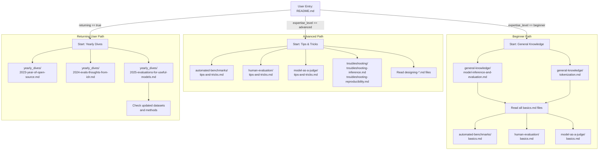

**User Navigation Diagram: Shows three distinct paths through the codebase based on expertise level, mapping to specific markdown files in the repository**

### Path Characteristics

**Beginner Path** ([README.md:9-11]()):
- **Entry point**: `general-knowledge/` directory, specifically [3.1](#3.1) and [3.2](#3.2)
- **Progression**: Foundational concepts → methodology basics → simple implementations
- **Key files**: All `basics.md` files across methodologies
- **Objective**: Build understanding of tokenization, inference mechanics, and basic evaluation types

**Advanced Path** ([README.md:12-13]()):
- **Entry point**: `tips-and-tricks.md` files and `troubleshooting/` directory
- **Focus areas**: [2.1.3](#2.1.3), [2.2.2](#2.2.2), [2.3.4](#2.3.4), [4](#4)
- **Key files**: `designing-your-*.md`, `troubleshooting-*.md`
- **Objective**: Resolve practical implementation issues and optimize evaluation design

**Returning User Path** ([README.md:14-15]()):
- **Entry point**: `yearly_dives/` directory, particularly [5.3](#5.3) for 2025 updates
- **Focus**: Temporal evolution of evaluation practices and new methodologies
- **Key files**: Year-specific markdown files in `yearly_dives/`
- **Objective**: Understand paradigm shifts and new dataset/metric releases

**Sources:** [README.md:8-16]()

## Three Evaluation Methodologies

The guidebook's core content is organized around three evaluation paradigms, each implemented as a separate directory under `contents/`. These methodologies represent different trade-offs between automation, quality, and scalability.

### Methodology Comparison

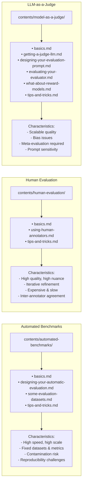

**Methodology Implementation Diagram: Maps evaluation paradigms to their implementation directories and characteristic trade-offs**

### Methodology Selection Criteria

| Criterion | Automated Benchmarks | Human Evaluation | LLM-as-a-Judge |
|-----------|---------------------|------------------|----------------|
| **Speed** | Fast (batch inference) | Slow (hours per annotation) | Medium (depends on judge model) |
| **Cost** | Low (compute only) | High (annotator wages) | Medium (judge inference cost) |
| **Scale** | High (1000s of examples) | Low (100s of examples) | High (limited by judge capacity) |
| **Quality** | Fixed by dataset | Highest (human nuance) | Variable (judge-dependent) |
| **Reproducibility** | Challenging (prompt sensitivity) | Low (annotator variance) | Medium (stochastic judge outputs) |
| **Primary Risk** | Contamination | Annotation drift | Position/verbosity bias |
| **Wiki Reference** | [2.1](#2.1) | [2.2](#2.2) | [2.3](#2.3) |

**Automated Benchmarks** ([README.md:22-26]()):
- **Directory**: `contents/automated-benchmarks/`
- **Core files**: `designing-your-automatic-evaluation.md` covers dataset selection, inference methods, prompt engineering, and metric choice
- **Dataset catalog**: `some-evaluation-datasets.md` contains domain-specific benchmark listings (math, code, reasoning)
- **Use case**: High-throughput regression testing, leaderboard rankings
- **Limitations**: See [2.1.3](#2.1.3) for contamination and tokenization issues

**Human Evaluation** ([README.md:28-31]()):
- **Directory**: `contents/human-evaluation/`
- **Core files**: `using-human-annotators.md` details workforce selection, guideline design, and quality control
- **Process**: Iterative annotation refinement with inter-annotator agreement validation
- **Use case**: Validating automated methods, evaluating subjective qualities (helpfulness, harmlessness)
- **Limitations**: See [2.2.2](#2.2.2) for annotation drift and cognitive load management

**LLM-as-a-Judge** ([README.md:33-39]()):
- **Directory**: `contents/model-as-a-judge/`
- **Core files**: `getting-a-judge-llm.md` (judge acquisition), `designing-your-evaluation-prompt.md` (prompt engineering), `evaluating-your-evaluator.md` (meta-evaluation)
- **Special topic**: `what-about-reward-models.md` covers Bradley-Terry models as alternative judge approach
- **Use case**: Scaling human-like evaluation, pairwise preference ranking
- **Limitations**: See [2.3.4](#2.3.4) for position bias, verbosity bias, and self-preference issues

**Sources:** [README.md:22-39]()

## Supporting Systems

Beyond the three core methodologies, the guidebook includes foundational knowledge, troubleshooting resources, and external ecosystem references that enable successful evaluation implementation.

### Supporting Content Architecture

```mermaid
graph TD
    subgraph "Foundational Knowledge"
        GK_DIR["contents/general-knowledge/"]
        GK_INF["model-inference-and-evaluation.md<br/>- Tokenization → prediction process<br/>- Log-likelihood vs generative eval<br/>- Output constraint methods"]
        GK_TOK["tokenization.md<br/>- Character/word/sub-word (BPE)<br/>- Vocabulary considerations<br/>- Multilingual challenges<br/>- Numerical representation"]
    end
    
    subgraph "Troubleshooting"
        TR_DIR["contents/troubleshooting/"]
        TR_INF["troubleshooting-inference.md<br/>- Model output parsing<br/>- Format compliance<br/>- Verbose outputs"]
        TR_REPRO["troubleshooting-reproducibility.md<br/>- Prompt sensitivity<br/>- Score variance<br/>- Tokenization spacing"]
    end
    
    subgraph "External Ecosystem"
        RES_DIR["resources/"]
        RES_EVAL["about-evaluation.md<br/>- Evaluation frameworks<br/>- Leaderboards<br/>- Research papers"]
        RES_NLP["about-NLP.md<br/>- NLP courses<br/>- Architecture guides<br/>- Tutorials"]
    end
    
    subgraph "Temporal Context"
        YD_DIR["yearly_dives/"]
        YD_2023["2023-year-of-open-source.md<br/>- LLaMA, Falcon, Mistral<br/>- RLHF, DPO methods"]
        YD_2024["2024-evals-thoughts-from-iclr.md<br/>- Evaluation crisis identification<br/>- Three purposes framework"]
        YD_2025["2025-evaluations-for-useful-models.md<br/>- Multi-layer architecture<br/>- Utility over intelligence"]
    end
    
    GK_DIR --> GK_INF
    GK_DIR --> GK_TOK
    TR_DIR --> TR_INF
    TR_DIR --> TR_REPRO
    RES_DIR --> RES_EVAL
    RES_DIR --> RES_NLP
    YD_DIR --> YD_2023
    YD_DIR --> YD_2024
    YD_DIR --> YD_2025
    
    GK_INF -.required for.-> AB_DIR["All evaluation methodologies"]
    TR_INF -.resolves issues in.-> AB_DIR
    TR_REPRO -.resolves issues in.-> AB_DIR
    YD_2024 -.informs design of.-> AB_DIR
    YD_2025 -.informs design of.-> AB_DIR
    RES_EVAL -.provides tools for.-> AB_DIR
```

**Supporting Systems Diagram: Shows how foundational knowledge, troubleshooting, resources, and temporal context support the three core methodologies**

### Foundational Knowledge

The `general-knowledge/` directory ([README.md:46-50]()) provides prerequisite understanding:

- **Model Inference** ([3.1](#3.1)): Documents the tokenization → prediction pipeline, distinguishing between log-likelihood evaluation (computing probabilities of fixed completions) and generative evaluation (sampling new text)
- **Tokenization** ([3.2](#3.2)): Explains BPE (Byte-Pair Encoding) sub-word tokenization, vocabulary size trade-offs, and multilingual/numerical representation challenges
- **Target audience**: Beginners should read these before methodology-specific content
- **Advanced users**: [README.md:48]() recommends skimming to "Going further" sections for advanced references

### Troubleshooting

The `troubleshooting/` directory ([README.md:41-44]()) addresses common implementation failures:

- **Inference issues** ([4](#4)): Model output parsing failures, format non-compliance, handling verbose outputs
- **Reproducibility issues**: Prompt sensitivity (same prompt, different scores), tokenization spacing effects, score variance across runs
- **Practical focus**: [README.md:42]() describes this as "the most densely practical part of this guide"
- **Example**: Math parsing issues (documented in [4.1](#4.1)) detail sympy limitations causing ~6% failure rate on valid LaTeX expressions

### External Ecosystem

The `resources/` directory ([README.md:57-61]()) connects to external tools and learning materials:

- **Evaluation tools** ([6.1](#6.1)): lm_eval harness, lighteval, Argilla, distilabel frameworks
- **Leaderboards** ([6.2](#6.2)): Open LLM Leaderboard, HELM, Chatbot Arena
- **Learning resources** ([6.3](#6.3)): NLP courses, architecture guides, prompting tutorials
- **Curation**: [README.md:58]() notes these are "Links I like", indicating editorial selection

### Yearly Dives

The `yearly_dives/` directory ([README.md:52-55]()) provides temporal context:

- **2023** ([5.1](#5.1)): Open-source model emergence (LLaMA, Falcon, Mistral), fine-tuning methods (RLHF, DPO)
- **2024** ([5.2](#5.2)): Evaluation crisis recognition (contamination, score instability, undefined capabilities), three purposes framework
- **2025** ([5.3](#5.3)): Paradigm shift to multi-layer evaluation architecture (specific capabilities → assistant tasks → dynamic environments → forecasters)
- **Recommended for**: [README.md:15]() identifies returning users as primary audience

**Sources:** [README.md:41-61]()

## Content Dependencies

Evaluation methodologies depend on foundational knowledge and are supported by troubleshooting resources. This dependency structure informs the recommended reading order.

### Dependency Graph

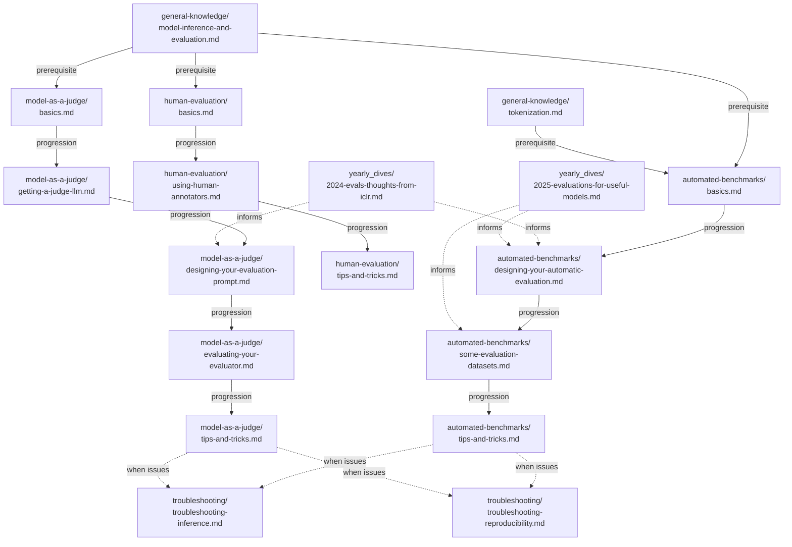

**Content Dependency Diagram: Shows prerequisite relationships between markdown files, indicating recommended reading order for beginners and dependency resolution for implementation**

### Reading Order Recommendations

**For Beginners** (implementing [README.md:9-11]()):
1. `general-knowledge/model-inference-and-evaluation.md` ([3.1](#3.1))
2. `general-knowledge/tokenization.md` ([3.2](#3.2))
3. Methodology-specific `basics.md` file ([2.1](#2.1), [2.2](#2.2), or [2.3](#2.3))
4. Methodology-specific design/implementation files
5. `tips-and-tricks.md` for chosen methodology
6. `troubleshooting/` files as issues arise

**For Advanced Users** (implementing [README.md:12-13]()):
- Start with `designing-*.md` files in chosen methodology
- Reference `troubleshooting/` proactively
- Consult `tips-and-tricks.md` for optimization strategies
- Skip foundational knowledge unless encountering conceptual gaps

**For Returning Users** (implementing [README.md:14-15]()):
- Start with `yearly_dives/2025-evaluations-for-useful-models.md` ([5.3](#5.3))
- Identify new datasets in `some-evaluation-datasets.md` ([2.1.2](#2.1.2))
- Review updated methodologies informed by 2024-2025 paradigm shifts

**Sources:** [README.md:8-16](), [README.md:22-60]()

## Community and Contributions

The guidebook is a community-driven project with translation support and contribution mechanisms.

### Translation Architecture

Translations are organized under the `translations/` directory using ISO 639-2 language codes:

| Language | Code | Directory | Status | Contributor |
|----------|------|-----------|--------|-------------|
| Chinese | `zh` | `translations/zh/` | Active | @SuSung-boy |
| French | `fr` | External (HuggingFace Space) | Active | @lbourdois |

**Translation process** (documented in [7](#7)):
1. Fork repository
2. Create language branch using ISO 639-2 code
3. Translate markdown files maintaining directory structure
4. Submit pull request
5. Review and merge by maintainers

**Sources:** [README.md:63-66]()

### Acknowledgments

The guidebook acknowledges influences from:
- **Structural inspiration**: ML Engineering Guidebook by Stas Bekman [README.md:69]()
- **Industry contributors**: Representatives from Allen AI, Cohere, Meta, OpenAI, Anthropic, Max Planck Institute [README.md:72]()
- **Community**: Open LLM Leaderboard users, lighteval community [README.md:73]()
- **Hugging Face team**: Lewis Tunstall, Hynek Kydlíček, Guilherme Penedo, Thom Wolf, Nathan Habib [README.md:74]()

**Sources:** [README.md:68-76]()

## Citation and Licensing

The guidebook is licensed under Creative Commons BY-NC-SA 4.0 [README.md:79-83]().

**Citation format**:
```
@misc{fourrier2024evaluation,
  author = {Clémentine Fourrier and The Hugging Face Community},
  title = {LLM Evaluation Guidebook},
  year = {2024},
  journal = {GitHub repository},
  url = {https://github.com/huggingface/evaluation-guidebook}
}
```

The BY-NC-SA license permits:
- **Share**: Copy and redistribute material in any medium or format
- **Adapt**: Remix, transform, and build upon material

Under the conditions:
- **Attribution**: Credit the original author
- **NonCommercial**: Non-commercial purposes only
- **ShareAlike**: Distribute adaptations under identical license

**Sources:** [README.md:78-93]()

## Next Steps

After understanding the guidebook's architecture and navigation strategy, proceed to:

- **[Evaluation Methodologies](#2)**: Overview of the three evaluation paradigms and selection criteria
- **[Automated Benchmarks](#2.1)**: If prioritizing speed and scale over nuance
- **[Human Evaluation](#2.2)**: If requiring highest quality subjective judgments
- **[LLM-as-a-Judge](#2.3)**: If seeking scalable quality evaluation
- **[Foundational Knowledge](#3)**: If unfamiliar with LLM inference mechanics and tokenization
- **[Evolution of LLM Evaluation](#5)**: For historical context on evaluation paradigm shifts from 2023-2025

**Sources:** [README.md:1-93]()

---

# Page: Evaluation Methodologies

# Evaluation Methodologies

<details>
<summary>Relevant source files</summary>

The following files were used as context for generating this wiki page:

- [README.md](README.md)
- [yearly_dives/2023-year-of-open-source.md](yearly_dives/2023-year-of-open-source.md)
- [yearly_dives/2024-evals-thoughts-from-iclr.md](yearly_dives/2024-evals-thoughts-from-iclr.md)
- [yearly_dives/2025-evaluations-for-useful-models.md](yearly_dives/2025-evaluations-for-useful-models.md)

</details>


## Purpose and Scope

This document provides an overview of the three primary approaches to evaluating Large Language Models (LLMs): automated benchmarks, human evaluation, and LLM-as-a-judge. It explains the technical characteristics, appropriate use cases, and fundamental limitations of each methodology.

For detailed implementation guidance on specific methodologies, see:
- Automated benchmarks: [Automated Benchmarks](#2.1)
- Human evaluation: [Human Evaluation](#2.2)
- LLM-as-a-judge: [LLM-as-a-Judge](#2.3)

For historical context on how evaluation practices evolved from 2023-2025, see [Evolution of LLM Evaluation](#5).

Sources: [README.md:1-93](), [yearly_dives/2024-evals-thoughts-from-iclr.md:1-121]()

## The Three Evaluation Paradigms

Modern LLM evaluation relies on three distinct methodologies, each answering different questions and serving different purposes in the model development lifecycle.

### High-Level Comparison

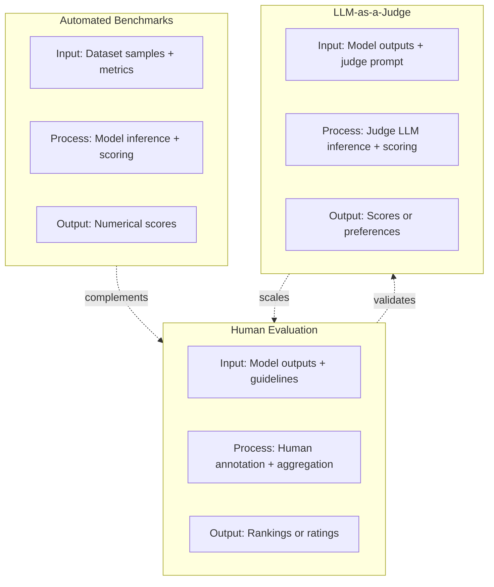

Sources: [yearly_dives/2024-evals-thoughts-from-iclr.md:12-64]()

| Methodology | Speed | Cost | Reproducibility | Contamination Risk | Best For |
|-------------|-------|------|-----------------|-------------------|----------|
| Automated Benchmarks | Fast (minutes-hours) | Low (compute only) | High | High | Specific capabilities, training monitoring, model comparison |
| Human Evaluation | Slow (days-weeks) | High (labor intensive) | Low-Medium | Low | Open-ended tasks, preference assessment, quality validation |
| LLM-as-a-Judge | Medium (hours) | Medium (API costs) | Medium | Low | Scalable quality assessment, preference learning |

Sources: [yearly_dives/2024-evals-thoughts-from-iclr.md:12-64]()

## Automated Benchmarks

### Technical Description

Automated benchmarks evaluate models using pre-constructed datasets paired with algorithmic metrics. The evaluation consists of:

1. **Sample Collection**: A dataset containing inputs (prompts, questions, code problems) and often reference outputs (ground truth answers)
2. **Inference Method**: Either log-likelihood evaluation (comparing probability scores across multiple choice options) or generative evaluation (producing free-form text)
3. **Scoring Metric**: Algorithmic comparison of model output to reference (exact match, normalized match, BLEU/ROUGE, functional correctness)

Sources: [yearly_dives/2024-evals-thoughts-from-iclr.md:16-27]()

### Guidebook Structure Mapping

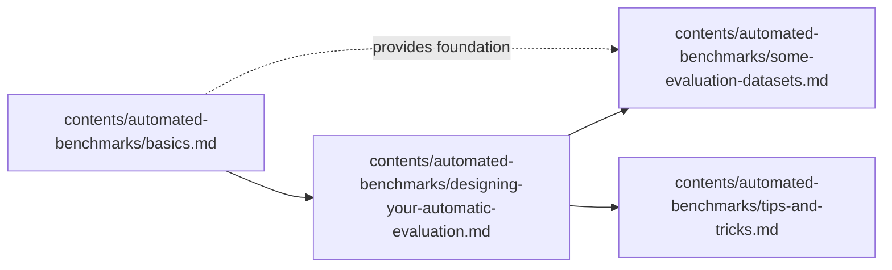

Sources: [README.md:22-26]()

### Key Use Cases

**Non-Regression Testing**: Monitoring training progress by evaluating whether performance trajectories and score ranges fall within expected bounds for a model of given size and training setup. The absolute score is less important than the trend and range.

**Model Comparison**: Establishing rankings across models using stable evaluation methodologies. When scores are susceptible to prompt variations, rankings provide more robust signal than absolute numbers.

**Capability Assessment**: Testing specific, well-defined capabilities like mathematical reasoning (GSM8K, MATH), code generation (HumanEval, MBPP), or instruction following (IFEval).

Sources: [yearly_dives/2024-evals-thoughts-from-iclr.md:71-95]()

### Fundamental Limitations

**Contamination**: Public benchmarks inevitably appear in model training data, either intentionally or through web scraping. This inflates scores without genuine capability improvement. The contamination problem has driven creation of dataset variants (GSM1K from GSM8K, MATH-500 from MATH) and private benchmarks.

**Proxy Measurement**: For abstract capabilities like "reasoning" or "intelligence," benchmarks can only measure performance on specific tasks that serve as proxies. Success on GSM8K indicates ability to solve grade-school math problems, not general mathematical reasoning.

**Evaluation Sensitivity**: Scores fluctuate significantly with minor prompt changes, answer ordering in multiple choice questions, and output parsing strategies.

Sources: [yearly_dives/2024-evals-thoughts-from-iclr.md:16-36](), [yearly_dives/2025-evaluations-for-useful-models.md:19-49]()

## Human Evaluation

### Technical Description

Human evaluation tasks annotators with judging model outputs according to specified criteria. Three primary approaches exist:

**Vibe-Checks**: Individual community members manually test models on personal prompts, sharing anecdotal findings. Highly susceptible to confirmation bias but useful for rapid capability exploration.

**Arena Systems**: Large-scale community voting where users compare model outputs and vote for preferences. Votes aggregate into Elo rankings. Example: LMSYS Chatbot Arena aggregates thousands of community votes.

**Systematic Annotation**: Professional annotators follow detailed guidelines to rate or rank outputs. Requires careful annotator selection, guideline design, and quality control mechanisms (inter-annotator agreement, error annotation).

Sources: [yearly_dives/2024-evals-thoughts-from-iclr.md:38-54]()

### Guidebook Structure Mapping

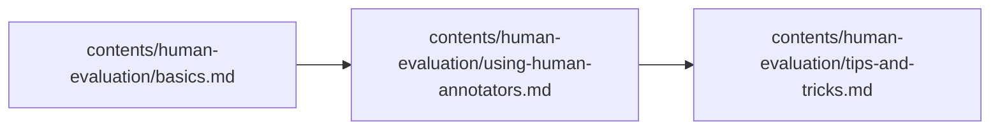

Sources: [README.md:28-31]()

### Key Use Cases

**Open-Ended Quality Assessment**: Evaluating dimensions difficult to measure algorithmically, such as helpfulness, coherence, creativity, or stylistic preferences.

**Contamination-Proof Evaluation**: New prompts written by humans avoid training set overlap, providing genuine out-of-distribution testing.

**Preference Alignment Validation**: Determining whether model outputs align with human values and expectations, serving as ground truth for preference models.

Sources: [yearly_dives/2024-evals-thoughts-from-iclr.md:38-42]()

### Fundamental Limitations

**Subjectivity and Cultural Bias**: Annotator preferences vary by culture, identity, and personal values. Different demographic groups rate toxicity, helpfulness, and quality differently.

**Psychological Biases**: Humans favor assertive answers over accurate ones, preferring confident tone regardless of factual correctness. They also prefer answers aligning with their existing beliefs over factually correct contradictions.

**Scalability and Cost**: Each new model requires fresh human evaluation, making continuous assessment expensive. Systematic annotation with quality control costs scale linearly with evaluation volume.

**Reproducibility**: Arena-style evaluations provide aggregated preferences but individual judgments vary significantly, making specific score reproduction impossible.

Sources: [yearly_dives/2024-evals-thoughts-from-iclr.md:44-54]()

## LLM-as-a-Judge

### Technical Description

LLM-as-a-judge uses language models to evaluate other language models' outputs. Two implementation approaches exist:

**Generalist LLMs**: High-capability models (GPT-4, Claude) receive prompts describing evaluation criteria, example outputs, and target outputs to judge. The judge provides scores or rankings based on specified dimensions.

**Specialist Reward Models**: Small models trained on human preference data to predict preference scores. Often use Bradley-Terry models for pairwise comparisons, outputting relative preference probabilities.

Sources: [yearly_dives/2024-evals-thoughts-from-iclr.md:56-63]()

### Guidebook Structure Mapping

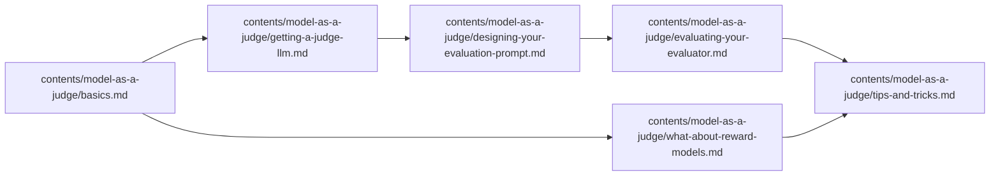

Sources: [README.md:33-39]()

### Key Use Cases

**Scaled Human Preference Approximation**: When human evaluation is too expensive but automated metrics insufficient, judge LLMs approximate human preferences at lower cost.

**Reward Model Training**: Generating preference data for reinforcement learning from human feedback (RLHF) or direct preference optimization (DPO) training procedures.

**Multi-Dimensional Assessment**: Evaluating multiple quality dimensions (helpfulness, harmlessness, honesty) simultaneously with structured prompts.

Sources: [yearly_dives/2024-evals-thoughts-from-iclr.md:56-63]()

### Fundamental Limitations

**Self-Preference Bias**: Judge models systematically favor their own outputs when comparing against other models, inflating self-scores.

**Position Bias**: Judges disproportionately prefer outputs presented first in pairwise comparisons, regardless of quality.

**Verbosity Bias**: Longer, more detailed answers receive higher scores even when less accurate or helpful than concise alternatives.

**Score Consistency**: Judges struggle to maintain consistent score ranges across evaluations, and rarely explain reasoning before scoring leads to arbitrary judgments.

**Uninterpretable Bias Introduction**: Using LLMs to train LLMs creates subtle, difficult-to-detect biases that may compound across model generations.

Sources: [yearly_dives/2024-evals-thoughts-from-iclr.md:61-63]()

## Decision Framework: Choosing an Evaluation Approach

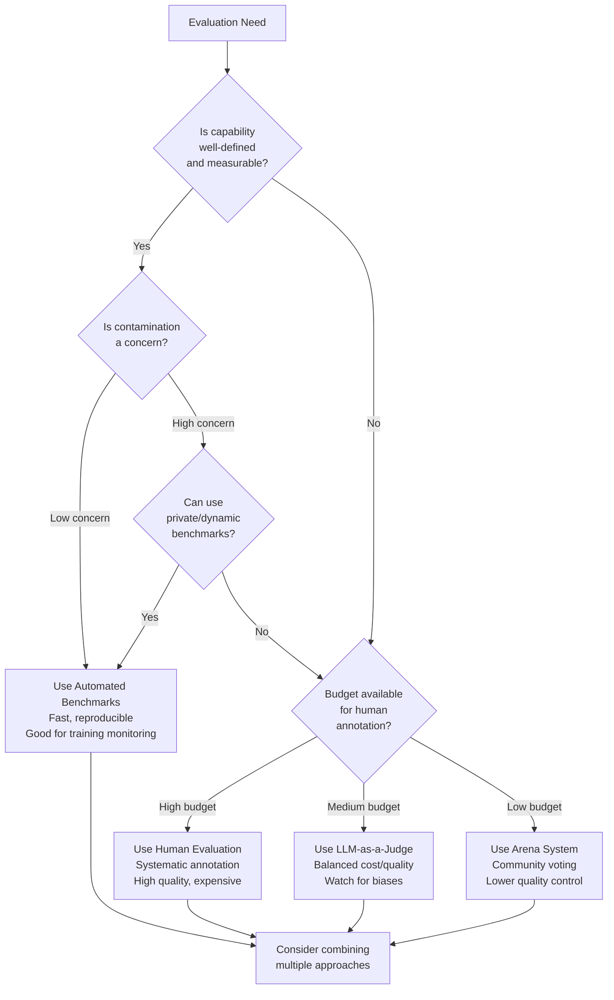

Sources: [yearly_dives/2024-evals-thoughts-from-iclr.md:66-113]()

### Selection Criteria Table

| Criterion | Automated Benchmarks | Human Evaluation | LLM-as-a-Judge |
|-----------|---------------------|------------------|----------------|
| **Use when capability is...** | Well-defined, testable | Open-ended, subjective | Complex but describable |
| **Use when you need...** | Training monitoring | Preference validation | Scalable quality assessment |
| **Avoid when...** | High contamination risk | Budget constrained | Self-evaluation required |
| **Best for model stage...** | Pretraining, base models | Post-training, chat models | Post-training evaluation |
| **Evaluation speed** | Minutes to hours | Days to weeks | Hours to days |

Sources: [yearly_dives/2024-evals-thoughts-from-iclr.md:66-113](), [yearly_dives/2025-evaluations-for-useful-models.md:1-167]()

## Cross-Cutting Concerns

All three evaluation methodologies face shared challenges that must be addressed regardless of approach selected.

### Contamination

**Definition**: Evaluation data appearing in model training sets, either intentionally or through web scraping, causing inflated scores without genuine capability.

**Mitigation Strategies**:
- Use private or gated datasets (GPQA diamond subset, Humanity's Last Exam)
- Implement dynamic benchmarks with regular refresh (LiveCodeBench adds problems by publication date)
- Create dataset variants (GSM-Symbolic generates infinite variations from templates)
- Add canary strings for detection (BigBench approach)

Sources: [yearly_dives/2024-evals-thoughts-from-iclr.md:33-36](), [yearly_dives/2025-evaluations-for-useful-models.md:40-49]()

### Bias

**Types**:
- **Position bias**: Preference for first-presented options in multiple choice or pairwise comparisons
- **Verbosity bias**: Preference for longer outputs regardless of quality
- **Self-preference bias**: Models favoring their own generations when judging
- **Cultural bias**: Preference variations across demographic groups

**Mitigation Strategies**:
- Randomize answer ordering in multiple choice evaluations
- Normalize by length or request concise answers
- Use third-party judges, never self-evaluation
- Diversify annotator pools and guidelines

Sources: [yearly_dives/2024-evals-thoughts-from-iclr.md:27-63]()

### Reproducibility

**Challenges**:
- Prompt sensitivity: Minor wording changes cause significant score variation
- Tokenization differences: Whitespace, special characters affect parsing
- Output parsing: Normalization strategies impact generative evaluation scores
- Judge model changes: API-based judges change without notice

**Mitigation Strategies**:
- Document exact prompts, parsers, and normalization procedures
- Version control evaluation code and judge models
- Report score variance across multiple runs
- Use local models rather than APIs when possible

Sources: [yearly_dives/2024-evals-thoughts-from-iclr.md:88-94]()

### Cross-Cutting Concerns Architecture

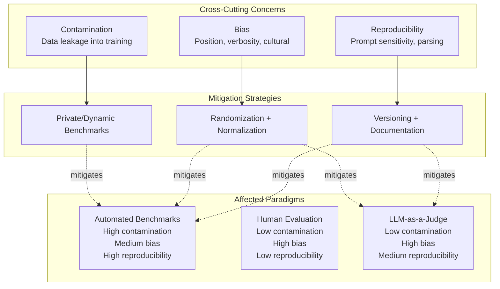

Sources: [yearly_dives/2024-evals-thoughts-from-iclr.md:27-94](), [yearly_dives/2025-evaluations-for-useful-models.md:1-167]()

## Three Purposes of Evaluation

Evaluation serves three distinct purposes that are often conflated but require different methodologies and interpretation frameworks.

### Purpose 1: Non-Regression Testing

**Question Answered**: "Is my model training correctly? Have my changes broken expected behavior?"

**Methodology**: Monitor evaluation score trajectories and ranges during training. Compare against expected performance bounds for model size and architecture.

**Interpretation**: Absolute scores matter less than trends and ranges. A 7B base model scoring 50-65 on MMLU indicates normal training; scores of 20-30 indicate training failure.

**Best Approach**: Automated benchmarks with high signal-to-noise ratio

Sources: [yearly_dives/2024-evals-thoughts-from-iclr.md:71-84]()

### Purpose 2: Model Ranking

**Question Answered**: "Which model is best? Should I select model A or model B for my use case?"

**Methodology**: Establish consistent rankings across models using stable evaluation methods. Focus on relative ordering rather than absolute scores.

**Interpretation**: Rankings are more robust than scores to minor perturbations. If top-ranked model fails on your use case, lower-ranked models likely will too.

**Best Approach**: Combination of automated benchmarks (for stability) and human evaluation (for preference)

Sources: [yearly_dives/2024-evals-thoughts-from-iclr.md:85-94]()

### Purpose 3: Capability Assessment

**Question Answered**: "Can models do X? What are current field-wide capabilities?"

**Methodology**: Use benchmarks as proxies for broader capabilities, acknowledging fundamental measurement limitations.

**Interpretation**: Performance on GSM8K indicates ability to solve grade-school math, not general reasoning. No benchmark currently measures abstract capabilities reliably.

**Best Approach**: Multi-layered evaluation (specific capabilities → assistant tasks → dynamic environments)

Sources: [yearly_dives/2024-evals-thoughts-from-iclr.md:95-104](), [yearly_dives/2025-evaluations-for-useful-models.md:1-167]()

## Evolution of Evaluation Philosophy

The LLM evaluation field has matured significantly from 2023 to 2025, shifting from simple benchmark-centric approaches to multi-layered capability orchestration.

### 2023: Benchmark-Centric Era

Focus on standard automated benchmarks (MMLU, GSM8K, HumanEval) for comparing open-source models against closed alternatives. Contamination and saturation began emerging as concerns.

Sources: [yearly_dives/2023-year-of-open-source.md:1-166]()

### 2024: Crisis Recognition

Recognition of fundamental problems: contamination prevalence, score instability, undefined capabilities, and pervasive biases in all evaluation types. Community identified three distinct evaluation purposes (non-regression, ranking, capability assessment).

Sources: [yearly_dives/2024-evals-thoughts-from-iclr.md:1-121]()

### 2025: Integrated Capability Testing

Shift toward evaluating practical utility through multi-layered architecture:
1. **Layer 1**: Specific capabilities (math, code, reasoning, tool-calling)
2. **Layer 2**: Assistant tasks (GAIA, DABStep requiring capability integration)
3. **Layer 3**: Dynamic environments (games, forecasting)
4. **Layer 4**: Contamination-proof evaluation (forecasting, dynamic benchmarks)

Emphasis on functional testing and parser-based validation over model judges for interpretability.

Sources: [yearly_dives/2025-evaluations-for-useful-models.md:1-167]()

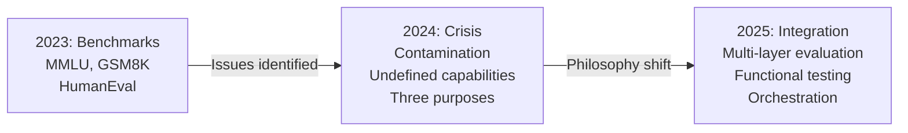

Sources: [yearly_dives/2023-year-of-open-source.md:1-166](), [yearly_dives/2024-evals-thoughts-from-iclr.md:1-121](), [yearly_dives/2025-evaluations-for-useful-models.md:1-167]()

## Practical Recommendations

Based on current understanding of evaluation limitations and best practices:

### For Model Builders

**During Training**: Use automated benchmarks for non-regression testing. Monitor MMLU-Pro, MATH-500, basic reasoning benchmarks for trajectory validation.

**Post-Training**: Combine specific capability tests (IFEval, AIME, SWE-Bench, TauBench/BFCL) with integrated assistant tasks (GAIA, DABStep).

### For Model Users

**Model Selection**: Prioritize rankings from diverse benchmark suites over individual scores. Check performance on domain-specific evaluations matching your use case.

**Deployment Validation**: Conduct systematic human evaluation on representative production prompts before deployment.

### For Researchers

**Benchmark Design**: Favor functional testing with algorithmic validation over model judges. Create mechanisms for regular dataset refresh or template-based generation.

**Reporting**: Document exact prompts, parsers, and evaluation procedures. Report score variance and statistical significance. Provide both scores and rankings.

Sources: [yearly_dives/2025-evaluations-for-useful-models.md:153-167]()

---

# Page: Automated Benchmarks

# Automated Benchmarks

<details>
<summary>Relevant source files</summary>

The following files were used as context for generating this wiki page:

- [README.md](README.md)
- [contents/automated-benchmarks/basics.md](contents/automated-benchmarks/basics.md)

</details>


Automated benchmarks are standardized, reproducible procedures for evaluating LLM performance on specific tasks or capabilities without human intervention during the evaluation process. They represent one of three primary evaluation methodologies (alongside Human Evaluation and LLM-as-a-Judge), offering consistency and scalability at limited cost.

This page covers the fundamentals of automated benchmarking: what they are, how they work, their core components (datasets, metrics, inference methods), and their advantages and limitations. For detailed guidance on designing evaluations, see page 2.1.1. For a comprehensive catalog of evaluation datasets, see page 2.1.2. For implementation advice and troubleshooting, see page 2.1.3.

## What are Automated Benchmarks?

Automated benchmarks evaluate model performance by comparing model outputs against predefined references or correct answers. They can assess two types of targets:

- **Concrete tasks**: Well-defined objectives with clear success criteria (e.g., "How accurately can my model classify spam from non-spam emails?")
- **Abstract capabilities**: General abilities that are harder to define precisely (e.g., "How good is my model at mathematical reasoning?")

The key characteristic of automated benchmarks is that evaluation happens programmatically: once the dataset and metric are defined, the scoring process requires no human judgment during execution.

Sources: [contents/automated-benchmarks/basics.md:4-7]()
</thinking>

## Evaluation Objectives: Tasks vs. Capabilities

Automated benchmarks target two distinct levels of evaluation:

| Evaluation Type | Definition | Example | Measurement Approach |
|----------------|------------|---------|---------------------|
| **Task-based** | Concrete, well-defined objective | Email spam classification | Direct accuracy on labeled samples |
| **Capability-based** | Abstract skill or knowledge domain | Mathematical reasoning | Proxy through task performance (e.g., solving math problems) |

Task-based evaluations are straightforward: the success criteria are explicit. Capability-based evaluations are more challenging because they require decomposing an abstract ability into measurable tasks. For instance, "good at math" could mean arithmetic skill, logical reasoning, or understanding new mathematical concepts—leading to the use of generalist evaluation datasets as proxies for broader capabilities.

Sources: [contents/automated-benchmarks/basics.md:4-7](), [contents/automated-benchmarks/basics.md:32-36]()

## Core Architecture of Automated Benchmarks

Automated benchmarks consist of three essential components that work together to produce evaluation scores:

1. **Dataset**: A collection of samples, each containing:
   - An **input** (prompt, question, or context) for the model
   - A **reference** or "gold" answer to compare against the model's output
   - Metadata (task type, difficulty level, domain)

2. **Inference Method**: The approach to obtaining model outputs:
   - **Generative evaluation**: Model generates text following the input
   - **Log-probability evaluation**: Model provides probabilities for predefined answer choices

3. **Metric**: A function that compares model outputs to references and computes a score quantifying performance

These components form a pipeline: dataset samples → model inference → metric computation → performance score.

Sources: [contents/automated-benchmarks/basics.md:8-18]()

### Diagram: Automated Benchmark Pipeline

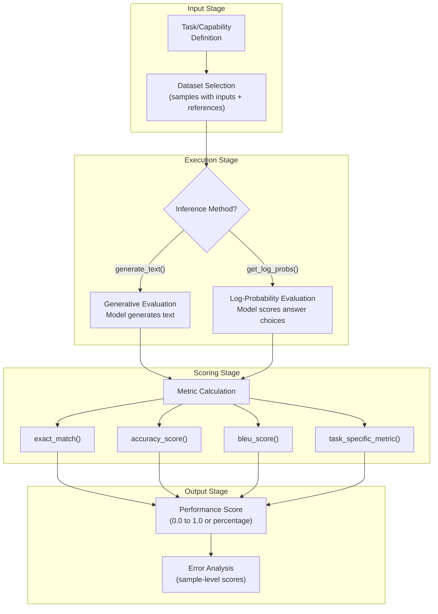

This pipeline enables **reproducibility**: running the same benchmark multiple times with the same model yields identical results (barring hardware differences or model-internal randomness), allowing fair comparison across models.

Sources: [contents/automated-benchmarks/basics.md:8-18](), [contents/automated-benchmarks/basics.md:25-27]()

## Two Evaluation Modes: Generative vs. Log-Probability

LLM evaluation frameworks typically support two distinct inference modes, each suited to different task types:

### Generative Evaluation

In generative evaluation, the model produces text tokens sequentially in response to an input prompt. The generated text is then compared to a reference answer using string-based or semantic metrics.

**Characteristics:**
- Model calls: `model.generate(input_prompt, max_new_tokens=...)`
- Output: Generated text string
- Comparison: Model output vs. reference answer
- Use cases: Open-ended questions, code generation, creative writing, question answering

**Example workflow:**
```
Input: "What is the capital of France?"
Model generates: "Paris"
Reference: "Paris"
Metric (exact_match): 1.0 (match)
```

### Log-Probability Evaluation (Multiple-Choice)

In log-probability evaluation, the model computes the probability of each pre-defined answer choice without generating new tokens. The choice with the highest log-probability is selected as the model's answer.

**Characteristics:**
- Model calls: `model.compute_log_probs(input_prompt, answer_choices)`
- Output: Log-probability scores for each choice
- Comparison: Highest-probability choice vs. correct answer label
- Use cases: Classification tasks, multiple-choice questions, tasks with discrete answer sets

**Example workflow:**
```
Input: "What is the capital of France? A) London B) Paris C) Berlin D) Madrid"
Model computes log-probs: A: -2.3, B: -0.1, C: -3.2, D: -2.8
Selected: B (highest probability)
Reference: B
Metric (accuracy): 1.0 (correct)
```

### Comparison Table

| Aspect | Generative Evaluation | Log-Probability Evaluation |
|--------|----------------------|---------------------------|
| Model operation | Sequential token generation | Probability computation |
| Suitable for | Open-ended, creative tasks | Classification, discrete choices |
| Speed | Slower (generation required) | Faster (no generation) |
| Output format | Free-form text | Selected choice |
| Common metrics | Exact match, BLEU, ROUGE | Accuracy, F1 score |
| Sensitivity | Prompt-sensitive, format-dependent | Less format-sensitive |

For more technical details on how these evaluation modes work at the inference level, see page 3.1 on Model Inference and Evaluation.

Sources: [contents/automated-benchmarks/basics.md:15-18]()

## Dataset Requirements and Generalization

Evaluation datasets must satisfy specific criteria to produce meaningful performance measurements:

### Core Requirements

1. **Representative samples**: Samples should emulate the real-world distribution of the target task, including edge cases and difficult examples
2. **Out-of-distribution data**: Ideally, evaluation samples should not have appeared in the model's training data
3. **Quality references**: Gold answers should be accurate and unambiguous
4. **Sufficient coverage**: Dataset size should be large enough to distinguish between model capabilities statistically

### The Generalization Problem

Automated benchmarks test **generalization**—the model's ability to perform well on unseen data by learning underlying patterns rather than memorizing training examples.

**Example**: A spam classifier that generalizes well can identify spam emails about "health products" after training only on spam about "fake banks," because it has learned abstract spam indicators (urgency, suspicious links, poor grammar) rather than memorizing specific content.

**Overfitting vs. Generalization:**
- **Overfitting**: Model performs well on training data but fails on new examples (like a student memorizing test questions without understanding the subject)
- **Generalization**: Model performs well on both training and evaluation data by learning transferable patterns

This is why evaluating on training data is meaningless—it measures memorization, not capability. The contamination problem (when evaluation data leaks into training sets) undermines this distinction, making it difficult to assess true generalization.

Sources: [contents/automated-benchmarks/basics.md:9-23]()

## Common Metrics in Automated Evaluation

Metrics convert model outputs into quantitative performance scores. The choice of metric depends on the evaluation mode and task requirements.

### Metric Categories and Implementation

| Metric Type | Examples | Input Requirements | Output Range | Best Used For |
|-------------|----------|-------------------|--------------|---------------|
| **Classification** | `accuracy`, `F1`, `precision`, `recall` | Predicted labels vs. true labels | 0.0 to 1.0 | Multiple-choice, binary decisions |
| **Exact matching** | `exact_match`, `string_match` | Generated text vs. reference | 0.0 or 1.0 | Factual answers, deterministic outputs |
| **N-gram overlap** | `BLEU`, `ROUGE-N`, `ROUGE-L` | Generated text vs. reference(s) | 0.0 to 1.0 | Translation, summarization |
| **Functional testing** | `pass@k`, `unit_test_pass_rate` | Generated code vs. test suite | Pass rate | Code generation |
| **Task-specific** | `sympy_equality` (math), `IFEval` (instruction following) | Task-dependent | Task-dependent | Specialized domains |

### Metric Selection Considerations

- **Interpretability**: `accuracy` and `exact_match` are intuitive; `BLEU` and `ROUGE` require domain knowledge to interpret
- **Strictness**: `exact_match` is binary (0 or 1); `BLEU/ROUGE` allow partial credit
- **Normalization**: String metrics often require preprocessing (lowercasing, whitespace removal, punctuation handling) to avoid penalizing formatting differences
- **Task alignment**: Metrics should reflect what matters for the task (e.g., functional correctness for code, semantic similarity for paraphrasing)

For detailed guidance on metric selection and prompt design to maximize metric reliability, see page 2.1.1 on Designing Automated Evaluations.

Sources: [contents/automated-benchmarks/basics.md:12-15](), [contents/automated-benchmarks/basics.md:27-30]()

### Diagram: Metric Calculation Pipeline

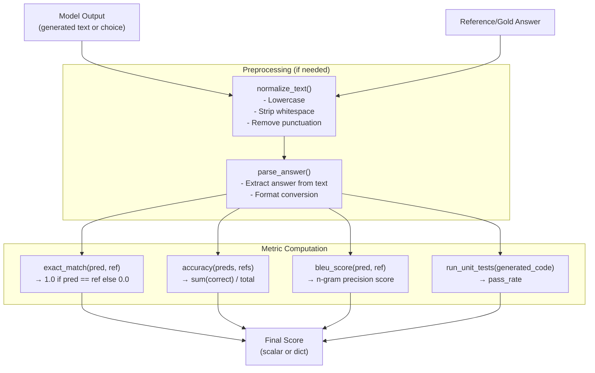

Sources: [contents/automated-benchmarks/basics.md:12-15](), [contents/automated-benchmarks/basics.md:27-30]()

## Advantages of Automated Benchmarks

Automated benchmarks offer distinct advantages that make them the foundation of LLM evaluation:

### 1. Consistency and Reproducibility

Running the same benchmark multiple times on the same model yields identical results (barring hardware differences or model-internal randomness). This enables:
- **Fair model comparisons**: All models are evaluated under identical conditions
- **Leaderboard rankings**: Models can be objectively ranked on standardized benchmarks
- **Regression testing**: Model updates can be validated to ensure they don't degrade performance on existing tasks

### 2. Scale at Limited Cost

Automated benchmarks can evaluate thousands of samples across multiple benchmarks with minimal human effort and cost:
- **Batch processing**: Evaluate entire datasets programmatically
- **Multi-model evaluation**: Compare dozens of models simultaneously
- **Rapid iteration**: Test model variations quickly during development
- **Cost efficiency**: No per-sample human annotation required

### 3. Metric Interpretability

Most automated metrics are straightforward to understand and communicate:
- `accuracy = 0.85` means "85% of answers were correct"
- `exact_match = 0.72` means "72% of generated answers matched references exactly"
- Clear, quantitative results facilitate decision-making and performance tracking

### 4. Dataset Quality (When Available)

Many established benchmarks leverage high-quality data sources:
- **Expert-generated**: Datasets like MATH use competition-level problems created by mathematicians
- **Pre-existing high-quality data**: MMLU aggregates exam questions from reliable educational sources
- **Rigorous validation**: Many datasets undergo multiple quality control rounds

**Caveat**: Not all datasets are created equal. MMLU, for instance, has documented issues (parsing errors, ambiguous questions), leading to follow-up datasets like MMLU-Pro and MMLU-Redux. Always assess dataset quality critically.

Sources: [contents/automated-benchmarks/basics.md:25-30]()

## Limitations of Automated Benchmarks

Automated benchmarks have fundamental limitations that impact their reliability and scope:

### 1. Reduced Effectiveness for Complex Tasks

Automated benchmarks excel at well-defined tasks with clear success criteria but struggle with complex, multifaceted capabilities:

**Works well for:**
- Classification (spam detection, sentiment analysis)
- Factual question answering (single correct answer)
- Code functionality (pass/fail tests)

**Struggles with:**
- Abstract capabilities ("reasoning ability," "creativity")
- Subjective quality (writing style, persuasiveness)
- Multi-step problem-solving with multiple valid approaches

**The proxy problem**: When evaluating abstract capabilities like "mathematical reasoning," benchmarks use task performance (solving math problems) as a proxy. This assumes performance on specific tasks generalizes to the broader capability, which may not always hold.

### 2. Data Contamination

Once a dataset is published publicly in plain text, it will eventually appear in web scrapes and model training data. This creates fundamental uncertainty:

**The contamination lifecycle:**
```
Dataset publication → Web scraping → Training corpus → Model training → Evaluation
                                                            ↑____contaminated__|
```

**Consequences:**
- **Inflated scores**: Models may have memorized evaluation samples during training
- **Invalid comparisons**: Newer models trained on larger web scrapes are more likely to be contaminated
- **Metric gaming**: High benchmark scores may not reflect true capability

**Mitigation strategies** (see page 2.1.3):
- Private evaluation datasets (not publicly released)
- Dynamic benchmarks (regularly updated with new samples)
- Contamination detection methods (perplexity analysis, canary strings)
- Dataset variants (e.g., GSM8K → GSM-Symbolic with template variations)

### 3. Prompt Sensitivity and Reproducibility Issues

Generative evaluation scores can vary significantly based on:
- Exact prompt wording
- Few-shot example selection and order
- Output formatting instructions
- Model temperature and sampling parameters

This makes it challenging to reproduce results across different implementations or compare results from different evaluation frameworks. See page 4 (Troubleshooting) for practical solutions.

### 4. Metric-Task Misalignment

Not all metrics accurately capture what matters for a task:
- `BLEU` score correlates poorly with human judgment of translation quality
- `exact_match` penalizes semantically correct but differently worded answers
- Task-specific metrics may not generalize across domains

The choice of metric significantly impacts measured performance and can create misleading conclusions about model capabilities.

Sources: [contents/automated-benchmarks/basics.md:32-36]()

## Relationship to Other Evaluation Approaches

Automated benchmarks are one of three primary approaches to LLM evaluation, alongside Human Evaluation and LLM-as-a-Judge.

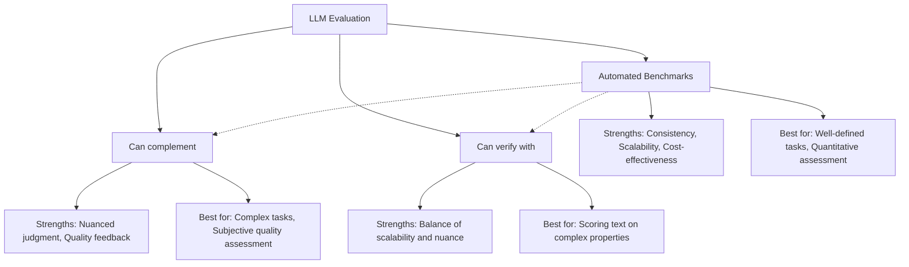

Sources: contents/automated-benchmarks/basics.md:24-36, contents/model-as-a-judge/basics.md:3-18

---

# Page: Designing Automated Evaluations

# Designing Automated Evaluations

<details>
<summary>Relevant source files</summary>

The following files were used as context for generating this wiki page:

- [contents/automated-benchmarks/designing-your-automatic-evaluation.md](contents/automated-benchmarks/designing-your-automatic-evaluation.md)

</details>


## Purpose and Scope

This page provides a systematic guide for designing robust automated evaluations of language models. It covers the four critical decision points in the evaluation design process: dataset selection, inference method, prompt engineering, and metric selection. The page also introduces functional testing as an emerging paradigm for creating contamination-resistant evaluations.

**Related pages:**
- For a catalog of existing evaluation datasets, see [Evaluation Datasets Catalog](#2.1.2)
- For foundational understanding of inference mechanics, see [Model Inference and Evaluation](#3.1)
- For troubleshooting common issues, see [Tips and Tricks](#2.1.3)
- For understanding metric behavior across evaluations, see [Troubleshooting](#4)

---

## The Evaluation Design Process

Automated evaluation design consists of four sequential decisions, each constraining and informing the next. The quality of your evaluation is fundamentally bounded by the quality of your dataset—no sophisticated metric or prompt engineering can compensate for poorly constructed evaluation samples.

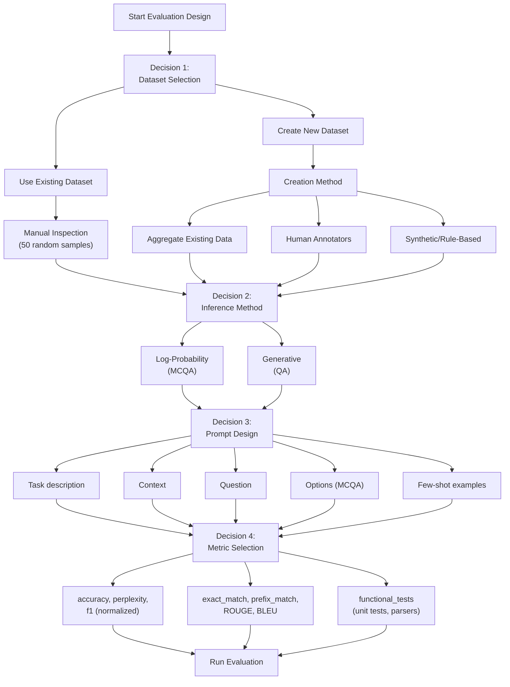

**Sources:** [contents/automated-benchmarks/designing-your-automatic-evaluation.md:1-118]()

---

## Dataset Selection

The dataset selection process differs significantly depending on whether you use an existing dataset or create a new one. Both approaches require rigorous quality validation.

### Evaluating Existing Datasets

When selecting an existing dataset, evaluate it across three dimensions: creation process, sample quality, and statistical adequacy.

#### Creation Process Assessment

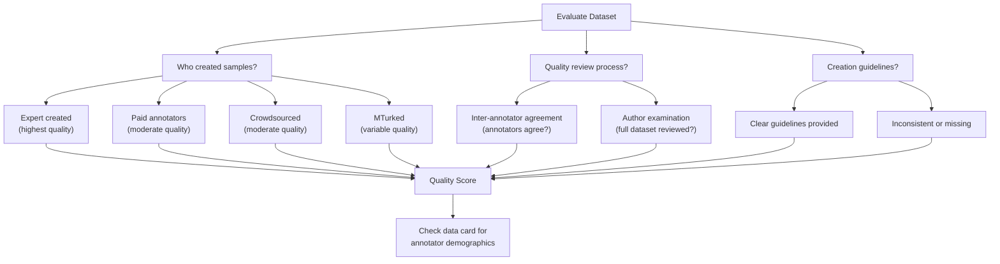

The creation process hierarchy matters because it directly impacts dataset consistency and language diversity. Expert-created datasets generally exhibit higher quality than crowdsourced alternatives, particularly for complex reasoning tasks.

**Sources:** [contents/automated-benchmarks/designing-your-automatic-evaluation.md:8-21]()

#### Sample Quality Checklist

Manually inspect 50 random samples against this checklist:

| Quality Dimension | Evaluation Criteria | Example Issues |
|-------------------|---------------------|----------------|
| **Prompt Clarity** | Are prompts unambiguous and well-specified? | Vague questions requiring unstated assumptions |
| **Answer Correctness** | Are provided answers actually correct? | TriviaQA contains conflicting aliases in gold answers |
| **Information Completeness** | Is all necessary information present? | MMLU misses reference schematics in some questions |
| **Task Relevance** | Do questions match your evaluation goals? | Domain mismatch with target use case |
| **Use Case Alignment** | Are examples relevant to your application? | General knowledge when you need domain expertise |

**Minimum sample requirement:** 100 samples for statistically significant results in automatic benchmarks.

**Sources:** [contents/automated-benchmarks/designing-your-automatic-evaluation.md:22-32]()

### Creating New Datasets

Three approaches exist for creating custom evaluation datasets, each with distinct trade-offs:

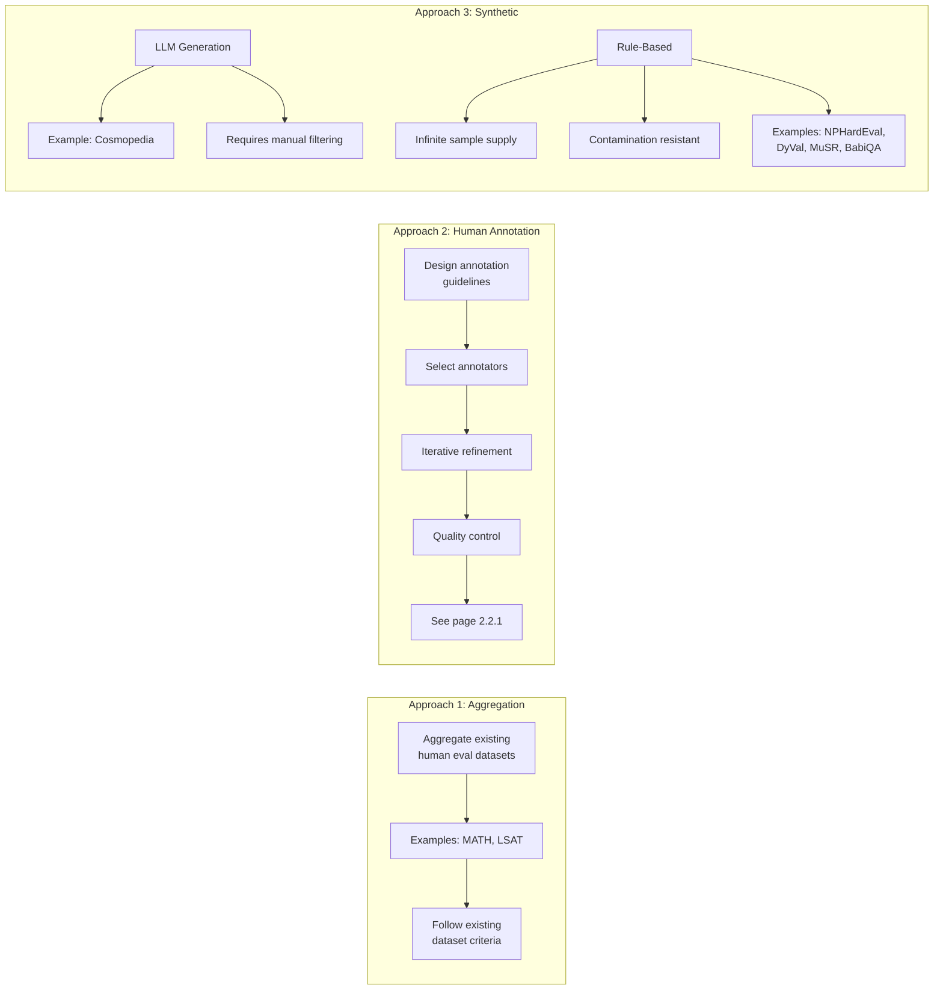

**Rule-based generation** is particularly valuable for contamination avoidance. By algorithmically generating test cases, you create samples that cannot have appeared in training data. This approach works well for tasks with formal structure (graph algorithms, mathematical problems, logical reasoning).

**Sources:** [contents/automated-benchmarks/designing-your-automatic-evaluation.md:33-46]()

---

## Inference Method Selection

The inference method determines how you extract model predictions and fundamentally shapes which models will perform well on your evaluation.

### Log-Probability (MCQA) vs Generative (QA)

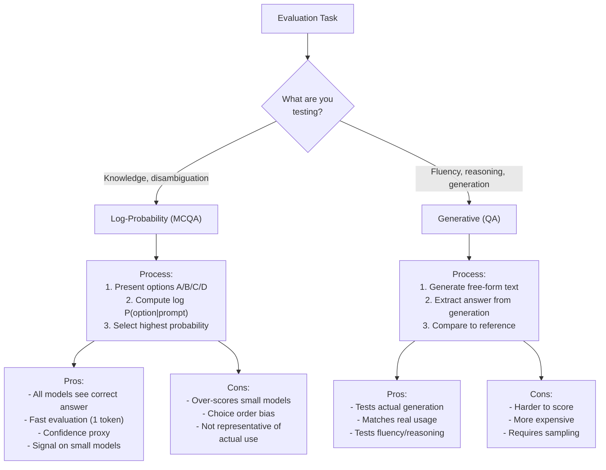

### Trade-offs Table

| Aspect | Log-Probability (MCQA) | Generative (QA) |
|--------|------------------------|-----------------|
| **Speed** | Fast (single token prediction) | Slower (full generation) |
| **Model Coverage** | Works well on small models | Requires capable models for generation |
| **Real-world Validity** | Limited (forced choice) | High (actual use case) |
| **Scoring Complexity** | Simple (argmax probability) | Complex (matching, normalization) |
| **Confidence Signal** | Direct (probability values) | Indirect (must be engineered) |
| **Known Biases** | Choice order effects | Verbosity, format sensitivity |

**Critical consideration:** Some models exhibit choice order bias, favoring specific options (e.g., always preferring option A) regardless of content. This is documented in [arXiv:2309.03882]().

**Sources:** [contents/automated-benchmarks/designing-your-automatic-evaluation.md:48-66]()

---

## Prompt Engineering

Prompt design significantly impacts evaluation results. Semantically equivalent prompts can yield substantially different scores, and models increasingly overfit specific prompt formats.

### Prompt Component Architecture

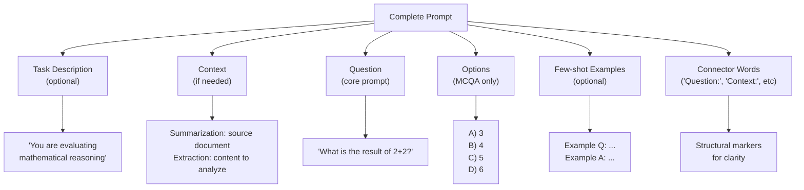

**Sources:** [contents/automated-benchmarks/designing-your-automatic-evaluation.md:68-79]()

### Prompt Sensitivity Issues

Three critical challenges affect prompt reliability:

| Issue | Description | Mitigation Strategy |
|-------|-------------|---------------------|
| **Semantic Variance** | Small prompt changes cause large score differences | Run evaluation with multiple prompt variations allocated to equivalent difficulty samples |
| **Format Overfitting** | Models overfit test set formats during training | Use format-diverse prompts; newer models (Llama 3.2, Qwen 2.5) ignore few-shot format cues |
| **Model-Specific Advantages** | Prompt format advantages specific models | Document prompt format in evaluation metadata; consider format ablations |

The format overfitting problem is documented in [arXiv:2407.07890](), which demonstrates that some models achieve inflated scores by memorizing evaluation formats rather than learning underlying capabilities. The Open LLM Leaderboard v2 team observed Llama 3.2 and Qwen 2.5 no longer following few-shot format patterns, suggesting format saturation in training data.

**Sources:** [contents/automated-benchmarks/designing-your-automatic-evaluation.md:81-89]()

### Constrained Generation

For metrics requiring specific output formats, constrained generation techniques force models to produce parseable outputs. These techniques are detailed in the [Model Inference and Evaluation](#3.1) page, section "Constraining model outputs".

**Sources:** [contents/automated-benchmarks/designing-your-automatic-evaluation.md:90-91]()

---

## Metric Selection

Metric selection depends entirely on your inference method. The critical principle: **match your metric to what your task actually measures**.

### Log-Probability Metrics

For log-probability evaluations, metrics are straightforward:

```mermaid
graph LR
    LOGPROB["Log-Probability<br/>Evaluation"] --> NORM["Normalize by length"]
    
    NORM --> CHAR["Character<br/>normalization"]
    NORM --> TOKEN["Token<br/>normalization"]
    NORM --> PMI["PMI normalization"]
    
    CHAR --> METRICS["Available Metrics"]
    TOKEN --> METRICS
    PMI --> METRICS
    
    METRICS --> ACC["Accuracy<br/>(most likely = best?)"]
    METRICS --> PERP["Perplexity<br/>(sequence likelihood)"]
    METRICS --> F1["F1 Score<br/>(precision + recall)"]
    METRICS --> REC["Recall"]
```

**Critical requirement:** Length normalization is essential. Without it, shorter completions systematically achieve higher log-probabilities, biasing results.

**Sources:** [contents/automated-benchmarks/designing-your-automatic-evaluation.md:93-94]()

### Generative Metrics Pipeline

Generative evaluation requires a two-stage process: normalization and comparison.

```mermaid
graph TD
    GEN["Generated Output"] --> DECIDE1{"Normalization<br/>needed?"}
    
    DECIDE1 -->|Yes| NORM["Apply Normalization"]
    DECIDE1 -->|No| RAW["Use raw output"]
    
    NORM --> NORM_MATH["Math: Extract numerical result<br/>from formatted output"]
    NORM --> NORM_COT["Chain of Thought: Remove<br/>reasoning trace"]
    NORM --> NORM_FORMAT["Remove formatting artifacts"]
    
    NORM_MATH --> COMPARE["Comparison Method"]
    NORM_COT --> COMPARE
    NORM_FORMAT --> COMPARE
    RAW --> COMPARE
    
    COMPARE --> MATCH["Match-Based<br/>Metrics"]
    COMPARE --> SIM["Similarity<br/>Metrics"]
    
    MATCH --> M1["exact_match"]
    MATCH --> M2["prefix_match"]
    MATCH --> M3["quasi_exact_match"]
    
    SIM --> S1["ROUGE"]
    SIM --> S2["BLEU"]
    SIM --> S3["character n-gram"]
    
    M1 --> REF["Compare to<br/>Reference"]
    M2 --> REF
    M3 --> REF
    S1 --> REF
    S2 --> REF
    S3 --> REF
```

**Normalization considerations:**
- Normalizations can be unfair if poorly designed (see blog: ["Open LLM Leaderboard Drop"](https://huggingface.co/blog/open-llm-leaderboard-drop))
- They provide valuable task-level signal despite individual-sample artifacts
- Essential for math evaluations with formatted outputs
- Required when using Chain of Thought (CoT) to extract final answers from reasoning traces

**Metric catalog reference:** For a comprehensive list of implemented metrics, see the [lighteval Metric List](https://github.com/huggingface/lighteval/wiki/Metric-List).

**Sources:** [contents/automated-benchmarks/designing-your-automatic-evaluation.md:96-103]()

### Task-Specific Metric Selection

The metric must align with what you're actually measuring. For some domains, average performance is insufficient—you must measure **worst-case performance**:

| Domain | What to Measure | Why |
|--------|-----------------|-----|
| **Medical** | Worst-case accuracy | Patient safety requires consistent correctness |
| **Public Chatbots** | Worst-case toxicity | Public exposure to harmful outputs |
| **Code Generation** | Worst-case security | Single vulnerability compromises system |
| **Knowledge QA** | Average accuracy | Aggregate capability matters |

This distinction is explored in depth in Ehud Reiter's blog: ["Challenges in Evaluating LLMs"](https://ehudreiter.com/2024/07/10/challenges-in-evaluating-llms/).

**Sources:** [contents/automated-benchmarks/designing-your-automatic-evaluation.md:105-106]()

---

## Functional Testing: The Emerging Paradigm

Functional testing evaluates models on what they **do** rather than what they **say**. Originating in code evaluation, this approach is expanding to structured text tasks.

### Core Concept

```mermaid
graph LR
    subgraph "Traditional Evaluation"
        T1["Model Output"] --> T2["String Comparison"]
        T2 --> T3["Match Score"]
    end
    
    subgraph "Functional Evaluation"
        F1["Model Output"] --> F2["Execute/Parse<br/>Output"]
        F2 --> F3["Test Against<br/>Specification"]
        F3 --> F4["Binary Pass/Fail"]
    end
    
    T3 --> TRAD_ISSUE["Issues:<br/>- Overfitting semantics<br/>- Memorization<br/>- Ambiguous correctness"]
    
    F4 --> FUNC_BENEFIT["Benefits:<br/>- Tests capability<br/>- Contamination resistant<br/>- Clear pass/fail"]
```

### Benefits of Functional Testing

| Benefit | Explanation | Impact |
|---------|-------------|--------|
| **Easier Test Generation** | Many domains allow rule-based test case generation | Reduced annotation cost |
| **Contamination Resistance** | Generated test cases cannot appear in training data | Addresses data leakage |
| **Capability Focus** | Tests specific active capabilities rather than memorization | More meaningful evaluation |
| **Creativity Requirement** | Requires domain expertise to design functional tests | Barrier to adoption |

**Sources:** [contents/automated-benchmarks/designing-your-automatic-evaluation.md:107-117]()

### Functional Testing Examples

#### Code Evaluation: Unit Tests

The canonical functional testing domain. Models generate code to solve a problem, then that code executes against a test suite:

```mermaid
graph LR
    PROBLEM["Problem:<br/>'Write function to<br/>sort array'"] --> MODEL["Model<br/>Generates Code"]
    
    MODEL --> CODE["def sort_array(arr):<br/>  return sorted(arr)"]
    
    CODE --> TEST1["Test 1: [3,1,2] → [1,2,3]"]
    CODE --> TEST2["Test 2: [] → []"]
    CODE --> TEST3["Test 3: [1] → [1]"]
    CODE --> TEST4["Test 4: [5,5,5] → [5,5,5]"]
    
    TEST1 --> PASS1["✓ Pass"]
    TEST2 --> PASS2["✓ Pass"]
    TEST3 --> PASS3["✓ Pass"]
    TEST4 --> PASS4["✓ Pass"]
    
    PASS1 --> SCORE["Score: 4/4 = 100%"]
    PASS2 --> SCORE
    PASS3 --> SCORE
    PASS4 --> SCORE
```

#### IFEval: Instruction Following Evaluation

IFEval extends functional testing to text by creating verifiable formatting instructions:

```mermaid
graph TD
    INSTR["Instruction:<br/>'Write a paragraph with<br/>exactly 5 bullet points.<br/>Capitalize only the first sentence.'"] --> MODEL["Model<br/>Generates Text"]
    
    MODEL --> OUTPUT["Generated Output"]
    
    OUTPUT --> PARSE["Parser Checks"]
    
    PARSE --> CHECK1{"Exactly 5<br/>bullet points?"}
    PARSE --> CHECK2{"Only first sentence<br/>capitalized?"}
    PARSE --> CHECK3{"Valid paragraph<br/>structure?"}
    
    CHECK1 -->|Yes| P1["✓"]
    CHECK1 -->|No| F1["✗"]
    
    CHECK2 -->|Yes| P2["✓"]
    CHECK2 -->|No| F2["✗"]
    
    CHECK3 -->|Yes| P3["✓"]
    CHECK3 -->|No| F3["✗"]
    
    P1 --> FINAL["Final Score:<br/>3/3 checks passed"]
    P2 --> FINAL
    P3 --> FINAL
    F1 --> FINAL
    F2 --> FINAL
    F3 --> FINAL
```

**IFEval instruction types:**
- Bullet point count constraints
- Sentence capitalization patterns
- Word/character count requirements
- Specific keyword inclusion/exclusion
- Structural formatting (headers, lists, etc.)

Each instruction creates a **verifiable constraint** that can be programmatically tested, independent of semantic content quality.

**Challenge:** Extending functional testing to general text requires creativity. Unlike code (which has natural test suites) or instructions (which have explicit constraints), most text evaluation lacks obvious functional specifications.

**Sources:** [contents/automated-benchmarks/designing-your-automatic-evaluation.md:107-117]()

---

## Complete Evaluation Design Workflow

The following diagram synthesizes all four decision points into an integrated workflow, showing dependencies and feedback loops:

```mermaid
graph TB
    START["Evaluation Design"] --> Q1{"Dataset<br/>exists?"}
    
    Q1 -->|Yes| INSPECT["Manual Inspection:<br/>50 samples"]
    Q1 -->|No| CREATE["Dataset Creation"]
    
    INSPECT --> QUALITY{"Quality<br/>adequate?"}
    QUALITY -->|No| CREATE
    QUALITY -->|Yes| INF_SELECT["Select Inference Method"]
    
    CREATE --> AGG["Aggregation"]
    CREATE --> HUM["Human Annotation"]
    CREATE --> SYN["Synthetic/Rule-Based"]
    
    AGG --> INF_SELECT
    HUM --> INF_SELECT
    SYN --> INF_SELECT
    
    INF_SELECT --> MCQA_INF["MCQA:<br/>Log-probability"]
    INF_SELECT --> QA_INF["QA:<br/>Generative"]
    
    MCQA_INF --> PROMPT_MCQA["Design MCQA Prompt:<br/>- Task description<br/>- Question<br/>- Options A/B/C/D<br/>- Few-shot (optional)"]
    
    QA_INF --> PROMPT_QA["Design QA Prompt:<br/>- Task description<br/>- Context (if needed)<br/>- Question<br/>- Few-shot (optional)<br/>- Constraints"]
    
    PROMPT_MCQA --> TEST_PROMPT["Test Prompt Sensitivity:<br/>Multiple variations"]
    PROMPT_QA --> TEST_PROMPT
    
    TEST_PROMPT --> SENSITIVE{"High<br/>variance?"}
    SENSITIVE -->|Yes| PROMPT_MCQA
    SENSITIVE -->|No| METRIC_SELECT["Select Metric"]
    
    METRIC_SELECT --> MCQA_METRIC["MCQA Metrics:<br/>- Accuracy (normalized)<br/>- Perplexity<br/>- F1"]
    
    METRIC_SELECT --> QA_METRIC["QA Metrics:<br/>- exact_match<br/>- prefix_match<br/>- ROUGE/BLEU"]
    
    METRIC_SELECT --> FUNC_METRIC["Functional Metrics:<br/>- Unit tests<br/>- Parser validation<br/>- Format checks"]
    
    MCQA_METRIC --> RUN["Run Evaluation"]
    QA_METRIC --> RUN
    FUNC_METRIC --> RUN
    
    RUN --> VALIDATE{"Results<br/>reasonable?"}
    VALIDATE -->|No| DEBUG["Debug:<br/>- Check normalization<br/>- Inspect failures<br/>- Review prompt"]
    VALIDATE -->|Yes| COMPLETE["Evaluation Complete"]
    
    DEBUG --> PROMPT_MCQA
    DEBUG --> PROMPT_QA
    DEBUG --> METRIC_SELECT
```

**Sources:** [contents/automated-benchmarks/designing-your-automatic-evaluation.md:1-118]()

---

## Key Takeaways

1. **Dataset quality bounds evaluation quality** — No amount of engineering downstream can compensate for poor samples
2. **Manual inspection is non-negotiable** — Always inspect 50 random samples before committing to a dataset
3. **Inference method shapes results** — MCQA over-scores small models; generative matches real usage
4. **Prompts are sensitive** — Semantically equivalent prompts yield different scores; test multiple variations
5. **Match metric to measurement goal** — Average performance vs worst-case performance requires different metrics
6. **Functional testing is the future** — Tests capabilities rather than memorization; naturally contamination-resistant

**Related Resources:**
- Dataset catalog and contamination analysis: [Evaluation Datasets Catalog](#2.1.2)
- Practical troubleshooting: [Tips and Tricks](#2.1.3)
- Human annotation guidelines: [Using Human Annotators](#2.2.1)
- Inference mechanics: [Model Inference and Evaluation](#3.1)

**Sources:** [contents/automated-benchmarks/designing-your-automatic-evaluation.md:1-118]()

---

# Page: Evaluation Datasets Catalog

# Evaluation Datasets Catalog

<details>
<summary>Relevant source files</summary>

The following files were used as context for generating this wiki page:

- [contents/automated-benchmarks/some-evaluation-datasets.md](contents/automated-benchmarks/some-evaluation-datasets.md)
- [yearly_dives/2023-year-of-open-source.md](yearly_dives/2023-year-of-open-source.md)
- [yearly_dives/2024-evals-thoughts-from-iclr.md](yearly_dives/2024-evals-thoughts-from-iclr.md)
- [yearly_dives/2025-evaluations-for-useful-models.md](yearly_dives/2025-evaluations-for-useful-models.md)

</details>


This document provides a comprehensive catalog of evaluation datasets used for automated benchmarking of large language models (LLMs) across multiple domains and capability areas. For information about designing evaluations using these datasets, see [Designing Automated Evaluations](#2.1.1). For practical tips on implementation, see [Tips and Tricks for Automated Benchmarks](#2.1.3).

## Purpose and Scope

Evaluation datasets serve as standardized test sets that enable consistent and repeatable assessment of LLM capabilities. They support multiple evaluation purposes:

1. **Non-regression testing**: Verifying training methods work as expected (see page 5.2)
2. **Model ranking**: Comparing relative performance across models
3. **Capability assessment**: Understanding what models can accomplish

This catalog organizes datasets by capability area, from specific skills (math, code) to integrated assistant tasks, reflecting the evolution from testing isolated capabilities to evaluating useful, integrated behaviors. As discussed in page 5.3, modern evaluation increasingly focuses on whether models can orchestrate multiple capabilities to accomplish real-world tasks.

## Dataset Landscape and Evolution

Evaluation datasets have evolved significantly from 2023 to 2025, shifting from testing isolated skills to evaluating integrated capabilities and real-world usefulness.

**Evolution of Evaluation Dataset Focus**

```mermaid
graph LR
    subgraph "Pre-2023: Pre-LLM Era"
        PreLLM["Historic Datasets"]
        PreLLM --> ARC_2018["ARC (2018)"]
        PreLLM --> WinoGrande_2019["WinoGrande (2019)"]
        PreLLM --> HellaSwag_2019["HellaSwag (2019)"]
        PreLLM --> MMLU_2020["MMLU (2020)"]
    end
    
    subgraph "2023-2024: Saturation Era"
        Sat["Saturated Datasets"]
        Sat --> Contaminated["High Contamination Risk"]
        Sat --> Easy["Too Easy for Modern Models"]
        Contaminated --> Variants["Dataset Variants Created"]
        Variants --> GSM1K["GSM1K"]
        Variants --> GSMSymbolic["GSM-Symbolic"]
        Variants --> MMLUPro["MMLU-Pro"]
    end
    
    subgraph "2025: Integrated Capabilities"
        Modern["Current Focus"]
        Modern --> Specific["Layer 1: Specific Capabilities"]
        Modern --> Assistant["Layer 2: Assistant Tasks"]
        Modern --> Dynamic["Layer 3: Dynamic Environments"]
        Modern --> Forecasting["Layer 4: Forecasters"]
        
        Specific --> IFEval["IFEval"]
        Specific --> LiveCodeBench["LiveCodeBench"]
        Assistant --> GAIA["GAIA"]
        Assistant --> DABStep["DABStep"]
        Dynamic --> TextQuests["TextQuests"]
        Dynamic --> TownOfSalem["Town of Salem"]
        Forecasting --> FutureBench["FutureBench"]
    end
    
    PreLLM -.-> Sat
    Sat -.-> Modern
```

Sources: yearly_dives/2025-evaluations-for-useful-models.md:17-167

**Dataset Categorization Framework**

```mermaid
flowchart TD
    Datasets["Evaluation Datasets"] --> ByCapability["By Capability Layer"]
    Datasets --> ByOrigin["By Origin"]
    Datasets --> ByFormat["By Evaluation Format"]
    
    ByCapability --> L1["Layer 1: Specific Skills"]
    ByCapability --> L2["Layer 2: Assistant Tasks"]
    ByCapability --> L3["Layer 3: Dynamic Environments"]
    ByCapability --> L4["Layer 4: Forecasting"]
    
    L1 --> Math["Math: GSM8K, MATH, AIME"]
    L1 --> Code["Code: HumanEval, SWE-Bench"]
    L1 --> LongCtx["Long Context: HELMET"]
    L1 --> InstFollow["Instruction: IFEval"]
    L1 --> Tools["Tools: BFCL, TauBench"]
    
    L2 --> InfoRet["Info Retrieval: GAIA, BrowseComp"]
    L2 --> Science["Science: DABStep, SciCode"]
    
    L3 --> Games["Games: TextQuests, ARC-AGI"]
    
    L4 --> Future["FutureBench, FutureX"]
    
    ByOrigin --> ExamBased["Exam: AIME, GAOKAO"]
    ByOrigin --> WebSourced["Web: LiveCodeBench"]
    ByOrigin --> Synthetic["Synthetic: GSM-Symbolic"]
    ByOrigin --> Expert["Expert: FrontierMath"]
    
    ByFormat --> MC["Multiple Choice"]
    ByFormat --> Functional["Functional Testing"]
    ByFormat --> Generative["Open Generation"]
    ByFormat --> Execution["Code Execution"]
```

Sources: yearly_dives/2025-evaluations-for-useful-models.md:13-163

## Key Considerations for Dataset Selection

When selecting evaluation datasets, align your choice with your evaluation purpose (see page 5.2 for detailed discussion):

1. **Evaluation Purpose**:
   - Non-regression testing: Use stable, well-understood datasets
   - Model ranking: Use datasets with stable ranking properties
   - Capability assessment: Use recent, uncontaminated datasets

2. **Contamination Risk**: Has the dataset been publicly available long enough to appear in training data?
3. **Difficulty Level**: Match to your target model capabilities
4. **Evaluation Format**: Functional testing vs. string matching vs. model judge
5. **Task Integration**: Does it test isolated skills or integrated capabilities?
6. **Interpretability**: Can humans understand what performance means?

### Dataset Contamination: The Critical Challenge

Contamination occurs when evaluation datasets appear in model training data, creating artificially inflated scores that don't generalize. This is the most serious problem in modern LLM evaluation.

**Contamination Risk and Mitigation Strategies**

```mermaid
flowchart TD
    subgraph "Contamination Risk Factors"
        Public["Public Availability"]
        Age["Dataset Age"]
        Popularity["Usage Frequency"]
        Format["Plain Text Format"]
    end
    
    Public & Age & Popularity & Format --> HighRisk["High Contamination Risk"]
    
    subgraph "Mitigation Strategies"
        Strategy1["Temporal: Use Recent Data"]
        Strategy2["Access Control: Private/Gated Datasets"]
        Strategy3["Variation: Generate Problem Variants"]
        Strategy4["Templates: Parameterized Generation"]
        Strategy5["Dynamic: Regular Dataset Updates"]
        Strategy6["Detection: Canary Strings"]
    end
    
    HighRisk --> Strategy1
    HighRisk --> Strategy2
    HighRisk --> Strategy3
    HighRisk --> Strategy4
    HighRisk --> Strategy5
    HighRisk --> Strategy6
    
    Strategy1 --> Example1["AIME 2024/2025"]
    Strategy2 --> Example2["FrontierMath, GPQA Diamond"]
    Strategy3 --> Example3["GSM-Plus (8 variations)"]
    Strategy4 --> Example4["GSM-Symbolic (templates)"]
    Strategy5 --> Example5["LiveCodeBench (date tracking)"]
    Strategy6 --> Example6["BigBench canaries"]
```

Sources: yearly_dives/2025-evaluations-for-useful-models.md:36-47, yearly_dives/2024-evals-thoughts-from-iclr.md:33-36, contents/automated-benchmarks/some-evaluation-datasets.md:9-11

**Contamination Detection and Dataset Lifecycle**

As datasets age and become publicly available, they inevitably contaminate training data. The table below shows contamination status and recommended usage:

| Risk Level | Dataset Examples | Recommended Use | Notes |
|------------|-----------------|-----------------|-------|
| **High** (Pre-2023) | GSM8K, MATH, MMLU, HumanEval, ARC, HellaSwag | Pretraining checks only | Saturated, widely contaminated |
| **Medium** (2023-2024) | GPQA (original), GSM8K variants | Ablations, with caution | Contamination emerging |
| **Low** (2025) | AIME 2025, Math-Arena, LiveCodeBench, MCP-Universe | Post-training evaluation | Fresh, actively updated |
| **Very Low** (Private) | FrontierMath, Humanity's Last Exam (HLE) | Research benchmarking | Limited access reduces risk |

Sources: yearly_dives/2025-evaluations-for-useful-models.md:17-49, yearly_dives/2024-evals-thoughts-from-iclr.md:33-36

## Comprehensive Dataset Catalog

This catalog organizes evaluation datasets by capability area, reflecting the multi-layered evaluation architecture described in page 5.3. Datasets are categorized from specific capabilities (Layer 1) to integrated assistant tasks (Layer 2) to dynamic environments (Layer 3).

### Layer 1: Specific Capabilities

These datasets test isolated skills that serve as building blocks for more complex behaviors.

#### Reasoning and Commonsense (Historic, Pre-LLM)

These datasets were designed before the LLM era and are now largely saturated. Use only for pretraining checks or ablation studies.

| Dataset | Type | Size | Publication | Status | Use Case |
|---------|------|------|-------------|--------|----------|
| **ARC (Challenge)** | Science MCQA | 1.2K | 2018 | Saturated | Pretraining only |
| **WinoGrande** | Pronoun resolution | 43K | 2019 | Saturated | Pretraining only |
| **HellaSwag** | Next sentence selection | 60K | 2019 | Saturated | Pretraining only |
| **CommonsenseQA** | Commonsense MCQA | 12K | 2018 | Saturated | Pretraining only |
| **PIQA** | Physical commonsense | 20K | 2019 | Saturated | Pretraining only |
| **OpenBookQA** | Science + commonsense | 6K | 2018 | Saturated | Pretraining only |

Sources: yearly_dives/2025-evaluations-for-useful-models.md:17-24

#### Knowledge Evaluation

Knowledge datasets test factual understanding and domain expertise. The field has evolved from general knowledge (MMLU) to expert-level understanding (GPQA, HLE).

| Dataset | Type | Size | Publication | Contamination | Recommended Use |
|---------|------|------|-------------|---------------|-----------------|
| **MMLU** | General knowledge MCQA | 15K | 2020 | High | Pretraining only |
| **MMLU-Redux** | Cleaned MMLU | Subset of MMLU | 2024 | Medium | With caution |
| **MMLU-Pro** | Extended MMLU | Larger | 2024 | Medium | Pretraining/ablations |
| **Global-MMLU** | Culturally diverse | Multilingual | 2024 | Low | Cultural bias testing |
| **GPQA (Diamond)** | PhD-level science | Subset | 2023 | Medium | Post-training |
| **Humanity's Last Exam (HLE)** | Expert crowdsourced | 2.5K | 2024 | Very Low (private) | Research benchmark |

**Important Note on Knowledge Evaluation**: As models gain tool access (web search, retrieval), latent knowledge evaluation becomes less relevant. The field is shifting from "closed book" to "open book" evaluation, testing retrieval and reasoning rather than memorization.

Sources: yearly_dives/2025-evaluations-for-useful-models.md:25-36

#### Mathematics

Math datasets serve as proxies for reasoning and logic. The field has seen an explosion of variants to address contamination.

**Currently Recommended Math Datasets (2025)**

| Dataset | Type | Size | Publication | Status | Use Case |
|---------|------|------|-------------|--------|----------|
| **MATH-500** | Olympiad subset | 500 | 2024 | Low contamination | Pretraining/ablations |
| **AIME 2024/2025** | American olympiad | 30/year | Annual | Very low (recent) | Post-training, contamination detection |
| **Math-Arena** | Competition compilation | Updated regularly | 2025 | Very low (dynamic) | Post-training |
| **GSM-Symbolic** | Templated problems | Infinite | 2024 | Very low (generative) | Contamination-proof eval |
| **FrontierMath** | Expert-created | 100+ | 2024 | Very low (private) | Research benchmark |

**Saturated Math Datasets (Use with Caution)**

| Dataset | Size | Publication | Issue | Recommended Use |
|---------|------|-------------|-------|-----------------|
| GSM8K | 8.5K | 2021 | Highly contaminated | None (use variants) |
| MATH | 12.5K | 2021 | Contaminated | Pretraining only |
| GSM1K | 1.2K | 2024 | For contamination detection | Contamination analysis |
| GSM-Plus | 10K (8 vars/Q) | 2024 | Robustness testing | Sensitivity analysis |
| GSM-IC | 58K | 2023 | Distractor testing | Robustness testing |

**Complete Math Dataset Reference**

For comprehensive details on all math datasets including olympiad, school, synthetic, and web-sourced datasets, see [contents/automated-benchmarks/some-evaluation-datasets.md:13-64]().

Sources: yearly_dives/2025-evaluations-for-useful-models.md:37-50, contents/automated-benchmarks/some-evaluation-datasets.md:13-64

#### Code Evaluation

Code datasets test programming ability and serve as reasoning proxies. Evolution has moved from simple function completion to repository-level editing.

**Modern Code Evaluation (2025 Recommendations)**

| Dataset | Type | Size | Publication | Status | Key Feature |
|---------|------|------|-------------|--------|-------------|
| **LiveCodeBench** | LeetCode problems | Growing | 2024 | Low (dated) | Date tracking for contamination |
| **AiderBench** | Code editing | From Exercism | 2024 | Low | Tests editing/refactoring |
| **SWE-Bench (Verified)** | GitHub issues | High quality subset | 2024 | Low | Repository-level reasoning |

**Historic Code Datasets (Saturated)**

| Dataset | Size | Publication | Issue | Use Case |
|---------|------|-------------|-------|----------|
| HumanEval | 164 | 2021 | Saturated | Pretraining only |
| HumanEval+ | 164+ | 2023 | Contaminated | Pretraining only |
| MBPP | 1K | 2021 | Saturated | Pretraining only |
| MBPP+ | 1K+ | 2023 | Contaminated | Pretraining only |
| APPS | 10K | 2021 | Saturated | Pretraining only |

**For detailed code dataset information**: See [contents/automated-benchmarks/some-evaluation-datasets.md:69-74]() for pre-LLM code datasets.

Sources: yearly_dives/2025-evaluations-for-useful-models.md:51-69

#### Long Context Management

Long context datasets test ability to reason over extended sequences, critical for assistant applications.

| Dataset | Type | Context Length | Publication | Status | Key Feature |
|---------|------|----------------|-------------|--------|-------------|
| **HELMET** | Aggregated tasks | Varies | 2024 | Discriminative | Comprehensive task coverage |
| NIAH | Needle retrieval | Varies | 2023 | Solved | Basic retrieval (baseline only) |
| RULER | Multi-hop tracing | Up to 128K | 2024 | Near-solved | Variable tracking |
| InfinityBench | Multilingual tasks | 100K | 2024 | Some signal | QA, retrieval, computation |
| OpenAI MRCR | Text modifications | Long | 2025 | Some signal | Modification tracking |
| **Kalamang Translation** | Grammar book translation | Full book | 2024 | High signal | Low-resource language |
| Novel Challenge | Book comprehension | Full novels | 2024 | High signal | True/false claims |

Sources: yearly_dives/2025-evaluations-for-useful-models.md:71-81

#### Instruction Following

Instruction following datasets use **functional testing** - a key paradigm where correctness is verified through parsing rules rather than string matching.

| Dataset | Type | Size | Publication | Key Feature |
|---------|------|------|-------------|-------------|
| **IFEval** | Format constraints | Set | 2023 | Parser-based validation (strict accuracy) |
| **IFBench** | Extended IFEval | Larger | 2025 | More complex constraints |
| CoCoNot | Non-compliance | Set | 2024 | Tests refusal behavior |

**Why IFEval is Important**: It represents functional testing where each formatting instruction (keywords, punctuation, markdown) can be checked programmatically. This provides strict, unambiguous scores without model judges, and is easily regenerated to prevent contamination.

Sources: yearly_dives/2025-evaluations-for-useful-models.md:82-87

#### Tool Calling and MCP

Tool calling datasets test ability to select and use external tools correctly. The emergence of Model Context Protocol (MCP) has driven new benchmarks.

**Traditional Tool Calling**

| Dataset | Type | Size | Publication | Evaluation Method | Issues |
|---------|------|------|-------------|-------------------|--------|
| **TauBench** | Retail/airline | Scenarios | 2024 | Database state + LLM judge | Costly, LLM-judged |
| **BFCL v3** | Function calling | Multi-subset | 2025 | AST + execution + state | Focus on tool use |
| **BFCL v4** | Web/search | Multi-subset | 2025 | AST + execution + state | Agentic tool use |
| ToolBench | API calling | 100 | 2023 | Mixed (unstable) | Real API instability |
| StableToolBench | Virtual APIs | Extended | 2025 | LLM judge | Fixed ToolBench issues |

**MCP (Model Context Protocol) Benchmarks**

| Dataset | Servers | Size | Publication | Evaluation Method | Key Feature |
|---------|---------|------|-------------|-------------------|-------------|
| **MCP-Universe** | 11 real-world | Tasks | 2025 | Execution-based (strict) | Dynamic answer validation |
| **LiveMCPBench** | Local deployable | Large | 2025 | Tool discrimination | Tests tool selection |
| MCPBench | Live servers | Tasks | 2025 | Rules + LLM judge | Real-world servers |

Sources: yearly_dives/2025-evaluations-for-useful-models.md:89-106

### Layer 2: Assistant Tasks

These datasets require orchestrating multiple capabilities (reasoning, tools, long context) to accomplish realistic tasks. They represent the shift toward evaluating useful, integrated behavior.

#### Real-Life Information Retrieval

| Dataset | Type | Size | Publication | Key Feature |
|---------|------|------|-------------|-------------|
| **GAIA** | Multi-step queries | 3 difficulty levels | 2023 | Tools + reasoning + retrieval |
| **GAIA 2** | Mobile environment | Tasks | 2025 | Time-sensitive, noisy environments |
| **BrowseComp** | Web research | Questions | 2025 | Multiple solution paths |

**Note on GAIA**: Level 1 is now saturated. Results vary widely depending on whether evaluation uses the public validation set or LLM judges on the private test set. Check evaluation methodology when comparing scores.

Sources: yearly_dives/2025-evaluations-for-useful-models.md:110-119

#### Science Assistants

These datasets test ability to conduct scientific work combining code, reasoning, and domain knowledge.

| Dataset | Domain | Size | Publication | Evaluation | Key Feature |
|---------|--------|------|-------------|------------|-------------|
| **DABStep** | Data analysis | Real workloads | 2025 | Ground truth (unbiased) | Uncontaminated operational data |
| SciCode | Multi-domain | Problems + subproblems | 2024 | Scientist + LLM judge | Decomposed scientific workflows |
| PaperBench | ML research | ICML papers | 2025 | LLM judge (8K graded tasks) | Code reconstruction from papers |
| DSBench | Data analysis | Kaggle + financial | 2025 | Mixed metrics | Multimodal data tasks |

Sources: yearly_dives/2025-evaluations-for-useful-models.md:120-128

### Layer 3: Dynamic Environments (Game-Based)

Game-based benchmarks test adaptability in changing environments. Unlike static assistant tasks, games require dynamic decision-making and long-term planning. They're also highly interpretable - winning or losing is unambiguous.

| Dataset | Type | Publication | Status | Key Feature |
|---------|------|-------------|--------|-------------|
| **ARC-AGI 3** | Logic puzzles | 2025 (ongoing) | Unsolved | Exploration, planning, memory |
| **TextQuests** | RPG adventures | 2025 | Medium difficulty | Long-range planning |
| **Town of Salem** | Social deduction | 2025 | Partially solved | Tests deception (safety-relevant) |
| Werewolf | Social deduction | 2025 | Varies | Logic + communication |
| Pokemon | Single-player RPG | 2024 | Medium difficulty | Long context + planning |
| Crafter | Survival game | 2021 | Medium difficulty | Multi-step objectives |

**Why Games Matter**: They test adaptability to changing environments (unlike static benchmarks), require long-range planning, and provide clear pass/fail metrics. Town of Salem is particularly interesting for safety: models that excel at deceptive roles raise concerns.

Sources: yearly_dives/2025-evaluations-for-useful-models.md:131-141

### Layer 4: Forecasting (Contamination-Proof)

Forecasting datasets are inherently contamination-proof since they test prediction of future events. However, discriminative power is unclear.

| Dataset | Type | Time Horizon | Publication | Question Source |
|---------|------|--------------|-------------|-----------------|
| **FutureBench** | News prediction | Weekly | 2024 | Betting markets + LLM |
| FutureX | Event prediction | Daily | 2025 | Templates from live data |
| Arbitrage | Event prediction | 2028 resolution | 2024 | Prediction markets |

**Limitations**: Unclear whether poor performance indicates impossible-to-predict events or model weakness. Success might reflect formulaic questions rather than genuine reasoning.

Sources: yearly_dives/2025-evaluations-for-useful-models.md:142-152

## Practical Recommendations by Use Case

The following table maps evaluation purposes to recommended dataset choices based on the 2025 evaluation landscape:

**Dataset Selection by Evaluation Purpose**

```mermaid
flowchart TD
    Purpose["Evaluation Purpose"] --> NonReg["Non-Regression Testing"]
    Purpose --> Ranking["Model Ranking"]
    Purpose --> Research["Research Benchmarking"]
    Purpose --> Production["Production Use Cases"]
    
    NonReg --> NR_Pre["Pretraining: MMLU-Pro, GSM-Symbolic, MATH-500"]
    NonReg --> NR_Post["Post-training: GPQA, IFEval, HELMET, TauBench"]
    
    Ranking --> Rank_Inf["Inference: IFBench, MathArena, LiveCodeBench, MCP-Universe"]
    Ranking --> Rank_LH["Long Horizon: GAIA, DABStep"]
    
    Research --> Res_Cap["Capabilities: HLE, ARC-AGI3, FrontierMath"]
    Research --> Res_Safety["Safety: Town of Salem, CoCoNot"]
    
    Production --> Prod_Domain["Domain-Specific: Match to use case"]
    Production --> Prod_Func["Functional Testing: IFEval-style custom"]
```

Sources: yearly_dives/2025-evaluations-for-useful-models.md:157-167

**2025 Recommended Dataset Combinations**

For **model builders** (training/developing models):
- **Pretraining**: MMLU-Pro, MATH-500, AIME 2024, historic datasets for trajectories
- **Post-training**: GPQA, IFEval, SWE-Bench Verified, HELMET or equivalent long context, TauBench or BFCL

For **model evaluators** (comparing at inference):
- **Core capabilities**: IFBench, HLE, Math-Arena, AiderBench, LiveCodeBench, MCP-Universe
- **Long horizon tasks**: GAIA, DABStep, or domain-specific assistant tasks
- **Adaptability**: ARC-AGI3 (when available), TextQuests, or other game-based if relevant

For **safety researchers**:
- **Deception detection**: Town of Salem
- **Refusal behavior**: CoCoNot
- **Robustness**: GSM-Plus, IFBench

Sources: yearly_dives/2025-evaluations-for-useful-models.md:157-163

## Dataset Evaluation Methods and Code References

Different datasets require different evaluation approaches. Understanding these patterns helps select appropriate datasets and implement evaluations correctly.

**Evaluation Method Taxonomy**

```mermaid
flowchart TD
    EvalMethods["Evaluation Methods"] --> LogProb["Log-Probability Based"]
    EvalMethods --> Generative["Generative/String Matching"]
    EvalMethods --> Functional["Functional Testing"]
    EvalMethods --> Execution["Code Execution"]
    EvalMethods --> Judge["Model Judge"]
    
    LogProb --> LogProbEx["MMLU, ARC, HellaSwag"]
    LogProb --> LogProbNote["Multiple choice selection"]
    
    Generative --> GenEx["GSM8K, MATH, GPQA"]
    Generative --> GenNote["Exact match, normalization"]
    Generative --> GenIssue["Sensitive to format"]
    
    Functional --> FuncEx["IFEval, IFBench"]
    Functional --> FuncNote["Parser validation"]
    Functional --> FuncBenefit["Strict, regenerable"]
    
    Execution --> ExecEx["HumanEval, SWE-Bench, BFCL"]
    Execution --> ExecNote["Unit tests, state checks"]
    Execution --> ExecBenefit["Unambiguous results"]
    
    Judge --> JudgeEx["GAIA, TauBench, SciCode"]
    Judge --> JudgeNote["LLM evaluates answer"]
    Judge --> JudgeIssue["Introduces bias"]
```

Sources: yearly_dives/2025-evaluations-for-useful-models.md:82-106

**Functional Testing vs. String Matching: A Critical Distinction**

The field is moving toward functional testing (parser-based, execution-based validation) rather than string matching or model judges. This shift is critical for contamination resistance and result interpretability.

| Evaluation Type | Examples | Advantages | Disadvantages |
|-----------------|----------|------------|---------------|
| **Functional Testing** | IFEval (parsers), HumanEval (unit tests), BFCL (AST+execution), MCP-Universe (execution) | Strict accuracy, unambiguous, easily regenerable, no judge bias | Limited to tasks with verifiable outputs |
| **String Matching** | GSM8K (exact match), MATH (normalized match) | Simple to implement | Format-sensitive, requires careful normalization |
| **Model Judge** | GAIA (private set), TauBench, SciCode | Handles open-ended tasks | Introduces bias, costly, inconsistent |
| **Log-Probability** | MMLU, ARC | Efficient, no generation needed | Prone to position bias, limited task types |

**Key Insight from 2025**: Functional testing is preferred whenever possible. It provides contamination resistance (problems can be regenerated), strict accuracy (no ambiguity), and interpretable results (you know exactly what passed/failed).

Sources: yearly_dives/2025-evaluations-for-useful-models.md:82-106, 157-167

## Best Practices and Recommendations

When using evaluation datasets, consider these best practices:

1. **Use multiple datasets** that test different aspects of mathematical capability
2. **Be aware of contamination** issues, especially with widely available datasets
3. **Consider dataset age** - newer datasets are less likely to be in training data
4. **Match evaluation format** to your use case requirements
5. **Document dataset choices** and their limitations in your evaluation reports
6. **Consider creating variations** of existing datasets when contamination is suspected

For evaluating cutting-edge LLMs, prioritize:
- Recently published datasets (post-2023)
- Datasets with verifiable answers (e.g., through SymPy evaluation)
- Expert-created datasets (e.g., FrontierMath, CHAMP)
- Datasets with built-in robustness tests (e.g., GSM-Plus)

Sources: contents/automated-benchmarks/some-evaluation-datasets.md:5-11

---

# Page: Tips and Tricks

# Tips and Tricks for Automated Benchmarks

<details>
<summary>Relevant source files</summary>

The following files were used as context for generating this wiki page:

- [contents/automated-benchmarks/tips-and-tricks.md](contents/automated-benchmarks/tips-and-tricks.md)

</details>


This page provides practical advice for implementing automated benchmarks for LLM evaluation, addressing common issues, optimizations, and techniques to improve the quality and efficiency of your evaluations. For information about designing automated evaluations, see [Designing Automated Evaluations](#2.1.1), and for details about specific evaluation datasets, see [Evaluation Datasets](#2.1.2).

## Managing Data Contamination

Data contamination occurs when evaluation data appears in the training data of the models being evaluated, leading to inflated performance metrics that don't reflect true capabilities. Here are strategies to mitigate this issue:

```mermaid
flowchart TD
    A["Data Contamination Issue"] --> B["Mitigation Strategies"]
    
    B --> C["Canary Strings"]
    B --> D["Protected Access"]
    B --> E["Dynamic Benchmarks"]
    B --> F["Post-hoc Detection"]
    
    C --> C1["Unique identifiers in eval sets"]
    D --> D1["Encrypted/gated datasets"]
    E --> E1["Regular benchmark updates"]
    F --> F1["Perplexity/adversarial analysis"]
```

1. **Canary Strings**: Include specific character combinations in evaluation sets that model creators can search for in their training data to detect contamination (similar to BigBench).

2. **Protected Access**: Provide evaluation datasets in encrypted or gated forms to prevent web crawlers from accidentally including them in training data.

3. **Dynamic Benchmarks**: Regularly update evaluation datasets to prevent models from "learning the answers," though this increases dataset maintenance costs.

4. **Post-hoc Detection**: Attempt to detect contamination after evaluation through methods such as analyzing generation perplexity or designing adversarial prompts.

Note that even if a dataset is contaminated, it may still provide valuable signal during evaluation.

Sources: [contents/automated-benchmarks/tips-and-tricks.md:3-12]()

## Practical Implementation Challenges

### Working with Fine-tuned Models

When working with instruction-tuned models, performance can be severely impacted if you don't:

1. Include the model's system prompt at the beginning of inference
2. Use the appropriate chat template (typically including `Assistant` and `User` prefixes for dialogue turns)

Different tokenizers may behave differently with respect to chat templates, particularly regarding spacing, which can affect model performance.

```mermaid
graph TD
    A["Fine-tuned Model Requirements"] --> B["System Prompt"]
    A --> C["Chat Template"]
    
    B --> B1["Add at beginning of inference"]
    
    C --> C1["Use proper Assistant/User prefixes"]
    C --> C2["Consider tokenizer differences"]
    
    D["Tokenization Impact"] --> D1["Spacing variations between tokenizers"]
    D1 --> D2["Affects template effectiveness"]
```

Sources: [contents/automated-benchmarks/tips-and-tricks.md:16-23]()

### Tokenization Challenges

Tokenization issues represent some of the most complex and subtle challenges in automated benchmarking. Here are the key areas to consider:

#### Context and Choices Tokenization

In multiple-choice question answering (MCQA) evaluations:
- Ideally, tokenize context and choices together for natural token sequences
- Some tokenizers (like Llama) don't satisfy `enc(context + choice) = enc(context) + enc(choice)`
- If your model has this issue, tokenize context and choices separately, then concatenate after removing special tokens

#### Start and End of Sentence Tokens

- Some models (like Gemma) are sensitive to the inclusion of start-of-sentence tokens
- End-of-sentence detection can be problematic when models predict combined tokens (e.g., `\n\t` instead of just `\n`)
- You may need to implement "backtracking" to properly cut generated text at the right spot

#### Multilingual Evaluation

- Languages without space-delimited words (Korean, Thai, Japanese, Chinese) require language-specific tokenizers
- Improper tokenization affects metrics like BLEU scores and F1 scores

#### Code Evaluation

- Code models often treat sequences like `\n\t` as single tokens
- This can cause issues with generation stopping if `\n` is defined as an end token
- Solutions include updating end token definitions or implementing post-generation backtracking

```mermaid
flowchart TD
    A["Tokenization Challenges"] --> B["MCQA Context & Choices"]
    A --> C["Sentence Tokens"]
    A --> D["Multilingual Considerations"]
    A --> E["Code Evaluation"]
    
    B --> B1["Together vs Separate Tokenization"]
    B --> B2["Token Bleeding Problem"]
    
    C --> C1["Start-of-Sentence Sensitivity"]
    C --> C2["End-of-Sentence Detection Issues"]
    
    D --> D1["Language-Specific Tokenizers Needed"]
    D --> D2["Impact on BLEU/F1 Metrics"]
    
    E --> E1["\\n\\t as Single Token"]
    E --> E2["Generation Stopping Problems"]
```

Sources: [contents/automated-benchmarks/tips-and-tricks.md:25-47]()

### Optimization Techniques for MCQA Evaluations

For multiple-choice question answering (MCQA) evaluations, you can significantly improve performance by optimizing how you handle token predictions:

| Traditional Approach | Optimized Approach |
|----------------------|-------------------|
| Run separate inference for each choice (`context + choice 1`, `context + choice 2`, etc.) | Run inference once on context only |
| Multiple model passes required | Single model pass |
| Slower, especially with many choices | Much faster execution |

The key optimization is to design tasks where choices are represented by single tokens. This allows you to:
1. Run inference only once on the context
2. Compute the probability distribution across the full vocabulary
3. Extract logprobabilities for tokens representing choices
4. Compare in a single pass

This approach is implemented in the `lighteval` library.

```mermaid
graph TB
    A["MCQA Evaluation Speedup"] --> B["Single Token Prediction Approach"]
    
    B --> C["Run inference on context only"]
    C --> D["Get probability distribution on full vocabulary"]
    D --> E["Extract probabilities for choice tokens"]
    E --> F["Compare in single pass"]
    
    G["Traditional Approach"] --> H["Multiple Inference Passes"]
    H --> I["context + choice 1"]
    H --> J["context + choice 2"]
    H --> K["context + choice n"]
    
    L["Optimization Benefit"] --> M["Significant Speed Improvement"]
```

Sources: [contents/automated-benchmarks/tips-and-tricks.md:49-54]()

## Troubleshooting Generative Evaluations

When facing unexpectedly poor results on generative evaluations, inspect model outputs for these common issues:

| Issue | Description | Solution |
|-------|-------------|----------|
| **Strict Output Parsing** | Answer is generated but lost during parsing before metrics computation | Adapt your parsing logic to be more flexible |
| **Format Following Failure** | Model unable to follow your output format in few-shot examples (common in recent instruction models like Llama 3.2 or Qwen 2.5) | Adapt prompt format or accept that models should be able to follow instructions |
| **Excessive Verbosity** | Model generates very verbose output and never reaches the correct answer (common in long context models like Qwen and CommandR) | Increase allowed context length, add instructions to be concise, or accept that models should answer succinctly |

```mermaid
flowchart TD
    A["Troubleshooting Generation Issues"] --> B["Common Problems"]
    
    B --> C["Output Parsing"]
    B --> D["Format Following"]
    B --> E["Verbosity"]
    
    C --> C1["Too strict parsing"]
    C --> C2["Fix: Adapt parsing logic"]
    
    D --> D1["Model ignores few-shot examples"]
    D --> D2["Fix: Adapt prompt or adjust expectations"]
    
    E --> E1["Model too verbose"]
    E --> E2["Fix: Increase context or add brevity instructions"]
```

Sources: [contents/automated-benchmarks/tips-and-tricks.md:56-64]()

## Integrated Benchmark Workflow

The tips and tricks in this document should be considered throughout your evaluation workflow. This diagram shows how these considerations fit into the larger benchmark process:

```mermaid
flowchart LR
    A["Dataset Selection"] --> B["Benchmark Design"]
    B --> C["Implementation"]
    C --> D["Troubleshooting"]
    D --> E["Analysis & Iteration"]
    
    subgraph "Contamination Considerations"
        F["Canary Strings"]
        G["Protected Access"]
        H["Dynamic Updates"]
    end
    
    subgraph "Implementation Considerations"
        I["System Prompts"]
        J["Chat Templates"]
        K["Tokenization Issues"]
        L["Performance Optimizations"]
    end
    
    subgraph "Troubleshooting Areas"
        M["Output Parsing"]
        N["Format Following"]
        O["Verbosity Control"]
    end
    
    F & G & H -.-> A & B
    I & J & K & L -.-> B & C
    M & N & O -.-> D & E
```

By anticipating these common challenges and applying the appropriate techniques, you can create more reliable, efficient, and informative automated benchmarks for evaluating LLM performance.

Sources: [contents/automated-benchmarks/tips-and-tricks.md]()

---

# Page: Human Evaluation

# Human Evaluation

<details>
<summary>Relevant source files</summary>

The following files were used as context for generating this wiki page:

- [README.md](README.md)
- [contents/human-evaluation/basics.md](contents/human-evaluation/basics.md)

</details>


This document provides an overview of human evaluation as an approach for assessing LLM performance. It covers fundamental concepts, methodologies, and workflows for implementing human evaluations effectively. For information about automated benchmarks, see [Automated Benchmarks](#2.1), and for using LLMs to evaluate other models, see [LLM-as-a-Judge](#2.3).

## What is Human Evaluation?

Human evaluation involves asking humans to assess LLM outputs according to defined criteria. In the context of this guide, we focus on post-hoc evaluation: evaluating a trained model on specific tasks using human judgment.

Human evaluation plays a crucial role in the LLM evaluation ecosystem by providing direct measures of human preferences and quality assessments that may be difficult to capture through automated metrics alone.

```mermaid
graph TD
    A["LLM Evaluation Approaches"] --> B["Human Evaluation"]
    A --> C["Automated Benchmarks"]
    A --> D["LLM-as-a-Judge"]
    
    B --> B1["Systematic Evaluation"]
    B --> B2["Casual Evaluation"]
    
    B1 --> B1a["Dataset-based"]
    B1 --> B1b["Open-ended"]
    B1 --> B1c["Error Annotation"]
    
    B2 --> B2a["Vibes-checks"]
    B2 --> B2b["Arenas"]
```

Sources: [contents/human-evaluation/basics.md:1-26]

## Types of Human Evaluation

There are two broad categories of human evaluation approaches: systematic and casual evaluations.

### Systematic Evaluation

Systematic evaluations are structured approaches with clear guidelines and formal annotator selection. There are three main methods:

1. **Open-ended evaluation**: When you don't have a dataset, provide humans with task instructions, scoring guidelines, and access to models for interaction.

2. **Dataset-based evaluation**: When you have a dataset, prompt your model with it, then provide humans with the prompt-response pairs and scoring guidelines.

3. **Error annotation**: When you already have a dataset and scores, humans review your evaluation method by annotating errors.

### Casual Evaluation

Less formal approaches that leverage communities or individual assessments:

1. **Vibes-checks**: Manual evaluations by individuals to get an overall feeling of model performance across use cases. Results are typically shared on social platforms.

2. **Arenas**: Crowdsourced evaluations where users compare models, such as the LMSYS Chatbot Arena, resulting in rankings through aggregated votes.

Sources: [contents/human-evaluation/basics.md:7-26]

## Human Evaluation Workflow

The following diagram illustrates the typical workflow for implementing a systematic human evaluation:

```mermaid
flowchart TD
    A["Define Task & Scoring Guidelines"] --> B["Workforce Selection"]
    B --> C["Guideline Design"]
    C --> D["Iterative Annotation"]
    D --> E["Quality Estimation"]
    E --> F["Manual Curation"]
    F --> G["Final Dataset & Analysis"]
    
    E -- "Issues Found" --> C
    D -- "Misunderstandings" --> C
    
    H["Evaluation Tools\n(e.g., Argilla)"] -.-> B & C & D & E & F
    
    subgraph "Key Considerations"
        K1["Clear Instructions"]
        K2["Annotator Training"]
        K3["Bias Mitigation"]
        K4["Quality Control"]
    end
```

The process begins with defining evaluation objectives and criteria, selecting qualified annotators, developing detailed guidelines, conducting iterative annotation rounds with quality checks, and finally producing a dataset of evaluations for analysis.

Sources: [contents/human-evaluation/tips-and-tricks.md:1-19]

## Advantages and Limitations

Human evaluation offers distinct benefits but also presents important challenges:

### Advantages

- **Flexibility**: Can evaluate almost any aspect of model output with clear definitions
- **Reduced contamination risk**: Human-created evaluation questions are less likely to be in training data
- **Direct preference measurement**: Directly captures human judgments on quality
- **High-quality feedback**: Can provide detailed, context-specific assessments
- **Data privacy**: When using in-house annotators, evaluation data remains private

### Limitations

- **Biases**:
  - **First impression bias**: Evaluators judge based on initial impressions rather than deeper analysis
  - **Tone bias**: Assertive, confident answers may be rated higher regardless of factual accuracy
  - **Self-preference bias**: Humans prefer answers aligned with their own views
  - **Identity bias**: Different demographic groups may have divergent evaluation criteria
- **Resource constraints**:
  - **Cost**: Expensive to implement properly with paid annotators
  - **Scalability**: Difficult to scale compared to automated methods
  - **Reproducibility**: Challenging to reproduce results exactly across different annotator groups

```mermaid
graph TD
    subgraph "Human Evaluation Tradeoffs"
        subgraph "Strengths"
            S1["Flexibility"]
            S2["No Data Contamination"]
            S3["Alignment with Human Preferences"]
            S4["High-quality Feedback"]
            S5["Data Privacy"]
        end
        
        subgraph "Limitations"
            L1["Cognitive Biases"]
            L2["Cost & Resources"]
            L3["Limited Scalability"]
            L4["Reproducibility Challenges"]
        end
    end
    
    L1 --> L1a["First Impression Bias"]
    L1 --> L1b["Tone Bias"]
    L1 --> L1c["Self-preference Bias"]
    L1 --> L1d["Identity Bias"]
```

Sources: [contents/human-evaluation/basics.md:27-60]

## Implementation Considerations

### Task Design

- **Simplicity**: Keep tasks as simple as possible to minimize cognitive load
- **Information display**: Show only necessary information to avoid introducing bias
- **Interface efficiency**: Design the interface to minimize scrolling and cognitive burden
- **Pilot testing**: Test the setup on a small sample before full implementation

### During Annotation

- **Independent work**: Annotators should work independently to prevent bias propagation
- **Consistency**: Track guideline changes with version control and metadata
- **Quality control**: Implement measures to ensure annotation quality and reliability

### Hybrid Approaches

To balance quality and efficiency, consider these hybrid human-machine approaches:

1. **Model-aided annotation**: Use model predictions as pre-annotations to speed up the process
2. **Supervised model-as-judge**: Combine LLM judges with human supervision
3. **Edge case identification**: Use multiple models and have humans annotate only cases where models disagree

```mermaid
flowchart LR
    A["Traditional Human\nEvaluation"] --> B["Full Human\nAnnotation"]
    
    C["Hybrid Human-Machine\nEvaluation"] --> D["Model-aided\nAnnotation"]
    C --> E["Supervised Model\nas Judge"]
    C --> F["Edge Case\nIdentification"]
    
    G["Fully Automated\nEvaluation"] --> H["Automated\nBenchmarks"]
    G --> I["LLM-as-Judge"]
    
    subgraph "Resource Requirements"
        J1["High Human Effort"]
        J2["Medium Human Effort"]
        J3["Low Human Effort"]
    end
    
    B --- J1
    D & E & F --- J2
    H & I --- J3
```

Sources: [contents/human-evaluation/tips-and-tricks.md:4-28]

## Tools and Resources

Several tools and approaches can facilitate human evaluation:

- **Annotation platforms**: [Argilla](https://github.com/argilla-io/argilla/) provides infrastructure for annotation tasks
- **Data generation tools**: [distilabel](https://github.com/argilla-io/distilabel) helps generate synthetic data for evaluation
- **End-to-end tutorials**: Comprehensive guides to building custom evaluation setups

For comprehensive implementation, there's an [end-to-end custom domain evaluation tutorial](https://github.com/argilla-io/argilla-cookbook/tree/main/domain-eval) that guides you through building a custom evaluation task from domain documents to a complete evaluation system.

Sources: [resources/About evaluation.md:37-38], [contents/human-evaluation/tips-and-tricks.md:30-32]

## Relationship to Other Evaluation Methods

Human evaluation complements automated benchmarks and LLM-as-a-judge approaches in a comprehensive evaluation strategy:

```mermaid
graph TD
    A["Comprehensive LLM\nEvaluation Strategy"] --> B["Human Evaluation"]
    A --> C["Automated Benchmarks"]
    A --> D["LLM-as-a-Judge"]
    
    B --> B1["Strengths:\n- Direct human feedback\n- Flexible criteria\n- Nuanced judgments"]
    B --> B2["Use when:\n- Quality is subjective\n- Creating gold standards\n- Evaluating novel capabilities"]
    
    C --> C1["Strengths:\n- Scalable\n- Reproducible\n- Standardized"]
    C --> C2["Use when:\n- Objective metrics exist\n- Regular benchmarking needed\n- Comparing across models"]
    
    D --> D1["Strengths:\n- Balance of scale and quality\n- Cost-effective\n- Adaptable to many tasks"]
    D --> D2["Use when:\n- Human eval too costly\n- Need for scale\n- Semi-subjective criteria"]
    
    B <-.-> D
    B <-.-> C
    C <-.-> D
```

The ideal evaluation strategy often involves a combination of these approaches, leveraging the strengths of each while mitigating their respective limitations.

Sources: [contents/human-evaluation/basics.md:27-60], [resources/About evaluation.md:14-18]

## Next Steps

For more detailed guidance on working with human annotators, including selection, instruction, and management, see [Using Human Annotators](#2.2.1). For practical advice and best practices for implementing human evaluation, refer to [Tips and Tricks for Human Evaluation](#2.2.2).

---

# Page: Using Human Annotators

# Using Human Annotators

<details>
<summary>Relevant source files</summary>

The following files were used as context for generating this wiki page:

- [contents/human-evaluation/using-human-annotators.md](contents/human-evaluation/using-human-annotators.md)

</details>


## Purpose and Scope

This document specifies the technical process for implementing human annotation in LLM evaluation. Human evaluation serves three roles in the evaluation ecosystem:

1. **Primary evaluation method** for tasks requiring nuanced judgment
2. **Validation mechanism** for automated benchmarks and LLM-as-judge methods
3. **Ground truth generation** for training reward models and judge LLMs

Human annotation is preferred when evaluation criteria involve subjective quality dimensions (coherence, helpfulness, factual accuracy) that automated metrics cannot reliably assess. The tradeoff is higher cost and lower throughput compared to automated methods (see section 2.1) and LLM-as-judge approaches (see section 2.3).

Sources: [contents/human-evaluation/using-human-annotators.md:1-7]()

## Human Annotation Workflow

**Diagram: Standard Human Annotation Pipeline**

```mermaid
flowchart TD
    A["Task Definition"] --> B["Workforce Selection"]
    B --> C["Guideline Design"]
    C --> D["Pilot Annotation Round"]
    D --> E["Inter-Annotator Agreement Calculation"]
    E --> F{"Agreement Threshold Met?"}
    F -->|No| G["Guideline Refinement"]
    G --> D
    F -->|Yes| H["Full-Scale Annotation"]
    H --> I["Quality Estimation"]
    I --> J["Manual Curation"]
    J --> K["Final Dataset Export"]
    
    subgraph "Tools Integration"
        L["Argilla Platform"]
        M["distilabel Framework"]
        N["HuggingFace Datasets"]
    end
    
    D --> L
    H --> L
    I --> L
    L --> M
    K --> N
```

The workflow consists of five phases: workforce selection, guideline design, iterative annotation, quality estimation, and manual curation. Iteration occurs between guideline refinement and pilot rounds until inter-annotator agreement metrics reach acceptable thresholds (typically κ > 0.6 for categorical tasks, ICC > 0.7 for ratings).

Sources: [contents/human-evaluation/using-human-annotators.md:7-27]()

## Workforce Selection

Annotator selection directly impacts annotation quality. Selection criteria must be specified based on task requirements.

### Demographic Requirements

| Requirement Type | Examples | When Required |
|-----------------|----------|---------------|
| Language | Native speakers, multilingual proficiency | Multilingual evaluation, cultural context assessment |
| Education | Higher education, specific degrees | Technical domain evaluation (medical, legal, scientific) |
| Domain Expertise | Subject matter experts | Specialized knowledge tasks (code review, mathematical reasoning) |
| Geographic Diversity | Multiple regions/countries | Cross-cultural evaluation, bias detection |

### Quality Assurance Mechanisms

**Qualification Testing**
- Pre-task assessments with known correct answers
- Minimum passing thresholds for inclusion
- Periodic re-qualification during long projects

**LLM-Generated Response Detection**
- Statistical analysis of response patterns
- Timing analysis (suspiciously fast submissions)
- Perplexity analysis of text responses
- Explicit prohibitions in annotator agreements

**Performance Monitoring**
- Real-time agreement tracking with gold standard samples
- Periodic manual review of annotator outputs
- Removal of consistently low-quality annotators

### Compensation Structure

Monetary incentive is required except for highly motivated volunteer annotators. Quality declines measurably when compensation is below market rates for the task complexity and required expertise level.

Sources: [contents/human-evaluation/using-human-annotators.md:9-16]()

## Guideline Design

Annotation guidelines define the annotation task unambiguously. Ambiguous guidelines are the primary cause of low inter-annotator agreement.

**Diagram: Guideline Development Iteration Cycle**

```mermaid
flowchart LR
    A["Initial Guideline Draft"] --> B["Small-Scale Pilot\n(3-5 annotators)"]
    B --> C["Agreement Measurement"]
    C --> D{"κ or ICC Acceptable?"}
    D -->|No| E["Identify Disagreement Sources"]
    E --> F["Revise Guidelines"]
    F --> B
    D -->|Yes| G["Finalize Guidelines"]
    
    subgraph "Common Disagreement Sources"
        H["Ambiguous Criteria"]
        I["Undefined Edge Cases"]
        J["Unclear Examples"]
        K["Missing Context"]
    end
    
    E --> H & I & J & K
```

### Guideline Components

| Component | Purpose | Implementation |
|-----------|---------|----------------|
| Task Description | Define what annotators evaluate | Precise specification of input/output format |
| Scoring Criteria | Define evaluation dimensions | Rubric with explicit decision rules |
| Example Annotations | Demonstrate correct judgments | 10-20 examples covering common cases |
| Edge Case Handling | Resolve ambiguous scenarios | Explicit rules for boundary conditions |
| FAQ Section | Address common confusions | Updated iteratively from annotator questions |

The GAIA benchmark development process allocated substantial time to guideline refinement, conducting multiple pilot rounds before full annotation. This investment in guideline quality reduces downstream manual curation requirements.

Sources: [contents/human-evaluation/using-human-annotators.md:18-19]()

## Iterative Annotation Process

Guideline convergence requires multiple annotation rounds. Annotators misinterpret initial guidelines regardless of clarity.

### Iteration Protocol

| Round | Sample Size | Purpose | Exit Criteria |
|-------|-------------|---------|---------------|
| Pilot 1 | 50-100 items | Identify major guideline ambiguities | Complete feedback collection |
| Pilot 2 | 100-200 items | Validate guideline revisions | κ > 0.4 or ICC > 0.5 |
| Pilot 3 | 200-300 items | Confirm guideline stability | κ > 0.6 or ICC > 0.7 |
| Full Scale | All items | Production annotation | Maintain agreement thresholds |

### Annotator Independence

Annotators must work independently without consultation. Shared discussion artificially inflates agreement metrics without improving true reliability. For consensus-based annotation, implement a two-phase process:

1. **Independent phase**: Annotators work separately
2. **Resolution phase**: Disagreements resolved through discussion or expert arbitration

Sources: [contents/human-evaluation/using-human-annotators.md:21-22]()

## Quality Assurance

Quality assurance consists of agreement measurement and manual curation.

### Inter-Annotator Agreement Metrics

**Diagram: Agreement Metric Selection by Annotation Type**

```mermaid
flowchart TD
    A["Annotation Type"] --> B{"Number of Annotators"}
    B -->|2| C{"Data Type"}
    B -->|3+| D{"Data Type"}
    
    C -->|Categorical| E["Cohen's Kappa κ"]
    C -->|Continuous| F["Pearson Correlation"]
    C -->|Ordinal| G["Spearman Correlation"]
    
    D -->|Categorical| H["Fleiss' Kappa κ"]
    D -->|Continuous/Ordinal| I["Intraclass Correlation ICC"]
    
    subgraph "Agreement Thresholds"
        J["κ < 0.4: Poor"]
        K["κ 0.4-0.6: Moderate"]
        L["κ 0.6-0.8: Substantial"]
        M["κ > 0.8: Near Perfect"]
    end
```

| Metric | Use Case | Calculation | Acceptable Threshold |
|--------|----------|-------------|---------------------|
| Cohen's κ | 2 annotators, categorical | Adjusts for chance agreement | κ > 0.6 |
| Fleiss' κ | 3+ annotators, categorical | Generalizes Cohen's κ | κ > 0.6 |
| Krippendorff's α | Any annotators, any scale | Handles missing data | α > 0.67 |
| ICC | 3+ annotators, continuous | Variance-based reliability | ICC > 0.7 |

### Manual Curation Process

**Quality Filtering Pipeline**

```mermaid
flowchart TD
    A["Raw Annotations"] --> B["Calculate IAA per Item"]
    B --> C{"IAA > Threshold?"}
    C -->|Yes| D["Include in Final Dataset"]
    C -->|No| E["Flag for Review"]
    E --> F["Expert Adjudication"]
    F --> G{"Salvageable?"}
    G -->|Yes| H["Corrected Annotation"]
    G -->|No| I["Exclude from Dataset"]
    H --> D
    
    J["Annotator Performance Tracking"] --> K{"Below Quality Threshold?"}
    K -->|Yes| L["Remove Annotator from Pool"]
    K -->|No| M["Continue Annotation"]
```

Manual curation identifies:
- Items with low inter-annotator agreement
- Annotations from underperforming annotators
- Systematic annotation errors
- Edge cases requiring expert judgment

The final dataset includes only high-confidence annotations where annotators demonstrated reliable agreement or expert review resolved disagreements.

Sources: [contents/human-evaluation/using-human-annotators.md:24-25]()

## Annotation Tools and Infrastructure

**Diagram: Annotation Tool Ecosystem Integration**

```mermaid
flowchart LR
    A["Model Outputs"] --> B["Argilla Platform"]
    B --> C["Annotation Interface"]
    C --> D["Human Annotators"]
    D --> E["Annotated Data"]
    E --> F["Quality Control Module"]
    F --> G{"Pass QC?"}
    G -->|Yes| H["Export to HuggingFace Datasets"]
    G -->|No| I["Re-annotate"]
    I --> C
    
    J["distilabel Framework"] --> B
    K["Python SDK"] --> B
    L["REST API"] --> B
    
    H --> M["Downstream Use Cases"]
    M --> N["Training Reward Models"]
    M --> O["Fine-tuning Judge LLMs"]
    M --> P["Validation Dataset"]
```

### Argilla

Argilla is an open-source annotation platform with integration for the Hugging Face ecosystem. Core capabilities:

| Feature | Implementation | Use Case |
|---------|---------------|----------|
| Annotation UI | Web-based interface | Text classification, ranking, span annotation |
| Quality Control | Built-in IAA calculation | Real-time agreement monitoring |
| Workflow Management | Task distribution, progress tracking | Multi-annotator coordination |
| Data Integration | HuggingFace Datasets API | Direct export to datasets library |
| Programmatic Access | Python SDK, REST API | Automated pipeline integration |

Argilla integrates with `distilabel` for synthetic data generation and annotation workflows. Setup instructions: https://huggingface.co/learn/cookbook/enterprise_cookbook_argilla

### Alternative Platforms

| Platform | Strengths | Limitations |
|----------|-----------|-------------|
| Label Studio | Flexible data types, ML-assisted labeling | Requires self-hosting |
| Prodigy | Active learning integration | Commercial license |
| Amazon SageMaker Ground Truth | Scalable workforce management | AWS vendor lock-in |
| Scale AI | Managed workforce | Expensive, proprietary |

Sources: [contents/human-evaluation/using-human-annotators.md:27-29]()

## Human Evaluation as Validation Mechanism

Human annotation serves as ground truth for validating automated evaluation methods.

**Diagram: Human Evaluation in Multi-Method Validation**

```mermaid
flowchart TD
    A["Model Outputs to Evaluate"] --> B["Automated Benchmark Evaluation"]
    A --> C["LLM-as-Judge Evaluation"]
    A --> D["Human Annotation"]
    
    B --> E["Automated Scores"]
    C --> F["Judge Scores"]
    D --> G["Human Judgments"]
    
    E --> H["Correlation Analysis"]
    F --> H
    G --> H
    
    H --> I{"Correlation with Human Judgments"}
    I -->|High| J["Automated Method Validated"]
    I -->|Low| K["Automated Method Unreliable"]
    
    K --> L["Investigate Sources of Disagreement"]
    L --> M["Metric Refinement or Judge Prompt Refinement"]
```

### Validation Methodology

Human annotations validate automated methods through correlation analysis:

1. **Sample selection**: Select representative subset (typically 100-500 items) from evaluation dataset
2. **Multi-method evaluation**: Score same items using automated metrics, LLM judges, and human annotators
3. **Correlation calculation**: Compute Spearman's ρ or Pearson's r between automated scores and human judgments
4. **Threshold assessment**: Correlation ρ > 0.7 indicates acceptable automated method reliability

Low correlation indicates systematic disagreement requiring investigation:
- Automated metric misaligned with human quality perception
- LLM judge exhibits positional or verbosity bias
- Task requires subjective judgment that automation cannot capture

### Use Cases for Human Validation

| Automated Method | Validation Purpose | When Required |
|-----------------|-------------------|---------------|
| Exact match metrics | Verify adequacy for task | Initial benchmark design |
| LLM-as-judge | Detect biases, confirm reliability | Before large-scale use |
| Reward models | Ground truth for training | Model development |
| Novel metrics | Establish validity | Before adoption |

Human evaluation cost is amortized when validation findings enable reliable automated scoring at scale.

Sources: [contents/human-evaluation/using-human-annotators.md:1-33]()

## Best Practices Summary

| Phase | Requirements | Quality Indicators |
|-------|-------------|-------------------|
| Workforce Selection | Demographics match task, compensation adequate, qualification testing | <5% annotator removal rate |
| Guideline Design | Unambiguous criteria, comprehensive examples, edge case coverage | Converge to κ > 0.6 within 3 pilot rounds |
| Iterative Annotation | Multiple pilots, independent annotation, guideline refinement | Stable agreement across rounds |
| Quality Assurance | Inter-annotator agreement measurement, manual curation | Final dataset κ > 0.7 or ICC > 0.75 |
| Tool Integration | Argilla or equivalent platform, HuggingFace Datasets export | <10% manual export/conversion effort |

## Further Resources

For more detailed information on human annotation practices, the following resources are recommended:

- [Setting up an annotator platform with Argilla](https://huggingface.co/learn/cookbook/enterprise_cookbook_argilla) - Practical tutorial by Moritz Laurer
- [ACL Anthology: Annotation Good Practices](https://aclanthology.org/2024.cl-3.1/) - Comprehensive review of human annotation literature
- [ScaleAI's Data Labeling Guide](https://scale.com/guides/data-labeling-annotation-guide) - Lightweight guide to annotation practices
- [Addressing Annotator Disagreement](https://aclanthology.org/2024.naacl-long.126/) - Research on sources of annotator disagreement and mitigation strategies

For practical implementation tips beyond this overview, see [Tips and Tricks for Human Evaluation](#2.2.2).

Sources: [contents/human-evaluation/using-human-annotators.md:28-32]()

---

# Page: Tips and Tricks

# Tips and Tricks for Human Evaluation

<details>
<summary>Relevant source files</summary>

The following files were used as context for generating this wiki page:

- [contents/human-evaluation/tips-and-tricks.md](contents/human-evaluation/tips-and-tricks.md)

</details>


This page provides practical advice and best practices for implementing human evaluation of LLMs. While [Human Evaluation](#2.2) covers the fundamentals and [Using Human Annotators](#2.2.1) focuses on workforce selection and management, this section concentrates on specific techniques to improve the quality and efficiency of your human evaluation process.

## Designing the Task

Effective task design is fundamental for obtaining high-quality human evaluations. Consider the following recommendations:

- **Simple is better**: Keep annotation tasks as simple as possible to minimize cognitive load. This helps ensure annotators remain focused and produce higher quality evaluations.

- **Check what you show**: Only display necessary information for annotators to complete the task. Avoid including details that could introduce bias.

- **Consider your annotators' time**: How and where information is displayed affects cognitive load and result quality. Ensure texts and tasks are visible together to avoid unnecessary scrolling, and display sequential tasks in logical order.

- **Test the setup**: Always test your task design and guidelines on a small sample before deploying to your entire annotation team. Iterate as needed.

```mermaid
flowchart TD
    TaskDesign["Task Design"] --> Simplify["Keep Tasks Simple"]
    TaskDesign --> InfoControl["Control Information Shown"]
    TaskDesign --> UX["Optimize UI/UX"]
    TaskDesign --> Test["Preliminary Testing"]
    
    Simplify --> CogLoad["Reduced Cognitive Load"]
    InfoControl --> BiasPrevention["Prevented Bias Introduction"]
    UX --> Efficiency["Improved Efficiency"]
    Test --> Iteration["Iterative Improvement"]
    
    CogLoad & BiasPrevention & Efficiency & Iteration --> Quality["High-Quality Evaluation Data"]
```

Sources: [contents/human-evaluation/tips-and-tricks.md:4-13]()

## During the Annotation

To maintain high quality throughout the annotation process:

- **Annotators should work independently**: Prevent annotators from helping each other or seeing each other's work to avoid propagating biases and causing annotation drift. Alignment should happen through comprehensive guidelines rather than direct collaboration.

- **Consistency is key**: Track guideline changes through versioning (e.g., `guidelines-v1`). If significant changes occur, consider whether previously annotated data needs review.

```mermaid
flowchart LR
    subgraph "Quality Control Process"
        IndepWork["Independent Work"] --> QualityData["High-Quality Evaluation Data"]
        Guidelines["Comprehensive Guidelines"] --> QualityData
        VersionControl["Guidelines Version Control"] --> QualityData
        IAA["Inter-Annotator Agreement"] --> QualityData
    end
    
    subgraph "Training Process"
        NewAnnotators["New Team Members"] --> SeparateTraining["Training on Separate Dataset"]
        SeparateTraining --> MeasureAlignment["Measure Alignment"]
        MeasureAlignment --> ProductionTasks["Production Tasks"]
    end
```

Sources: [contents/human-evaluation/tips-and-tricks.md:14-19]()

## Hybrid Human-Machine Annotation

When facing time or resource constraints, consider these hybrid approaches that combine human evaluation with machine assistance:

### Human-Machine Evaluation Options

| Approach | Description | Key Consideration |
|----------|-------------|-------------------|
| **Model-aided annotation** | Use model predictions as pre-annotations | Watch for model bias introduction |
| **Supervised model-as-judge** | Validate or discard model judgments with human review | Balance efficiency with oversight |
| **Edge case identification** | Use models for initial evaluation, bring humans in only for disagreements | Focus human effort where most valuable |

```mermaid
flowchart TD
    subgraph "Hybrid Annotation Workflow"
        ModelAided["Model-Aided Annotation"] --> BiasCheck["Check for Model Bias"]
        SupervisedJudge["Supervised Model-as-Judge"] --> HumanValidation["Human Validation"]
        ModelJury["Jury of Models"] --> Disagreement["Model Disagreement"]
        Disagreement --> HumanResolver["Human Resolution"]
        
        BiasCheck --> FinalEval["Final Evaluation Dataset"]
        HumanValidation --> FinalEval
        HumanResolver --> FinalEval
    end
```

Sources: [contents/human-evaluation/tips-and-tricks.md:20-29]()

## End-to-End Implementation

The following diagram illustrates a complete workflow for implementing human evaluation using specific tools from the ecosystem:

```mermaid
flowchart LR
    DomainDocs["Domain Documents"] --> SyntheticData["Synthetic Data Generation"]
    SyntheticData --> HumanEval["Human Evaluation"]
    HumanEval --> CustomTask["Custom Evaluation Task"]
    CustomTask --> ModelEval["Model Evaluation"]
    
    subgraph "Tool Integration"
        distilabel["distilabel Library"] -.-> SyntheticData
        Argilla["Argilla Platform"] -.-> HumanEval
        lighteval["lighteval Library"] -.-> ModelEval
    end
```

For a practical implementation of these tips, you can follow the [end-to-end custom domain evaluation tutorial](https://github.com/argilla-io/argilla-cookbook/tree/main/domain-eval) from Argilla. This tutorial guides you through:

1. Building a custom evaluation task for your specific domain
2. Creating synthetic data with `distilabel`
3. Implementing manual evaluation with `Argilla`
4. Setting up your model evaluation with `lighteval`

Sources: [contents/human-evaluation/tips-and-tricks.md:30-32](), [resources/About evaluation.md:37-39]()

## Human Evaluation Workflow with Tips Integration

This comprehensive diagram shows how the tips and tricks discussed on this page integrate into the complete human evaluation workflow:

```mermaid
flowchart TD
    DefineTask["Define Task & Scoring Guidelines"] --> SelectWorkforce["Select Workforce"]
    SelectWorkforce --> DesignGuidelines["Design Guidelines"]
    DesignGuidelines --> Annotation["Annotation Process"]
    Annotation --> QualityCheck["Quality Assessment"]
    QualityCheck --> FinalDataset["Final Evaluation Dataset"]
    
    subgraph "Task Design Tips"
        SimpleTasks["Keep it simple"]
        InfoControl["Show only necessary info"]
        UXOptimize["Optimize annotator experience"]
        TestFirst["Test before full deployment"]
    end
    
    subgraph "Process Tips"
        IndepAnnotation["Independent annotation"]
        VersionGuides["Version guidelines"]
        TrainSeparately["Train separately"]
        MonitorAgreement["Monitor agreement"]
    end
    
    subgraph "Hybrid Options"
        PreAnnotation["Pre-annotation"]
        SupervisedJudge["Supervised models"]
        EdgeCaseFocus["Edge case focus"]
    end
    
    TaskDesignTips -.-> DefineTask & DesignGuidelines
    ProcessTips -.-> Annotation & QualityCheck
    HybridOptions -.-> Annotation
    
    QualityCheck -->|"Issues found"| DesignGuidelines
```

Sources: [contents/human-evaluation/tips-and-tricks.md:4-29]()

By implementing these tips and best practices, you can significantly improve the quality and efficiency of your human evaluation process while making the most of your available resources.

---

# Page: LLM-as-a-Judge

# LLM-as-a-Judge

<details>
<summary>Relevant source files</summary>

The following files were used as context for generating this wiki page:

- [README.md](README.md)
- [contents/model-as-a-judge/basics.md](contents/model-as-a-judge/basics.md)

</details>


## Purpose and Scope

This document explains the concept and practice of using Large Language Models (LLMs) as evaluators of other LLM outputs. It covers the fundamental architecture, judge types, evaluation tasks, and core trade-offs of this methodology.

For detailed implementation guidance, see:
- Judge acquisition strategies: [#2.3.1](#2.3.1)
- Prompt engineering techniques: [#2.3.2](#2.3.2)
- Reward model approaches: [#2.3.3](#2.3.3)
- Bias mitigation strategies: [#2.3.4](#2.3.4)

For alternative evaluation approaches, see:
- Traditional benchmarks: [#2.1](#2.1)
- Human annotation: [#2.2](#2.2)

---

## What is LLM-as-a-Judge?

LLM-as-a-Judge is an evaluation methodology where **neural networks are used to evaluate the outputs of other neural networks**. The judge model analyzes text generations and provides assessments based on specified criteria.

```mermaid
graph LR
    subgraph "Model Under Test"
        Input["Input Prompt"]
        ModelA["LLM Being Evaluated"]
        OutputA["Generated Text"]
    end
    
    subgraph "Judge System"
        JudgePrompt["Evaluation Prompt<br/>+ Scoring Criteria"]
        JudgeModel["Judge LLM"]
        Judgment["Score / Ranking /<br/>Similarity Value"]
    end
    
    Input --> ModelA
    ModelA --> OutputA
    OutputA --> JudgePrompt
    JudgePrompt --> JudgeModel
    JudgeModel --> Judgment
```

**Diagram: Basic LLM-as-a-Judge Evaluation Flow**

The judge system receives the model output and applies assessment criteria through a specialized prompt to produce quantitative or comparative judgments.

Sources: [contents/model-as-a-judge/basics.md:1-11]()

---

## Judge Types and Architecture

Judge models exist in three primary forms, each with distinct characteristics and use cases:

| Judge Type | Implementation | Typical Size | Training Required | Use Case |
|------------|---------------|--------------|-------------------|----------|
| **Classifier Judges** | Specialized neural networks | Small (100M-1B params) | Task-specific fine-tuning | Single property assessment (toxicity, spam, factuality) |
| **LLM Judges** | General-purpose LLMs with evaluation prompts | Large (7B-70B+ params) | Prompt engineering only | Complex, nuanced evaluation across multiple properties |
| **Reward Models** | Bradley-Terry preference models | Medium (1B-34B params) | Preference data fine-tuning | Pairwise comparison, RLHF alignment |

### Architecture: Judge Evaluation Pipeline

```mermaid
graph TB
    subgraph "Judge Types"
        ClassifierJudge["Classifier Judge<br/>spam filter pattern"]
        LLMJudge["LLM Judge<br/>prompt-based"]
        RewardModel["Reward Model<br/>Bradley-Terry"]
    end
    
    subgraph "Input Processing"
        ModelOutput["Model Output Text"]
        Reference["Reference Text<br/>optional"]
        EvalCriteria["Evaluation Criteria"]
    end
    
    subgraph "Evaluation Logic"
        ClassifierLogic["Forward Pass<br/>Softmax Layer"]
        PromptConstruction["Prompt Construction<br/>few-shot + CoT"]
        PairwiseScoring["Logit Comparison<br/>preference scoring"]
    end
    
    subgraph "Output Format"
        BinaryClass["Binary/Multi-class<br/>Label"]
        NumericScore["Numeric Score<br/>0-5 or 0-10"]
        PreferenceRank["Preference Ordering<br/>A > B"]
    end
    
    ModelOutput --> ClassifierJudge
    ModelOutput --> LLMJudge
    ModelOutput --> RewardModel
    
    Reference --> LLMJudge
    Reference --> RewardModel
    EvalCriteria --> LLMJudge
    
    ClassifierJudge --> ClassifierLogic
    LLMJudge --> PromptConstruction
    RewardModel --> PairwiseScoring
    
    ClassifierLogic --> BinaryClass
    PromptConstruction --> NumericScore
    PairwiseScoring --> PreferenceRank
```

**Diagram: Judge Types and Their Processing Pipelines**

Sources: [contents/model-as-a-judge/basics.md:4-18]()

---

## Evaluation Tasks

Judge models perform three primary evaluation tasks, each serving distinct assessment needs:

### Task 1: Scoring Model Generations

Judges assign quantitative scores to assess specific text properties on a defined scale.

**Properties Evaluated:**
- Fluency (linguistic quality)
- Toxicity (harmful content detection)
- Coherence (logical consistency)
- Persuasiveness (argument quality)
- Factuality (accuracy)
- Instruction following

**Example Prompt Pattern:**
```
Score the fluency from 0 to 5, where:
0 = completely unintelligible
5 = native-like fluency
```

### Task 2: Pairwise Comparison

Judges compare two model outputs to determine which better satisfies the evaluation criteria.

**Common Applications:**
- Model selection (A/B testing)
- RLHF preference collection
- Ranking model generations
- Chatbot arena-style evaluation

### Task 3: Similarity Computation

Judges assess semantic similarity between a model output and a reference text.

**Use Cases:**
- Paraphrase detection
- Translation quality (semantic equivalence)
- Summarization faithfulness
- Answer correctness (when exact match is too strict)

Sources: [contents/model-as-a-judge/basics.md:13-16]()

---

## Workflow: From Model Output to Judgment

```mermaid
graph TD
    Start["Model Generates Output"]
    
    SelectJudge{"Select Judge Type"}
    
    ClassifierPath["Classifier Judge Path"]
    LLMPath["LLM Judge Path"]
    RewardPath["Reward Model Path"]
    
    ClassifierSetup["Load Pretrained<br/>Classifier Model"]
    LLMSetup["Design Evaluation<br/>Prompt"]
    RewardSetup["Load Reward Model<br/>Prepare Pairs"]
    
    ClassifierInference["Run Inference<br/>Single Forward Pass"]
    LLMInference["Generate with Judge LLM<br/>Parse Output"]
    RewardInference["Compute Preference<br/>Logits"]
    
    Validate["Validate Results<br/>Check for Biases"]
    
    Output["Judgment Score/<br/>Ranking/Classification"]
    
    Start --> SelectJudge
    
    SelectJudge -->|"Simple Property<br/>e.g., toxicity"| ClassifierPath
    SelectJudge -->|"Complex Assessment<br/>e.g., fluency"| LLMPath
    SelectJudge -->|"Pairwise Preference"| RewardPath
    
    ClassifierPath --> ClassifierSetup
    LLMPath --> LLMSetup
    RewardPath --> RewardSetup
    
    ClassifierSetup --> ClassifierInference
    LLMSetup --> LLMInference
    RewardSetup --> RewardInference
    
    ClassifierInference --> Validate
    LLMInference --> Validate
    RewardInference --> Validate
    
    Validate --> Output
```

**Diagram: End-to-End Judge Evaluation Workflow**

This workflow illustrates the decision points and processing steps from model output to final judgment, with distinct paths for each judge type.

Sources: [contents/model-as-a-judge/basics.md:1-35]()

---

## Implementation Reference: Code Entities

### File Structure

The LLM-as-a-Judge implementation guidance is organized in the following structure:

| File | Purpose | Key Topics |
|------|---------|------------|
| `contents/model-as-a-judge/basics.md` | Conceptual foundation | Judge types, tasks, pros/cons |
| `contents/model-as-a-judge/getting-a-judge-llm.md` | Judge acquisition | Generalist LLMs, specialized judges, custom training |
| `contents/model-as-a-judge/designing-your-evaluation-prompt.md` | Prompt engineering | Few-shot examples, Chain of Thought, criteria specification |
| `contents/model-as-a-judge/evaluating-your-evaluator.md` | Meta-evaluation | Judge validation, bias detection |
| `contents/model-as-a-judge/what-about-reward-models.md` | Reward model approach | Bradley-Terry models, preference scoring |
| `contents/model-as-a-judge/tips-and-tricks.md` | Practical guidance | Bias mitigation, common pitfalls |

### External Tool Integration

```mermaid
graph TB
    subgraph "distilabel Library Integration"
        Pipeline["distilabel Pipeline"]
        
        DataGen["Synthetic Data<br/>Generation"]
        LLMTask["LLM Task<br/>Configuration"]
        JudgeStep["Judge Evaluation<br/>Step"]
        
        Pipeline --> DataGen
        Pipeline --> LLMTask
        Pipeline --> JudgeStep
    end
    
    subgraph "Example Implementations"
        Ultrafeedback["Ultrafeedback Tutorial<br/>sections/pipeline_samples/<br/>papers/ultrafeedback/"]
        ArenaHard["Arena Hard Benchmark<br/>sections/pipeline_samples/<br/>examples/benchmarking_<br/>with_distilabel/"]
        
        Ultrafeedback --> JudgeStep
        ArenaHard --> JudgeStep
    end
    
    subgraph "Judge Models Referenced"
        GeneralistLLM["Generalist LLM<br/>GPT-4, Claude, etc."]
        SpecializedJudge["Specialized Judge<br/>Task-specific"]
        RewardModelImpl["Reward Model<br/>NeMoTron-4 340B"]
    end
    
    JudgeStep --> GeneralistLLM
    JudgeStep --> SpecializedJudge
    JudgeStep --> RewardModelImpl
    
    NemoTechReport["NeMoTron-4 340B<br/>Tech Report<br/>research.nvidia.com"]
    UltrafeedbackPaper["Ultrafeedback Paper<br/>arxiv:2310.01377"]
    
    RewardModelImpl -.documented in.-> NemoTechReport
    Ultrafeedback -.implements.-> UltrafeedbackPaper
```

**Diagram: Code Entities and External Tool References**

This diagram maps the conceptual judge evaluation system to concrete implementations in the `distilabel` library and specific example pipelines.

Sources: [contents/model-as-a-judge/basics.md:33-35](), [README.md:33-39]()

---

## Trade-offs and Considerations

### Advantages

**Objectivity and Reproducibility**
- Automate empirical judgments in a consistent, repeatable manner
- Eliminate inter-annotator variability in assessment

**Scale and Cost**
- More scalable than human annotation
- Process large datasets efficiently
- Lower instantiation cost than training specialized models
- Cheaper than expert human annotators for high-volume tasks

**Human Alignment**
- Demonstrate correlation with human judgments on many tasks
- Can approximate human preferences when properly calibrated

### Disadvantages

**Hidden Biases**
- **Positional bias**: Preference for first or last position in pairwise comparisons
- **Verbosity bias**: Tendency to favor longer, more detailed responses
- **Self-preference**: Models may favor outputs similar to their own generation style
- Harder to detect than human biases due to less scrutiny

**Data Quality Concerns**
- Generate large volumes of synthetic judgments requiring validation
- Chain of Thought reasoning produces additional data to analyze
- Risk of echo-chamber effects when LLMs evaluate LLMs

**Expert Quality Gap**
- Expert human annotators provide qualitatively superior assessments for specialized domains
- Judges may miss nuanced domain-specific requirements
- Statistical robustness from sociological survey design not yet matched in prompt engineering

### Comparison Table

| Dimension | LLM-as-a-Judge | Human Evaluation | Automatic Benchmarks |
|-----------|----------------|------------------|---------------------|
| **Scale** | High (1000s-10000s) | Low (10s-100s) | Very High (10000s+) |
| **Cost per Evaluation** | Low ($0.001-0.01) | High ($1-10+) | Very Low ($0.0001) |
| **Nuance Detection** | Medium | High | Low |
| **Reproducibility** | High | Medium | Very High |
| **Bias Control** | Challenging | Established methods | Minimal bias |
| **Domain Expertise** | Limited | High (with right annotators) | Task-dependent |
| **Setup Time** | Medium (prompt design) | High (annotator training) | Low (existing datasets) |

Sources: [contents/model-as-a-judge/basics.md:20-31]()

---

## Integration with Other Evaluation Methods

LLM-as-a-Judge serves as a middle ground between automated benchmarks and human evaluation:

```mermaid
graph LR
    subgraph "Automated Benchmarks"
        AutoDS["Evaluation Datasets"]
        AutoMetric["Exact Match<br/>BLEU/ROUGE"]
        AutoScale["10k+ samples"]
    end
    
    subgraph "LLM-as-a-Judge"
        JudgeLLM["Judge Model"]
        JudgePrompt["Evaluation Prompt"]
        JudgeScale["1k-10k samples"]
    end
    
    subgraph "Human Evaluation"
        HumanAnnotator["Expert Annotators"]
        HumanGuideline["Annotation Guidelines"]
        HumanScale["10-100 samples"]
    end
    
    AutoMetric -->|"Too strict for<br/>open-ended tasks"| JudgeLLM
    JudgeLLM -->|"Validate judge<br/>quality"| HumanAnnotator
    HumanAnnotator -->|"Create training data<br/>for specialized judges"| JudgeLLM
    
    JudgePrompt -.inspired by.-> HumanGuideline
    HumanGuideline -.scaled via.-> JudgePrompt
```

**Diagram: LLM-as-a-Judge in the Evaluation Ecosystem**

- **Automated Benchmarks** ([#2.1](#2.1)): Fast, cheap, but limited to properties measurable by exact match or string similarity
- **LLM-as-a-Judge** (this section): Scales human-like nuanced assessment at moderate cost
- **Human Evaluation** ([#2.2](#2.2)): Highest quality, but expensive and slow; used to validate judge quality

Sources: [contents/model-as-a-judge/basics.md:8-10](), [README.md:22-31]()

---

## Getting Started

### Step 1: Choose Your Judge Type

**For simple, well-defined properties:**
- Use classifier judges (toxicity, spam, factuality)
- Faster inference, lower cost
- Requires task-specific training data

**For complex, nuanced assessment:**
- Use LLM judges with prompt engineering
- No training required, flexible criteria
- Higher cost, slower inference

**For preference-based evaluation:**
- Use reward models
- Optimized for pairwise comparison
- See [#2.3.3](#2.3.3) for details

### Step 2: Implement Your First Judge

The `distilabel` library provides a straightforward implementation path:

**Key Components:**
- Pipeline configuration for data flow
- LLM task definitions for judge prompts
- Evaluation step integration
- Result parsing and validation

**Example Workflows:**
- [Ultrafeedback tutorial](https://distilabel.argilla.io/latest/sections/pipeline_samples/papers/ultrafeedback/): Implements multi-aspect evaluation with judge LLMs
- [Arena Hard benchmark](https://distilabel.argilla.io/latest/sections/pipeline_samples/examples/benchmarking_with_distilabel/): Demonstrates pairwise comparison setup

Reference guide: [Aymeric Roucher's LLM Judge Tutorial](https://huggingface.co/learn/cookbook/en/llm_judge)

### Step 3: Validate Your Judge

Before production use, perform meta-evaluation:
- Compare judge outputs to human annotations on a sample
- Check for systematic biases (position, verbosity, self-preference)
- Measure inter-judge agreement if using multiple judges
- See [#2.3.4](#2.3.4) for bias detection and mitigation

### Step 4: Iterate on Prompt Design

Effective judge prompts require:
- Clear task description and scoring criteria
- Few-shot examples demonstrating edge cases
- Chain of Thought prompting for transparency
- Detailed guidance in [#2.3.2](#2.3.2)

Sources: [contents/model-as-a-judge/basics.md:32-35](), [README.md:33-39]()

---

## Next Steps

For comprehensive guidance on specific aspects of LLM-as-a-Judge:

- **[#2.3.1](#2.3.1) Getting a Judge LLM**: Strategies for acquiring or training judge models (generalist LLMs, specialized judges, custom training)
- **[#2.3.2](#2.3.2) Designing Evaluation Prompts**: Best practices for prompt engineering, few-shot examples, and Chain of Thought
- **[#2.3.3](#2.3.3) Reward Models**: Alternative approach using Bradley-Terry preference models
- **[#2.3.4](#2.3.4) Tips and Tricks**: Bias mitigation, common pitfalls, and practical troubleshooting

For foundational concepts supporting judge evaluation:
- **[#3.1](#3.1) Model Inference and Evaluation**: Understanding tokenization, log-probability, and generative evaluation
- **[#4](#4) Troubleshooting**: Solutions for inference issues, reproducibility challenges, and parsing problems

Sources: [README.md:33-40]()

---

# Page: Getting a Judge LLM

# Getting a Judge LLM

<details>
<summary>Relevant source files</summary>

The following files were used as context for generating this wiki page:

- [contents/model-as-a-judge/getting-a-judge-llm.md](contents/model-as-a-judge/getting-a-judge-llm.md)

</details>


## Purpose and Scope

This document provides comprehensive guidance on selecting, accessing, or training an LLM to serve as a judge for evaluating other models or systems. It covers the three main approaches: using existing generalist LLMs, employing specialized judge models, and training custom judge models. For details on how to create effective prompts for your judge LLM, see [Designing Evaluation Prompts](#2.3.2), and for best practices and bias mitigation, see [Tips and Tricks for LLM-as-a-Judge](#2.3.3).

```mermaid
flowchart TD
    A["Judge LLM Selection"]
    A --> B["Generalist LLMs"]
    A --> C["Specialized Judge Models"]
    A --> D["Custom Trained Judges"]
    
    B --> B1["Open Source\n(Qwen 2.5, Llama 3.1, Command R+)"]
    B --> B2["Closed Source\n(Claude, GPT-4, etc.)"]
    
    C --> C1["Flow-Judge"]
    C --> C2["Prometheus"]
    C --> C3["JudgeLM"]
    
    D --> D1["Human Preference Data"]
    D --> D2["Synthetic Preference Data"]
    D --> D3["Fine-tuning Methods"]
```

Sources: [contents/model-as-a-judge/getting-a-judge-llm.md:1-7]()

## Using Generalist LLMs as Judges

Generalist LLMs are large language models trained on diverse data and designed for broad capabilities. When used as judges, they can evaluate responses across many domains without requiring specialized training for evaluation tasks.

### Open vs. Closed Source Options

While closed source models like Claude and GPT-4 initially led in evaluation performance, the gap has narrowed significantly with the emergence of high-quality open source alternatives.

#### Open Source Options:
- **Qwen 2.5** - A family of models with strong evaluation capabilities
- **Command R+** - Cohere's instruction-tuned model with strong reasoning abilities
- **Llama 3.1-405B-Instruct** - Meta's largest instruction-tuned model 

#### Closed Source Considerations:

When using closed source models, be aware of these key trade-offs:

| Disadvantages | Advantages |
|---------------|------------|
| API-based models can change without notice, reducing reproducibility | Easy access without hardware requirements |
| Black-box operation limits interpretability | Typically high quality evaluations |
| Potential data privacy concerns and leakage | Available through simple API calls |

Open source models accessed through model providers often provide the accessibility advantages of closed models while addressing reproducibility and interpretability concerns.

Sources: [contents/model-as-a-judge/getting-a-judge-llm.md:5-16]()

## Using Specialized LLM Judge Models

Specialized judge models are typically smaller models (a few billion parameters) specifically trained or fine-tuned to perform evaluation tasks. These models have several advantages:

- Can run on consumer hardware (often locally)
- Optimized specifically for evaluation tasks
- More lightweight and efficient than generalist models

```mermaid
graph LR
    A["Specialized Judge Models"]
    A --> B["Flow-Judge-v0.1\n3.8B parameters"]
    A --> C["Prometheus\n7B-13B parameters"]
    A --> D["JudgeLM\n7B-33B parameters"]
    
    B --> B1["Phi-3.5-mini-instruct\nfine-tuned"]
    C --> C1["Trained from scratch\nor fine-tuned on\npreference data"]
    D --> D1["Trained from scratch\non synthetic\npreference data"]
```

### Notable Specialized Judge Models

| Model | Size | Base Model | Training Approach | Link |
|-------|------|------------|-------------------|------|
| Flow-Judge-v0.1 | 3.8B | Phi-3.5-mini-instruct | Fine-tuned on synthetic preference data | Hugging Face: flowaicom/flow-judge-v01 |
| Prometheus v1 | 13B | From scratch | Trained on synthetic preference data | Hugging Face: prometheus-eval/prometheus-13b-v1.0 |
| Prometheus v2 | 7B | Mistral-7B-Instruct-v0.2 | Fine-tuned with weight merging | Hugging Face: prometheus-eval/prometheus-7b-v2.0 |
| JudgeLM | 7B-33B | From scratch | Trained on multi-source synthetic preference data | See research paper |

These models often require following their specific prompt formats for optimal performance.

Sources: [contents/model-as-a-judge/getting-a-judge-llm.md:18-25]()

## Training Your Own Judge LLM

Creating a custom judge LLM allows for domain-specific evaluation capabilities and greater control over the evaluation process.

```mermaid
flowchart TD
    A["Training a Custom Judge"]
    
    A --> B["1. Gather Preference Data"]
    B --> B1["Human Preference Datasets\n(e.g., LMSYS Chatbot Arena)"]
    B --> B2["Model-Generated\nPreference Data\n(e.g., Prometheus collections)"]
    
    A --> C["2. Choose Base Approach"]
    C --> C1["Train Small Model\nFrom Scratch"]
    C --> C2["Start From Existing Model"]
    
    C2 --> D1["Distillation"]
    C2 --> D2["Quantization"]
    C2 --> D3["Fine-tuning\n(PEFT, adapters for\nlarge models)"]
    
    subgraph "Best Practice"
    D3 --> E["Starting from a reward model\noften works better than\nstarting from an instruct model"]
    end
```

### Gathering Preference Data

Two main sources of preference data exist:

1. **Human preference datasets**
   - Datasets like the LMSYS Chatbot Arena contain human judgments about model outputs
   - Provides high-quality ground truth but can be expensive to create or limited in scale

2. **Model-generated preference data**
   - Synthetic datasets created by existing models
   - Examples include the Prometheus preference and feedback collections
   - More scalable but may inherit biases from the generating model

### Training Approaches

Once you have preference data, choose one of these approaches:

1. **Train a small model from scratch**
   - Requires significant compute but gives complete control
   - Works well when you have extensive domain-specific data

2. **Start from an existing model**
   - **Distillation**: Create a smaller model that replicates the behavior of a larger one
   - **Quantization**: Reduce the precision of model weights to decrease size and increase inference speed
   - **Fine-tuning**: Adapt an existing model using preference data
     - For larger models with limited training resources, use PEFT (Parameter-Efficient Fine-Tuning) or adapter weights
     - Research suggests starting from a reward model works better than starting from an instruction-tuned model

Sources: [contents/model-as-a-judge/getting-a-judge-llm.md:27-39]()

## Comparison of Judge LLM Approaches

Below is a comparison of the three approaches to help select the most appropriate option based on your specific needs:

| Approach | Size Range | Hardware Requirements | Control & Customization | Setup Complexity | Data Privacy | Best For |
|----------|------------|----------------------|------------------------|------------------|-------------|----------|
| Generalist LLMs | 7B-1T+ parameters | Minimal with API; High for local | Low | Low with API; High for local | Low with API; High for local | Quick setup, general evaluation tasks |
| Specialized Judge Models | 3B-33B parameters | Moderate | Medium | Medium | High | Balanced performance and resource usage |
| Custom Trained Judges | Variable | High during training; Depends on final model size | High | High | High | Domain-specific evaluation, full control |

This comparison highlights the key trade-offs involved in selecting a judge LLM. The optimal choice depends on your specific requirements regarding resource constraints, data privacy concerns, customization needs, and the domain of evaluation.

Sources: [contents/model-as-a-judge/getting-a-judge-llm.md]()

---

# Page: Designing Evaluation Prompts

# Designing Evaluation Prompts

<details>
<summary>Relevant source files</summary>

The following files were used as context for generating this wiki page:

- [contents/general-knowledge/tokenization.md](contents/general-knowledge/tokenization.md)
- [contents/model-as-a-judge/designing-your-evaluation-prompt.md](contents/model-as-a-judge/designing-your-evaluation-prompt.md)

</details>


## Purpose and Scope

This page provides comprehensive guidance on crafting effective prompts when using LLMs as evaluators or judges. Well-designed evaluation prompts are crucial for obtaining reliable, consistent, and meaningful assessments from judge LLMs. This document covers fundamental principles, essential components, structured formats, and techniques to improve accuracy in LLM evaluation prompts.

For information about selecting or obtaining appropriate judge models, see [Getting a Judge LLM](#2.3.1). For practical implementation advice and bias mitigation, see [Tips and Tricks for LLM-as-a-Judge](#2.3.3).

## The Evaluation Prompt Design Process

Designing effective evaluation prompts involves several key steps and considerations. The following diagram illustrates the general process of creating prompts for LLM-as-a-judge evaluation:

```mermaid
flowchart TD
    A["Define Evaluation Objective"] --> B["Select Evaluation Method"]
    B --> C["Design Prompt Structure"]
    C --> D["Specify Evaluation Criteria"]
    D --> E["Add Reasoning Instructions"]
    E --> F["Format Output Requirements"]
    F --> G["Test and Refine"]
    
    B --> B1["Single Response Scoring"]
    B --> B2["Pairwise Comparison"]
    B --> B3["Multi-aspect Evaluation"]
    
    D --> D1["Qualitative Criteria"]
    D --> D2["Quantitative Metrics"]
    
    G --> C
    
    subgraph "Continuous Improvement"
        G --> H["Analyze Results"]
        H --> I["Identify Biases/Issues"]
        I --> C
    end
```

Sources: [contents/model-as-a-judge/designing-your-evaluation-prompt.md:3-14]()

## Fundamental Principles

When designing evaluation prompts for judge LLMs, consider these core principles:

1. **Clarity and Specificity**: Prompts should clearly articulate what is being evaluated and how.
2. **Structured Reasoning**: Guide the judge LLM through a structured evaluation process.
3. **Consistent Output Format**: Specify a standardized format for evaluation results.
4. **Bias Awareness**: Be conscious of potential biases in evaluation design.
5. **Task Appropriateness**: Match evaluation approach to the specific capability being assessed.

### Evaluation Methods Comparison

Different evaluation methods have distinct advantages and limitations:

| Method | Description | Strengths | Considerations |
|--------|-------------|-----------|----------------|
| **Absolute Scoring** | Assigning a score on a predefined scale | Simple to implement; Direct comparison across multiple systems | Susceptible to scale interpretation biases; Less alignment with human judgment |
| **Pairwise Comparison** | Direct comparison between two outputs | Better correlation with human preferences; More robust against biases | Limited to comparative assessments; Requires more evaluations for multiple systems |
| **Multi-aspect Evaluation** | Evaluating different aspects separately | More detailed feedback; Identifies specific strengths/weaknesses | More complex prompts; Higher token usage |

Sources: [contents/model-as-a-judge/designing-your-evaluation-prompt.md:18-21]()

## Components of Effective Evaluation Prompts

The following diagram illustrates the essential components of an effective evaluation prompt:

```mermaid
graph TD
    subgraph "Evaluation Prompt Structure"
        A["Task Description"] --> B["Context/Sample Presentation"]
        B --> C["Evaluation Criteria"]
        C --> D["Reasoning Process Instructions"]
        D --> E["Output Format Specification"]
        
        A1["Clear statement of evaluator role"] --> A
        A2["Description of what will be evaluated"] --> A
        
        C1["Detailed scoring system"] --> C
        C2["Definition of key metrics/aspects"] --> C
        
        D1["Step-by-step analysis instructions"] --> D
        D2["Chain-of-thought prompting"] --> D
        
        E1["JSON/structured format"] --> E
        E2["Required fields/components"] --> E
    end
```

### 1. Task Description

Begin with a clear statement of the task, establishing the evaluator's role and what they'll be evaluating:

- `Your task is to evaluate [specific aspect] of the following [content type].`
- `You will be provided with [description of what will be evaluated].`

### 2. Context/Sample Presentation

Present the content to be evaluated in a structured way. For pairwise comparisons:
- `Response A: [Text of first response]`
- `Response B: [Text of second response]`

### 3. Evaluation Criteria

Provide detailed criteria for evaluation, including:
- Clear definitions of what constitutes different quality levels
- Detailed explanation of scoring scales when used
- Specific aspects to consider during evaluation

```
You should evaluate [property] on a scale of 1-5, where:
1 = [detailed description of lowest quality]
...
5 = [detailed description of highest quality]
```

### 4. Reasoning Process Instructions

Guide the evaluator through a structured reasoning process:
- `To judge this response, first analyze [specific aspect], then consider [another aspect]...`
- `Before providing your final evaluation, identify strengths and weaknesses...`

### 5. Output Format Specification

Specify the exact format for evaluation outputs:
- `Provide your evaluation in JSON format with the following fields: {"score": [your score], "reasoning": [detailed explanation]}`
- For comparative evaluations: `{"better_response": "[A or B]", "reasoning": [explanation]}`

Sources: [contents/model-as-a-judge/designing-your-evaluation-prompt.md:3-14](), [contents/model-as-a-judge/designing-your-evaluation-prompt.md:18-21]()

## Techniques to Improve Evaluation Accuracy

Several techniques can enhance the accuracy and reliability of LLM-based evaluations:

```mermaid
graph LR
    A["Basic Evaluation Prompt"] --> B["Enhanced Evaluation"]
    
    B --> C1["Few-shot Examples"]
    B --> C2["Chain-of-Thought Reasoning"]
    B --> C3["Reference Answers"]
    B --> C4["Multi-turn Analysis"]
    B --> C5["Jury of Models Approach"]
    
    C1 --> D["Improved Evaluation Quality"]
    C2 --> D
    C3 --> D
    C4 --> D
    C5 --> D
    
    subgraph "Implementation Approaches"
        E1["Prompt Engineering"] --- C1 & C2 & C3
        E2["Multi-Stage Processing"] --- C4
        E3["Model Ensembling"] --- C5
    end
```

### 1. Few-Shot Examples

Include demonstrations of evaluation in the prompt to guide the model:
- Show examples of high-quality, medium-quality, and low-quality responses
- Demonstrate the reasoning process for each example
- Match examples to the domain being evaluated

### 2. Chain-of-Thought (CoT) Reasoning

Request explicit reasoning before final judgment:
- Ask the model to analyze specific aspects step by step
- Request identification of strengths and weaknesses
- Have the model justify its scoring decisions

Research has shown that CoT significantly improves evaluation accuracy, especially when the reasoning comes *before* the final score or judgment.

### 3. Reference Answers

When available, include reference or gold-standard answers:
- Helps establish a clear standard for evaluation
- Particularly useful for factual accuracy assessment
- Can serve as an anchor to reduce evaluation variability

### 4. Multi-turn Analysis

Break evaluation into multiple steps:
- First turn: Initial analysis and identification of potential issues
- Second turn: Deeper assessment of identified issues
- Final turn: Synthesis and overall evaluation

This approach has proven especially effective for factual error detection.

### 5. Jury of Models Approach

Use multiple evaluations from different models or prompts:
- Aggregate results from several evaluator instances
- Can use different model sizes or the same model with different temperatures
- Reduces individual model biases and improves reliability

Sources: [contents/model-as-a-judge/designing-your-evaluation-prompt.md:23-32]()

## Special Considerations

### Tokenization Awareness

When designing evaluation prompts, consider how tokenization affects the process:

- **Token Limits**: Evaluation prompts consume context window space, leaving less room for content being evaluated
- **Multilingual Evaluation**: Different languages tokenize at different efficiencies
- **Numerical Content**: Consider how numbers are tokenized when evaluating mathematical content

```mermaid
graph TD
    A["Prompt Design Considerations"] --> B["Context Window Efficiency"]
    A --> C["Cross-lingual Fairness"]
    A --> D["Content Type Handling"]
    
    B --> B1["Concise Instructions"]
    B --> B2["Structured Format"]
    
    C --> C1["Language-specific Adjustments"]
    C --> C2["Script-aware Design"]
    
    D --> D1["Mathematical Content"]
    D --> D2["Code Evaluation"]
    D --> D3["Structured Data"]
```

Sources: [contents/general-knowledge/tokenization.md:1-27](), [contents/general-knowledge/tokenization.md:52-66]()

### Bias Mitigation in Evaluation Design

When designing evaluation prompts, be aware of potential biases:

- **Position Bias**: Randomize the order of responses in comparative evaluations
- **Length Bias**: Explicitly instruct the model not to favor longer responses
- **Self-reference Bias**: For models evaluating their own outputs, use techniques to reduce self-preference

Sources: [contents/model-as-a-judge/designing-your-evaluation-prompt.md:34-36]()

## Prompt Templates and Examples

Take inspiration from established evaluation frameworks that have been refined through extensive testing:

- **MixEval**: Provides templates for various evaluation aspects
- **MTBench**: Contains standardized prompts for model comparison

Useful approaches for specific evaluation needs:

1. **For Pairwise Comparisons**:
   ```
   Your task is to compare two responses to the same query.
   Query: [query text]
   Response A: [text of first response]
   Response B: [text of second response]
   First, analyze the strengths and weaknesses of each response in detail.
   Then determine which response better answers the query.
   Your output must be in the following JSON format:
   {"analysis_A": "[strengths and weaknesses of A]", "analysis_B": "[strengths and weaknesses of B]", "better_response": "[A or B]", "reasoning": "[explanation of final decision]"}
   ```

2. **For Numeric Scoring**:
   ```
   Your task is to evaluate the following response on a scale of 1-5 for [specific criterion].
   Query: [query text]
   Response: [response text]
   Scoring criteria:
   1 = [detailed description]
   2 = [detailed description]
   3 = [detailed description]
   4 = [detailed description]
   5 = [detailed description]
   First, analyze how the response performs against each aspect of the criterion.
   Then, determine the appropriate score based on your analysis.
   Your output must be in the following JSON format:
   {"analysis": "[detailed analysis]", "score": [numeric score], "justification": "[explanation of score]"}
   ```

Sources: [contents/model-as-a-judge/designing-your-evaluation-prompt.md:16](), [contents/model-as-a-judge/designing-your-evaluation-prompt.md:18-21]()

## Integration with LLM-as-a-Judge Workflow

The following diagram illustrates how evaluation prompt design fits into the broader LLM-as-a-judge evaluation framework:

```mermaid
flowchart LR
    A["Input Content\nto Evaluate"] --> B["Evaluation Prompt\nConstruction"]
    B --> C["Judge LLM"]
    C --> D["Evaluation Output"]
    D --> E["Result Analysis"]
    
    subgraph "Prompt Components"
        F1["Task Description"]
        F2["Evaluation Criteria"]
        F3["Reasoning Instructions"]
        F4["Output Format"]
    end
    
    F1 & F2 & F3 & F4 --> B
    
    subgraph "Enhancement Techniques"
        G1["Few-shot Examples"]
        G2["Chain-of-Thought"]
        G3["Multi-model Jury"]
    end
    
    G1 & G2 & G3 --> C
    
    E --> H["Iterative Improvement"]
    H --> B
```

Sources: [contents/model-as-a-judge/designing-your-evaluation-prompt.md]()

## Conclusion

Effective evaluation prompt design is crucial for obtaining reliable judgments from LLMs. By following structured approaches to prompt construction, including clear evaluation criteria, reasoning steps, and appropriate output formats, you can significantly enhance the quality of LLM-based evaluations. Advanced techniques like chain-of-thought reasoning, reference inclusion, and jury approaches provide additional tools to improve evaluation accuracy. As with all LLM applications, be aware of potential biases and consider implementing specific mitigations in your evaluation design.

---

# Page: Reward Models

# Reward Models

<details>
<summary>Relevant source files</summary>

The following files were used as context for generating this wiki page:

- [contents/model-as-a-judge/what-about-reward-models.md](contents/model-as-a-judge/what-about-reward-models.md)

</details>


## Purpose and Scope

This document explains reward models as an alternative approach to using generative LLMs for evaluation. Reward models are specialized neural networks trained to predict human preference scores for language model outputs. Unlike generative judge LLMs that produce textual feedback and scores (see [2.3.2](#2.3.2)), reward models directly output numerical scores through a single forward pass, offering significant speed and determinism advantages. For general information about acquiring judge models, see [2.3.1](#2.3.1). For bias mitigation strategies applicable to all judge approaches, see [2.3.4](#2.3.4).

Sources: [contents/model-as-a-judge/what-about-reward-models.md:1-7]()

## What is a Reward Model?

A reward model is a neural network fine-tuned to predict scores from human annotations for given prompt/completion pairs. The training objective aligns the model's scoring behavior with human preferences, allowing it to serve as a proxy for human judgment during evaluation.

The key distinction from generative judge LLMs is architectural: instead of generating text that must be parsed into scores, reward models output numerical values directly through their final layer, typically using a scalar projection head that replaces the language modeling head of the base model.

Sources: [contents/model-as-a-judge/what-about-reward-models.md:3-7]()

### Core Training Paradigm

```mermaid
graph TB
    subgraph "Training Phase"
        HD["Human Annotations<br/>(preference data)"]
        Pairs["Prompt/Completion Pairs"]
        HD --> Train["Fine-tune Base Model"]
        Pairs --> Train
    end
    
    subgraph "Inference Phase"
        Input["Prompt + Completion"]
        RM["Reward Model<br/>(forward pass)"]
        Score["Numerical Score"]
        Input --> RM
        RM --> Score
    end
    
    Train -.produces.-> RM
    
    subgraph "Usage Context"
        Score --> RL["Reinforcement Learning<br/>(reward signal)"]
        Score --> Eval["Evaluation<br/>(quality assessment)"]
    end
```

**Diagram: Reward Model Training and Usage Pipeline**

Sources: [contents/model-as-a-judge/what-about-reward-models.md:3-7]()

## Reward Model Architectures

### Bradley-Terry Pairwise Models

The most common reward model architecture follows the Bradley-Terry model, which outputs a single scalar score per completion. The pairwise preference probability is computed as:

$$p(\text{completion b is better than completion a}) = \text{sigmoid}(\text{score}_b - \text{score}_a)$$

This formulation is trained exclusively on pairwise comparison annotations, which are easier to collect than absolute scores because humans naturally find it simpler to compare two options than to rate them on an absolute scale.

**Key Characteristics:**
- **Input:** Single prompt + single completion
- **Output:** Scalar score (typically unbounded)
- **Training data:** Pairwise comparisons (A vs B)
- **Comparison method:** Within-prompt only (cannot compare across different prompts)

**Limitations:**
- Scores from different prompts are not comparable due to varying difficulty scales
- Cannot directly answer "which of 100 completions is best?" without computing all pairwise differences
- Context length constraints when comparing very long completions

**Example Models:**
- Standard Bradley-Terry implementations
- Enhanced pairwise models like `RLHFlow/pair-preference-model-LLaMA3-8B` that predict probability distributions rather than binary preferences

Sources: [contents/model-as-a-judge/what-about-reward-models.md:8-19]()

### Absolute Scoring Models

Some reward models output absolute scores that are interpretable across different prompts, eliminating the need for pairwise comparison infrastructure.

**Example Architectures:**
- **SteerLM:** Outputs absolute quality scores directly
- **HelpSteer2-Preference:** Outputs both absolute and relative scores
- **ArmoRM:** Hybrid model supporting both scoring modes

**Trade-offs:**
| Aspect | Absolute Scores | Pairwise Scores |
|--------|----------------|-----------------|
| Data collection | Harder (less stable human ratings) | Easier (natural comparisons) |
| Cross-prompt comparison | Yes | No |
| Evaluation simplicity | Can average directly | Requires reference set |
| Training stability | More challenging | More stable |
| Memory requirements | Lower | Higher (must process pairs) |

Sources: [contents/model-as-a-judge/what-about-reward-models.md:20-25]()

### Architecture Comparison Diagram

```mermaid
graph TB
    subgraph "Bradley-Terry Pairwise"
        P1["Prompt"]
        C1["Completion"]
        P1 --> BTFWD["Forward Pass"]
        C1 --> BTFWD
        BTFWD --> BTSCORE["score_single"]
        
        P2["Prompt"]
        C2a["Completion A"]
        C2b["Completion B"]
        P2 --> BT2A["Forward Pass A"]
        C2a --> BT2A
        P2 --> BT2B["Forward Pass B"]
        C2b --> BT2B
        BT2A --> SA["score_a"]
        BT2B --> SB["score_b"]
        SA --> DIFF["sigmoid(score_b - score_a)"]
        SB --> DIFF
        DIFF --> PREF["P(B better than A)"]
    end
    
    subgraph "Absolute Scoring"
        P3["Prompt"]
        C3["Completion"]
        P3 --> ABSFWD["Forward Pass"]
        C3 --> ABSFWD
        ABSFWD --> ABSSCORE["absolute_score<br/>(0-1 or 0-10 scale)"]
    end
    
    subgraph "Hybrid Models"
        P4["Prompt"]
        C4["Completion"]
        P4 --> HYBFWD["Forward Pass"]
        C4 --> HYBFWD
        HYBFWD --> HYBABS["absolute_score"]
        HYBFWD --> HYBREL["relative_score_head"]
    end
```

**Diagram: Reward Model Architecture Types**

Sources: [contents/model-as-a-judge/what-about-reward-models.md:8-25]()

## Using Reward Models for Evaluation

### Evaluation Pipeline

```mermaid
graph LR
    Dataset["Evaluation Dataset<br/>(prompts)"]
    Model["Target LLM"]
    RM["Reward Model"]
    
    Dataset --> Gen["Generate Completions"]
    Model --> Gen
    Gen --> Comps["Generated Completions"]
    
    Comps --> Score["Score with RM"]
    RM --> Score
    
    Score --> Agg["Aggregation Strategy"]
    Agg --> Results["Evaluation Metrics"]
    
    subgraph "Aggregation Options"
        Agg --> AVG["Average Score<br/>(absolute only)"]
        Agg --> WR["Win Rate<br/>(vs reference set)"]
        Agg --> WP["Win Probability<br/>(vs reference set)"]
    end
```

**Diagram: Reward Model Evaluation Workflow**

Sources: [contents/model-as-a-judge/what-about-reward-models.md:27-38]()

### Scoring Strategies

#### For Absolute Score Models

When using models that output absolute scores (e.g., SteerLM, HelpSteer2-Preference, ArmoRM with absolute head):

```
aggregate_score = mean(scores across all prompt/completion pairs)
```

This straightforward averaging works because scores are calibrated to be comparable across different prompts.

#### For Pairwise Models

Directly averaging pairwise scores is problematic because different prompts have inherently different reward scales. A score of 0.5 on an easy prompt is not equivalent to 0.5 on a hard prompt. Instead, use reference-based metrics:

**Win Rate:**
```
win_rate = (# completions ranked higher than reference) / (total completions)
```

Calculate the percentage of model completions ranked higher than a reference set of completions. This provides a coarse-grained, interpretable metric.

**Win Probability:**
```
win_probability = mean(P(model_completion > reference_completion))
```

Compute the mean probability that model completions are better than reference completions. This provides a smoother, more fine-grained signal that changes gradually with model improvements.

Sources: [contents/model-as-a-judge/what-about-reward-models.md:27-38]()

### Aggregation Methods Table

| Method | Model Type | Formula | Granularity | Use Case |
|--------|-----------|---------|-------------|----------|
| Average Score | Absolute | `mean(scores)` | Fine-grained | Direct quality measurement |
| Win Rate | Pairwise | `count(score_model > score_ref) / n` | Coarse | Simple comparison metric |
| Win Probability | Pairwise | `mean(sigmoid(score_model - score_ref))` | Fine-grained | Training monitoring, checkpoint selection |

Sources: [contents/model-as-a-judge/what-about-reward-models.md:29-38]()

## Comparison with Generative Judge LLMs

### Advantages of Reward Models

**Speed:**
- **Reward models:** Single forward pass with scalar output
- **Generative judges:** Must generate potentially long text responses (50-500 tokens)
- **Speed-up:** Typically 10-100x faster

**Determinism:**
- **Reward models:** Identical inputs always produce identical scores (no sampling)
- **Generative judges:** Stochastic generation can produce varying scores even with temperature=0 due to implementation differences

**Positional Bias Resistance:**
- **Reward models (absolute):** Process single completions, no ordering information
- **Reward models (pairwise):** Minimal bias if training data balanced both positions
- **Generative judges:** Susceptible to position bias when comparing multiple completions (see [2.3.4](#2.3.4))

**No Prompt Engineering:**
- **Reward models:** Score directly from training data distribution, no prompts needed
- **Generative judges:** Require careful prompt design for reliable scoring (see [2.3.2](#2.3.2))

Sources: [contents/model-as-a-judge/what-about-reward-models.md:39-46]()

### Disadvantages of Reward Models

**Fine-tuning Requirements:**
- Requires curating preference datasets (thousands to millions of comparisons)
- Training cost can be substantial for large base models
- May perform poorly on out-of-distribution tasks despite inheriting base model capabilities

**Overfitting Risk:**
- When the same reward model is used for both reinforcement learning and evaluation, the target model may overfit to the reward model's specific preferences rather than true human preferences
- This issue also applies to direct alignment algorithms (DPO, IPO) when evaluation uses similar datasets to training

**Limited Interpretability:**
- Outputs only numerical scores, no explanations
- Debugging score disagreements requires human inspection of completions
- Cannot provide detailed feedback like generative judges can

Sources: [contents/model-as-a-judge/what-about-reward-models.md:47-50]()

### Comparison Matrix

```mermaid
graph TB
    subgraph "Reward Models"
        RM_SPEED["Speed: Very Fast<br/>(1x forward pass)"]
        RM_DETERM["Determinism: Perfect"]
        RM_BIAS["Positional Bias: Minimal"]
        RM_PROMPT["Prompt Engineering: None"]
        RM_TRAIN["Training Required: Yes"]
        RM_INTERP["Interpretability: Scores only"]
        RM_OVERFIT["Overfitting Risk: High<br/>(when used in RL)"]
    end
    
    subgraph "Generative Judge LLMs"
        GLM_SPEED["Speed: Slow<br/>(generate 50-500 tokens)"]
        GLM_DETERM["Determinism: Low<br/>(sampling variance)"]
        GLM_BIAS["Positional Bias: High<br/>(order matters)"]
        GLM_PROMPT["Prompt Engineering: Required"]
        GLM_TRAIN["Training Required: Optional"]
        GLM_INTERP["Interpretability: High<br/>(explanations provided)"]
        GLM_OVERFIT["Overfitting Risk: Lower"]
    end
    
    CHOOSE{Choose Judge Type}
    CHOOSE -->|Need Speed + Determinism| RM_SPEED
    CHOOSE -->|Need Interpretability| GLM_INTERP
    CHOOSE -->|Pure Evaluation| RM_SPEED
    CHOOSE -->|Also doing RL| GLM_SPEED
```

**Diagram: Reward Model vs Generative Judge LLM Trade-offs**

Sources: [contents/model-as-a-judge/what-about-reward-models.md:39-50]()

## Implementation Considerations

### Model Selection

The RewardBench Leaderboard tracks reward model performance across various tasks. When selecting a model, consider:

1. **Task distribution alignment:** Check if the model was trained on data similar to your evaluation domain
2. **Base model size:** Larger base models (7B+ parameters) generally perform better but are slower
3. **Scoring type:** Choose between pairwise, absolute, or hybrid based on your aggregation needs
4. **Training data transparency:** Prefer models with documented training datasets to avoid overlap with your evaluation set

**Reference:** RewardBench Leaderboard at `allenai/reward-bench` HuggingFace space

Sources: [contents/model-as-a-judge/what-about-reward-models.md:51-54]()

### Caching and Efficiency

For pairwise models that score single completions, implement caching strategies:

```
1. Score all reference model completions once → cache to disk
2. For new model evaluation:
   - Score new completions
   - Load cached reference scores
   - Compute win rate/probability without re-scoring references
```

This approach is particularly effective when evaluating multiple model variants or checkpoints against the same reference set, as demonstrated in the Nemotron paper.

Sources: [contents/model-as-a-judge/what-about-reward-models.md:54-56]()

### Checkpoint Selection During Training

Track win rates or win probabilities throughout training to:
- **Detect model degradation:** Drops in win probability indicate quality regression
- **Select optimal checkpoints:** Choose checkpoints with peak evaluation performance rather than peak training metrics
- **Monitor training stability:** Smooth win probability curves indicate stable training

This technique has been used in recent work to prevent overfitting and identify when further training degrades model quality.

Sources: [contents/model-as-a-judge/what-about-reward-models.md:56-57]()

### Implementation Flow Diagram

```mermaid
graph TB
    SELECT["Select Reward Model<br/>(RewardBench Leaderboard)"]
    
    SELECT --> SETUP["Setup Evaluation"]
    
    SETUP --> GEN_REF["Generate Reference<br/>Completions"]
    SETUP --> GEN_MODEL["Generate Model<br/>Completions"]
    
    GEN_REF --> SCORE_REF["Score with RM<br/>(cache results)"]
    GEN_MODEL --> SCORE_MODEL["Score with RM"]
    
    SCORE_REF --> CACHE["Cache to disk:<br/>reference_scores.json"]
    
    CACHE --> COMPARE["Compare Scores"]
    SCORE_MODEL --> COMPARE
    
    COMPARE --> METRICS["Compute Metrics:<br/>- Win Rate<br/>- Win Probability<br/>- Average Score"]
    
    METRICS --> ANALYSIS["Analysis:<br/>- Overall quality<br/>- Per-domain breakdown<br/>- Training curve"]
    
    subgraph "Reuse for New Models"
        NEW_MODEL["New Model Checkpoint"]
        NEW_MODEL --> GEN_MODEL
        CACHE -.cached reference scores.-> COMPARE
    end
```

**Diagram: Efficient Reward Model Evaluation Implementation**

Sources: [contents/model-as-a-judge/what-about-reward-models.md:51-57]()

## Key References

| Resource | Type | Purpose |
|----------|------|---------|
| RewardBench Leaderboard | Benchmark | Compare reward model performance |
| Nemotron paper (arXiv:2406.11704) | Case study | Production usage of reward models for evaluation |
| Recent training monitoring paper (arXiv:2410.11677v1) | Methodology | Win probability tracking for checkpoint selection |
| SteerLM (arXiv:2311.09528) | Model architecture | Absolute scoring approach |
| HelpSteer2-Preference (arXiv:2410.01257) | Model architecture | Hybrid absolute/relative scoring |
| ArmoRM (arXiv:2406.12845) | Model architecture | Multi-mode reward modeling |
| RLHFlow/pair-preference-model-LLaMA3-8B | Implementation | Enhanced pairwise preference modeling |

Sources: [contents/model-as-a-judge/what-about-reward-models.md:16,22-24,53-57]()

## When to Use Reward Models

Choose reward models over generative judge LLMs when:

- **Speed is critical:** Evaluating thousands of completions regularly
- **Determinism is required:** Need reproducible scores across different runs
- **Positional bias is a concern:** Comparing multiple completions per prompt
- **No prompt engineering resources:** Cannot invest time in judge prompt optimization
- **Pure evaluation context:** Not using the judge for reinforcement learning

Consider generative judges when:

- **Interpretability is essential:** Need explanations for debugging or human review
- **Out-of-distribution tasks:** Evaluating novel task types not covered by reward model training
- **Combined with RL:** To avoid overfitting to reward model preferences
- **Rapid prototyping:** No resources for fine-tuning a reward model

Sources: [contents/model-as-a-judge/what-about-reward-models.md:39-50]()

---

# Page: Tips and Tricks

# Tips and Tricks for LLM-as-a-Judge

<details>
<summary>Relevant source files</summary>

The following files were used as context for generating this wiki page:

- [contents/model-as-a-judge/tips-and-tricks.md](contents/model-as-a-judge/tips-and-tricks.md)

</details>


## Purpose and Scope

This document provides practical guidance for effectively using LLMs as judges in evaluation tasks, focusing on understanding and mitigating common biases, selecting appropriate evaluation tasks, and implementing best practices. For basic information about the LLM-as-a-Judge approach, see [LLM-as-a-Judge](#2.3). For information on selecting or training judge models, see [Getting a Judge LLM](#2.3.1). For guidance on crafting effective evaluation prompts, see [Designing Evaluation Prompts](#2.3.2).

## Common Biases and Mitigation Strategies

LLM judges exhibit several well-documented biases that can affect evaluation quality. Understanding these biases and implementing appropriate mitigation strategies is crucial for reliable evaluations.

### Bias Mitigation Framework

```mermaid
graph TD
    subgraph "Common Biases"
        B1["Inconsistency Bias"]
        B2["Self-Preference Bias"]
        B3["Position Bias"]
        B4["Length Bias"]
        B5["Format Bias"]
        B6["Perturbation Blindness"]
    end
    
    subgraph "Mitigation Strategies"
        M1["Multiple Runs & Aggregation"]
        M2["Model Jury Implementation"]
        M3["Position Randomization"]
        M4["Length Normalization"]
        M5["Format Adherence"]
        M6["Chain-of-Thought Reasoning"]
    end
    
    B1 --> M1
    B2 --> M2
    B3 --> M3
    B4 --> M4
    B5 --> M5
    B6 --> M6
```

Sources: [contents/model-as-a-judge/tips-and-tricks.md:3-22]()

### Lack of Internal Consistency

LLM judges may provide different judgments when prompted multiple times with the same input (especially when temperature > 0).

**Mitigation:**
- Implement self-consistency prompting by querying the judge multiple times and taking the majority output
- Use temperature = 0 for deterministic outputs

Sources: [contents/model-as-a-judge/tips-and-tricks.md:5-6]()

### Self-Preference

LLMs tend to favor their own outputs when scoring answers, which can skew evaluation results.

**Mitigation:**
- Use a jury of diverse models to balance out individual biases
- Avoid using the same model as both generator and judge

Sources: [contents/model-as-a-judge/tips-and-tricks.md:7-8]()

### Blindness to Input Perturbation

LLM judges often struggle to identify perturbated input and provide consistent score ranges across similar inputs with varying noise levels.

**Mitigation:**
- Ask the model to explain its reasoning before providing a score
- Provide a coherent grading scale in the prompt
- Include examples of both good and poor responses with expected scores

Sources: [contents/model-as-a-judge/tips-and-tricks.md:9-12]()

### Position Bias

LLMs tend to favor answers in specific positions, particularly in pairwise comparisons.

**Mitigation:**
- Randomly switch answer positions between evaluations
- Compute log-probabilities of all possible choices to get a normalized answer

Sources: [contents/model-as-a-judge/tips-and-tricks.md:13-16]()

### Verbosity/Length Bias

LLM judges often show preference for longer, more verbose answers.

**Mitigation:**
- Explicitly account for answer length differences in the prompt
- Include instructions that discourage focusing on length

Sources: [contents/model-as-a-judge/tips-and-tricks.md:17-18]()

### Format Bias

LLMs may fail to evaluate accurately if the prompt format deviates significantly from what they were trained on.

**Mitigation:**
- Study the training prompt format (if the model was instruction-tuned)
- Ensure your evaluation prompt follows a similar structure

Sources: [contents/model-as-a-judge/tips-and-tricks.md:21-22]()

## Choosing Appropriate Tasks for LLM Judges

Not all evaluation tasks are equally suitable for LLM judges. Understanding their strengths and limitations helps in making informed decisions about when to use them.

### Task Suitability Assessment

```mermaid
flowchart TD
    Start["Evaluation Task"] --> Q1{"Is factual verification\nthe primary concern?"}
    Q1 -- Yes --> R1["Caution: LLM judges struggle\nwith hallucination detection"]
    Q1 -- No --> Q2{"Does task require\nsubject matter expertise?"}
    
    Q2 -- Yes --> R2["Check: Does judge model\nhave relevant expertise?"]
    Q2 -- No --> R3["Suitable for LLM judge\nwith bias mitigations"]
    
    R2 -- Yes --> R3
    R2 -- No --> R4["Consider specialized\nevaluation methods"]
```

Sources: [contents/model-as-a-judge/tips-and-tricks.md:24-28]()

### Tasks Not Well-Suited for LLM Judges

LLM judges generally struggle with:

1. **Hallucination Detection**: Particularly challenging for partial hallucinations (statements that appear plausible but contain subtle inaccuracies)
2. **Fact-Checking**: Especially for specialized domains or recent events outside their training data
3. **Technical Accuracy**: In domains requiring specialized knowledge like law, medicine, or advanced mathematics

Sources: [contents/model-as-a-judge/tips-and-tricks.md:27]()

### Tasks with Variable Correlation to Human Judgments

LLM judges show inconsistent correlation with human evaluators on:

1. **Summarization Quality**: Low to moderate correlation with human judgment
2. **Faithfulness Assessment**: Moderate correlation, but can miss subtle issues
3. **General Text Quality**: Variable correlation depending on the specific criteria

Sources: [contents/model-as-a-judge/tips-and-tricks.md:28]()

### Human Judgment Consideration

It's worth noting that while LLM judges may not always align with human judgment, human evaluations themselves have limitations:

- Non-expert human annotators may not provide reliable evaluations in specialized domains such as medical, legal, or mathematical content
- For some tasks, expert human evaluation may still be necessary despite its higher cost and time requirements

Sources: [contents/model-as-a-judge/tips-and-tricks.md:19-20]()

## Implementation Best Practices

Effectively implementing LLM judges requires careful attention to the evaluation pipeline and process.

### LLM Judge Evaluation Pipeline

```mermaid
flowchart LR
    subgraph "Input Preparation"
        IP1["configurePrompt()"]
        IP2["prepareAnswers()"]
        IP3["setEvaluationCriteria()"]
    end
    
    subgraph "Execution"
        EX1["runJudgeModel()"]
        EX2["multipleRuns()"]
        EX3["extractScores()"]
    end
    
    subgraph "Bias Mitigation"
        BM1["detectBiases()"]
        BM2["applyMitigations()"]
        BM3["normalizeScores()"]
    end
    
    IP1 & IP2 & IP3 --> EX1 --> EX2 --> EX3 --> BM1 --> BM2 --> BM3
```

### Workflow Recommendations

1. **Run Multiple Evaluations**: Use different prompts and judge configurations to triangulate results
2. **Combine with Other Methods**: Use LLM judges alongside automated metrics or human evaluation
3. **Validate Judge Performance**: Test the judge on clear-cut examples with known correct evaluations
4. **Explain-then-Score Approach**: Have the judge explain its reasoning before giving a score
5. **Use Strong Judges**: Larger, more capable models generally perform better as judges

### Implementation Considerations

1. **Temperature Setting**: Lower temperature (0-0.3) for more consistent results
2. **Token Limits**: Ensure your prompt and inputs don't exceed context window limitations
3. **Cost Management**: Balance evaluation thoroughness with computational/financial costs
4. **Version Control**: Track judge model versions, as new versions may evaluate differently

### Sample Evaluation Process with Bias Mitigation

| Step | Description | Bias Mitigation |
|------|-------------|-----------------|
| 1. Configure Judge | Select appropriate LLM and settings | Use temperature=0 for consistency |
| 2. Prepare Inputs | Format prompt, answers, and criteria | Ensure format matches judge training |
| 3. Execute Multiple Runs | Run each evaluation multiple times | Self-consistency for reliable results |
| 4. Position Randomization | Vary answer positions | Mitigate position bias |
| 5. Extract Scores | Parse and collect raw scores | N/A |
| 6. Apply Normalizations | Adjust for identified biases | Length normalization, format adjustment |
| 7. Aggregate Results | Combine multiple runs and adjustments | Average across runs and positions |
| 8. Validate | Compare to known examples or other methods | Cross-check with automated metrics |

### Practical Implementation Tips

- **Prompt Engineering**: Include explicit instructions to counter known biases
- **Multi-Method Validation**: Cross-check LLM judge results with automated metrics
- **Specialized Judges**: For domain-specific tasks, consider using judges fine-tuned on that domain
- **Audit for Biases**: Regularly check for systematic biases in your evaluation results
- **Iterative Refinement**: Update your evaluation approach based on bias detection

---

# Page: Foundational Knowledge

# Foundational Knowledge

<details>
<summary>Relevant source files</summary>

The following files were used as context for generating this wiki page:

- [README.md](README.md)

</details>


This section provides essential background on LLM mechanics that underpins all evaluation approaches. Understanding how models process text, generate predictions, and produce outputs is critical for designing effective evaluations, interpreting results, and troubleshooting issues.

The foundational concepts covered here apply equally to:
- **Automated Benchmarks** (Section 2.1): Understanding tokenization helps explain why prompts must be carefully designed and why small format changes can affect scores
- **Human Evaluation** (Section 2.2): Knowing how models generate text helps annotators understand what they're evaluating
- **LLM-as-a-Judge** (Section 2.3): Judge LLMs use the same inference mechanisms, which informs prompt design and bias mitigation

This overview introduces the core inference pipeline and evaluation modes. For detailed explanations, see:
- **Section 3.1 (Model Inference and Evaluation)**: Complete coverage of tokenization, prediction, evaluation paradigms, and output constraints
- **Section 3.2 (Tokenization)**: Deep dive into tokenization methods, vocabulary considerations, and multilingual challenges

## The LLM Inference Pipeline

Understanding how LLMs process and generate text is fundamental to evaluation design. The inference pipeline consists of three stages: tokenization, prediction, and decoding.

### Inference Pipeline Overview

```mermaid
flowchart TD
    Input["Input Text<br/>(Prompt)"]
    Tokenizer["Tokenization<br/>Text → Token IDs"]
    Model["LLM Forward Pass<br/>Token IDs → Logits"]
    Decode["Decoding Strategy<br/>Logits → Next Token"]
    Output["Output Token"]
    Complete{Complete?}
    
    Input --> Tokenizer
    Tokenizer --> Model
    Model --> Decode
    Decode --> Output
    Output --> Complete
    Complete -->|No| Tokenizer
    Complete -->|Yes| Final["Final Output<br/>(Detokenized Text)"]
    
    style Tokenizer fill:#f9f9f9,stroke:#333,stroke-width:2px
    style Model fill:#f9f9f9,stroke:#333,stroke-width:2px
    style Decode fill:#f9f9f9,stroke:#333,stroke-width:2px
```

Sources: [contents/general-knowledge/model-inference-and-evaluation.md:1-16]()

### Why This Matters for Evaluation

Each stage of the pipeline introduces considerations for evaluation:

| Pipeline Stage | Evaluation Impact | Common Issues |
|----------------|------------------|---------------|
| **Tokenization** | Prompt format sensitivity, multilingual differences | Inconsistent space handling, numeric representation |
| **Prediction** | Score calibration, probability interpretation | Log-probability instability, length bias |
| **Decoding** | Output variance, reproducibility | Temperature effects, sampling randomness |

Understanding these stages helps explain phenomena like:
- Why adding a space changes model performance (tokenization differences)
- Why models prefer certain answer formats (prediction distribution bias)
- Why scores vary between runs (decoding randomness)

**For detailed coverage**, see Section 3.1 (Model Inference and Evaluation) and Section 3.2 (Tokenization).

Sources: [contents/general-knowledge/model-inference-and-evaluation.md:1-67](), [contents/general-knowledge/tokenization.md]()

## Two Evaluation Modes

Evaluation frameworks operate in two distinct modes, each leveraging different aspects of the inference pipeline.

### Evaluation Mode Comparison

```mermaid
flowchart TD
    Pipeline["LLM Inference Pipeline"]
    
    subgraph LogLik["Log-Likelihood Mode"]
        LL_Input["Prompt + All Choices"]
        LL_Forward["Forward Pass Only<br/>(No Decoding)"]
        LL_Logits["Extract Logits"]
        LL_Prob["Compute Probabilities"]
        LL_Select["Select Highest Probability"]
        
        LL_Input --> LL_Forward
        LL_Forward --> LL_Logits
        LL_Logits --> LL_Prob
        LL_Prob --> LL_Select
    end
    
    subgraph Gen["Generative Mode"]
        G_Input["Prompt Only"]
        G_Forward["Forward Pass"]
        G_Decode["Apply Decoding Strategy"]
        G_Gen["Generate Token"]
        G_Stop{Stop?}
        G_Output["Complete Output"]
        
        G_Input --> G_Forward
        G_Forward --> G_Decode
        G_Decode --> G_Gen
        G_Gen --> G_Stop
        G_Stop -->|No| G_Forward
        G_Stop -->|Yes| G_Output
    end
    
    Pipeline --> LogLik
    Pipeline --> Gen
```

Sources: [contents/general-knowledge/model-inference-and-evaluation.md:16-46]()

### Mode Characteristics

| Characteristic | Log-Likelihood | Generative |
|---------------|----------------|------------|
| **Speed** | Fast (single forward pass per choice) | Slower (multiple passes to generate) |
| **Determinism** | Deterministic | Varies with decoding strategy |
| **Use Cases** | Multiple choice, classification | Open-ended generation, reasoning |
| **Metrics** | Accuracy, perplexity | BLEU, exact match, human/LLM judgment |
| **Variance** | Low | High (especially with sampling) |

**When to use each mode:**
- **Log-likelihood**: Multiple-choice datasets (MMLU, ARC), classification tasks, fast screening
- **Generative**: Math problems (GSM8K), code generation (HumanEval), assistant evaluation (MT-Bench)

**For implementation details**, see Section 3.1 which covers request types, metric selection, and output constraints.

Sources: [contents/general-knowledge/model-inference-and-evaluation.md:16-67]()

## Mapping Concepts to Code

Understanding how foundational concepts map to evaluation framework code helps bridge theory and practice.

### Framework Architecture: lighteval Example

```mermaid
flowchart TD
    subgraph Config["Configuration Layer"]
        ModelCfg["BaseModelConfig<br/>VLLMModelConfig"]
        TaskCfg["LightevalTaskConfig"]
        PipelineCfg["PipelineParameters"]
    end
    
    subgraph Core["Core Pipeline"]
        Pipeline["Pipeline"]
        Tokenizer["Tokenization"]
        Inference["Model Inference"]
        Metrics["Metric Computation"]
    end
    
    subgraph Tasks["Task Definition"]
        PromptFunc["prompt_function()"]
        FewShot["few_shots_split<br/>few_shots_select"]
        RequestType["RequestType<br/>.LOGLIKELIHOOD<br/>.GREEDY_UNTIL"]
    end
    
    subgraph MetricImpl["Metric Implementations"]
        LogLikMetric["loglikelihood_acc_norm"]
        GenMetric["quasi_exact_match"]
        OtherMetrics["bleu<br/>rouge<br/>..."]
    end
    
    ModelCfg --> Pipeline
    TaskCfg --> Pipeline
    PipelineCfg --> Pipeline
    
    Pipeline --> Tokenizer
    Tokenizer --> Inference
    Inference --> Metrics
    
    TaskCfg --> PromptFunc
    TaskCfg --> FewShot
    TaskCfg --> RequestType
    
    RequestType -->|LOGLIKELIHOOD| LogLikMetric
    RequestType -->|GREEDY_UNTIL| GenMetric
    RequestType -->|GREEDY_UNTIL| OtherMetrics
    
    Metrics --> LogLikMetric
    Metrics --> GenMetric
    Metrics --> OtherMetrics
```

Sources: [contents/examples/comparing_task_formulations.ipynb:70-87](), [contents/examples/comparing_task_formulations.ipynb:132-151](), [contents/examples/comparing_task_formulations.ipynb:173-174]()

### Key Code Entities and Their Roles

| Code Entity | Role | Maps To Concept |
|-------------|------|-----------------|
| `BaseModelConfig` / `VLLMModelConfig` | Specifies model and inference parameters | Tokenization + Prediction stages |
| `LightevalTaskConfig` | Defines evaluation task structure | Evaluation mode selection |
| `RequestType.LOGLIKELIHOOD` | Signals log-probability evaluation | Log-likelihood mode |
| `RequestType.GREEDY_UNTIL` | Signals generative evaluation | Generative mode |
| `prompt_function()` | Formats input for model | Output constraint (prompt engineering) |
| `few_shots_split` / `few_shots_select` | Controls example selection | Output constraint (few-shot learning) |
| `loglikelihood_acc_norm` | Computes accuracy from probabilities | Log-likelihood metric |
| `quasi_exact_match` | Compares generated vs reference text | Generative metric |

### Example: Defining a Task

```python
# Maps foundational concepts to code
task_config = LightevalTaskConfig(
    name="my_task",
    prompt_function=my_prompt_fn,        # Output constraint: prompt design
    suite=["custom"],
    hf_repo="my_dataset",
    hf_subset="default",
    evaluation_splits=["test"],
    few_shots_split="train",             # Output constraint: few-shot examples
    few_shots_select="random",           
    metric=[Metrics.loglikelihood_acc_norm],  # Evaluation mode: log-likelihood
)
```

**This configuration connects:**
1. Prompt design (`prompt_function`) to output constraint methods
2. Few-shot learning (`few_shots_split`) to in-context learning
3. Metric selection (`Metrics.loglikelihood_acc_norm`) to evaluation mode (log-likelihood)

Sources: [contents/examples/comparing_task_formulations.ipynb:132-151](), [contents/examples/comparing_task_formulations.ipynb:173-174]()
</thinking>

### Code-Level Workflow

```mermaid
sequenceDiagram
    participant User
    participant Pipeline
    participant ModelConfig as BaseModelConfig
    participant TaskConfig as LightevalTaskConfig
    participant Tokenizer
    participant Model
    participant Metric
    
    User->>Pipeline: Initialize with configs
    User->>Pipeline: run()
    
    Pipeline->>TaskConfig: Get prompt_function()
    TaskConfig-->>Pipeline: Formatted prompt
    
    Pipeline->>ModelConfig: Get tokenizer
    ModelConfig-->>Pipeline: Tokenizer instance
    
    Pipeline->>Tokenizer: tokenize(prompt)
    Tokenizer-->>Pipeline: token_ids
    
    Pipeline->>Model: forward(token_ids)
    Model-->>Pipeline: logits
    
    alt RequestType.LOGLIKELIHOOD
        Pipeline->>Metric: loglikelihood_acc_norm(logits, choices)
        Metric-->>Pipeline: accuracy score
    else RequestType.GREEDY_UNTIL
        Pipeline->>Model: generate(token_ids)
        Model-->>Pipeline: generated_text
        Pipeline->>Metric: quasi_exact_match(generated, reference)
        Metric-->>Pipeline: match score
    end
    
    Pipeline-->>User: Results
```

Sources: [contents/examples/comparing_task_formulations.ipynb:460-477](), [contents/examples/comparing_task_formulations.ipynb:541-583]()

## Practical Implications for Evaluation Design

Foundational knowledge directly informs evaluation design decisions across all methodologies.

### Design Decision Framework

```mermaid
flowchart TD
    Question{Evaluation Design Question}
    
    Question --> Q1{What format should<br/>my prompt use?}
    Question --> Q2{Which evaluation<br/>mode should I use?}
    Question --> Q3{Why are my scores<br/>varying?}
    
    Q1 --> A1["Consider tokenization:<br/>- Space handling<br/>- Special tokens<br/>- Format sensitivity"]
    
    Q2 --> A2["Consider task type:<br/>- Multiple choice → Log-likelihood<br/>- Open generation → Generative<br/>- Speed vs flexibility"]
    
    Q3 --> A3["Consider pipeline stages:<br/>- Tokenization differences<br/>- Decoding randomness<br/>- Temperature settings"]
    
    A1 --> Next["See Section 3.2:<br/>Tokenization Details"]
    A2 --> Next2["See Section 3.1:<br/>Evaluation Modes"]
    A3 --> Next3["See Section 4:<br/>Troubleshooting"]
```

Sources: [contents/general-knowledge/model-inference-and-evaluation.md:1-67](), [contents/troubleshooting/troubleshooting-reproducibility.md]()

### Common Evaluation Scenarios

| Scenario | Relevant Concept | Guideline |
|----------|-----------------|-----------|
| Designing prompts for MMLU | Tokenization sensitivity | Test with/without spaces; check special tokens |
| Comparing models on math tasks | Generative mode + output parsing | Use structured generation or robust parsers |
| Creating a new benchmark | Evaluation mode selection | Log-likelihood for speed; generative for realism |
| Debugging score variance | Decoding strategy | Fix temperature=0 for deterministic results |
| Evaluating multilingual models | Tokenization differences | Check vocabulary coverage per language |
| Building LLM-as-judge | All concepts | Judge uses same inference; understand biases |

**These scenarios are covered in depth in:**
- **Section 2.1 (Automated Benchmarks)**: Prompt design, dataset selection
- **Section 2.3 (LLM-as-a-Judge)**: Judge prompt engineering, bias mitigation
- **Section 4 (Troubleshooting)**: Inference issues, reproducibility problems

Sources: [contents/automated-benchmarks/designing-your-automatic-evaluation.md](), [contents/model-as-a-judge/designing-your-evaluation-prompt.md](), [contents/troubleshooting/troubleshooting-inference.md]()

## Relationship to Main Evaluation Approaches

These general knowledge concepts form the foundation for the three main evaluation approaches covered in this guidebook:

```mermaid
graph TD
    A["General Knowledge"] --> B["Tokenization"]
    A --> C["Prediction Process"]
    A --> D["Evaluation Paradigms"]
    A --> E["Output Constraints"]
    
    B & C & D & E --> F["Automated Benchmarks"]
    B & C & D & E --> G["Human Evaluation"]
    B & C & D & E --> H["LLM-as-a-Judge"]
    
    subgraph "Evaluation Implementation Tools"
        I["lighteval"]
        J["lm_eval Harness"]
        K["Argilla"]
        L["distilabel"]
    end
    
    F -.-> I & J
    G -.-> K
    H -.-> L
```

Sources: README.md:9-11, README.md:17-49

Understanding these core concepts enables more effective implementation of specific evaluation approaches and better interpretation of evaluation results across all methodologies.

---

# Page: Model Inference and Evaluation

# Model Inference and Evaluation

<details>
<summary>Relevant source files</summary>

The following files were used as context for generating this wiki page:

- [contents/general-knowledge/model-inference-and-evaluation.md](contents/general-knowledge/model-inference-and-evaluation.md)

</details>


## Purpose and Scope

This page explains the foundational mechanics of how large language models perform inference and how this process enables two distinct evaluation paradigms. Understanding these mechanics is prerequisite to implementing any evaluation methodology described in this guidebook.

**Scope**: This page covers (1) the two-stage inference process (tokenization and prediction), (2) log-likelihood vs. generative evaluation methods, and (3) techniques for constraining model outputs. For detailed tokenization mechanics, see [Tokenization](#3.2). For practical evaluation frameworks implementing these concepts, see [Automated Benchmarks](#2.1) and [LLM-as-a-Judge](#2.3).

Sources: [contents/general-knowledge/model-inference-and-evaluation.md:1-8]()

---

## The Inference Pipeline

At a fundamental level, LLMs predict plausible continuations of input text through a two-stage process.

```mermaid
graph LR
    Input["Input Text<br/>(Prompt)"]
    Tokenizer["Tokenization Stage"]
    TokenSeq["Token Sequence<br/>[t1, t2, ..., tn]"]
    Model["LLM Forward Pass"]
    Logits["Logits Distribution<br/>over Vocabulary"]
    Selection["Token Selection<br/>(sampling/greedy)"]
    Output["Output Token(s)"]
    
    Input --> Tokenizer
    Tokenizer --> TokenSeq
    TokenSeq --> Model
    Model --> Logits
    Logits --> Selection
    Selection --> Output
    
    Output -.auto-regressive loop.-> TokenSeq
```

**Diagram: Two-Stage Inference Pipeline**

### Stage 1: Tokenization

The input text is segmented into tokens—small text units ranging from single characters to full words. Each token maps to a unique integer ID from the model's vocabulary. This vocabulary defines the complete set of tokens the model can process.

| Concept | Description | Example |
|---------|-------------|---------|
| Token | Smallest unit of text processed by model | "Hello" might be one token or ["He", "llo"] |
| Vocabulary | Complete set of valid tokens | GPT-4: ~100K tokens, LLaMA: 32K tokens |
| Token ID | Integer representation of token | "Hello" → 15496 |

Sources: [contents/general-knowledge/model-inference-and-evaluation.md:7-8]()

### Stage 2: Prediction

The model generates a probability distribution over its entire vocabulary for the next token. This distribution is computed using the logits (raw scores) output by the model's final layer. To generate continued text, the highest-probability token (with optional randomness for diversity) is selected and appended to the input sequence. The process repeats auto-regressively until a stopping condition is met.

Sources: [contents/general-knowledge/model-inference-and-evaluation.md:10-14]()

---

## Evaluation Paradigms

The inference mechanism enables two fundamentally different evaluation approaches, each measuring different model capabilities.

Sources: [contents/general-knowledge/model-inference-and-evaluation.md:16-19]()

### Log-Likelihood Evaluation

This paradigm measures the conditional probability of specific continuations given a prompt. It answers: "What is the likelihood that the model would generate this specific text as a continuation?"

```mermaid
graph TB
    Prompt["Prompt:<br/>'The capital of France is'"]
    ChoiceA["Choice A:<br/>' Paris'"]
    ChoiceB["Choice B:<br/>' London'"]
    ChoiceC["Choice C:<br/>' Berlin'"]
    
    Concat1["Concatenate:<br/>'The capital of France is Paris'"]
    Concat2["Concatenate:<br/>'The capital of France is London'"]
    Concat3["Concatenate:<br/>'The capital of France is Berlin'"]
    
    Forward1["Forward Pass"]
    Forward2["Forward Pass"]
    Forward3["Forward Pass"]
    
    Logits1["Logits for<br/>choice tokens"]
    Logits2["Logits for<br/>choice tokens"]
    Logits3["Logits for<br/>choice tokens"]
    
    LogSoftmax1["Log-Softmax<br/>→ log P(Paris)"]
    LogSoftmax2["Log-Softmax<br/>→ log P(London)"]
    LogSoftmax3["Log-Softmax<br/>→ log P(Berlin)"]
    
    Sum1["Sum token<br/>log-probs"]
    Sum2["Sum token<br/>log-probs"]
    Sum3["Sum token<br/>log-probs"]
    
    Norm1["Length<br/>normalization"]
    Norm2["Length<br/>normalization"]
    Norm3["Length<br/>normalization"]
    
    Compare["Compare scores:<br/>Select highest"]
    
    Prompt --> ChoiceA
    Prompt --> ChoiceB
    Prompt --> ChoiceC
    
    ChoiceA --> Concat1
    ChoiceB --> Concat2
    ChoiceC --> Concat3
    
    Concat1 --> Forward1
    Concat2 --> Forward2
    Concat3 --> Forward3
    
    Forward1 --> Logits1
    Forward2 --> Logits2
    Forward3 --> Logits3
    
    Logits1 --> LogSoftmax1
    Logits2 --> LogSoftmax2
    Logits3 --> LogSoftmax3
    
    LogSoftmax1 --> Sum1
    LogSoftmax2 --> Sum2
    LogSoftmax3 --> Sum3
    
    Sum1 --> Norm1
    Sum2 --> Norm2
    Sum3 --> Norm3
    
    Norm1 --> Compare
    Norm2 --> Compare
    Norm3 --> Compare
```

**Diagram: Log-Likelihood Evaluation Flow for Multiple Choice**

#### Computation Steps

1. **Concatenation**: Append each candidate choice to the prompt
2. **Forward Pass**: Process concatenated sequences through the model
3. **Logit Extraction**: Retain only logits corresponding to choice tokens (discard prompt logits)
4. **Log-Probability Conversion**: Apply log-softmax to convert logits to log-probabilities in range `[-∞, 0]`
5. **Token Aggregation**: Sum individual token log-probabilities to obtain overall choice log-probability
6. **Length Normalization** (optional): Divide by number of tokens to avoid bias toward shorter choices

Sources: [contents/general-knowledge/model-inference-and-evaluation.md:20-26]()

#### Use Cases

| Application | Description | Example Benchmark |
|-------------|-------------|-------------------|
| Multiple-choice selection | Identify model's preferred answer among options | MMLU, ARC-Challenge |
| Binary classification | Test if probability exceeds threshold (e.g., 0.5) | TruthfulQA (some versions) |
| Calibration analysis | Assess if correct answers receive highest probabilities | Anthropic calibration studies |

**Important Limitation**: This method can assign high scores to answers the model would not freely generate. For instance, if the model would naturally produce "Zygote" as the next token, forcing it to select among "Paris/London/Berlin" yields a winner that may not reflect the model's true preference distribution.

Sources: [contents/general-knowledge/model-inference-and-evaluation.md:30-34]()

#### Calibration

A well-calibrated model assigns the highest probabilities to correct answers. Calibration can be measured and trained explicitly. Research shows calibration is not universal—models can be calibrated on some domains but not others.

**Further Reading**:
- Anthropic calibration paper: [arxiv.org/abs/2207.05221](https://arxiv.org/abs/2207.05221)
- Calibration limits: [arxiv.org/abs/2311.14648](https://arxiv.org/abs/2311.14648)

Sources: [contents/general-knowledge/model-inference-and-evaluation.md:33-34]()

### Generative Evaluation

This paradigm evaluates the text the model freely generates in response to a prompt. It measures the model's unconstrained behavior rather than forced-choice selection.

```mermaid
graph TB
    InitPrompt["Initial Prompt:<br/>'Translate to French: Hello'"]
    
    Pass1["Forward Pass"]
    Logits1["Logits Distribution"]
    Select1["Select Token:<br/>'Bon'"]
    Append1["Append to sequence:<br/>'...Hello Bon'"]
    
    Pass2["Forward Pass"]
    Logits2["Logits Distribution"]
    Select2["Select Token:<br/>'jour'"]
    Append2["Append to sequence:<br/>'...Hello Bonjour'"]
    
    Pass3["Forward Pass"]
    Logits3["Logits Distribution"]
    Select3["Select Token:<br/>[EOS]"]
    
    Generation["Final Generation:<br/>'Bonjour'"]
    
    Reference["Reference:<br/>'Bonjour'"]
    Metric["Scoring Metric:<br/>Exact Match / BLEU / Judge"]
    Score["Final Score"]
    
    InitPrompt --> Pass1
    Pass1 --> Logits1
    Logits1 --> Select1
    Select1 --> Append1
    
    Append1 --> Pass2
    Pass2 --> Logits2
    Logits2 --> Select2
    Select2 --> Append2
    
    Append2 --> Pass3
    Pass3 --> Logits3
    Logits3 --> Select3
    
    Select3 --> Generation
    
    Generation --> Metric
    Reference --> Metric
    Metric --> Score
```

**Diagram: Auto-Regressive Generative Evaluation Flow**

#### Process

1. **Initial Forward Pass**: Process the prompt through the model
2. **Token Selection**: Choose the most likely next token (with optional sampling for temperature/top-p)
3. **Sequence Augmentation**: Append selected token to the sequence
4. **Iteration**: Repeat steps 1-3 until stopping condition:
   - Maximum length reached
   - Special end-of-sequence token generated
   - Custom termination logic triggered
5. **Scoring**: Compare generated text against reference answer(s) using appropriate metrics

Sources: [contents/general-knowledge/model-inference-and-evaluation.md:36-39]()

#### Common Metrics

| Metric Type | Examples | Use Cases |
|-------------|----------|-----------|
| Exact Match | String equality (possibly normalized) | Factual QA, math problems |
| Overlap-based | BLEU, ROUGE, F1 | Translation, summarization |
| Semantic | BERTScore, embedding similarity | Paraphrase detection |
| Functional | Unit test execution, code correctness | Code generation |
| Judge-based | LLM-as-a-judge scores | Open-ended generation |

Sources: [contents/general-knowledge/model-inference-and-evaluation.md:45]()

#### Log-Likelihood vs. Generative Tradeoffs

The choice between evaluation paradigms has significant implications:

- **Log-likelihood**: Faster (single forward pass per choice), deterministic, but may not reflect free generation behavior. Can create ranking instabilities when switching methods.
- **Generative**: Reflects actual model behavior, necessary for open-ended tasks, but slower and introduces sampling variance.

For detailed analysis of how switching between these methods affects MMLU scores and rankings, see the Hugging Face blog post on MMLU evaluation methodologies.

**Further Reading**: [Blog on several ways to evaluate MMLU](https://huggingface.co/blog/open-llm-leaderboard-mmlu)

Sources: [contents/general-knowledge/model-inference-and-evaluation.md:48-49]()

---

## Output Constraint Methods

Many evaluation tasks require outputs in specific formats to enable automated scoring. Three primary approaches exist for constraining model outputs.

```mermaid
graph TB
    Task["Evaluation Task<br/>Requires Specific Format"]
    
    Method1["1. Prompt Instructions"]
    Method2["2. Few-Shot Examples"]
    Method3["3. Structured Generation"]
    
    Task --> Method1
    Task --> Method2
    Task --> Method3
    
    M1Impl["Add explicit instructions:<br/>'Provide numerical answers in digits'<br/>'Use no abbreviations'"]
    M2Impl["Include k examples<br/>demonstrating format:<br/>Q: ... A: 42<br/>Q: ... A: 17"]
    M3Impl["Apply grammar/regex constraints<br/>via Finite State Machine<br/>(e.g., outlines library)"]
    
    Method1 --> M1Impl
    Method2 --> M2Impl
    Method3 --> M3Impl
    
    M1Pro["+ Simple to implement<br/>+ Works for capable models"]
    M1Con["- Unreliable for weaker models<br/>- No guarantees"]
    
    M2Pro["+ Implicit learning<br/>+ No code changes"]
    M2Con["- Less effective post-2023<br/>- Consumes context<br/>- Overfitting to format"]
    
    M3Pro["+ Guaranteed compliance<br/>+ Reduces prompt variance"]
    M3Con["- Can hurt reasoning<br/>- Requires library integration"]
    
    M1Impl --> M1Pro
    M1Impl --> M1Con
    
    M2Impl --> M2Pro
    M2Impl --> M2Con
    
    M3Impl --> M3Pro
    M3Impl --> M3Con
```

**Diagram: Output Constraint Method Tradeoffs**

### Comparison Table

| Method | Reliability | Implementation Complexity | Context Overhead | Works Post-2023? |
|--------|-------------|---------------------------|------------------|------------------|
| **Prompt Instructions** | Medium | Low | Minimal | Yes (for capable models) |
| **Few-Shot Examples** | Medium-Low | Low | High (k examples) | Declining effectiveness |
| **Structured Generation** | High (guaranteed) | Medium-High | None | Yes |

Sources: [contents/general-knowledge/model-inference-and-evaluation.md:51-66]()

### Method 1: Prompt Instructions

Explicit instructions specify the desired output format directly in the prompt. Example: *"Provide numerical answers in digits. Use no abbreviation."*

This approach is sufficient for high-capability models but provides no guarantees. The GAIA benchmark uses this method; their task prompt is available in the [GAIA leaderboard submission tab](https://huggingface.co/spaces/gaia-benchmark/leaderboard).

Sources: [contents/general-knowledge/model-inference-and-evaluation.md:53-56]()

### Method 2: Few-Shot In-Context Learning

Providing k examples of the desired format in the prompt implicitly biases the model toward following that pattern. This was highly effective until late 2023.

**Degradation Post-2023**: Widespread instruction-tuning and inclusion of instruction data in continued pre-training has biased recent models toward specific output formats, reducing few-shot effectiveness. This phenomenon has been termed "training on the test task" or "overfitting the prompt format." Additionally, few-shot examples consume valuable context, which is limiting for models with smaller context windows.

Sources: [contents/general-knowledge/model-inference-and-evaluation.md:57-60]()

### Method 3: Structured Text Generation

Structured generation enforces output compliance via formal constraints (grammar rules, regular expressions) implemented as finite state machines (FSM). The `outlines` library provides production-ready FSM implementation.

#### Advantages

- **Guaranteed Compliance**: Outputs provably match specified format
- **Reduced Variance**: Eliminates prompt sensitivity related to formatting
- **Stable Rankings**: Evaluation results become more reproducible across prompt variations

A joint Hugging Face/Outlines study demonstrated that structured generation significantly reduces prompt variance in evaluation, stabilizing model rankings.

**Further Reading**: [Evaluation with Structured Outputs](https://huggingface.co/blog/evaluation-structured-outputs)

Sources: [contents/general-knowledge/model-inference-and-evaluation.md:61-64]()

#### Potential Drawbacks

Recent research indicates structured generation can degrade performance on reasoning tasks by shifting the probability distribution too far from the model's natural generation prior. This tradeoff requires task-specific consideration.

**Further Reading**: [Research on structured generation performance](https://arxiv.org/abs/2408.02442)

Sources: [contents/general-knowledge/model-inference-and-evaluation.md:66]()

#### Technical Implementation

The `outlines` library uses FSM to constrain generation:

1. Define output schema (JSON, regex, grammar)
2. Compile schema to FSM
3. During generation, mask invalid tokens at each step
4. Select only from valid continuations

**Further Reading**:
- [Understanding FSM in structured generation](https://blog.dottxt.co/coalescence.html)
- [Outlines method paper](https://arxiv.org/abs/2307.09702)
- [Interleaved generation alternative](https://github.com/guidance-ai/guidance)

Sources: [contents/general-knowledge/model-inference-and-evaluation.md:69-71]()

---

## Implementation References

Key code patterns for implementing these concepts can be found in evaluation frameworks:

- **Log-likelihood evaluation**: `lm_eval` computes token-level log-probabilities and aggregates them
- **Generative evaluation**: Auto-regressive loops with stopping conditions
- **Structured generation**: Integration of `outlines` FSM or `guidance` interleaved generation

For practical implementations, see [Evaluation Tools and Frameworks](#6.1).

Sources: [contents/general-knowledge/model-inference-and-evaluation.md:48-71]()

---

## Mathematical Formalization

For rigorous mathematical treatment of log-likelihood and generative evaluation, see the EleutherAI formalization paper, particularly Appendix A:

**Reference**: [EleutherAI evaluation formalization](https://arxiv.org/abs/2405.14782v2)

Sources: [contents/general-knowledge/model-inference-and-evaluation.md:50]()

---

# Page: Tokenization

# Tokenization

<details>
<summary>Relevant source files</summary>

The following files were used as context for generating this wiki page:

- [contents/general-knowledge/tokenization.md](contents/general-knowledge/tokenization.md)
- [contents/model-as-a-judge/designing-your-evaluation-prompt.md](contents/model-as-a-judge/designing-your-evaluation-prompt.md)

</details>


## Purpose and Scope

This document provides a technical overview of tokenization in the context of Large Language Models (LLMs). Tokenization is a fundamental preprocessing step that converts text into numerical representations that LLMs can process. Understanding tokenization is crucial for effective model evaluation and operation, as it affects model performance, inference speed, and multi-language capabilities.

This page focuses on tokenization mechanisms, methods, and considerations. For information about model inference and evaluation more broadly, see [Model Inference and Evaluation](#3.1).

Sources: [contents/general-knowledge/tokenization.md:1-7]()

## Tokenization Fundamentals

### What is Tokenization?

Tokenization is the process of converting text into numerical tokens that can be processed by language models. Since LLMs are mathematical functions that operate on numbers rather than text, tokenization serves as the critical interface between natural language and model input.

The tokenization process involves two main steps:
1. Splitting text into smaller units (tokens)
2. Mapping these units to numerical indices

```mermaid
flowchart LR
    A["Input Text"] --> B["Tokenizer"]
    B --> C["Tokens"]
    C --> D["Numerical Indices"]
    D --> E["Model Processing"]
    
    subgraph "Components"
        B
    end
    
    subgraph "Vocabulary"
        VocabDict["Token-to-Index Mapping"]
    end
    
    B <--> VocabDict
```

Sources: [contents/general-knowledge/tokenization.md:3-7]()

### Key Terminology

- **Token**: A unit of text that can represent characters, subwords, or entire words
- **Tokenizer**: The tool that splits input text into tokens and maps them to numerical indices
- **Vocabulary**: The complete set of tokens that a model can recognize and process
- **Context window**: The maximum number of tokens a model can process at once

Sources: [contents/general-knowledge/tokenization.md:17-18]()

## Tokenization Approaches

Tokenization methods have evolved significantly over time, with each approach offering different trade-offs between efficiency, semantic preservation, and handling of unknown words.

```mermaid
graph TD
    A["Tokenization Approaches"] --> B["Character-based"]
    A --> C["Word-based"]
    A --> D["Subword-based"]
    
    B --> B1["Maps individual characters to numbers"]
    B --> B2["Verbose representation (many tokens)"]
    B --> B3["Handles any character sequence"]
    
    C --> C1["Maps whole words to numbers"]
    C --> C2["Compact representation (fewer tokens)"]
    C --> C3["Cannot handle unknown words"]
    
    D --> D1["Maps meaningful subword units"]
    D --> D2["Balance between character and word approaches"]
    D --> D3["Preserves morphological information"]
    
    subgraph "Current Standard"
        D
        D1
        D2
        D3
    end
```

Sources: [contents/general-knowledge/tokenization.md:8-16]()

### Character-based Tokenization

Character-based tokenization maps each character to a numerical index (e.g., 'a' → 1, 'b' → 2). While this approach can handle any text without unknown token issues, it loses word-level semantic relationships and produces very long token sequences, increasing computational cost.

### Word-based Tokenization

Word-based tokenization maps complete words to numerical indices (e.g., 'apple' → 345). This creates more compact representations but struggles with out-of-vocabulary words and fails to capture relationships between morphologically related words (e.g., "similar", "similarity").

### Subword-based Tokenization

Subword tokenization, the current standard for most modern LLMs, strikes a balance between character and word approaches by:
1. Breaking words into semantically meaningful subunits
2. Preserving morphological relationships between words
3. Handling previously unseen words by decomposing them into known subwords

For example, "similarly" might be tokenized as ["similar", "ly"], maintaining the semantic connection to related words like "similar" and "dissimilar".

Sources: [contents/general-knowledge/tokenization.md:10-16]()

## Byte Pair Encoding (BPE)

Byte Pair Encoding is the most widely used subword tokenization algorithm. It works by:

1. Starting with a vocabulary of individual characters
2. Iteratively merging the most frequent pairs of adjacent tokens
3. Continuing this process until reaching a desired vocabulary size

```mermaid
flowchart TD
    A["BPE Algorithm"] --> B["Initialize with character vocabulary"]
    B --> C["Count token pair frequencies in corpus"]
    C --> D["Merge most frequent pair"]
    D --> E["Update vocabulary"]
    E --> F["Desired vocabulary size reached?"]
    F -- "No" --> C
    F -- "Yes" --> G["Final vocabulary"]
```

BPE automatically learns to form longer tokens for common words and word parts, while leaving rare words to be represented as sequences of shorter subword units.

Sources: [contents/general-knowledge/tokenization.md:15-16](), [contents/general-knowledge/tokenization.md:24-26]()

## Tokenization Considerations and Challenges

### Vocabulary Size Trade-offs

Vocabulary size has significant implications for model behavior and efficiency:

| Vocabulary Size | Advantages | Disadvantages |
|-----------------|------------|---------------|
| Too Large | - More compact token sequences<br>- Potentially faster inference | - Poor representation for rare words<br>- Specific associations for uncommon tokens |
| Too Small | - Robust handling of diverse text<br>- Better generalization | - Longer token sequences<br>- Higher inference cost<br>- Loss of semantic representation |

For example, with a large vocabulary, "similarly" might be represented as 2 tokens, while with a small vocabulary, it might require 9 tokens (one per character), making generation 4-5 times more costly.

Sources: [contents/general-knowledge/tokenization.md:30-45]()

### Multilingual Tokenization Challenges

When models need to handle multiple languages, tokenization faces additional challenges:

```mermaid
graph TD
    A["Multilingual Tokenization Issues"] --> B["Token Distribution Imbalance"]
    A --> C["Script Diversity"]
    A --> D["Morphological Differences"]
    
    B --> B1["High-resource languages get longer tokens"]
    B --> B2["Low-resource languages split into many small tokens"]
    
    C --> C1["Different writing systems require special handling"]
    
    D --> D1["Languages structure words differently"]
    
    E["Consequences"] --> E1["Higher inference costs for non-English languages"]
    E --> E2["Performance disparities across languages"]
    E --> E3["Unfair token allocation"]
```

BPE tokenizers trained predominantly on English or other high-resource languages tend to assign longer, more semantically meaningful tokens to frequently seen words in those languages. Low-resource languages often get tokenized at or near the character level, resulting in much longer token sequences for equivalent content and significantly higher inference costs.

Sources: [contents/general-knowledge/tokenization.md:52-66]()

### Number Tokenization

Handling numerical values presents unique challenges in tokenization:

- **Digit-level approach**: Tokenizing individual digits (0-9) requires multiple tokens to represent large numbers but generalizes to any number
- **Number-level approach**: Tokenizing common numbers as single tokens reduces sequence length but may struggle with arbitrary large numbers
- **Mixed approach**: Using different strategies for different number ranges

Different models implement varying approaches to number tokenization, and it remains unclear which approach best facilitates mathematical reasoning.

Sources: [contents/general-knowledge/tokenization.md:68-72]()

## Tokenization in LLM Evaluation

Tokenization has significant implications for LLM evaluation across different approaches:

```mermaid
graph TD
    A["Tokenization Impact on Evaluation"] --> B["Automated Benchmarks"]
    A --> C["Human Evaluation"]
    A --> D["LLM-as-a-Judge"]
    
    B --> B1["Token-based metrics influence scores"]
    B --> B2["Language bias in benchmarks"]
    B --> B3["Token efficiency affects benchmark costs"]
    
    C --> C1["Prompt design considerations"]
    C --> C2["Context window limitations"]
    
    D --> D1["Prompt design optimization"]
    D --> D2["Tokenization effects on evaluation costs"]
    D --> D3["Output format constraints"]
```

### Automated Benchmarks

When performing automated evaluation, tokenization affects:
- The computational efficiency of running benchmarks
- The fairness of cross-lingual evaluations
- Token-based metrics like perplexity

### Human Evaluation

For human evaluation, tokenization considerations include:
- Designing prompts that fit within token limits
- Understanding how tokenization affects model output quality

### LLM-as-a-Judge

When using LLMs as judges, tokenization affects:
- The design of evaluation prompts
- The choice of output format (e.g., JSON structures)
- The token efficiency of the evaluation process

Sources: [contents/model-as-a-judge/designing-your-evaluation-prompt.md:1-16]()

## Practical Implications

Understanding tokenization is essential for:

1. **Prompt Engineering**: Optimizing token usage in prompts to maximize context efficiency
2. **Cost Management**: Predicting and controlling inference costs
3. **Cross-Lingual Development**: Being aware of and mitigating language biases
4. **Evaluation Design**: Creating fair and efficient evaluation frameworks

For most practical applications, it's recommended to:
- Be aware of your model's tokenization approach
- Test tokenization effects on your specific inputs
- Consider token efficiency in prompt design
- Account for cross-lingual tokenization disparities in multilingual applications

Sources: [contents/general-knowledge/tokenization.md:1-17]()

## Further Resources

For deeper understanding of tokenization concepts:
- Explanation of different tokenization methods in the 🤗 NLP Course
- Conceptual guide about tokenization in the 🤗 documentation
- BPE explanations and implementations

For specific tokenization challenges:
- Multilingual tokenization analyses and demos
- Number tokenization approaches across different models

Sources: [contents/general-knowledge/tokenization.md:18-72]()

---

# Page: Troubleshooting

# Troubleshooting

<details>
<summary>Relevant source files</summary>

The following files were used as context for generating this wiki page:

- [README.md](README.md)

</details>


This page provides solutions for common issues encountered during LLM evaluation. It covers key problems across automated benchmarks, human evaluation, and LLM-as-a-judge approaches, focusing on practical solutions to keep your evaluation pipeline running smoothly.

For information about specific evaluation approaches, refer to the respective sections: [Automated Benchmarks](#2.1), [Human Evaluation](#2.2), or [LLM-as-a-Judge](#2.3).

## Common Evaluation Issues Overview

LLM evaluation can encounter several types of issues that affect your results or prevent evaluation from completing properly:

```mermaid
flowchart TD
    START["LLM Evaluation"] --> ISSUE["Issue Encountered"]
    ISSUE --> CAT["Issue Category"]
    
    CAT --> INFERENCE["Inference Issues"]
    CAT --> REPRO["Reproducibility Issues"]
    CAT --> PARSING["Math/Parsing Issues"]
    CAT --> METRIC["Metric Calculation Issues"]
    
    INFERENCE --> INF1["Model Loading Failures"]
    INFERENCE --> INF2["Generation Timeouts"]
    INFERENCE --> INF3["Memory Constraints"]
    
    REPRO --> REP1["Inconsistent Results"]
    REPRO --> REP2["Environment Variations"]
    REPRO --> REP3["Version Mismatches"]
    
    PARSING --> PAR1["LaTeX Parsing Errors"]
    PARSING --> PAR2["Format Conversions"]
    
    METRIC --> MET1["Precision/Recall Errors"]
    METRIC --> MET2["Custom Metric Issues"]
    
    INF1 & INF2 & INF3 & REP1 & REP2 & REP3 & PAR1 & PAR2 & MET1 & MET2 --> SOLUTION["Solutions in This Guide"]
```

Sources: `README.md`

## Inference Troubleshooting

When running models for evaluation, you may encounter various issues with model loading, generation, or resource constraints.

### Model Loading Issues

Common model loading problems include:

1. **Incompatible model formats** - Ensure your model format is compatible with the framework you're using
2. **Missing dependencies** - Check if all required packages are installed and at the correct versions
3. **Hardware constraints** - Verify your hardware meets the requirements for the model size

### Generation Timeouts

If your evaluation is timing out during generation:

1. **Reduce batch size** - Processing fewer examples at once can help
2. **Adjust maximum generation length** - Limit output token length appropriately
3. **Implement chunking** - Process dataset in smaller chunks

### Memory Management

For memory-related issues:

1. **Quantization** - Use lower precision (e.g., int8, float16) where accuracy permits
2. **Gradient checkpointing** - Enable for larger models to trade computation for memory
3. **Model sharding** - Split model across multiple devices if available

```mermaid
flowchart LR
    A["Inference Issue"] --> B["Diagnose Issue Type"]
    B --> C1["Model Loading"]
    B --> C2["Generation"]
    B --> C3["Resource Constraint"]
    
    C1 --> D1["Check Model Format"]
    C1 --> D2["Verify Dependencies"]
    
    C2 --> E1["Adjust Timeouts"]
    C2 --> E2["Check Prompt Format"]
    
    C3 --> F1["Monitor Memory Usage"]
    C3 --> F2["Apply Optimization"]
    
    F2 --> G1["Quantization"]
    F2 --> G2["Model Sharding"]
    F2 --> G3["Batch Size Reduction"]
```

Sources: `README.md:39-42`

## Reproducibility Troubleshooting

Ensuring consistent results across evaluation runs is crucial for reliable comparisons and experiments.

### Setting Deterministic Execution

To ensure reproducibility:

1. **Set random seeds** - Set seeds for all sources of randomness (Python, PyTorch, NumPy)
2. **Control environment variables** - Document and control relevant environment variables
3. **Fix versions** - Pin dependency versions in your environment

### Common Reproducibility Issues

| Issue | Possible Causes | Solution |
|-------|-----------------|----------|
| Different results across runs | Random seeds not set | Set global and framework-specific seeds |
| Results vary across machines | Hardware differences | Control precision settings, use deterministic algorithms |
| Results differ from published | Version differences | Match exact versions of frameworks and models |
| Sampling inconsistency | Temperature/top-k/top-p settings | Document and standardize sampling parameters |

### Reproducibility Checklist

- [ ] Set all random seeds (Python, PyTorch, NumPy, etc.)
- [ ] Document hardware specifications
- [ ] Pin dependency versions
- [ ] Record model version/checkpoint
- [ ] Save prompts and generation parameters
- [ ] Document pre/post-processing steps
- [ ] Record evaluation metric implementation details

Sources: `README.md:39-42`

## Math Parsing Issues

Math-related evaluations, particularly those using LaTeX notation like the MATH benchmark, can encounter parsing difficulties.

### LaTeX Parsing Challenges

The `sympy` library commonly used for parsing mathematical expressions has limitations when handling certain LaTeX constructs:

```mermaid
flowchart TD
    A["LaTeX Expression"] --> B["sympy Parser"]
    B --> C["Parsing Result"]
    
    C --> D1["Success: Valid Parse"]
    C --> D2["Failure: Cannot Parse"]
    
    D2 --> E1["Interval Notation Issues [0,1)"]
    D2 --> E2["Union Symbol Issues ∪"]
    D2 --> E3["Fraction Syntax Issues"]
    
    E1 & E2 & E3 --> F["Workarounds"]
    
    F --> G1["String Comparison"]
    F --> G2["Custom Parsing Rules"]
    F --> G3["Grammar Updates"]
    
    G1 & G2 & G3 --> H["Improved Evaluation Accuracy"]
```

### Common Parsing Errors

Some examples of LaTeX expressions that `sympy` struggles to parse include:

1. Interval notation: `[0,1)` 
2. Set union operations: `(-\infty,-5]\cup[5,\infty)`
3. Complex fractions: `-\frac{1}{{}2x}`

### Solutions for Math Parsing

Two main approaches to address math parsing issues:

1. **Add string comparison checks** - Implement string-based comparisons when symbolic parsing fails
2. **Update parsing grammar** - Modify the LaTeX grammar used by the parser to support additional constructs

The first approach is typically simpler to implement and can significantly improve evaluation accuracy.

### Impact on Evaluation Results

Implementing proper math parsing solutions can substantially affect evaluation scores. For example, adding string comparison checks to the MATH benchmark evaluation improved scores by 2-3 percentage points across models, as shown in the documentation.

Sources: `contents/troubleshooting/troubleshooting-math-parsing.md:1-52`, `assets/sympy_doc.png`

## Evaluation Tool Troubleshooting

Each evaluation tool has its own common issues and solutions.

### LightEval Issues

When using the LightEval framework for automated benchmarks:

1. **Dataset loading errors** - Check network connectivity and dataset configurations
2. **Model incompatibility** - Ensure model format and configuration match expectations
3. **Metric calculation errors** - Verify metrics are appropriate for the task

### Example: Comparing Task Formulations

When comparing different prompt formulations using LightEval (as shown in the examples), common issues include:

1. **Inconsistent scoring across formulations** - Ensure metric definitions are consistent
2. **Batch size limitations** - Adjust batch size based on prompt length and model capacity
3. **Task registration issues** - Verify task configurations are correctly registered

```mermaid
flowchart TB
    A["Evaluation Tool Issue"] --> B["Identify Tool"]
    
    B --> C1["LightEval"]
    B --> C2["Argilla"]
    B --> C3["Other Tools"]
    
    C1 --> D1["Configuration"]
    C1 --> D2["Dataset Issues"]
    C1 --> D3["Model Integration"]
    
    D1 --> E1["Check Task Registry"]
    D1 --> E2["Verify Metric Settings"]
    
    D2 --> F1["Check Dataset Access"]
    D2 --> F2["Review Processing"]
    
    D3 --> G1["Check Model Format"]
    D3 --> G2["Review Integration Path"]
```

Sources: `contents/examples/comparing_task_formulations.ipynb:101-584`

## Troubleshooting by Evaluation Approach

Different evaluation approaches (automated benchmarks, human evaluation, LLM-as-a-judge) have specific issues to consider.

### Automated Benchmark Issues

| Issue | Description | Solution |
|-------|-------------|----------|
| Dataset compatibility | Model cannot process dataset format | Convert to compatible format |
| Token limit exceeded | Prompts too long for model context | Truncate or chunk prompts |
| Output parsing | Cannot extract answers from model output | Implement more robust parsing |
| Batching failures | Batch processing errors | Reduce batch size or implement error handling |

### Human Evaluation Issues

| Issue | Description | Solution |
|-------|-------------|----------|
| Annotator disagreement | High variance in human ratings | Improve guidelines, increase annotator count |
| Guideline misinterpretation | Annotators misunderstand task | Clarify guidelines, provide examples |
| Bias in ratings | Systematic bias in human judgments | Implement controls, randomize presentation |
| Low inter-annotator agreement | Inconsistent ratings across annotators | Refine task definition, train annotators |

### LLM-as-a-Judge Issues

| Issue | Description | Solution |
|-------|-------------|----------|
| Judge model bias | Judge favors certain response styles | Use multiple judges, control for biases |
| Prompt sensitivity | Results highly dependent on judge prompt | Standardize and test prompts thoroughly |
| Inconsistent reasoning | Judge provides inconsistent rationales | Use chain-of-thought or structured output formats |
| Reference dependency | Over-reliance on reference answers | Design appropriate evaluation criteria |

Sources: `README.md:20-38`

## Conclusion

Troubleshooting is an essential part of the LLM evaluation process. By understanding common issues and their solutions, you can ensure more reliable and accurate evaluation results. When encountering problems:

1. Identify the category of the issue (inference, reproducibility, parsing, etc.)
2. Check if the issue is specific to your evaluation approach
3. Follow the relevant troubleshooting steps in this guide
4. Document your solution for future reference

For specific troubleshooting on math parsing issues, see the dedicated section [Math Parsing Issues](#4.1).

---

# Page: Math Parsing Issues

# Math Parsing Issues

<details>
<summary>Relevant source files</summary>

The following files were used as context for generating this wiki page:

- [assets/lm_eval_diff.png](assets/lm_eval_diff.png)
- [assets/sympy_doc.png](assets/sympy_doc.png)
- [contents/troubleshooting/troubleshooting-math-parsing.md](contents/troubleshooting/troubleshooting-math-parsing.md)

</details>


## Purpose and Scope

This document explains the technical challenges encountered when evaluating models on the MATH benchmark, which requires parsing LaTeX mathematical expressions to compare model outputs against ground truth answers. We focus on the limitations of symbolic parsing libraries, their impact on evaluation accuracy, and practical workarounds.

For general information about designing automated evaluations, see [Designing Automated Evaluations](#2.1.1). For a catalog of math-specific datasets beyond MATH, see [Evaluation Datasets Catalog](#2.1.2).

Sources: [contents/troubleshooting/troubleshooting-math-parsing.md:1-6]()

## The LaTeX Parsing Challenge

### Why LaTeX Parsing is Fundamentally Hard

The MATH benchmark uses LaTeX notation to represent mathematical calculations and symbols. While LaTeX is a standard format for mathematical typesetting, parsing it programmatically is inherently difficult because there is no canonical "correct" way to parse LaTeX expressions.

The `sympy` library, which the `lm-evaluation-harness` uses for parsing, explicitly acknowledges this limitation in its documentation:

> "There is no such thing as a canonical form of a LaTeX expression"

This fundamental ambiguity creates reliability issues when trying to automatically evaluate mathematical correctness.

```mermaid
graph TB
    subgraph "MATH Benchmark Evaluation Flow"
        Input["Model Output<br/>(LaTeX String)"]
        GT["Ground Truth<br/>(LaTeX String)"]
        Parser["sympy.parsing.latex"]
        
        Input --> Parse1["Parse Attempt"]
        GT --> Parse2["Parse Attempt"]
        
        Parse1 --> Parser
        Parse2 --> Parser
        
        Parser --> Success{"Parsing<br/>Successful?"}
        Parser --> Fail{"Parsing<br/>Failed?"}
        
        Success --> Compare["Symbolic Comparison"]
        Compare --> Result["Match Result"]
        
        Fail --> Error["~6% Parse Failures"]
        Error --> FalseNeg["False Negative<br/>(Correct answer marked wrong)"]
    end
    
    style Error fill:#f5f5f5
    style FalseNeg fill:#f5f5f5
```

**Diagram: MATH Benchmark Evaluation Flow Without Fallback**

Sources: [contents/troubleshooting/troubleshooting-math-parsing.md:3-14](), [assets/sympy_doc.png]()

### Empirical Failure Rate

When testing `sympy` by parsing ground truth expressions against themselves (a self-consistency test), the parser achieves only **~94% accuracy**. This means that approximately 6% of valid, correctly-formatted LaTeX expressions cannot be parsed by `sympy`, even when comparing identical strings.

Sources: [contents/troubleshooting/troubleshooting-math-parsing.md:12-14]()

## Common Parsing Failures

### Example Cases

The following table shows LaTeX expressions that `sympy` fails to parse, along with the error messages:

| LaTeX Expression | Error Message | Issue Type |
|------------------|---------------|------------|
| `[0,1)` | `couldn't parse one of [0,1) or [0,1), I expected one of these: ']'` | Interval notation with mixed brackets |
| `(-\inf,-5]\cup[5,\inf)` | `couldn't parse one of (-\inf,-5]\cup[5,\inf) or (-\inf,-5]\cup[5,\inf), I expected something else here` | Set union notation |
| `-\frac{1}{{}2x}` | `couldn't parse one of -\frac{1}{{}2x} or -\frac{1}{{}2x}, I don't understand this` | Fraction with double braces |

Sources: [contents/troubleshooting/troubleshooting-math-parsing.md:16-34]()

### Grammar Limitations

The parsing failures stem from limitations in `sympy`'s LaTeX grammar definition, which is defined in [sympy/parsing/latex/lark/grammar/latex.lark](). The grammar does not support all valid LaTeX mathematical notation, particularly:

- Half-open interval notation (e.g., `[a,b)`)
- Complex set operations with union symbols (`\cup`)
- Non-standard brace patterns in fractions

Sources: [contents/troubleshooting/troubleshooting-math-parsing.md:16-34](), [contents/troubleshooting/troubleshooting-math-parsing.md:38]()

## Solutions and Workarounds

### Approach Comparison

```mermaid
graph LR
    Problem["Parsing Failure<br/>~6% of cases"]
    
    Problem --> Option1["Option A:<br/>Rewrite LaTeX Grammar"]
    Problem --> Option2["Option B:<br/>String Comparison Fallback"]
    
    Option1 --> Deep["Deep rabbit hole:<br/>- Grammar complexity<br/>- Maintenance burden<br/>- Edge cases"]
    
    Option2 --> Simple["Practical solution:<br/>- Add string checks<br/>- Sufficient accuracy<br/>- Easy to maintain"]
    
    Simple --> Impl["Implementation"]
    
    style Deep fill:#f5f5f5
    style Simple fill:#f5f5f5
```

**Diagram: Solution Decision Tree**

Sources: [contents/troubleshooting/troubleshooting-math-parsing.md:36-41]()

### Implemented Solution: String Comparison Fallback

Rather than attempting to fix the `sympy` grammar (described as "almost falling into a deep rabbit hole"), the practical solution is to add a string comparison fallback when symbolic parsing fails.

The implementation adds manual string comparison checks to the evaluation code, improving model scores without requiring complex grammar modifications.

```mermaid
graph TB
    subgraph "Enhanced Evaluation Flow with Fallback"
        Input["Model Output<br/>(LaTeX String)"]
        GT["Ground Truth<br/>(LaTeX String)"]
        
        Input --> Normalize1["Normalize String"]
        GT --> Normalize2["Normalize String"]
        
        Normalize1 --> SymParse["sympy Parse Attempt"]
        Normalize2 --> SymParse
        
        SymParse --> ParseOK{"Parse<br/>Success?"}
        
        ParseOK -->|Yes| SymComp["Symbolic Comparison"]
        SymComp --> Match1["Result"]
        
        ParseOK -->|No| Fallback["String Comparison<br/>Fallback"]
        Fallback --> StrComp["Direct String Match"]
        StrComp --> Match2["Result"]
    end
    
    style Fallback fill:#f5f5f5
```

**Diagram: Enhanced Evaluation Flow with String Comparison Fallback**

Sources: [contents/troubleshooting/troubleshooting-math-parsing.md:36-44]()

### Code Changes

The fix was implemented in the LM Evaluation Harness codebase. The modification adds string comparison as a fallback mechanism when `sympy` parsing fails.

Sources: [contents/troubleshooting/troubleshooting-math-parsing.md:43-44](), [assets/lm_eval_diff.png]()

## Impact on Evaluation Results

### Score Improvements

The string comparison fallback significantly improves evaluation scores across models. The following table shows the impact on the top 25 models:

| Model | Original Score | Fixed Parser Score | Score Improvement |
|-------|----------------|-------------------|-------------------|
| rombodawg/Rombos-LLM-V2.5-Qwen-72b | 47.58 | 50.68 | +3.10 |
| MaziyarPanahi/calme-2.2-qwen2-72b | 41.16 | 43.43 | +2.27 |
| arcee-ai/Arcee-Nova | 40.48 | 42.90 | +2.42 |
| fblgit/TheBeagle-v2beta-32B-MGS | 39.43 | 42.52 | +3.09 |
| rombodawg/Rombos-LLM-V2.5-Qwen-32b | 39.12 | 41.99 | +2.87 |
| dnhkng/RYS-XLarge | 38.97 | 41.24 | +2.27 |
| Qwen/Qwen2.5-72B | 36.10 | 38.67 | +2.57 |

**Average improvement:** Approximately **2-3 percentage points** across all models tested.

Sources: [contents/troubleshooting/troubleshooting-math-parsing.md:46-250]()

### Ranking Stability

Most model rankings remain stable after the fix, indicating that the parsing issues affect models relatively uniformly. Some rank changes occur:

```mermaid
graph LR
    subgraph "Rank Changes (Selected Models)"
        M7["dfurman/CalmeRys-78B-Orpo-v0.1"]
        M8["MaziyarPanahi/calme-2.2-rys-78b"]
        M9["MaziyarPanahi/calme-2.4-rys-78b"]
        
        M7 --> R7O["Rank 8 → 7"]
        M8 --> R8O["Rank 8 → 9"]
        M9 --> R9O["Rank 9 → 8"]
        
        M16["abacusai/Smaug-Qwen2-72B-Instruct"]
        M16 --> R16["Rank 16 → 19"]
    end
```

**Diagram: Example Rank Changes After Parser Fix**

The majority of models (21 out of 25 in the sample) maintain their relative rankings, with only minor position swaps primarily affecting models with very similar scores.

Sources: [contents/troubleshooting/troubleshooting-math-parsing.md:48-250]()

## Key Takeaways

### For Evaluation Practitioners

1. **Parsing is not perfect**: Even mature libraries like `sympy` cannot parse all valid mathematical notation
2. **Fallback mechanisms are essential**: String comparison provides a simple, effective fallback for parsing failures
3. **Score impact is significant**: The ~6% parsing failure rate translates to 2-3 percentage point differences in final scores
4. **Rankings are relatively stable**: The systematic nature of parsing failures means most relative rankings remain unchanged

### Technical Considerations

| Consideration | Detail |
|---------------|--------|
| **Library Used** | `sympy.parsing.latex` |
| **Failure Rate** | ~6% of valid LaTeX expressions |
| **Impact on Scores** | 2-3 percentage point improvement |
| **Grammar Location** | [sympy/parsing/latex/lark/grammar/latex.lark]() |
| **Common Failures** | Interval notation, set operations, non-standard braces |
| **Recommended Fix** | String comparison fallback |

Sources: [contents/troubleshooting/troubleshooting-math-parsing.md:1-250]()

## Implementation Mapping

```mermaid
graph TB
    subgraph "Code Entity Space"
        MATH_DS["MATH Dataset<br/>lighteval/MATH"]
        LMHarness["lm-evaluation-harness"]
        
        LMHarness --> Eval["Evaluation Module"]
        Eval --> SympyParser["sympy.parsing.latex"]
        Eval --> StrFallback["String Comparison<br/>Fallback Logic"]
        
        MATH_DS --> GT["Ground Truth<br/>LaTeX Strings"]
        GT --> Eval
        
        Model["Model Outputs"] --> Eval
        
        Eval --> Results["Evaluation Results<br/>(~2-3pp improvement)"]
    end
    
    style SympyParser fill:#f5f5f5
    style StrFallback fill:#f5f5f5
```

**Diagram: Code Entity Relationships in MATH Evaluation**

This diagram maps the natural language concepts discussed in this document to their corresponding code entities in the evaluation pipeline.

Sources: [contents/troubleshooting/troubleshooting-math-parsing.md:3-12](), [contents/troubleshooting/troubleshooting-math-parsing.md:43-44]()

---

# Page: Evolution of LLM Evaluation

# Evolution of LLM Evaluation

<details>
<summary>Relevant source files</summary>

The following files were used as context for generating this wiki page:

- [yearly_dives/2023-year-of-open-source.md](yearly_dives/2023-year-of-open-source.md)
- [yearly_dives/2024-evals-thoughts-from-iclr.md](yearly_dives/2024-evals-thoughts-from-iclr.md)
- [yearly_dives/2025-evaluations-for-useful-models.md](yearly_dives/2025-evaluations-for-useful-models.md)

</details>


## Purpose and Scope

This document traces the historical development of LLM evaluation methodologies from 2023 through 2025, documenting how the field matured from simple benchmark-focused approaches to sophisticated multi-layered utility assessment frameworks. It provides temporal context for understanding why current evaluation practices exist and how they address problems discovered in earlier approaches.

For detailed year-by-year analysis:
- [2023: Year of Open Source](#5.1) - The emergence of open models and standard benchmarks
- [2024: The Evaluation Crisis](#5.2) - Recognition of fundamental problems in evaluation
- [2025: Evaluating Useful Models](#5.3) - The shift toward utility-focused, multi-layered evaluation

For specific evaluation methodologies, see [Evaluation Methodologies](#2).

Sources: [yearly_dives/2025-evaluations-for-useful-models.md:1-12](), [yearly_dives/2023-year-of-open-source.md:1-10](), [yearly_dives/2024-evals-thoughts-from-iclr.md:1-10]()

## Evaluation Timeline: Three Phases of Development

```mermaid
graph LR
    subgraph "2023: Open Source Era"
        S23[2023_Phase]
        S23_Focus["Standard Benchmarks<br/>MMLU, GSM8K, HumanEval"]
        S23_Models["Open Models<br/>LLaMA, Falcon, Mistral"]
        S23_Problem["Emerging Issues<br/>Saturation, Contamination"]
        
        S23 --> S23_Focus
        S23 --> S23_Models
        S23_Focus --> S23_Problem
    end
    
    subgraph "2024: Crisis Recognition"
        S24[2024_Phase]
        S24_Crisis["Fundamental Problems<br/>Score instability<br/>Prompt sensitivity<br/>Undefined capabilities"]
        S24_Response["Three Purposes Framework<br/>Non-regression testing<br/>Leaderboard rankings<br/>Capability assessment"]
        S24_Solutions["Proposed Solutions<br/>Dynamic benchmarks<br/>Private datasets<br/>Contamination detection"]
        
        S24 --> S24_Crisis
        S24_Crisis --> S24_Response
        S24_Response --> S24_Solutions
    end
    
    subgraph "2025: Utility Focus"
        S25[2025_Phase]
        S25_Philosophy["New Paradigm<br/>Utility over intelligence<br/>Integrated capabilities<br/>Assistant-focused"]
        S25_Architecture["Four-Layer Architecture<br/>Layer 1: Specific capabilities<br/>Layer 2: Assistant tasks<br/>Layer 3: Dynamic environments<br/>Layer 4: Forecasters"]
        S25_Methods["Implementation<br/>Functional testing<br/>Parser validation<br/>Multi-capability integration"]
        
        S25 --> S25_Philosophy
        S25_Philosophy --> S25_Architecture
        S25_Architecture --> S25_Methods
    end
    
    S23_Problem ==> S24_Crisis
    S24_Solutions ==> S25_Philosophy
```

**Timeline of Evaluation Evolution**: This diagram traces the three distinct phases of LLM evaluation development, showing how problems identified in each phase drove the evolution of the next. The progression moves from benchmark-centric (2023) through crisis recognition (2024) to utility-focused assessment (2025).

Sources: [yearly_dives/2023-year-of-open-source.md:1-50](), [yearly_dives/2024-evals-thoughts-from-iclr.md:66-114](), [yearly_dives/2025-evaluations-for-useful-models.md:1-11]()

## Core Problems That Emerged

### Contamination Crisis

**Contamination** occurs when evaluation datasets appear in model training data, either accidentally or intentionally. This was recognized as early as 2023 but became critical by 2024.

| Problem | Impact | Detection Methods |
|---------|--------|-------------------|
| Benchmark Leakage | Inflated scores that don't reflect true capability | Canary strings, perplexity analysis |
| Dataset Saturation | Models memorize answers rather than learn patterns | Performance comparison across variants |
| Training Data Inclusion | Non-generalizable performance | Dynamic benchmark approaches |

**GSM8K Contamination Response**: The community created multiple variants to detect and mitigate contamination:
- `GSM1K` - 1K new problems to test contamination on original GSM8K
- `GSM-Plus` - 8 variations per question with adversarial changes
- `GSM-Symbolic` - Template-based generation for infinite problem creation

Sources: [yearly_dives/2024-evals-thoughts-from-iclr.md:33-36](), [yearly_dives/2025-evaluations-for-useful-models.md:40-41]()

### Score Instability

```mermaid
graph TB
    subgraph "Sources of Instability"
        PS["Prompt Sensitivity<br/>Minor wording changes<br/>affect scores significantly"]
        MC["Multi-choice Bias<br/>Position bias<br/>Order effects"]
        TK["Tokenization Issues<br/>Spacing variations<br/>Numeric representation"]
        NM["Normalization Problems<br/>String matching failures<br/>Format inconsistencies"]
    end
    
    subgraph "Manifestations"
        SI["Score Instability"]
        RR["Reproducibility Issues"]
        IS["Inconsistent Rankings"]
    end
    
    subgraph "Proposed Solutions"
        FR["Functional Testing<br/>Parser validation<br/>Unit test approach"]
        RK["Ranking Stability<br/>Focus on relative ordering<br/>Group evaluations"]
        ST["Standardization<br/>Strict format requirements<br/>IFEval approach"]
    end
    
    PS --> SI
    MC --> SI
    TK --> RR
    NM --> RR
    SI --> IS
    RR --> IS
    
    IS --> FR
    IS --> RK
    IS --> ST
```

**Score Instability Problem Space**: Multiple factors contribute to evaluation score instability. The 2024 crisis identified that absolute scores are less meaningful than relative rankings, leading to functional testing approaches in 2025.

Sources: [yearly_dives/2024-evals-thoughts-from-iclr.md:88-93](), [yearly_dives/2025-evaluations-for-useful-models.md:83-86]()

### Undefined Capabilities

The field struggled with defining what "capabilities" mean for LLMs. Abstract terms like "reasoning," "intelligence," or "understanding" lacked rigorous definitions.

**From 2024 Crisis Recognition**:
> "We cannot at the moment just say 'this model is the best at this', but instead 'this model is the best on this task that we hope is a good proxy for this capability, without any guarantee'."

This led to the 2025 shift: instead of testing abstract "intelligence," evaluate concrete utility through integrated task performance.

Sources: [yearly_dives/2024-evals-thoughts-from-iclr.md:96-104]()

## The Three Purposes Framework (2024)

The 2024 evaluation crisis clarified that different evaluation use cases require different approaches:

```mermaid
graph TD
    EvalPurpose["Evaluation Purpose"]
    
    EvalPurpose --> P1["Purpose 1:<br/>Non-Regression Testing"]
    EvalPurpose --> P2["Purpose 2:<br/>Leaderboard Rankings"]
    EvalPurpose --> P3["Purpose 3:<br/>Capability Assessment"]
    
    P1 --> P1Q["Question:<br/>Is training working?"]
    P1 --> P1M["Metrics:<br/>Score trajectories<br/>Expected ranges"]
    P1 --> P1E["Example:<br/>MMLU 50-65 for 7B base"]
    
    P2 --> P2Q["Question:<br/>Which model is best?"]
    P2 --> P2M["Metrics:<br/>Relative rankings<br/>Ranking stability"]
    P2 --> P2E["Example:<br/>Open LLM Leaderboard<br/>Chatbot Arena"]
    
    P3 --> P3Q["Question:<br/>Can models do X?"]
    P3 --> P3M["Metrics:<br/>Task-specific performance<br/>Proxy evaluations"]
    P3 --> P3E["Example:<br/>GSM8K for math<br/>HumanEval for code"]
```

**Three Purposes of Evaluation**: The 2024 framework recognized that evaluation serves distinct purposes, each requiring different metrics and interpretation. Conflating these purposes leads to misinterpretation of results.

Sources: [yearly_dives/2024-evals-thoughts-from-iclr.md:66-104]()

## Paradigm Shifts Across Years

### 2023: Benchmark-Centric Evaluation

| Aspect | Approach | Datasets Used |
|--------|----------|---------------|
| **Focus** | Standard benchmarks for open models | MMLU, GSM8K, HumanEval, ARC |
| **Philosophy** | Bigger models = better performance | 7B to 70B parameter models |
| **Data Strategy** | More tokens, smaller models (Chinchilla scaling) | 1T-2T tokens |
| **Evaluation Type** | Multiple choice and exact match | Log-probability and string matching |
| **Open-ness** | High transparency on training data | Data mixes documented |

**Key Insight**: The Chinchilla paper showed that models should be smaller but trained on more data, shifting from 100B+ parameter models to 7-70B models trained on 1-2T tokens.

Sources: [yearly_dives/2023-year-of-open-source.md:43-73]()

### 2024: Crisis and Framework Development

**Recognition of Fundamental Issues**:
1. **Contamination** - Benchmarks leaked into training data
2. **Score Instability** - Minute prompt changes caused large score variations
3. **Human Biases** - Annotators prefer assertive answers over factual ones
4. **LLM Judge Biases** - Self-preference, position bias, verbosity bias
5. **Undefined Capabilities** - No rigorous definitions for "reasoning" or "intelligence"

**Response**: Development of contamination detection methods, dynamic benchmarks, and the three purposes framework.

Sources: [yearly_dives/2024-evals-thoughts-from-iclr.md:1-114]()

### 2025: Multi-Layered Utility Assessment

```mermaid
graph TB
    Philosophy["2025 Philosophy:<br/>Utility over Intelligence"]
    
    Philosophy --> L1["Layer 1: Specific Capabilities<br/>IFEval, MATH-500, AIME<br/>SWE-Bench, HELMET"]
    Philosophy --> L2["Layer 2: Assistant Tasks<br/>GAIA, DABStep, BrowseComp<br/>TauBench, BFCL"]
    Philosophy --> L3["Layer 3: Dynamic Environments<br/>TextQuests, Town of Salem<br/>ARC-AGI3, Pokemon"]
    Philosophy --> L4["Layer 4: Forecasters<br/>FutureBench, FutureX<br/>Arbitrage"]
    
    L1 --> L1_Char["Tests individual skills<br/>Math, code, long context<br/>Tool calling, instruction following"]
    L2 --> L2_Char["Integrated capabilities<br/>Multi-step reasoning<br/>Real-world scenarios"]
    L3 --> L3_Char["Adaptability testing<br/>Dynamic decision-making<br/>Long-range planning"]
    L4 --> L4_Char["Contamination-proof<br/>Future event prediction<br/>Inherently unseen data"]
    
    L1_Char --> Method["Functional Testing<br/>Parser validation<br/>Unit test approach"]
    L2_Char --> Method
    L3_Char --> Method
    L4_Char --> Method
```

**2025 Four-Layer Architecture**: Evaluation moved from isolated benchmarks to a layered approach testing capability integration. Each layer serves a different assessment purpose, with emphasis on functional correctness over model judging.

Sources: [yearly_dives/2025-evaluations-for-useful-models.md:11-166]()

## Functional Testing: The 2025 Solution

**IFEval as Paradigm Example**: IFEval tests instruction following through format constraints (keywords, punctuation, word counts, file formatting). Each constraint is validated with parsing tests, providing strict scores without LLM judges.

```mermaid
graph LR
    subgraph "Traditional Approach"
        T1["Model Output"]
        T2["String Normalization"]
        T3["Compare to Reference"]
        T4["Score<br/>Ambiguous cases"]
        
        T1 --> T2 --> T3 --> T4
    end
    
    subgraph "Functional Testing Approach"
        F1["Model Output"]
        F2["Parse with Validator"]
        F3["Check Constraints"]
        F4["Score<br/>Unambiguous pass/fail"]
        
        F1 --> F2 --> F3 --> F4
    end
    
    subgraph "Examples"
        E1["IFEval: Format checks"]
        E2["BFCL: AST validation"]
        E3["MCP-Universe: Execution-based"]
        E4["Game benchmarks: Win/loss"]
    end
    
    F4 -.implemented_in.-> E1
    F4 -.implemented_in.-> E2
    F4 -.implemented_in.-> E3
    F4 -.implemented_in.-> E4
```

**Functional Testing vs Traditional Evaluation**: Functional testing provides unambiguous pass/fail metrics through parser validation rather than string matching or LLM judging. This approach is emphasized in 2025 evaluations.

Sources: [yearly_dives/2025-evaluations-for-useful-models.md:82-86](), [yearly_dives/2025-evaluations-for-useful-models.md:166]()

## Dataset Evolution: GSM8K Family as Case Study

The evolution of the GSM8K dataset family demonstrates how the community responds to contamination and saturation:

| Dataset | Year | Purpose | Approach |
|---------|------|---------|----------|
| **GSM8K** | 2021 | Original grade school math | 8.5K human-written problems |
| **GSM1K** | 2024 | Contamination analysis | 1K new problems to compare performance |
| **GSM-Plus** | 2024 | Adversarial robustness | 8 variations per question (distractors, numerical) |
| **GSM-Symbolic** | 2024 | Template generation | Problems generated from templates ad infinitum |
| **MATH-500** | 2024 | Representative subset | 500 sampled problems to avoid overfitting |
| **AIME** | 2024-2025 | Annual contamination check | New problems every year, compare year-over-year |

**Pattern**: Rather than replacing saturated benchmarks, the community creates variants that test robustness, check contamination, and enable infinite generation.

Sources: [yearly_dives/2025-evaluations-for-useful-models.md:37-49]()

## Current Recommendations (2025)

### For Model Builders

**Core Capabilities During Training**:
- MMLU-Pro (pretraining signal)
- MATH-500, AIME24 (post-training math)
- GPQA (post-training knowledge)
- IFEval (instruction following)
- SWE-Bench (code understanding)
- HELMET (long context)
- TauBench or BFCL (tool use)

### For Comparing Models at Inference

**Recommended Evaluation Suite**:
- IFBench (instruction following)
- HLE (Humanity's Last Exam - knowledge)
- MathArena (math competitions)
- AiderBench, LiveCodeBench (code)
- MCP-Universe (tool calling)

### For Real-World Performance

**Long Horizon Tasks**:
- GAIA (information retrieval)
- DABStep (data analysis)
- SciCode (scientific computing)
- Domain-specific evaluations

### For Robustness and Adaptability

**Games and Dynamic Environments**:
- ARC-AGI3 (formal reasoning)
- TextQuests (long-range planning)
- Town of Salem (deception/safety testing)

Sources: [yearly_dives/2025-evaluations-for-useful-models.md:153-166]()

## Key Lessons Across the Timeline

```mermaid
graph TD
    L2023["2023 Lessons"]
    L2024["2024 Lessons"]
    L2025["2025 Lessons"]
    
    L2023 --> L2023_1["Open weights enable<br/>community innovation"]
    L2023 --> L2023_2["Smaller models + more data<br/>beats bigger models"]
    L2023 --> L2023_3["Benchmarks saturate quickly"]
    
    L2024 --> L2024_1["Absolute scores<br/>are unstable"]
    L2024 --> L2024_2["Different evaluation purposes<br/>need different metrics"]
    L2024 --> L2024_3["Human and LLM judges<br/>have systematic biases"]
    
    L2025 --> L2025_1["Evaluate utility<br/>not intelligence"]
    L2025 --> L2025_2["Functional testing beats<br/>subjective judging"]
    L2025 --> L2025_3["Capability integration matters<br/>more than isolated skills"]
    
    L2023_3 --> L2024_1
    L2024_2 --> L2025_1
    L2024_3 --> L2025_2
```

**Lessons Learned Across Timeline**: Each year's insights directly informed the next year's approach. The field progressively matured from simple benchmark usage to sophisticated multi-layered evaluation.

Sources: [yearly_dives/2023-year-of-open-source.md:152-159](), [yearly_dives/2024-evals-thoughts-from-iclr.md:105-114](), [yearly_dives/2025-evaluations-for-useful-models.md:153-166]()

## From Closed Book to Open Book Evaluation

A fundamental shift occurred in evaluation philosophy regarding knowledge access:

**2023 Approach**: Test latent knowledge in models (closed book)
- MMLU for factual knowledge
- Models evaluated without tool access
- Knowledge stored in parameters

**2025 Approach**: Test information retrieval and reasoning (open book)
- Models have internet access, tools
- Evaluation focuses on search, retrieval, reasoning
- Knowledge access assumed

**Rationale**: As models gain tool access, pure knowledge recall becomes less relevant than the ability to find, retrieve, and reason over information. This mirrors the shift from high school (closed book) to university (open book) examinations.

Sources: [yearly_dives/2025-evaluations-for-useful-models.md:32-36]()

## Future Directions

Based on the 2025 trajectory, evaluation is moving toward:

1. **Functional Correctness** - Parser-based validation over LLM judging
2. **Understandable Datasets** - Tasks comprehensible by general public (games, real-world scenarios)
3. **Dynamic Evaluation** - Continuously updated benchmarks (Math-Arena, LiveCodeBench)
4. **Integrated Testing** - Multi-capability orchestration rather than isolated skills
5. **Contamination-Proof** - Forecasting benchmarks with inherently unseen data

The field emphasizes building models that "work well" rather than models that are "intelligent," reflecting a pragmatic turn toward utility assessment.

Sources: [yearly_dives/2025-evaluations-for-useful-models.md:153-167]()

---

**Related Pages**:
- For detailed 2023 history: [2023: Year of Open Source](#5.1)
- For 2024 crisis analysis: [2024: The Evaluation Crisis](#5.2)
- For current approaches: [2025: Evaluating Useful Models](#5.3)
- For methodology details: [Evaluation Methodologies](#2)
- For specific datasets: [Evaluation Datasets Catalog](#2.1.2)

---

# Page: 2023: Year of Open Source

# 2023: Year of Open Source

<details>
<summary>Relevant source files</summary>

The following files were used as context for generating this wiki page:

- [yearly_dives/2023-year-of-open-source.md](yearly_dives/2023-year-of-open-source.md)
- [yearly_dives/2024-evals-thoughts-from-iclr.md](yearly_dives/2024-evals-thoughts-from-iclr.md)
- [yearly_dives/2025-evaluations-for-useful-models.md](yearly_dives/2025-evaluations-for-useful-models.md)

</details>


## Purpose and Scope

This page documents the landscape of open-source Large Language Models (LLMs) in 2023, focusing on the technical characteristics, training approaches, and community developments that shaped this period. This historical context is essential for understanding current evaluation practices, as many benchmarks and evaluation methodologies emerged in response to the capabilities and limitations of these models.

For evaluation crisis insights that emerged from 2023's benchmark saturation, see [2024: The Evaluation Crisis](#5.2). For the shift toward utility-focused evaluation, see [2025: Evaluating Useful Models](#5.3).

**Key developments covered:**
- Transition from scale-focused to data-efficient training paradigms
- Release of foundational open-weight models (LLaMA, Falcon, Mistral, Qwen, Yi)
- Proliferation of fine-tuning methods (RLHF, DPO, instruction tuning)
- Community-driven dataset creation and model merging
- Democratization through quantization and PEFT techniques

Sources: [yearly_dives/2023-year-of-open-source.md:1-167]()

---

## The Paradigm Shift: From Scale to Data Efficiency

### 2022 Baseline: Large Models

Before 2023, the prevailing assumption was that larger models with more parameters yielded better performance. The concept of "emergent abilities" and "scaling laws" drove development toward massive models:

| Model Family | Parameters | Training Tokens | Notable Characteristics |
|--------------|-----------|----------------|------------------------|
| BLOOM | 176B | 350B | 46 languages, 13 programming languages, post-embedding normalization, ALiBi embeddings |
| OPT | 175B | 180B | Alternating dense/locally banded attention, GPT-3 comparable |
| GLM-130B | 130B | 400B | Post-layer-norm with DeepNorm, RoPE embeddings, English/Chinese |
| Galactica | 120B | 106B | Scientific literature specialized |
| GPT-NeoX-20B | 20B | 500B | Fully open (architecture, weights, data) |

These models required ~220GB of memory to load a 100B parameter model, making them inaccessible to most practitioners.

### The Chinchilla Findings

The March 2022 DeepMind paper fundamentally changed training philosophy. Key finding: for a fixed compute budget, **models should be smaller but trained on considerably more data**. 

- Chinchilla: 70B parameters (1/3 the size of competitors) trained on 1.4T tokens (3-4x more data)
- Achieved similar or better performance than larger models
- Shifted focus from parameter count to token count

This insight, while likely known in closed labs, catalyzed the open-source community's approach in 2023.

Sources: [yearly_dives/2023-year-of-open-source.md:25-46]()

---

## Model Architecture Foundation

```mermaid
graph TB
    subgraph "Base Components"
        ARCH["Architecture<br/>(decoder-only Transformer)"]
        DATASET["Training Dataset<br/>(natural language, code, structured data)"]
        TOKENIZER["Tokenizer<br/>(BPE/sub-word, 32k-200k vocab)"]
        HYPERPARAMS["Training Hyperparameters<br/>(learning rate, batch size, etc.)"]
    end
    
    subgraph "Training Process"
        COMPUTE["Computing Power<br/>(GPU clusters)"]
        MONITORING["Training Monitoring<br/>(loss curves, checkpoints)"]
    end
    
    subgraph "Output Artifacts"
        WEIGHTS["Model Weights<br/>(learned parameters)"]
        INFERENCE["Inference<br/>(generation on new inputs)"]
    end
    
    subgraph "Post-Training"
        FINETUNE["Fine-tuning<br/>(task specialization)"]
        DATASETS_FT["Specialized Datasets<br/>(smaller, targeted)"]
    end
    
    ARCH --> COMPUTE
    DATASET --> COMPUTE
    TOKENIZER --> COMPUTE
    HYPERPARAMS --> COMPUTE
    MONITORING --> COMPUTE
    COMPUTE --> WEIGHTS
    WEIGHTS --> INFERENCE
    WEIGHTS --> FINETUNE
    DATASETS_FT --> FINETUNE
    FINETUNE --> INFERENCE
    
    style WEIGHTS fill:#f9f9f9,stroke:#333,stroke-width:2px
    style FINETUNE fill:#f9f9f9,stroke:#333,stroke-width:2px
```

**Core Components Explained:**

1. **Architecture**: Decoder-only Transformer variations with modifications:
   - Attention mechanisms: Flash-Attention, GQA, sliding windows
   - Position encodings: ALiBi, RoPE (Rotary Position Embeddings)
   - Normalization: Pre-norm (RMSNorm), post-norm (LayerNorm)
   - Activation functions: SwiGLU

2. **Tokenization**: Conversion of text to numerical tokens
   - Methods: Character-level, word-level, sub-word (BPE)
   - Vocabulary size: Typically 32,000 to 200,000 tokens
   - Dataset size measured in tokens (hundreds of billions to trillions)

3. **Training Hyperparameters**: Control the learning process
   - Learning rate schedules
   - Batch sizes and gradient accumulation
   - Optimizer configuration (AdamW variants)

4. **Weights**: The trained model parameters
   - Primary artifact released by open-source models
   - Enables inference and fine-tuning without retraining from scratch
   - Environmental and financial benefit through checkpoint reuse

Sources: [yearly_dives/2023-year-of-open-source.md:10-23]()

---

## The 2023 Wave: Open Model Releases

```mermaid
timeline
    title 2023 Open-Source LLM Releases
    February : LLaMA (Meta)<br/>65B, 1.4T tokens
    April : Pythia (EleutherAI)<br/>StableLM-Base-Alpha (StabilityAI)
    May : MPT (MosaicML)<br/>7B-30B, 1T tokens
    June : XGen (Salesforce)<br/>Falcon (TIIUAE)<br/>7B-40B models
    July : LLaMA-2 (Meta)<br/>7B-70B, 2T tokens<br/>Permissive license
    August : StableLM-v2 (StabilityAI)
    September : Qwen (Alibaba)<br/>Mistral-7B (Mistral AI)
    November : Yi (01-AI)<br/>6B-34B, 3T tokens
    December : DeciLM (Deci)<br/>Phi-2 (Microsoft)<br/>SOLAR (Upstage)
```

### Key Model Families and Technical Details

#### LLaMA Family
**LLaMA 1** (February 2023)
- Sizes: 7B, 13B, 33B, 65B parameters
- Training: 1.4T tokens (65B), 1T tokens (6B, 13B)
- Notable: Optimized for inference cost, not just training efficiency
- Performance: 13B model outperformed GPT-3 on most benchmarks
- License: Non-commercial (limited adoption)
- HuggingFace path: `meta-llama/Llama-*`

**LLaMA 2** (July 2023)
- Sizes: 7B, 13B, 70B parameters
- Training: 2T tokens from "publicly available sources"
- License: Permissive community license
- Includes extensive RLHF alignment
- HuggingFace path: `meta-llama/Llama-2-*`

#### EleutherAI Pythia
- Suite of models: Multiple sizes for research
- Training: Completely public data
- Purpose: Understanding LLM training dynamics
- Collection: `EleutherAI/pythia-scaling-suite-64fb5dfa8c21ebb3db7ad2e1`

#### MosaicML MPT
- Sizes: 7B, 30B parameters
- Training: 1T tokens (C4, CommonCrawl, The Stack, S2ORC)
- License: Commercial use allowed
- Path: `mosaicml/mpt-*`

#### TIIUAE Falcon
- Sizes: 7B, 40B, 180B parameters
- Training: 1-1.5T tokens (RefinedWeb, Project Gutenberg, Reddit, StackOverflow, GitHub, arXiv, Wikipedia)
- Collection: `tiiuae/falcon-*`
- Technical report and research paper published

#### StabilityAI StableLM
**Base-Alpha** (April 2023)
- Sizes: 3B, 7B
- Training: 1.5T tokens (experimental dataset on ThePile)
- Path: `stabilityai/stablelm-base-alpha-*`

**v2 Series** (August 2023)
- Data: RefinedWeb, RedPajama, ThePile, internal datasets

**3B-4e1T** (December 2023)
- Size: 3B parameters
- Training: 4T tokens
- Includes detailed technical report

#### Mistral AI
**Mistral-7B** (September 2023)
- Size: 7B parameters
- Training: Undisclosed tokens from "open Web"
- Architecture: Sliding window attention
- Path: `mistralai/Mistral-7B-v0.1`

**Mixtral 8x7B** (December 2023)
- Architecture: Mixture of Experts (8 sub-models)
- Routing: For each input, router selects 2 best sub-models

#### Chinese Models
**Qwen (Alibaba)**
- Sizes: 7B-72B parameters
- Training: 2.4T tokens (English/Chinese bilingual)
- Path: `Qwen/Qwen-*`
- Strong performance on open leaderboards

**Yi (01-AI)**
- Sizes: 6B-34B parameters
- Training: 3T tokens (English/Chinese)
- Path: `01-ai/Yi-*`
- Step ahead on Skill-Mix benchmark

### Model Release Characteristics

**Openness Spectrum:**
- **Early 2023**: High openness (dataset mixes, weights, architectures detailed)
- **Late 2023**: Reduced transparency (undisclosed training data, unreproducible)
- All provided starting points through released weights

**Common Architecture Tweaks:**
- Position embeddings: ALiBi or RoPE
- Normalization: RMS pre-normalization
- Activation: SwiGLU
- Attention: Flash-Attention, GQA (Grouped Query Attention), sliding windows
- Code optimizations for training/inference speed

Sources: [yearly_dives/2023-year-of-open-source.md:47-72]()

---

## Fine-Tuning and Alignment Methods

### Method Comparison Table

| Method | Approach | Data Required | Computational Cost | Primary Use |
|--------|----------|---------------|-------------------|-------------|
| Chat Fine-tuning | Supervised learning on dialogue data | Multi-turn conversations | Moderate | General chat behavior |
| Instruction Fine-tuning (IFT) | Supervised learning on instruction-response pairs | Query-answer datasets | Moderate | Task following |
| Distillation | Use larger model outputs as training data | Model generations (e.g., GPT-4) | Moderate | Knowledge transfer |
| RLHF | Train preference model, then RL update | Ranked human preferences | High | Safety alignment |
| RLAIF | Use LLM to rank outputs | Ranked AI preferences | High | Safety (lower cost) |
| DPO | Direct optimization on preference data | Ranked preferences | Moderate | Alignment (simpler than RLHF) |

### Detailed Method Descriptions

#### Chat-Based Fine-Tuning
- Variant of supervised fine-tuning using dialogue data
- Multi-turn conversation format (social media style)
- Auto-regressive next-word prediction
- Teaches conversational flow and context management

#### Instruction Fine-Tuning (IFT)
- Dataset structure: Query/prompt + answer + optional input context
- Teaches instruction-following behavior
- Datasets can be human-generated or LLM-generated
- Enables "distillation" from high-performing models (e.g., GPT-4 outputs)

#### Reinforcement Learning from Human Feedback (RLHF)
Process flow:
1. Generate multiple answers from prompt
2. Humans rank answers
3. Train preference/reward model from rankings
4. Use RL to fine-tune language model with preference model
5. Model learns to maximize human preference scores

Characteristics:
- Costly (annotation + preference model training + RL fine-tuning)
- Primary use: Safety objectives
- References: See HuggingFace RLHF blog and papers [1909.08593](), [2204.05862]()

#### Reinforcement Learning from AI Feedback (RLAIF)
- Same as RLHF but uses high-quality LLM for ranking instead of humans
- Lower cost than RLHF
- Trade-off: Inherits biases from judge LLM

#### Direct Preference Optimization (DPO)
- Eliminates separate preference model
- Directly updates model using preference rankings
- Compares original policy vs optimal policy
- Simpler optimization, equivalent performance to RLHF
- The aligned model IS the preference model

### Models Released with Fine-Tuned Variants

```mermaid
graph LR
    subgraph "Base Models"
        MPT7B["mosaicml/mpt-7b"]
        FALCON["tiiuae/falcon-7b"]
        XGEN["Salesforce/xgen-7b-4k-base"]
        LLAMA2["meta-llama/Llama-2-7b"]
        QWEN["Qwen/Qwen-7B"]
        YI["01-ai/Yi-6B"]
        DECI["Deci/DeciLM-7B"]
    end
    
    subgraph "Fine-Tuned Variants"
        MPT_INST["mpt-7b-instruct"]
        MPT_CHAT["mpt-7b-chat"]
        FALCON_INST["falcon-7b-instruct"]
        XGEN_INST["xgen-7b-inst"]
        LLAMA2_CHAT["Llama-2-7b-chat<br/>(RLHF aligned)"]
        QWEN_CHAT["Qwen-7B-Chat"]
        YI_CHAT["Yi-6B-Chat"]
        DECI_INST["DeciLM-7B-instruct"]
    end
    
    MPT7B --> MPT_INST
    MPT7B --> MPT_CHAT
    FALCON --> FALCON_INST
    XGEN --> XGEN_INST
    LLAMA2 --> LLAMA2_CHAT
    QWEN --> QWEN_CHAT
    YI --> YI_CHAT
    DECI --> DECI_INST
```

**LLaMA-2's Safety Focus:**
- Extensive safety considerations in pretraining and fine-tuning
- Multiple RLHF iterations for safety alignment
- Red-teaming and adversarial testing
- Most comprehensive safety-focused release of 2023

Sources: [yearly_dives/2023-year-of-open-source.md:74-88]()

---

## Community Ecosystem: Datasets and Models

### Instruction/Chat Dataset Timeline

```mermaid
graph TB
    subgraph "Pre-2023 Foundation"
        WEBGPT["openai/webgpt_comparisons<br/>(OpenAI, preferences)"]
        HHRLHF["anthropics/hh-rlhf<br/>(Anthropic, preferences)"]
        SUMMARIZE["openai/summarize_from_feedback<br/>(OpenAI, preferences)"]
        P3["bigscience/P3<br/>(BigScience, instructions)"]
        FLAN["google-research/FLAN<br/>(Google, instructions)"]
        NATINST["allenai/natural-instructions<br/>(AllenAI, instructions)"]
        SELFINST["yizhongw/self-instruct<br/>(Framework)"]
    end
    
    subgraph "Winter 2022-2023"
        HC3["Hello-SimpleAI/HC3<br/>(Jan, human vs ChatGPT)"]
        ALPACA["tatsu-lab/stanford_alpaca<br/>(Mar, 52K LLM-generated)"]
        OIG["laion.ai/oig-dataset<br/>(Mar, 43M instructions)"]
        VICUNA["ShareGPT conversations<br/>(Mar, ChatGPT user shares)"]
        GUANACO["JosephusCheung/GuanacoDataset<br/>(Mar, 500K multilingual)"]
    end
    
    subgraph "Spring 2023"
        KOALA["BAIR Koala<br/>(Apr, compilation)"]
        DOLLY["databricks/databricks-dolly-15k<br/>(Apr, human-generated)"]
        ULTRACHAT["UltraChat<br/>(May, 1.5M conversations)"]
        GPT4LLM["Microsoft GPT4-LLM<br/>(May, framework)"]
        ORCA["Orca method<br/>(Jun, reasoning traces)"]
        CAMEL["camel-ai datasets<br/>(Jun, 20K+ per domain)"]
        AIROBOROS["Airoboros framework<br/>(Jun, self-instruct)"]
    end
    
    subgraph "Summer-Autumn 2023"
        ULTRALM["OpenBMB UltraLM<br/>(Aug, chat tuned)"]
        ULTRAFEED["openbmb/UltraFeedback<br/>(Sep, GPT-4 ranked)"]
        HERMES["NousResearch/Hermes<br/>(Summer, collections)"]
        OPENCHAT["OpenChat<br/>(Sep, new RL strategy)"]
        ORCADPO["Intel/orca_dpo_pairs<br/>(Sep, DPO dataset)"]
    end
    
    subgraph "End 2023"
        ZEPHYR["HuggingFaceH4/zephyr-7b-beta<br/>(Oct, DPO+AIF)"]
        OPENHERMES["teknium/OpenHermes-2<br/>(Oct, 900K entries)"]
        LMSYS["LMSYS-Chat-1M<br/>(Oct, user conversations)"]
        HELPSTEER["nvidia/HelpSteer<br/>(Nov, graded responses)"]
        ORCA2["microsoft/Orca-2-13b<br/>(Nov, synthetic reasoning)"]
        NEURAL["Intel/neural-chat-7b-v3-1<br/>(Nov, Orca+DPO)"]
        STARLING["berkeley-nest/Starling-LM<br/>(Dec, RLAIF)"]
        NECTAR["berkeley-nest/Nectar<br/>(Dec, 200K comparisons)"]
    end
    
    WEBGPT --> KOALA
    HHRLHF --> KOALA
    SUMMARIZE --> KOALA
    
    ALPACA --> GUANACO
    
    VICUNA --> ULTRACHAT
    
    ULTRACHAT --> ZEPHYR
    ULTRAFEED --> ZEPHYR
    
    ZEPHYR --> STARLING
```

### Community Fine-Tuning Highlights

**Stanford Alpaca** (March 2023)
- First instruction-following LLaMA model (7B)
- Dataset: 52K instructions generated with LLM
- Demonstrated community's ability to rapidly adapt base models

**LMSYS Vicuna** (March 2023)
- LLaMA 13B fine-tuned on ShareGPT conversations
- User-shared ChatGPT conversations as training data
- Pioneered using public user data for model improvement

**Databricks Dolly** (April 2023)
- 15K manually generated instructions
- Significant human annotation effort
- Pythia fine-tune demonstrating data quality importance

**Open Orca** (June 2023)
- Community reproduction of Microsoft's Orca method
- Several million entries
- Used to fine-tune multiple model families (LLaMA, Mistral)

**Hugging Face Zephyr** (October 2023)
- Mistral-7B + DPO + AIF
- Training: UltraChat + UltraFeedback
- Path: `HuggingFaceH4/zephyr-7b-beta`
- Demonstrated DPO effectiveness

**Berkeley Starling** (December 2023)
- RLAIF fine-tuned OpenChat
- Nectar dataset: 200K comparison entries
- Path: `berkeley-nest/Starling-LM-7B-alpha`

### Community Characteristics

**Discussion Platforms:**
- Reddit discussions on model quality
- Discord servers for fine-tuning techniques
- Hugging Face Hub model cards and discussions
- Twitter/X for release announcements

**Collaborative Development:**
- Spontaneous expertise sharing
- Dataset quality validation through community testing
- Model merging experiments shared openly
- Rapid iteration and improvement cycles

Sources: [yearly_dives/2023-year-of-open-source.md:90-104]()

---

## Democratization Techniques

### Model Merging

Model merging combines weights from different fine-tuned models sharing a common architecture to unify their strengths.

**Merging Methods:**

| Method | Approach | Reference |
|--------|----------|-----------|
| Simple Averaging | Average parameters across models | Papers [2204.03044](), [2109.01903]() |
| Weighted Averaging | Weight parameters by task importance | Paper [2111.09832]() |
| TIES Merging | Consider parameter interference before merging | Paper [2306.01708]() |

**Example Merged Model Naming:**
- `llama2-zephyr-orca-ultra`: Likely LLaMA-2 + Zephyr merged, trained on Orca + Ultra datasets
- Model cards on Hugging Face Hub provide merge details

**Community Impact:**
- Enables customization without training resources
- Exploits common architecture across 2023 releases
- Creates unique model variants for specific use cases
- Submitted models to Open LLM Leaderboard often have merge lineage

**Traceability Challenges:**
- Complex merge/commit histories
- Dataset provenance difficult to track (compilations of compilations)
- Models may be "fine-tuned versions of fine-tuned versions"
- Example: Mistral's child models tree visualization

### Parameter Efficient Fine-Tuning (PEFT)

Technique for fine-tuning without loading entire model in memory.

**Process:**
1. Freeze pretrained model parameters
2. Add small "adapter" layers on top
3. Fine-tune only the lightweight adapters
4. Share adapter weights (much smaller than base model)

**Benefits:**
- Reduces memory requirements dramatically
- Enables fine-tuning on consumer hardware
- Quick iteration on specialized tasks
- Easy sharing and swapping of adapters

**Implementations:**
- Hugging Face PEFT library: `github.com/huggingface/peft`
- Multiple adapter architectures available

### Quantization

Reduces model size by decreasing parameter precision.

**Precision Levels and Memory Requirements:**

| Model Size | float16 | int8 | int4 |
|------------|---------|------|------|
| 30B params | ~66 GB | ~33 GB | ~16 GB |
| 70B params | ~154 GB | ~77 GB | ~38 GB |
| 7B params | ~15 GB | ~7.5 GB | ~3.75 GB |

**How Quantization Works:**
- Numbers stored at different precisions: `float32`, `float16`, `int8`, `int4`
- Higher precision = more bits = more memory
- Lower precision = less memory but potential performance degradation
- Large models show limited performance loss when quantized

**Popular Methods:**

| Method | Description | Paper |
|--------|-------------|-------|
| bitsandbytes | 8-bit and 4-bit quantization | [2208.07339]() |
| GPTQ | Post-training quantization | [2210.17323]() |
| AWQ | Activation-aware weight quantization | [2306.00978]() |

**Community Quantization:**
- Users like TheBloke (`TheBloke` on Hugging Face) convert popular models
- Provides quantized versions in multiple formats
- Dramatically improves accessibility for consumer hardware

**Performance Impact:**
- Minimal degradation on larger models (30B+)
- More noticeable on smaller models
- Trade-off: accessibility vs precision

Sources: [yearly_dives/2023-year-of-open-source.md:107-139]()

---

## Emerging Architectures

```mermaid
graph TB
    subgraph "Dominant 2023"
        TRANSFORMER["Decoder-only Transformer<br/>(all major releases)"]
    end
    
    subgraph "Late 2023 Innovations"
        MOE["Mixture of Experts<br/>Mixtral 8x7B"]
        SSM["State Space Models"]
    end
    
    subgraph "SSM Variants"
        MAMBA["Mamba<br/>(selection mechanism)"]
        HYENA["Striped Hyena<br/>(fast convolution kernels)"]
    end
    
    TRANSFORMER -.potential alternative.-> MOE
    TRANSFORMER -.potential alternative.-> SSM
    SSM --> MAMBA
    SSM --> HYENA
    
    MOE_DESC["Router selects 2/8 sub-models<br/>per input, sums outputs"]
    SSM_DESC["Maps input to output via latent space<br/>Can be expressed as RNN or CNN"]
    
    MOE --> MOE_DESC
    SSM --> SSM_DESC
```

### Mixture of Experts: Mixtral

**Mixtral 8x7B** (December 2023)
- Path: `mistralai/Mixtral-8x7B-v0.1`
- Architecture: 8 decoder sub-models
- Routing mechanism: For each input, router selects 2 best sub-models
- Combines outputs via summation
- Effective parameter usage: ~12.9B active parameters per token
- Total parameters: ~47B

### State Space Models (SSMs)

Fundamentally different from Transformers: map inputs to outputs through a latent state space.

**Theoretical Properties:**
- Can be expressed as RNN (Recurrent Neural Network)
- Can be expressed as CNN (Convolutional Neural Network)
- Depends on task and formulation

**Mamba**
- Paper: [2312.00752]()
- Innovation: Added selection mechanism to state space model
- Enables selective information retention
- More efficient long-range dependency modeling

**Striped Hyena**
- Path: `togethercomputer/StripedHyena-Nous-7B`
- Innovation: Fast convolution kernels
- Hybrid architecture optimizing for speed

**Status at End 2023:**
- Too early to determine if SSMs will replace Transformers
- Promising computational efficiency characteristics
- Requires further validation on diverse tasks
- Active area of research entering 2024

Sources: [yearly_dives/2023-year-of-open-source.md:140-151]()

---

## Evaluation Implications

### Benchmark Saturation

By end of 2023, several evaluation trends emerged:

**Contamination Concerns:**
- Open datasets increasingly in training data
- Models achieving high scores without true capability
- Need for dynamic benchmarks recognized

**Common Benchmarks Reaching Limits:**
- GSM8K (grade school math): Near-saturated
- MMLU (knowledge): Approaching ceiling
- HumanEval (code): Top models scoring >80%

**Response Strategies:**
- GSM-variants created: GSM1K, GSM-Plus, GSM-Symbolic
- MMLU cleaned and extended: MMLU-Redux, MMLU-Pro
- Private benchmarks emerged: GPQA (gated access)

### Open LLM Leaderboard

The Hugging Face Open LLM Leaderboard (`HuggingFaceH4/open_llm_leaderboard`) became the primary public benchmark aggregator:

**Characteristics:**
- Aggregates scores across multiple benchmarks
- Enables model comparison
- Receives merged model submissions
- Democratizes model evaluation

**Issues Identified:**
- Score instability with prompt variations
- Merged models with complex lineage
- Contamination difficult to detect
- Rankings fluctuate with minor perturbations

These evaluation challenges directly led to the 2024 evaluation crisis (see [2024: The Evaluation Crisis](#5.2)).

### Vibe-Check Culture

**Manual Evaluation Practices:**
- Individual practitioners test models on personal use cases
- Shared anecdotally on Reddit, Twitter, Discord
- Ranges from coding to creative writing
- Highly subjective but provides real-world signal

**Systematic Community Reviews:**
- Users like Wolfram Ravenwolf publish methodical comparisons
- Consistent testing methodology across models
- Helps practitioners select models for specific tasks

Sources: [yearly_dives/2023-year-of-open-source.md:1-167](), [yearly_dives/2024-evals-thoughts-from-iclr.md:1-122]()

---

## Key Takeaways

| Theme | Development |
|-------|-------------|
| **Openness** | Ebbs and flows: early 2023 very open (datasets, architecture), late 2023 less transparent (undisclosed training data) |
| **Geography** | Emergence of strong Chinese contenders (Qwen, Yi, DeepSeek) |
| **Scale** | Shift from 100B+ to efficient 7B-70B models trained on more data |
| **Accessibility** | Quantization and PEFT enabled consumer hardware deployment |
| **Community** | Unprecedented community-driven fine-tuning and dataset creation |
| **Alignment** | RLHF, DPO, and instruction tuning became standard practice |
| **Architecture** | Transformer dominant but SSMs and MoE emerged as alternatives |
| **Licensing** | Mix of permissive (LLaMA-2) and restrictive (LLaMA-1) licenses |
| **Evaluation** | Benchmark saturation and contamination concerns grew |

**Impact on Current Practice:**

1. **Evaluation Design**: Recognition that benchmarks saturate led to dynamic evaluation approaches (see [2025: Evaluating Useful Models](#5.3))

2. **Capability Assessment**: Difficulty defining and measuring "reasoning" or "general intelligence" became apparent (see [2024: The Evaluation Crisis](#5.2))

3. **Open Science**: Community demonstrated ability to rapidly iterate on and improve base models without massive compute resources

4. **Training Paradigm**: Data quality and quantity became more important than parameter count alone

5. **Accessibility**: Democratization techniques (quantization, PEFT, merging) made LLMs accessible to broader practitioner base

Sources: [yearly_dives/2023-year-of-open-source.md:152-162]()

---

# Page: 2024: The Evaluation Crisis

# 2024: The Evaluation Crisis

<details>
<summary>Relevant source files</summary>

The following files were used as context for generating this wiki page:

- [yearly_dives/2023-year-of-open-source.md](yearly_dives/2023-year-of-open-source.md)
- [yearly_dives/2024-evals-thoughts-from-iclr.md](yearly_dives/2024-evals-thoughts-from-iclr.md)
- [yearly_dives/2025-evaluations-for-useful-models.md](yearly_dives/2025-evaluations-for-useful-models.md)

</details>


**Purpose**: This page documents the fundamental evaluation problems recognized in 2024, including score instability, contamination at scale, and the inability to define model "capabilities." It presents the three-purpose framework that emerged from this crisis (non-regression testing, leaderboard rankings, capability assessment) and analyzes the limitations discovered in all three evaluation paradigms: automated benchmarks, human evaluation, and LLM-as-judge.

**Context**: For background on the pre-crisis evaluation landscape, see [2023: Year of Open Source](#5.1). For how the field evolved in response to these challenges, see [2025: Evaluating Useful Models](#5.3).

---

## Overview: The Crisis Recognition

In early 2024, particularly around the ICLR conference, the LLM evaluation community confronted a series of interconnected problems that challenged the validity of existing evaluation approaches. These issues had been accumulating throughout 2023 but reached critical mass as model capabilities expanded and evaluation became increasingly central to research and product development.

```mermaid
graph TB
    subgraph "Core Problems Identified"
        P1["Score Instability<br/>Minute prompt changes → large score variations"]
        P2["Contamination at Scale<br/>Public benchmarks in training data"]
        P3["Undefined Capabilities<br/>No formal definition of 'reasoning'"]
        P4["Human Bias<br/>Preference for assertiveness over accuracy"]
        P5["Judge Bias<br/>Self-preference, inconsistent scoring"]
    end
    
    subgraph "Systemic Issues"
        S1["Benchmarks used for<br/>conflicting purposes"]
        S2["Scores treated as<br/>absolute measures"]
        S3["Capability claims without<br/>theoretical foundation"]
    end
    
    P1 --> S2
    P2 --> S1
    P3 --> S3
    P4 --> S2
    P5 --> S2
    
    S1 -.leads to.-> CRISIS["2024 Evaluation Crisis"]
    S2 -.leads to.-> CRISIS
    S3 -.leads to.-> CRISIS
    
    CRISIS --> FRAMEWORK["Three Purposes Framework"]
    CRISIS --> SOLUTIONS["Mitigation Strategies"]
```

**Sources**: [yearly_dives/2024-evals-thoughts-from-iclr.md:1-10](), [yearly_dives/2025-evaluations-for-useful-models.md:1-166]()

---

## The Three Purposes Framework

The critical insight of 2024 was recognizing that evaluation serves **three distinct purposes** that were being conflated. Each purpose requires different methodologies, metrics, and interpretation frameworks.

### Purpose 1: Non-Regression Testing

**Question Addressed**: "Is my model training well? Is my training method sound?"

Non-regression testing validates that training procedures produce expected behaviors, not that models achieve specific capability levels. This concept borrowed from software engineering ensures that changes to training data, architecture, or hyperparameters do not "break" the learning process.

**Key Characteristics**:
- Focus on **score trajectories** (improvement over training) rather than absolute values
- Focus on **score ranges** (performance within expected bounds for model size)
- Benchmark contamination is less critical since goal is relative measurement
- Perplexity-based metrics may be sufficient

**Example**: A 7B base LLM should score 50-65 on MMLU (multiple choice). Performance of 20-30 indicates failed learning, regardless of the "target" capability.

```mermaid
graph LR
    subgraph "Non-Regression Testing Workflow"
        TRAIN["Training Change<br/>- New dataset<br/>- Architecture tweak<br/>- Hyperparameter adjustment"]
        EVAL["Evaluation on<br/>Fixed Benchmark Set"]
        CHECK{"Score in<br/>Expected Range?"}
        TRAJ{"Trajectory<br/>Improving?"}
        
        TRAIN --> EVAL
        EVAL --> CHECK
        CHECK -->|Yes| TRAJ
        CHECK -->|No| FAIL["Training Failed"]
        TRAJ -->|Yes| PASS["Training Sound"]
        TRAJ -->|No| INVESTIGATE["Investigate Issue"]
    end
```

**Table: Non-Regression vs Capability Evaluation**

| Aspect | Non-Regression Testing | Capability Evaluation |
|--------|------------------------|----------------------|
| **Goal** | Validate training process | Measure model abilities |
| **Metric Focus** | Trajectory and range | Absolute score |
| **Contamination Risk** | Low concern | Critical concern |
| **Score Interpretation** | "Within bounds?" | "How capable?" |
| **Benchmark Requirements** | High signal-to-noise ratio | Task representativeness |
| **Stability Needs** | Moderate | High |

**Sources**: [yearly_dives/2024-evals-thoughts-from-iclr.md:71-84](), [yearly_dives/2025-evaluations-for-useful-models.md:157-159]()

### Purpose 2: Leaderboard Rankings and Model Selection

**Question Addressed**: "Which model is the best? Is my model better than your model?"

Leaderboards exist to establish relative model ordering, not to provide absolute capability measurements. The 2024 insight was that **rankings are more stable than scores** when using robust evaluation methods, even though individual scores fluctuate with prompt variations.

**Critical Finding**: In the ICLR 2024 plenary, Moritz Hardt demonstrated that neither the Open LLM Leaderboard nor Chatbot Arena provided stable rankings under perturbations. The Open LLM Leaderboard showed instability when adding minuscule score modifications (within expected variance), while Chatbot Arena's Elo rankings shifted significantly when introducing bad contenders.

**Ranking Stability Requirements**:
- Consistent relative ordering across evaluation runs
- Robustness to minor prompt variations
- Broad groups of evaluations providing convergent rankings
- Statistical significance testing between adjacent ranks

```mermaid
graph TB
    subgraph "Ranking Stability Analysis"
        MODEL_SET["Model Set<br/>M1, M2, M3, M4"]
        
        EVAL1["Evaluation Run 1<br/>Standard Prompts"]
        EVAL2["Evaluation Run 2<br/>Prompt Variations"]
        EVAL3["Evaluation Run 3<br/>Order Randomization"]
        
        RANK1["Ranking 1"]
        RANK2["Ranking 2"]
        RANK3["Ranking 3"]
        
        COMPARE["Kendall Tau<br/>Correlation"]
        
        STABLE{"Stable<br/>Rankings?"}
        
        MODEL_SET --> EVAL1
        MODEL_SET --> EVAL2
        MODEL_SET --> EVAL3
        
        EVAL1 --> RANK1
        EVAL2 --> RANK2
        EVAL3 --> RANK3
        
        RANK1 --> COMPARE
        RANK2 --> COMPARE
        RANK3 --> COMPARE
        
        COMPARE --> STABLE
    end
```

**Sources**: [yearly_dives/2024-evals-thoughts-from-iclr.md:86-94]()

### Purpose 3: Capability Assessment

**Question Addressed**: "Where are we, as a field, in terms of model capabilities? Can my model do X?"

This is the most problematic purpose identified in 2024. The community recognized that **we cannot define what constitutes a "capability" for machine learning models**, especially for complex behaviors like reasoning or theory of mind.

**The Fundamental Problem**: For any complex capability, the best available statement is: "This model is the best on this task that we hope is a good proxy for this capability, **without any guarantee**."

**Why Capabilities Are Undefined**:

| Challenge | Description | Example |
|-----------|-------------|---------|
| **No Theoretical Framework** | No formal definition of what "reasoning" means for ML systems | GSM8K tests math problem-solving, not "mathematical reasoning" as an abstract capability |
| **Confounding Factors** | Performance affected by memorization, pattern matching, spurious correlations | High MMLU scores may reflect training data overlap rather than knowledge |
| **Task-Capability Gap** | Tasks measure observable behavior, not underlying mechanism | Models that "draw" unicorns may be retrieving patterns, not understanding visual concepts |
| **Anthropomorphic Projection** | Human capability frameworks don't transfer to models | IQ/EQ metrics controversial even for humans |

**Key Quote from 2024**: 
> "We are strongly missing any kind of good definitions and framework on what a capability is for a machine learning model, especially for those surrounding reasoning and mind theory. However, this is not specific to machine learning! In human and animal studies, it is also quite hard to define what constitutes a 'capability'."

**Sources**: [yearly_dives/2024-evals-thoughts-from-iclr.md:96-104](), [yearly_dives/2025-evaluations-for-useful-models.md:3-9]()

---

## Score Instability and Prompt Sensitivity

One of the most disruptive discoveries in 2024 was that LLM benchmark scores exhibit extreme sensitivity to superficial prompt variations, making absolute scores nearly meaningless for model comparison.

### Manifestations of Instability

**Multiple Choice Position Bias**: Models favor specific answer positions (A, B, C, D) based on training data patterns rather than content. Randomizing answer order produces different scores for the same model.

**Generative Evaluation Normalization**: String comparison methods for matching generated answers to references are highly sensitive to:
- Whitespace handling
- Case sensitivity  
- Punctuation normalization
- Numeric formatting (e.g., "1,000" vs "1000")

**Prompt Formatting**: Minor wording changes produce score variations of 5-15 points on benchmarks like MMLU:
- "Answer the following question" vs "Question:"
- Few-shot example ordering
- Instruction placement (before vs after context)

### Implications for Evaluation Design

```mermaid
graph TB
    subgraph "Score vs Ranking Stability"
        PROMPT_VAR["Prompt Variations<br/>- Wording changes<br/>- Format adjustments<br/>- Example ordering"]
        
        SCORE_CHANGE["Absolute Scores<br/>Change Significantly<br/>±5-15 points"]
        
        RANK_STABLE["Rankings<br/>More Stable<br/>Top-3 consistent"]
        
        PROMPT_VAR --> SCORE_CHANGE
        PROMPT_VAR --> RANK_STABLE
        
        SCORE_CHANGE -.unreliable.-> CLAIMS["Absolute Capability Claims"]
        RANK_STABLE -.supports.-> COMPARE["Relative Comparisons"]
    end
```

**Consequence**: The field shifted from reporting absolute scores (e.g., "Model X achieves 82.3 on MMLU") to reporting rankings and score ranges (e.g., "Model X ranks #3 on MMLU with scores 80-84 across prompt variations").

**Sources**: [yearly_dives/2024-evals-thoughts-from-iclr.md:27-28](), [yearly_dives/2024-evals-thoughts-from-iclr.md:86-94]()

---

## Contamination at Scale

By 2024, benchmark contamination evolved from an occasional problem to a systemic crisis. Most public benchmarks published before 2023 appeared in training datasets, either deliberately or accidentally through web scraping.

### The Contamination Lifecycle

```mermaid
graph TB
    CREATE["Benchmark Created<br/>2020-2022"]
    PUBLISH["Published Online<br/>Plain text, GitHub, HF"]
    SCRAPE["Web Scrapers Collect<br/>CommonCrawl, C4, etc."]
    TRAIN["Training Datasets Include<br/>Benchmark samples"]
    EVAL["Model Evaluated<br/>on Same Benchmark"]
    INFLATED["Inflated Scores<br/>Don't generalize"]
    
    CREATE --> PUBLISH
    PUBLISH --> SCRAPE
    SCRAPE --> TRAIN
    TRAIN --> EVAL
    EVAL --> INFLATED
    
    PUBLISH -.months later.-> SCRAPE
    
    style INFLATED fill:#ffcccc
```

### Detection Methods (2024)

**Canary Strings**: Unique character sequences added to benchmarks for dataset authors to search and remove (e.g., BigBench). **Problem**: Requires awareness and effort from data curators; not widely adopted.

**Perplexity Analysis**: Contaminated models show unusually low perplexity on benchmark text compared to similar unseen text. **Problem**: Difficult to establish baseline thresholds.

**Temporal Analysis**: Compare model performance on problems created before vs after training cutoff date (e.g., AIME 2024 vs AIME 2025). **Problem**: Requires regularly updated benchmarks.

**Behavioral Testing**: GSM-Symbolic approach where problems are regenerated from templates, testing if performance degrades on structurally identical but numerically different problems.

### Contamination Mitigation Strategies

| Strategy | Implementation | Advantages | Disadvantages |
|----------|----------------|------------|---------------|
| **Gated Access** | Benchmark requires application approval | Prevents casual scraping | Limits research accessibility |
| **Encrypted Datasets** | Samples encrypted, decryption requires expertise | Prevents accidental inclusion | High barrier to entry |
| **Dynamic Benchmarks** | Regular refresh with new samples | Always uncontaminated | High maintenance cost |
| **Private Test Sets** | Hold-out test split never released | Guaranteed clean evaluation | No external verification |

**Example: GSM8K Family Evolution**

```mermaid
graph LR
    GSM8K["GSM8K (2021)<br/>8.5K problems<br/>Status: Contaminated"]
    
    GSM1K["GSM1K (2024)<br/>1K new problems<br/>Purpose: Contamination testing"]
    
    GSMSYM["GSM-Symbolic (2024)<br/>Template generation<br/>Purpose: Infinite variation"]
    
    GSMPLUS["GSM-Plus (2024)<br/>8 variations per Q<br/>Purpose: Robustness testing"]
    
    GSM8K --> GSM1K
    GSM8K --> GSMSYM
    GSM8K --> GSMPLUS
```

**Sources**: [yearly_dives/2024-evals-thoughts-from-iclr.md:33-36](), [yearly_dives/2025-evaluations-for-useful-models.md:38-46]()

---

## Automated Benchmark Limitations

### The Generalization vs Specificity Paradox

Automated benchmarks face an irreconcilable tension: tasks must be either **well-defined and specific** (enabling automatic scoring) or **holistic and general** (measuring broad capabilities). They cannot be both.

**Well-Defined Tasks**: 
- Example: Email spam classification
- **Pros**: Clear success criteria, interpretable results, automatic metrics
- **Cons**: Narrow scope, doesn't generalize to related tasks

**Holistic Capabilities**:
- Example: "Good at math"
- **Pros**: Broad coverage, relevant to real use cases
- **Cons**: Success/failure hard to interpret, poor proxy for actual capability

**2024 Realization**: Most "capability" benchmarks (MMLU, GSM8K, HumanEval) are actually **proxy tasks** with no theoretical justification for why performance should indicate the target capability.

### Multiple Choice Artifacts

Multiple choice evaluations revealed systematic biases in 2024:

**Position Bias**: Models trained on data where correct answers appear more frequently in position A or C will favor those positions regardless of content.

**Distributional Artifacts**: Models learn spurious correlations from training data:
- Longer answers more likely correct
- Answers with specific formatting patterns
- Semantic similarity to question text

**The MMLU Crisis**: In 2024, MMLU underwent scrutiny revealing:
- Incomplete questions referring to absent documents
- Incorrect ground truth answers  
- Ambiguous questions with multiple valid answers
- Americano-centric topic selection

This led to cleaned/extended versions: **MMLU-Redux** (2024), **MMLU-Pro** (2024), and **Global-MMLU** (2024).

**Sources**: [yearly_dives/2024-evals-thoughts-from-iclr.md:17-31](), [yearly_dives/2025-evaluations-for-useful-models.md:26-30]()

---

## Human Evaluation Limitations

### The Assertiveness Bias

A critical finding in 2024: **human evaluators rate answer quality based on tone rather than factuality**. Studies showed that crowdsourced annotators significantly underestimate factual errors in confidently-phrased incorrect answers.

**Experimental Results**:
- Assertive wrong answers rated higher than tentative correct answers
- Expert annotators less susceptible to this bias
- Effect strongest in crowdsourced annotation

**Table: Human Evaluator Biases (2024 Studies)**

| Bias Type | Description | Affected Domains | Mitigation |
|-----------|-------------|------------------|------------|
| **First Impression** | Quality estimated from initial tone, not full analysis | All domains | Expert annotators, structured guidelines |
| **Assertiveness** | Confident tone → higher ratings, regardless of accuracy | Factual knowledge, code, reasoning | Fact-checking protocols |
| **Alignment** | Prefer answers matching annotator's views/errors | Opinion-based tasks | Multiple annotators, calibration |
| **Cultural** | Preferences vary by cultural background | Conversation style, formality | Diverse annotator pool |

### The Three Human Evaluation Approaches

```mermaid
graph TB
    subgraph "Vibes-checks"
        V1["Individual Assessment"]
        V2["Undisclosed Prompts"]
        V3["Anecdotal Evidence"]
        V4["High Confirmation Bias"]
        
        V1 --> V2 --> V3 --> V4
    end
    
    subgraph "Arena Voting"
        A1["Community Scale"]
        A2["Pairwise Comparison"]
        A3["Elo Ranking"]
        A4["Subjectivity Smoothing"]
        
        A1 --> A2 --> A3 --> A4
    end
    
    subgraph "Systematic Annotation"
        S1["Paid Annotators"]
        S2["Detailed Guidelines"]
        S3["Quality Control"]
        S4["High Cost"]
        
        S1 --> S2 --> S3 --> S4
    end
```

**Vibes-checks**: Individual, unsystematic evaluations. High bias, low reproducibility. **Use case**: Personal exploration, not rigorous comparison.

**Arena Voting** (e.g., LMSYS Chatbot Arena): Large-scale community voting with Elo rankings. Subject to cultural bias and inconsistent criteria. **Use case**: Capturing general user preference.

**Systematic Annotation** (e.g., ScaleAI): Detailed guidelines, trained annotators, rigorous protocols. Expensive and still subject to human biases. **Use case**: High-stakes evaluation requiring consistency.

**Sources**: [yearly_dives/2024-evals-thoughts-from-iclr.md:38-54]()

---

## LLM-as-Judge Biases

Using models to evaluate other models emerged as a cost-effective alternative to human annotation, but 2024 revealed fundamental limitations.

### Self-Preference Bias

Models consistently rate their own outputs higher than equivalent outputs from other models. This effect persists even when outputs are anonymized, suggesting models recognize their own generation patterns.

**Measurement**: When GPT-4 judges GPT-4 vs Claude outputs of equivalent quality, GPT-4 outputs receive ~15% higher scores.

### Inconsistent Scoring

LLM judges exhibit poor calibration across score ranges:
- Tend to cluster scores in middle range (6-8 out of 10)
- Avoid extreme scores (1-3 or 9-10)
- Score compression reduces discriminative power

**Mitigation**: Chain-of-Thought prompting (asking models to explain reasoning before scoring) improves consistency but doesn't eliminate bias.

### Ranking Inconsistency with Humans

2024 studies found that LLM judges correlate moderately with human preference (0.6-0.7 correlation) but diverge on key dimensions:
- Overweight fluency and formatting
- Underweight factual accuracy
- Prefer longer, more verbose answers

### The Generational Bias Problem

```mermaid
graph LR
    GEN1["Generation 1<br/>Human-created data"]
    GEN2["Generation 2<br/>Model trained on Gen1"]
    JUDGE2["Judge 2<br/>Evaluates Gen2"]
    GEN3["Generation 3<br/>Trained on Judge2-selected data"]
    JUDGE3["Judge 3<br/>Evaluates Gen3"]
    
    GEN1 --> GEN2
    GEN2 --> JUDGE2
    JUDGE2 -.selects.-> FILTERED["Filtered Dataset"]
    FILTERED --> GEN3
    GEN3 --> JUDGE3
    
    JUDGE2 -.introduces.-> BIAS2["Subtle Bias"]
    BIAS2 -.amplifies.-> JUDGE3
    
    style BIAS2 fill:#ffcccc
```

**Concern**: Using LLMs to select training data for future LLMs introduces compounding subtle biases across generations, similar to inbreeding problems in genetics. Long-term effects unknown but potentially severe.

**Specialist Judge Exception**: Small, specialized models trained specifically as judges (e.g., toxicity classifiers) show more reliable behavior than generalist LLMs, but still require careful validation.

**Sources**: [yearly_dives/2024-evals-thoughts-from-iclr.md:56-64]()

---

## Proposed Solutions and Mitigation Strategies

### Dynamic Benchmark Framework

**Concept**: Continuously refresh evaluation datasets to prevent contamination and maintain discriminative power.

**Implementation Requirements**:
- Automated sample generation pipeline
- Quality control mechanisms
- Version tracking and historical comparison
- Cost-effective data sourcing

**Examples**:
- **LiveCodeBench**: Continuously updated with LeetCode problems, tracking temporal contamination
- **Math-Arena**: Regularly updated competition problems from ongoing olympiads
- **FutureBench**: Questions about future events, inherently contamination-proof

**Challenges**:
- High maintenance cost
- Difficulty ensuring consistent difficulty across versions
- Need for automated quality validation

### Private Dataset Strategy

**Approach**: Maintain evaluation datasets that are never publicly released, with access only through controlled evaluation services.

**Table: Private Dataset Trade-offs**

| Aspect | Advantage | Disadvantage |
|--------|-----------|--------------|
| **Contamination** | Guaranteed prevention | No community verification |
| **Reproducibility** | Eliminated for external researchers | N/A |
| **Cost** | One-time creation | Ongoing access management |
| **Trust** | Requires trusting evaluator | Critical for acceptance |

**Example**: Humanity's Last Exam (2024) - 2.5K expert-written questions, mostly private. Problem: No fast scoring, so people use LLM judges as proxy, making comparisons unreliable.

### Contamination Detection Techniques

**Template-Based Generation** (GSM-Symbolic model):
```
Template: "John has X apples. He gives Y to Mary. How many remain?"
Generate: Replace X, Y with random values
Test: Does performance degrade on new instances?
```

If model performance drops significantly on template variations, original dataset likely contaminated.

**Temporal Testing** (AIME approach):
1. Train model with cutoff date T
2. Evaluate on benchmark created before T (e.g., AIME 2024)
3. Evaluate on benchmark created after T (e.g., AIME 2025)
4. Compare performance: large gap suggests contamination

### Ranking-First Evaluation

**Principle**: Report rankings and confidence intervals rather than point scores.

**Implementation**:
1. Evaluate each model multiple times with prompt variations
2. Compute score distribution for each model
3. Establish ranking with statistical significance testing
4. Report: "Model A ranks #1 (p < 0.05 vs Model B)"

**Benefits**:
- More robust to score instability
- Provides uncertainty quantification
- Focuses on actionable comparisons

**Sources**: [yearly_dives/2024-evals-thoughts-from-iclr.md:33-36](), [yearly_dives/2025-evaluations-for-useful-models.md:40-49](), [yearly_dives/2025-evaluations-for-useful-models.md:60-62]()

---

## The State of Evaluation Paradigms in 2024

### Summary Matrix

| Paradigm | Strengths (2024) | Limitations (2024) | Recommended Use |
|----------|------------------|-------------------|-----------------|
| **Automated Benchmarks** | - Fast, cheap, reproducible<br/>- Good for non-regression testing<br/>- Useful for rankings | - Contamination widespread<br/>- Score instability<br/>- Poor capability proxies | Non-regression testing, relative rankings on stable benchmarks |
| **Human Evaluation** | - Captures subjective quality<br/>- Flexible for new tasks<br/>- Detects subtle issues | - Assertiveness bias<br/>- Cultural variation<br/>- High cost, low scale | Subjective quality assessment, preference modeling |
| **LLM-as-Judge** | - Scalable, cost-effective<br/>- Correlates with human preference<br/>- Flexible prompt design | - Self-preference bias<br/>- Inconsistent scoring<br/>- Generational concerns | Preliminary filtering, tasks where subtle bias acceptable |

### The Unsolved Problem

At the end of 2024, the field recognized that:

> **"We cannot at the moment just say 'this model is the best at this', but instead 'this model is the best on this task that we hope is a good proxy for this capability, without any guarantee'."**

The theoretical framework for defining and measuring model capabilities remained absent. The field acknowledged this limitation but had no clear path forward, setting the stage for the 2025 paradigm shift toward evaluating practical utility rather than abstract intelligence.

### Cross-Cutting Concerns Identified

```mermaid
graph TB
    subgraph "Measurement Issues"
        M1["Score Instability"]
        M2["Prompt Sensitivity"]
        M3["Contamination"]
    end
    
    subgraph "Interpretation Issues"
        I1["Undefined Capabilities"]
        I2["Task-Capability Gap"]
        I3["Confounding Factors"]
    end
    
    subgraph "Bias Issues"
        B1["Position Bias"]
        B2["Assertiveness Bias"]
        B3["Self-Preference Bias"]
    end
    
    M1 --> CRISIS["Evaluation Crisis"]
    M2 --> CRISIS
    M3 --> CRISIS
    I1 --> CRISIS
    I2 --> CRISIS
    I3 --> CRISIS
    B1 --> CRISIS
    B2 --> CRISIS
    B3 --> CRISIS
    
    CRISIS --> RESPONSE["2024 Response<br/>- Three purposes framework<br/>- Ranking focus<br/>- Mitigation strategies"]
```

**Sources**: [yearly_dives/2024-evals-thoughts-from-iclr.md:105-114]()

---

## Key Takeaways for Practitioners

1. **Separate Evaluation Purposes**: Distinguish between non-regression testing (training validation), leaderboard ranking (model selection), and capability assessment (field progress). Each requires different methodologies.

2. **Report Ranges, Not Points**: Given score instability, report confidence intervals and rankings rather than single scores. Example: "Model ranks #2 with MMLU 79.2±3.1" instead of "Model scores 82.3 on MMLU."

3. **Assume Contamination**: For benchmarks published before 2023, assume training data contamination. Use post-2024 benchmarks or private datasets for critical decisions.

4. **Validate Human Annotations**: For factual domains (code, math, knowledge), supplement human evaluation with automatic correctness checks to mitigate assertiveness bias.

5. **Use LLM Judges Carefully**: Acceptable for preliminary filtering or subjective quality (helpfulness, style). Avoid for factual accuracy or when evaluating models from the same family as the judge.

6. **Prioritize Ranking Stability**: When designing benchmarks, optimize for consistent relative model ordering across evaluation variations rather than absolute score precision.

7. **Acknowledge Capability Uncertainty**: Avoid claiming "Model X can reason" or "Model Y understands language." Instead: "Model X ranks highest on reasoning-proxy tasks" or "Model Y shows strong performance on language understanding benchmarks."

**Sources**: [yearly_dives/2024-evals-thoughts-from-iclr.md:1-122]()

---

# Page: 2025: Evaluating Useful Models

# 2025: Evaluating Useful Models

<details>
<summary>Relevant source files</summary>

The following files were used as context for generating this wiki page:

- [yearly_dives/2023-year-of-open-source.md](yearly_dives/2023-year-of-open-source.md)
- [yearly_dives/2024-evals-thoughts-from-iclr.md](yearly_dives/2024-evals-thoughts-from-iclr.md)
- [yearly_dives/2025-evaluations-for-useful-models.md](yearly_dives/2025-evaluations-for-useful-models.md)

</details>


## Purpose and Scope

This page documents the 2025 paradigm shift in LLM evaluation from measuring abstract "intelligence" to assessing practical utility. It presents the multi-layered evaluation architecture that emerged in 2025, progressing from isolated capabilities through integrated assistant tasks to dynamic adaptation testing. This represents the culmination of lessons learned from the evaluation crisis of 2024 (see [2024: The Evaluation Crisis](#5.2)).

For historical context on the open-source movement that preceded these evaluation changes, see [2023: Year of Open Source](#5.1). For practical implementation of these evaluation approaches, see [Designing Automated Evaluations](#2.1.1) and [Evaluation Datasets Catalog](#2.1.2).

**Sources:** [yearly_dives/2025-evaluations-for-useful-models.md:1-11]()

## The Philosophical Shift: From Intelligence to Utility

The core insight of 2025 was recognizing that evaluating whether models are "intelligent" is both philosophically intractable and practically less useful than evaluating whether they function as effective assistants. Modern LLMs are primarily deployed as assistants for coding, administrative support, and agentic tasks rather than as general intelligence systems.

According to reports from Anthropic and OpenAI, the dominant use cases for LLMs center on assistant-like behavior: managing ambiguous instructions, constructing step-by-step plans, identifying necessary resources, applying plans while calling tools, and adapting to unexpected events—all without hallucinating.

```mermaid
graph TB
    OLD["2024 Evaluation Philosophy"]
    NEW["2025 Evaluation Philosophy"]
    
    OLD --> O1["Target: General Intelligence"]
    OLD --> O2["Approach: Single Metrics"]
    OLD --> O3["Problem: Contamination"]
    OLD --> O4["Issue: Score Instability"]
    
    NEW --> N1["Target: Practical Utility"]
    NEW --> N2["Approach: Multi-Layer Testing"]
    NEW --> N3["Solution: Dynamic Benchmarks"]
    NEW --> N4["Focus: Functional Correctness"]
    
    O1 -.evolution.-> N1
    O2 -.evolution.-> N2
    O3 -.evolution.-> N3
    O4 -.evolution.-> N4
    
    N1 --> USE["Assistant Effectiveness"]
    N2 --> LAYER["4-Layer Architecture"]
    N3 --> CONT["Forecasters & Games"]
    N4 --> PARSE["Parser-Based Validation"]
```

**Diagram: Paradigm Evolution from 2024 to 2025**

This shift emphasizes that a good assistant requires orchestrating multiple capabilities simultaneously rather than excelling at isolated tasks. A model might perform well on math benchmarks but fail when that math reasoning must integrate with tool calling and long context management in realistic scenarios.

**Sources:** [yearly_dives/2025-evaluations-for-useful-models.md:1-11, 109-111, 153-167]()

## The Four-Layer Evaluation Architecture

The 2025 evaluation framework structures testing across four distinct layers, each serving a different purpose and measuring increasingly integrated capabilities:

| Layer | Purpose | Signal Type | Contamination Risk | Example Benchmarks |
|-------|---------|-------------|-------------------|-------------------|
| **Layer 1: Specific Capabilities** | Validate individual skills during development | Training signal, model comparison | High (static datasets) | MATH-500, IFEval, HELMET |
| **Layer 2: Assistant Tasks** | Measure integrated multi-capability performance | Real-world utility | Medium (can be gated) | GAIA, DABStep, SciCode |
| **Layer 3: Dynamic Environments** | Test adaptability and robustness | Behavioral patterns | Low (games change state) | TextQuests, Town of Salem, ARC-AGI3 |
| **Layer 4: Forecasters** | Contamination-proof capability testing | Reasoning quality | None (future events) | FutureBench, FutureX, Arbitrage |

```mermaid
graph TB
    L1["Layer 1: Specific Capabilities<br/>MATH-500, AIME, IFEval, HELMET"]
    L2["Layer 2: Assistant Tasks<br/>GAIA, DABStep, BrowseComp"]
    L3["Layer 3: Dynamic Environments<br/>TextQuests, Town of Salem"]
    L4["Layer 4: Forecasters<br/>FutureBench, FutureX"]
    
    L1 --> L1A["Math: MATH-500, AIME24, Math-Arena"]
    L1 --> L1B["Code: LiveCodeBench, AiderBench, SWE-Bench"]
    L1 --> L1C["Long Context: HELMET, Kalamang"]
    L1 --> L1D["Tools: TauBench, BFCL, MCP-Universe"]
    L1 --> L1E["Instructions: IFEval, IFBench"]
    L1 --> L1F["Knowledge: GPQA, HLE"]
    
    L1A --> L2
    L1B --> L2
    L1C --> L2
    L1D --> L2
    L1E --> L2
    L1F --> L2
    
    L2 --> L2A["Information Retrieval: GAIA, BrowseComp"]
    L2 --> L2B["Science Assistants: DABStep, PaperBench"]
    L2 --> L2C["Data Analysis: DSBench"]
    
    L2A --> L3
    L2B --> L3
    L2C --> L3
    
    L3 --> L3A["Adventure Games: TextQuests, Pokemon"]
    L3 --> L3B["Bluffing Games: Town of Salem, Poker"]
    L3 --> L3C["Puzzle Games: ARC-AGI3"]
    
    L1 --> L4
    L2 --> L4
    
    L4 --> L4A["Weekly Horizon: FutureBench"]
    L4 --> L4B["Daily Generation: FutureX"]
    L4 --> L4C["2028 Events: Arbitrage"]
```

**Diagram: Four-Layer Evaluation Architecture**

The architecture recognizes that no single layer is sufficient. Layer 1 provides fast iteration feedback during development but is vulnerable to contamination. Layer 2 tests realistic integration but remains static. Layer 3 evaluates adaptation but may not reflect useful tasks. Layer 4 offers contamination immunity but has unclear discriminative power.

**Sources:** [yearly_dives/2025-evaluations-for-useful-models.md:11-13, 153-167]()

## Layer 1: Specific Capabilities

### Reasoning and Commonsense

Historic reasoning datasets from the pre-LLM era (ARC, WinoGrande, HellaSwag, CommonsenseQA, PIQA, OpenBookQA) are now primarily used for pretraining ablations rather than final model evaluation. These datasets, built between 2018-2019, reached saturation by 2023 and suffer from contamination. They were originally designed to be adversarial for BERT-era models but are now too easy for modern LLMs.

```mermaid
graph LR
    HISTORIC["Historic Datasets<br/>2018-2019"]
    
    HISTORIC --> ARC["ARC-Challenge<br/>Science MCQA"]
    HISTORIC --> WINO["WinoGrande<br/>Pronoun Resolution"]
    HISTORIC --> HELLA["HellaSwag<br/>Next Sentence"]
    HISTORIC --> COMMON["CommonsenseQA<br/>ConceptNet MCQA"]
    HISTORIC --> PIQA["PIQA<br/>Physical Commonsense"]
    
    ARC --> STATUS["Status: Saturated"]
    WINO --> STATUS
    HELLA --> STATUS
    COMMON --> STATUS
    PIQA --> STATUS
    
    STATUS --> USE["Use: Pretraining Only"]
```

**Diagram: Historic Reasoning Datasets Status**

**Sources:** [yearly_dives/2025-evaluations-for-useful-models.md:17-23]()

### Knowledge Evaluation

Knowledge evaluation has evolved through several generations, each addressing contamination and quality issues:

- **MMLU** (2020): Original 57-subject exam dataset, now saturated with identified issues (incomplete questions, incorrect ground truths, americano-centrism)
- **MMLU-Redux** (2024): Cleaned version removing problematic questions
- **MMLU-Pro** (2024): Extended with complex questions and more answer choices - current community standard for pretraining
- **Global-MMLU** (2024): Translated and annotated for cultural bias
- **GPQA** (2023): PhD-level questions in biology/chemistry/physics, diamond subset most used, contamination emerging
- **Humanity's Last Exam** (2024): 2.5K expert-crowdsourced questions across domains, mostly private, unbroken but evaluated via LLM judges

The field is moving away from pure knowledge benchmarks for two reasons: (1) questions become too complex for non-experts to validate, and (2) with tool access, these become web search evaluations rather than latent knowledge tests.

```mermaid
graph TB
    MMLU["MMLU 2020<br/>Original Knowledge Benchmark"]
    
    MMLU --> ISSUE["Issues Identified:<br/>- Incomplete questions<br/>- Wrong answers<br/>- Cultural bias"]
    
    ISSUE --> REDUX["MMLU-Redux 2024<br/>Cleaned Version"]
    ISSUE --> PRO["MMLU-Pro 2024<br/>More Complex + Answers"]
    ISSUE --> GLOBAL["Global-MMLU 2024<br/>Multilingual + Cultural"]
    
    MMLU --> HARD["Harder Alternatives"]
    HARD --> GPQA["GPQA 2023<br/>PhD-Level Questions"]
    HARD --> HLE["Humanity's Last Exam 2024<br/>Expert Crowdsourced"]
    
    PRO --> PREUSE["Use: Pretraining Eval"]
    GPQA --> POSTUSE["Use: Post-Training Eval"]
    HLE --> POSTUSE
```

**Diagram: Knowledge Evaluation Evolution**

**Sources:** [yearly_dives/2025-evaluations-for-useful-models.md:25-36]()

### Math Evaluation

Math datasets serve dual purposes: evaluating mathematical capability and providing reasoning/logic proxies. The evolution shows increasing sophistication in contamination prevention:

**GSM8K Family:**
- `GSM8K` (2021): 8.5K grade school problems - saturated/contaminated
- `GSM1K` (2024): 1K new problems for contamination detection
- `GSM-Plus` (2024): Adversarial rewrites with distractors
- `GSM-Symbolic` (2024): Template-based generation for infinite problems

**Current Recommendations:**
- **MATH-500**: Representative 500-problem subset avoiding overfitting
- **AIME** (2024, 2025): American Olympiad datasets renewed yearly, enabling contamination detection by comparing year-over-year performance
- **Math-Arena**: Continuously updated competition compilation including AIME25

**Frontier Benchmarks:**
- `FrontierMath` (2024): Mathematician-written problems, theoretically private but OpenAI accessed portions
- `Humanity's Last Exam` (2025): Contains theorem proving requiring complex reasoning

```mermaid
graph TB
    GSM["GSM8K 2021<br/>8.5K Grade School"]
    MATH["MATH 2021<br/>Olympiad Problems"]
    
    GSM --> SAT["Status: Saturated"]
    MATH --> SAT
    
    SAT --> VAR["Contamination Variants"]
    VAR --> GSM1K["GSM1K: New Problems"]
    VAR --> GSMPLUS["GSM-Plus: Adversarial"]
    VAR --> GSMSYM["GSM-Symbolic: Templates"]
    
    MATH --> MATHVAR["MATH Variants"]
    MATHVAR --> MATH500["MATH-500<br/>Representative Subset"]
    MATHVAR --> MATHHARD["MATH-Hard<br/>Hardest 500"]
    
    CURRENT["2025 Recommendations"]
    CURRENT --> MATH500
    CURRENT --> AIME["AIME 24/25<br/>Yearly Olympiads"]
    CURRENT --> ARENA["Math-Arena<br/>Live Competitions"]
    
    FRONTIER["Frontier Difficulty"]
    FRONTIER --> FRONT["FrontierMath<br/>Mathematician-Written"]
    FRONTIER --> HLE2["HLE Math<br/>Theorem Proving"]
```

**Diagram: Math Evaluation Ecosystem**

The community recommends `AIME25` and `MATH-500` for pretraining, `Math-Arena` for post-training evaluation.

**Sources:** [yearly_dives/2025-evaluations-for-useful-models.md:37-50]()

### Code Evaluation

Code evaluation tests both tool interaction capability and reasoning ability. Models need coding skills to call tools (code agents) or debug tool output (JSON agents).

**Historic Benchmarks (2021):**
- `MBPP`: 1K crowdsourced Python entry-level problems
- `APPS`: 10K problems from interviews and competitive sites
- `HumanEval`: Codex-era problems with sandbox execution, introduced `pass@k` estimator

**Extensions (2023-2024):**
- `HumanEval+` / `MBPP+`: Additional test cases, bug fixes
- `EvoEval`: Semantic rewrites with difficulty labeling

**Current Recommendations:**
- **LiveCodeBench** (2024): Problems from LeetCode with publication dates for contamination detection
- **AiderBench** (2024): Code editing and refactoring from Exercism
- **SWE-Bench** (2024): Real GitHub issue resolution testing cross-file editing, logic understanding, execution

```mermaid
graph TB
    HISTORIC["Historic 2021"]
    HISTORIC --> MBPP["MBPP<br/>1K Python Entry"]
    HISTORIC --> APPS["APPS<br/>10K Interview Problems"]
    HISTORIC --> HUMAN["HumanEval<br/>Sandbox + pass@k"]
    
    EXTEND["Extensions 2023-24"]
    HUMAN --> HUMANPLUS["HumanEval+<br/>More Tests"]
    MBPP --> MBPPPLUS["MBPP+<br/>Bug Fixes"]
    HUMAN --> EVO["EvoEval<br/>Semantic Rewrites"]
    
    CURRENT["2025 Recommendations"]
    CURRENT --> LIVE["LiveCodeBench<br/>Date-Stamped LeetCode"]
    CURRENT --> AIDER["AiderBench<br/>Code Editing"]
    CURRENT --> SWE["SWE-Bench Verified<br/>Real Issues"]
    
    LIVE --> CONTAM["Contamination Detection"]
    SWE --> HOLO["Holistic Testing:<br/>- Cross-file<br/>- Long context<br/>- Execution"]
```

**Diagram: Code Evaluation Evolution**

Practitioners should follow `LiveCodeBench`, `AiderBench`, and `SWE-Bench Verified`, along with the METR report on actual code assistant usefulness.

**Sources:** [yearly_dives/2025-evaluations-for-useful-models.md:51-69]()

### Long Context Management

Long context evaluation tests whether models maintain information across extended conversations without losing track. Maximum context lengths evolved from 2K tokens (2022) to 128K+ (2025).

**Foundational Benchmarks:**
- **NIAH** (2023): Needle in a Haystack - places random fact in unrelated text
- **RULER** (2024): Multi-hop tracing, word frequency, QA variation of NIAH
- **Michelangelo/MRCR** (2024, 2025): Reproducing unique context portions, sequence modifications

**Synthetic Evaluations:**
- **InfinityBench** (2024): 100K token multilingual (En/Zh) tasks across QA, retrieval, computation
- **HELMET** (2024): Aggregation of RAG, QA, recall, generation, summarization, reranking, in-context learning tasks

**Novel Approaches:**
- **Novel Challenge** (2024): 1K true/false claims about recent fictional books requiring full-text understanding
- **Kalamang Translation** (2024): Translating English to ultra-low-resource language from grammar book (200 speakers, no online presence)

```mermaid
graph TB
    FOUND["Foundational Tests"]
    FOUND --> NIAH["NIAH 2023<br/>Needle in Haystack"]
    FOUND --> RULER["RULER 2024<br/>Multi-hop Tracing"]
    FOUND --> MRCR["MRCR 2024/25<br/>Sequence Modifications"]
    
    NIAH --> STATUS1["Status: Nearly Solved"]
    RULER --> STATUS1
    
    SYNTH["Synthetic Evaluations"]
    SYNTH --> INF["InfinityBench 2024<br/>100K Token Tasks"]
    SYNTH --> HELM["HELMET 2024<br/>Task Aggregation"]
    
    INF --> STATUS2["Status: Some Signal"]
    HELM --> STATUS2
    
    NOVEL["Novel Approaches"]
    NOVEL --> BOOK["Novel Challenge 2024<br/>Fictional Book Claims"]
    NOVEL --> KAL["Kalamang 2024<br/>Grammar Translation"]
    
    BOOK --> STATUS3["Status: High Quality"]
    KAL --> STATUS3
    
    REC["2025 Recommendation"]
    REC --> HELM
    REC --> KAL
```

**Diagram: Long Context Evaluation Landscape**

**HELMET** (2024) still provides discriminative power for comparing models in 2025. The Kalamang dataset is particularly notable for its contamination immunity (language has no online presence) and potential for expansion to other low-resource languages.

**Sources:** [yearly_dives/2025-evaluations-for-useful-models.md:71-81]()

### Instruction Following

**IFEval** (2023) represents one of the most innovative evaluation designs by testing formatting instructions through parser-based validation. Models receive instructions about keywords, punctuation, word/sentence counts, file formatting (markdown, HTML), each verifiable through specific parsing tests.

**IFBench** (2025) extends this approach.

This evaluation type exemplifies **functional correctness / unit test evaluation**—the preferred approach for 2025. Key advantages:
- Strict scoring without model judges
- Easy regeneration/extension preventing contamination
- Verifiable pass/fail criteria

**CoCoNot** (2024) tests complementary "non-compliance" behavior: whether models appropriately refuse incomplete (underspecified/unclear), unanswerable (lacking information, AI-humanizing), or unsafe requests.

```mermaid
graph TB
    IF["Instruction Following"]
    
    IF --> IFEVAL["IFEval 2023<br/>Parser-Based Validation"]
    IF --> IFBENCH["IFBench 2025<br/>Extended IFEval"]
    
    IFEVAL --> TESTS["Parsing Tests:<br/>- Keywords<br/>- Punctuation<br/>- Word counts<br/>- Markdown/HTML"]
    
    TESTS --> ADV["Advantages:<br/>- No model judge<br/>- Easy extension<br/>- Strict scoring"]
    
    IF --> COCONOT["CoCoNot 2024<br/>Non-Compliance Testing"]
    
    COCONOT --> REFUSE["Refuse:<br/>- Incomplete<br/>- Unanswerable<br/>- Unsafe"]
```

**Diagram: Instruction Following Evaluation**

The functional testing approach of IFEval sets a standard for 2025 evaluation design.

**Sources:** [yearly_dives/2025-evaluations-for-useful-models.md:82-88]()

### Tool Calling

Tool calling evaluation tests models' ability to interact with external systems—a critical capability for agentic behavior.

**TauBench** (2024): Retail and airline domain tasks (ordering, booking, searching) using synthetic databases. Correctness evaluated by: (1) database state updates, (2) appropriate user responses. Uses LLM-mocked users (costly, error-prone).

**ToolBench/StableToolBench** (2023/2025): 100 test cases requiring 1-10 API calls across various domains (OpenWeather, HomeSearch, GoogleSheets, WebShop). StableToolBench introduces `VirtualAPIServer` for stability, uses LLM judge (introduces bias).

**BFCL** (2025): Four subsets testing:
- v3: Simple single-turn tool calls
- v4: Crowdsourced real user function calls
- Multi-turn: Accuracy in long context with tool calls
- Agentic: Web search, memory, SQL interaction

Evaluation uses AST (Abstract Syntax Trees), execution response, and state matching.

**MCP Benchmarks** (2025): Testing Model Context Protocol tool use:
- **MCPBench**: Live MCP servers (Wikipedia, HuggingFace, Reddit, Steam, arXiv) with multi-turn synthetic tasks, rule-based + LLM judge evaluation
- **MCP-Universe**: 11 servers (navigation, 3D design, web search) with format correctness and task-dependent execution-based evaluation (dynamic answer grabbing for time-sensitive queries)
- **LiveMCPBench**: Local MCP server collection testing tool selection from long lists

```mermaid
graph TB
    TOOLS["Tool Calling Evaluation"]
    
    TOOLS --> TAU["TauBench 2024<br/>Retail/Airline<br/>LLM User Mock"]
    TOOLS --> STABLE["StableToolBench 2025<br/>Virtual API Server<br/>LLM Judge"]
    TOOLS --> BFCL["BFCL 2025<br/>AST + Execution"]
    
    BFCL --> V3["v3: Single Turn"]
    BFCL --> V4["v4: Crowdsourced<br/>+ Agentic"]
    
    TOOLS --> MCP["MCP Benchmarks 2025"]
    
    MCP --> MCPB["MCPBench<br/>Live Servers<br/>Rule + Judge"]
    MCP --> MCPU["MCP-Universe<br/>Execution-Based<br/>Dynamic Answers"]
    MCP --> LIVE["LiveMCPBench<br/>Tool Selection"]
    
    REC["2025 Recommendations"]
    REC --> BFCL
    REC --> MCPU
```

**Diagram: Tool Calling Evaluation Ecosystem**

**MCP-Universe** stands out for its execution-based evaluation avoiding LLM judges, automatically grabbing correct answers for dynamic queries (weather, GitHub stars) from source systems. **BFCL v3** tests general tool calling, **v4** tests web/search tool use. **LiveMCPBench** addresses the emerging need to select tools from extensive lists as the web adopts MCP.

**Sources:** [yearly_dives/2025-evaluations-for-useful-models.md:89-107]()

## Layer 2: Assistant Tasks

Assistant tasks require orchestrating multiple capabilities simultaneously. While individual capability testing provides development signal, real-world assistant performance emerges from capability integration. A model excelling at reasoning but failing to integrate it with tool calling and long context management will not succeed as an assistant.

These benchmarks provide insights into specific domains while remaining understandable to general audiences (unlike abstract capability benchmarks). General benchmarks verify end results rather than prescribing specific tool usage, allowing multiple solution paths.

### Information Retrieval

**GAIA** (2023): Pioneering modern agentic evaluation, requires tool use, reasoning, and retrieval for real-life queries (sometimes with documents). Three difficulty levels—level 1 saturated, level 3 remains challenging. Evaluation complexity arises because results are spread across validation (public) vs test (private, LLM-judge-evaluated) sets.

**BrowseComp** (2025): Similar goal (finding specific answers with online tools) but builds questions from results backward (e.g., "which paper about Topic at Conference with one Nationality author and two Entity affiliations?"). Does not guarantee answer uniqueness, generally harder than GAIA.

**GAIA2**: Extends beyond retrieval using mock mobile environments to test assistants answering queries requiring event chains and tool calls. Time-sensitive and deliberately noisy subsets (mocking API failures) are hardest; search and execution are easy for SOTA models.

```mermaid
graph TB
    INFO["Information Retrieval<br/>Assistant Tasks"]
    
    INFO --> GAIA["GAIA 2023<br/>Real Queries + Docs"]
    GAIA --> L1["Level 1: Saturated"]
    GAIA --> L2["Level 2: Moderate"]
    GAIA --> L3["Level 3: Hard"]
    
    INFO --> BROWSE["BrowseComp 2025<br/>Backward Questions"]
    BROWSE --> HARD["Generally Harder<br/>No Unique Answers"]
    
    INFO --> GAIA2["GAIA2<br/>Mobile Environment"]
    GAIA2 --> TIME["Time-Sensitive: Hard"]
    GAIA2 --> NOISE["Noisy APIs: Hard"]
    GAIA2 --> SEARCH["Search/Execute: Easy"]
```

**Diagram: Information Retrieval Assistant Tasks**

**Sources:** [yearly_dives/2025-evaluations-for-useful-models.md:110-119]()

### Science Assistants

**SciCode** (2024): Real scientific problems requiring code across STEM fields (biology to math/chemistry). Problems drawn from actual workflows, decomposed into subproblems. Original evaluation by scientists + model judge; at publication, models scored <5% (current results unclear).

**PaperBench** (2025): Tests ML research replication from ICML papers. Models must reconstruct matching codebases—8K individually graded tasks grouped as rubric trees with weighting. Evaluated with LLM judge (though some automation may be possible with code structure constraints).

**DSBench** (2025): Multimodal data analysis using Kaggle and ModelOff (financial) samples. ModelOff provides multiple choice (easier), Kaggle uses task-specific metrics.

**DABStep** (2025): Previously private (uncontaminated) operational data analysis workloads. Real-world questions requiring multi-step reasoning, varied document parsing, and data manipulation. Each problem has ground truth enabling unbiased, low-cost evaluation—ideal for hard, realistic use cases.

```mermaid
graph TB
    SCI["Science Assistant Tasks"]
    
    SCI --> CODE["SciCode 2024<br/>STEM Code Problems"]
    CODE --> EVAL1["Scientists + Judge<br/><5% at Launch"]
    
    SCI --> PAPER["PaperBench 2025<br/>ICML Replication"]
    PAPER --> EVAL2["LLM Judge<br/>8K Graded Tasks"]
    
    SCI --> DS["DSBench 2025<br/>Kaggle + ModelOff"]
    DS --> EVAL3["Mixed:<br/>MCQA + Metrics"]
    
    SCI --> DAB["DABStep 2025<br/>Data Analysis"]
    DAB --> EVAL4["Ground Truth<br/>Unbiased + Fast"]
    
    REC["2025 Recommendation"]
    REC --> DAB
```

**Diagram: Science Assistant Benchmarks**

**DABStep** stands out for ground truth evaluation, difficulty, and real-world relevance without requiring expensive LLM judges.

**Sources:** [yearly_dives/2025-evaluations-for-useful-models.md:120-129]()

## Layer 3: Game-Based Evaluations

Game-based benchmarks evaluate adaptability to changing environments—unlike static assistant tasks. They require long context reasoning while remaining **understandable** by general audiences. However, they lack real-world grounding and may not reflect useful capabilities.

### Formal Logic Games

**ARC-AGI** (2019): Puzzle grid sequences where models infer rules to predict final items—resembling IQ tests. Nearly solved in 2024. **ARC-AGI3** (2025, ongoing) contains new games requiring exploration, planning, and memory management. Current solutions brute-force problems.

**Baba is AI** (2024): Similar rule extrapolation approach.

```mermaid
graph TB
    FORMAL["Formal Logic Games"]
    
    FORMAL --> ARC1["ARC-AGI 2019<br/>Grid Puzzles"]
    ARC1 --> SOLVED["Status: Nearly Solved 2024"]
    
    FORMAL --> ARC3["ARC-AGI3 2025<br/>New Games"]
    ARC3 --> ONGOING["Status: Ongoing<br/>Brute Force Solutions"]
    
    FORMAL --> BABA["Baba is AI 2024<br/>Rule Extrapolation"]
```

**Diagram: Formal Logic Game Evaluations**

**Sources:** [yearly_dives/2025-evaluations-for-useful-models.md:132-134]()

### Adventure and Survival Games

Single-player games requiring long-range planning, context management, reasoning, and backtracking:

- **TextQuests** (2025): Text-based adventure requiring objective planning
- **Pokemon** (2024): Examples include Twitch streams for Claude and Gemini
- **Crafter** (2021): Minecraft-inspired survival requiring resource management

**Balrog** (2024) integrates multiple single-player environments.

```mermaid
graph TB
    ADVENTURE["Adventure/Survival Games"]
    
    ADVENTURE --> TEXT["TextQuests 2025<br/>Text Adventures"]
    ADVENTURE --> POKE["Pokemon 2024<br/>Twitch Demos"]
    ADVENTURE --> CRAFT["Crafter 2021<br/>Minecraft-Style"]
    
    TEXT --> REQ["Requirements:<br/>- Long planning<br/>- Context memory<br/>- Backtracking"]
    POKE --> REQ
    CRAFT --> REQ
    
    ADVENTURE --> BAL["Balrog 2024<br/>Multi-Environment"]
```

**Diagram: Adventure Game Evaluations**

**Sources:** [yearly_dives/2025-evaluations-for-useful-models.md:135-137]()

### Bluffing and Deception Games

Competitive games testing logic, reasoning, and deception:

- **Poker** (2025): Probabilistic reasoning
- **Town of Salem** (2025): Mafia variant testing deception capability (Claude Opus 4 cannot win as vampire but succeeds as peasant)
- **Werewolf** (2025): Multiple implementations

**Hanabi**: Cooperative constrained-communication game testing adaptability.

These games provide unambiguous pass/fail metrics (did the LLM win?). Recommended: **TextQuests** for capabilities, **Town of Salem** for safety evaluation.

```mermaid
graph TB
    BLUFF["Bluffing/Deception Games"]
    
    BLUFF --> POKER["Poker 2025<br/>Probabilistic"]
    BLUFF --> SALEM["Town of Salem 2025<br/>Deception Testing"]
    BLUFF --> WOLF["Werewolf 2025<br/>Multiple Versions"]
    
    SALEM --> EXAMPLE["Claude Opus 4:<br/>Fails Vampire<br/>Succeeds Peasant"]
    
    COOP["Cooperative Games"]
    COOP --> HANABI["Hanabi<br/>Constrained Comm"]
    
    REC["2025 Recommendations"]
    REC --> TEXT2["TextQuests:<br/>Capabilities"]
    REC --> SALEM2["Town of Salem:<br/>Safety"]
```

**Diagram: Bluffing and Cooperative Game Evaluations**

**Sources:** [yearly_dives/2025-evaluations-for-useful-models.md:137-141]()

## Layer 4: Forecasting Evaluations

Forecasting tasks are inherently contamination-proof—they test predictions about future events. They require reasoning across sources but their discriminative value is uncertain. The fundamental question: when models fail predictions, is it because the event was unpredictable or because the model is inadequate? Conversely, successful predictions may indicate overly easy questions.

These evaluations may reinforce the "slot machine" perception of LLMs due to outcome randomness.

**FutureBench**: Predicts newsworthy future events using browsing and LLM-generated questions with weekly time horizons, plus user predictions from betting markets. Models barely exceed random on human bets, achieve 75% on model-generated questions (likely easier).

**FutureX**: Uses prediction markets, government websites, ranking platforms, and real-time data. Template-based question generation (`when will STOCK reach POINT?`) with 500 daily questions and irrelevant question filtering.

**Arbitrage**: Similar template approach but 2028 time horizon.

```mermaid
graph TB
    FORECAST["Forecasting Evaluations<br/>Contamination-Proof"]
    
    FORECAST --> FUTURE["FutureBench<br/>Weekly Horizon"]
    FUTURE --> SRC1["Sources:<br/>- Browsing<br/>- LLM Questions<br/>- Betting Markets"]
    FUTURE --> RES1["Results:<br/>Random on Human Bets<br/>75% on LLM Questions"]
    
    FORECAST --> FUTUREX["FutureX<br/>Daily Generation"]
    FUTUREX --> SRC2["Sources:<br/>- Markets<br/>- Gov Sites<br/>- Rankings<br/>- Real-time Data"]
    FUTUREX --> TEMP["Template-Based<br/>500 Questions/Day"]
    
    FORECAST --> ARB["Arbitrage<br/>2028 Horizon"]
    ARB --> SRC3["Template Generation<br/>Long Timeline"]
    
    ISSUE["Open Questions"]
    ISSUE --> Q1["Unpredictable vs<br/>Model Inadequacy?"]
    ISSUE --> Q2["Success = Easy<br/>Questions?"]
```

**Diagram: Forecasting Evaluation Landscape**

While theoretically appealing for contamination immunity, forecasting evaluations face fundamental interpretability challenges about what they actually measure.

**Sources:** [yearly_dives/2025-evaluations-for-useful-models.md:142-152]()

## 2025 Evaluation Recommendations

### For Model Builders

**Core Capabilities (Training Phase):**
- Historic capability evaluations for training signal
- **Post-training:** `MATH-500`, `AIME24`, `GPQA`, `IFEval`, `SWE-Bench Verified`
- **Long context:** `HELMET` or equivalent
- **Tool use:** `TauBench` or `BFCL` v3 if targeting tools

### For Model Comparison at Inference

**Core Capabilities:**
- **Instructions:** `IFBench`
- **Knowledge:** `Humanity's Last Exam`
- **Math:** `Math-Arena`
- **Code:** `AiderBench`, `LiveCodeBench`
- **Tools:** `MCP-Universe`

### For Real-World Performance

**Long Horizon Tasks:**
- `GAIA` (information retrieval)
- `DABStep` (data analysis)
- `SciCode` (scientific problems)
- Domain-specific evaluations for targeted use cases

### For Robustness and Adaptability

**Games:**
- `ARC-AGI3` (when released)
- `TextQuests` (capabilities)
- `Town of Salem` (safety)
- Any engaging game beyond traditional Chess/Go/Poker

```mermaid
graph TB
    USE["Use Case"]
    
    USE --> BUILD["Model Building"]
    USE --> COMPARE["Model Comparison"]
    USE --> REAL["Real-World Performance"]
    USE --> ROBUST["Robustness Testing"]
    
    BUILD --> TRAIN["Training:<br/>Historic Benchmarks"]
    BUILD --> POST["Post-Training:<br/>MATH-500, AIME24<br/>GPQA, IFEval<br/>SWE-Bench, HELMET"]
    
    COMPARE --> INF["Inference Testing:<br/>IFBench, HLE<br/>Math-Arena, AiderBench<br/>LiveCodeBench, MCP-Universe"]
    
    REAL --> HORIZON["Long Horizon:<br/>GAIA, DABStep<br/>SciCode, Domain-Specific"]
    
    ROBUST --> GAME["Games:<br/>ARC-AGI3, TextQuests<br/>Town of Salem"]
```

**Diagram: 2025 Evaluation Recommendations by Use Case**

**Sources:** [yearly_dives/2025-evaluations-for-useful-models.md:153-167]()

## Emphasis on Functional Testing

The 2025 guidebook advocates for functional testing over model judges wherever possible. Functional testing includes:

- **Parser-based validation** (IFEval format checks)
- **Unit tests** (code execution)
- **Execution-based evaluation** (MCP-Universe dynamic answer grabbing)
- **State matching** (database correctness verification)

These approaches provide strict, unbiased scoring without introducing LLM judge biases. They make datasets more **understandable**—evaluators and model creators can directly inspect pass/fail criteria rather than trusting opaque judge decisions.

This philosophical shift reflects the move toward engineering rigor: treating evaluation as software testing rather than subjective assessment.

**Sources:** [yearly_dives/2025-evaluations-for-useful-models.md:82-88, 96, 102, 166]()

## Conclusion

The 2025 evaluation paradigm represents maturation from single-metric optimization to multi-layered utility assessment. The field moved from asking "is this model intelligent?" to "can this model reliably help users accomplish tasks?"

The four-layer architecture acknowledges that:
1. Specific capabilities provide fast development signal but face contamination
2. Assistant tasks test realistic integration but remain static
3. Games evaluate adaptation but may lack practical relevance
4. Forecasters offer contamination immunity but uncertain discriminative power

No single layer suffices—effective evaluation requires strategic combination across layers depending on development stage and intended use.

The emphasis on functional testing, understandable tasks, and contamination-proof approaches signals a field maturing toward engineering discipline. Models are increasingly evaluated as tools rather than theoretical constructs, which better serves the community building practical applications.

**Sources:** [yearly_dives/2025-evaluations-for-useful-models.md:1-167]()

---

# Page: Resources and Ecosystem

# Resources and Ecosystem

<details>
<summary>Relevant source files</summary>

The following files were used as context for generating this wiki page:

- [contents/human-evaluation/tips-and-tricks.md](contents/human-evaluation/tips-and-tricks.md)
- [resources/about-NLP.md](resources/about-NLP.md)
- [resources/about-evaluation.md](resources/about-evaluation.md)

</details>


## Purpose and Scope

This page provides a comprehensive guide to the external tools, frameworks, leaderboards, and learning resources that complement the evaluation methodologies described in [Evaluation Methodologies](#2). These resources form the practical infrastructure for implementing evaluations, publishing results, and building foundational knowledge.

For information about the evaluation methods themselves, see [Evaluation Methodologies](#2). For temporal context on how the ecosystem has evolved, see [Evolution of LLM Evaluation](#5). For practical implementation issues, see [Troubleshooting](#4).

## Overview of the Ecosystem

The evaluation ecosystem consists of three interconnected layers: evaluation frameworks that execute benchmarks, leaderboards that aggregate and publish results, and learning resources that provide foundational knowledge. Understanding how these components interact is essential for effective LLM evaluation.

### Ecosystem Architecture

```mermaid
graph TB
    subgraph "Evaluation Frameworks"
        LM_EVAL["lm_eval<br/>(EleutherAI Harness)"]
        LIGHTEVAL["lighteval<br/>(Hugging Face)"]
        ARGILLA["Argilla<br/>(Annotation Tool)"]
        DISTILABEL["distilabel<br/>(Synthetic Data)"]
    end
    
    subgraph "Leaderboards"
        OPEN_LLM["Open LLM Leaderboard<br/>(Static Benchmarks)"]
        HELM["HELM<br/>(Win-Rate Ranking)"]
        ARENA["Chatbot Arena<br/>(Human Preference)"]
        PERF["LLM Performance<br/>(API Pricing)"]
    end
    
    subgraph "Learning Resources"
        NLP_COURSES["NLP Courses<br/>(NLP for You, HF Course)"]
        ARCH_GUIDES["Architecture Guides<br/>(Annotated Transformers)"]
        EVAL_KNOWLEDGE["Evaluation Research<br/>(ICML Tutorial, Papers)"]
    end
    
    subgraph "Evaluation Process"
        DESIGN["Design Evaluation"]
        EXECUTE["Execute Evaluation"]
        PUBLISH["Publish Results"]
        LEARN["Build Knowledge"]
    end
    
    DESIGN --> EXECUTE
    EXECUTE --> PUBLISH
    LEARN --> DESIGN
    PUBLISH --> LEARN
    
    LM_EVAL --> EXECUTE
    LIGHTEVAL --> EXECUTE
    ARGILLA --> EXECUTE
    DISTILABEL --> DESIGN
    
    EXECUTE --> OPEN_LLM
    EXECUTE --> HELM
    EXECUTE --> ARENA
    
    NLP_COURSES --> LEARN
    ARCH_GUIDES --> LEARN
    EVAL_KNOWLEDGE --> LEARN
```

**Sources:** [resources/about-evaluation.md:1-40](), [resources/about-NLP.md:1-15]()

## Evaluation Tools and Frameworks

Evaluation frameworks provide the execution infrastructure for running benchmarks at scale. The ecosystem includes specialized tools for different evaluation paradigms and integration patterns.

### Primary Evaluation Frameworks

#### lm_eval (EleutherAI Harness)

The `lm_eval` framework, also known as "the Harness," is the powerhouse of LLM evaluations. It provides a stable, reproducible environment for evaluating models from multiple providers on a comprehensive range of benchmarks.

**Key Capabilities:**
- Multi-provider support (Hugging Face, OpenAI, Anthropic, etc.)
- Extensive benchmark library (hundreds of tasks)
- Reproducible evaluation environment
- Standardized metric computation

**Primary Use Cases:**
- Large-scale benchmark sweeps
- Cross-provider model comparison
- Leaderboard submission preparation
- Reproducibility requirements

#### lighteval (Hugging Face)

The `lighteval` framework focuses on customization and recent benchmarks. It provides a lightweight alternative with emphasis on extensibility and modern evaluation tasks.

**Key Capabilities:**
- Customizable task definitions
- Recent benchmark integration
- Flexible metric computation
- Rapid prototyping support

**Primary Use Cases:**
- Custom evaluation development
- New benchmark integration
- Domain-specific evaluation
- Rapid iteration workflows

### Annotation and Data Generation Tools

#### Argilla and distilabel

`Argilla` and `distilabel` form a complementary pair for human-in-the-loop evaluation and synthetic data generation.

**Argilla:** Annotation platform for building evaluation datasets with human supervision
- Task design interface
- Annotator workflow management
- Quality control mechanisms
- Integration with evaluation frameworks

**distilabel:** Synthetic data generation using LLMs
- Prompt-based data creation
- Multi-model generation
- Quality filtering
- Dataset augmentation

**Integration Pattern:** The typical workflow combines `distilabel` for initial data generation, `Argilla` for human validation and refinement, and `lighteval` for final evaluation execution.

**Sources:** [resources/about-evaluation.md:20-24](), [human-evaluation/tips-and-tricks.md:32]()

### Tool Integration Workflow

```mermaid
graph LR
    subgraph "Data Preparation"
        DOMAIN["Domain Documents"]
        DISTILABEL["distilabel<br/>Synthetic Generation"]
        SYNTHETIC["Synthetic Dataset"]
    end
    
    subgraph "Human Annotation"
        ARGILLA["Argilla<br/>Annotation Interface"]
        ANNOTATORS["Human Annotators"]
        VALIDATED["Validated Dataset"]
    end
    
    subgraph "Evaluation Execution"
        LIGHTEVAL["lighteval<br/>Custom Evaluation"]
        LM_EVAL["lm_eval<br/>Standard Benchmarks"]
        RESULTS["Evaluation Results"]
    end
    
    subgraph "Publication"
        LEADERBOARD["Leaderboard Submission"]
        PAPER["Research Publication"]
    end
    
    DOMAIN --> DISTILABEL
    DISTILABEL --> SYNTHETIC
    SYNTHETIC --> ARGILLA
    ARGILLA --> ANNOTATORS
    ANNOTATORS --> ARGILLA
    ARGILLA --> VALIDATED
    
    VALIDATED --> LIGHTEVAL
    VALIDATED --> LM_EVAL
    LIGHTEVAL --> RESULTS
    LM_EVAL --> RESULTS
    
    RESULTS --> LEADERBOARD
    RESULTS --> PAPER
```

**Sources:** [human-evaluation/tips-and-tricks.md:30-32](), [resources/about-evaluation.md:37-38]()

### Framework Comparison

| Framework | Provider | Primary Focus | Benchmark Count | Customization | Best For |
|-----------|----------|---------------|-----------------|---------------|----------|
| `lm_eval` | EleutherAI | Stability & reproducibility | 200+ | Medium | Leaderboard submissions, standard benchmarks |
| `lighteval` | Hugging Face | Recent benchmarks & customization | 50+ | High | Custom evaluation, new benchmarks |
| `Argilla` | Argilla | Human annotation | N/A | High | Building evaluation datasets |
| `distilabel` | Argilla | Synthetic data | N/A | High | Data augmentation, rapid prototyping |

**Sources:** [resources/about-evaluation.md:21-23]()

## Leaderboards

Leaderboards aggregate evaluation results and provide standardized comparison across models. The ecosystem includes multiple leaderboards with distinct evaluation philosophies and target use cases.

### Leaderboard Taxonomy

Leaderboards can be categorized along two primary dimensions: evaluation methodology (static benchmarks vs. human preference) and accessibility (open submission vs. curated).

```mermaid
graph TB
    subgraph "Static Benchmark Leaderboards"
        OPEN_LLM["Open LLM Leaderboard<br/>HuggingFace<br/>Open Submissions<br/>Reference Benchmarks"]
        HELM["HELM<br/>Stanford<br/>Curated Models<br/>Win-Rate Ranking"]
    end
    
    subgraph "Human Preference Leaderboards"
        ARENA["Chatbot Arena<br/>LMSys<br/>Crowdsourced Evaluation<br/>150+ Models"]
    end
    
    subgraph "Performance Leaderboards"
        PERF["LLM Performance<br/>Artificial Analysis<br/>API Benchmarking<br/>Pricing Data"]
    end
    
    subgraph "Discovery Tools"
        FINDER["Leaderboard Finder<br/>Search by Use Case"]
        BLOGS["HF Leaderboard Blogs"]
    end
    
    FINDER --> OPEN_LLM
    FINDER --> HELM
    FINDER --> ARENA
    FINDER --> PERF
    
    BLOGS -.documents.-> OPEN_LLM
    BLOGS -.documents.-> ARENA
```

**Sources:** [resources/about-evaluation.md:25-35]()

### Static Benchmark Leaderboards

#### Open LLM Leaderboard

The Open LLM Leaderboard provides neutral third-party evaluation of open LLMs on reference static benchmarks.

**Characteristics:**
- **Provider:** Hugging Face
- **Submission:** Open to community submissions
- **Benchmarks:** Fixed set of reference tasks (MMLU, GSM8K, etc.)
- **Ranking:** Aggregate score across benchmarks
- **Update Frequency:** Continuous as submissions arrive

**Use Cases:**
- Comparing open-source models
- Validating model performance claims
- Tracking evaluation over time
- Community benchmarking

#### HELM (Holistic Evaluation of Language Models)

HELM evaluates models on static benchmarks but uses win-rate methodology for ranking.

**Characteristics:**
- **Provider:** Stanford CRFM
- **Submission:** Curated model selection
- **Benchmarks:** Comprehensive benchmark suite
- **Ranking:** Win-rate computation (pairwise comparisons)
- **Update Frequency:** Periodic releases

**Differentiators:**
- Win-rate ranking provides relative performance
- Holistic evaluation across multiple dimensions
- Academic research focus

**Sources:** [resources/about-evaluation.md:26-29]()

### Human Preference Leaderboards

#### Chatbot Arena

Chatbot Arena uses crowdsourced human evaluation to rank models based on real user preferences.

**Characteristics:**
- **Provider:** LMSys (Berkeley)
- **Evaluation:** Human voters compare model outputs
- **Scale:** 150+ models evaluated
- **Ranking:** ELO-based scoring system
- **Update Frequency:** Real-time as votes accumulate

**Methodology:**
- Users chat with two anonymous models
- Vote for preferred response
- ELO scores computed from voting patterns
- Bias mitigation through position randomization

**Use Cases:**
- Evaluating conversational quality
- Capturing human preferences
- Validating chat assistant performance
- Complementing static benchmarks

**Sources:** [resources/about-evaluation.md:30-31]()

### Performance and Pricing Leaderboards

#### LLM Performance Leaderboard

The LLM Performance Leaderboard focuses on API provider benchmarks including performance metrics and pricing.

**Characteristics:**
- **Provider:** Artificial Analysis
- **Focus:** Commercial API providers
- **Metrics:** Latency, throughput, pricing
- **Use Cases:** API provider selection, cost optimization

**Covered Dimensions:**
- Inference speed (tokens/second)
- Response latency (time to first token)
- Pricing per token
- Quality benchmarks

**Sources:** [resources/about-evaluation.md:32-33]()

### Leaderboard Philosophy Comparison

| Leaderboard | Evaluation Type | Ranking Method | Model Coverage | Best For |
|-------------|-----------------|----------------|----------------|----------|
| Open LLM Leaderboard | Static benchmarks | Aggregate score | Open-source | Standard benchmark comparison |
| HELM | Static benchmarks | Win-rate | Curated selection | Relative performance analysis |
| Chatbot Arena | Human preference | ELO rating | 150+ models | Conversational quality |
| LLM Performance | Performance metrics | Multi-dimensional | API providers | API selection, cost optimization |

### Leaderboard Discovery

The ecosystem includes discovery tools to help identify the most relevant leaderboard:

- **Leaderboard Finder:** Search interface to find leaderboards by use case and evaluation requirements
- **Hugging Face Leaderboard Blogs:** Documentation and analysis of leaderboard methodologies and results

**Sources:** [resources/about-evaluation.md:34-35]()

## Learning Resources

Building expertise in LLM evaluation requires foundational knowledge across multiple domains: general NLP concepts, model architectures, prompting techniques, and evaluation methodologies.

### Resource Categories

```mermaid
graph TB
    subgraph "General NLP Knowledge"
        NLP_YOU["NLP for You<br/>Lena Voita<br/>Step-by-step NLP course"]
        HF_COURSE["HF NLP Course<br/>Hugging Face<br/>Code-focused, comprehensive"]
    end
    
    subgraph "Architecture Understanding"
        ENC_DEC["Annotated Encoder-Decoder<br/>Bastings<br/>2015 Bahdanau attention"]
        TRANSFORMERS["Annotated Transformers<br/>Rush<br/>2016 Vaswani paper"]
        ILL_TRANS["Illustrated Transformers<br/>Alammar<br/>Visual explanations"]
        S4["Annotated S4<br/>Rush<br/>State space models"]
        MOE["Visual Guide to MoE<br/>Grootendorst<br/>Mixture of experts"]
    end
    
    subgraph "Prompting"
        PROMPT["Show Me the Prompt<br/>Hamel<br/>Practical guide"]
    end
    
    subgraph "Evaluation Knowledge"
        FM_CHEAT["FM Development Cheatsheet<br/>AllenAI<br/>Foundational models"]
        CHALLENGES["LM Evaluation Challenges<br/>Schoelkopf & Sutawika<br/>ICML Tutorial"]
        TRENCHES["Lessons from Trenches<br/>EleutherAI<br/>Reproducibility"]
        PODCASTS["Latent Space Podcasts<br/>Benchmarks 101 & 201"]
    end
    
    subgraph "LLM as Judge"
        EUGENE["LLM Evaluators<br/>Eugene Yan"]
        CAMERON["LLM as Judge<br/>Cameron Wolfe"]
        DYLAN["LLM & VLM as Judge<br/>Dylan"]
    end
```

**Sources:** [resources/about-NLP.md:1-14](), [resources/about-evaluation.md:1-18]()

### General NLP Knowledge

#### Foundational Courses

**NLP for You (Lena Voita)**
- **URL:** https://lena-voita.github.io/nlp_course.html
- **Focus:** Step-by-step progression through NLP concepts
- **Audience:** Beginners to intermediate
- **Strengths:** Clear explanations, well-structured, accessible

**The NLP Course (Hugging Face)**
- **URL:** https://huggingface.co/learn/nlp-course/chapter1/1
- **Focus:** Comprehensive coverage with code examples
- **Audience:** Practitioners wanting hands-on experience
- **Strengths:** Extensive code snippets, integration with Hugging Face ecosystem

**Sources:** [resources/about-NLP.md:1-3]()

### Understanding LLM Architectures

Architecture understanding is crucial for interpreting evaluation results and designing appropriate benchmarks.

#### Annotated Paper Series

**Annotated Encoder-Decoder (Jasmijn Bastings)**
- **Focus:** 2015 Bahdanau attention mechanism for RNNs
- **Format:** Code walkthrough of paper
- **Prerequisites:** Basic neural network knowledge

**Annotated Transformers (Sasha Rush)**
- **Focus:** 2016 Vaswani transformer paper
- **Format:** Code implementation with step-by-step explanations
- **Prerequisites:** Encoder-decoder understanding

**Illustrated Transformers (Jay Alammar)**
- **Focus:** Transformer architecture
- **Format:** Visual diagrams and illustrations
- **Complement:** Use alongside Annotated Transformers for visual learners

**Annotated S4 (Sasha Rush)**
- **Focus:** Structured State Space for Sequence Modeling
- **Format:** Code walkthrough
- **Use Case:** Understanding state space model alternatives to transformers

#### Architecture Extensions

**Visual Guide to Mixture of Experts (Maarten Grootendorst)**
- **Focus:** MoE architecture patterns
- **Prerequisites:** Transformer understanding
- **Format:** Visual explanations with diagrams

**Sources:** [resources/about-NLP.md:5-10]()

### Prompting Techniques

**Show Me the Prompt (Hamel Husain)**
- **URL:** https://hamel.dev/blog/posts/prompt/
- **Focus:** Practical prompting strategies
- **Relevance:** Essential for designing evaluation prompts (see [Designing Evaluation Prompts](#2.3.2))

**Sources:** [resources/about-NLP.md:12-13]()

### Evaluation-Specific Knowledge

#### Foundational Resources

**Foundational Model Development Cheatsheet (AllenAI)**
- **URL:** https://fmcheatsheet.org/
- **Coverage:** End-to-end model development and evaluation
- **Audience:** Practitioners and researchers

#### Automatic Evaluation

**Challenges in LM Evaluation (Schoelkopf & Sutawika)**
- **Format:** ICML 2024 tutorial presentation
- **Topics:** Reproducibility, contamination, metric design
- **Context:** Informs [2024: The Evaluation Crisis](#5.2)

**Lessons from the Trenches on Reproducible Evaluation of LMs (EleutherAI)**
- **Format:** Research paper (arXiv:2405.14782)
- **Focus:** Practical reproducibility challenges
- **Relevance:** Directly applicable to [Troubleshooting](#4)

**Latent Space Podcasts**
- **Benchmarks 101:** Automatic benchmark history and common issues
- **Benchmarks 201:** Evaluation method selection and leaderboard operations

#### LLM as a Judge

**LLM Evaluators (Eugene Yan)**
- **URL:** https://eugeneyan.com/writing/llm-evaluators/
- **Format:** Experience report
- **Topics:** Judge selection, prompt design, bias mitigation

**LLM as a Judge (Cameron Wolfe)**
- **URL:** https://cameronrwolfe.substack.com/p/llm-as-a-judge
- **Format:** Technical deep-dive
- **Topics:** Meta-evaluation, reward modeling

**LLM & VLM-as-a-Judge (Dylan)**
- **URL:** https://dylandigitalgarden.com/2024/July/July+31%2C+2024+LLM+%26+VLM-as-a-Judge
- **Format:** Guide with vision-language model coverage
- **Scope:** Extends judge methodology to multimodal evaluation

**Sources:** [resources/about-evaluation.md:1-18]()

### Learning Pathway

The recommended learning pathway depends on your background and evaluation goals:

```mermaid
graph TD
    START["Starting Point"]
    
    START --> BG_CHECK{"Background?"}
    
    BG_CHECK -->|"New to NLP"| PATH_BEGINNER["1. NLP for You<br/>2. HF NLP Course<br/>3. Illustrated Transformers"]
    BG_CHECK -->|"Know NLP basics"| PATH_INTERMEDIATE["1. Annotated Transformers<br/>2. FM Cheatsheet<br/>3. Evaluation Challenges"]
    BG_CHECK -->|"Experienced"| PATH_ADVANCED["1. Lessons from Trenches<br/>2. LLM as Judge guides<br/>3. Domain-specific papers"]
    
    PATH_BEGINNER --> GOAL{"Evaluation Goal?"}
    PATH_INTERMEDIATE --> GOAL
    PATH_ADVANCED --> GOAL
    
    GOAL -->|"Automatic benchmarks"| AUTO_RESOURCES["- Evaluation Challenges<br/>- Benchmarks 101/201<br/>- lm_eval docs"]
    GOAL -->|"Human evaluation"| HUMAN_RESOURCES["- Argilla tutorial<br/>- Annotation guidelines<br/>- Quality control methods"]
    GOAL -->|"LLM as judge"| JUDGE_RESOURCES["- Eugene Yan guide<br/>- Cameron Wolfe deep-dive<br/>- Bias mitigation papers"]
    
    AUTO_RESOURCES --> IMPLEMENT["Implementation"]
    HUMAN_RESOURCES --> IMPLEMENT
    JUDGE_RESOURCES --> IMPLEMENT
```

**Sources:** [resources/about-NLP.md:1-14](), [resources/about-evaluation.md:1-18]()

### Resource Table Summary

| Category | Resource | Provider | Format | Target Audience |
|----------|----------|----------|--------|-----------------|
| **General NLP** | NLP for You | Lena Voita | Online course | Beginners |
| | HF NLP Course | Hugging Face | Interactive course | Practitioners |
| **Architecture** | Annotated Transformers | Sasha Rush | Code walkthrough | Intermediate |
| | Illustrated Transformers | Jay Alammar | Visual guide | Visual learners |
| | Visual MoE Guide | Maarten Grootendorst | Visual guide | Advanced |
| **Prompting** | Show Me the Prompt | Hamel Husain | Blog post | All levels |
| **Evaluation** | FM Cheatsheet | AllenAI | Reference guide | All levels |
| | Evaluation Challenges | EleutherAI | Tutorial | Intermediate |
| | Lessons from Trenches | EleutherAI | Research paper | Advanced |
| **LLM as Judge** | LLM Evaluators | Eugene Yan | Experience report | Intermediate |
| | LLM as a Judge | Cameron Wolfe | Technical analysis | Advanced |

## Practical Integration

### Tutorial: End-to-End Custom Domain Evaluation

The ecosystem provides a complete end-to-end tutorial for building custom evaluation tasks, integrating multiple tools from the ecosystem.

**Tutorial Location:** https://github.com/argilla-io/argilla-cookbook/tree/main/domain-eval

**Workflow Steps:**
1. **Start with domain documents:** Your specific domain knowledge
2. **Generate synthetic data:** Use `distilabel` for initial dataset creation
3. **Human annotation:** Validate and refine with `Argilla`
4. **Evaluation execution:** Run evaluation with `lighteval`

**Tools Integrated:**
- `distilabel`: Synthetic data generation
- `Argilla`: Annotation interface and quality control
- `lighteval`: Custom evaluation execution

**Learning Outcomes:**
- Design custom annotation tasks
- Manage annotation workflows
- Integrate multiple tools
- Build domain-specific evaluations

**Sources:** [resources/about-evaluation.md:37-38](), [human-evaluation/tips-and-tricks.md:30-32]()

### Tool Selection Decision Tree

```mermaid
graph TD
    START["Need to Evaluate LLM"]
    
    START --> Q1{"Have existing<br/>evaluation dataset?"}
    
    Q1 -->|"Yes"| Q2{"Standard<br/>benchmark?"}
    Q1 -->|"No"| Q3{"Need human<br/>annotation?"}
    
    Q2 -->|"Yes"| USE_LM_EVAL["Use lm_eval<br/>Standard benchmarks<br/>Reproducible execution"]
    Q2 -->|"No"| USE_LIGHTEVAL["Use lighteval<br/>Custom evaluation<br/>Flexible metrics"]
    
    Q3 -->|"Yes"| Q4{"Have initial<br/>data?"}
    Q3 -->|"No"| USE_DISTILABEL["Use distilabel<br/>Generate synthetic data"]
    
    Q4 -->|"Yes"| USE_ARGILLA["Use Argilla<br/>Annotation workflow"]
    Q4 -->|"No"| USE_DISTILABEL
    
    USE_DISTILABEL --> USE_ARGILLA
    USE_ARGILLA --> Q5{"Need custom<br/>metrics?"}
    
    Q5 -->|"Yes"| USE_LIGHTEVAL
    Q5 -->|"No"| USE_LM_EVAL
    
    USE_LM_EVAL --> PUBLISH{"Publish results?"}
    USE_LIGHTEVAL --> PUBLISH
    
    PUBLISH -->|"Open model"| OPEN_LLM["Submit to<br/>Open LLM Leaderboard"]
    PUBLISH -->|"Chat assistant"| ARENA["Submit to<br/>Chatbot Arena"]
    PUBLISH -->|"Research"| HELM["Consider HELM<br/>Academic publication"]
```

**Sources:** [resources/about-evaluation.md:20-38]()

## Ecosystem Evolution and Future Directions

The evaluation ecosystem continues to evolve in response to the challenges documented in [2024: The Evaluation Crisis](#5.2) and the paradigm shift described in [2025: Evaluating Useful Models](#5.3).

**Current Trends:**
- Integration of multiple evaluation paradigms (automatic + human + judge)
- Focus on contamination-resistant evaluation methods
- Emphasis on practical utility over abstract capabilities
- Growth of domain-specific evaluation frameworks

**Ecosystem Gaps:**
- Limited tools for dynamic environment evaluation
- Insufficient standardization across frameworks
- Need for better contamination detection tools
- Lack of meta-evaluation infrastructure

For the latest developments, consult the [Yearly Dives](#5) section and the Hugging Face blog on leaderboards and evaluations.

**Sources:** [resources/about-evaluation.md:34]()

---

# Page: Evaluation Tools and Frameworks

# Evaluation Tools and Frameworks

<details>
<summary>Relevant source files</summary>

The following files were used as context for generating this wiki page:

- [contents/human-evaluation/tips-and-tricks.md](contents/human-evaluation/tips-and-tricks.md)
- [resources/about-NLP.md](resources/about-NLP.md)
- [resources/about-evaluation.md](resources/about-evaluation.md)

</details>


## Purpose and Scope

This page provides an overview of key evaluation frameworks and tools that implement the evaluation methodologies described in this guidebook. These tools translate the conceptual approaches from automated benchmarks ([#2.1](#2.1)), human evaluation ([#2.2](#2.2)), and LLM-as-a-judge ([#2.3](#2.3)) into practical software systems.

For information about leaderboards that aggregate results from these tools, see [Leaderboards](#6.2). For broader learning resources about NLP and evaluation theory, see [Learning Resources](#6.3).

---

## Evaluation Tools Ecosystem

The evaluation tools ecosystem consists of specialized frameworks for different evaluation paradigms. These tools handle the infrastructure complexity of model inference, dataset management, metric computation, and result aggregation.

### Tool Categories and Use Cases

```mermaid
graph TB
    subgraph "Automated Benchmark Tools"
        LM_EVAL["lm_eval (Harness)<br/>EleutherAI"]
        LIGHTEVAL["lighteval<br/>Hugging Face"]
    end
    
    subgraph "Human Annotation Platforms"
        ARGILLA["Argilla<br/>Annotation UI + Dataset Management"]
    end
    
    subgraph "LLM-as-Judge & Synthetic Data"
        DISTILABEL["distilabel<br/>Pipeline Framework"]
    end
    
    subgraph "Evaluation Methodologies"
        AUTO["Automated Benchmarks<br/>Static datasets<br/>Reproducible metrics"]
        HUMAN["Human Evaluation<br/>Annotation tasks<br/>Quality control"]
        JUDGE["LLM-as-a-Judge<br/>Model-based evaluation<br/>Scalable assessment"]
    end
    
    LM_EVAL --> AUTO
    LIGHTEVAL --> AUTO
    
    ARGILLA --> HUMAN
    ARGILLA --> HYBRID["Hybrid Approaches<br/>Model-aided annotation<br/>Supervised judging"]
    
    DISTILABEL --> JUDGE
    DISTILABEL --> HYBRID
    
    AUTO --> RESULTS["Evaluation Results"]
    HUMAN --> RESULTS
    JUDGE --> RESULTS
    HYBRID --> RESULTS
    
    RESULTS --> LEADERBOARDS["Leaderboards<br/>Open LLM, HELM, Arena"]
```

**Sources:** [resources/about-evaluation.md:21-31]()

| Tool Category | Primary Framework(s) | Main Use Case | Key Strength |
|--------------|---------------------|---------------|--------------|
| Automated Evaluation | `lm_eval`, `lighteval` | Benchmark execution on static datasets | Reproducibility, stability |
| Human Annotation | `Argilla` | Creating evaluation datasets, annotation workflows | Quality control, UI/UX |
| LLM-as-Judge | `distilabel` | Pipeline-based model evaluation, synthetic data | Flexibility, composability |

---

## Automated Evaluation Frameworks

Automated evaluation frameworks execute models on benchmark datasets and compute metrics. These tools are the foundation for reproducible, large-scale evaluation.

### lm_eval (EleutherAI Harness)

The **lm_eval harness** is the most established automated evaluation framework, used by major leaderboards including the Open LLM Leaderboard.

#### Architecture and Capabilities

```mermaid
graph TB
    subgraph "lm_eval Components"
        API["Model API Layer<br/>HF, OpenAI, Anthropic, etc."]
        TASKS["Task Registry<br/>~60+ task families<br/>200+ task variants"]
        METRICS["Metric System<br/>Accuracy, F1, BLEU, etc."]
        CACHE["Request Cache<br/>Deduplication"]
    end
    
    USER["User"] --> CONFIG["Configuration<br/>Model, tasks, batch size"]
    CONFIG --> API
    API --> INFERENCE["Model Inference"]
    
    INFERENCE --> CACHE
    CACHE --> TASKS
    TASKS --> METRICS
    METRICS --> RESULTS["Results JSON<br/>Per-task scores<br/>Aggregations"]
    
    TASKS -.load.-> DATASETS["Dataset Sources<br/>HuggingFace Hub<br/>Custom loaders"]
```

**Key Features:**
- **Stability:** Designed for reproducible evaluation with fixed versions
- **Coverage:** Supports hundreds of benchmarks out-of-the-box
- **Provider Support:** Works with local models (HuggingFace), APIs (OpenAI, Anthropic), and custom implementations
- **Request Caching:** Deduplicates identical prompts to reduce compute

**Typical Workflow:**
```bash
# Basic evaluation command structure
lm_eval --model hf \
    --model_args pretrained=<model_name> \
    --tasks <task_name> \
    --batch_size <batch_size> \
    --output_path <results_path>
```

**Use Cases:**
- Leaderboard submissions requiring standardized evaluation
- Non-regression testing during model development
- Large-scale benchmark sweeps across model families

**Sources:** [resources/about-evaluation.md:22]()

### lighteval (Hugging Face)

**lighteval** is a lighter-weight evaluation framework optimized for customization and rapid iteration on recent benchmarks.

#### Architecture and Focus

```mermaid
graph TB
    subgraph "lighteval Components"
        CORE["Core Evaluation Engine<br/>Model inference + metrics"]
        TASKS_LIGHT["Task Definitions<br/>Python-based DSL<br/>Easy customization"]
        METRICS_LIGHT["Extended Metrics<br/>Recent benchmarks<br/>Custom implementations"]
    end
    
    USER_LIGHT["User"] --> CUSTOM["Custom Task Definition<br/>Python dictionary"]
    USER_LIGHT --> BUILTIN["Built-in Tasks<br/>Recent benchmarks"]
    
    CUSTOM --> TASKS_LIGHT
    BUILTIN --> TASKS_LIGHT
    
    TASKS_LIGHT --> CORE
    CORE --> EVAL_RESULTS["Evaluation Results<br/>Detailed per-sample outputs"]
    
    TASKS_LIGHT -.easier to modify.-> NEW_BENCHMARKS["New Benchmarks<br/>IFEval, GPQA, MUSR"]
```

**Key Features:**
- **Customization:** Task definitions are simple Python dictionaries
- **Recent Benchmarks:** Focus on post-2023 evaluation datasets
- **Per-Sample Outputs:** Detailed logging for error analysis
- **Integration:** Native integration with Argilla for human review workflows

**Typical Workflow:**
```python
# Task definition example (conceptual)
task = {
    "name": "custom_task",
    "dataset": "organization/dataset_name",
    "prompt_function": custom_prompt_fn,
    "metric": ["exact_match", "f1"]
}
```

**Use Cases:**
- Rapid prototyping of new evaluation tasks
- Custom domain-specific benchmarks
- Integration with human annotation workflows (via Argilla)
- Research requiring per-sample analysis

**Comparison: lm_eval vs lighteval**

| Dimension | lm_eval | lighteval |
|-----------|---------|-----------|
| Stability | High (production-grade) | Moderate (evolving) |
| Customization | Lower (requires task class) | Higher (simple Python dict) |
| Benchmark Coverage | Extensive (legacy + recent) | Focused (recent benchmarks) |
| Best For | Leaderboards, reproducibility | Research, custom evaluations |

**Sources:** [resources/about-evaluation.md:23](), [contents/human-evaluation/tips-and-tricks.md:32]()

---

## Human Annotation Platforms

Human annotation platforms provide the infrastructure for creating evaluation datasets through crowdsourced or expert annotation.

### Argilla

**Argilla** is an annotation platform that bridges automated evaluation with human judgment, supporting both dataset creation and model-assisted workflows.

#### Architecture and Workflow Integration

```mermaid
graph TB
    subgraph "Argilla Platform"
        UI["Web Annotation UI<br/>Task interfaces<br/>Guideline display"]
        DATASET["Dataset Management<br/>Records + metadata<br/>Version control"]
        METRICS["Quality Metrics<br/>Inter-annotator agreement<br/>Annotation velocity"]
        API["Python API<br/>Programmatic access"]
    end
    
    subgraph "Annotation Workflows"
        MANUAL["Manual Annotation<br/>Human annotators"]
        ASSISTED["Model-Aided Annotation<br/>Pre-annotations from LLM"]
        SUPERVISED["Supervised Judge<br/>Human validates LLM judge"]
    end
    
    DATA_SOURCE["Data Sources<br/>Raw text, model outputs"] --> DATASET
    
    DATASET --> UI
    UI --> MANUAL
    UI --> ASSISTED
    UI --> SUPERVISED
    
    MANUAL --> ANNOTATED["Annotated Dataset"]
    ASSISTED --> ANNOTATED
    SUPERVISED --> ANNOTATED
    
    ANNOTATED --> API
    API --> LIGHTEVAL["lighteval<br/>Custom evaluation"]
    API --> ANALYSIS["Error Analysis<br/>Dataset statistics"]
```

**Key Features:**
- **Task Types:** Supports classification, span annotation, ranking, and free-text annotation
- **Guideline Management:** Built-in guideline display and versioning
- **Quality Control:** Real-time inter-annotator agreement calculation
- **Model Integration:** Can display model predictions as pre-annotations
- **Python API:** Programmatic dataset access for training or evaluation

**Workflow Patterns:**

1. **Pure Human Annotation:**
   - Define task and guidelines in Argilla UI
   - Annotators work independently ([#2.2.1](#2.2.1) best practices apply)
   - Export annotated dataset for evaluation

2. **Model-Aided Annotation:**
   - Generate pre-annotations using an LLM
   - Annotators validate/correct in Argilla UI
   - Reduces annotation time but may introduce model bias

3. **Supervised LLM-as-Judge:**
   - LLM judge generates evaluations
   - Human supervisors review edge cases or disagreements in Argilla
   - Combines scalability with quality control

**Sources:** [contents/human-evaluation/tips-and-tricks.md:24-28](), [contents/human-evaluation/tips-and-tricks.md:32]()

---

## LLM-as-Judge and Synthetic Data Tools

Tools in this category orchestrate LLM-based evaluation pipelines and generate synthetic data for training or evaluation.

### distilabel

**distilabel** is a pipeline framework for building complex LLM workflows, including judge-based evaluation and synthetic data generation.

#### Pipeline Architecture

```mermaid
graph TB
    subgraph "distilabel Pipeline Components"
        LOAD["LoadDataFromHub<br/>LoadDataFromDicts"]
        STEPS["Processing Steps<br/>LLM tasks<br/>Transformations"]
        LLM["LLM Backends<br/>OpenAI, Anthropic, HF, vLLM"]
        OUTPUT["Output Handlers<br/>Write to Hub, disk, Argilla"]
    end
    
    PIPELINE_DEF["Pipeline Definition<br/>Python code"] --> LOAD
    LOAD --> STEP1["Step 1: Generate<br/>e.g., Create questions"]
    STEP1 --> LLM
    LLM --> STEP2["Step 2: Judge<br/>e.g., Score responses"]
    STEP2 --> LLM
    LLM --> STEP3["Step 3: Filter<br/>e.g., Keep high-quality"]
    STEP3 --> OUTPUT
    
    OUTPUT --> HUB["HuggingFace Hub"]
    OUTPUT --> ARGILLA_OUT["Argilla Dataset<br/>For human review"]
```

**Key Features:**
- **Pipeline Composition:** Chain multiple LLM operations (generation, judging, filtering)
- **Multi-Provider:** Supports OpenAI, Anthropic, HuggingFace, vLLM, and local models
- **Parallel Execution:** Distributes workload across multiple LLM instances
- **Quality Control:** Integrates with Argilla for human-in-the-loop validation
- **Synthetic Data:** Can generate training data, evaluation sets, or preference pairs

**Typical Use Cases:**

1. **LLM-as-Judge Pipeline:**
   ```
   Input Dataset → Judge Prompt Generation → LLM Judge → Aggregate Scores
   ```

2. **Synthetic Evaluation Set:**
   ```
   Domain Docs → Generate Questions → Generate Answers → Judge Quality → Filter
   ```

3. **Preference Dataset Creation:**
   ```
   Questions → Multiple Models → Judge Preferences → Create Pairs → Human Validation
   ```

**Integration Pattern:**
```mermaid
graph LR
    DOMAIN["Domain Documents"] --> DISTILABEL["distilabel Pipeline"]
    DISTILABEL --> SYNTHETIC["Synthetic Eval Dataset"]
    SYNTHETIC --> ARGILLA["Argilla<br/>Manual review"]
    ARGILLA --> VALIDATED["Validated Dataset"]
    VALIDATED --> LIGHTEVAL["lighteval<br/>Run evaluation"]
```

This end-to-end pattern is demonstrated in the domain evaluation tutorial that guides users from domain documents to a custom evaluation task.

**Sources:** [contents/human-evaluation/tips-and-tricks.md:32](), [resources/about-evaluation.md:38]()

---

## Tool Integration Patterns

Evaluation frameworks rarely operate in isolation. Understanding integration patterns helps build robust evaluation workflows.

### Pattern 1: Automated Evaluation + Human Validation

```mermaid
graph TB
    MODEL["Model Under Test"] --> LM_EVAL["lm_eval/lighteval<br/>Automated benchmark"]
    LM_EVAL --> SCORES["Quantitative Scores<br/>Accuracy, F1, etc."]
    LM_EVAL --> SAMPLES["Failed Samples<br/>Error cases"]
    
    SAMPLES --> ARGILLA["Argilla<br/>Human review"]
    ARGILLA --> ANALYSIS["Error Analysis<br/>Categorize failures<br/>Identify patterns"]
    
    ANALYSIS --> INSIGHTS["Insights<br/>Model weaknesses<br/>Dataset quality issues"]
    SCORES --> REPORT["Evaluation Report"]
    INSIGHTS --> REPORT
```

**Use Case:** After automated benchmark evaluation, load failed samples into Argilla for human annotators to categorize error types (e.g., reasoning failures, knowledge gaps, formatting issues).

**Sources:** [contents/human-evaluation/tips-and-tricks.md:32]()

### Pattern 2: Hybrid Annotation with Model-Aided Workflow

```mermaid
graph TB
    RAW["Raw Evaluation Data"] --> DISTILABEL["distilabel<br/>Generate pre-annotations"]
    DISTILABEL --> LLM_JUDGE["LLM Judge<br/>Initial scores/labels"]
    
    LLM_JUDGE --> ARGILLA["Argilla<br/>Display pre-annotations"]
    ARGILLA --> HUMAN["Human Annotators<br/>Validate/correct"]
    
    HUMAN --> FILTERED["Filtered Dataset<br/>High-confidence samples"]
    FILTERED --> LIGHTEVAL["lighteval<br/>Custom evaluation task"]
    
    HUMAN --> UNCERTAIN["Uncertain Cases<br/>Model disagreements"]
    UNCERTAIN --> REVIEW["Expert Review"]
```

**Use Case:** Generate initial judgments with distilabel, present them to human annotators in Argilla, have humans focus on edge cases where the model is uncertain.

**Sources:** [contents/human-evaluation/tips-and-tricks.md:24-28]()

### Pattern 3: Multi-Tool Benchmark Pipeline

```mermaid
graph TB
    subgraph "Development Phase"
        DEV_MODEL["Development Model"] --> LIGHTEVAL_DEV["lighteval<br/>Quick custom evals"]
        LIGHTEVAL_DEV --> ITERATE["Iterate on Model"]
    end
    
    subgraph "Validation Phase"
        ITERATE --> FINAL_MODEL["Release Candidate"]
        FINAL_MODEL --> LM_EVAL_VALID["lm_eval<br/>Standard benchmarks"]
        LM_EVAL_VALID --> SCORES_VALID["Validation Scores"]
    end
    
    subgraph "Publication Phase"
        SCORES_VALID --> SUBMISSION["Submit to Leaderboard<br/>Open LLM Leaderboard"]
    end
```

**Use Case:** Use lighteval for rapid iteration during development (custom tasks, domain-specific benchmarks), then validate with lm_eval on standardized benchmarks before leaderboard submission.

---

## Tool Selection Guide

Choosing the right evaluation framework depends on your evaluation goals, resources, and constraints.

### Decision Matrix

```mermaid
graph TD
    START["Evaluation Need"] --> Q1{"Need standardized<br/>benchmark results?"}
    
    Q1 -->|Yes| Q2{"Leaderboard<br/>submission?"}
    Q1 -->|No| Q3{"Human annotation<br/>required?"}
    
    Q2 -->|Yes| USE_LM_EVAL["Use: lm_eval<br/>Rationale: Standard, reproducible"]
    Q2 -->|No| Q4{"Custom<br/>benchmarks?"}
    
    Q4 -->|Yes| USE_LIGHTEVAL["Use: lighteval<br/>Rationale: Easy customization"]
    Q4 -->|No| USE_LM_EVAL
    
    Q3 -->|Yes| Q5{"Model-aided<br/>annotation?"}
    Q3 -->|No| Q6{"LLM-as-judge<br/>evaluation?"}
    
    Q5 -->|Yes| USE_ALL["Use: distilabel + Argilla<br/>Rationale: Generate + validate"]
    Q5 -->|No| USE_ARGILLA["Use: Argilla<br/>Rationale: Pure human annotation"]
    
    Q6 -->|Yes| USE_DISTILABEL["Use: distilabel<br/>Rationale: Pipeline orchestration"]
    Q6 -->|No| USE_LIGHTEVAL
```

### Selection Criteria Table

| Criterion | lm_eval | lighteval | Argilla | distilabel |
|-----------|---------|-----------|---------|------------|
| **Reproducibility** | ⭐⭐⭐ | ⭐⭐ | N/A | ⭐⭐ |
| **Customization** | ⭐ | ⭐⭐⭐ | ⭐⭐⭐ | ⭐⭐⭐ |
| **Human Annotation** | ❌ | ❌ | ⭐⭐⭐ | ❌ |
| **LLM-as-Judge** | ❌ | Limited | ❌ | ⭐⭐⭐ |
| **Learning Curve** | Moderate | Easy | Easy | Moderate |
| **Community Size** | Large | Growing | Growing | Growing |
| **Best For** | Leaderboards | Research | Quality control | Complex pipelines |

### Practical Recommendations

**For Automated Benchmarks ([#2.1](#2.1)):**
- **Leaderboard work:** Use `lm_eval` for reproducibility and standardization
- **Research/custom tasks:** Use `lighteval` for faster iteration
- **Both:** Run `lighteval` during development, validate with `lm_eval` before publication

**For Human Evaluation ([#2.2](#2.2)):**
- **Dataset creation:** Use `Argilla` for annotation workflows with quality control
- **Annotation guidelines:** Follow best practices from [#2.2.1](#2.2.1) and [#2.2.2](#2.2.2)
- **Quality metrics:** Track inter-annotator agreement in Argilla's built-in metrics

**For LLM-as-a-Judge ([#2.3](#2.3)):**
- **Judge orchestration:** Use `distilabel` to build evaluation pipelines
- **Prompt engineering:** Apply techniques from [#2.3.2](#2.3.2)
- **Bias mitigation:** Implement strategies from [#2.3.4](#2.3.4) in pipeline
- **Validation:** Route uncertain cases to `Argilla` for human review

**For Hybrid Workflows:**
- Combine tools: `distilabel` (generate) → `Argilla` (validate) → `lighteval` (evaluate)
- End-to-end tutorial: Follow the domain evaluation tutorial for complete implementation

**Sources:** [resources/about-evaluation.md:21-40](), [contents/human-evaluation/tips-and-tricks.md:20-32]()

---

## Additional Resources

For hands-on implementation guidance:
- **End-to-end tutorial:** [Domain evaluation tutorial](https://github.com/argilla-io/argilla-cookbook/tree/main/domain-eval) demonstrating distilabel + Argilla + lighteval integration
- **Tool documentation:**
  - lm_eval: https://github.com/EleutherAI/lm-evaluation-harness/
  - lighteval: https://github.com/huggingface/lighteval
  - Argilla: https://github.com/argilla-io/argilla/
  - distilabel: https://github.com/argilla-io/distilabel

For information about where these tools publish results, see [Leaderboards](#6.2). For broader learning about evaluation theory and NLP fundamentals, see [Learning Resources](#6.3).

**Sources:** [resources/about-evaluation.md:22-38]()

---

# Page: Leaderboards

# Leaderboards

<details>
<summary>Relevant source files</summary>

The following files were used as context for generating this wiki page:

- [resources/about-NLP.md](resources/about-NLP.md)
- [resources/about-evaluation.md](resources/about-evaluation.md)

</details>


## Purpose and Scope

This page describes the major public leaderboards used to evaluate and rank Large Language Models, including their different evaluation philosophies, methodologies, and appropriate use cases. Leaderboards serve as both aggregation points for model performance data and as standardized comparison frameworks that enable the community to assess relative model capabilities.

For information about the underlying evaluation methodologies that feed into leaderboards, see [Automated Benchmarks](#2.1), [Human Evaluation](#2.2), and [LLM-as-a-Judge](#2.3). For practical evaluation tools and frameworks, see [Evaluation Tools and Frameworks](#6.1). For historical context on evaluation challenges, see [The Evaluation Crisis](#5.2).

## Overview of LLM Leaderboards

LLM leaderboards aggregate evaluation results across multiple models and present them in a standardized format, enabling direct comparison of model capabilities. They serve several critical functions in the evaluation ecosystem:

**Standardization**: Leaderboards establish common evaluation protocols, ensuring that all models are tested under identical conditions with the same benchmarks, prompts, and metrics.

**Transparency**: Public leaderboards provide visibility into model performance beyond vendor-reported metrics, enabling independent verification of capabilities.

**Discovery**: Leaderboards help practitioners identify appropriate models for their use cases by comparing performance across relevant benchmarks.

**Progress Tracking**: By maintaining historical records, leaderboards document the evolution of model capabilities over time.

Leaderboards differ fundamentally in their evaluation philosophy, falling into three primary categories: static benchmark leaderboards, human preference leaderboards, and performance/cost leaderboards.

Sources: [resources/about-evaluation.md:25-36]()

## Leaderboard Architecture and Evaluation Flows

```mermaid
graph TB
    subgraph "Model Submission Sources"
        MODEL_HF["Hugging Face Hub<br/>Model Repository"]
        MODEL_API["API Providers<br/>(OpenAI, Anthropic, etc.)"]
        MODEL_LOCAL["Local/Custom Models"]
    end
    
    subgraph "Static Benchmark Leaderboards"
        OPEN_LLM["Open LLM Leaderboard<br/>open-llm-leaderboard/open_llm_leaderboard<br/>Static benchmarks + Submissions"]
        HELM["HELM<br/>crfm.stanford.edu/helm<br/>Win-rate rankings"]
    end
    
    subgraph "Human Preference Leaderboards"
        ARENA["Chatbot Arena<br/>lmsys/chatbot-arena-leaderboard<br/>Crowdsourced pairwise comparisons"]
    end
    
    subgraph "Performance Leaderboards"
        PERF["LLM Performance Leaderboard<br/>ArtificialAnalysis/LLM-Performance-Leaderboard<br/>Speed + Cost + Quality"]
    end
    
    subgraph "Discovery Tools"
        FINDER["Leaderboard Finder<br/>leaderboards/LeaderboardFinder<br/>Search by use case"]
    end
    
    subgraph "Evaluation Backends"
        LM_EVAL["lm_eval harness<br/>EleutherAI"]
        LIGHTEVAL["lighteval<br/>huggingface"]
        CUSTOM["Custom evaluation<br/>infrastructure"]
    end
    
    MODEL_HF -->|"submit for evaluation"| OPEN_LLM
    MODEL_API -->|"evaluated via APIs"| HELM
    MODEL_API -->|"user interactions"| ARENA
    MODEL_API -->|"performance tests"| PERF
    MODEL_LOCAL -->|"submit results"| OPEN_LLM
    
    OPEN_LLM -->|"uses"| LM_EVAL
    OPEN_LLM -->|"uses"| LIGHTEVAL
    HELM -->|"uses"| CUSTOM
    ARENA -->|"uses"| CUSTOM
    PERF -->|"uses"| CUSTOM
    
    FINDER -->|"indexes"| OPEN_LLM
    FINDER -->|"indexes"| HELM
    FINDER -->|"indexes"| ARENA
    FINDER -->|"indexes"| PERF
    
    BLOGS["Blogs<br/>huggingface.co/blog?tag=leaderboard"] -.->|"documents"| OPEN_LLM
    BLOGS -.->|"documents"| ARENA
```

**Diagram: Leaderboard Ecosystem and Submission Flows**

This diagram maps the primary leaderboards to their code entities (Hugging Face Spaces, GitHub repositories) and shows how models flow from submission sources through evaluation backends to ranking systems. The Leaderboard Finder provides a meta-search capability across all platforms.

Sources: [resources/about-evaluation.md:25-36]()

## Static Benchmark Leaderboards

Static benchmark leaderboards evaluate models on fixed, curated datasets using automatic metrics. They prioritize reproducibility, standardization, and objectivity at the cost of potential benchmark saturation and contamination risks.

### Open LLM Leaderboard

**Location**: `huggingface.co/spaces/open-llm-leaderboard/open_llm_leaderboard`

**Evaluation Philosophy**: Neutral third-party evaluation of open-source LLMs on reference static benchmarks with open submission process.

**Key Characteristics**:

| Aspect | Implementation |
|--------|----------------|
| **Submission Model** | Open submissions from community; any model on Hugging Face Hub can be submitted |
| **Evaluation Backend** | Uses `lm_eval` harness and `lighteval` (see [Evaluation Tools](#6.1)) |
| **Benchmark Suite** | Rotating set of benchmarks selected to minimize contamination (see [Evaluation Datasets Catalog](#2.1.2)) |
| **Reproducibility** | Full evaluation logs and configurations published with results |
| **Update Frequency** | Continuous evaluation queue; new submissions evaluated within days |

**Primary Use Cases**:
- Comparing open-source models for selection decisions
- Tracking progress in open LLM development
- Validating claims made by model developers
- Identifying contamination through cross-version comparisons

**Limitations**:
- Static benchmarks subject to saturation and contamination (see [The Evaluation Crisis](#5.2))
- Does not capture human-perceived quality or instruction-following ability
- Limited to models compatible with Hugging Face Transformers library

Sources: [resources/about-evaluation.md:26-27]()

### HELM (Holistic Evaluation of Language Models)

**Location**: `crfm.stanford.edu/helm/lite/latest/#/leaderboard`

**Evaluation Philosophy**: Comprehensive evaluation on static benchmarks with win-rate based rankings rather than absolute scores.

**Key Characteristics**:

| Aspect | Implementation |
|--------|----------------|
| **Ranking Method** | Win-rate calculation: models compared across multiple scenarios, ranked by proportion of "wins" |
| **Evaluation Coverage** | Broader scenario coverage than single-benchmark leaderboards |
| **Submission Model** | Curated selection; not open submission |
| **Granularity** | Multiple sub-leaderboards for different capability dimensions |

**Win-Rate Methodology**: Instead of reporting raw accuracy scores, HELM computes how often each model outperforms others across evaluation scenarios. This approach:
- Reduces sensitivity to benchmark-specific score scales
- Provides more interpretable relative rankings
- Highlights models that perform consistently well across diverse tasks

**Primary Use Cases**:
- Holistic model comparison across multiple dimensions
- Understanding relative strengths/weaknesses between models
- Academic research requiring comprehensive evaluation coverage

**Limitations**:
- Not real-time; evaluations run in batches
- Limited to models with API access or those run by Stanford team
- Win-rate aggregation can obscure performance on specific capabilities

Sources: [resources/about-evaluation.md:28-29]()

## Human Preference Leaderboards

Human preference leaderboards use real human judgments to rank models, capturing subjective quality dimensions that automated metrics miss. They trade reproducibility for better alignment with human perception of model utility.

### Chatbot Arena

**Location**: `huggingface.co/spaces/lmsys/chatbot-arena-leaderboard`

**Evaluation Philosophy**: Crowdsourced pairwise comparisons using real user interactions in an anonymous arena format.

**Key Characteristics**:

| Aspect | Implementation |
|--------|----------------|
| **Evaluation Method** | Pairwise blind comparisons: users interact with two models simultaneously without knowing their identities |
| **Ranking Algorithm** | Elo rating system (similar to chess rankings) based on win/loss/tie outcomes |
| **Sample Size** | Evaluates ~150 LLMs with millions of comparison votes |
| **Prompt Distribution** | Organic user queries, not curated benchmarks |
| **Annotation Quality** | Crowdsourced; inherent variability in human judgment |

**Arena Methodology**:
1. User submits a prompt to the arena
2. Two randomly selected models generate responses
3. User votes for the better response (or declares tie) without knowing which model produced which response
4. Elo ratings updated based on outcome and pre-existing ratings
5. After voting, model identities revealed

This approach addresses several limitations of static benchmarks:
- Captures instruction-following and helpfulness not measured by accuracy metrics
- Evaluates on diverse, organic user queries rather than academic benchmarks
- Blind comparison reduces bias toward popular model brands
- Continuous evaluation as new models are added

**Primary Use Cases**:
- Evaluating chat/assistant model quality
- Understanding human preference trends
- Comparing instruction-following capabilities
- Selecting models for user-facing applications

**Limitations**:
- Lower reproducibility due to variable crowd quality
- Subject to human biases (verbosity bias, style preferences)
- Expensive to scale; requires continuous human annotation
- Prompt distribution may not match your specific use case
- Lacks granular capability breakdowns

Sources: [resources/about-evaluation.md:30-31]()

## Performance and Cost Leaderboards

### LLM Performance Leaderboard

**Location**: `huggingface.co/spaces/ArtificialAnalysis/LLM-Performance-Leaderboard`

**Evaluation Philosophy**: Multi-dimensional evaluation of API providers focusing on speed, cost, and quality trade-offs.

**Key Characteristics**:

| Aspect | Implementation |
|--------|----------------|
| **Metrics** | Latency (time-to-first-token, tokens-per-second), cost-per-token, quality scores |
| **Scope** | Major API providers (OpenAI, Anthropic, Google, etc.) |
| **Update Frequency** | Regular re-evaluation as APIs update |
| **Primary Audience** | Organizations selecting API providers for production deployment |

**Evaluated Dimensions**:
- **Speed**: Time-to-first-token (TTFT), output tokens per second
- **Cost**: Price per input/output token
- **Quality**: Integration of benchmark scores or human preference ratings
- **Reliability**: Uptime, rate limits, error rates

**Primary Use Cases**:
- Selecting API providers for production systems
- Cost-benefit analysis for model selection
- Understanding performance vs cost trade-offs
- Comparing same model across different providers

**Limitations**:
- Does not evaluate open-source or locally-hosted models
- API performance varies by region and time
- Quality metrics secondary to performance/cost

Sources: [resources/about-evaluation.md:32-33]()

## Evaluation Philosophy Comparison

```mermaid
graph TB
    subgraph "Static Benchmark Philosophy"
        STATIC_PROS["Advantages<br/>- Reproducible<br/>- Objective metrics<br/>- Fast evaluation<br/>- Low cost"]
        STATIC_CONS["Disadvantages<br/>- Contamination risk<br/>- Benchmark saturation<br/>- Poor human alignment<br/>- Gaming potential"]
        STATIC_USE["Best For<br/>- Open model comparison<br/>- Progress tracking<br/>- Academic research<br/>- Capability verification"]
    end
    
    subgraph "Human Preference Philosophy"
        HUMAN_PROS["Advantages<br/>- Human-aligned<br/>- Captures nuance<br/>- Organic prompts<br/>- Instruction-following"]
        HUMAN_CONS["Disadvantages<br/>- Expensive<br/>- Slow updates<br/>- Subjective<br/>- Human biases"]
        HUMAN_USE["Best For<br/>- Assistant/chat models<br/>- User-facing apps<br/>- Quality assessment<br/>- Helpfulness eval"]
    end
    
    subgraph "Performance Philosophy"
        PERF_PROS["Advantages<br/>- Production-relevant<br/>- Real-world metrics<br/>- Multi-dimensional<br/>- Cost-aware"]
        PERF_CONS["Disadvantages<br/>- API-only<br/>- Variable results<br/>- Limited quality depth<br/>- Regional differences"]
        PERF_USE["Best For<br/>- API selection<br/>- Cost optimization<br/>- Latency requirements<br/>- Production deployment"]
    end
    
    EVAL_NEED["Evaluation Need"] --> STATIC_USE
    EVAL_NEED --> HUMAN_USE
    EVAL_NEED --> PERF_USE
    
    STATIC_PROS -->|"balanced by"| STATIC_CONS
    HUMAN_PROS -->|"balanced by"| HUMAN_CONS
    PERF_PROS -->|"balanced by"| PERF_CONS
```

**Diagram: Comparing Leaderboard Evaluation Philosophies**

This table provides a detailed comparison across multiple dimensions:

| Dimension | Static Benchmarks | Human Preference | Performance/Cost |
|-----------|-------------------|------------------|------------------|
| **Reproducibility** | High: Same inputs → same outputs | Low: Human judgment varies | Medium: API performance varies |
| **Contamination Risk** | High: Public datasets can leak into training | Low: Organic user prompts | N/A: Measures speed/cost |
| **Human Alignment** | Low: Metrics may not capture quality | High: Direct human judgment | Medium: Quality secondary to speed |
| **Cost** | Low: Automated evaluation | High: Requires human annotators | Low: Automated testing |
| **Update Frequency** | Continuous (Open LLM) or Batched (HELM) | Continuous but slow | Regular re-evaluation |
| **Model Coverage** | Open models + some APIs | ~150 models (expanding) | Major API providers only |
| **Capability Granularity** | High: Specific benchmarks | Low: Overall preference | High: Multiple metrics |
| **Gaming Resistance** | Low: Can optimize for specific benchmarks | Medium: Blind comparison helps | High: Harder to game latency/cost |

Sources: [resources/about-evaluation.md:25-36]()

## Using Leaderboards Effectively

### Selection Strategy

Choose leaderboards based on your evaluation objectives:

**For Model Selection (Open Source)**:
1. Start with **Open LLM Leaderboard** for capability overview
2. Validate top candidates on your specific domain benchmarks (see [Designing Automated Evaluations](#2.1.1))
3. Consider **Chatbot Arena** if instruction-following is critical
4. Run custom evaluations for your specific use case

**For API Provider Selection**:
1. Check **LLM Performance Leaderboard** for speed/cost baseline
2. Validate quality on **Chatbot Arena** or **HELM**
3. Run custom evaluations on your expected prompt distribution
4. Consider regional availability and rate limits

**For Research/Academic Work**:
1. Use **HELM** for comprehensive coverage
2. Supplement with **Open LLM Leaderboard** for open models
3. Report both automated and human evaluation results
4. Disclose any benchmark overlap with training data

### Interpretation Guidelines

**Understanding Score Differences**:
- Small differences (<2-3 percentage points) often within evaluation noise
- Statistical significance varies by benchmark size and metric type
- Consider score variance across multiple runs when available

**Avoiding Common Pitfalls**:

| Pitfall | Mitigation |
|---------|------------|
| **Over-reliance on single leaderboard** | Consult multiple leaderboards; validate on custom benchmarks |
| **Ignoring contamination** | Check model training cutoff dates vs benchmark publication dates |
| **Treating rankings as absolute** | Understand that rankings reflect specific evaluation choices |
| **Assuming transferability** | Model A > Model B on leaderboard doesn't guarantee A > B on your task |
| **Ignoring confidence intervals** | Request or compute statistical significance when possible |

**Contextual Considerations**:
- Leaderboard rankings reflect aggregate performance; check sub-scores for capabilities relevant to your use case
- Models may perform differently on your specific domain vs general benchmarks
- Consider model size, inference cost, and deployment requirements alongside leaderboard position
- Evaluate instruction-following separately from raw capability if building user-facing applications

Sources: [resources/about-evaluation.md:25-36]()

## Leaderboard Discovery and Resources

### Leaderboard Finder

**Location**: `huggingface.co/spaces/leaderboards/LeaderboardFinder`

A meta-search tool that indexes multiple leaderboards and enables discovery based on:
- **Capability dimensions**: Math, code, reasoning, instruction-following, etc.
- **Model characteristics**: Open source, API, size constraints
- **Evaluation methodology**: Automated, human preference, domain-specific

**Use Cases**:
- Finding specialized leaderboards for niche domains (legal, medical, scientific)
- Discovering new leaderboards as the ecosystem evolves
- Comparing how the same model ranks across different evaluation frameworks

### Official Documentation and Updates

**Leaderboard-Related Blogs**: `huggingface.co/blog?tag=leaderboard`

This collection includes:
- Announcement posts for new leaderboards or major updates
- Methodology explanations and changes
- Analysis of trends (model performance over time, common failure modes)
- Contamination investigations and benchmark updates
- Best practices for interpretation

**Recommended Reading**:
- Benchmark-specific blog posts explaining methodology changes
- Contamination detection case studies
- Comparison analyses between different leaderboards

### Integration with Evaluation Workflow

```mermaid
graph LR
    START["Evaluation Need"] --> DISCOVER["Discover Leaderboards<br/>LeaderboardFinder"]
    DISCOVER --> CONSULT["Consult Multiple<br/>Leaderboards"]
    
    subgraph "Leaderboard Consultation"
        CONSULT --> CHECK_STATIC["Check Static<br/>Open LLM / HELM"]
        CONSULT --> CHECK_HUMAN["Check Human<br/>Chatbot Arena"]
        CONSULT --> CHECK_PERF["Check Performance<br/>If using APIs"]
    end
    
    CHECK_STATIC --> SHORTLIST["Create Model<br/>Shortlist"]
    CHECK_HUMAN --> SHORTLIST
    CHECK_PERF --> SHORTLIST
    
    SHORTLIST --> CUSTOM["Run Custom<br/>Evaluation"]
    CUSTOM --> VALIDATE["Validate on<br/>Your Domain"]
    
    VALIDATE --> DECISION{"Performance<br/>Acceptable?"}
    DECISION -->|"No"| CONSULT
    DECISION -->|"Yes"| DEPLOY["Deploy Model"]
    
    DEPLOY --> MONITOR["Monitor & Compare<br/>to Leaderboard<br/>Expectations"]
    
    BLOGS["Read Blogs<br/>huggingface.co/blog?tag=leaderboard"] -.->|"inform methodology"| CONSULT
    BLOGS -.->|"guide interpretation"| VALIDATE
```

**Diagram: Integrating Leaderboards into Evaluation Workflow**

This workflow shows how leaderboards fit into a comprehensive model selection process:

1. **Discovery Phase**: Use LeaderboardFinder to identify relevant leaderboards
2. **Consultation Phase**: Check multiple leaderboards (static, human, performance)
3. **Shortlisting**: Create candidate list based on leaderboard performance
4. **Custom Evaluation**: Don't rely solely on leaderboard scores (see [Designing Automated Evaluations](#2.1.1))
5. **Validation**: Test on your specific domain and use case
6. **Monitoring**: Compare production performance to leaderboard expectations

Sources: [resources/about-evaluation.md:34-36]()

## Relationship to Evaluation Methodologies

Leaderboards aggregate results from the three core evaluation methodologies:

**Static Benchmark Leaderboards** ← **Automated Benchmarks** ([#2.1](#2.1))
- Open LLM Leaderboard and HELM use automated evaluation on static datasets
- Implement the dataset selection, prompt design, and metric choice discussed in automated benchmark design
- Face the same contamination and saturation challenges

**Human Preference Leaderboards** ← **Human Evaluation** ([#2.2](#2.2))
- Chatbot Arena uses crowdsourced human annotators
- Implements pairwise comparison annotation tasks
- Must manage annotation quality and inter-annotator agreement

**Some Leaderboards Use** ← **LLM-as-a-Judge** ([#2.3](#2.3))
- Emerging leaderboards experiment with LLM judges for scalability
- Must address judge biases (position, verbosity, self-preference)
- Enable faster iteration than pure human evaluation

Understanding these underlying methodologies is essential for interpreting leaderboard results and knowing when to trust them versus when to run custom evaluations.

## Limitations and Future Directions

### Current Limitations

**Temporal Instability**: As noted in [The Evaluation Crisis](#5.2), leaderboard rankings can shift dramatically with:
- Benchmark updates to address contamination
- Changes in evaluation protocols
- Updates to models (same name, different weights)

**Coverage Gaps**:
- Limited representation of specialized domains (medical, legal, scientific)
- Underrepresentation of non-English languages
- Few leaderboards for multi-modal models
- Limited evaluation of agent capabilities

**Interpretation Challenges**:
- Aggregate scores obscure specific capability strengths/weaknesses
- Difficult to predict performance on novel tasks
- Rankings optimized for leaderboard metrics may not reflect real-world utility

### Emerging Trends

**Dynamic Evaluation**: Moving toward contamination-resistant evaluation through:
- Regularly rotated benchmark sets
- Private test sets with public validation sets
- Adversarial benchmark generation

**Multi-Dimensional Leaderboards**: Rather than single rankings, providing:
- Capability-specific sub-leaderboards
- User-segmented rankings (by use case or preference)
- Confidence intervals and uncertainty estimates

**Integrated Assessment**: Following the philosophy from [Evaluating Useful Models](#5.3), future leaderboards may evaluate:
- Multi-capability integration rather than isolated skills
- Dynamic adaptation in agent environments
- Long-term forecasting accuracy (contamination-proof)

These trends reflect the maturation from single-metric optimization toward holistic utility assessment discussed throughout the guidebook's evolution from 2023-2025.

Sources: [resources/about-evaluation.md:25-36]()

---

# Page: Learning Resources

# Learning Resources

<details>
<summary>Relevant source files</summary>

The following files were used as context for generating this wiki page:

- [resources/about-NLP.md](resources/about-NLP.md)
- [resources/about-evaluation.md](resources/about-evaluation.md)

</details>


## Purpose and Scope

This page provides a curated collection of external learning resources that complement the evaluation methodologies presented in this guidebook. These resources cover foundational NLP knowledge, LLM architecture understanding, evaluation-specific guidance, and practical tutorials. They are organized by topic to help readers build the prerequisite knowledge needed for effective LLM evaluation.

For practical evaluation tools and frameworks, see [Evaluation Tools and Frameworks](#6.1). For model comparison and ranking platforms, see [Leaderboards](#6.2). For foundational concepts about model inference and tokenization, see [Model Inference and Evaluation](#3.1) and [Tokenization](#3.2).

## Resource Organization

The learning resources are organized into four main categories corresponding to different knowledge domains:

```mermaid
graph TB
    LR["Learning Resources<br/>(resources/about-evaluation.md,<br/>resources/about-NLP.md)"]
    
    subgraph "Foundational Knowledge"
        NLP["General NLP<br/>- NLP for You<br/>- The NLP Course"]
        ARCH["Architecture Guides<br/>- Annotated Encoder-Decoder<br/>- Annotated Transformers<br/>- Illustrated Transformers"]
        PROMPT["Prompting<br/>- Show me the prompt"]
    end
    
    subgraph "Evaluation-Specific"
        EVAL_GEN["General Evaluation<br/>- Foundational Model Cheatsheet"]
        AUTO_EVAL["Automatic Evaluation<br/>- Challenges in LM evaluation<br/>- Lessons from trenches<br/>- Benchmarks 101/201"]
        JUDGE_EVAL["LLM-as-a-Judge<br/>- Eugene Yan guide<br/>- Cameron Wolfe analysis<br/>- Dylan Digital Garden"]
    end
    
    subgraph "Practical Tutorials"
        TUTS["Implementation Guides<br/>- Domain evaluation tutorial<br/>- Argilla + distilabel"]
    end
    
    subgraph "Advanced Topics"
        ADV["Specialized Architectures<br/>- Annotated S4<br/>- Visual Guide to MoE"]
    end
    
    LR --> NLP
    LR --> ARCH
    LR --> PROMPT
    LR --> EVAL_GEN
    LR --> AUTO_EVAL
    LR --> JUDGE_EVAL
    LR --> TUTS
    LR --> ADV
    
    NLP -.prerequisite for.-> ARCH
    ARCH -.prerequisite for.-> EVAL_GEN
    EVAL_GEN -.specializes into.-> AUTO_EVAL
    EVAL_GEN -.specializes into.-> JUDGE_EVAL
    PROMPT -.supports.-> JUDGE_EVAL
```

**Sources:** [resources/about-evaluation.md:1-40](), [resources/about-NLP.md:1-15]()

## Learning Pathways by User Profile

Different user profiles should follow different learning pathways depending on their background and evaluation needs:

```mermaid
graph LR
    subgraph "Beginner Path"
        B1["Start: General NLP<br/>(NLP for You,<br/>NLP Course)"]
        B2["Architecture Basics<br/>(Illustrated Transformers)"]
        B3["Evaluation Fundamentals<br/>(FM Cheatsheet)"]
        B4["Automatic Evaluation<br/>(Benchmarks 101)"]
        
        B1 --> B2
        B2 --> B3
        B3 --> B4
    end
    
    subgraph "Intermediate Path"
        I1["Start: Architecture Details<br/>(Annotated Transformers)"]
        I2["Evaluation Challenges<br/>(Challenges in LM eval)"]
        I3["Implementation<br/>(Domain eval tutorial)"]
        I4["LLM as Judge<br/>(Eugene Yan guide)"]
        
        I1 --> I2
        I2 --> I3
        I2 --> I4
    end
    
    subgraph "Advanced Path"
        A1["Start: Advanced Architectures<br/>(Annotated S4, MoE)"]
        A2["Deep Dive: Reproducibility<br/>(Lessons from trenches)"]
        A3["Judge Design<br/>(Cameron Wolfe analysis)"]
        A4["Production Evaluation<br/>(Benchmarks 201)"]
        
        A1 --> A2
        A2 --> A3
        A2 --> A4
    end
```

**Sources:** [resources/about-evaluation.md:1-40](), [resources/about-NLP.md:1-15]()

## Foundational NLP Knowledge

### General NLP Courses

| Resource | Author/Organization | Coverage | Best For |
|----------|-------------------|----------|----------|
| [NLP for You](https://lena-voita.github.io/nlp_course.html) | Lena Voita | Step-by-step NLP fundamentals | Beginners, comprehensive learning |
| [The NLP Course](https://huggingface.co/learn/nlp-course/chapter1/1) | Hugging Face | Complete course with code snippets | Fast implementation, hands-on learning |
| [Foundational Model Development Cheatsheet](https://fmcheatsheet.org/) | AllenAI | Quick reference for FM development | Quick lookup, experienced practitioners |

**Sources:** [resources/about-NLP.md:1-3](), [resources/about-evaluation.md:1-3]()

### Architecture Understanding

The following resources provide progressive depth in understanding transformer and related architectures:

| Resource | Focus | Format | Prerequisites |
|----------|-------|--------|---------------|
| [The Illustrated Transformers](https://jalammar.github.io/illustrated-transformer/) | Visual explanations | Diagrams and visualizations | Basic ML knowledge |
| [The Annotated Transformers](https://nlp.seas.harvard.edu/2018/04/03/attention.html) | Code walkthrough of Vaswani 2016 | Code + explanations | Python, PyTorch |
| [The Annotated Encoder-Decoder](https://bastings.github.io/annotated_encoder_decoder/) | Bahdanau 2015 attention mechanism | Code + explanations | RNN knowledge helpful |
| [The Annotated S4](https://srush.github.io/annotated-s4/) | State space models | Code + explanations | Transformer knowledge |
| [A Visual Guide to MoE](https://newsletter.maartengrootendorst.com/p/a-visual-guide-to-mixture-of-experts) | Mixture of Experts architectures | Visualizations | Transformer knowledge |

**Sources:** [resources/about-NLP.md:5-10]()

### Prompting Techniques

| Resource | Focus | Relevance to Evaluation |
|----------|-------|------------------------|
| [Show me the prompt](https://hamel.dev/blog/posts/prompt/) | Practical prompting strategies | Essential for designing evaluation prompts and judge prompts (see [Designing Evaluation Prompts](#2.3.2)) |

**Sources:** [resources/about-NLP.md:12-13]()

## Evaluation-Specific Knowledge

### Automatic Evaluation Resources

```mermaid
graph TB
    AUTO["Automatic Evaluation Resources"]
    
    PRES["Challenges in LM Evaluation<br/>(Schoelkopf & Sutawika)<br/>ICML 2024 Tutorial"]
    PAPER["Lessons from the Trenches<br/>(EleutherAI)<br/>arXiv:2405.14782"]
    POD1["Benchmarks 101<br/>(Latent Space)<br/>Podcast"]
    POD2["Benchmarks 201<br/>(Latent Space)<br/>Podcast"]
    
    AUTO --> PRES
    AUTO --> PAPER
    AUTO --> POD1
    AUTO --> POD2
    
    PRES -.covers.-> CHALLENGES["Evaluation Challenges:<br/>- Contamination<br/>- Prompt sensitivity<br/>- Metric selection"]
    PAPER -.covers.-> REPRO["Reproducibility:<br/>- Score variance<br/>- Implementation details<br/>- Best practices"]
    POD1 -.covers.-> HIST["History & Issues:<br/>- Benchmark evolution<br/>- Known problems"]
    POD2 -.covers.-> PRACTICAL["Practical Guidance:<br/>- Method selection<br/>- Leaderboard insights"]
```

**Sources:** [resources/about-evaluation.md:5-11]()

**Detailed Resource Descriptions:**

- **Challenges in LM evaluation** ([presentation](https://github.com/lm-evaluation-challenges/lm-evaluation-challenges.github.io/blob/main/%5BMain%5D%20ICML%20Tutorial%202024%20-%20Challenges%20in%20LM%20Evaluation.pdf)) by Hailey Schoelkopf and Lintang Sutawika provides a comprehensive overview of evaluation challenges including contamination, reproducibility issues, and metric limitations. This complements the [Designing Automated Evaluations](#2.1.1) section.

- **Lessons from the trenches on Reproducible Evaluation of LMs** ([arXiv:2405.14782](https://arxiv.org/abs/2405.14782)) by EleutherAI documents practical experiences with reproducibility challenges, directly supporting the [Troubleshooting](#4) section content.

- **Benchmarks 101 and 201** ([Latent Space podcasts](https://www.latent.space/p/benchmarks-101)) cover the history of automatic benchmarks, common issues, method selection guidance, and insights about the Open LLM Leaderboard. Episode 201 features discussion of leaderboard operations.

**Sources:** [resources/about-evaluation.md:5-11]()

### LLM-as-a-Judge Resources

Three comprehensive guides provide different perspectives on using LLMs as evaluators:

| Resource | Author | Focus | Key Topics |
|----------|--------|-------|------------|
| [LLM Evaluators Guide](https://eugeneyan.com/writing/llm-evaluators/) | Eugene Yan | Practical implementation | Reference-free evaluation, pairwise comparison, prompt design |
| [LLM as a Judge](https://cameronrwolfe.substack.com/p/llm-as-a-judge) | Cameron Wolfe | Analytical deep-dive | Judge selection, bias analysis, meta-evaluation |
| [LLM & VLM-as-a-Judge](https://dylandigitalgarden.com/2024/July/July+31%2C+2024+LLM+%26+VLM-as-a-Judge) | Dylan Digital Garden | Experience feedback | Vision-language models as judges, multimodal evaluation |

**Sources:** [resources/about-evaluation.md:14-18]()

**Resource-to-Guidebook Section Mapping:**

```mermaid
graph LR
    subgraph "External Resources"
        EY["Eugene Yan<br/>LLM Evaluators"]
        CW["Cameron Wolfe<br/>LLM as Judge"]
        DD["Dylan Digital<br/>VLM as Judge"]
    end
    
    subgraph "Guidebook Sections"
        GET["Getting a Judge LLM<br/>(2.3.1)"]
        DESIGN["Designing Evaluation<br/>Prompts (2.3.2)"]
        TIPS["Tips and Tricks<br/>(2.3.4)"]
    end
    
    EY -.informs.-> DESIGN
    EY -.informs.-> TIPS
    CW -.informs.-> GET
    CW -.informs.-> TIPS
    DD -.extends.-> GET
```

**Sources:** [resources/about-evaluation.md:14-18]()

## Practical Implementation Tutorials

### End-to-End Domain Evaluation Tutorial

The [Argilla + distilabel domain evaluation tutorial](https://github.com/argilla-io/argilla-cookbook/tree/main/domain-eval) provides a complete implementation guide for building custom evaluation tasks. This tutorial demonstrates the full pipeline:

```mermaid
graph LR
    SYNTH["Synthetic Data<br/>Generation<br/>(distilabel)"]
    ANNO["Manual Evaluation<br/>Interface<br/>(Argilla)"]
    JUDGE["Judge Training<br/>or Validation"]
    DEPLOY["Production<br/>Deployment"]
    
    SYNTH --> ANNO
    ANNO --> JUDGE
    JUDGE --> DEPLOY
    
    SYNTH -.see also.-> TOOLS["Evaluation Tools<br/>(6.1)"]
    ANNO -.see also.-> HUMAN["Human Evaluation<br/>(2.2)"]
    JUDGE -.see also.-> LLM_JUDGE["LLM-as-a-Judge<br/>(2.3)"]
```

**Tutorial Components:**

1. **Synthetic data generation** using `distilabel` - creates evaluation datasets for specific domains
2. **Annotation interface** with `Argilla` - manages human annotator workflows
3. **Hybrid evaluation** - combines human and LLM judgments
4. **Quality control** - validates consistency between annotators and judges

This tutorial directly implements concepts from [Using Human Annotators](#2.2.1) and [Designing Evaluation Prompts](#2.3.2).

**Sources:** [resources/about-evaluation.md:37-38]()

## Resource Selection Guide

The following decision tree helps select appropriate resources based on current needs:

```mermaid
graph TD
    START{What do you need?}
    
    START -->|"Foundational understanding"| FOUND{Background level?}
    START -->|"Evaluation expertise"| EVAL{Evaluation type?}
    START -->|"Implementation help"| IMPL{What to implement?}
    
    FOUND -->|"New to NLP"| R1["NLP for You<br/>+<br/>Illustrated Transformers"]
    FOUND -->|"Some ML background"| R2["The NLP Course<br/>+<br/>Annotated Transformers"]
    FOUND -->|"Advanced topics"| R3["Annotated S4<br/>+<br/>Visual Guide to MoE"]
    
    EVAL -->|"Automatic benchmarks"| R4["Benchmarks 101/201<br/>+<br/>Challenges in LM eval"]
    EVAL -->|"LLM-as-a-Judge"| R5["Eugene Yan guide<br/>+<br/>Cameron Wolfe analysis"]
    EVAL -->|"Reproducibility"| R6["Lessons from trenches<br/>+<br/>FM Cheatsheet"]
    
    IMPL -->|"Custom evaluation"| R7["Domain eval tutorial<br/>(Argilla + distilabel)"]
    IMPL -->|"Prompt design"| R8["Show me the prompt<br/>+<br/>Designing Eval Prompts"]
    IMPL -->|"Judge setup"| R9["Getting a Judge LLM<br/>+<br/>Eugene Yan guide"]
```

**Sources:** [resources/about-evaluation.md:1-40](), [resources/about-NLP.md:1-15]()

## Resource Access Patterns

All learning resources are catalogued in two primary files within the repository:

| File Path | Content Focus | Primary Sections |
|-----------|---------------|------------------|
| `resources/about-evaluation.md` | Evaluation-specific resources | Knowledge (lines 1-18), Software (lines 20-39) |
| `resources/about-NLP.md` | NLP foundational resources | General knowledge (lines 1-3), Architectures (lines 5-10), Prompting (lines 12-13) |

**File Structure Mapping:**

```mermaid
graph TB
    ROOT["Repository Root"]
    
    RES_DIR["resources/"]
    EVAL_FILE["about-evaluation.md"]
    NLP_FILE["about-NLP.md"]
    
    ROOT --> RES_DIR
    RES_DIR --> EVAL_FILE
    RES_DIR --> NLP_FILE
    
    subgraph "about-evaluation.md sections"
        EVAL_KNOW["Knowledge (1-18)<br/>- General<br/>- Automatic eval<br/>- LLM as judge"]
        EVAL_SOFT["Software (20-39)<br/>- Evaluation suites<br/>- Leaderboards<br/>- Tutorials"]
    end
    
    subgraph "about-NLP.md sections"
        NLP_GEN["General (1-3)<br/>- NLP courses"]
        NLP_ARCH["Architectures (5-10)<br/>- Annotated guides"]
        NLP_PROMPT["Prompting (12-13)<br/>- Prompt engineering"]
    end
    
    EVAL_FILE --> EVAL_KNOW
    EVAL_FILE --> EVAL_SOFT
    NLP_FILE --> NLP_GEN
    NLP_FILE --> NLP_ARCH
    NLP_FILE --> NLP_PROMPT
```

**Sources:** [resources/about-evaluation.md:1-40](), [resources/about-NLP.md:1-15]()

## Integration with Guidebook Sections

Learning resources support and complement specific guidebook sections:

| Guidebook Section | Supporting Learning Resources |
|------------------|------------------------------|
| [Model Inference and Evaluation](#3.1) | NLP for You, The NLP Course, Annotated Transformers |
| [Tokenization](#3.2) | The NLP Course (tokenization chapters), Annotated Transformers |
| [Designing Automated Evaluations](#2.1.1) | Challenges in LM evaluation, Benchmarks 101, Lessons from trenches |
| [Evaluation Datasets Catalog](#2.1.2) | FM Cheatsheet, Benchmarks 201 |
| [Using Human Annotators](#2.2.1) | Domain evaluation tutorial (Argilla implementation) |
| [Getting a Judge LLM](#2.3.1) | Eugene Yan guide, Cameron Wolfe analysis |
| [Designing Evaluation Prompts](#2.3.2) | Show me the prompt, Eugene Yan guide |
| [Tips and Tricks](#2.3.4) | Cameron Wolfe analysis (bias mitigation), Dylan Digital Garden |
| [2024: The Evaluation Crisis](#5.2) | Challenges in LM evaluation, Lessons from trenches |
| [2025: Evaluating Useful Models](#5.3) | Benchmarks 201, FM Cheatsheet |

**Sources:** [resources/about-evaluation.md:1-40](), [resources/about-NLP.md:1-15]()

## Advanced Architecture Resources

For readers interested in specialized architectures beyond standard transformers:

### State Space Models

**The Annotated S4** by Sasha Rush provides a code walkthrough of the Structured State Space for Sequence Modeling paper. This is relevant for understanding alternative architectures that may require different evaluation approaches than transformer-based models.

**Sources:** [resources/about-NLP.md:9]()

### Mixture of Experts

**A Visual Guide to MoE** by Maarten Grootendorst explains Mixture of Experts architectures through visualizations. Understanding MoE is increasingly important as many frontier models (e.g., Mixtral, GPT-4) use this architecture, which affects inference characteristics and evaluation considerations.

**Sources:** [resources/about-NLP.md:10]()

## Recommended Reading Order

For readers working through the entire guidebook, the recommended resource engagement order is:

1. **Foundation** (parallel with [Foundational Knowledge](#3)): NLP for You OR The NLP Course
2. **Architecture** (parallel with [Model Inference](#3.1)): Illustrated Transformers, then Annotated Transformers
3. **Evaluation Theory** (parallel with [Evaluation Methodologies](#2)): FM Cheatsheet, Benchmarks 101
4. **Specific Methods** (parallel with methodology sections):
   - For automatic evaluation: Challenges in LM evaluation, Lessons from trenches
   - For LLM-as-a-Judge: Eugene Yan guide, Cameron Wolfe analysis
5. **Implementation** (parallel with designing sections): Domain evaluation tutorial
6. **Advanced Topics** (parallel with [Evolution](#5)): Benchmarks 201, specialized architecture guides

**Sources:** [resources/about-evaluation.md:1-40](), [resources/about-NLP.md:1-15]()

---

# Page: Contributing to the Guidebook

# Contributing to the Guidebook

<details>
<summary>Relevant source files</summary>

The following files were used as context for generating this wiki page:

- [README.md](README.md)
- [translations/CONTRIBUTING.md](translations/CONTRIBUTING.md)

</details>


## Purpose and Scope

This document describes how community members can contribute to the LLM Evaluation Guidebook, with a primary focus on the translation process. The guidebook is community-driven and welcomes translations into multiple languages. For information about the guidebook's content structure, see [Overview](#1). For details on specific evaluation methodologies covered in the guidebook, see [Evaluation Methodologies](#2).

The contribution process follows a standard fork-and-pull-request workflow with specific requirements for folder architecture and language code conventions. All contributions are licensed under CC BY-NC-SA 4.0 [README.md:79-83]().

---

## Translation Contribution Workflow

The guidebook uses a systematic process for accepting community translations. The workflow progresses through five distinct phases, from initial fork to final merge.

### Process Overview

```mermaid
graph TB
    Start["Contributor identifies<br/>language to translate"]
    Fork["Fork repository<br/>github.com/huggingface/evaluation-guidebook"]
    Branch["Create branch<br/>adding_&lt;langcode&gt;"]
    Folder["Create folder<br/>translations/&lt;langcode&gt;/"]
    Translate["Translate files<br/>maintain folder architecture"]
    Commit["Commit and push<br/>to branch"]
    PR["Open Pull Request<br/>to main repo"]
    Review["Review process<br/>potential edits"]
    Merge["Merge to main<br/>translation complete"]
    
    Start --> Fork
    Fork --> Branch
    Branch --> Folder
    Folder --> Translate
    Translate --> Commit
    Commit --> PR
    PR --> Review
    Review -->|"Edits needed"| Translate
    Review -->|"Approved"| Merge
    
    style Start fill:#f9f9f9
    style Fork fill:#f9f9f9
    style Branch fill:#f9f9f9
    style Merge fill:#f9f9f9
```

**Diagram: Translation Contribution State Machine**

The workflow is explicitly documented in [translations/CONTRIBUTING.md:3-13](), which defines each step:

1. **Fork** the repository to your GitHub account
2. **Create a branch** on your fork named `adding_<langcode>`
3. **Create a folder** using the ISO 639-2 language code
4. **Translate files** while maintaining the original folder architecture
5. **Commit and push** changes to your branch
6. **Open a PR** to the main repository
7. **Review and iterate** with maintainers if edits are needed
8. **Merge** once approved

Sources: [translations/CONTRIBUTING.md:1-13](), [README.md:63-66]()

---

## Language Code Requirements

Translations must use ISO 639-2 language codes for folder naming. This standardization ensures consistent organization across all translations.

### ISO 639-2 Standard

The guidebook requires ISO 639-2 codes as specified in [translations/CONTRIBUTING.md:6](). These are three-letter language codes maintained by the Library of Congress.

| Language | ISO 639-2 Code | Folder Path | Status |
|----------|----------------|-------------|--------|
| Chinese | `zh` | `translations/zh/contents` | Complete |
| French | `fr` | `translations/fr/` | Complete (external) |
| Example: Spanish | `spa` | `translations/spa/contents` | N/A |
| Example: German | `deu` | `translations/deu/contents` | N/A |
| Example: Japanese | `jpn` | `translations/jpn/contents` | N/A |

**Reference**: Full ISO 639-2 code list available at https://www.loc.gov/standards/iso639-2/php/code_list.php [translations/CONTRIBUTING.md:6]()

Sources: [translations/CONTRIBUTING.md:6](), [README.md:65-66]()

---

## Folder Architecture

Translations must preserve the original guidebook's folder structure. This requirement ensures consistency across languages and simplifies maintenance.

### Directory Structure Mapping

```mermaid
graph TB
    subgraph "Main Repository"
        Main["evaluation-guidebook/"]
        Contents["contents/"]
        AutoBench["automated-benchmarks/"]
        HumanEval["human-evaluation/"]
        ModelJudge["model-as-a-judge/"]
        Trouble["troubleshooting/"]
        GenKnow["general-knowledge/"]
        Yearly["yearly_dives/"]
        Resources["resources/"]
    end
    
    subgraph "Translation Structure"
        Trans["translations/"]
        LangCode["&lt;langcode&gt;/"]
        TransContents["contents/"]
        TransAuto["automated-benchmarks/"]
        TransHuman["human-evaluation/"]
        TransModel["model-as-a-judge/"]
        TransTrouble["troubleshooting/"]
        TransGen["general-knowledge/"]
        TransYearly["yearly_dives/"]
        TransRes["resources/"]
    end
    
    Main --> Contents
    Contents --> AutoBench
    Contents --> HumanEval
    Contents --> ModelJudge
    Contents --> Trouble
    Contents --> GenKnow
    Main --> Yearly
    Main --> Resources
    
    Trans --> LangCode
    LangCode --> TransContents
    TransContents --> TransAuto
    TransContents --> TransHuman
    TransContents --> TransModel
    TransContents --> TransTrouble
    TransContents --> TransGen
    LangCode --> TransYearly
    LangCode --> TransRes
    
    AutoBench -.mirrors.-> TransAuto
    HumanEval -.mirrors.-> TransHuman
    ModelJudge -.mirrors.-> TransModel
    Trouble -.mirrors.-> TransTrouble
    GenKnow -.mirrors.-> TransGen
    Yearly -.mirrors.-> TransYearly
    Resources -.mirrors.-> TransRes
```

**Diagram: Folder Architecture Mirror Structure**

The requirement to "respect the folder architecture" [translations/CONTRIBUTING.md:7]() means:

- All translated files must maintain their relative paths
- Directory hierarchy from `contents/` must be replicated under `translations/<langcode>/contents/`
- Files like `basics.md`, `tips-and-tricks.md`, and `designing-your-evaluation.md` stay in their respective subdirectories

### Example Translation Mapping

Original file paths map directly to translated equivalents:

| Original Path | Chinese Translation Path |
|--------------|--------------------------|
| `contents/automated-benchmarks/basics.md` | `translations/zh/contents/automated-benchmarks/basics.md` |
| `contents/human-evaluation/using-human-annotators.md` | `translations/zh/contents/human-evaluation/using-human-annotators.md` |
| `contents/model-as-a-judge/designing-your-evaluation-prompt.md` | `translations/zh/contents/model-as-a-judge/designing-your-evaluation-prompt.md` |
| `yearly_dives/2025-evaluations-for-useful-models.md` | `translations/zh/yearly_dives/2025-evaluations-for-useful-models.md` |

Sources: [translations/CONTRIBUTING.md:7](), [README.md:23-60]()

---

## Branch Naming Convention

Contributors must follow a specific branch naming pattern to maintain consistency across the contribution ecosystem.

### Branch Name Format

The required pattern is `adding_<langcode>` where `<langcode>` is the ISO 639-2 code [translations/CONTRIBUTING.md:5]().

**Examples**:
- Chinese translation: `adding_zh`
- French translation: `adding_fr`
- Spanish translation: `adding_spa`
- German translation: `adding_deu`

This convention allows maintainers to quickly identify translation branches and their target languages.

Sources: [translations/CONTRIBUTING.md:5]()

---

## Pull Request and Review Process

After pushing translated content to a branch, contributors open a Pull Request (PR) to the main repository for review.

### Review Workflow

```mermaid
stateDiagram-v2
    [*] --> PROpened: Contributor opens PR
    PROpened --> InitialReview: Maintainer reviews
    InitialReview --> EditsRequested: Issues found
    InitialReview --> Approved: No issues
    EditsRequested --> ContributorEdits: Contributor makes changes
    ContributorEdits --> ReReview: Updates pushed
    ReReview --> EditsRequested: More issues
    ReReview --> Approved: Issues resolved
    Approved --> Merged: PR merged
    Merged --> [*]: Translation complete
```

**Diagram: PR Review State Machine**

The review process may involve multiple rounds [translations/CONTRIBUTING.md:11]():

1. **Initial Review**: Maintainers check translation quality, folder structure compliance, and ISO code correctness
2. **Round of Edits**: If issues are found, maintainers request changes
3. **Iteration**: Contributors update their branch with corrections
4. **Re-Review**: Maintainers verify fixes
5. **Merge**: Once approved, the PR is merged to main

After merge, the translation is complete and the contributor's work is acknowledged [translations/CONTRIBUTING.md:13]().

Sources: [translations/CONTRIBUTING.md:9-13]()

---

## Existing Community Translations

The guidebook has active community translations in multiple languages, demonstrating the success of the contribution process.

### Current Translations

| Language | Code | Repository/Location | Contributor | Status |
|----------|------|---------------------|-------------|--------|
| Chinese | `zh` | `translations/zh/contents` | @SuSung-boy | Merged |
| French | `fr` | https://huggingface.co/spaces/CATIE-AQ/Guide_Evaluation_LLM | @lbourdois | External space |

The Chinese translation follows the standard fork-PR process and is integrated into the main repository [README.md:65](). The French translation is hosted as an external Hugging Face Space [README.md:66](), demonstrating flexibility in distribution methods.

### Recognition

Contributors are acknowledged in the main README with:
- Country flag emoji
- Link to translation location
- GitHub handle attribution

This recognition system is visible at [README.md:63-66]().

Sources: [README.md:63-66]()

---

## File-Level Contribution Details

### Key Files in Contribution Process

```mermaid
graph LR
    Contributor["Contributor"]
    ContribGuide["translations/CONTRIBUTING.md"]
    MainREADME["README.md"]
    TransFolder["translations/&lt;langcode&gt;/"]
    
    Contributor -->|"Reads instructions"| ContribGuide
    Contributor -->|"Reviews structure"| MainREADME
    Contributor -->|"Creates and populates"| TransFolder
    
    ContribGuide -->|"Line 3-9:<br/>Process steps"| TransFolder
    ContribGuide -->|"Line 6:<br/>ISO 639-2 requirement"| TransFolder
    ContribGuide -->|"Line 7:<br/>Architecture requirement"| TransFolder
    
    MainREADME -->|"Line 23-60:<br/>Content structure"| TransFolder
    MainREADME -->|"Line 65-66:<br/>Example translations"| TransFolder
```

**Diagram: File Dependencies in Contribution Process**

The contribution workflow references these specific files:

1. **[translations/CONTRIBUTING.md]()**
   - [Line 3-9](): Step-by-step process
   - [Line 6](): ISO 639-2 code requirement
   - [Line 7](): Folder architecture requirement
   - [Line 11](): Review and edit rounds
   - [Line 13](): Completion confirmation

2. **[README.md]()**
   - [Line 23-60](): Full content structure to replicate
   - [Line 63-66](): Community translations section
   - [Line 79-83](): License information (CC BY-NC-SA 4.0)

Sources: [translations/CONTRIBUTING.md:1-13](), [README.md:1-94]()

---

## License Compliance

All contributions to the guidebook are subject to the Creative Commons Attribution-NonCommercial-ShareAlike 4.0 International License (CC BY-NC-SA 4.0).

### License Requirements

The license badge and information are displayed at [README.md:79-83](). Contributors should understand:

- **Attribution (BY)**: Must credit original authors
- **NonCommercial (NC)**: Cannot use for commercial purposes
- **ShareAlike (SA)**: Derivative works must use same license

Translations are considered derivative works and automatically inherit this license.

### Citation Format

The guidebook provides a standard citation format at [README.md:85-93]() for academic or professional reference:

```bibtex
@misc{fourrier2024evaluation,
  author = {Clémentine Fourrier and The Hugging Face Community},
  title = {LLM Evaluation Guidebook},
  year = {2024},
  journal = {GitHub repository},
  url = {https://github.com/huggingface/evaluation-guidebook)
}
```

Contributors are acknowledged as part of "The Hugging Face Community" in this citation.

Sources: [README.md:79-93]()

---

## Summary of Requirements

The following table summarizes all requirements for contributing translations:

| Requirement | Specification | Reference |
|-------------|--------------|-----------|
| **Language Code** | ISO 639-2 three-letter code | [translations/CONTRIBUTING.md:6]() |
| **Branch Name** | `adding_<langcode>` | [translations/CONTRIBUTING.md:5]() |
| **Folder Structure** | Mirror `contents/` hierarchy under `translations/<langcode>/` | [translations/CONTRIBUTING.md:7]() |
| **Commit Process** | Fork → Branch → Translate → Push → PR | [translations/CONTRIBUTING.md:3-9]() |
| **Review** | Iterative edits if needed | [translations/CONTRIBUTING.md:11]() |
| **License** | CC BY-NC-SA 4.0 inherited | [README.md:79-83]() |

Contributors who follow these requirements ensure smooth integration of their translations into the guidebook ecosystem.

Sources: [translations/CONTRIBUTING.md:1-13](), [README.md:79-83]()