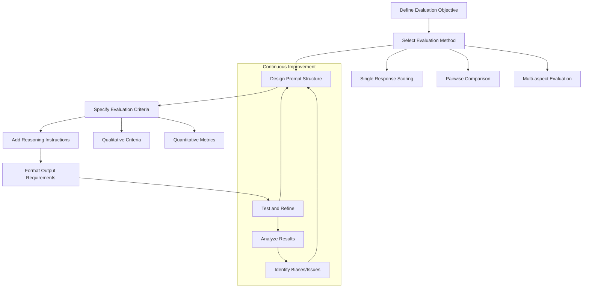
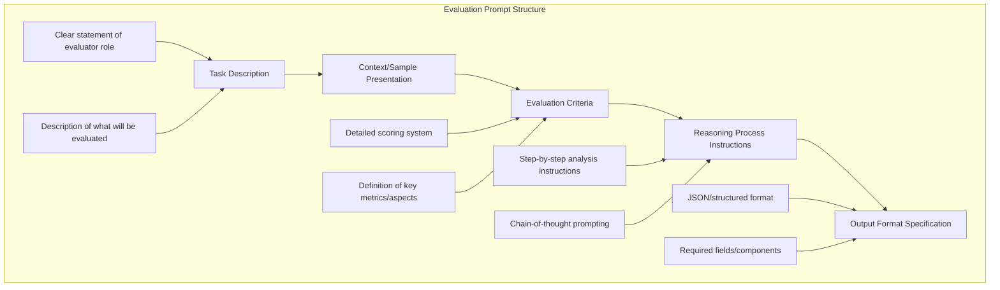
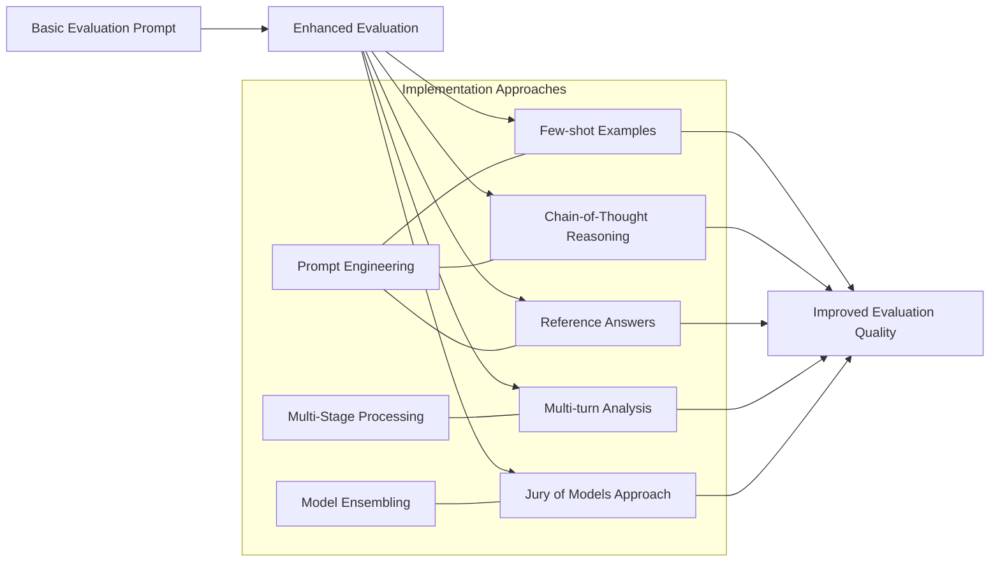
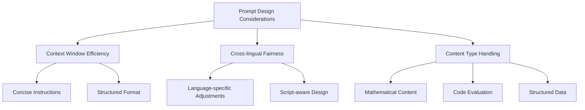
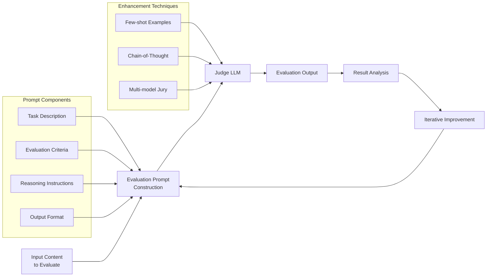

<!-- source: DeepWiki mcp.deepwiki.com · repo huggingface/evaluation-guidebook · extra page Designing Evaluation Prompts · fetched 2026-10-26 -->

# Designing Evaluation Prompts

<details>
<summary>Relevant source files</summary>

The following files were used as context for generating this wiki page:

- [contents/general-knowledge/tokenization.md](contents/general-knowledge/tokenization.md)
- [contents/model-as-a-judge/designing-your-evaluation-prompt.md](contents/model-as-a-judge/designing-your-evaluation-prompt.md)

</details>


## Purpose and Scope

This page provides comprehensive guidance on crafting effective prompts when using LLMs as evaluators or judges. Well-designed evaluation prompts are crucial for obtaining reliable, consistent, and meaningful assessments from judge LLMs. This document covers fundamental principles, essential components, structured formats, and techniques to improve accuracy in LLM evaluation prompts.

For information about selecting or obtaining appropriate judge models, see [Getting a Judge LLM](#2.3.1). For practical implementation advice and bias mitigation, see [Tips and Tricks for LLM-as-a-Judge](#2.3.3).

## The Evaluation Prompt Design Process

Designing effective evaluation prompts involves several key steps and considerations. The following diagram illustrates the general process of creating prompts for LLM-as-a-judge evaluation:



Sources: [contents/model-as-a-judge/designing-your-evaluation-prompt.md:3-14]()

## Fundamental Principles

When designing evaluation prompts for judge LLMs, consider these core principles:

1. **Clarity and Specificity**: Prompts should clearly articulate what is being evaluated and how.
2. **Structured Reasoning**: Guide the judge LLM through a structured evaluation process.
3. **Consistent Output Format**: Specify a standardized format for evaluation results.
4. **Bias Awareness**: Be conscious of potential biases in evaluation design.
5. **Task Appropriateness**: Match evaluation approach to the specific capability being assessed.

### Evaluation Methods Comparison

Different evaluation methods have distinct advantages and limitations:

| Method | Description | Strengths | Considerations |
|--------|-------------|-----------|----------------|
| **Absolute Scoring** | Assigning a score on a predefined scale | Simple to implement; Direct comparison across multiple systems | Susceptible to scale interpretation biases; Less alignment with human judgment |
| **Pairwise Comparison** | Direct comparison between two outputs | Better correlation with human preferences; More robust against biases | Limited to comparative assessments; Requires more evaluations for multiple systems |
| **Multi-aspect Evaluation** | Evaluating different aspects separately | More detailed feedback; Identifies specific strengths/weaknesses | More complex prompts; Higher token usage |

Sources: [contents/model-as-a-judge/designing-your-evaluation-prompt.md:18-21]()

## Components of Effective Evaluation Prompts

The following diagram illustrates the essential components of an effective evaluation prompt:



### 1. Task Description

Begin with a clear statement of the task, establishing the evaluator's role and what they'll be evaluating:

- `Your task is to evaluate [specific aspect] of the following [content type].`
- `You will be provided with [description of what will be evaluated].`

### 2. Context/Sample Presentation

Present the content to be evaluated in a structured way. For pairwise comparisons:
- `Response A: [Text of first response]`
- `Response B: [Text of second response]`

### 3. Evaluation Criteria

Provide detailed criteria for evaluation, including:
- Clear definitions of what constitutes different quality levels
- Detailed explanation of scoring scales when used
- Specific aspects to consider during evaluation

```
You should evaluate [property] on a scale of 1-5, where:
1 = [detailed description of lowest quality]
...
5 = [detailed description of highest quality]
```

### 4. Reasoning Process Instructions

Guide the evaluator through a structured reasoning process:
- `To judge this response, first analyze [specific aspect], then consider [another aspect]...`
- `Before providing your final evaluation, identify strengths and weaknesses...`

### 5. Output Format Specification

Specify the exact format for evaluation outputs:
- `Provide your evaluation in JSON format with the following fields: {"score": [your score], "reasoning": [detailed explanation]}`
- For comparative evaluations: `{"better_response": "[A or B]", "reasoning": [explanation]}`

Sources: [contents/model-as-a-judge/designing-your-evaluation-prompt.md:3-14](), [contents/model-as-a-judge/designing-your-evaluation-prompt.md:18-21]()

## Techniques to Improve Evaluation Accuracy

Several techniques can enhance the accuracy and reliability of LLM-based evaluations:



### 1. Few-Shot Examples

Include demonstrations of evaluation in the prompt to guide the model:
- Show examples of high-quality, medium-quality, and low-quality responses
- Demonstrate the reasoning process for each example
- Match examples to the domain being evaluated

### 2. Chain-of-Thought (CoT) Reasoning

Request explicit reasoning before final judgment:
- Ask the model to analyze specific aspects step by step
- Request identification of strengths and weaknesses
- Have the model justify its scoring decisions

Research has shown that CoT significantly improves evaluation accuracy, especially when the reasoning comes *before* the final score or judgment.

### 3. Reference Answers

When available, include reference or gold-standard answers:
- Helps establish a clear standard for evaluation
- Particularly useful for factual accuracy assessment
- Can serve as an anchor to reduce evaluation variability

### 4. Multi-turn Analysis

Break evaluation into multiple steps:
- First turn: Initial analysis and identification of potential issues
- Second turn: Deeper assessment of identified issues
- Final turn: Synthesis and overall evaluation

This approach has proven especially effective for factual error detection.

### 5. Jury of Models Approach

Use multiple evaluations from different models or prompts:
- Aggregate results from several evaluator instances
- Can use different model sizes or the same model with different temperatures
- Reduces individual model biases and improves reliability

Sources: [contents/model-as-a-judge/designing-your-evaluation-prompt.md:23-32]()

## Special Considerations

### Tokenization Awareness

When designing evaluation prompts, consider how tokenization affects the process:

- **Token Limits**: Evaluation prompts consume context window space, leaving less room for content being evaluated
- **Multilingual Evaluation**: Different languages tokenize at different efficiencies
- **Numerical Content**: Consider how numbers are tokenized when evaluating mathematical content



Sources: [contents/general-knowledge/tokenization.md:1-27](), [contents/general-knowledge/tokenization.md:52-66]()

### Bias Mitigation in Evaluation Design

When designing evaluation prompts, be aware of potential biases:

- **Position Bias**: Randomize the order of responses in comparative evaluations
- **Length Bias**: Explicitly instruct the model not to favor longer responses
- **Self-reference Bias**: For models evaluating their own outputs, use techniques to reduce self-preference

Sources: [contents/model-as-a-judge/designing-your-evaluation-prompt.md:34-36]()

## Prompt Templates and Examples

Take inspiration from established evaluation frameworks that have been refined through extensive testing:

- **MixEval**: Provides templates for various evaluation aspects
- **MTBench**: Contains standardized prompts for model comparison

Useful approaches for specific evaluation needs:

1. **For Pairwise Comparisons**:
   ```
   Your task is to compare two responses to the same query.
   Query: [query text]
   Response A: [text of first response]
   Response B: [text of second response]
   First, analyze the strengths and weaknesses of each response in detail.
   Then determine which response better answers the query.
   Your output must be in the following JSON format:
   {"analysis_A": "[strengths and weaknesses of A]", "analysis_B": "[strengths and weaknesses of B]", "better_response": "[A or B]", "reasoning": "[explanation of final decision]"}
   ```

2. **For Numeric Scoring**:
   ```
   Your task is to evaluate the following response on a scale of 1-5 for [specific criterion].
   Query: [query text]
   Response: [response text]
   Scoring criteria:
   1 = [detailed description]
   2 = [detailed description]
   3 = [detailed description]
   4 = [detailed description]
   5 = [detailed description]
   First, analyze how the response performs against each aspect of the criterion.
   Then, determine the appropriate score based on your analysis.
   Your output must be in the following JSON format:
   {"analysis": "[detailed analysis]", "score": [numeric score], "justification": "[explanation of score]"}
   ```

Sources: [contents/model-as-a-judge/designing-your-evaluation-prompt.md:16](), [contents/model-as-a-judge/designing-your-evaluation-prompt.md:18-21]()

## Integration with LLM-as-a-Judge Workflow

The following diagram illustrates how evaluation prompt design fits into the broader LLM-as-a-judge evaluation framework:



Sources: [contents/model-as-a-judge/designing-your-evaluation-prompt.md]()

## Conclusion

Effective evaluation prompt design is crucial for obtaining reliable judgments from LLMs. By following structured approaches to prompt construction, including clear evaluation criteria, reasoning steps, and appropriate output formats, you can significantly enhance the quality of LLM-based evaluations. Advanced techniques like chain-of-thought reasoning, reference inclusion, and jury approaches provide additional tools to improve evaluation accuracy. As with all LLM applications, be aware of potential biases and consider implementing specific mitigations in your evaluation design.

---

