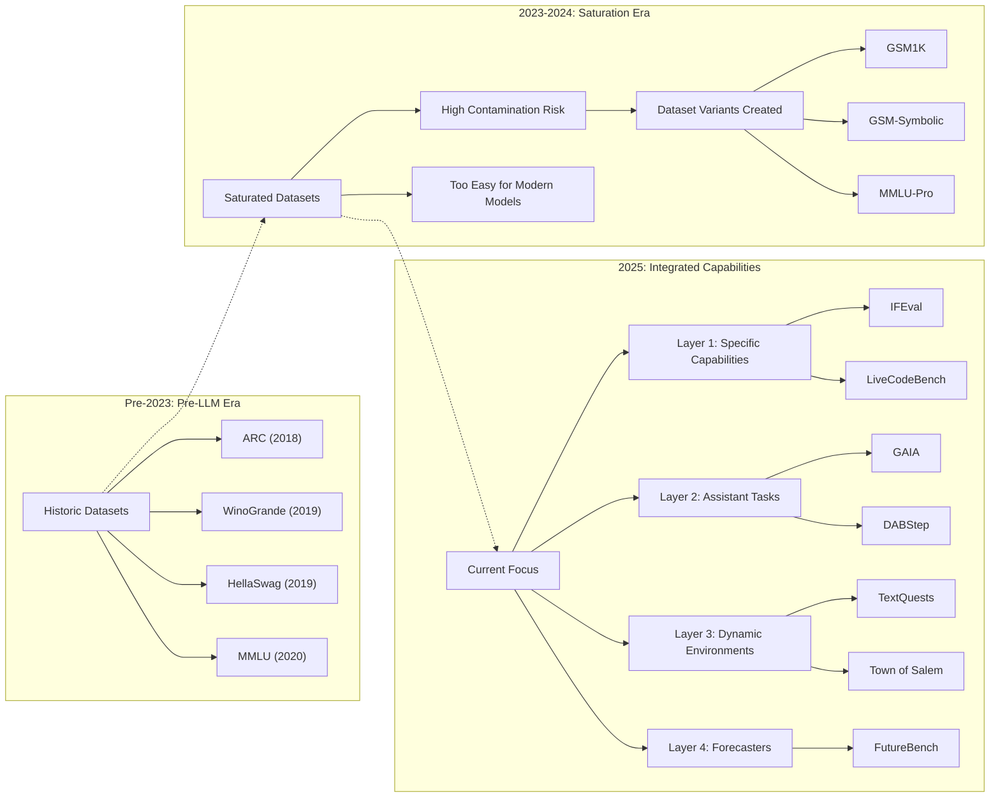
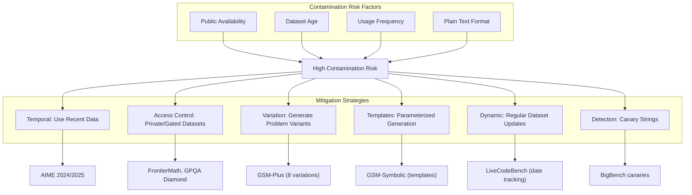
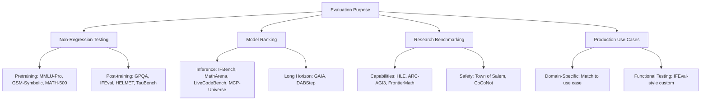

<!-- source: DeepWiki mcp.deepwiki.com · repo huggingface/evaluation-guidebook · extra page Evaluation Datasets Catalog · fetched 2026-10-26 -->

# Evaluation Datasets Catalog

Relevant source files

The following files were used as context for generating this wiki page:

- [contents/automated-benchmarks/some-evaluation-datasets.md](contents/automated-benchmarks/some-evaluation-datasets.md)
- [yearly_dives/2023-year-of-open-source.md](yearly_dives/2023-year-of-open-source.md)
- [yearly_dives/2024-evals-thoughts-from-iclr.md](yearly_dives/2024-evals-thoughts-from-iclr.md)
- [yearly_dives/2025-evaluations-for-useful-models.md](yearly_dives/2025-evaluations-for-useful-models.md)

This document provides a comprehensive catalog of evaluation datasets used for automated benchmarking of large language models (LLMs) across multiple domains and capability areas. For information about designing evaluations using these datasets, see [Designing Automated Evaluations](#2.1.1). For practical tips on implementation, see [Tips and Tricks for Automated Benchmarks](#2.1.3).

## Purpose and Scope

Evaluation datasets serve as standardized test sets that enable consistent and repeatable assessment of LLM capabilities. They support multiple evaluation purposes:

1. **Non-regression testing**: Verifying training methods work as expected (see page 5.2)
2. **Model ranking**: Comparing relative performance across models
3. **Capability assessment**: Understanding what models can accomplish

This catalog organizes datasets by capability area, from specific skills (math, code) to integrated assistant tasks, reflecting the evolution from testing isolated capabilities to evaluating useful, integrated behaviors. As discussed in page 5.3, modern evaluation increasingly focuses on whether models can orchestrate multiple capabilities to accomplish real-world tasks.

## Dataset Landscape and Evolution

Evaluation datasets have evolved significantly from 2023 to 2025, shifting from testing isolated skills to evaluating integrated capabilities and real-world usefulness.

**Evolution of Evaluation Dataset Focus**

Sources: yearly_dives/2025-evaluations-for-useful-models.md:17-167

**Dataset Categorization Framework**

```mermaid
flowchart TD
    Datasets["Evaluation Datasets"] --> ByCapability["By Capability Layer"]
    Datasets --> ByOrigin["By Origin"]
    Datasets --> ByFormat["By Evaluation Format"]
    
    ByCapability --> L1["Layer 1: Specific Skills"]
    ByCapability --> L2["Layer 2: Assistant Tasks"]
    ByCapability --> L3["Layer 3: Dynamic Environments"]
    ByCapability --> L4["Layer 4: Forecasting"]
    
    L1 --> Math["Math: GSM8K, MATH, AIME"]
    L1 --> Code["Code: HumanEval, SWE-Bench"]
    L1 --> LongCtx["Long Context: HELMET"]
    L1 --> InstFollow["Instruction: IFEval"]
    L1 --> Tools["Tools: BFCL, TauBench"]
    
    L2 --> InfoRet["Info Retrieval: GAIA, BrowseComp"]
    L2 --> Science["Science: DABStep, SciCode"]
    
    L3 --> Games["Games: TextQuests, ARC-AGI"]
    
    L4 --> Future["FutureBench, FutureX"]
    
    ByOrigin --> ExamBased["Exam: AIME, GAOKAO"]
    ByOrigin --> WebSourced["Web: LiveCodeBench"]
    ByOrigin --> Synthetic["Synthetic: GSM-Symbolic"]
    ByOrigin --> Expert["Expert: FrontierMath"]
    
    ByFormat --> MC["Multiple Choice"]
    ByFormat --> Functional["Functional Testing"]
    ByFormat --> Generative["Open Generation"]
    ByFormat --> Execution["Code Execution"]
```

Sources: yearly_dives/2025-evaluations-for-useful-models.md:13-163

## Key Considerations for Dataset Selection

When selecting evaluation datasets, align your choice with your evaluation purpose (see page 5.2 for detailed discussion):

1. **Evaluation Purpose**:
   - Non-regression testing: Use stable, well-understood datasets
   - Model ranking: Use datasets with stable ranking properties
   - Capability assessment: Use recent, uncontaminated datasets

2. **Contamination Risk**: Has the dataset been publicly available long enough to appear in training data?
3. **Difficulty Level**: Match to your target model capabilities
4. **Evaluation Format**: Functional testing vs. string matching vs. model judge
5. **Task Integration**: Does it test isolated skills or integrated capabilities?
6. **Interpretability**: Can humans understand what performance means?

### Dataset Contamination: The Critical Challenge

Contamination occurs when evaluation datasets appear in model training data, creating artificially inflated scores that don't generalize. This is the most serious problem in modern LLM evaluation.

**Contamination Risk and Mitigation Strategies**

Sources: yearly_dives/2025-evaluations-for-useful-models.md:36-47, yearly_dives/2024-evals-thoughts-from-iclr.md:33-36, contents/automated-benchmarks/some-evaluation-datasets.md:9-11

**Contamination Detection and Dataset Lifecycle**

As datasets age and become publicly available, they inevitably contaminate training data. The table below shows contamination status and recommended usage:

| Risk Level | Dataset Examples | Recommended Use | Notes |
|------------|-----------------|-----------------|-------|
| **High** (Pre-2023) | GSM8K, MATH, MMLU, HumanEval, ARC, HellaSwag | Pretraining checks only | Saturated, widely contaminated |
| **Medium** (2023-2024) | GPQA (original), GSM8K variants | Ablations, with caution | Contamination emerging |
| **Low** (2025) | AIME 2025, Math-Arena, LiveCodeBench, MCP-Universe | Post-training evaluation | Fresh, actively updated |
| **Very Low** (Private) | FrontierMath, Humanity's Last Exam (HLE) | Research benchmarking | Limited access reduces risk |

Sources: yearly_dives/2025-evaluations-for-useful-models.md:17-49, yearly_dives/2024-evals-thoughts-from-iclr.md:33-36

## Comprehensive Dataset Catalog

This catalog organizes evaluation datasets by capability area, reflecting the multi-layered evaluation architecture described in page 5.3. Datasets are categorized from specific capabilities (Layer 1) to integrated assistant tasks (Layer 2) to dynamic environments (Layer 3).

### Layer 1: Specific Capabilities

These datasets test isolated skills that serve as building blocks for more complex behaviors.

#### Reasoning and Commonsense (Historic, Pre-LLM)

These datasets were designed before the LLM era and are now largely saturated. Use only for pretraining checks or ablation studies.

| Dataset | Type | Size | Publication | Status | Use Case |
|---------|------|------|-------------|--------|----------|
| **ARC (Challenge)** | Science MCQA | 1.2K | 2018 | Saturated | Pretraining only |
| **WinoGrande** | Pronoun resolution | 43K | 2019 | Saturated | Pretraining only |
| **HellaSwag** | Next sentence selection | 60K | 2019 | Saturated | Pretraining only |
| **CommonsenseQA** | Commonsense MCQA | 12K | 2018 | Saturated | Pretraining only |
| **PIQA** | Physical commonsense | 20K | 2019 | Saturated | Pretraining only |
| **OpenBookQA** | Science + commonsense | 6K | 2018 | Saturated | Pretraining only |

Sources: yearly_dives/2025-evaluations-for-useful-models.md:17-24

#### Knowledge Evaluation

Knowledge datasets test factual understanding and domain expertise. The field has evolved from general knowledge (MMLU) to expert-level understanding (GPQA, HLE).

| Dataset | Type | Size | Publication | Contamination | Recommended Use |
|---------|------|------|-------------|---------------|-----------------|
| **MMLU** | General knowledge MCQA | 15K | 2020 | High | Pretraining only |
| **MMLU-Redux** | Cleaned MMLU | Subset of MMLU | 2024 | Medium | With caution |
| **MMLU-Pro** | Extended MMLU | Larger | 2024 | Medium | Pretraining/ablations |
| **Global-MMLU** | Culturally diverse | Multilingual | 2024 | Low | Cultural bias testing |
| **GPQA (Diamond)** | PhD-level science | Subset | 2023 | Medium | Post-training |
| **Humanity's Last Exam (HLE)** | Expert crowdsourced | 2.5K | 2024 | Very Low (private) | Research benchmark |

**Important Note on Knowledge Evaluation**: As models gain tool access (web search, retrieval), latent knowledge evaluation becomes less relevant. The field is shifting from "closed book" to "open book" evaluation, testing retrieval and reasoning rather than memorization.

Sources: yearly_dives/2025-evaluations-for-useful-models.md:25-36

#### Mathematics

Math datasets serve as proxies for reasoning and logic. The field has seen an explosion of variants to address contamination.

**Currently Recommended Math Datasets (2025)**

| Dataset | Type | Size | Publication | Status | Use Case |
|---------|------|------|-------------|--------|----------|
| **MATH-500** | Olympiad subset | 500 | 2024 | Low contamination | Pretraining/ablations |
| **AIME 2024/2025** | American olympiad | 30/year | Annual | Very low (recent) | Post-training, contamination detection |
| **Math-Arena** | Competition compilation | Updated regularly | 2025 | Very low (dynamic) | Post-training |
| **GSM-Symbolic** | Templated problems | Infinite | 2024 | Very low (generative) | Contamination-proof eval |
| **FrontierMath** | Expert-created | 100+ | 2024 | Very low (private) | Research benchmark |

**Saturated Math Datasets (Use with Caution)**

| Dataset | Size | Publication | Issue | Recommended Use |
|---------|------|-------------|-------|-----------------|
| GSM8K | 8.5K | 2021 | Highly contaminated | None (use variants) |
| MATH | 12.5K | 2021 | Contaminated | Pretraining only |
| GSM1K | 1.2K | 2024 | For contamination detection | Contamination analysis |
| GSM-Plus | 10K (8 vars/Q) | 2024 | Robustness testing | Sensitivity analysis |
| GSM-IC | 58K | 2023 | Distractor testing | Robustness testing |

**Complete Math Dataset Reference**

For comprehensive details on all math datasets including olympiad, school, synthetic, and web-sourced datasets, see [contents/automated-benchmarks/some-evaluation-datasets.md:13-64]().

Sources: yearly_dives/2025-evaluations-for-useful-models.md:37-50, contents/automated-benchmarks/some-evaluation-datasets.md:13-64

#### Code Evaluation

Code datasets test programming ability and serve as reasoning proxies. Evolution has moved from simple function completion to repository-level editing.

**Modern Code Evaluation (2025 Recommendations)**

| Dataset | Type | Size | Publication | Status | Key Feature |
|---------|------|------|-------------|--------|-------------|
| **LiveCodeBench** | LeetCode problems | Growing | 2024 | Low (dated) | Date tracking for contamination |
| **AiderBench** | Code editing | From Exercism | 2024 | Low | Tests editing/refactoring |
| **SWE-Bench (Verified)** | GitHub issues | High quality subset | 2024 | Low | Repository-level reasoning |

**Historic Code Datasets (Saturated)**

| Dataset | Size | Publication | Issue | Use Case |
|---------|------|-------------|-------|----------|
| HumanEval | 164 | 2021 | Saturated | Pretraining only |
| HumanEval+ | 164+ | 2023 | Contaminated | Pretraining only |
| MBPP | 1K | 2021 | Saturated | Pretraining only |
| MBPP+ | 1K+ | 2023 | Contaminated | Pretraining only |
| APPS | 10K | 2021 | Saturated | Pretraining only |

**For detailed code dataset information**: See [contents/automated-benchmarks/some-evaluation-datasets.md:69-74]() for pre-LLM code datasets.

Sources: yearly_dives/2025-evaluations-for-useful-models.md:51-69

#### Long Context Management

Long context datasets test ability to reason over extended sequences, critical for assistant applications.

| Dataset | Type | Context Length | Publication | Status | Key Feature |
|---------|------|----------------|-------------|--------|-------------|
| **HELMET** | Aggregated tasks | Varies | 2024 | Discriminative | Comprehensive task coverage |
| NIAH | Needle retrieval | Varies | 2023 | Solved | Basic retrieval (baseline only) |
| RULER | Multi-hop tracing | Up to 128K | 2024 | Near-solved | Variable tracking |
| InfinityBench | Multilingual tasks | 100K | 2024 | Some signal | QA, retrieval, computation |
| OpenAI MRCR | Text modifications | Long | 2025 | Some signal | Modification tracking |
| **Kalamang Translation** | Grammar book translation | Full book | 2024 | High signal | Low-resource language |
| Novel Challenge | Book comprehension | Full novels | 2024 | High signal | True/false claims |

Sources: yearly_dives/2025-evaluations-for-useful-models.md:71-81

#### Instruction Following

Instruction following datasets use **functional testing** - a key paradigm where correctness is verified through parsing rules rather than string matching.

| Dataset | Type | Size | Publication | Key Feature |
|---------|------|------|-------------|-------------|
| **IFEval** | Format constraints | Set | 2023 | Parser-based validation (strict accuracy) |
| **IFBench** | Extended IFEval | Larger | 2025 | More complex constraints |
| CoCoNot | Non-compliance | Set | 2024 | Tests refusal behavior |

**Why IFEval is Important**: It represents functional testing where each formatting instruction (keywords, punctuation, markdown) can be checked programmatically. This provides strict, unambiguous scores without model judges, and is easily regenerated to prevent contamination.

Sources: yearly_dives/2025-evaluations-for-useful-models.md:82-87

#### Tool Calling and MCP

Tool calling datasets test ability to select and use external tools correctly. The emergence of Model Context Protocol (MCP) has driven new benchmarks.

**Traditional Tool Calling**

| Dataset | Type | Size | Publication | Evaluation Method | Issues |
|---------|------|------|-------------|-------------------|--------|
| **TauBench** | Retail/airline | Scenarios | 2024 | Database state + LLM judge | Costly, LLM-judged |
| **BFCL v3** | Function calling | Multi-subset | 2025 | AST + execution + state | Focus on tool use |
| **BFCL v4** | Web/search | Multi-subset | 2025 | AST + execution + state | Agentic tool use |
| ToolBench | API calling | 100 | 2023 | Mixed (unstable) | Real API instability |
| StableToolBench | Virtual APIs | Extended | 2025 | LLM judge | Fixed ToolBench issues |

**MCP (Model Context Protocol) Benchmarks**

| Dataset | Servers | Size | Publication | Evaluation Method | Key Feature |
|---------|---------|------|-------------|-------------------|-------------|
| **MCP-Universe** | 11 real-world | Tasks | 2025 | Execution-based (strict) | Dynamic answer validation |
| **LiveMCPBench** | Local deployable | Large | 2025 | Tool discrimination | Tests tool selection |
| MCPBench | Live servers | Tasks | 2025 | Rules + LLM judge | Real-world servers |

Sources: yearly_dives/2025-evaluations-for-useful-models.md:89-106

### Layer 2: Assistant Tasks

These datasets require orchestrating multiple capabilities (reasoning, tools, long context) to accomplish realistic tasks. They represent the shift toward evaluating useful, integrated behavior.

#### Real-Life Information Retrieval

| Dataset | Type | Size | Publication | Key Feature |
|---------|------|------|-------------|-------------|
| **GAIA** | Multi-step queries | 3 difficulty levels | 2023 | Tools + reasoning + retrieval |
| **GAIA 2** | Mobile environment | Tasks | 2025 | Time-sensitive, noisy environments |
| **BrowseComp** | Web research | Questions | 2025 | Multiple solution paths |

**Note on GAIA**: Level 1 is now saturated. Results vary widely depending on whether evaluation uses the public validation set or LLM judges on the private test set. Check evaluation methodology when comparing scores.

Sources: yearly_dives/2025-evaluations-for-useful-models.md:110-119

#### Science Assistants

These datasets test ability to conduct scientific work combining code, reasoning, and domain knowledge.

| Dataset | Domain | Size | Publication | Evaluation | Key Feature |
|---------|--------|------|-------------|------------|-------------|
| **DABStep** | Data analysis | Real workloads | 2025 | Ground truth (unbiased) | Uncontaminated operational data |
| SciCode | Multi-domain | Problems + subproblems | 2024 | Scientist + LLM judge | Decomposed scientific workflows |
| PaperBench | ML research | ICML papers | 2025 | LLM judge (8K graded tasks) | Code reconstruction from papers |
| DSBench | Data analysis | Kaggle + financial | 2025 | Mixed metrics | Multimodal data tasks |

Sources: yearly_dives/2025-evaluations-for-useful-models.md:120-128

### Layer 3: Dynamic Environments (Game-Based)

Game-based benchmarks test adaptability in changing environments. Unlike static assistant tasks, games require dynamic decision-making and long-term planning. They're also highly interpretable - winning or losing is unambiguous.

| Dataset | Type | Publication | Status | Key Feature |
|---------|------|-------------|--------|-------------|
| **ARC-AGI 3** | Logic puzzles | 2025 (ongoing) | Unsolved | Exploration, planning, memory |
| **TextQuests** | RPG adventures | 2025 | Medium difficulty | Long-range planning |
| **Town of Salem** | Social deduction | 2025 | Partially solved | Tests deception (safety-relevant) |
| Werewolf | Social deduction | 2025 | Varies | Logic + communication |
| Pokemon | Single-player RPG | 2024 | Medium difficulty | Long context + planning |
| Crafter | Survival game | 2021 | Medium difficulty | Multi-step objectives |

**Why Games Matter**: They test adaptability to changing environments (unlike static benchmarks), require long-range planning, and provide clear pass/fail metrics. Town of Salem is particularly interesting for safety: models that excel at deceptive roles raise concerns.

Sources: yearly_dives/2025-evaluations-for-useful-models.md:131-141

### Layer 4: Forecasting (Contamination-Proof)

Forecasting datasets are inherently contamination-proof since they test prediction of future events. However, discriminative power is unclear.

| Dataset | Type | Time Horizon | Publication | Question Source |
|---------|------|--------------|-------------|-----------------|
| **FutureBench** | News prediction | Weekly | 2024 | Betting markets + LLM |
| FutureX | Event prediction | Daily | 2025 | Templates from live data |
| Arbitrage | Event prediction | 2028 resolution | 2024 | Prediction markets |

**Limitations**: Unclear whether poor performance indicates impossible-to-predict events or model weakness. Success might reflect formulaic questions rather than genuine reasoning.

Sources: yearly_dives/2025-evaluations-for-useful-models.md:142-152

## Practical Recommendations by Use Case

The following table maps evaluation purposes to recommended dataset choices based on the 2025 evaluation landscape:

**Dataset Selection by Evaluation Purpose**

Sources: yearly_dives/2025-evaluations-for-useful-models.md:157-167

**2025 Recommended Dataset Combinations**

For **model builders** (training/developing models):
- **Pretraining**: MMLU-Pro, MATH-500, AIME 2024, historic datasets for trajectories
- **Post-training**: GPQA, IFEval, SWE-Bench Verified, HELMET or equivalent long context, TauBench or BFCL

For **model evaluators** (comparing at inference):
- **Core capabilities**: IFBench, HLE, Math-Arena, AiderBench, LiveCodeBench, MCP-Universe
- **Long horizon tasks**: GAIA, DABStep, or domain-specific assistant tasks
- **Adaptability**: ARC-AGI3 (when available), TextQuests, or other game-based if relevant

For **safety researchers**:
- **Deception detection**: Town of Salem
- **Refusal behavior**: CoCoNot
- **Robustness**: GSM-Plus, IFBench

Sources: yearly_dives/2025-evaluations-for-useful-models.md:157-163

## Dataset Evaluation Methods and Code References

Different datasets require different evaluation approaches. Understanding these patterns helps select appropriate datasets and implement evaluations correctly.

**Evaluation Method Taxonomy**

```mermaid
flowchart TD
    EvalMethods["Evaluation Methods"] --> LogProb["Log-Probability Based"]
    EvalMethods --> Generative["Generative/String Matching"]
    EvalMethods --> Functional["Functional Testing"]
    EvalMethods --> Execution["Code Execution"]
    EvalMethods --> Judge["Model Judge"]
    
    LogProb --> LogProbEx["MMLU, ARC, HellaSwag"]
    LogProb --> LogProbNote["Multiple choice selection"]
    
    Generative --> GenEx["GSM8K, MATH, GPQA"]
    Generative --> GenNote["Exact match, normalization"]
    Generative --> GenIssue["Sensitive to format"]
    
    Functional --> FuncEx["IFEval, IFBench"]
    Functional --> FuncNote["Parser validation"]
    Functional --> FuncBenefit["Strict, regenerable"]
    
    Execution --> ExecEx["HumanEval, SWE-Bench, BFCL"]
    Execution --> ExecNote["Unit tests, state checks"]
    Execution --> ExecBenefit["Unambiguous results"]
    
    Judge --> JudgeEx["GAIA, TauBench, SciCode"]
    Judge --> JudgeNote["LLM evaluates answer"]
    Judge --> JudgeIssue["Introduces bias"]
```

Sources: yearly_dives/2025-evaluations-for-useful-models.md:82-106

**Functional Testing vs. String Matching: A Critical Distinction**

The field is moving toward functional testing (parser-based, execution-based validation) rather than string matching or model judges. This shift is critical for contamination resistance and result interpretability.

| Evaluation Type | Examples | Advantages | Disadvantages |
|-----------------|----------|------------|---------------|
| **Functional Testing** | IFEval (parsers), HumanEval (unit tests), BFCL (AST+execution), MCP-Universe (execution) | Strict accuracy, unambiguous, easily regenerable, no judge bias | Limited to tasks with verifiable outputs |
| **String Matching** | GSM8K (exact match), MATH (normalized match) | Simple to implement | Format-sensitive, requires careful normalization |
| **Model Judge** | GAIA (private set), TauBench, SciCode | Handles open-ended tasks | Introduces bias, costly, inconsistent |
| **Log-Probability** | MMLU, ARC | Efficient, no generation needed | Prone to position bias, limited task types |

**Key Insight from 2025**: Functional testing is preferred whenever possible. It provides contamination resistance (problems can be regenerated), strict accuracy (no ambiguity), and interpretable results (you know exactly what passed/failed).

Sources: yearly_dives/2025-evaluations-for-useful-models.md:82-106, 157-167

## Best Practices and Recommendations

When using evaluation datasets, consider these best practices:

1. **Use multiple datasets** that test different aspects of mathematical capability
2. **Be aware of contamination** issues, especially with widely available datasets
3. **Consider dataset age** - newer datasets are less likely to be in training data
4. **Match evaluation format** to your use case requirements
5. **Document dataset choices** and their limitations in your evaluation reports
6. **Consider creating variations** of existing datasets when contamination is suspected

For evaluating cutting-edge LLMs, prioritize:
- Recently published datasets (post-2023)
- Datasets with verifiable answers (e.g., through SymPy evaluation)
- Expert-created datasets (e.g., FrontierMath, CHAMP)
- Datasets with built-in robustness tests (e.g., GSM-Plus)

Sources: contents/automated-benchmarks/some-evaluation-datasets.md:5-11

---

