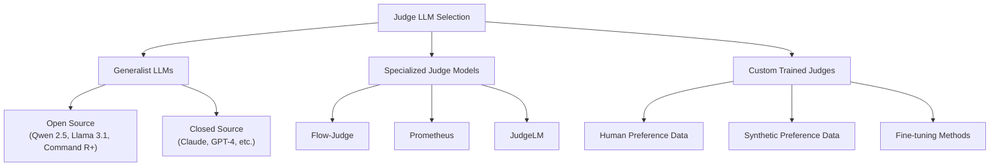
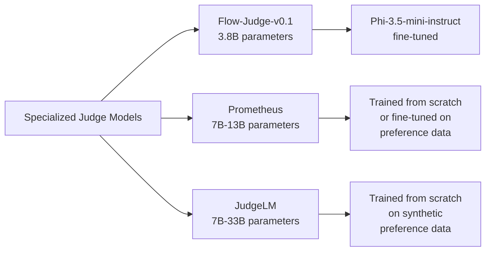
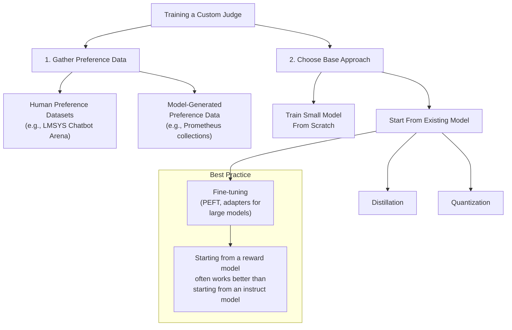

<!-- source: DeepWiki mcp.deepwiki.com · repo huggingface/evaluation-guidebook · extra page Getting a Judge LLM · fetched 2026-10-26 -->

# Getting a Judge LLM

Relevant source files

The following files were used as context for generating this wiki page:

- [contents/model-as-a-judge/getting-a-judge-llm.md](contents/model-as-a-judge/getting-a-judge-llm.md)

## Purpose and Scope

This document provides comprehensive guidance on selecting, accessing, or training an LLM to serve as a judge for evaluating other models or systems. It covers the three main approaches: using existing generalist LLMs, employing specialized judge models, and training custom judge models. For details on how to create effective prompts for your judge LLM, see [Designing Evaluation Prompts](#2.3.2), and for best practices and bias mitigation, see [Tips and Tricks for LLM-as-a-Judge](#2.3.3).

Sources: [contents/model-as-a-judge/getting-a-judge-llm.md:1-7]()

## Using Generalist LLMs as Judges

Generalist LLMs are large language models trained on diverse data and designed for broad capabilities. When used as judges, they can evaluate responses across many domains without requiring specialized training for evaluation tasks.

### Open vs. Closed Source Options

While closed source models like Claude and GPT-4 initially led in evaluation performance, the gap has narrowed significantly with the emergence of high-quality open source alternatives.

#### Open Source Options:
- **Qwen 2.5** - A family of models with strong evaluation capabilities
- **Command R+** - Cohere's instruction-tuned model with strong reasoning abilities
- **Llama 3.1-405B-Instruct** - Meta's largest instruction-tuned model 

#### Closed Source Considerations:

When using closed source models, be aware of these key trade-offs:

| Disadvantages | Advantages |
|---------------|------------|
| API-based models can change without notice, reducing reproducibility | Easy access without hardware requirements |
| Black-box operation limits interpretability | Typically high quality evaluations |
| Potential data privacy concerns and leakage | Available through simple API calls |

Open source models accessed through model providers often provide the accessibility advantages of closed models while addressing reproducibility and interpretability concerns.

Sources: [contents/model-as-a-judge/getting-a-judge-llm.md:5-16]()

## Using Specialized LLM Judge Models

Specialized judge models are typically smaller models (a few billion parameters) specifically trained or fine-tuned to perform evaluation tasks. These models have several advantages:

- Can run on consumer hardware (often locally)
- Optimized specifically for evaluation tasks
- More lightweight and efficient than generalist models

### Notable Specialized Judge Models

| Model | Size | Base Model | Training Approach | Link |
|-------|------|------------|-------------------|------|
| Flow-Judge-v0.1 | 3.8B | Phi-3.5-mini-instruct | Fine-tuned on synthetic preference data | Hugging Face: flowaicom/flow-judge-v01 |
| Prometheus v1 | 13B | From scratch | Trained on synthetic preference data | Hugging Face: prometheus-eval/prometheus-13b-v1.0 |
| Prometheus v2 | 7B | Mistral-7B-Instruct-v0.2 | Fine-tuned with weight merging | Hugging Face: prometheus-eval/prometheus-7b-v2.0 |
| JudgeLM | 7B-33B | From scratch | Trained on multi-source synthetic preference data | See research paper |

These models often require following their specific prompt formats for optimal performance.

Sources: [contents/model-as-a-judge/getting-a-judge-llm.md:18-25]()

## Training Your Own Judge LLM

Creating a custom judge LLM allows for domain-specific evaluation capabilities and greater control over the evaluation process.

### Gathering Preference Data

Two main sources of preference data exist:

1. **Human preference datasets**
   - Datasets like the LMSYS Chatbot Arena contain human judgments about model outputs
   - Provides high-quality ground truth but can be expensive to create or limited in scale

2. **Model-generated preference data**
   - Synthetic datasets created by existing models
   - Examples include the Prometheus preference and feedback collections
   - More scalable but may inherit biases from the generating model

### Training Approaches

Once you have preference data, choose one of these approaches:

1. **Train a small model from scratch**
   - Requires significant compute but gives complete control
   - Works well when you have extensive domain-specific data

2. **Start from an existing model**
   - **Distillation**: Create a smaller model that replicates the behavior of a larger one
   - **Quantization**: Reduce the precision of model weights to decrease size and increase inference speed
   - **Fine-tuning**: Adapt an existing model using preference data
     - For larger models with limited training resources, use PEFT (Parameter-Efficient Fine-Tuning) or adapter weights
     - Research suggests starting from a reward model works better than starting from an instruction-tuned model

Sources: [contents/model-as-a-judge/getting-a-judge-llm.md:27-39]()

## Comparison of Judge LLM Approaches

Below is a comparison of the three approaches to help select the most appropriate option based on your specific needs:

| Approach | Size Range | Hardware Requirements | Control & Customization | Setup Complexity | Data Privacy | Best For |
|----------|------------|----------------------|------------------------|------------------|-------------|----------|
| Generalist LLMs | 7B-1T+ parameters | Minimal with API; High for local | Low | Low with API; High for local | Low with API; High for local | Quick setup, general evaluation tasks |
| Specialized Judge Models | 3B-33B parameters | Moderate | Medium | Medium | High | Balanced performance and resource usage |
| Custom Trained Judges | Variable | High during training; Depends on final model size | High | High | High | Domain-specific evaluation, full control |

This comparison highlights the key trade-offs involved in selecting a judge LLM. The optimal choice depends on your specific requirements regarding resource constraints, data privacy concerns, customization needs, and the domain of evaluation.

Sources: [contents/model-as-a-judge/getting-a-judge-llm.md]()

---

