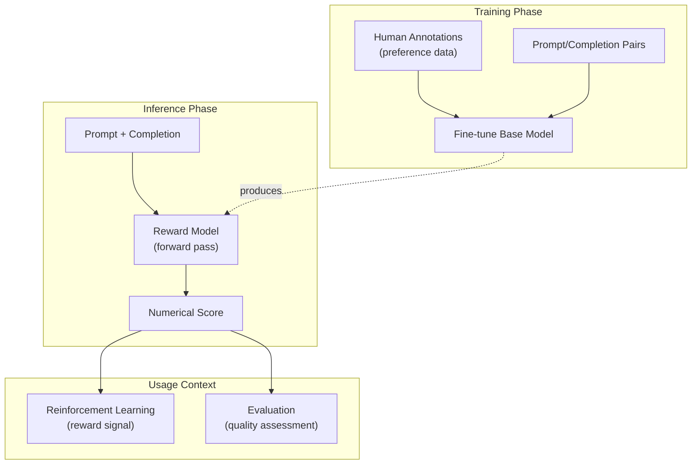
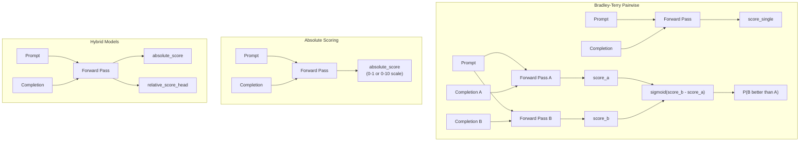
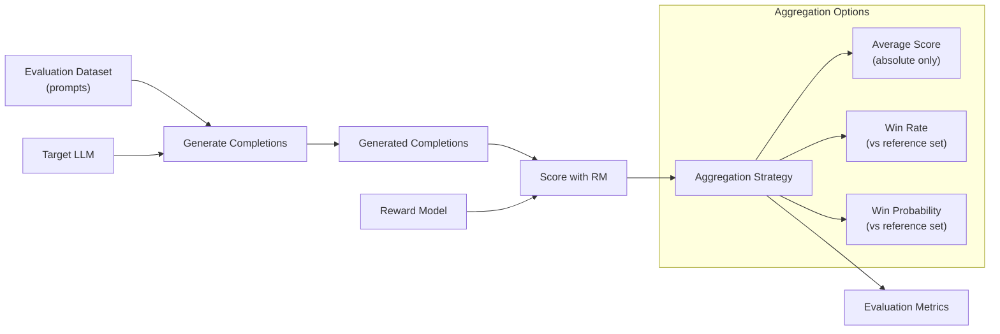
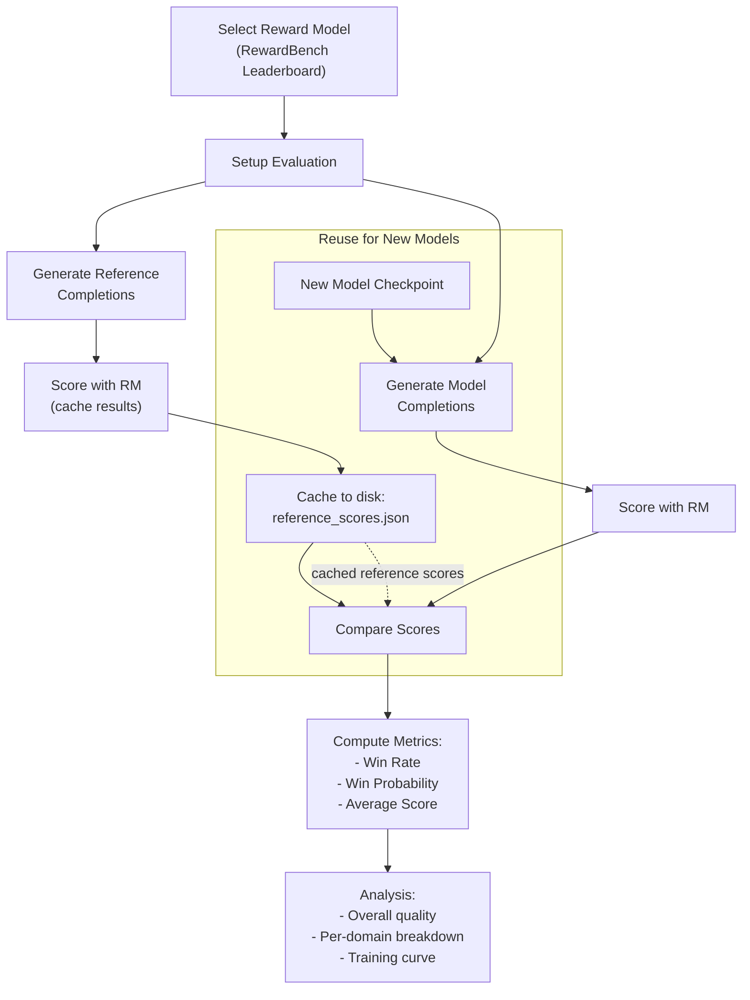

<!-- source: DeepWiki mcp.deepwiki.com · repo huggingface/evaluation-guidebook · extra page Reward Models · fetched 2026-10-26 -->

# Reward Models

<details>
<summary>Relevant source files</summary>

The following files were used as context for generating this wiki page:

- [contents/model-as-a-judge/what-about-reward-models.md](contents/model-as-a-judge/what-about-reward-models.md)

</details>


## Purpose and Scope

This document explains reward models as an alternative approach to using generative LLMs for evaluation. Reward models are specialized neural networks trained to predict human preference scores for language model outputs. Unlike generative judge LLMs that produce textual feedback and scores (see [2.3.2](#2.3.2)), reward models directly output numerical scores through a single forward pass, offering significant speed and determinism advantages. For general information about acquiring judge models, see [2.3.1](#2.3.1). For bias mitigation strategies applicable to all judge approaches, see [2.3.4](#2.3.4).

Sources: [contents/model-as-a-judge/what-about-reward-models.md:1-7]()

## What is a Reward Model?

A reward model is a neural network fine-tuned to predict scores from human annotations for given prompt/completion pairs. The training objective aligns the model's scoring behavior with human preferences, allowing it to serve as a proxy for human judgment during evaluation.

The key distinction from generative judge LLMs is architectural: instead of generating text that must be parsed into scores, reward models output numerical values directly through their final layer, typically using a scalar projection head that replaces the language modeling head of the base model.

Sources: [contents/model-as-a-judge/what-about-reward-models.md:3-7]()

### Core Training Paradigm



**Diagram: Reward Model Training and Usage Pipeline**

Sources: [contents/model-as-a-judge/what-about-reward-models.md:3-7]()

## Reward Model Architectures

### Bradley-Terry Pairwise Models

The most common reward model architecture follows the Bradley-Terry model, which outputs a single scalar score per completion. The pairwise preference probability is computed as:

$$p(\text{completion b is better than completion a}) = \text{sigmoid}(\text{score}_b - \text{score}_a)$$

This formulation is trained exclusively on pairwise comparison annotations, which are easier to collect than absolute scores because humans naturally find it simpler to compare two options than to rate them on an absolute scale.

**Key Characteristics:**
- **Input:** Single prompt + single completion
- **Output:** Scalar score (typically unbounded)
- **Training data:** Pairwise comparisons (A vs B)
- **Comparison method:** Within-prompt only (cannot compare across different prompts)

**Limitations:**
- Scores from different prompts are not comparable due to varying difficulty scales
- Cannot directly answer "which of 100 completions is best?" without computing all pairwise differences
- Context length constraints when comparing very long completions

**Example Models:**
- Standard Bradley-Terry implementations
- Enhanced pairwise models like `RLHFlow/pair-preference-model-LLaMA3-8B` that predict probability distributions rather than binary preferences

Sources: [contents/model-as-a-judge/what-about-reward-models.md:8-19]()

### Absolute Scoring Models

Some reward models output absolute scores that are interpretable across different prompts, eliminating the need for pairwise comparison infrastructure.

**Example Architectures:**
- **SteerLM:** Outputs absolute quality scores directly
- **HelpSteer2-Preference:** Outputs both absolute and relative scores
- **ArmoRM:** Hybrid model supporting both scoring modes

**Trade-offs:**
| Aspect | Absolute Scores | Pairwise Scores |
|--------|----------------|-----------------|
| Data collection | Harder (less stable human ratings) | Easier (natural comparisons) |
| Cross-prompt comparison | Yes | No |
| Evaluation simplicity | Can average directly | Requires reference set |
| Training stability | More challenging | More stable |
| Memory requirements | Lower | Higher (must process pairs) |

Sources: [contents/model-as-a-judge/what-about-reward-models.md:20-25]()

### Architecture Comparison Diagram



**Diagram: Reward Model Architecture Types**

Sources: [contents/model-as-a-judge/what-about-reward-models.md:8-25]()

## Using Reward Models for Evaluation

### Evaluation Pipeline



**Diagram: Reward Model Evaluation Workflow**

Sources: [contents/model-as-a-judge/what-about-reward-models.md:27-38]()

### Scoring Strategies

#### For Absolute Score Models

When using models that output absolute scores (e.g., SteerLM, HelpSteer2-Preference, ArmoRM with absolute head):

```
aggregate_score = mean(scores across all prompt/completion pairs)
```

This straightforward averaging works because scores are calibrated to be comparable across different prompts.

#### For Pairwise Models

Directly averaging pairwise scores is problematic because different prompts have inherently different reward scales. A score of 0.5 on an easy prompt is not equivalent to 0.5 on a hard prompt. Instead, use reference-based metrics:

**Win Rate:**
```
win_rate = (# completions ranked higher than reference) / (total completions)
```

Calculate the percentage of model completions ranked higher than a reference set of completions. This provides a coarse-grained, interpretable metric.

**Win Probability:**
```
win_probability = mean(P(model_completion > reference_completion))
```

Compute the mean probability that model completions are better than reference completions. This provides a smoother, more fine-grained signal that changes gradually with model improvements.

Sources: [contents/model-as-a-judge/what-about-reward-models.md:27-38]()

### Aggregation Methods Table

| Method | Model Type | Formula | Granularity | Use Case |
|--------|-----------|---------|-------------|----------|
| Average Score | Absolute | `mean(scores)` | Fine-grained | Direct quality measurement |
| Win Rate | Pairwise | `count(score_model > score_ref) / n` | Coarse | Simple comparison metric |
| Win Probability | Pairwise | `mean(sigmoid(score_model - score_ref))` | Fine-grained | Training monitoring, checkpoint selection |

Sources: [contents/model-as-a-judge/what-about-reward-models.md:29-38]()

## Comparison with Generative Judge LLMs

### Advantages of Reward Models

**Speed:**
- **Reward models:** Single forward pass with scalar output
- **Generative judges:** Must generate potentially long text responses (50-500 tokens)
- **Speed-up:** Typically 10-100x faster

**Determinism:**
- **Reward models:** Identical inputs always produce identical scores (no sampling)
- **Generative judges:** Stochastic generation can produce varying scores even with temperature=0 due to implementation differences

**Positional Bias Resistance:**
- **Reward models (absolute):** Process single completions, no ordering information
- **Reward models (pairwise):** Minimal bias if training data balanced both positions
- **Generative judges:** Susceptible to position bias when comparing multiple completions (see [2.3.4](#2.3.4))

**No Prompt Engineering:**
- **Reward models:** Score directly from training data distribution, no prompts needed
- **Generative judges:** Require careful prompt design for reliable scoring (see [2.3.2](#2.3.2))

Sources: [contents/model-as-a-judge/what-about-reward-models.md:39-46]()

### Disadvantages of Reward Models

**Fine-tuning Requirements:**
- Requires curating preference datasets (thousands to millions of comparisons)
- Training cost can be substantial for large base models
- May perform poorly on out-of-distribution tasks despite inheriting base model capabilities

**Overfitting Risk:**
- When the same reward model is used for both reinforcement learning and evaluation, the target model may overfit to the reward model's specific preferences rather than true human preferences
- This issue also applies to direct alignment algorithms (DPO, IPO) when evaluation uses similar datasets to training

**Limited Interpretability:**
- Outputs only numerical scores, no explanations
- Debugging score disagreements requires human inspection of completions
- Cannot provide detailed feedback like generative judges can

Sources: [contents/model-as-a-judge/what-about-reward-models.md:47-50]()

### Comparison Matrix

```mermaid
graph TB
    subgraph "Reward Models"
        RM_SPEED["Speed: Very Fast<br/>(1x forward pass)"]
        RM_DETERM["Determinism: Perfect"]
        RM_BIAS["Positional Bias: Minimal"]
        RM_PROMPT["Prompt Engineering: None"]
        RM_TRAIN["Training Required: Yes"]
        RM_INTERP["Interpretability: Scores only"]
        RM_OVERFIT["Overfitting Risk: High<br/>(when used in RL)"]
    end
    
    subgraph "Generative Judge LLMs"
        GLM_SPEED["Speed: Slow<br/>(generate 50-500 tokens)"]
        GLM_DETERM["Determinism: Low<br/>(sampling variance)"]
        GLM_BIAS["Positional Bias: High<br/>(order matters)"]
        GLM_PROMPT["Prompt Engineering: Required"]
        GLM_TRAIN["Training Required: Optional"]
        GLM_INTERP["Interpretability: High<br/>(explanations provided)"]
        GLM_OVERFIT["Overfitting Risk: Lower"]
    end
    
    CHOOSE{Choose Judge Type}
    CHOOSE -->|Need Speed + Determinism| RM_SPEED
    CHOOSE -->|Need Interpretability| GLM_INTERP
    CHOOSE -->|Pure Evaluation| RM_SPEED
    CHOOSE -->|Also doing RL| GLM_SPEED
```



**Diagram: Reward Model vs Generative Judge LLM Trade-offs**

Sources: [contents/model-as-a-judge/what-about-reward-models.md:39-50]()

## Implementation Considerations

### Model Selection

The RewardBench Leaderboard tracks reward model performance across various tasks. When selecting a model, consider:

1. **Task distribution alignment:** Check if the model was trained on data similar to your evaluation domain
2. **Base model size:** Larger base models (7B+ parameters) generally perform better but are slower
3. **Scoring type:** Choose between pairwise, absolute, or hybrid based on your aggregation needs
4. **Training data transparency:** Prefer models with documented training datasets to avoid overlap with your evaluation set

**Reference:** RewardBench Leaderboard at `allenai/reward-bench` HuggingFace space

Sources: [contents/model-as-a-judge/what-about-reward-models.md:51-54]()

### Caching and Efficiency

For pairwise models that score single completions, implement caching strategies:

```
1. Score all reference model completions once → cache to disk
2. For new model evaluation:
   - Score new completions
   - Load cached reference scores
   - Compute win rate/probability without re-scoring references
```

This approach is particularly effective when evaluating multiple model variants or checkpoints against the same reference set, as demonstrated in the Nemotron paper.

Sources: [contents/model-as-a-judge/what-about-reward-models.md:54-56]()

### Checkpoint Selection During Training

Track win rates or win probabilities throughout training to:
- **Detect model degradation:** Drops in win probability indicate quality regression
- **Select optimal checkpoints:** Choose checkpoints with peak evaluation performance rather than peak training metrics
- **Monitor training stability:** Smooth win probability curves indicate stable training

This technique has been used in recent work to prevent overfitting and identify when further training degrades model quality.

Sources: [contents/model-as-a-judge/what-about-reward-models.md:56-57]()

### Implementation Flow Diagram



**Diagram: Efficient Reward Model Evaluation Implementation**

Sources: [contents/model-as-a-judge/what-about-reward-models.md:51-57]()

## Key References

| Resource | Type | Purpose |
|----------|------|---------|
| RewardBench Leaderboard | Benchmark | Compare reward model performance |
| Nemotron paper (arXiv:2406.11704) | Case study | Production usage of reward models for evaluation |
| Recent training monitoring paper (arXiv:2410.11677v1) | Methodology | Win probability tracking for checkpoint selection |
| SteerLM (arXiv:2311.09528) | Model architecture | Absolute scoring approach |
| HelpSteer2-Preference (arXiv:2410.01257) | Model architecture | Hybrid absolute/relative scoring |
| ArmoRM (arXiv:2406.12845) | Model architecture | Multi-mode reward modeling |
| RLHFlow/pair-preference-model-LLaMA3-8B | Implementation | Enhanced pairwise preference modeling |

Sources: [contents/model-as-a-judge/what-about-reward-models.md:16,22-24,53-57]()

## When to Use Reward Models

Choose reward models over generative judge LLMs when:

- **Speed is critical:** Evaluating thousands of completions regularly
- **Determinism is required:** Need reproducible scores across different runs
- **Positional bias is a concern:** Comparing multiple completions per prompt
- **No prompt engineering resources:** Cannot invest time in judge prompt optimization
- **Pure evaluation context:** Not using the judge for reinforcement learning

Consider generative judges when:

- **Interpretability is essential:** Need explanations for debugging or human review
- **Out-of-distribution tasks:** Evaluating novel task types not covered by reward model training
- **Combined with RL:** To avoid overfitting to reward model preferences
- **Rapid prototyping:** No resources for fine-tuning a reward model

Sources: [contents/model-as-a-judge/what-about-reward-models.md:39-50]()

---

