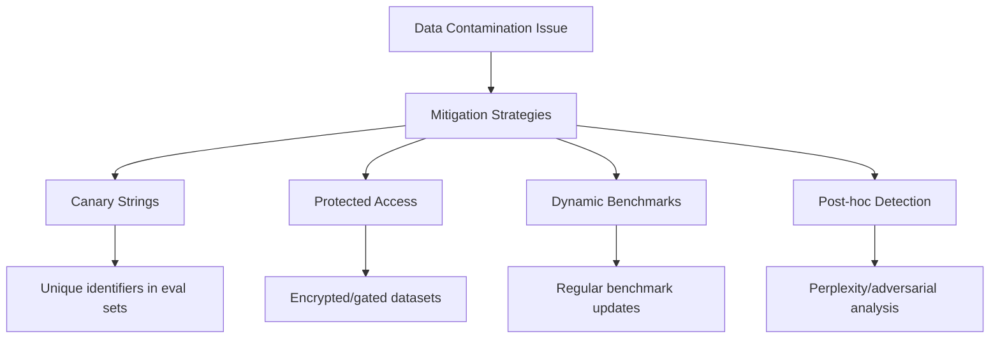
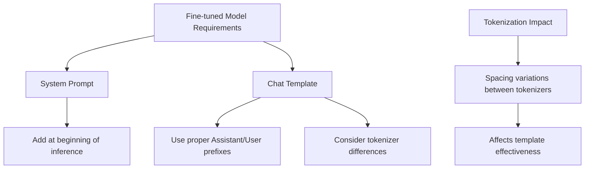
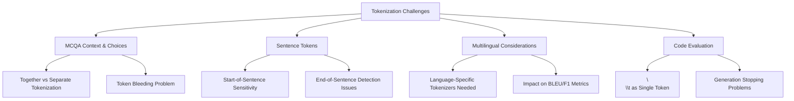
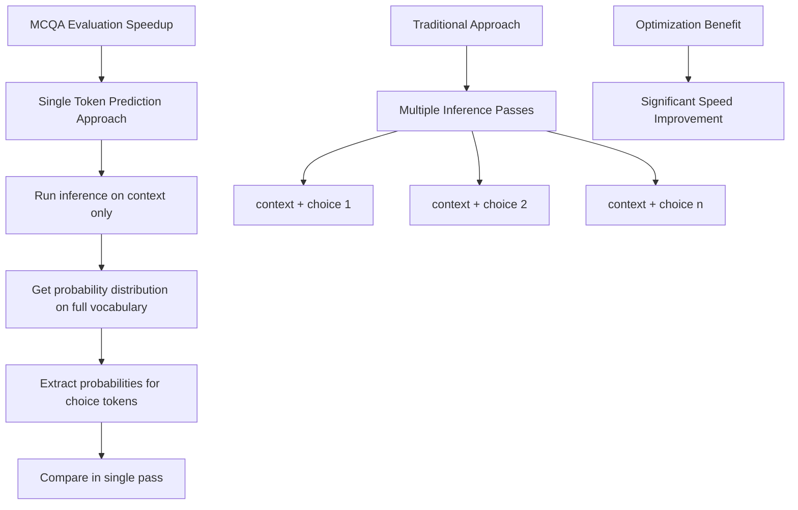
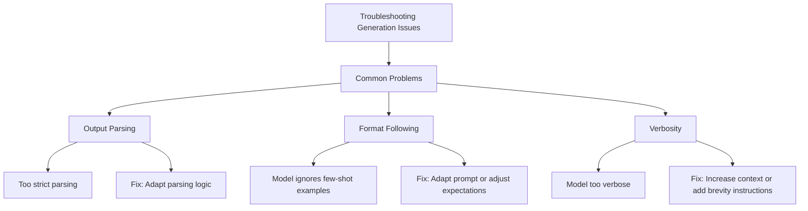
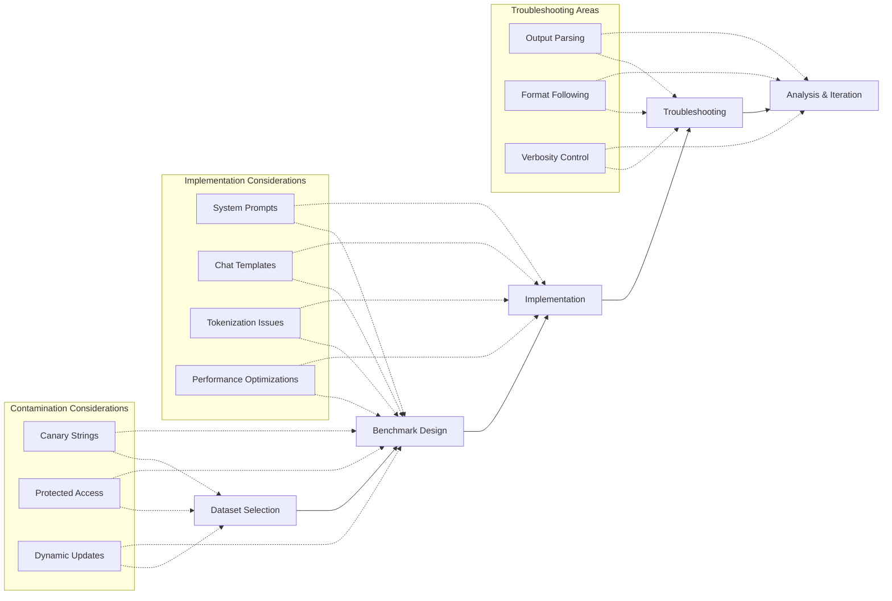

<!-- source: DeepWiki mcp.deepwiki.com · repo huggingface/evaluation-guidebook · extra page Tips and Tricks · fetched 2026-10-26 -->

# Tips and Tricks for Automated Benchmarks

Relevant source files

The following files were used as context for generating this wiki page:

- [contents/automated-benchmarks/tips-and-tricks.md](contents/automated-benchmarks/tips-and-tricks.md)

This page provides practical advice for implementing automated benchmarks for LLM evaluation, addressing common issues, optimizations, and techniques to improve the quality and efficiency of your evaluations. For information about designing automated evaluations, see [Designing Automated Evaluations](#2.1.1), and for details about specific evaluation datasets, see [Evaluation Datasets](#2.1.2).

## Managing Data Contamination

Data contamination occurs when evaluation data appears in the training data of the models being evaluated, leading to inflated performance metrics that don't reflect true capabilities. Here are strategies to mitigate this issue:

1. **Canary Strings**: Include specific character combinations in evaluation sets that model creators can search for in their training data to detect contamination (similar to BigBench).

2. **Protected Access**: Provide evaluation datasets in encrypted or gated forms to prevent web crawlers from accidentally including them in training data.

3. **Dynamic Benchmarks**: Regularly update evaluation datasets to prevent models from "learning the answers," though this increases dataset maintenance costs.

4. **Post-hoc Detection**: Attempt to detect contamination after evaluation through methods such as analyzing generation perplexity or designing adversarial prompts.

Note that even if a dataset is contaminated, it may still provide valuable signal during evaluation.

Sources: [contents/automated-benchmarks/tips-and-tricks.md:3-12]()

## Practical Implementation Challenges

### Working with Fine-tuned Models

When working with instruction-tuned models, performance can be severely impacted if you don't:

1. Include the model's system prompt at the beginning of inference
2. Use the appropriate chat template (typically including `Assistant` and `User` prefixes for dialogue turns)

Different tokenizers may behave differently with respect to chat templates, particularly regarding spacing, which can affect model performance.

Sources: [contents/automated-benchmarks/tips-and-tricks.md:16-23]()

### Tokenization Challenges

Tokenization issues represent some of the most complex and subtle challenges in automated benchmarking. Here are the key areas to consider:

#### Context and Choices Tokenization

In multiple-choice question answering (MCQA) evaluations:
- Ideally, tokenize context and choices together for natural token sequences
- Some tokenizers (like Llama) don't satisfy `enc(context + choice) = enc(context) + enc(choice)`
- If your model has this issue, tokenize context and choices separately, then concatenate after removing special tokens

#### Start and End of Sentence Tokens

- Some models (like Gemma) are sensitive to the inclusion of start-of-sentence tokens
- End-of-sentence detection can be problematic when models predict combined tokens (e.g., `\n\t` instead of just `\n`)
- You may need to implement "backtracking" to properly cut generated text at the right spot

#### Multilingual Evaluation

- Languages without space-delimited words (Korean, Thai, Japanese, Chinese) require language-specific tokenizers
- Improper tokenization affects metrics like BLEU scores and F1 scores

#### Code Evaluation

- Code models often treat sequences like `\n\t` as single tokens
- This can cause issues with generation stopping if `\n` is defined as an end token
- Solutions include updating end token definitions or implementing post-generation backtracking

Sources: [contents/automated-benchmarks/tips-and-tricks.md:25-47]()

### Optimization Techniques for MCQA Evaluations

For multiple-choice question answering (MCQA) evaluations, you can significantly improve performance by optimizing how you handle token predictions:

| Traditional Approach | Optimized Approach |
|----------------------|-------------------|
| Run separate inference for each choice (`context + choice 1`, `context + choice 2`, etc.) | Run inference once on context only |
| Multiple model passes required | Single model pass |
| Slower, especially with many choices | Much faster execution |

The key optimization is to design tasks where choices are represented by single tokens. This allows you to:
1. Run inference only once on the context
2. Compute the probability distribution across the full vocabulary
3. Extract logprobabilities for tokens representing choices
4. Compare in a single pass

This approach is implemented in the `lighteval` library.

Sources: [contents/automated-benchmarks/tips-and-tricks.md:49-54]()

## Troubleshooting Generative Evaluations

When facing unexpectedly poor results on generative evaluations, inspect model outputs for these common issues:

| Issue | Description | Solution |
|-------|-------------|----------|
| **Strict Output Parsing** | Answer is generated but lost during parsing before metrics computation | Adapt your parsing logic to be more flexible |
| **Format Following Failure** | Model unable to follow your output format in few-shot examples (common in recent instruction models like Llama 3.2 or Qwen 2.5) | Adapt prompt format or accept that models should be able to follow instructions |
| **Excessive Verbosity** | Model generates very verbose output and never reaches the correct answer (common in long context models like Qwen and CommandR) | Increase allowed context length, add instructions to be concise, or accept that models should answer succinctly |

Sources: [contents/automated-benchmarks/tips-and-tricks.md:56-64]()

## Integrated Benchmark Workflow

The tips and tricks in this document should be considered throughout your evaluation workflow. This diagram shows how these considerations fit into the larger benchmark process:

By anticipating these common challenges and applying the appropriate techniques, you can create more reliable, efficient, and informative automated benchmarks for evaluating LLM performance.

Sources: [contents/automated-benchmarks/tips-and-tricks.md]()

---

