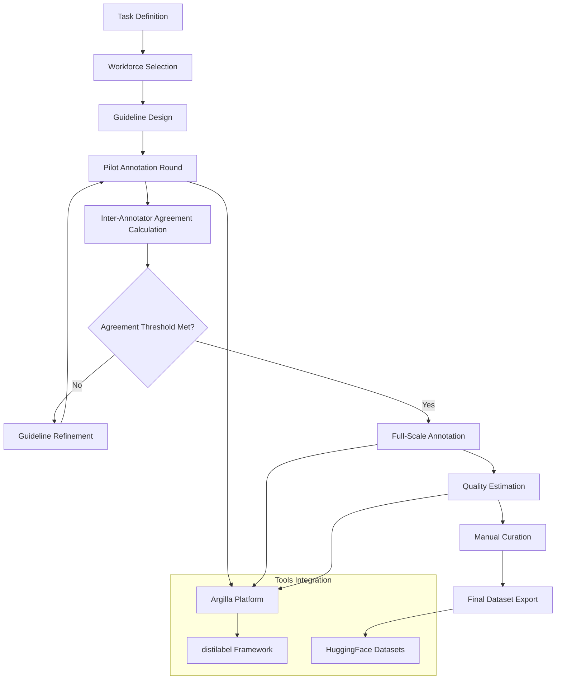
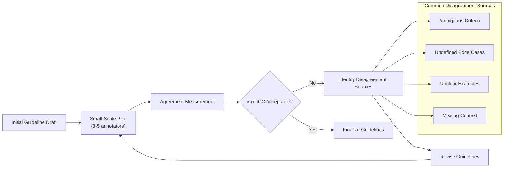
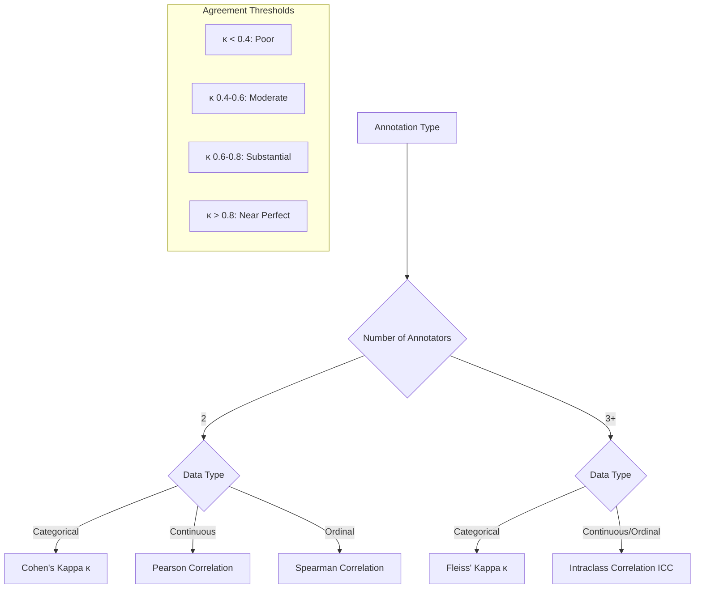
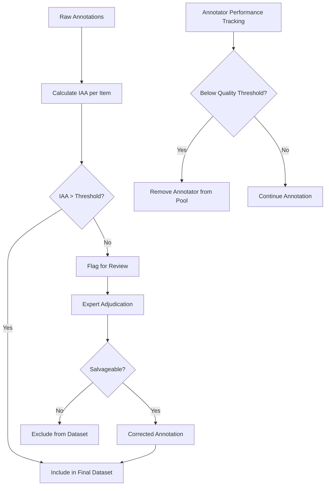
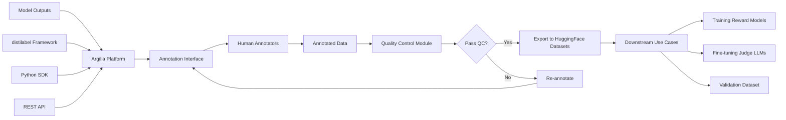
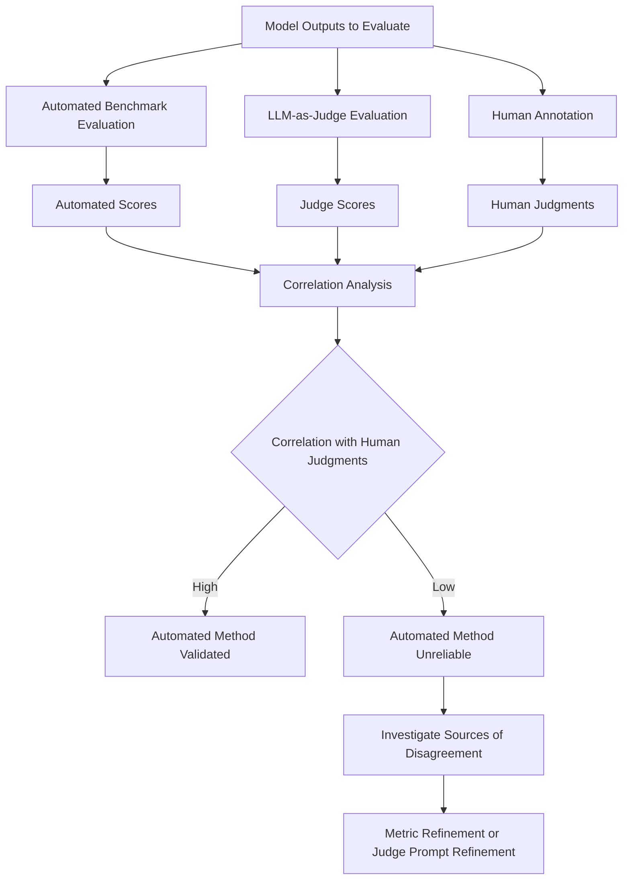

<!-- source: DeepWiki mcp.deepwiki.com · repo huggingface/evaluation-guidebook · extra page Using Human Annotators · fetched 2026-10-26 -->

# Using Human Annotators

Relevant source files

The following files were used as context for generating this wiki page:

- [contents/human-evaluation/using-human-annotators.md](contents/human-evaluation/using-human-annotators.md)

## Purpose and Scope

This document specifies the technical process for implementing human annotation in LLM evaluation. Human evaluation serves three roles in the evaluation ecosystem:

1. **Primary evaluation method** for tasks requiring nuanced judgment
2. **Validation mechanism** for automated benchmarks and LLM-as-judge methods
3. **Ground truth generation** for training reward models and judge LLMs

Human annotation is preferred when evaluation criteria involve subjective quality dimensions (coherence, helpfulness, factual accuracy) that automated metrics cannot reliably assess. The tradeoff is higher cost and lower throughput compared to automated methods (see section 2.1) and LLM-as-judge approaches (see section 2.3).

Sources: [contents/human-evaluation/using-human-annotators.md:1-7]()

## Human Annotation Workflow

**Diagram: Standard Human Annotation Pipeline**

The workflow consists of five phases: workforce selection, guideline design, iterative annotation, quality estimation, and manual curation. Iteration occurs between guideline refinement and pilot rounds until inter-annotator agreement metrics reach acceptable thresholds (typically κ > 0.6 for categorical tasks, ICC > 0.7 for ratings).

Sources: [contents/human-evaluation/using-human-annotators.md:7-27]()

## Workforce Selection

Annotator selection directly impacts annotation quality. Selection criteria must be specified based on task requirements.

### Demographic Requirements

| Requirement Type | Examples | When Required |
|-----------------|----------|---------------|
| Language | Native speakers, multilingual proficiency | Multilingual evaluation, cultural context assessment |
| Education | Higher education, specific degrees | Technical domain evaluation (medical, legal, scientific) |
| Domain Expertise | Subject matter experts | Specialized knowledge tasks (code review, mathematical reasoning) |
| Geographic Diversity | Multiple regions/countries | Cross-cultural evaluation, bias detection |

### Quality Assurance Mechanisms

**Qualification Testing**
- Pre-task assessments with known correct answers
- Minimum passing thresholds for inclusion
- Periodic re-qualification during long projects

**LLM-Generated Response Detection**
- Statistical analysis of response patterns
- Timing analysis (suspiciously fast submissions)
- Perplexity analysis of text responses
- Explicit prohibitions in annotator agreements

**Performance Monitoring**
- Real-time agreement tracking with gold standard samples
- Periodic manual review of annotator outputs
- Removal of consistently low-quality annotators

### Compensation Structure

Monetary incentive is required except for highly motivated volunteer annotators. Quality declines measurably when compensation is below market rates for the task complexity and required expertise level.

Sources: [contents/human-evaluation/using-human-annotators.md:9-16]()

## Guideline Design

Annotation guidelines define the annotation task unambiguously. Ambiguous guidelines are the primary cause of low inter-annotator agreement.

**Diagram: Guideline Development Iteration Cycle**

### Guideline Components

| Component | Purpose | Implementation |
|-----------|---------|----------------|
| Task Description | Define what annotators evaluate | Precise specification of input/output format |
| Scoring Criteria | Define evaluation dimensions | Rubric with explicit decision rules |
| Example Annotations | Demonstrate correct judgments | 10-20 examples covering common cases |
| Edge Case Handling | Resolve ambiguous scenarios | Explicit rules for boundary conditions |
| FAQ Section | Address common confusions | Updated iteratively from annotator questions |

The GAIA benchmark development process allocated substantial time to guideline refinement, conducting multiple pilot rounds before full annotation. This investment in guideline quality reduces downstream manual curation requirements.

Sources: [contents/human-evaluation/using-human-annotators.md:18-19]()

## Iterative Annotation Process

Guideline convergence requires multiple annotation rounds. Annotators misinterpret initial guidelines regardless of clarity.

### Iteration Protocol

| Round | Sample Size | Purpose | Exit Criteria |
|-------|-------------|---------|---------------|
| Pilot 1 | 50-100 items | Identify major guideline ambiguities | Complete feedback collection |
| Pilot 2 | 100-200 items | Validate guideline revisions | κ > 0.4 or ICC > 0.5 |
| Pilot 3 | 200-300 items | Confirm guideline stability | κ > 0.6 or ICC > 0.7 |
| Full Scale | All items | Production annotation | Maintain agreement thresholds |

### Annotator Independence

Annotators must work independently without consultation. Shared discussion artificially inflates agreement metrics without improving true reliability. For consensus-based annotation, implement a two-phase process:

1. **Independent phase**: Annotators work separately
2. **Resolution phase**: Disagreements resolved through discussion or expert arbitration

Sources: [contents/human-evaluation/using-human-annotators.md:21-22]()

## Quality Assurance

Quality assurance consists of agreement measurement and manual curation.

### Inter-Annotator Agreement Metrics

**Diagram: Agreement Metric Selection by Annotation Type**

| Metric | Use Case | Calculation | Acceptable Threshold |
|--------|----------|-------------|---------------------|
| Cohen's κ | 2 annotators, categorical | Adjusts for chance agreement | κ > 0.6 |
| Fleiss' κ | 3+ annotators, categorical | Generalizes Cohen's κ | κ > 0.6 |
| Krippendorff's α | Any annotators, any scale | Handles missing data | α > 0.67 |
| ICC | 3+ annotators, continuous | Variance-based reliability | ICC > 0.7 |

### Manual Curation Process

**Quality Filtering Pipeline**

Manual curation identifies:
- Items with low inter-annotator agreement
- Annotations from underperforming annotators
- Systematic annotation errors
- Edge cases requiring expert judgment

The final dataset includes only high-confidence annotations where annotators demonstrated reliable agreement or expert review resolved disagreements.

Sources: [contents/human-evaluation/using-human-annotators.md:24-25]()

## Annotation Tools and Infrastructure

**Diagram: Annotation Tool Ecosystem Integration**

### Argilla

Argilla is an open-source annotation platform with integration for the Hugging Face ecosystem. Core capabilities:

| Feature | Implementation | Use Case |
|---------|---------------|----------|
| Annotation UI | Web-based interface | Text classification, ranking, span annotation |
| Quality Control | Built-in IAA calculation | Real-time agreement monitoring |
| Workflow Management | Task distribution, progress tracking | Multi-annotator coordination |
| Data Integration | HuggingFace Datasets API | Direct export to datasets library |
| Programmatic Access | Python SDK, REST API | Automated pipeline integration |

Argilla integrates with `distilabel` for synthetic data generation and annotation workflows. Setup instructions: https://huggingface.co/learn/cookbook/enterprise_cookbook_argilla

### Alternative Platforms

| Platform | Strengths | Limitations |
|----------|-----------|-------------|
| Label Studio | Flexible data types, ML-assisted labeling | Requires self-hosting |
| Prodigy | Active learning integration | Commercial license |
| Amazon SageMaker Ground Truth | Scalable workforce management | AWS vendor lock-in |
| Scale AI | Managed workforce | Expensive, proprietary |

Sources: [contents/human-evaluation/using-human-annotators.md:27-29]()

## Human Evaluation as Validation Mechanism

Human annotation serves as ground truth for validating automated evaluation methods.

**Diagram: Human Evaluation in Multi-Method Validation**

### Validation Methodology

Human annotations validate automated methods through correlation analysis:

1. **Sample selection**: Select representative subset (typically 100-500 items) from evaluation dataset
2. **Multi-method evaluation**: Score same items using automated metrics, LLM judges, and human annotators
3. **Correlation calculation**: Compute Spearman's ρ or Pearson's r between automated scores and human judgments
4. **Threshold assessment**: Correlation ρ > 0.7 indicates acceptable automated method reliability

Low correlation indicates systematic disagreement requiring investigation:
- Automated metric misaligned with human quality perception
- LLM judge exhibits positional or verbosity bias
- Task requires subjective judgment that automation cannot capture

### Use Cases for Human Validation

| Automated Method | Validation Purpose | When Required |
|-----------------|-------------------|---------------|
| Exact match metrics | Verify adequacy for task | Initial benchmark design |
| LLM-as-judge | Detect biases, confirm reliability | Before large-scale use |
| Reward models | Ground truth for training | Model development |
| Novel metrics | Establish validity | Before adoption |

Human evaluation cost is amortized when validation findings enable reliable automated scoring at scale.

Sources: [contents/human-evaluation/using-human-annotators.md:1-33]()

## Best Practices Summary

| Phase | Requirements | Quality Indicators |
|-------|-------------|-------------------|
| Workforce Selection | Demographics match task, compensation adequate, qualification testing | <5% annotator removal rate |
| Guideline Design | Unambiguous criteria, comprehensive examples, edge case coverage | Converge to κ > 0.6 within 3 pilot rounds |
| Iterative Annotation | Multiple pilots, independent annotation, guideline refinement | Stable agreement across rounds |
| Quality Assurance | Inter-annotator agreement measurement, manual curation | Final dataset κ > 0.7 or ICC > 0.75 |
| Tool Integration | Argilla or equivalent platform, HuggingFace Datasets export | <10% manual export/conversion effort |

## Further Resources

For more detailed information on human annotation practices, the following resources are recommended:

- [Setting up an annotator platform with Argilla](https://huggingface.co/learn/cookbook/enterprise_cookbook_argilla) - Practical tutorial by Moritz Laurer
- [ACL Anthology: Annotation Good Practices](https://aclanthology.org/2024.cl-3.1/) - Comprehensive review of human annotation literature
- [ScaleAI's Data Labeling Guide](https://scale.com/guides/data-labeling-annotation-guide) - Lightweight guide to annotation practices
- [Addressing Annotator Disagreement](https://aclanthology.org/2024.naacl-long.126/) - Research on sources of annotator disagreement and mitigation strategies

For practical implementation tips beyond this overview, see [Tips and Tricks for Human Evaluation](#2.2.2).

Sources: [contents/human-evaluation/using-human-annotators.md:28-32]()

---

